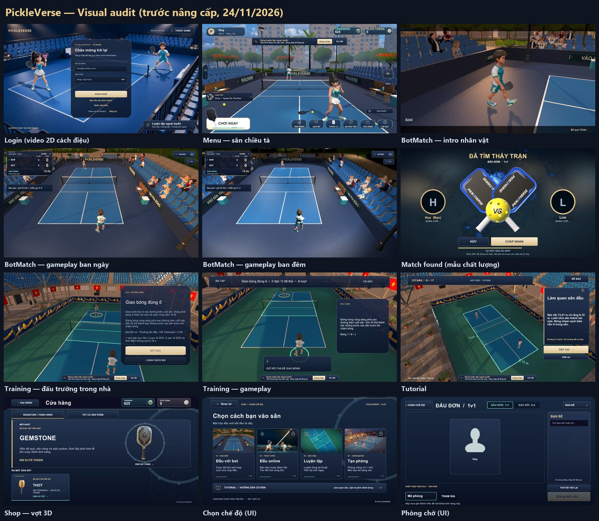

# 00 — Visual Audit (trước nâng cấp)

Ngày 24/11/2026, branch `claude/silly-turing-16c9c9` @ `851c325` (bằng `main`). Ảnh chụp Game view 1920×1080 trong
Unity 6000.6.2f1 (RTX 3050 Laptop), Play Mode, chế độ ngoại tuyến. Ảnh gốc: `BlenderWork/ArtAudit/before/`
(thư mục gitignored). Bảng tổng hợp:

## Kết luận chung

Game có những mảnh chất lượng tốt (video Login cách điệu, nhân vật có tạo hình rõ, màn match-found có shader và
vợt modeling riêng, khu Sunset District nhiều chi tiết) nhưng **không đứng chung một hệ hình ảnh**:

1. **Không có hậu kỳ ở bất kỳ camera nào.** Cả 15 scene đều có `renderPostProcessing = false`: không tonemapping
   (HDR bị cắt cứng ở 1.0), không color grading, không bloom, không anti-aliasing hậu kỳ. Ánh sáng mạnh (đèn sân 37,4)
   chỉ có thể "cháy" chứ không cuộn mềm. Đây là nguyên nhân lớn nhất khiến hình phẳng và "giống bản dựng thử".
2. **Bảy họ shader cho cùng loại bề mặt.** Kiểm kê vật liệu: URP Simple Lit 54, URP Lit 25, Sunset Surface 14,
   Arena Glass 13, Stage Lit 6 (CG built-in, không tương thích SRP Batcher), glTF PBR (shader graph nhập từ GLB),
   Natural/Sunset Foliage. Simple Lit (Blinn-Phong) và Lit (GGX) phản ứng với cùng một đèn khác nhau → nhân vật,
   khán giả, sân và đấu trường trông như đến từ ba trò chơi.
3. **Ban ngày tối và lạnh hơn ban đêm.** Lấy mẫu pixel: mặt sân ngày `#2F6089`, đêm `#3F80BC`; nền quanh sân ngày
   `#363E53` (navy lạnh). Giờ vàng được khai báo (nắng `(1,.74,.50)`) nhưng vùng chơi gần như không nhận sắc ấm.
4. **Academy Arena (Training/Tutorial/Replay) lạc tông.** Sàn quanh sân xanh lá `#2D5746` bão hòa, ánh sáng phẳng,
   không có bóng tiếp xúc; 167 đèn spot trên mái được bật nhưng cường độ 0; ~4,2 triệu tam giác/khung hình.
5. **Hình khối cứng ở đạo cụ.** Thùng giữ lạnh, hộp ghế, bảng quảng cáo là khối hộp cạnh sắc, pháp tuyến phẳng;
   không có bevel bắt sáng, nên dưới ánh thấp chúng thành mảng màu đặc.
6. **Thiếu tầng không khí.** Menu: nhà cao tầng phía sau rõ nét và tương phản ngang tiền cảnh; không có hạt bụi,
   lá rơi hay chuyển động môi trường nhẹ ngoài cây có gió.
7. **Showroom (Shop/Collection) và match-found đã đi đúng hướng** (key ấm + fill lạnh + rim), nhưng mỗi nơi tự
   viết luật ánh sáng riêng.

## Từng màn hình

| Màn hình | Hiện trạng | Vấn đề | Hướng xử lý |
|---|---|---|---|
| Login, Loading | Video 2D cách điệu (nhân vật kiểu hoạt hình 3D), UI Arena Glass | Tốt; là tham chiếu tạo hình nhân vật | Giữ; dùng làm chuẩn tỷ lệ/silhouette. |
| Menu | Sân Sunset District + nhân vật trình diễn | Không tonemap; nhà phía sau quá rõ; ánh sáng trưa trung tính (`1,.93,.82`) khác BotMatch | Look GoldenHour chung với BotMatch; atmospheric perspective; rim cho nhân vật. |
| BotMatch / Multiplayer | Sunset District, 146 khán giả skinned, 2,48 triệu tam giác/khung hình | Sân tối/lạnh; khán giả Simple Lit phẳng; đạo cụ khối hộp | Bộ vật liệu Court; uber shader cho khán giả; đạo cụ bevel; tối ưu khán giả. |
| BotMatch intro | Camera cinematic theo nhân vật | Đẹp nhất trong game nhưng nền không mờ, không tách lớp | DoF chọn lọc chỉ trong cinematic. |
| Ban đêm | Đèn sân trắng 37,4 | Phẳng, sân sáng hơn ban ngày, không có tách lớp | Đèn 4800K, ambient lạnh, bloom nhẹ ở đèn. |
| Training / Tutorial / Replay | Academy Arena trong nhà | Lạc tông (sàn xanh lá, sáng phẳng), 4,2 triệu tam giác, 167 đèn rỗng | Look Arena; vật liệu chuẩn; tắt đèn rỗng; tối ưu ghế. |
| Shop / Collection | Vợt 3D, 3 đèn studio | Ổn; shader vợt riêng (Gemstone) | Look Showroom, bloom nhẹ cho đá quý. |
| Match found | Shader Stage Lit/Energy/Trail/UI Waves | Mẫu chất lượng; shader CG built-in | Giữ ngôn ngữ, chuyển sang luật ánh sáng chung. |
| Màn UI (ModeSelection, PlayMultiplayer, Settings) | Arena Glass | Nhất quán | Không áp hậu kỳ lên UI. |

## Số đo hiệu năng trước nâng cấp (Editor, Game view 1920×1080, mức đồ họa PC)

Đo bằng probe ghi 600 khung hình liên tiếp trong Play Mode (bỏ 10 khung đầu). Đây là số Editor (có chi phí Editor);
số đo trên bản build `.exe` ở [06](06-Rendering-Performance.md).

| Cảnh | FPS trung bình | Frame avg / p95 | GPU avg | Tam giác/khung |
|---|---:|---:|---:|---:|
| Menu (ngày) | 80,5 | 12,42 / 14,38 ms | 11,67 ms | 0,70 triệu |
| BotMatch gameplay (ngày) | 53,4 | 18,72 / 24,92 ms | 15,88 ms | 2,48 triệu |
| Training drill | 78,2 | 12,79 / 27,43 ms | 12,62 ms | 4,22 triệu |

GPU ≈ frame time ở cả ba cảnh → **GPU-bound**; Training có p95 gấp đôi trung bình (giật theo đợt).
