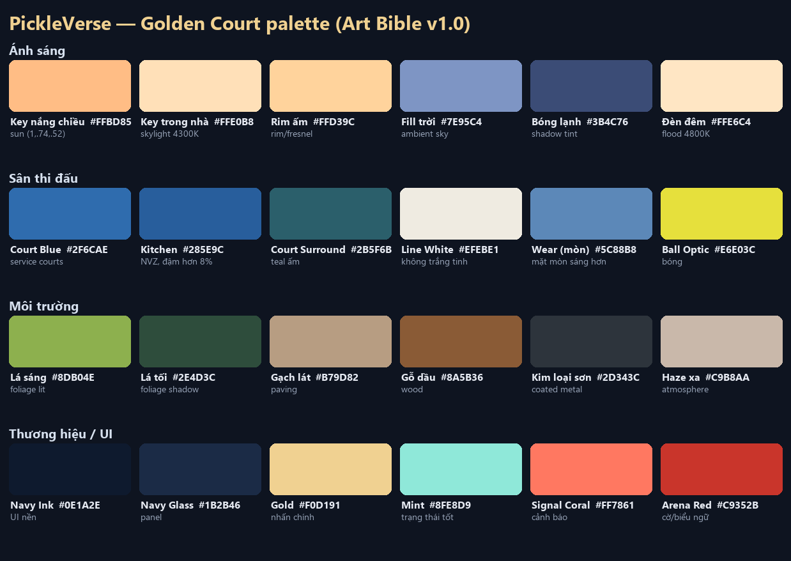

# 03 — Lighting & Color

> Warm key · cool ambient shadows · soft contact shadows · controlled highlights · Warm Highlights + Cool Shadows

## Cấu trúc ánh sáng của mọi khung hình

| Lớp | Vai trò | Quy tắc |
|---|---|---|
| **Key** (Directional) | Nắng/skylight ấm vàng cam, tạo hướng và bóng | Luôn ấm (R ≥ G > B); vùng chơi nhận key rõ nhất |
| **Fill / ambient** | Trời xanh (trilight) + tint bóng lạnh của Look | Vùng tối vẫn giữ chi tiết; không đen tuyệt đối |
| **Rim** | Fresnel ấm trong shader (không phải đèn thật) | Mềm, mạnh ở cạnh hướng về key; nhân vật 0,32, vật 0,05–0,22 |
| **Tiếp xúc** | SSAO sau opaque (preset Cao) + gradient chân vật | Bóng tiếp xúc mềm, không viền bẩn |
| **Practical** | Đèn pha sân, đèn đường, cửa sổ (ban đêm) | 4800 K trắng ấm; bloom nhẹ ở nguồn sáng |

## Thông số đèn theo bối cảnh

| Bối cảnh | Key (Euler / màu / cường độ) | Ambient trilight (trời / chân trời / đất) | Sương / haze |
|---|---|---|---|
| Sunset District — ngày (BotMatch, Multiplayer, Training) | (21°, 62°) · (1, .76, .54) · 2,25 · shadow .82 | (.40,.47,.62) / (.58,.47,.40) / (.22,.19,.16) | ấm (.80,.62,.50), 55–330 m |
| Menu — chiều muộn → hoàng hôn | 42° → 18°, yaw −35° · (1,.86,.68) → (1,.68,.43) · 1,95 | (.44,.54,.72) / (.52,.48,.45) / (.22,.20,.18) | xám ấm (.62,.62,.66), 38–140 m |
| Academy Arena (Tutorial, Replay) | skylight (62°, 35°) · (1,.86,.70) · 2,0 · shadow .7 | (.42,.50,.66) / (.55,.47,.40) / (.26,.21,.17) | như ngày |
| Ban đêm (mọi sân) | đèn pha (1,.91,.80) | (.07,.078,.09) / (.05,.057,.065) / (.035,.04,.045) | xanh đêm (.025,.04,.07), 38–210 m |

Hướng nắng chiều ở Sunset District không được đổi: mặt nạ bóng tĩnh (`SD_SunMask_*`) được nướng theo đúng (21°, 62°).
Mái màng của đấu trường là vải mờ nên không đổ bóng cứng (ánh trời đi qua).

## Look (Volume) — `Assets/Settings/ArtDirection/Look_*.asset`

Sinh bằng `PickleVerse/Art Direction/Rebuild looks` (`ArtDirectionLookBuilder`), áp bởi `ArtDirectionRuntime` theo bảng
`Resources/ArtDirection/ArtDirectionLooks.asset`. Tonemapping **Neutral** ở mọi Look (giữ màu thương hiệu, cuộn highlight mềm).

| Look | Exposure | Contrast | Saturation | White balance (temp/tint) | Lift / Gain | Bloom (ngưỡng/cường độ) | Vignette |
|---|---:|---:|---:|---|---|---|---:|
| GoldenHour | +0,22 | 12 | +6 | +7 / +2 | lift lạnh (.97,.99,1.04) · gain ấm (1.04,1,.95) | 1,05 / 0,28 | 0,20 |
| Night (trộn theo trọng số đêm) | +0,20 | 14 | −4 | −5 / 0 | (.95,.98,1.07) · (1.02,1,.97) | 0,95 / 0,45 | 0,26 |
| Arena | +0,14 | 14 | −4 | +8 / +1 | (.96,.985,1.05) · (1.05,1,.94) | 1,05 / 0,25 | 0,22 |
| Showroom | 0 | 10 | +4 | +3 / 0 | (.97,.99,1.04) · (1.03,1,.97) | 0,95 / 0,35 | 0,28 |
| Cinematic (chỉ intro / chiến thắng) | — | — | — | — | — | — | 0,30 + DoF Gaussian 8 → 30 m |
| QualityLow (preset Thấp, mobile) | — | — | — | — | — | tắt | tắt, DoF tắt |

**Không được biến game thành bộ lọc ảnh:** bloom ≤ 0,5, vignette ≤ 0,3, không film grain/chromatic aberration/lens dirt,
DoF chỉ trong cinematic (kiểm tra bằng test `LooksUseNeutralTonemappingAndRestrainedEffects`).

Tint bóng lạnh (`_PV_ShadowTint`, rgb + cường độ): Sunset (.66,.76,1) × 0,38 · Arena (.68,.78,1) × 0,32 · Showroom (.70,.80,1) × 0,25.

## Phân lớp chiều sâu (foreground / midground / background)

- **Foreground** (nhân vật, ghế cạnh sân): tương phản và bão hòa đầy đủ, rim ấm.
- **Midground** (sân, khán đài gần): vùng chơi là mặt phẳng sáng nhất; khán đài lùi một nấc giá trị.
- **Background** (nhà cao tầng, hàng cây xa): sương ấm tuyến tính làm giảm tương phản & bão hòa (atmospheric perspective);
  ban đêm thành phố xa chỉ còn cửa sổ sáng.

## Chất lượng theo preset người chơi (`GameSettings.graphics`)

| Preset | Hậu kỳ | SSAO | Cinematic DoF | Khí quyển | AA khi MSAA tắt |
|---|---|---|---|---|---|
| Thấp / mobile | tonemap + grading (LUT) | tắt | tắt | tắt | không |
| Trung bình | + bloom, vignette | tắt | có | có | FXAA |
| Cao | + SSAO | after-opaque, nửa độ phân giải, cường độ 0,55, bán kính 0,3 m | có | có | SMAA |

Các màn UI thuần (Login, Loading, ModeSelection, PlayMultiplayer, Settings) không có Look → camera giữ nguyên, canvas không bị tonemap.
Camera render vào texture (vợt xoay ở Shop/Collection, sân khấu match-found) cũng giữ nguyên ánh sáng studio riêng
đã duyệt: Look chỉ áp lên camera 3D vẽ ra màn hình.

## Bảng màu

