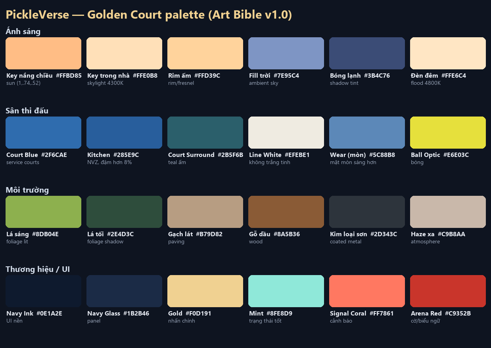

# PickleVerse Art Bible — "Golden Court" (v1.0, 24/11/2026)

Tài liệu chuẩn hình ảnh cho **mọi** tài sản 3D, ánh sáng, hậu kỳ và chuyển động của PickleVerse.
Mục tiêu của người dùng: hình khối mềm mại, vật liệu có chiều sâu, ánh sáng ấm–lạnh hài hòa, môi trường giàu
chi tiết, chuyển động mượt, FPS ổn định. Phong cách: **Stylized Realism**.

> Quy tắc số 1: mọi tài sản 3D đi qua cùng một Art Direction. Một tài sản mới chưa được dùng trong game nếu
> chưa qua checklist ở cuối mỗi mục.

## Tuyên bố phong cách

PickleVerse là một **sân pickleball đẹp nhất thành phố lúc 5 giờ chiều**. Hình khối đơn giản và mềm như đồ chơi
cao cấp; bề mặt có chất liệu thật (acrylic sần, gỗ dầu, thép sơn tĩnh điện, vải lưới) nhưng được "biên tập": ít nhiễu,
độ nhám có kiểm soát, cạnh bắt sáng. Ánh sáng là ngôn ngữ chính: nắng vàng cam làm key, trời xanh làm fill,
bóng đổ lạnh nhưng còn chi tiết. Sân thi đấu luôn là vùng rõ nhất, tương phản cao nhất; mọi thứ khác lùi về sau
bằng giảm tương phản, giảm bão hòa và haze.

| Thành phần | Định hướng | Mục |
|---|---|---|
| Geometry | Organic, Smooth, Beveled | [01 Shape Language](01-Shape-Language.md) |
| Silhouette | Mềm mại, tự nhiên, dễ nhận diện | [01 Shape Language](01-Shape-Language.md) |
| Materials | Stylized PBR | [02 Material Language](02-Material-Language.md) |
| Lighting | Cinematic, Soft Lighting | [03 Lighting & Color](03-Lighting-Color.md) |
| Color | Warm Highlights + Cool Shadows | [03 Lighting & Color](03-Lighting-Color.md) |
| Environment | Layered, Rich, Atmospheric | [04 Environment Language](04-Environment-Language.md) |
| Animation | Fluid, Responsive, Natural | [05 Motion Language](05-Motion-Language.md) |
| Rendering | High Quality, Performance Optimized | [06 Rendering & Performance](06-Rendering-Performance.md) |

Phân tích hiện trạng (ảnh từng màn hình, số đo trước nâng cấp): [00 Visual Audit](00-Visual-Audit.md).

## Ba "phim trường" của game

Mọi scene thuộc một trong ba bối cảnh; mỗi bối cảnh có một Look (Volume profile) riêng nhưng dùng chung
shader, bộ vật liệu, bảng màu và luật ánh sáng.

| Bối cảnh | Scene | Look | Ý đồ |
|---|---|---|---|
| **Sunset District** (ngoài trời) | Menu, BotMatch, MultiplayerCourt | `Look_GoldenHour` / `Look_Night` | Giờ vàng: nắng thấp 21°, bóng dài, haze ấm; đêm: đèn sân trắng ấm, thành phố xa phát sáng. |
| **Academy Arena** (trong nhà) | Training, Tutorial, Replay | `Look_Arena` | Đấu trường gỗ–thép: ánh trời ấm rọi qua mái, khán đài lùi vào bóng xanh lạnh, sân sáng như sân khấu. |
| **Showroom** (studio) | Shop, Collection, Match found | `Look_Showroom` | Ba điểm sáng studio (key ấm, fill lạnh, rim), nền navy thương hiệu, vật thể như đồ trang sức. |

Các màn UI thuần (Login, Loading, ModeSelection, PlayMultiplayer, Settings) giữ hệ UI Arena Glass (navy + gold + mint)
và **không** áp hậu kỳ lên canvas để chữ và màu thương hiệu không bị tonemap.

## Nơi đặt mọi thứ trong project

| Loại | Đường dẫn |
|---|---|
| Uber shader | `Assets/Shaders/ArtDirection/StylizedLit.shader` (+ `PVStylizedLighting.hlsl`, `PVCommon.hlsl`) |
| Bộ vật liệu chuẩn | `Assets/Materials/ArtDirection/<Bộ>/` |
| Texture chuẩn | `Assets/Textures/ArtDirection/<Bộ>/T_<Bộ>_{BaseColor,Normal,Mask,Emission}.png` |
| Look / Volume | `Assets/Settings/ArtDirection/Look_*.asset` |
| Bản đồ scene → Look | `Assets/Resources/ArtDirection/ArtDirectionLooks.asset` |
| Runtime | `Assets/Scripts/ArtDirection/` (asmdef `PickleVerse.ArtDirection`, chỉ trình bày) |
| Nguồn Blender | `ArtSource/ArtDirection/` (script tái tạo được, xuất FBX) |
| Công cụ Editor | Menu `PickleVerse/Art Direction/…` |

## Quy trình cho tài sản mới

1. Phác silhouette ở khoảng cách camera gameplay (5–15 m) → đạt chuẩn [01](01-Shape-Language.md).
2. Model trong Blender bằng script trong `ArtSource/`, bevel + weighted normal, xuất FBX (trục Unity = (−x, z, −y)).
3. Gán một vật liệu từ **5 bộ chuẩn** (hoặc biến thể của chúng). Không tạo shader mới khi uber shader đã có tính năng.
4. Kiểm tra trong cả ba Look (ngày / đêm / arena) bằng menu `PickleVerse/Art Direction/Preview looks`.
5. Đo: tam giác LOD0/LOD1, số vật liệu, shadow caster — theo ngân sách ở [06](06-Rendering-Performance.md).

## Lịch sử phiên bản

| Phiên bản | Ngày | Nội dung |
|---|---|---|
| 1.0 | 24/11/2026 | Visual audit, chốt Golden Court, 5 mục ngôn ngữ, ngân sách hiệu năng. |
