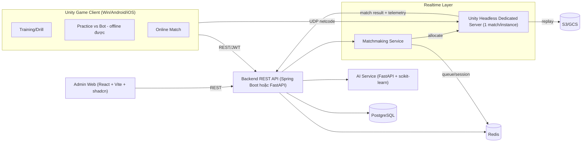
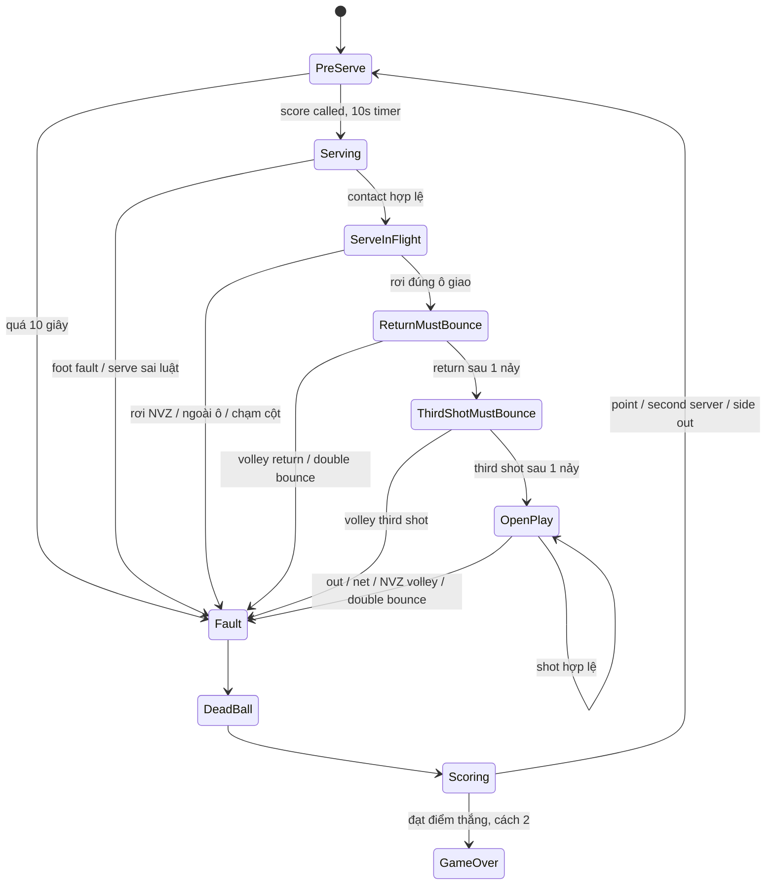

# PickleVerse (PKV) – Phân tích chuyên sâu tài liệu Doc

> Nguồn đã đọc (chỉ đọc, không chỉnh sửa):
> - [PickleVerse_Capstone_Proposal.md](./PickleVerse_Capstone_Proposal.md)
> - [PickleVerse_Capstone_Proposal.docx](./PickleVerse_Capstone_Proposal.docx) – nội dung trùng bản .md, có thêm phần header đăng ký
> - [Luat_thi_dau_Pickleball.md](./Luat_thi_dau_Pickleball.md) – bản dịch Luật USA Pickleball (13 phần + phụ lục)

---

## 1. Bức tranh tổng thể

| Mục | Nội dung |
|---|---|
| Loại đồ án | Capstone ngành Software Engineering (FPT – `fe.edu.vn`) |
| GVHD | Mr. Lại Đức Hùng (hungld5@fe.edu.vn) |
| Nhóm | 4 sinh viên (1 Leader + 3 Member) – thông tin SV còn trống |
| Thời lượng | 14 tuần, 7 work package |
| Sản phẩm lõi | Game 3D Pickleball Unity: Training + AI practice + Online 1v1/2v2 |
| Điểm "ăn điểm" SE | Netcode authoritative + multi-tier (Backend, AI service, Admin web) |

**Tóm lại một câu:** một "Duolingo + Wii Sports" cho Pickleball — học kỹ thuật qua drill có chấm sao, rồi áp dụng vào trận online có matchmaking theo Elo, được AI "huấn luyện viên" phân tích telemetry để chỉ lỗi.

---

## 2. Phân rã hệ thống (5 subsystem)

| # | Subsystem | Trách nhiệm chính | Package |
|---|---|---|---|
| 1 | Unity Game Client | Gameplay, drill, UI, input, client prediction | P1–P5 |
| 2 | Dedicated Game Server | Authoritative rules + physics, validate input | P3, P5 |
| 3 | Backend API | Auth JWT, profile, progression, content, leaderboard | P1, P3 |
| 4 | AI Service | Elo/matchmaking, skill classifier, technique-error classifier, drill recommendation | P4, P5 |
| 5 | Admin Web | User/content/match/analytics/moderation | P6 |

---

## 3. Mổ xẻ Functional Requirements

### 3.1 Player Client – 10 nhóm chức năng

| FR | Chức năng | Ghi chú chuyên môn |
|---|---|---|
| FR-01 | Register/Login + Profile + Self-assessment | Self-assessment là input cho cold-start classifier |
| FR-02 | Tutorial luật + điều khiển | Nên dạy dần: serve → 2-bounce → kitchen |
| FR-03 | Training theo kỹ thuật | Serve, Dink, Volley, Third-shot drop, Positioning |
| FR-04 | 1–3 sao, XP, level, unlock | Cần data-driven (ScriptableObject + content từ API) |
| FR-05 | Practice vs AI | Chạy local, dùng chung Rules Engine |
| FR-06 | Online 1v1 / 2v2, room code, quick-match | Phần khó nhất của đồ án |
| FR-07 | Feedback kỹ thuật sau drill/trận | NFR: ≤ 1 giây |
| FR-08 | Progress dashboard | Trend accuracy, thời gian luyện, mastery, badge |
| FR-09 | Friends, match history, leaderboard | Redis sorted set cho leaderboard |
| FR-10 | Daily challenge + streak | Cần server time để chống chỉnh giờ máy |

### 3.2 AI Features – 4 module

| Module | Kỹ thuật đề xuất | Input | Output |
|---|---|---|---|
| Adaptive Bot | Behavior Tree | Rating người chơi | Shot selection, aggressiveness, error rate |
| Skill Rating & MM | Elo + classifier khởi điểm | Kết quả trận, onboarding | Rating, tier, cặp đấu |
| Technique Feedback | Rule-based + classifier nhẹ | Telemetry từng cú đánh | Nhãn lỗi + tip |
| Drill Recommendation | Mapping lỗi → drill | Thống kê lỗi | Danh sách drill gợi ý |

### 3.3 Admin Web – 6 nhóm
RBAC (player/admin) · User mgmt · Content mgmt (lesson, drill, difficulty, reference data) · Match monitoring · Analytics (retention, error heatmap, MM health) · Moderation (report/appeal).

---

## 4. Mổ xẻ Non-functional Requirements (đánh giá tính khả thi)

| NFR | Mục tiêu | Đánh giá của tôi |
|---|---|---|
| Latency | RTT < 100 ms, prediction + reconciliation | Khả thi nếu host server ở SG/VN; cần thiết kế ball theo "hit event" (xem §6.3) |
| FPS | 60 FPS mid-range | Khả thi với URP, sân đơn, ít nhân vật |
| AI feedback | ≤ 1 s | Khả thi, rule-based gần như tức thì |
| Scalability | 2.000 CCU, 500 match | ⚠️ Rất nặng: 500 process Unity headless ≈ 50–100 GB RAM. Cần chứng minh bằng load test + giải thích |
| Availability | 99.5% | Khó chứng minh trong 14 tuần, chỉ nên nêu là target |
| Compatibility | Win10+, Android 9+, iOS 14+ | ⚠️ iOS cần máy Mac + Apple Dev account |
| Security | JWT, AES-256 at rest, server-authoritative | AES-256 at rest = bật encryption của cloud DB/disk |
| Offline | Drill offline, sync khi online | ⚠️ Xung đột anti-cheat: kết quả offline có thể bị sửa → không cho ảnh hưởng ranked/leaderboard |

---

## 5. Luật Pickleball → Đặc tả Rules Engine cho game

Đây là phần quan trọng nhất của file luật: chuyển văn bản luật thành **thông số + state machine** cho code.

### 5.1 Thông số sân & thiết bị (Phần 2) – dùng 1 unit = 1 m

| Thông số | Imperial | Metric (Unity) | Điều luật |
|---|---|---|---|
| Sân (đơn & đôi giống nhau) | 20 × 44 ft | 6.096 × 13.411 m | 2.A.1 |
| Độ rộng vạch | 2 in | 0.0508 m | 2.A.2 |
| Mặt sân tối thiểu | 30 × 60 ft | 9.14 × 18.29 m | 2.A.3 |
| Mặt sân khuyến nghị (giải) | 34 × 64 ft | 10.36 × 19.5 m | 2.A.3 |
| NVZ (Kitchen) | 7 ft từ lưới | 2.134 m | 2.B.3 |
| Cột lưới cách nhau | 22 ft | 6.706 m | 2.C.2 |
| Lưới cao tại biên | 36 in | 0.914 m | 2.C.5 |
| Lưới cao tại giữa | 34 in | 0.864 m | 2.C.5 |
| Bóng | 26–40 lỗ tròn | — | 2.D.1 |
| Vợt | Dài + rộng ≤ 24 in, dài ≤ 17 in | ≤ 0.61 m, ≤ 0.43 m | 2.E.3 |

> [!NOTE]
> File luật **không có** khối lượng/đường kính/độ nảy của bóng. Theo chuẩn thiết bị USA Pickleball (cần đối chiếu bản chính thức): đường kính ~7.3–7.5 cm, khối lượng ~22–26.5 g, thả từ 78 in nảy 30–34 in. Đây là thông số bắt buộc để tune vật lý.

**Lưu ý quan trọng:**
- Vạch là một phần của vùng mà nó bao quanh (vạch NVZ thuộc NVZ; vạch biên → bóng "in").
- Lưới **võng ở giữa** (36 → 34 in) → collider lưới nên là mesh cong/2 đoạn, không phải box phẳng.

### 5.2 Các luật cốt lõi phải code (MVP)

| Nhóm | Luật | Điều | Cách kiểm tra trong game |
|---|---|---|---|
| Giao bóng | Giao chéo sân, phải qua NVZ + vạch NVZ | 4.A.2, 4.M.3 | Điểm chạm đầu tiên ∈ ô giao bóng đối diện |
| Giao bóng | Chạm lưới vẫn hợp lệ (không còn "let") | 4.A.2 | Không replay khi net-cord |
| Giao bóng | Volley serve: cung đi lên, đầu vợt ≤ cổ tay, chạm bóng ≤ eo | 4.A.7 | Kiểm tra contact height + swing type |
| Giao bóng | Drop serve: thả tự nhiên, không đẩy | 4.A.8 | Chế độ serve thứ 2 |
| Giao bóng | Foot fault: ≥1 chân sau baseline, trong vùng kéo dài | 4.A.4, 4.L | Kiểm tra vị trí chân lúc contact |
| Giao bóng | Luật 10 giây | 4.E | Timer server, quá hạn = fault |
| Vị trí | Điểm chẵn → ô phải, lẻ → ô trái | 4.B.5, 4.B.6 | Auto-position người chơi |
| Rally | **Two-Bounce Rule** | Phần 1, 7.A | State: Return & Third shot bắt buộc bounce |
| Rally | Double bounce = thua điểm | 7.E | Đếm số lần nảy mỗi bên |
| Rally | Bóng ra ngoài / chạm sân mình / không qua lưới | 7.B, 7.D | Điểm chạm vs vùng sân |
| Rally | Bóng chui giữa lưới và cột = lỗi | 7.C, 11.L.2 | Trigger volume |
| Rally | Bóng chạm cột lưới = lỗi người đánh | 11.K | Collider tag |
| Rally | Đánh vòng cột (ATP) hợp lệ | 11.M | Không bắt buộc qua trên lưới |
| Rally | Đánh trước khi bóng qua mặt phẳng lưới = lỗi | 7.K, 11.I | So sánh vị trí contact với plane |
| Rally | Người/vợt chạm lưới khi bóng sống = lỗi | 7.G | Collider người chơi vs lưới |
| Rally | Bóng chạm người (trừ tay cầm vợt dưới cổ tay) = lỗi | 7.H | Hitbox body vs paddle |
| NVZ | Volley khi chạm NVZ = lỗi | 9.A, 9.B | Foot vs NVZ tại contact |
| NVZ | **Momentum** sau volley chạm NVZ vẫn lỗi (kể cả bóng đã chết) | 9.B.1, 9.C, 9.C.1 | Theo dõi "volley action" tới khi dừng đà |
| NVZ | Đã vào NVZ phải ra cả 2 chân mới được volley | 9.D | Flag `mustExitKitchen` |
| NVZ | Được đứng trong NVZ đánh bóng đã nảy | 9.F, 9.G | Hợp lệ |
| Điểm | Side-out scoring: chỉ bên giao ghi điểm | 4.F | ScoringStrategy |
| Điểm | Rally scoring (tùy chọn), điểm kết thúc chỉ khi giao | 4.F.1, 12.B.1.c | ScoringStrategy thứ 2 |
| Điểm | Thắng 11, cách 2 (hoặc 15/21) | Phần 1, 12.B | Config |
| Điểm | Đôi: gọi "đội giao – đội nhận – server #", mở màn 0-0-2 | 4.J | ScoreCaller |
| Đổi sân | Game 11 đổi ở 6; 15 ở 8; 21 ở 11 | 5.B.3 | Event SwitchSides |

### 5.3 Luật nên **bỏ qua / đơn giản hóa** trong game
- Gọi bóng in/out, đạo đức gọi bóng, khiếu nại line call (6.C, 13.D–13.F): **server là trọng tài tuyệt đối**, không có tranh chấp.
- Hinder, bóng vỡ, vật rơi trên sân, chấn thương, thiết bị điện tử (11.E–11.H, 11.P).
- Xe lăn, trang phục, phê duyệt vợt (2.F, 2.G).
- Thể thức giải đấu (12.C–12.K) → roadmap "tournament".

### 5.4 Luật "tái sử dụng" sáng tạo cho hệ thống online

| Luật gốc | Ánh xạ sang tính năng game |
|---|---|
| 12.H.1 Retirement (đối thủ được cộng đủ điểm thắng cách 2) | Chính sách **disconnect/rage-quit** |
| 12.H.1 Forfeit 11-0 | Không vào trận / AFK từ đầu |
| 13.H.4 Không ra sân sau 10 phút | Timeout reconnect (rút ngắn còn ~60–90 s) |
| 13.G Verbal Warning → Technical Warning → Technical Foul (−1 điểm) | Hệ thống **phạt toxic chat/emote spam** trong trận |
| 13.I Match forfeit khi tích lũy vi phạm | Auto-forfeit + gửi report sang Admin Moderation |
| 10.A Timeout 2 lần/game, 1 phút | Tính năng "pause" trong trận private room |
| 12.C.4 Tie-break vòng tròn | Dùng lại khi làm club/tournament post-capstone |
| 12.O Mini-singles | Drill/mode luyện di chuyển như đánh đôi |

### 5.5 Rally State Machine (đề xuất)

### 5.6 Lỗi trong bản dịch luật cần lưu ý
- 2.B.7 ghi "Left/Even Court" → đúng phải là **Left/Odd Court**.
- 4.B.6 dịch khá rối về "Starting Server = Second Server"; ý đúng: đầu game, đội giao trước chỉ có **1 lượt giao** nên gọi là server #2 (0-0-2).
- Nhiều chỗ lỗi chính tả ("vùng cấn", "Bive Ball"...).
- Bản dịch dựa trên rulebook cũ hơn → khi gặp edge case nên đối chiếu **bản tiếng Anh mới nhất** của USA Pickleball.

---

## 6. Góc nhìn Unity – các quyết định kỹ thuật then chốt

### 6.1 Kiến trúc code: tách Rules Engine thuần C#
- `PickleVerse.Rules` (asmdef, **noEngineReferences**): court geometry, rally state machine, scoring strategy, fault detection.
- Lợi ích: unit test bằng EditMode/NUnit, **dùng chung** cho client (offline/bot), dedicated server, và có thể port sang backend để validate.

### 6.2 Vật lý bóng: không nên phụ thuộc PhysX Rigidbody
- PhysX không deterministic giữa các nền tảng → khó prediction.
- Đề xuất: **tự viết integrator** (gravity + drag + Magnus nhẹ) chạy fixed tick, bounce dùng hệ số restitution/friction tự tune.
- Có trajectory giải tích → dự đoán điểm rơi cho **AI bot**, **shot assist**, **ghost trajectory** trong drill, và **telemetry**.

### 6.3 Netcode: mô hình "Hit-Event Ball"
- Pickleball chậm hơn shooter: bóng bay 0.5–1.5 s/cú.
- Người chơi: owner-predicted movement + server reconciliation.
- Bóng: server xác nhận cú đánh → broadcast `HitEvent{tick, pos, vel, spin, shotType}` → client tự mô phỏng quỹ đạo deterministic → gần như không cần sync bóng liên tục.
- Lag compensation: server rewind vị trí paddle theo tick khi validate cú đánh.

> [!WARNING]
> **Unity Netcode for GameObjects không có client prediction/reconciliation built-in.** Proposal ghi NGO + prediction → nhóm phải tự viết. Photon Fusion 2 có sẵn tick-based prediction nhưng là dịch vụ trả phí theo CCU. Cần chốt ở Tuần 1.

### 6.4 Shot/Input model (Desktop + Mobile)
- Không mô phỏng vung vợt thật; dùng **Shot Intent** = loại cú (dink/drive/drop/lob/volley/serve) + hướng ngắm + **timing quality**.
- Timing quality → độ lệch (aim noise), độ cao qua lưới → chính là nguồn **telemetry** cho AI feedback.
- Mobile: virtual joystick + nút cú đánh/gesture; Desktop: WASD + chuột/phím. Dùng Input System với Control Schemes.

### 6.5 Các mảng Unity khác
- Render: **URP** (mobile 60 FPS).
- UI: UI Toolkit (runtime) cho menu/dashboard; HUD trong trận có thể cần uGUI/world-space.
- Localization: Unity Localization package (VI/EN).
- Content: drill định nghĩa bằng data (JSON từ API + ScriptableObject mặc định offline) để Admin chỉnh được.
- Headless server: Dedicated Server build target, strip render/audio.

---

## 7. AI Module – chi tiết hóa

### 7.1 Adaptive Bot (Behavior Tree) – tham số scale theo rating
| Tham số | Bot dễ | Bot khó |
|---|---|---|
| Reaction delay | 400–500 ms | 120–180 ms |
| Sai số vị trí di chuyển | lớn | nhỏ |
| Aim noise / error rate | cao | thấp |
| Kitchen discipline (lên lưới, dink kiên nhẫn) | thấp | cao |
| Phân phối cú đánh | drive nhiều | drop/dink/reset hợp lý |
| Tôn trọng two-bounce rule | đôi khi quên (để dạy) | luôn đúng |

### 7.2 Elo / Matchmaking
- 1v1: Elo chuẩn, K-factor cao cho người mới (provisional ~10 trận đầu).
- 2v2: rating đội = trung bình (hoặc trọng số), cập nhật từng cá nhân.
- Matchmaking: hàng đợi Redis, cửa sổ rating **mở rộng dần theo thời gian chờ**.
- Cold start: self-assessment (tương tự thang 2.0–5.0 phổ biến) + kết quả vài drill đầu → tier khởi điểm.

### 7.3 Technique Feedback – taxonomy lỗi gắn với luật

| Mã lỗi | Mô tả | Dữ liệu telemetry | Liên hệ luật |
|---|---|---|---|
| SRV_LATE | Giao chậm/timing trễ | thời gian từ score call tới contact | 4.E |
| SRV_FOOT | Lỗi chân khi giao | vị trí chân lúc contact | 4.A.4 |
| SRV_SHORT | Giao rơi vào NVZ | điểm rơi | 4.M.3 |
| SRV_ILLEGAL | Contact cao hơn eo / không cung lên | contact height, swing | 4.A.7 |
| RET_VOLLEY | Volley quả return/third shot | bounce count | 7.A |
| DINK_HIGH | Dink quá cao qua lưới | chiều cao vượt lưới | Kỹ thuật |
| DROP_DEEP | Third-shot drop không rơi vào kitchen | điểm rơi | Kỹ thuật |
| NVZ_VOLLEY | Volley khi chạm kitchen / momentum | vị trí chân + đà | 9.B, 9.C |
| POS_BACK | Không lên lưới sau third shot | vị trí người theo thời gian | Chiến thuật |

> [!IMPORTANT]
> **Không có dataset gán nhãn sẵn.** Hướng khả thi: (1) rule-based làm baseline và làm "nhãn", (2) sinh dữ liệu tổng hợp từ bot có tiêm lỗi, (3) train classifier scikit-learn để chứng minh phần ML. Nên nói rõ điều này khi bảo vệ.

---

## 8. Data model sơ bộ (PostgreSQL)

`User`, `Role`, `PlayerProfile`, `Rating(history)`, `Lesson`, `Drill`, `DrillAttempt`, `ShotTelemetry`, `Match`, `MatchPlayer`, `Game`, `Rally`, `Friendship`, `Achievement`, `PlayerAchievement`, `DailyChallenge`, `ChallengeProgress`, `Report`, `Appeal`, `Sanction`.

Redis: `mm:queue:{mode}`, `session:{matchId}`, `lb:global` (sorted set), `presence:{userId}`.

---

## 9. Rủi ro & điểm chưa nhất quán trong proposal

| # | Vấn đề | Mức độ | Gợi ý |
|---|---|---|---|
| 1 | Công nghệ chưa chốt (Spring Boot **hoặc** FastAPI; NGO / Mirror / Fusion) | Cao | Chốt Tuần 1; dùng FastAPI cho cả API + AI giúp giảm stack |
| 2 | NGO thiếu prediction built-in | Cao | Hit-event ball + tự viết movement prediction, hoặc Fusion |
| 3 | P3 (Tuần 5–7) multiplayer rất chặt | Cao | Bắt đầu spike netcode từ Tuần 1–2 song song |
| 4 | 2v2 dồn vào Tuần 10–11 | Trung bình | Luật giao bóng đôi phức tạp → viết Rules Engine hỗ trợ đôi ngay từ đầu |
| 5 | 500 match đồng thời | Trung bình | Load test với bot client; nêu rõ giới hạn hạ tầng |
| 6 | Match replay (S3) chỉ có ở tech stack, không có trong FR | Thấp | Bổ sung FR hoặc bỏ |
| 7 | Danh sách kỹ thuật không đồng nhất ("kitchen rules" vs "court positioning") | Thấp | Chuẩn hóa 5 kỹ thuật × 3 drill = 15 drill |
| 8 | Offline mode vs anti-cheat | Trung bình | Kết quả offline chỉ tính XP, không tính rating |
| 9 | Side-out scoring làm trận online dài (15–25 phút) | Trung bình | Quick match dùng rally scoring tới 11 (hoặc 7); ranked dùng side-out |
| 10 | iOS build | Trung bình | Cần Mac; có thể hạ ưu tiên iOS xuống "stretch goal" |
| 11 | Dữ liệu nhãn cho classifier | Cao | Xem §7.3 |

---

## 10. Gợi ý phân vai cho nhóm 4 người

| Vai | Phụ trách |
|---|---|
| Leader / Gameplay Lead | Rules Engine, ball physics, shot model, drill framework |
| Netcode Engineer | Dedicated server, prediction, matchmaking allocation |
| Backend + AI Engineer | API, DB, Redis, Elo, classifier, telemetry pipeline |
| Client UI + Admin Web | UI Toolkit, progression UI, React admin dashboard |

---

## 11. Câu hỏi mở cần bạn xác nhận
1. Phiên bản Unity cụ thể (Unity 6 LTS?) và render pipeline?
2. Đã chốt NGO hay còn cân nhắc Photon Fusion / Mirror?
3. Backend chọn Spring Boot hay FastAPI?
4. Ưu tiên nền tảng: Windows + Android trước, iOS sau?
5. Thể thức mặc định cho online: side-out hay rally scoring?
