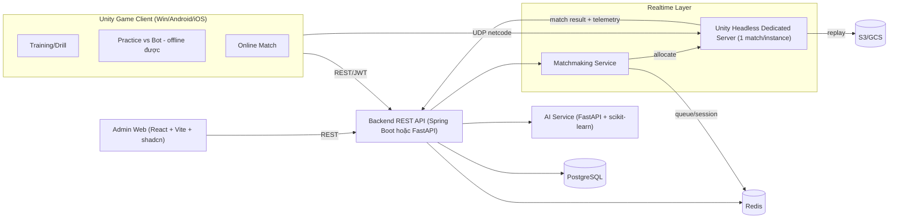
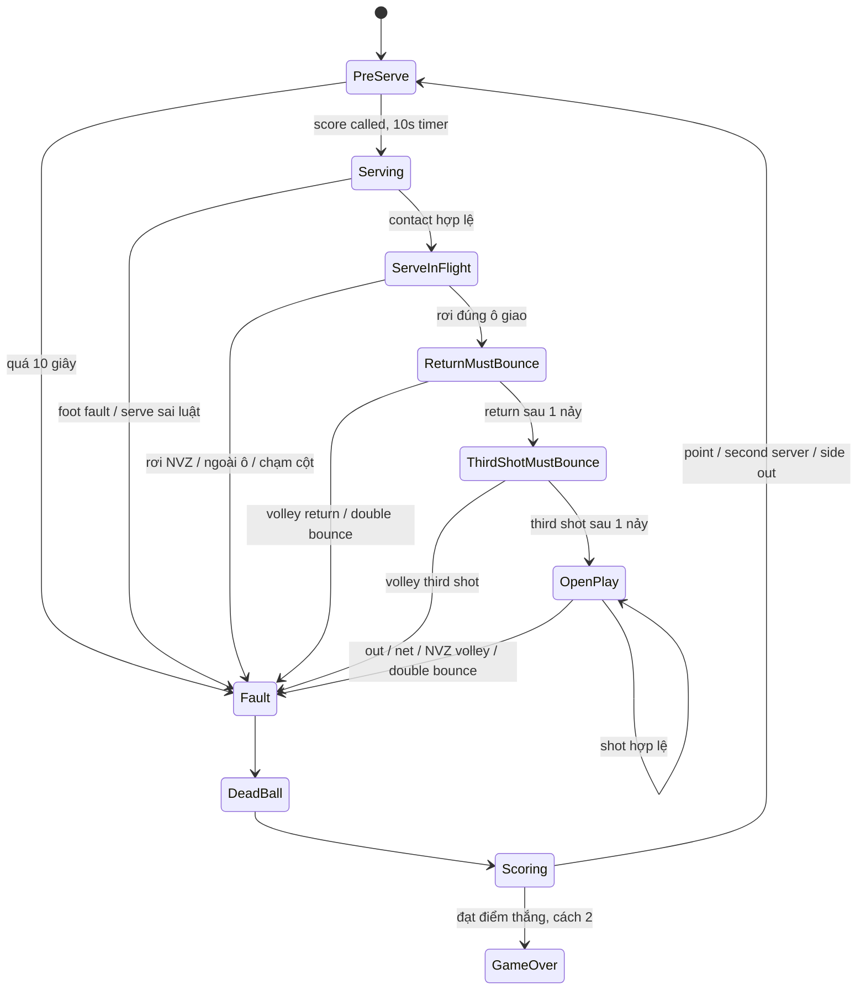

# PickleVerse — Tài liệu triển khai và vận hành

Bản tổng hợp ngày **22/10/2026**, gộp đầy đủ **48 tài liệu Markdown** trong `Doc`. Nội dung được sắp theo chủ đề; các báo cáo, đề xuất và mẫu lệnh vẫn phản ánh thời điểm tài liệu gốc được viết.

**Cập nhật schema ngày 31/10/2026:** GameMatches và GameMatchPlayers đều còn 15 cột; schema hiện tại 38 bảng/265 cột/53 FK. Hai tổng game thắng của GameMatches đã bỏ, tính từ MatchScore; dữ liệu trùng hồ sơ/điểm/Elo trong GameMatchPlayers cũng đã bỏ. Đã bỏ GameProgress, các bảng replay cũ, AppActivitySessions và JSON Data/Report của trận; vẫn dùng MatchScore, quan hệ trận/lịch sử đã gộp và FK ghép PlayerLessonDrills. Backend dùng Npgsql EF Core cho các luồng đã sửa; phiên hoạt động ở Redis, tổng thời gian ở PlayerProfiles. Phần từ điển bên dưới là snapshot cũ. Xem [Rà soát GameMatches](GameMatches_Normalization_20261031.md), [Rà soát GameMatchPlayers](GameMatchPlayers_Normalization_20261031.md) và dùng src/Database.sql hiện tại để tạo database.

**Đọc trước:** [Trạng thái chuyển online](#doc-online-migration-status), [chạy Docker và tích hợp Unity/backend](#doc-unity-backend-integration), [thời gian app và bot Rank Online](#doc-app-activity-ranked-fallback). Các báo cáo giai đoạn local/NGO được giữ để tra cứu lịch sử.

Bốn tài liệu yêu cầu được giữ riêng, nguyên trạng: [Core Features Markdown](PickleVerse_Core_Features.md), [Core Features Word](PickleVerse_Core_Features.docx), [Capstone Proposal Markdown](PickleVerse_Capstone_Proposal.md), [Capstone Proposal Word](PickleVerse_Capstone_Proposal.docx).

<a id="muc-luc"></a>
## Mục lục

- [1. Online, backend và vận hành](#phan-1)
  - [1.1. Tiến độ chuyển game sang online — cập nhật 22/10/2026](#doc-online-migration-status)
  - [1.2. Unity và backend: đợt tài khoản online](#doc-unity-backend-integration)
  - [1.3. Thời gian trong app và đối thủ dự phòng Rank Online](#doc-app-activity-ranked-fallback)
  - [1.4. Sách Hướng Dẫn Vận Hành Hệ Thống Quản Trị](#doc-administrator-guide)
  - [1.5. Từ điển database: tác dụng bảng và cột](#doc-database-dictionary)
  - [1.6. Cấu hình API và thời gian trận](#doc-server-configuration)
  - [1.7. Redis: hàng chờ, xác nhận và bảng xếp hạng](#doc-redis-matchmaking)
- [2. Hướng dẫn chơi và các tính năng](#phan-2)
  - [2.1. Luồng chọn chế độ và thiết lập trận bot](#doc-mode-selection-flow)
  - [2.2. BotMatch — scene đấu đơn với bot cục bộ](#doc-pickleverse-botmatch-guide)
  - [2.3. Bộ luyện tập PickleVerse](#doc-pickleverse-training-guide)
  - [2.4. Tutorial cơ bản của PickleVerse](#doc-tutorial-implementation)
  - [2.5. Cài đặt dùng chung của PickleVerse](#doc-settings-system)
  - [2.6. Shop, skin vợt và ví tiền demo](#doc-shop-implementation)
  - [2.7. Shop: Signature, toàn bộ catalog và màn xem 3D](#doc-shop-tabs-ux)
  - [2.8. Bộ sưu tập và trang bị vợt — 10/10/2026](#doc-collection-implementation)
- [3. Multiplayer, sân và hiệu năng chuyển cảnh](#phan-3)
  - [3.1. MultiplayerCourt: cinematic, kết quả và xác nhận trận](#doc-multiplayer-cinematic-readycheck)
  - [3.2. Hai sân mới — 19/10/2026](#doc-multiple-courts-20261019)
  - [3.3. Tích hợp Stadium Enhanced](#doc-pickleverse-stadium-integration)
  - [3.4. Tối ưu hiệu năng và ánh sáng sân vận động](#doc-pickleverse-stadium-performance)
  - [3.5. Sửa ánh sáng sân online — 16/10/2026](#doc-online-court-lighting-fix-20261016)
  - [3.6. Khôi phục sân cho BotMatch](#doc-court-restore-report)
  - [3.7. Sky và ánh sáng BotMatch](#doc-botmatch-environment-lighting)
  - [3.8. Màn chuyển cảnh Loading](#doc-scene-loading-20261019)
  - [3.9. Training / Tutorial: di chuyển và hiệu năng](#doc-practice-movement-performance-20261019)
  - [3.10. Tiến trình luyện tập và quay về đại sảnh](#doc-pickleverse-training-return-performance)
  - [3.11. Tối ưu quay lại đại sảnh từ Shop/Bộ sưu tập — 10/10/2026](#doc-lobby-return-performance)
  - [3.12. Căn viền đĩa và tối ưu Chọn chế độ → Đại sảnh — 11/10/2026](#doc-menu-mode-return-optimization)
- [4. Giao diện, HUD và âm thanh](#phan-4)
  - [4.1. Home Menu với sân mới và nhân vật nữ](#doc-home-menu-presentation)
  - [4.2. Cải tổ Menu bằng tài nguyên Blender](#doc-menu-ui-blender-refresh)
  - [4.3. Nâng cấp giao diện đại sảnh và âm nhạc — 11/10/2026](#doc-anime-ui-refresh)
  - [4.4. Nâng cấp UI các màn hình — 16/10/2026](#doc-anime-ui-screens-refresh-20261016)
  - [4.5. HUD thi đấu — BotMatch và MultiplayerCourt](#doc-match-hud-20261020)
  - [4.6. Bóng và HUD trong scene đấu bot](#doc-ball-presentation-fix-report)
  - [4.7. Thông báo chữ lướt trong trận đấu bot](#doc-botmatch-swipe-announcements)
  - [4.8. Tích hợp SFX trận đấu](#doc-match-sfx-integration)
  - [4.9. Nhạc nền và trình phát nhạc — cập nhật 11/10/2026](#doc-music-implementation)
- [5. Animation và chuyển động nhân vật](#phan-5)
  - [5.1. PickleVerse - Bộ 20 animation cho gameplay bàn phím](#doc-pickleverse-20-animation-production-brief)
  - [5.2. Bảng thời lượng và prompt animation](#doc-duration-animation)
  - [5.3. Kết quả chuẩn hóa thời lượng animation](#doc-animation-duration-update-report)
  - [5.4. Vừa di chuyển vừa đánh bóng](#doc-movement-animation-transitions)
  - [5.5. Căn cú chạm và phản hồi đánh bóng](#doc-shot-feedback-animation-alignment)
  - [5.6. Phản hồi chất lượng cú đánh — 19/10/2026](#doc-hit-grades-20261019)
  - [5.7. Tách 4 GLB dance thành clip cho nam/nữ](#doc-dance-animation-import)
  - [5.8. Vật lý tóc và váy nhân vật](#doc-character-secondary-motion)
  - [5.9. Cinematic mở đầu BotMatch](#doc-botmatch-cinematic-intro)
- [6. Phân tích, nghiên cứu điều khiển và luật](#phan-6)
  - [6.1. Đối chiếu tính năng cốt lõi PickleVerse với hiện trạng game](#doc-pickleverse-core-features-status-audit)
  - [6.2. PickleVerse (PKV) – Phân tích chuyên sâu tài liệu Doc](#doc-pickleverse-doc-analysis)
  - [6.3. PickleVerse nghiên cứu điều khiển và combo kỹ thuật đánh bóng](#doc-pickleverse-controls-combo-research)
  - [6.4. Luật thi đấu Pickleball — bản tài liệu tham khảo](#doc-luat-thi-dau-pickleball)
- [7. Lịch sử phê duyệt và phát hiện backend](#phan-7)
  - [7.1. Các thay đổi backend cần duyệt trước khi áp dụng](#doc-backend-integration-approval)
  - [7.2. Phát hiện backend ngoài phạm vi xác thực đã duyệt](#doc-backend-followup-findings)

---

<a id="phan-1"></a>
## 1. Online, backend và vận hành

<!-- BEGIN SOURCE: Online_Migration_Status.md -->
<a id="doc-online-migration-status"></a>
### 1.1. Tiến độ chuyển game sang online — cập nhật 22/10/2026

*Tài liệu gốc: `Online_Migration_Status.md`.*

<a id="doc-online-migration-status--tiến-độ-chuyển-game-sang-online--cập-nhật-22102026"></a>

Phạm vi đã được người dùng duyệt: lấy dữ liệu prototype Unity làm dữ liệu gốc, chuyển tiến trình sang backend, mở lại các menu/gameplay, dùng Photon và lưu replay S3. Luồng multiplayer được chốt: tìm trận → tất cả người chơi xác nhận → tải sân → bắt đầu. Không triển khai Unity dedicated server riêng.

Bổ sung được duyệt 22/10: [thời gian từ mở app, 10 UUID đối thủ ảo và fallback trong phòng Photon sau 360 giây](#doc-app-activity-ranked-fallback). Không chuyển Rank Online sang scene PvE. Đây là phần thay thế hành vi fallback trước đó.

Đã kiểm chứng phần bổ sung trên Editor và Windows với thời gian chờ thực tế 360,80/360,77 giây và tổng kết +60/-60 Elo. Đã qua 22 kiểm tra backend mới, 122 kiểm tra backend hồi quy, 18 kiểm tra Unity Services, kiểm tra đồng hồ hồ sơ và chạy lại hai người thật. Hai tài khoản thử và dữ liệu trận/replay thử đã dọn; giữ 10 tài khoản ảo không đăng nhập được. Chi tiết và bằng chứng trong tài liệu liên kết trên.

<a id="doc-online-migration-status--đã-kiểm-chứng"></a>
#### Đã kiểm chứng

- `src/Database.sql` là file SQL duy nhất để khởi tạo database mới: chứa schema gốc, cấu hình OTP/role, schema online và seed Unity. `src/Seed/UnityCatalog.json` lấy từ Progression Config, Shop Catalog và TrainingCurriculum của Unity; `Tools/Build-UnityContentSeed.ps1` chỉ cập nhật khối seed được đánh dấu, giữ nguyên phần schema.
- Docker PostgreSQL đã có 10 achievement, 17 nhiệm vụ, 3 cosmetic, 12 lesson, 12 drill. Đã sao lưu trước khi áp dụng; tài khoản hiện có được giữ nguyên.
- API Docker `/api/Game/state`, claim, purchase, equip và training đã được build/chạy. JSON HTTP đã kiểm tra bằng tài khoản tạm.
- Backend dùng lại các thuật toán C# thuần của Unity để giữ điều kiện mở khóa, sao, XP và phần thưởng. Lệnh ghi có khóa theo người chơi và mã chống xử lý lặp.
- Bộ kiểm tra tổng hợp đã qua 115 kiểm tra trên PostgreSQL tạm: auth/OTP/JWT, seed, mở khóa bài, thưởng, mua đồng thời, kết quả bot, xác nhận và kết quả online, bạn bè và phân trang. Log: `artifacts/verification/full-online-checks.log`. Các sửa lời mời mới nhất được kiểm tra bổ sung riêng trong `social-checks.log`.
- Editor: đăng nhập bằng tài khoản tạm, NameTag mở hồ sơ; tab achievement có 10 mục; tiến trình có 12 bài học. Ảnh kiểm chứng trong `artifacts/verification/online-*.png`.
- Photon Fusion 2.1.3 đã được nhập từ gói người dùng tải. App ID đã cấu hình tại `Assets/Photon/Fusion/Resources/PhotonAppSettings.asset`.
- Kiểm tra Photon Cloud thật: hai runner cùng một phòng, đều thấy hai người, vùng Asia. Báo cáo `artifacts/verification/photon-cloud-check.json`.
- Hai client thật (Editor + Windows development) đã qua phòng riêng 1v1: cả hai xác nhận, tải sân, bắt đầu, di chuyển được xác nhận bằng state mạng, ghi replay và lưu rời trận. Báo cáo: `photon-gameplay-editor.json`, `photon-gameplay-windows.json`. Không có lỗi runtime mới trong ca đã đạt.
- Replay hiện dùng API/S3, không ghi save người chơi/replay xuống đĩa ở luồng chạy chính. Kiểm tra `photon-replay-check.json` đọc lại được pose xương, 61 frame trong chunk đầu và 4 chunk cho mỗi người của trận thật. Local repository còn lại chỉ là adapter cho kiểm thử định dạng cũ.
- Prefab NetworkMatch/NetworkPlayer đã được chuyển bằng Unity Editor API sang Fusion NetworkObject. Đã gỡ NGO, Unity Multiplayer Services và Multiplayer Center qua Package Manager; mã và test riêng của transport cũ được giữ dưới cờ `PICKLEVERSE_LEGACY_NGO`.
- API online dùng xác nhận từ JWT từng người, khóa hồ sơ theo thứ tự UUID, lấy tên/Elo/vợt từ DB; chỉ cấp thưởng kết quả bình thường khi mọi người gửi cùng tỉ số. Rời trận phải do chính tài khoản đó gửi. Heartbeat 8 giây và thời gian kết nối lại 35 giây phía backend; đọc lại hồ sơ sẽ đối soát trận bị bỏ dở.
- API bạn bè/bảng xếp hạng và menu đã được nối dữ liệu thật, hỗ trợ tìm tên/ID, phân trang, lời mời chờ chấp nhận và xóa bạn; không dùng danh sách DEMO ở luồng chạy chính.
- Windows build sau khi bỏ UGS/NGO đã thành công. Build Profile và danh sách scene chung có PhotonLobby, Training và Loading.
- Tìm trận công khai đã qua Editor/Windows: tự ghép trên Photon, cả hai xác nhận, tải sân, di chuyển, replay và lưu rời trận. Báo cáo `photon-public-editor.json`, `photon-public-windows.json`. Race HTTP/SceneDone đã được sửa và kiểm tra lại.
- 11 kiểm tra social bổ sung đã qua: ID lời mời mới, vô hiệu chấp nhận cũ sau xóa bạn, block, phân trang và tìm kiếm. API Docker đã được cập nhật sau kiểm thử.
- Tìm trận 2v2 với hai nhóm đôi đã qua bằng 1 Editor + 3 Windows client. Bốn báo cáo `photon-doubles-a.json` đến `photon-doubles-d.json` cùng match ID, đều có đủ 4 actor, điều khiển được xác nhận qua mạng, replay và lưu rời trận.
- Editor kiểm tra trực tiếp: nút NameTag mở hồ sơ, tab achievement 10 hàng; bảng xếp hạng có dữ liệu tài khoản thật; training có 12 hàng và 4 bài mở ban đầu, checkpoint serve tải lại khớp server; shop/bộ sưu tập dùng OnlinePlayerEconomy với 3 cosmetic; tutorial skip và rời trận bot đã lưu backend. `online-menu-check.json` và ảnh `online-*-final.png` ghi nhận kết quả.
- ReplayView đã tải chunk từ S3, phát, seek và đổi 2x trong Editor; playhead được xác nhận thay đổi trên frame thật.
- Kết nối lại đã qua Editor/Windows: client Windows ngắt runner giữa trận, vào lại cùng match ID, nhận lại điều khiển và lưu rời trận. `photon-reconnect-editor.json` và `photon-reconnect-windows.json` đều đạt; không có lỗi runtime mới. Recorder nối manifest và thời gian từ S3 sau khi scene cũ flush xong, không ghi đè các chunk trước.
- Replay sau nối lại đã được đọc qua API/S3: hai người đều có 15 chunk hoàn chỉnh và pose xương hợp lệ (`photon-replay-check.json`).
- 372/372 test Editor của project đã qua (`unity-editor-checks.json`).

<a id="doc-online-migration-status--trạng-thái-bàn-giao-dev"></a>
#### Trạng thái bàn giao dev

- Windows build cuối thành công, 0 lỗi: `artifacts/windows-photon/PickleVerse.exe`; tóm tắt `windows-build-check.json`. Warning còn lại là Pipeline không bật trong Player; đây là công cụ điều khiển Editor, không cần cho gameplay.
- Đã dọn bốn tài khoản thử, dữ liệu trận/tiến trình và object replay thuộc các UUID thử; các file chứa credential fixture cũng đã xóa. Giữ tài khoản và dữ liệu người dùng thật. `final-dev-health.json` ghi nhận trạng thái Docker/Swagger và số tài khoản sau dọn.
- Luồng tài khoản, ví/skin, nhiệm vụ/achievement, training, tutorial, trận bot, Photon 1v1/2v2, kết nối lại và replay dùng API/S3 ở runtime. Các adapter local còn trong source phục vụ kiểm thử định dạng/pure rules; lựa chọn đồ họa/âm thanh/phím vẫn là thiết lập riêng trên thiết bị.
- Editor được để ngoài Play Mode. Chạy Play, đăng nhập tài khoản thật để sử dụng; API dev tại `http://localhost:8080`, Swagger tại `http://localhost:8080/swagger/index.html`.

<a id="doc-online-migration-status--giới-hạn-mô-hình-dev"></a>
#### Giới hạn mô hình dev

Fusion Shared dùng một client làm state authority cho luật/vật lý trận; Photon Cloud kết nối và đồng bộ. Backend kiểm tra đồng thuận/tính hợp lệ và tính thưởng, chưa phải cơ chế chống gian lận với mô phỏng trên dedicated server. Hai client thông đồng vẫn nằm ngoài bảo đảm hiện tại. Tài liệu chính thức: [Network topologies](https://doc.photonengine.com/fusion/v2/manual/network-topologies), [FixedUpdateNetwork trên proxy trong Fusion 2](https://doc.photonengine.com/fusion/v2/getting-started/migration/coming-from-fusion-v1).

Giữ trạng thái các file `_Recovery/*.unity` đã xóa trước đợt làm việc này. Không reset các sửa đổi có sẵn trong `Menu.unity` và các font về HEAD; các cache font do Unity tạo vẫn cần phân biệt với thay đổi mã sản phẩm khi người dùng commit.

<!-- END SOURCE: Online_Migration_Status.md -->

[↑ Mục lục](#muc-luc)

---

<!-- BEGIN SOURCE: Unity_Backend_Integration.md -->
<a id="doc-unity-backend-integration"></a>
### 1.2. Unity và backend: đợt tài khoản online

*Tài liệu gốc: `Unity_Backend_Integration.md`.*

<a id="doc-unity-backend-integration--unity-và-backend-đợt-tài-khoản-online"></a>

Ngày kiểm tra: 20/10/2026. Unity `6000.6.2f1`, ASP.NET Core `.NET 10`, PostgreSQL 16, Docker Desktop.

<a id="doc-unity-backend-integration--phạm-vi-đã-chốt"></a>
#### Phạm vi đã chốt

- Đăng ký -> OTP email Gmail thật -> đăng nhập -> tải/cập nhật hồ sơ -> đăng xuất.
- Bỏ khách/offline trong luồng chạy. Xóa save hồ sơ, replay, ví demo và trạng thái tutorial cũ trên máy phát triển.
- Tạm khóa training, thi đấu, shop, nhiệm vụ, lịch sử và social khi các phần này chưa được nối backend.
- Chuyển Photon và đồng bộ replay/S3 ở đợt tiếp theo; không thay netcode trong đợt này.
- Các thay đổi backend/Compose/OTP và bản sửa phân quyền Admin đều đã được người dùng duyệt trước khi sửa.

<a id="doc-unity-backend-integration--chạy-môi-trường-dev"></a>
#### Chạy môi trường dev

Tại thư mục repository:

```powershell
docker compose up -d --build
docker compose ps
```

| Dịch vụ | Địa chỉ trên máy phát triển |
|---|---|
| API | http://localhost:8080 |
| API readiness (kết nối DB) | http://localhost:8080/health/ready |
| Swagger UI dev | http://localhost:8080/swagger |
| OpenAPI dev | http://localhost:8080/openapi/v1.json |
| PostgreSQL Compose | 127.0.0.1:15432 |
| pgAdmin Compose | http://localhost:15050 |
| S3-compatible dev | http://localhost:19000 |

Các cổng 15432/15050/19000 được chọn vì máy đã có container khác dùng 5432/5050/9000. Những container cũ được giữ nguyên. Compose có thể đổi cổng bằng `POSTGRES_PORT`, `PGADMIN_PORT`, `S3_PORT`, `API_PORT` trong `.env`; nếu đổi cổng API cần đổi cấu hình Unity tương ứng.

Compose chỉ bind cổng ra loopback. Volume S3 dev mới là `pickleverse_dev_s3_data`; không dùng chung với volume của container S3 cũ.

Swagger UI chỉ bật khi `ASPNETCORE_ENVIRONMENT=Development`, đọc tài liệu OpenAPI hiện có tại `/openapi/v1.json`. Cấu hình dùng `Swashbuckle.AspNetCore.SwaggerUI` theo [hướng dẫn Microsoft cho .NET 10](https://learn.microsoft.com/en-us/aspnet/core/fundamentals/openapi/using-openapi-documents?view=aspnetcore-10.0). Docker dev dùng cổng 8080; cổng 5000 không được publish.

`.env` nằm ngoài Git; không đưa file này vào Unity hoặc chia sẻ build. `.env.example` cung cấp tên biến cần cấu hình:

```dotenv
JWT_KEY=<random secret, at least 32 characters>
SMTP_USERNAME=<sending Gmail address>
SMTP_APP_PASSWORD=<Google App Password>
SMTP_FROM_EMAIL=<same sending address>
```

Gmail dùng `smtp.gmail.com:587` với STARTTLS. App Password yêu cầu cấu hình tài khoản Google phù hợp; xem [Google App Password](https://support.google.com/accounts/answer/185833). Credential đã được cấu hình tại máy và SMTP đã chấp nhận email OTP thử; kết quả này không thay cho việc kiểm tra hộp thư/spam của người nhận.

Database mới chỉ cần `src/Database.sql`: toàn bộ schema, cột OTP lưu hash, bộ đếm nhập sai, role Player/Admin và seed game Unity đã được gộp vào file này. Compose tự chạy file khi khởi tạo volume PostgreSQL lần đầu; không cần chạy thêm SQL nào. Với PostgreSQL chạy riêng, kết nối vào một database trống và chạy toàn bộ file một lần. Volume DB đã tồn tại được giữ nguyên và init script không tự chạy lại; không chạy toàn bộ file khởi tạo lên database đang có dữ liệu.

<a id="doc-unity-backend-integration--cấu-trúc-unity"></a>
#### Cấu trúc Unity

| Vị trí trong `My project/Assets/Scripts` | Vai trò |
|---|---|
| `Services/Api/AccountModels.cs` | DTO tương ứng hợp đồng REST của backend |
| `Services/Api/ApiClient.cs` | JSON camelCase, phân tích lỗi API/ProblemDetails; không đưa stack trace vào UI |
| `Services/Api/UnityApiTransport.cs` | UnityWebRequest bất đồng bộ, timeout, cancellation và Bearer header |
| `Services/Utilities/ApiUrl.cs` | Kiểm tra URL; HTTP chỉ được chấp nhận trên loopback trong Editor/development |
| `Services/AccountService.cs` | Đăng ký, OTP, đăng nhập, refresh, logout và hồ sơ |
| `Services/AccountRuntime.cs` | Vòng đời service và cấu hình dùng chung qua scene |
| `FrontEnd/AccountScreen.cs` | UI tiếng Việt theo font và bảng màu lobby; chặn truy cập khi chưa đăng nhập |
| `Progression/ProgressionRuntime.cs` | Chiếu hồ sơ server cho các binding menu cũ, không mở/ghi file player local |

Asset cấu hình: `My project/Assets/Resources/BackendApiSettings.asset`. Base URL hiện là `http://localhost:8080`, không kèm `/api`. Dùng HTTPS cho bản release; bản Windows hiện tại là development để gọi Docker dev qua HTTP loopback.

Token và mật khẩu không được lưu xuống PlayerPrefs hoặc file. Mỗi lần chạy lại game cần đăng nhập. Trong phiên, service thực hiện một refresh dùng chung khi nhiều request đồng thời nhận 401; request được thử lại tối đa một lần sau refresh. Không tự thử lại giao dịch ghi khi mất mạng.

Ví dụ dùng service từ Unity main thread:

```csharp
using PickleVerse.Services;
using PickleVerse.Services.Api;

var account = AccountRuntime.Ensure().Account;
await account.LoginAsync(email, password, cancellationToken);
var profile = await account.ReloadProfileAsync(cancellationToken);
await account.UpdateProfileAsync(new UpdateProfileRequest
{
    PlayerName = newName,
    IsMale = true
}, cancellationToken);
await account.LogoutAsync(cancellationToken);
```

<a id="doc-unity-backend-integration--hợp-đồng-api-đã-nối"></a>
#### Hợp đồng API đã nối

| Method | Route |
|---|---|
| POST | `/api/Auth/register` |
| POST | `/api/Auth/verify-email` |
| POST | `/api/Auth/resend-otp` |
| POST | `/api/Auth/login` |
| POST | `/api/Auth/refresh-token` |
| POST | `/api/Auth/logout` |
| GET | `/api/Profiles/me` |
| PUT | `/api/Profiles/me` |

Đăng ký chỉ gửi bốn trường sau; không gửi `playerName`:

```json
{
  "email": "ban@example.com",
  "password": "ExamplePass!23",
  "confirmPassword": "ExamplePass!23",
  "isMale": true
}
```

Backend bắt buộc xác nhận mật khẩu khớp, tự sinh tên mặc định `player` + 12 ký tự hex ngẫu nhiên, ví dụ `playera4f8b2c9d103` (18 ký tự). Database giữ ràng buộc tên duy nhất; server thử sinh lại nếu gặp trùng tên. Form Unity không yêu cầu nhập tên khi đăng ký; sau đăng nhập vẫn đổi tên ở hồ sơ như trước. Tên và hồ sơ của tài khoản đã có được giữ nguyên.

Xác nhận mật khẩu dùng [CompareAttribute](https://learn.microsoft.com/en-us/dotnet/api/system.componentmodel.dataannotations.compareattribute?view=net-10.0); hậu tố tên dùng [RandomNumberGenerator.GetHexString](https://learn.microsoft.com/en-us/dotnet/api/system.security.cryptography.randomnumbergenerator.gethexstring?view=net-10.0) của .NET.

OTP có 6 chữ số, hạn 10 phút, tối đa 5 lần nhập sai cho một mã, chờ 60 giây trước khi gửi lại. Mã được gắn với tài khoản và lưu dưới dạng HMAC; token refresh được lưu dưới dạng hash và xoay khi sử dụng. Access token hạn 2 giờ, refresh token hạn 14 ngày. API auth có giới hạn 20 yêu cầu/phút/IP trong một cửa sổ cố định.

`POST /api/Auth/resend-otp` trả `{ code, message }`. Với tài khoản đã xác thực, code là `email_already_verified`: không tạo OTP/email mới, Unity chuyển về Đăng nhập, giữ email đã nhập và hiển thị hướng dẫn. Các trường hợp còn lại giữ phản hồi chung `verification_requested`; tài khoản đang hoạt động và chưa xác thực mới được gửi OTP, vẫn áp dụng thời gian chờ 60 giây. Giao diện giữ thông báo sau khi cập nhật trạng thái màn hình và xóa thông báo cũ khi người dùng chủ động chuyển tab.

<a id="doc-unity-backend-integration--đối-chiếu-hai-tài-liệu-đề-tài"></a>
#### Đối chiếu hai tài liệu đề tài

| Nhóm tính năng | Source hiện có | Trạng thái kết nối trong đợt này |
|---|---|---|
| Tài khoản/hồ sơ | Trước đây Unity dùng player local; backend có REST/JWT | Đã nối tài khoản online, OTP Gmail, hồ sơ server |
| Tutorial, training và bot | Có các script tutorial, training, chấm sao, bot và scene tương ứng | Giữ source, khóa lối vào; chưa kết luận chất lượng gameplay qua kiểm thử của đợt auth này |
| Tiến trình, nhiệm vụ, shop, social | Có engine/model/UI local và backend controller tương ứng | Không dùng save/fixture local làm dữ liệu thật; đợi adapter và mapping API |
| Multiplayer | Manifest/source hiện dùng NGO và Unity Services | Chưa chuyển Photon; cần chốt sản phẩm/topology ở đợt sau |
| Replay | Unity có recorder/repository local; backend có storage/replay API | Save cũ đã xóa; chưa nối upload/download từ Unity |
| Admin | Có controller quản trị | Sửa role guard và kiểm thử 401/403/200; không xây admin web trong đợt này |

Source thực tế dùng .NET và uGUI; proposal còn nêu lựa chọn backend Java/Python và UI Toolkit. Việc tích hợp hiện tại đi theo stack/source đang có và yêu cầu mới của người dùng.

<a id="doc-unity-backend-integration--xác-minh"></a>
#### Xác minh

- Build backend thành công, không lỗi/cảnh báo ở lượt build xác minh.
- 43 kiểm tra auth với PostgreSQL thật: hợp đồng đăng ký bốn trường, xác nhận mật khẩu, tên mặc định ngẫu nhiên (kể cả thử lại khi trùng tên), giới tính, email chưa xác thực, OTP sai/hết hạn/dùng lại, cooldown, khóa mã, gửi lại, refresh xoay/vô hiệu hóa, logout, tài khoản tạm khóa và request đồng thời. Database test riêng được xóa sau kiểm tra.
- Một luồng kiểm tra có gửi OTP thật qua Gmail SMTP, xác thực và đăng nhập trong DB test riêng. Ngoài ra, đã gọi `POST /api/Auth/register` tới chính API trong Docker: nhận HTTP 200 sau khi Gmail SMTP chấp nhận email OTP; tài khoản test vừa tạo được xóa ngay sau đó. Các case còn lại dùng mail adapter thu mã trong bộ nhớ, không gửi hàng loạt thư.
- 14 NUnit test Unity service đã qua: refresh đồng thời, clear phiên khi login đang chờ, request/logout của phiên cũ không xóa phiên mới, logout sau refresh và URL/ProblemDetails.
- Lượt kiểm tra đăng ký mới: Swagger có đúng `email`, `password`, `confirmPassword`, `isMale`; Docker API trả 400 cho xác nhận sai/thiếu và mật khẩu quá ngắn. Editor xác nhận ô tên được ẩn khi đăng ký, nút đăng ký báo mật khẩu không khớp và lựa chọn giới tính hoạt động. Báo cáo service mới: `artifacts/verification/unity-registration-tests.json`.
- Bản Windows đã cập nhật theo hợp đồng đăng ký mới, build 0 lỗi và 1 cảnh báo Pipeline như mô tả bên dưới. Smoke-test đăng nhập/hồ sơ/đăng xuất thành công: `artifacts/verification/windows-registration-smoke.json`; tài khoản fixture đã xóa. Ảnh form mới: `artifacts/verification/unity-registration-contract.png`.
- Editor Play Mode: chứng minh frame đang tăng; nhập vào input/bấm button thật để login và lưu tên/giới tính. Đọc lại từ REST xác nhận thay đổi đã lưu server. Không tạo lại thư mục LocalPlayers/Replays.
- HTTP: `/health/ready` -> 200, hồ sơ chưa đăng nhập -> 401, gọi auth lặp lại -> 429.
- Swagger UI: Docker API đã rebuild; `/swagger`, HTML, CSS/JavaScript và `/openapi/v1.json` đều trả 200. Trình duyệt đã hiển thị danh sách endpoint và schema; ảnh tại `artifacts/verification/swagger-ui.png`.
- Phân quyền Admin: chưa đăng nhập -> 401, Player -> 403, Admin -> 200; sử dụng fixture tạm và khôi phục role sau kiểm tra.
- Windows development: build cuối thành công với 0 lỗi; executable chạy ở batch mode, xác nhận Development flag, login, cập nhật hồ sơ, logout và không tạo save local đều thành công. Kết quả cuối: `artifacts/verification/windows-account-final-v3.json`.

Build cuối còn một cảnh báo của package Pipeline: chưa có RuntimePipelineConfig, nên tính năng điều khiển Player từ xa của package này không bật. API/đăng nhập không phụ thuộc tính năng đó. Một lượt build sau Play Mode từng gặp cache URP chứa tham chiếu runtime đã bị hủy; cache build đã được làm mới bằng API Dispose của package và lượt build cuối không còn lỗi. Không sửa source package hay renderer của dự án.

Báo cáo máy đọc nằm trong `artifacts/verification/`. Bản Windows nằm trong `artifacts/WindowsDev/`; chạy executable ngay trong thư mục đó cùng thư mục Data/DLL đi kèm. Build đợt này chỉ gồm Menu và Settings theo phạm vi tài khoản online.

Các tài khoản fixture và file credential kiểm thử đã được dọn. Mở Menu trong Unity, nhấn Play rồi đăng ký tài khoản thực để sử dụng. Ảnh UI đã kiểm tra nằm trong `artifacts/unity/`.

Chạy lại kiểm thử backend (mặc định không gửi thư):

```powershell
$env:PKV_TEST_POSTGRES = 'Host=127.0.0.1;Port=15432;Database=postgres;Username=sa;Password=12345'
dotnet run --project src/Testing/Backend/IntegrationChecks.csproj
```

Chỉ bật `PKV_RUN_SMTP_TEST=1` khi chủ động muốn gửi một OTP tới Gmail gửi đang cấu hình. Không đưa output chứa token hoặc credential vào log.

Phát hiện replay/S3 dành cho đợt sau được ghi trong [Doc/Backend_Followup_Findings.md](#doc-backend-followup-findings).

<!-- END SOURCE: Unity_Backend_Integration.md -->

[↑ Mục lục](#muc-luc)

---

<!-- BEGIN SOURCE: App_Activity_Ranked_Fallback.md -->
<a id="doc-app-activity-ranked-fallback"></a>
### 1.3. Thời gian trong app và đối thủ dự phòng Rank Online

*Tài liệu gốc: `App_Activity_Ranked_Fallback.md`.*

<a id="doc-app-activity-ranked-fallback--thời-gian-trong-app-và-đối-thủ-dự-phòng-rank-online"></a>

Phạm vi người dùng duyệt ngày 22/10/2026: thời gian từ mở app, chờ đối thủ thật đủ 360 giây, 10 tài khoản ảo, giữ phòng Photon và tổng kết Elo online.

<a id="doc-app-activity-ranked-fallback--thời-gian-hoạt-động"></a>
#### Thời gian hoạt động

`AppActivityRuntime` khởi động trước scene đầu tiên và dùng đồng hồ thời gian thực, độc lập với `Time.timeScale`. Menu, đăng nhập, tìm trận, training và trận đấu đều thuộc cùng phiên. Phiên được mở trước đăng nhập; khi đăng nhập mới gắn với tài khoản, bao gồm khoảng chờ đăng nhập. Đồng bộ mỗi 15 giây, trước đăng xuất/đổi tài khoản và khi thoát Windows bình thường. UI hồ sơ hiển thị thời gian tăng giữa các checkpoint.

- `POST /api/Game/activity/open`: không cần JWT, mở phiên bằng UUID ngẫu nhiên của lần chạy app.
- `POST /api/Game/activity/checkpoint`: cần JWT; `{ sessionId, elapsedSeconds, close }`. UUID trong JSON dùng định dạng có dấu gạch nối. Server trả `{ totalSeconds, elapsedSeconds }`.
- Server gắn phiên với một tài khoản, kiểm tra thời gian tăng theo đồng hồ server và tính phần thời gian chưa được ghi nhận. Retry và các cửa sổ app chồng nhau không cộng trùng. Đóng phiên không tiếp tục tăng giờ.
- Cập nhật 31/10: phiên/coverage và biên nhận tổng trước/sau nằm trong Redis, TTL 8 ngày; PostgreSQL chỉ giữ PlayerProfiles.TimePlayedSeconds. Phiên hết hạn/mất trả 410 để Unity tạo UUID mới, không cộng lại elapsed cũ. Xem Redis_App_Activity_20261031.md.
- Không còn cộng thời lượng khi hoàn tất trận. Endpoint cũ `/api/Profiles/sync-time` trả 410 để tránh cộng thêm lần nữa.
- Giữ số thời gian đã lưu trước thay đổi này; không có log mở/đóng app cũ để tính lại lịch sử chính xác. Nếu process bị kill/crash trước checkpoint cuối, phần chưa gửi chưa được bảo đảm lưu.

<a id="doc-app-activity-ranked-fallback--rank-online-sau-sáu-phút"></a>
#### Rank Online sau sáu phút

Unity tạo lượt tìm trận tại `POST /api/Game/ranked/search`. API giữ mốc bắt đầu, không đặt lại khi gửi lại cùng mã yêu cầu. Trong 360 giây đầu vẫn tìm người thật trên Photon theo cơ chế Elo hiện có.

Khi đủ hạn mà phòng vẫn chỉ có một người, peer điều phối khóa nhận thêm người trong lúc xin đối thủ tại `POST /api/Game/ranked/bot`. API kiểm tra tài khoản, lượt tìm chưa hủy, đủ thời gian, mã trận và tên phòng; cấp một tài khoản ảo còn trống. Unity thêm actor bot vào chính phòng đó, không tải `BotMatch`.

Luồng tiếp tục là **xác nhận → MultiplayerCourt → bắt đầu**. Ghế ảo được hệ thống chấp nhận; người chơi thật vẫn phải tự bấm xác nhận. Hủy/từ chối tìm trận làm lượt tìm mất hiệu lực, kể cả khi phản hồi cấp bot về muộn. Bot được điều khiển bằng `MultiplayerBot` trên state authority của phòng Fusion Shared.

Tên, giới tính và vợt lấy từ hồ sơ database. Elo của đối thủ được snapshot theo `EloPolicy.BotElo` hiện có, với sàn 100. Trận ghi loại `RankedSingles`, nhận phần thưởng online 150/75 TOKENPAD theo cấu hình gốc và tính Elo trên backend. API PvE chỉ cho `BotPractice`, không còn cho tạo `RankedBot` trực tiếp.

<a id="doc-app-activity-ranked-fallback--tài-khoản-và-dữ-liệu"></a>
#### Tài khoản và dữ liệu

`src/Database.sql` khởi tạo toàn bộ schema và dữ liệu gốc trong một transaction `BEGIN … COMMIT`. Hai bảng phiên nằm cùng phần schema online; 10 tài khoản bot nằm trong phần `INITIAL DATA` cùng các seed khác. Không còn block migration riêng cho app activity/ranked fallback. Chạy toàn bộ file chỉ cho database mới; với database đã có dữ liệu cần migration phù hợp, không chạy lại file khởi tạo và không xóa volume.

10 tài khoản có role **Player**, hồ sơ riêng và UUID cố định. Danh sách chuẩn cho Unity/API nằm trong `My project/Assets/Scripts/Entites/Multiplayer/RankedBotAccounts.cs`; backend compile cùng file, kiểm thử đối chiếu với SQL. Các tài khoản này không đăng nhập/refresh được và không gửi OTP; không có mật khẩu đăng nhập chung. Không tạo xác thực email giả để đưa chúng vào danh sách người thật.

Thay đổi schema trong đợt này: **thêm 2 bảng, tổng cộng 15 cột mới; không thêm/bớt cột của bảng cũ**.

| Bảng | Số cột | Vai trò |
| --- | ---: | --- |
| `appactivitysessions` | 6 | Lần mở app, tài khoản gắn với phiên, thời gian đã báo/đã ghi nhận và trạng thái đóng. Tổng hiện ở `playerprofiles.timeplayedseconds`, Unity đọc vào mục Thời gian hoạt động. |
| `rankedsearches` | 9 | Mốc 360 giây, hủy tìm, UUID bot được cấp, Elo snapshot và ràng buộc phòng Photon/mã trận. |

Các bảng có sẵn tiếp tục dùng: `users`/`roles`/`playerprofiles` chứa 10 danh tính; `gamematches` giữ phòng/đội hình/kết quả; `gamematchplayers` có hai participant; `matchhistory` và `playermatchhistory` lưu tỉ số, bên thắng/thua và Elo từng UUID. Backend chỉ tự hoàn tất ghế ảo đã được cấp; trận giữa hai người thật vẫn cần hai JWT đồng ý và báo cáo tỉ số khớp.

<a id="doc-app-activity-ranked-fallback--kết-thúc-trận"></a>
#### Kết thúc trận

Giữ bảng tỉ số và phần trình bày kết thúc hiện có. Nút **THOÁT TRẬN** mở màn tổng kết; nút về phòng khi trận đã kết thúc cũng đi qua màn này. Tổng kết đợi kết quả đã lưu, hiển thị Elo cộng/trừ và Elo trước/sau từ backend. Retry không cấp thưởng hoặc đổi Elo thêm lần nữa. Sau đó người chơi chọn về phòng hoặc menu.

Kiểm thử tự động mới: `IntegrationChecks --check-app-ranked` kiểm tra dữ liệu seed, đồng hồ app, chồng phiên, mốc 359/360, hủy sát hạn, cấm PvE rank, lịch sử và Elo chống lặp. `RankedFallbackSmokeRunner` là runner development gọi Photon thật và chờ đủ sáu phút; phần kiểm tra kết thúc trận chủ động tạo lỗi rally qua luật điểm thật để hoàn tất trận trong thời gian kiểm thử, không giả lập response API.

<a id="doc-app-activity-ranked-fallback--kết-quả-kiểm-chứng-22102026"></a>
#### Kết quả kiểm chứng 22/10/2026

- 122 kiểm tra backend hiện có đã qua sau khi cập nhật fixture cho 10 tài khoản ảo; thêm 22 kiểm tra app/rank đã qua trên PostgreSQL tạm. Log: `artifacts/verification/app-ranked-auth-regression.log`, `app-ranked-backend-checks.log`.
- 18 kiểm tra Unity Services đã qua, gồm chốt phiên trước đăng xuất và đổi tài khoản: `app-ranked-unity-services-tests.json`.
- Photon thật trong Editor: chờ 360,80 giây, xác nhận, sân SceneRef #5 (`MultiplayerCourt`), đủ hai actor với một bot, có cú đánh/trả bóng, tổng kết +60 Elo. `ranked-fallback-editor.json`; ảnh `ranked-fallback-editor-summary.png`. Công cụ kiểm thử đã được sửa để kiểm tra SceneRef của Fusion, vì multi-peer gộp asset sân vào scene runtime có tên khác.
- Photon thật trong Windows: chờ 360,77 giây, cùng luồng sân online, tổng kết -60 Elo. `ranked-fallback-windows.json`. Khi app đóng bình thường, database ghi phiên đã đóng và 463 giây: `app-ranked-windows-close.json`.
- UI hồ sơ Editor: thời gian đổi từ `00:10:46` sang `00:10:52`; tạm dừng `Time.timeScale=0` vẫn tăng 3,21 giây; checkpoint và đăng xuất thành công. `app-activity-profile-check.json`, ảnh `app-activity-profile.png`.
- Lịch sử database trước dọn fixture có đủ hai participant/UUID và Elo từng bên cho mỗi trận: `ranked-fallback-database-results.json`.
- Sửa thêm lỗi dọn phần trình bày: `ActorPose.Restore` không đọc `CourtEnd` từ actor mạng đã despawn. Đã chạy lại tìm trận công khai hai người thật bằng Editor + Windows, cả hai xác nhận/vào sân/di chuyển/ghi replay/rời trận đều đạt; `ranked-human-regression-editor.json`, `ranked-human-regression-windows.json`. Console Editor sau rời sân và dừng Play có 0 lỗi: `app-ranked-final-console.json`.
- Windows build cuối thành công, 0 lỗi; còn một cảnh báo API `SimulationMessagePtr` đã obsolete của SDK Fusion: `app-ranked-windows-build.json`. Player log Windows còn có thông báo native `Curl error 35` về xác thực chứng chỉ; chưa xác định request phát sinh log này. Các luồng API dev, Photon và replay trong ca kiểm thử vẫn hoàn tất; không tắt kiểm tra chứng chỉ để che log.
- Đã dọn hai tài khoản tạm, trận/replay của các UUID thử, và trả hai hồ sơ bot đã dùng về trạng thái seed ban đầu. Giữ tài khoản và dữ liệu người dùng thật. `app-ranked-cleanup.log`.
- Database dev sau thay đổi có 39 bảng/219 cột; riêng đợt này thêm 2 bảng/15 cột. `app-ranked-schema-summary.json`.

<!-- END SOURCE: App_Activity_Ranked_Fallback.md -->

[↑ Mục lục](#muc-luc)

---

<!-- BEGIN SOURCE: Administrator_Guide.md -->
<a id="doc-administrator-guide"></a>
### 1.4. Sách Hướng Dẫn Vận Hành Hệ Thống Quản Trị

*Tài liệu gốc: `Administrator_Guide.md`.*

<a id="doc-administrator-guide--sách-hướng-dẫn-vận-hành-hệ-thống-quản-trị"></a>
<a id="doc-administrator-guide--pickleverse-administrator-guide"></a>
#### PickleVerse Administrator Guide

**Dự án:** PickleVerse – Multiplayer Pickleball Skill-Training and Match Game with AI Coaching  
**Phiên bản hệ thống:** 1.0.0  
**Ngày phát hành:** 2026-10-22  

---

<a id="doc-administrator-guide--1-giới-thiệu-tổng-quan"></a>
#### 1. Giới thiệu Tổng quan
Admin Web Dashboard là nền tảng quản trị tập trung dành cho Ban điều hành, Huấn luyện viên (Coach) và Kiểm duyệt viên (Moderator) của PickleVerse. Hệ thống cho phép:
- Quản lý tài khoản người chơi, phân quyền vai trò (Role-Based Access Control - RBAC), xử lý kỷ luật (Khóa/Mở khóa tài khoản), kích hoạt thủ công và reset điểm Elo.
- Hệ thống CMS quản lý giáo trình đào tạo: Tạo bài học (Lessons), bài tập kỹ thuật (Drills), đăng bán vợt/trang phục vào Shop và tạo nhiệm vụ sự kiện.
- Giám sát các trận đấu trực tuyến 1v1 Singles và 2v2 Doubles theo thời gian thực với cơ chế tự động cập nhật (Auto-polling).
- Thẩm định và xử lý các báo cáo vi phạm (Cheating, toxicity, AFK) từ người chơi.
- Trực quan hóa **Bản đồ nhiệt lỗi kỹ thuật AI (Technique-Error Heatmap)** dựa trên dữ liệu telemetry thu thập từ game client.

---

<a id="doc-administrator-guide--2-hướng-dẫn-khởi-chạy-môi-trường"></a>
#### 2. Hướng dẫn Khởi chạy Môi trường

<a id="doc-administrator-guide--21-khởi-chạy-backend-api--database"></a>
##### 2.1 Khởi chạy Backend API & Database
1. Khởi động Docker Desktop trên máy tính.
2. Khởi chạy cụm dịch vụ PostgreSQL, Redis, MinIO và Backend API:
   ```bash
   cd src/Backend
   docker compose up -d
   ```
   *Backend API mặc định lắng nghe tại: `http://localhost:5000` (hoặc cổng cấu hình trong `.env`).*

<a id="doc-administrator-guide--22-khởi-chạy-ứng-dụng-quản-trị-web-admin-web"></a>
##### 2.2 Khởi chạy Ứng dụng Quản trị Web (Admin Web)
1. Mở cửa sổ dòng lệnh tại thư mục Frontend:
   ```bash
   cd src/Frontend
   ```
2. Cài đặt các gói phụ thuộc (nếu chưa cài đặt):
   ```bash
   npm install
   ```
3. Chạy môi trường phát triển (Dev Server):
   ```bash
   npm run dev
   ```
4. Truy cập giao diện trên trình duyệt tại: **`http://localhost:5173`**

---

<a id="doc-administrator-guide--3-quy-trình-đăng-nhập--phân-quyền-bảo-mật-rbac"></a>
#### 3. Quy trình Đăng nhập & Phân quyền Bảo mật (RBAC)

1. Mở trình duyệt và truy cập trang đăng nhập tại `/login`.
2. Nhập thông tin tài khoản được cấp quyền:
   - **Tài khoản / Email:** Nhập username hoặc email của quản trị viên.
   - **Mật khẩu:** Nhập mật khẩu bảo mật.
3. **Cơ chế kiểm soát an ninh (Zero-Trust RBAC):**
   - Nếu tài khoản có vai trò `Admin`, hệ thống cấp phát JWT token, lưu trữ phiên làm việc an toàn và điều hướng vào trang Dashboard.
   - Nếu tài khoản chỉ có vai trò `Player` (người chơi thông thường), hệ thống từ chối truy cập và hiển thị thông báo lỗi: *"Tài khoản của bạn không có vai trò Quản trị viên (Admin). Truy cập bị từ chối."*
   - Khi token hết hạn hoặc nhận mã lỗi `401 Unauthorized`/`403 Forbidden` từ API, hệ thống tự động xóa phiên và đưa người dùng về lại màn hình đăng nhập.

---

<a id="doc-administrator-guide--4-hướng-dẫn-vận-hành-các-phân-hệ-chức-năng"></a>
#### 4. Hướng dẫn Vận hành các Phân hệ Chức năng

<a id="doc-administrator-guide--41-phân-hệ-quản-lý-người-dùng-users"></a>
##### 4.1 Phân hệ Quản lý Người dùng (`/users`)
* **Tìm kiếm & Phân trang:**
  - Nhập tên người chơi hoặc địa chỉ email vào thanh tìm kiếm ở đầu trang.
  - Sử dụng dropdown để lọc người dùng theo trạng thái (`ACTIVE`, `BANNED`, `UNVERIFIED`).
* **Gán vai trò Quản trị (Assign Role):**
  - Nhấn vào biểu tượng khiên bảo mật bên phải mỗi dòng người dùng.
  - Chọn vai trò mong muốn: `Player` hoặc `Admin`.
  - Nhấn **Xác nhận gán** để cập nhật quyền hạn ngay lập tức.
* **Xử lý kỷ luật Khóa tài khoản (Ban User):**
  - Nhấn vào biểu tượng cảnh báo màu đỏ bên cạnh người dùng cần kỷ luật.
  - Nhập bắt buộc **Lý do vi phạm** (VD: *Gian lận điểm Elo, sử dụng ngôn từ xúc phạm...*).
  - Chọn thời hạn khóa cụ thể (hoặc để trống nếu muốn khóa vĩnh viễn).
  - Nhấn **Xác nhận khóa**. Trạng thái người dùng sẽ chuyển sang `BANNED` và người chơi sẽ bị ngắt kết nối khỏi game.
* **Mở khóa tài khoản (Unban User):**
  - Đối với các tài khoản đang ở trạng thái `BANNED`, nhấn nút **Mở khóa** màu xanh để phục hồi quyền truy cập.
* **Kích hoạt tài khoản & Reset Elo:**
  - Với tài khoản chưa xác thực email (`UNVERIFIED`), nhấn biểu tượng dấu tích xanh để kích hoạt tài khoản thủ công.
  - Nhấn biểu tượng xoay để đưa điểm Elo về mức mặc định (2000).

<a id="doc-administrator-guide--42-phân-hệ-quản-trị-nội-dung-đào-tạo--shop-cms"></a>
##### 4.2 Phân hệ Quản trị Nội dung đào tạo & Shop (`/cms`)
Phân hệ gồm 4 thẻ (Tabs) riêng biệt:
1. **Thêm Bài học (Lesson):**
   - Nhập tên bài học, mô tả giáo trình, cấp độ mở khóa (Level) và thứ tự hiển thị.
   - Nhấn **Lưu bài học mới** để đồng bộ vào cơ sở dữ liệu.
2. **Thêm Bài tập kỹ thuật (Drill):**
   - Chọn Lesson ID tương ứng và nhóm kỹ thuật AI (*Serve, Dink, Volley, Third-Shot Drop, Kitchen*).
   - Thiết lập số lần mục tiêu cần đạt (Target) và hướng dẫn thực hiện.
3. **Đăng bán Vật phẩm vào Shop (Cosmetics):**
   - Nhập mã Item Code (VD: `PADDLE_TITANIUM_2026`), tên hiển thị, giá bán và chọn loại tiền tệ (*Gold* hoặc *Gem*).
4. **Tạo Nhiệm vụ (Missions):**
   - Thiết lập nhiệm vụ hàng ngày (`DAILY`) hoặc hàng tuần (`WEEKLY`), số lần yêu cầu và phần thưởng nhận được.

<a id="doc-administrator-guide--43-phân-hệ-giám-sát-trận-đấu-thời-gian-thực-matches"></a>
##### 4.3 Phân hệ Giám sát Trận đấu thời gian thực (`/matches`)
* **Cơ chế Auto-polling:**
  - Thanh công cụ phía trên hỗ trợ công tắc bật/tắt tự động làm mới sau mỗi 10, 15 hoặc 30 giây.
  - Hệ thống tự động phát hiện khi tab trình duyệt bị ẩn (`visibilitychange`) và tạm dừng polling để tiết kiệm tài nguyên máy chủ.
* **Nút bấm làm mới thủ công:**
  - Nhấn vào nút xoay để tải lại danh sách 50 trận đấu gần nhất ngay lập tức.
* **Xem Biên bản trận đấu:**
  - Nhấn vào biểu tượng con mắt ở dòng trận đấu tương ứng để mở modal xem chi tiết tỷ số các set, thời gian thi đấu và tên người chiến thắng.

<a id="doc-administrator-guide--44-phân-hệ-hội-đồng-xử-lý-vi-phạm-moderation"></a>
##### 4.4 Phân hệ Hội đồng Xử lý Vi phạm (`/moderation`)
* **Lọc báo cáo vi phạm:**
  - Lọc theo các trạng thái: `PENDING` (Chờ xử lý), `RESOLVED` (Đã duyệt vi phạm), `DISMISSED` (Đã bác bỏ).
* **Quy trình Thẩm định:**
  1. Nhấn nút **Thẩm định** tại báo cáo cần xem xét.
  2. Đọc lý do phản ánh từ người tố cáo và kiểm tra mã trận đấu liên quan.
  3. Chọn phán quyết:
     - **Duyệt vi phạm:** Xác nhận hành vi xấu của người bị tố cáo. Có thể tích chọn *"Áp dụng chế tài: Khóa tài khoản người chơi này"* và nhập lý do khóa.
     - **Bác đơn:** Đánh dấu báo cáo không hợp lệ hoặc không đủ bằng chứng.
  4. Nhấn **Hoàn tất thẩm định** để lưu biên bản xử phạt.

<a id="doc-administrator-guide--45-phân-hệ-thống-kê--bản-đồ-nhiệt-ai-analytics"></a>
##### 4.5 Phân hệ Thống kê & Bản đồ nhiệt AI (`/analytics`)
* **Bản đồ nhiệt lỗi kỹ thuật (Technique-Error Heatmap):**
  - Trực quan hóa ma trận lỗi của 5 kỹ thuật chính (*Serve, Dink, Volley, Third-Shot Drop, Kitchen*).
  - Phân loại lỗi theo mức độ nghiêm trọng bằng mã màu tương phản:
    - **Xanh lục đậm:** Lỗi thấp ($\le 9$ lần).
    - **Vàng cam:** Lỗi trung bình ($10 - 24$ lần).
    - **Đỏ rực nhấp nháy:** Cảnh báo điểm nóng kỹ thuật ($\ge 25$ lần) cần huấn luyện bổ sung.
* **Biểu đồ cột xu hướng lỗi:**
  - Thống kê tỷ trọng lỗi giữa các kỹ thuật để đánh giá độ khó và cân bằng lại gameplay.

---

<a id="doc-administrator-guide--5-xử-lý-sự-cố-thường-gặp-troubleshooting"></a>
#### 5. Xử lý Sự cố Thường gặp (Troubleshooting)

| Hiện tượng | Nguyên nhân | Biện pháp khắc phục |
|---|---|---|
| Đăng nhập bị báo lỗi "Tài khoản không có vai trò Quản trị viên" | Tài khoản đang có RoleId = 1 (Player) | Sử dụng pgAdmin hoặc kết nối DB đổi `role_id = 2` (Admin) trong bảng `user_roles`. |
| Gọi API bị lỗi Network Error / CORS blocked | Backend chưa cho phép origin của web hoặc chưa khởi động | Đảm bảo Backend API đang chạy trên port 5000 và đã cấu hình policy `AdminWebPolicy` trong `Program.cs`. |
| Màn hình tự động văng ra trang Login | Token JWT đã hết hạn hoặc không hợp lệ | Đăng nhập lại để nhận token mới. |
| Danh sách trận đấu không tự cập nhật | Tab trình duyệt đang bị ẩn hoặc công tắc Auto-polling bị tắt | Nhấn chuyển lại tab hoặc bật lại công tắc Auto-polling trên thanh công cụ. |

<!-- END SOURCE: Administrator_Guide.md -->

[↑ Mục lục](#muc-luc)

---

<a id="doc-database-dictionary"></a>
### 1.5. Từ điển database: tác dụng bảng và cột — cập nhật 23/10/2026

Phần này mô tả **37 bảng và 208 cột** theo `Database.sql` và mã backend/Unity hiện tại. Unity truy cập dữ liệu qua API backend. Tên bảng và cột trình bày theo PascalCase trong SQL; PostgreSQL chuẩn hóa tên không đặt trong dấu ngoặc kép về chữ thường.

Nguồn đối chiếu: [Database.sql](D:/Repository/PickleVerse/src/Database.sql), [AuthService.cs](D:/Repository/PickleVerse/src/Backend/Services/Implementations/AuthService.cs), [OnlineGameService.cs](D:/Repository/PickleVerse/src/Backend/Services/Game/OnlineGameService.cs), [GameCatalogService.cs](D:/Repository/PickleVerse/src/Backend/Services/Game/GameCatalogService.cs), [OnlineGameService.Training.cs](D:/Repository/PickleVerse/src/Backend/Services/Game/OnlineGameService.Training.cs), [OnlineGameService.Activity.cs](D:/Repository/PickleVerse/src/Backend/Services/Game/OnlineGameService.Activity.cs), [OnlineGameService.RankedSearch.cs](D:/Repository/PickleVerse/src/Backend/Services/Game/OnlineGameService.RankedSearch.cs), [OnlineGameService.OnlineMatches.cs](D:/Repository/PickleVerse/src/Backend/Services/Game/OnlineGameService.OnlineMatches.cs), [OnlineReplayService.cs](D:/Repository/PickleVerse/src/Backend/Services/Game/OnlineReplayService.cs).

Khóa chính xác định duy nhất một bản ghi; khóa chính ghép gồm nhiều cột. Khóa ngoại liên kết tới bảng khác. `JSONB` lưu dữ liệu có cấu trúc JSON; các cột có tên kết thúc bằng `Seconds` tính bằng giây.

#### Bảng và tác dụng trong dự án

| STT | Bảng | Tác dụng của bảng trong dự án |
|---|---|---|
| 1 | [`Roles`](#doc-database-dictionary--roles) | Danh sách vai trò Player/Admin, dùng để phân quyền truy cập API. |
| 2 | [`Users`](#doc-database-dictionary--users) | Lưu tài khoản người chơi thật và 10 bot: email, mật khẩu đã băm, vai trò và trạng thái; phục vụ đăng ký, đăng nhập và kiểm soát tài khoản. |
| 3 | [`RefreshTokens`](#doc-database-dictionary--refreshtokens) | Lưu refresh token đã băm để gia hạn phiên đăng nhập, đổi token và thu hồi phiên khi đăng xuất. |
| 4 | [`VerificationEmail`](#doc-database-dictionary--verificationemail) | Lưu các lần xác thực email bằng OTP: mã đã băm, hạn sử dụng, số lần nhập sai và kết quả xác thực; phục vụ đăng ký, gửi lại mã và xác minh email. |
| 5 | [`PlayerProfiles`](#doc-database-dictionary--playerprofiles) | Lưu hồ sơ và chỉ số chính: tên, avatar, giới tính, Elo, cấp độ, EXP, thắng/thua và thời gian hoạt động; cung cấp dữ liệu cho NameTag, Profile và bảng xếp hạng Unity. |
| 6 | [`FriendRequests`](#doc-database-dictionary--friendrequests) | Lưu lời mời kết bạn và trạng thái chờ/chấp nhận/từ chối; phục vụ danh sách lời mời trong tính năng bạn bè. |
| 7 | [`Friendships`](#doc-database-dictionary--friendships) | Lưu quan hệ bạn bè đã được chấp nhận; cung cấp danh sách bạn bè. |
| 8 | [`BlockedUsers`](#doc-database-dictionary--blockedusers) | Lưu danh sách chặn; backend dùng để lọc danh sách người chơi và ngăn các thao tác kết bạn liên quan. |
| 9 | [`MatchHistory`](#doc-database-dictionary--matchhistory) | Lưu thông tin chung của trận đã ghi nhận: loại trận, thời điểm và tỉ số hai đội; phục vụ lịch sử thi đấu. |
| 10 | [`PlayerMatchHistory`](#doc-database-dictionary--playermatchhistory) | Lưu kết quả riêng của từng người trong trận: thắng/thua, đội và Elo cộng/trừ; phục vụ lịch sử và tổng kết trận. |
| 11 | [`ReportPlayerInMatch`](#doc-database-dictionary--reportplayerinmatch) | Lưu tố cáo người chơi trong trận và trạng thái xử lý; dùng bởi API gửi tố cáo và API Admin xem/xử lý. |
| 12 | [`MatchHistoryReplay`](#doc-database-dictionary--matchhistoryreplay) | Lưu đường dẫn replay gắn với lịch sử trận, được dùng bởi luồng API replay ban đầu. |
| 13 | [`Currencies`](#doc-database-dictionary--currencies) | Danh mục các loại tiền trong game, hiện gồm TOKENPAD và ELITE TOKEN. |
| 14 | [`PlayerCurrencies`](#doc-database-dictionary--playercurrencies) | Lưu số dư từng loại tiền của mỗi người; dùng khi hiển thị ví, mua vật phẩm và nhận thưởng. |
| 15 | [`Cosmetics`](#doc-database-dictionary--cosmetics) | Danh mục vật phẩm, hiện seed có 3 cây vợt; cung cấp tên, mô tả và cấu hình cho cửa hàng/bộ sưu tập Unity. |
| 16 | [`PlayerCosmetics`](#doc-database-dictionary--playercosmetics) | Lưu vật phẩm người chơi sở hữu và trạng thái trang bị; dùng cho kho đồ, bộ sưu tập và chọn vợt. |
| 17 | [`Achievements`](#doc-database-dictionary--achievements) | Danh mục 10 thành tựu gốc với mục tiêu và phần thưởng; cung cấp nội dung màn hình Achievement. |
| 18 | [`PlayerAchievements`](#doc-database-dictionary--playerachievements) | Lưu tiến độ và trạng thái nhận thưởng thành tựu của từng người; backend cập nhật cùng tiến trình online. |
| 19 | [`Missions`](#doc-database-dictionary--missions) | Danh mục 17 nhiệm vụ gốc, hiện phục vụ nhiệm vụ ngày/tuần cùng mục tiêu và phần thưởng. |
| 20 | [`PlayerMissions`](#doc-database-dictionary--playermissions) | Lưu tiến độ và nhận thưởng nhiệm vụ của mỗi người theo kỳ ngày/tuần; làm mới tiến độ khi đổi kỳ. |
| 21 | [`Techniques`](#doc-database-dictionary--techniques) | Danh mục kỹ thuật như Drive, Dink, Volley; dùng phân loại bài tập và thống kê độ thành thạo. |
| 22 | [`Lessons`](#doc-database-dictionary--lessons) | Danh mục 12 bài học gốc để Unity tải vào Training, gồm thứ tự, điều kiện mở khóa, mục tiêu và phần thưởng. |
| 23 | [`Drills`](#doc-database-dictionary--drills) | Danh mục 12 bài tập gốc, liên kết với kỹ thuật cần luyện. |
| 24 | [`LessonDrills`](#doc-database-dictionary--lessondrills) | Liên kết bài học với bài tập và đặt mục tiêu của từng bài tập trong bài học. |
| 25 | [`PlayerTechniqueMastery`](#doc-database-dictionary--playertechniquemastery) | Lưu lượt thực hiện, số lỗi và độ thành thạo theo kỹ thuật; Training online cập nhật khi hoàn tất, API coaching dùng đánh giá và gợi ý. |
| 26 | [`PlayerTechniquesErrors`](#doc-database-dictionary--playertechniqueserrors) | Nhật ký lỗi kỹ thuật và lời khuyên, có thể gắn với bài học hoặc trận; được dùng bởi API ghi nhận lỗi coaching. |
| 27 | [`PlayerLessonDrills`](#doc-database-dictionary--playerlessondrills) | Lưu kết quả tốt nhất theo người chơi/bài học/bài tập và trạng thái nhận thưởng; Training online cập nhật khi hoàn tất lượt tập. |
| 28 | [`CosmeticPrices`](#doc-database-dictionary--cosmeticprices) | Lưu giá từng vật phẩm theo từng loại tiền; API mua hàng online tra giá tại đây. |
| 29 | [`GameProgress`](#doc-database-dictionary--gameprogress) | Lưu trạng thái tiến trình tổng hợp dạng JSON; là một nguồn dữ liệu chính của luồng online, cùng các bảng hồ sơ, ví và tiến độ quan hệ. |
| 30 | [`GameCommands`](#doc-database-dictionary--gamecommands) | Ghi mã yêu cầu và dấu vết xử lý để ngăn thực hiện lặp thao tác như mua vật phẩm, nhận thưởng hoặc cập nhật Training khi Unity gửi lại request. |
| 31 | [`TrainingSessions`](#doc-database-dictionary--trainingsessions) | Lưu từng lượt tập và checkpoint riêng biệt; backend kiểm tra dữ liệu lượt tập trước khi hoàn tất, chấm kết quả và trao thưởng. |
| 32 | [`AppActivitySessions`](#doc-database-dictionary--appactivitysessions) | Ghi phiên từ lúc mở app, gồm trước đăng nhập; sau khi gắn tài khoản, backend cộng thời gian vào hồ sơ và tránh cộng trùng. Bảng khởi tạo rỗng. |
| 33 | [`GameMatches`](#doc-database-dictionary--gamematches) | Lưu trạng thái vận hành trận: loại trận, chủ phiên, đội hình, phòng Photon, giai đoạn và kết quả; hỗ trợ luồng xác nhận, bắt đầu, hoàn tất hoặc hủy. |
| 34 | [`GameMatchPlayers`](#doc-database-dictionary--gamematchplayers) | Lưu thành viên, đội, xác nhận, liên lạc và báo cáo kết quả của từng bên; phục vụ xác nhận trước tải sân và đối chiếu kết quả trận. |
| 35 | [`CurrencyTransactions`](#doc-database-dictionary--currencytransactions) | Nhật ký cộng/trừ tiền và số dư sau giao dịch; dùng đối chiếu mua hàng, nhận thưởng và kiểm tra sai lệch. |
| 36 | [`OnlineReplays`](#doc-database-dictionary--onlinereplays) | Lưu metadata replay theo trận và người chơi; luồng replay online của Unity dùng bảng này để liệt kê, tải và cập nhật bản ghi. |
| 37 | [`OnlineReplayChunks`](#doc-database-dictionary--onlinereplaychunks) | Lưu thông tin từng đoạn replay để tải và phát lại theo thứ tự; dữ liệu chuyển động được lưu thành file nén trên S3. |

10 tài khoản bot nằm trong `Users` và `PlayerProfiles`, dùng vai trò Player, UUID cố định và bị chặn đăng nhập; không có bảng bot riêng. `AppActivitySessions` khởi tạo rỗng để ghi nhận thời gian mở app. Hàng chờ và trạng thái tìm trận/xác nhận đã chuyển sang Redis; không còn bảng `RankedSearches`.

#### Cột và tác dụng trong từng bảng

<a id="doc-database-dictionary--roles"></a>
##### 1. `Roles`

Tác dụng của bảng trong dự án: Danh sách vai trò Player/Admin, dùng để phân quyền truy cập API.

Khóa chính: `RoleId`.

| Cột | Tác dụng của cột |
|---|---|
| `RoleId` | Mã vai trò tự tăng, là khóa chính. |
| `RoleName` | Tên vai trò duy nhất, hiện gồm Player và Admin. |
| `Description` | Mô tả vai trò. |

[↑ Danh sách bảng](#doc-database-dictionary) · [↑ Mục lục](#muc-luc)

<a id="doc-database-dictionary--users"></a>
##### 2. `Users`

Tác dụng của bảng trong dự án: Lưu tài khoản người chơi thật và 10 bot: email, mật khẩu đã băm, vai trò và trạng thái; phục vụ đăng ký, đăng nhập và kiểm soát tài khoản.

Khóa chính: `UserId`.

| Cột | Tác dụng của cột |
|---|---|
| `UserId` | UUID duy nhất của tài khoản, là khóa chính. |
| `Email` | Email duy nhất dùng đăng ký, đăng nhập và xác thực. |
| `PasswordHash` | Mật khẩu đã băm; tài khoản bot dùng giá trị đánh dấu để chặn đăng nhập. |
| `RoleId` | Liên kết tới Roles, xác định quyền của tài khoản. |
| `Status` | Trạng thái ACTIVE (hoạt động), BANNED (bị khóa), SUSPENDED (tạm ngưng). |
| `CreatedAt` | Thời điểm tạo tài khoản. |

[↑ Danh sách bảng](#doc-database-dictionary) · [↑ Mục lục](#muc-luc)

<a id="doc-database-dictionary--refreshtokens"></a>
##### 3. `RefreshTokens`

Tác dụng của bảng trong dự án: Lưu refresh token đã băm để gia hạn phiên đăng nhập, đổi token và thu hồi phiên khi đăng xuất.

Khóa chính: `TokenId`.

| Cột | Tác dụng của cột |
|---|---|
| `TokenId` | Mã bản ghi refresh token tự tăng, là khóa chính. |
| `UserId` | Tài khoản sở hữu token, liên kết tới Users. |
| `TokenHash` | Giá trị băm duy nhất của refresh token; không lưu token gốc. |
| `ExpiresAt` | Thời điểm token hết hạn. |
| `IsRevoked` | Token đã bị thu hồi hay chưa, chẳng hạn sau đăng xuất hoặc đổi token. |
| `CreatedAt` | Thời điểm tạo token. |

[↑ Danh sách bảng](#doc-database-dictionary) · [↑ Mục lục](#muc-luc)

<a id="doc-database-dictionary--verificationemail"></a>
##### 4. `VerificationEmail`

Tác dụng của bảng trong dự án: Lưu các lần xác thực email bằng OTP: mã đã băm, hạn sử dụng, số lần nhập sai và kết quả xác thực; phục vụ đăng ký, gửi lại mã và xác minh email.

Khóa chính: `VerificationEmailId`.

| Cột | Tác dụng của cột |
|---|---|
| `VerificationEmailId` | Mã bản ghi xác thực tự tăng, là khóa chính. |
| `UserId` | Tài khoản cần xác thực, liên kết tới Users. |
| `Email` | Email nhận OTP của lần xác thực này. |
| `Token` | Giá trị băm của OTP, dùng đối chiếu mã người chơi nhập. |
| `FailedAttempts` | Số lần nhập OTP sai, phục vụ giới hạn thử mã. |
| `CreatedAt` | Thời điểm tạo bản ghi OTP. |
| `ExpiresAt` | Thời điểm OTP hết hiệu lực. |
| `IsVerified` | Lần xác thực này đã thành công hay chưa. |

[↑ Danh sách bảng](#doc-database-dictionary) · [↑ Mục lục](#muc-luc)

<a id="doc-database-dictionary--playerprofiles"></a>
##### 5. `PlayerProfiles`

Tác dụng của bảng trong dự án: Lưu hồ sơ và chỉ số chính: tên, avatar, giới tính, Elo, cấp độ, EXP, thắng/thua và thời gian hoạt động; cung cấp dữ liệu cho NameTag, Profile và bảng xếp hạng Unity.

Khóa chính: `UserId`.

| Cột | Tác dụng của cột |
|---|---|
| `UserId` | Vừa là khóa chính, vừa liên kết tới Users; mỗi tài khoản có một hồ sơ. |
| `Avatar` | Mã avatar của người chơi, mặc định initial. |
| `PlayerName` | Tên hiển thị duy nhất trên NameTag, Profile và danh sách người chơi. |
| `Elo` | Điểm xếp hạng hiện tại, tối thiểu 100. |
| `IsMale` | Giới tính nhân vật: true là nam, false là nữ. |
| `TimePlayedSeconds` | Tổng thời gian hoạt động trong app, tính bằng giây, gồm cả menu và tìm trận. |
| `Level` | Cấp độ hiện tại, bắt đầu từ 1. |
| `Exp` | EXP trong cấp hiện tại, phục vụ xét lên cấp. |
| `WinStreak` | Chuỗi trận thắng liên tiếp hiện tại. |
| `DayStreak` | Chuỗi ngày chơi liên tiếp; logic hiện tại ghi nhận ngày có trận hoàn tất hợp lệ. |
| `WinCount` | Tổng số trận thắng được hệ thống tiến trình ghi nhận. |
| `LoseCount` | Tổng số trận thua được hệ thống tiến trình ghi nhận. |

[↑ Danh sách bảng](#doc-database-dictionary) · [↑ Mục lục](#muc-luc)

<a id="doc-database-dictionary--friendrequests"></a>
##### 6. `FriendRequests`

Tác dụng của bảng trong dự án: Lưu lời mời kết bạn và trạng thái chờ/chấp nhận/từ chối; phục vụ danh sách lời mời trong tính năng bạn bè.

Khóa chính: `RequestId`.

| Cột | Tác dụng của cột |
|---|---|
| `RequestId` | Mã lời mời tự tăng, là khóa chính. |
| `SenderId` | Tài khoản gửi lời mời, liên kết tới Users. |
| `ReceiverId` | Tài khoản nhận lời mời, liên kết tới Users. |
| `Status` | PENDING đang chờ, ACCEPTED đã chấp nhận, DECLINED đã từ chối. |
| `CreatedAt` | Thời điểm gửi lời mời. |
| `RespondedAt` | Thời điểm phản hồi; để trống khi chưa phản hồi. |

[↑ Danh sách bảng](#doc-database-dictionary) · [↑ Mục lục](#muc-luc)

<a id="doc-database-dictionary--friendships"></a>
##### 7. `Friendships`

Tác dụng của bảng trong dự án: Lưu quan hệ bạn bè đã được chấp nhận; cung cấp danh sách bạn bè.

Khóa chính: `UserId1` + `UserId2`.

| Cột | Tác dụng của cột |
|---|---|
| `UserId1` | Tài khoản thứ nhất trong quan hệ bạn bè, liên kết tới Users. |
| `UserId2` | Tài khoản thứ hai, liên kết tới Users; hai UUID phải theo thứ tự UserId1 &lt; UserId2 để tránh lưu trùng một cặp. |
| `CreatedAt` | Thời điểm hình thành quan hệ bạn bè. |

[↑ Danh sách bảng](#doc-database-dictionary) · [↑ Mục lục](#muc-luc)

<a id="doc-database-dictionary--blockedusers"></a>
##### 8. `BlockedUsers`

Tác dụng của bảng trong dự án: Lưu danh sách chặn; backend dùng để lọc danh sách người chơi và ngăn các thao tác kết bạn liên quan.

Khóa chính: `UserId` + `BlockedUserId`.

| Cột | Tác dụng của cột |
|---|---|
| `UserId` | Tài khoản thực hiện chặn, liên kết tới Users. |
| `BlockedUserId` | Tài khoản bị chặn, liên kết tới Users. |
| `CreatedAt` | Thời điểm chặn. |

[↑ Danh sách bảng](#doc-database-dictionary) · [↑ Mục lục](#muc-luc)

<a id="doc-database-dictionary--matchhistory"></a>
##### 9. `MatchHistory`

Tác dụng của bảng trong dự án: Lưu thông tin chung của trận đã ghi nhận: loại trận, thời điểm và tỉ số hai đội; phục vụ lịch sử thi đấu.

Khóa chính: `MatchId`.

| Cột | Tác dụng của cột |
|---|---|
| `MatchId` | UUID duy nhất của trận, là khóa chính. |
| `CreatedAt` | Thời điểm tạo bản ghi lịch sử; luồng online hiện ghi khi chốt kết quả trận. |
| `MatchType` | Loại trận, chẳng hạn RankedSingles, MatchedDoubles, Custom; mặc định SQL là 1Vs1. |
| `TeamAScore` | Kết quả đội A; luồng online hiện lưu số game thắng, ví dụ 2 trong trận thắng 2–1. |
| `TeamBScore` | Số game thắng của đội B trong luồng online hiện tại. |

[↑ Danh sách bảng](#doc-database-dictionary) · [↑ Mục lục](#muc-luc)

<a id="doc-database-dictionary--playermatchhistory"></a>
##### 10. `PlayerMatchHistory`

Tác dụng của bảng trong dự án: Lưu kết quả riêng của từng người trong trận: thắng/thua, đội và Elo cộng/trừ; phục vụ lịch sử và tổng kết trận.

Khóa chính: `PlayerId` + `MatchId`.

| Cột | Tác dụng của cột |
|---|---|
| `PlayerId` | Người chơi có kết quả này, liên kết tới PlayerProfiles. |
| `MatchId` | Trận liên quan, liên kết tới MatchHistory. |
| `Status` | Kết quả của người chơi: WIN, LOSE hoặc INTERRUPTED theo luồng backend hiện tại. |
| `IsTeamA` | True thuộc đội A, false thuộc đội B. |
| `ReceivedElo` | Elo thay đổi sau trận: dương được cộng, âm bị trừ, 0 không đổi. |

[↑ Danh sách bảng](#doc-database-dictionary) · [↑ Mục lục](#muc-luc)

<a id="doc-database-dictionary--reportplayerinmatch"></a>
##### 11. `ReportPlayerInMatch`

Tác dụng của bảng trong dự án: Lưu tố cáo người chơi trong trận và trạng thái xử lý; dùng bởi API gửi tố cáo và API Admin xem/xử lý.

Khóa chính: `ReporterId` + `ReportedPlayerId` + `MatchId`.

| Cột | Tác dụng của cột |
|---|---|
| `ReporterId` | Người gửi tố cáo, liên kết tới PlayerProfiles. |
| `ReportedPlayerId` | Người bị tố cáo, liên kết tới PlayerProfiles. |
| `MatchId` | Trận xảy ra sự việc, liên kết tới MatchHistory. |
| `Reason` | Nội dung hoặc lý do tố cáo. |
| `Status` | PENDING chờ xử lý, CHECKING đang kiểm tra, ACCEPTED chấp nhận, DECLINED bác bỏ. |
| `CreatedAt` | Thời điểm gửi tố cáo. |
| `UpdatedAt` | Thời điểm cập nhật tố cáo gần nhất. |

[↑ Danh sách bảng](#doc-database-dictionary) · [↑ Mục lục](#muc-luc)

<a id="doc-database-dictionary--matchhistoryreplay"></a>
##### 12. `MatchHistoryReplay`

Tác dụng của bảng trong dự án: Lưu đường dẫn replay gắn với lịch sử trận, được dùng bởi luồng API replay ban đầu.

Khóa chính: `MatchId`.

| Cột | Tác dụng của cột |
|---|---|
| `MatchId` | Vừa là khóa chính, vừa liên kết tới MatchHistory. |
| `ReplayUrl` | Đường dẫn file replay của luồng API replay ban đầu. |

[↑ Danh sách bảng](#doc-database-dictionary) · [↑ Mục lục](#muc-luc)

<a id="doc-database-dictionary--currencies"></a>
##### 13. `Currencies`

Tác dụng của bảng trong dự án: Danh mục các loại tiền trong game, hiện gồm TOKENPAD và ELITE TOKEN.

Khóa chính: `CurrencyId`.

| Cột | Tác dụng của cột |
|---|---|
| `CurrencyId` | Mã loại tiền tự tăng, là khóa chính. |
| `CurrencyName` | Tên loại tiền duy nhất, hiện gồm TOKENPAD và ELITE TOKEN. |
| `Description` | Mô tả loại tiền. |

[↑ Danh sách bảng](#doc-database-dictionary) · [↑ Mục lục](#muc-luc)

<a id="doc-database-dictionary--playercurrencies"></a>
##### 14. `PlayerCurrencies`

Tác dụng của bảng trong dự án: Lưu số dư từng loại tiền của mỗi người; dùng khi hiển thị ví, mua vật phẩm và nhận thưởng.

Khóa chính: `PlayerId` + `CurrencyId`.

| Cột | Tác dụng của cột |
|---|---|
| `PlayerId` | Người sở hữu số dư, liên kết tới PlayerProfiles. |
| `CurrencyId` | Loại tiền, liên kết tới Currencies. |
| `Amount` | Số dư hiện tại của loại tiền đó, không được âm. |

[↑ Danh sách bảng](#doc-database-dictionary) · [↑ Mục lục](#muc-luc)

<a id="doc-database-dictionary--cosmetics"></a>
##### 15. `Cosmetics`

Tác dụng của bảng trong dự án: Danh mục vật phẩm, hiện seed có 3 cây vợt; cung cấp tên, mô tả và cấu hình cho cửa hàng/bộ sưu tập Unity.

Khóa chính: `CosmeticId`.

| Cột | Tác dụng của cột |
|---|---|
| `CosmeticId` | Mã vật phẩm tự tăng trong database, là khóa chính. |
| `CurrencyId` | Loại tiền gắn với giá cơ bản của vật phẩm, liên kết tới Currencies. |
| `ItemCode` | Mã vật phẩm duy nhất dùng trong game, ví dụ paddle.default. |
| `CosmeticName` | Tên vật phẩm hiển thị trong cửa hàng. |
| `Description` | Mô tả vật phẩm. |
| `Price` | Giá tương ứng CurrencyId trong bản ghi này; luồng mua online hiện tra giá tại CosmeticPrices. |
| `Type` | Loại vật phẩm, hiện seed dùng Paddle. |
| `Config` | JSON cấu hình vật phẩm: mã, tên, bộ sưu tập, giá và thứ tự phát hành… |

[↑ Danh sách bảng](#doc-database-dictionary) · [↑ Mục lục](#muc-luc)

<a id="doc-database-dictionary--playercosmetics"></a>
##### 16. `PlayerCosmetics`

Tác dụng của bảng trong dự án: Lưu vật phẩm người chơi sở hữu và trạng thái trang bị; dùng cho kho đồ, bộ sưu tập và chọn vợt.

Khóa chính: `PlayerId` + `CosmeticId`.

| Cột | Tác dụng của cột |
|---|---|
| `PlayerId` | Người sở hữu vật phẩm, liên kết tới PlayerProfiles. |
| `CosmeticId` | Vật phẩm đã sở hữu, liên kết tới Cosmetics. |
| `Equipped` | Vật phẩm đang được trang bị hay chưa. |

[↑ Danh sách bảng](#doc-database-dictionary) · [↑ Mục lục](#muc-luc)

<a id="doc-database-dictionary--achievements"></a>
##### 17. `Achievements`

Tác dụng của bảng trong dự án: Danh mục 10 thành tựu gốc với mục tiêu và phần thưởng; cung cấp nội dung màn hình Achievement.

Khóa chính: `AchievementId`.

| Cột | Tác dụng của cột |
|---|---|
| `AchievementId` | Mã thành tựu tự tăng trong database, là khóa chính. |
| `AchievementCode` | Mã thành tựu duy nhất dùng trong game, ví dụ A.Win5. |
| `AchievementName` | Tên hiển thị, ví dụ “Thắng 5 trận”. |
| `Description` | Mô tả thành tựu. |
| `Type` | Chỉ số cần theo dõi, chẳng hạn số trận thắng Wins. |
| `Target` | Mức cần đạt để hoàn thành, chẳng hạn 5 trận thắng. |
| `Reward` | JSON phần thưởng; seed hiện dùng coins, gems, xp. Giá trị DEFAULT trong DDL còn theo cấu trúc cũ Exp/Currency; các bản ghi seed có giá trị riêng. |

[↑ Danh sách bảng](#doc-database-dictionary) · [↑ Mục lục](#muc-luc)

<a id="doc-database-dictionary--playerachievements"></a>
##### 18. `PlayerAchievements`

Tác dụng của bảng trong dự án: Lưu tiến độ và trạng thái nhận thưởng thành tựu của từng người; backend cập nhật cùng tiến trình online.

Khóa chính: `PlayerId` + `AchievementId`.

| Cột | Tác dụng của cột |
|---|---|
| `PlayerId` | Người chơi có tiến độ này, liên kết tới PlayerProfiles. |
| `AchievementId` | Thành tựu đang theo dõi, liên kết tới Achievements. |
| `Progress` | Giá trị tiến độ hiện tại; ví dụ thắng 3/5 trận thì lưu 3. |
| `IsClaimed` | Người chơi đã nhận phần thưởng hay chưa. |
| `ClaimedAt` | Thời điểm nhận thưởng; để trống nếu chưa nhận. |

[↑ Danh sách bảng](#doc-database-dictionary) · [↑ Mục lục](#muc-luc)

<a id="doc-database-dictionary--missions"></a>
##### 19. `Missions`

Tác dụng của bảng trong dự án: Danh mục 17 nhiệm vụ gốc, hiện phục vụ nhiệm vụ ngày/tuần cùng mục tiêu và phần thưởng.

Khóa chính: `MissionId`.

| Cột | Tác dụng của cột |
|---|---|
| `MissionId` | Mã nhiệm vụ tự tăng trong database, là khóa chính. |
| `MissionName` | Tên nhiệm vụ hiển thị trong game. |
| `Description` | Mô tả nhiệm vụ. |
| `Type` | Phạm vi nhiệm vụ trong seed hiện tại, như Daily hoặc Weekly. |
| `Target` | Giá trị cần đạt để hoàn thành nhiệm vụ. |
| `Reward` | JSON phần thưởng; seed hiện dùng coins, gems, xp, còn DEFAULT trong DDL là cấu trúc cũ Exp/Currency. |
| `Code` | Mã nhiệm vụ nhận diện giữa Unity và backend; có unique index và được phép NULL trong schema. |
| `Config` | JSON định nghĩa đầy đủ: mã, phạm vi, chỉ số theo dõi, mục tiêu và phần thưởng. |

[↑ Danh sách bảng](#doc-database-dictionary) · [↑ Mục lục](#muc-luc)

<a id="doc-database-dictionary--playermissions"></a>
##### 20. `PlayerMissions`

Tác dụng của bảng trong dự án: Lưu tiến độ và nhận thưởng nhiệm vụ của mỗi người theo kỳ ngày/tuần; làm mới tiến độ khi đổi kỳ.

Khóa chính: `PlayerId` + `MissionId`.

| Cột | Tác dụng của cột |
|---|---|
| `PlayerId` | Người chơi thực hiện nhiệm vụ, liên kết tới PlayerProfiles. |
| `MissionId` | Nhiệm vụ tương ứng, liên kết tới Missions. |
| `Progress` | Tiến độ nhiệm vụ trong kỳ hiện tại. |
| `IsClaimed` | Đã nhận thưởng nhiệm vụ trong kỳ này hay chưa. |
| `ClaimedAt` | Thời điểm nhận thưởng trong kỳ; để trống nếu chưa nhận. |
| `PeriodKey` | Mã kỳ yyyyMMdd: ngày hiện tại với Daily, ngày bắt đầu tuần với Weekly; dùng làm mới tiến độ đúng kỳ. |

[↑ Danh sách bảng](#doc-database-dictionary) · [↑ Mục lục](#muc-luc)

<a id="doc-database-dictionary--techniques"></a>
##### 21. `Techniques`

Tác dụng của bảng trong dự án: Danh mục kỹ thuật như Drive, Dink, Volley; dùng phân loại bài tập và thống kê độ thành thạo.

Khóa chính: `TechniqueId`.

| Cột | Tác dụng của cột |
|---|---|
| `TechniqueId` | Mã kỹ thuật tự tăng, là khóa chính. |
| `TechniqueName` | Tên kỹ thuật duy nhất, như Drive, Dink, Volley. |
| `Description` | Mô tả kỹ thuật. |

[↑ Danh sách bảng](#doc-database-dictionary) · [↑ Mục lục](#muc-luc)

<a id="doc-database-dictionary--lessons"></a>
##### 22. `Lessons`

Tác dụng của bảng trong dự án: Danh mục 12 bài học gốc để Unity tải vào Training, gồm thứ tự, điều kiện mở khóa, mục tiêu và phần thưởng.

Khóa chính: `LessonId`.

| Cột | Tác dụng của cột |
|---|---|
| `LessonId` | Mã bài học tự tăng trong database, là khóa chính. |
| `LessonName` | Tên bài học hiển thị trong Training. |
| `Description` | Nội dung giải thích bài học. |
| `Code` | Mã bài học dùng trong game, như drive, footwork; có unique index và được phép NULL trong schema. |
| `SortOrder` | Thứ tự hiển thị bài học. |
| `Type` | Loại kỹ năng của bài học theo dữ liệu seed hiện tại. |
| `Target` | Mục tiêu cần đạt, chẳng hạn số lượt thực hiện thành công. |
| `Config` | JSON cấu hình đầy đủ: hướng dẫn, số lượt tập, mục tiêu, kỹ thuật và các bài tiên quyết để mở khóa. |
| `Reward` | JSON phần thưởng; seed hiện dùng coins, gems, xp, còn DEFAULT trong DDL là cấu trúc cũ Exp/Currency. |

[↑ Danh sách bảng](#doc-database-dictionary) · [↑ Mục lục](#muc-luc)

<a id="doc-database-dictionary--drills"></a>
##### 23. `Drills`

Tác dụng của bảng trong dự án: Danh mục 12 bài tập gốc, liên kết với kỹ thuật cần luyện.

Khóa chính: `DrillId`.

| Cột | Tác dụng của cột |
|---|---|
| `DrillId` | Mã bài tập tự tăng, là khóa chính. |
| `TechniqueId` | Kỹ thuật bài tập rèn luyện, liên kết tới Techniques. |
| `DrillName` | Tên bài tập. |
| `Description` | Mô tả hoặc lời hướng dẫn thực hiện. |
| `Code` | Mã bài tập; seed hiện liên kết với bài học bằng cùng mã. Có unique index và được phép NULL trong schema. |

[↑ Danh sách bảng](#doc-database-dictionary) · [↑ Mục lục](#muc-luc)

<a id="doc-database-dictionary--lessondrills"></a>
##### 24. `LessonDrills`

Tác dụng của bảng trong dự án: Liên kết bài học với bài tập và đặt mục tiêu của từng bài tập trong bài học.

Khóa chính: `LessonId` + `DrillId`.

| Cột | Tác dụng của cột |
|---|---|
| `LessonId` | Bài học chứa bài tập, liên kết tới Lessons. |
| `DrillId` | Bài tập thuộc bài học, liên kết tới Drills. |
| `Target` | Mục tiêu của bài tập khi nằm trong bài học này. |

[↑ Danh sách bảng](#doc-database-dictionary) · [↑ Mục lục](#muc-luc)

<a id="doc-database-dictionary--playertechniquemastery"></a>
##### 25. `PlayerTechniqueMastery`

Tác dụng của bảng trong dự án: Lưu lượt thực hiện, số lỗi và độ thành thạo theo kỹ thuật; Training online cập nhật khi hoàn tất, API coaching dùng đánh giá và gợi ý.

Khóa chính: `PlayerId` + `TechniqueId`.

| Cột | Tác dụng của cột |
|---|---|
| `PlayerId` | Người chơi được đánh giá, liên kết tới PlayerProfiles. |
| `TechniqueId` | Kỹ thuật được đánh giá, liên kết tới Techniques. |
| `TotalAttempts` | Tổng lượt thực hiện kỹ thuật đã ghi nhận. |
| `TotalErrors` | Tổng lượt lỗi đã ghi nhận. |
| `MasteryScore` | Điểm thành thạo do database tự tính bằng phép chia số nguyên: (TotalAttempts − TotalErrors) × 100 / TotalAttempts; bằng 0 khi chưa có lượt thực hiện. |
| `LastUpdatedAt` | Thời điểm cập nhật thống kê gần nhất. |

[↑ Danh sách bảng](#doc-database-dictionary) · [↑ Mục lục](#muc-luc)

<a id="doc-database-dictionary--playertechniqueserrors"></a>
##### 26. `PlayerTechniquesErrors`

Tác dụng của bảng trong dự án: Nhật ký lỗi kỹ thuật và lời khuyên, có thể gắn với bài học hoặc trận; được dùng bởi API ghi nhận lỗi coaching.

Khóa chính: `ErrorLogId`.

| Cột | Tác dụng của cột |
|---|---|
| `ErrorLogId` | Mã bản ghi lỗi tự tăng, là khóa chính. |
| `PlayerId` | Người mắc lỗi, liên kết tới PlayerProfiles. |
| `TechniqueId` | Kỹ thuật liên quan, liên kết tới Techniques. |
| `MatchId` | Trận liên quan, liên kết tới MatchHistory; có thể để trống. |
| `LessonId` | Bài học liên quan, liên kết tới Lessons; có thể để trống. |
| `ErrorType` | Loại lỗi kỹ thuật được ghi nhận. |
| `CoachingTip` | Lời khuyên để khắc phục lỗi. |
| `CreatedAt` | Thời điểm ghi nhận lỗi. |

[↑ Danh sách bảng](#doc-database-dictionary) · [↑ Mục lục](#muc-luc)

<a id="doc-database-dictionary--playerlessondrills"></a>
##### 27. `PlayerLessonDrills`

Tác dụng của bảng trong dự án: Lưu kết quả tốt nhất theo người chơi/bài học/bài tập và trạng thái nhận thưởng; Training online cập nhật khi hoàn tất lượt tập.

Khóa chính: `PlayerId` + `LessonId` + `DrillId`.

| Cột | Tác dụng của cột |
|---|---|
| `PlayerId` | Người thực hiện bài tập, liên kết tới PlayerProfiles. |
| `LessonId` | Bài học liên quan, liên kết tới Lessons. |
| `DrillId` | Bài tập liên quan, liên kết tới Drills. |
| `Score` | Kết quả tốt nhất; luồng Training hiện lưu số sao đạt được. |
| `IsClaimedReward` | Cờ ghi nhận thưởng; luồng Training hiện đặt theo kết quả passed và giữ lại trạng thái đã đạt trước đó. |

[↑ Danh sách bảng](#doc-database-dictionary) · [↑ Mục lục](#muc-luc)

<a id="doc-database-dictionary--cosmeticprices"></a>
##### 28. `CosmeticPrices`

Tác dụng của bảng trong dự án: Lưu giá từng vật phẩm theo từng loại tiền; API mua hàng online tra giá tại đây.

Khóa chính: `CosmeticId` + `CurrencyId`.

| Cột | Tác dụng của cột |
|---|---|
| `CosmeticId` | Vật phẩm được định giá, liên kết tới Cosmetics. |
| `CurrencyId` | Loại tiền dùng để mua, liên kết tới Currencies. |
| `Price` | Giá bán bằng loại tiền đó; API kiểm tra và trừ tiền theo giá này. |

[↑ Danh sách bảng](#doc-database-dictionary) · [↑ Mục lục](#muc-luc)

<a id="doc-database-dictionary--gameprogress"></a>
##### 29. `GameProgress`

Tác dụng của bảng trong dự án: Lưu trạng thái tiến trình tổng hợp dạng JSON; là một nguồn dữ liệu chính của luồng online, cùng các bảng hồ sơ, ví và tiến độ quan hệ.

Khóa chính: `PlayerId`.

| Cột | Tác dụng của cột |
|---|---|
| `PlayerId` | Vừa là khóa chính, vừa liên kết tới PlayerProfiles; mỗi người có một trạng thái tổng hợp. |
| `Data` | JSON chứa tiến trình chi tiết: tutorial, Training, nhiệm vụ, thống kê và trạng thái trận liên quan. |
| `Revision` | Số phiên bản tăng mỗi lần backend lưu tiến trình. |
| `UpdatedAt` | Thời điểm lưu tiến trình gần nhất. |

[↑ Danh sách bảng](#doc-database-dictionary) · [↑ Mục lục](#muc-luc)

<a id="doc-database-dictionary--gamecommands"></a>
##### 30. `GameCommands`

Tác dụng của bảng trong dự án: Ghi mã yêu cầu và dấu vết xử lý để ngăn thực hiện lặp thao tác như mua vật phẩm, nhận thưởng hoặc cập nhật Training khi Unity gửi lại request.

Khóa chính: `PlayerId` + `CommandId`.

| Cột | Tác dụng của cột |
|---|---|
| `PlayerId` | Người gửi thao tác, liên kết tới PlayerProfiles. |
| `CommandId` | Mã yêu cầu client gửi, giúp nhận biết lần gửi lại của cùng thao tác. |
| `Kind` | Loại thao tác, như mua vật phẩm, nhận thưởng hoặc cập nhật Training. |
| `Fingerprint` | Mã băm nội dung yêu cầu; phát hiện dùng lại CommandId cho nội dung khác. |
| `Result` | Kết quả xử lý dạng JSON; mã hiện tại lưu revision sau xử lý. |
| `CreatedAt` | Thời điểm ghi nhận thao tác đã xử lý. |

[↑ Danh sách bảng](#doc-database-dictionary) · [↑ Mục lục](#muc-luc)

<a id="doc-database-dictionary--trainingsessions"></a>
##### 31. `TrainingSessions`

Tác dụng của bảng trong dự án: Lưu từng lượt tập và checkpoint riêng biệt; backend kiểm tra dữ liệu lượt tập trước khi hoàn tất, chấm kết quả và trao thưởng.

Khóa chính: `AttemptId`.

| Cột | Tác dụng của cột |
|---|---|
| `AttemptId` | UUID duy nhất của lượt tập, là khóa chính. |
| `PlayerId` | Người đang luyện tập, liên kết tới PlayerProfiles. |
| `LessonId` | Bài học đang tập, liên kết tới Lessons. |
| `DrillId` | Bài tập đang thực hiện, liên kết tới Drills; cặp LessonId/DrillId phải tồn tại trong LessonDrills. |
| `Data` | JSON số liệu lượt tập: lượt đánh, thành công, lỗi, thời gian và kết quả đánh giá. |
| `Completed` | Lượt tập đã được hoàn tất hay chưa. |
| `CreatedAt` | Thời điểm bắt đầu lượt tập. |
| `UpdatedAt` | Thời điểm cập nhật checkpoint hoặc kết quả gần nhất. |

[↑ Danh sách bảng](#doc-database-dictionary) · [↑ Mục lục](#muc-luc)

<a id="doc-database-dictionary--appactivitysessions"></a>
##### 32. `AppActivitySessions`

Tác dụng của bảng trong dự án: Ghi phiên từ lúc mở app, gồm trước đăng nhập; sau khi gắn tài khoản, backend cộng thời gian vào hồ sơ và tránh cộng trùng. Bảng khởi tạo rỗng.

Khóa chính: `SessionId`.

| Cột | Tác dụng của cột |
|---|---|
| `SessionId` | UUID duy nhất của phiên mở app, là khóa chính. |
| `PlayerId` | Người sở hữu phiên, liên kết tới PlayerProfiles; được để trống trước khi đăng nhập. |
| `StartedAt` | Mốc bắt đầu phiên mở app, dùng làm cơ sở tính thời gian hoạt động. |
| `ElapsedSeconds` | Thời lượng của phiên đã được backend ghi nhận, tính bằng giây. |
| `CreditedThrough` | Mốc thời gian đã dùng để tính tổng hoạt động, hỗ trợ tránh cộng trùng khi đồng bộ lại hoặc khi các phiên chồng nhau. |
| `Closed` | Phiên đã được đánh dấu đóng hay chưa. |

[↑ Danh sách bảng](#doc-database-dictionary) · [↑ Mục lục](#muc-luc)

<a id="doc-database-dictionary--gamematches"></a>
##### 33. `GameMatches`

Tác dụng của bảng trong dự án: Lưu trạng thái vận hành trận: loại trận, chủ phiên, đội hình, phòng Photon, giai đoạn và kết quả; hỗ trợ luồng xác nhận, bắt đầu, hoàn tất hoặc hủy.

Khóa chính: `MatchId`.

| Cột | Tác dụng của cột |
|---|---|
| `MatchId` | UUID duy nhất của trận, là khóa chính. |
| `OwnerId` | Người tạo/chủ phiên trận, liên kết tới PlayerProfiles; luồng Photon hiện gắn với người host. Có thể để trống. |
| `Kind` | Loại trận, như RankedSingles, MatchedDoubles, Custom hoặc BotPractice. |
| `Status` | Trạng thái tổng quát: STARTED, FINISHED, CANCELLED; STARTED bao gồm giai đoạn chuẩn bị và đang chơi của trận online. |
| `Data` | JSON trạng thái chi tiết: đội hình, phòng Photon, host và kết quả; trận online có phase PREPARING, PLAYING, FINISHED hoặc CANCELLED. |
| `CreatedAt` | Thời điểm tạo phiên trận, phục vụ cả kiểm tra hạn xác nhận. |
| `UpdatedAt` | Thời điểm cập nhật trạng thái trận gần nhất. |

[↑ Danh sách bảng](#doc-database-dictionary) · [↑ Mục lục](#muc-luc)

<a id="doc-database-dictionary--gamematchplayers"></a>
##### 34. `GameMatchPlayers`

Tác dụng của bảng trong dự án: Lưu thành viên, đội, xác nhận, liên lạc và báo cáo kết quả của từng bên; phục vụ xác nhận trước tải sân và đối chiếu kết quả trận.

Khóa chính: `MatchId` + `PlayerId`.

| Cột | Tác dụng của cột |
|---|---|
| `MatchId` | Trận tham gia, liên kết tới GameMatches. |
| `PlayerId` | Người tham gia, liên kết tới PlayerProfiles; có thể là người thật hoặc tài khoản bot. |
| `Team` | Đội của người chơi: 0 là đội A, 1 là đội B. |
| `Accepted` | Bản ghi xác nhận bền vững khi trận bắt đầu. Quyết định xác nhận trong lúc chờ lưu ở Redis; bot được tự xác nhận, chỉ người thật cần bấm. |
| `Report` | JSON kết quả trận do bên tham gia gửi lên, dùng đối chiếu và chốt kết quả; khác với tố cáo người chơi. |
| `Fingerprint` | Mã băm tỉ số chuẩn hóa theo đội, giúp so sánh kết quả các bên gửi lên. |
| `LastSeenAt` | Thời điểm liên lạc gần nhất được ghi nhận, hỗ trợ xử lý mất kết nối hoặc rời trận. |

[↑ Danh sách bảng](#doc-database-dictionary) · [↑ Mục lục](#muc-luc)

<a id="doc-database-dictionary--currencytransactions"></a>
##### 35. `CurrencyTransactions`

Tác dụng của bảng trong dự án: Nhật ký cộng/trừ tiền và số dư sau giao dịch; dùng đối chiếu mua hàng, nhận thưởng và kiểm tra sai lệch.

Khóa chính: `TransactionId`.

| Cột | Tác dụng của cột |
|---|---|
| `TransactionId` | Mã giao dịch tự tăng, là khóa chính. |
| `PlayerId` | Người có biến động tiền, liên kết tới PlayerProfiles. |
| `CurrencyId` | Loại tiền thay đổi, liên kết tới Currencies. |
| `CommandId` | Mã thao tác gây ra giao dịch; tổ hợp PlayerId/CurrencyId/CommandId là duy nhất. Cột này không khai báo khóa ngoại tới GameCommands. |
| `Delta` | Lượng tiền thay đổi: dương là cộng, âm là trừ. |
| `BalanceAfter` | Số dư sau giao dịch, không được âm. |
| `Reason` | Lý do thay đổi tiền, chẳng hạn mua vật phẩm hoặc nhận thưởng. |
| `CreatedAt` | Thời điểm ghi nhận giao dịch. |

[↑ Danh sách bảng](#doc-database-dictionary) · [↑ Mục lục](#muc-luc)

<a id="doc-database-dictionary--onlinereplays"></a>
##### 36. `OnlineReplays`

Tác dụng của bảng trong dự án: Lưu metadata replay theo trận và người chơi; luồng replay online của Unity dùng bảng này để liệt kê, tải và cập nhật bản ghi.

Khóa chính: `MatchId` + `PlayerId`.

| Cột | Tác dụng của cột |
|---|---|
| `MatchId` | Trận được ghi replay, liên kết tới GameMatches. |
| `PlayerId` | Người sở hữu bản ghi replay, liên kết tới PlayerProfiles. |
| `ObjectKey` | Khóa file metadata trên S3, dạng replays/{player}/{match}/metadata.json. |
| `Metadata` | JSON thông tin replay: nhân vật, tần suất lấy mẫu, thời lượng, danh sách chunk và trạng thái hoàn tất. |
| `UpdatedAt` | Thời điểm cập nhật replay gần nhất. |

[↑ Danh sách bảng](#doc-database-dictionary) · [↑ Mục lục](#muc-luc)

<a id="doc-database-dictionary--onlinereplaychunks"></a>
##### 37. `OnlineReplayChunks`

Tác dụng của bảng trong dự án: Lưu thông tin từng đoạn replay để tải và phát lại theo thứ tự; dữ liệu chuyển động được lưu thành file nén trên S3.

Khóa chính: `MatchId` + `PlayerId` + `ChunkIndex`.

| Cột | Tác dụng của cột |
|---|---|
| `MatchId` | Trận của đoạn replay; kết hợp PlayerId để liên kết tới OnlineReplays. |
| `PlayerId` | Người sở hữu đoạn replay; thuộc cùng bản ghi replay tổng thể. |
| `ChunkIndex` | Thứ tự đoạn replay, bắt đầu từ 0; SQL giới hạn nhỏ hơn 10000. |
| `ObjectKey` | Khóa file dữ liệu đoạn replay đã nén trên S3. |
| `ContentHash` | Mã băm SHA-256 của dữ liệu đoạn replay, kiểm tra nội dung khi tải lại cùng chunk. |
| `Metadata` | JSON mô tả đoạn replay, hiện gồm tên file và mốc thời gian bắt đầu/kết thúc. |

[↑ Danh sách bảng](#doc-database-dictionary) · [↑ Mục lục](#muc-luc)

---

<a id="doc-server-configuration"></a>
### 1.6. Cấu hình API và thời gian trận — cập nhật 23/10/2026

Các thông số vận hành được quản lý tại `src/Backend/API/appsettings.json`. API đọc và kiểm tra cấu hình khi khởi động bằng `ServerSettings`; sau khi đổi file cần khởi động lại API. Docker image đóng gói file này, nên chạy `docker compose up -d --build backend-api` để áp dụng thay đổi trong repository.

| Section | Cấu hình đã chốt |
|---|---|
| `Smtp` | Host `smtp.gmail.com`, Port `587`, FromName `PickleVerse`; kết nối STARTTLS. |
| `Otp` | LifetimeMinutes `10`, ResendCooldownSeconds `60`, MaxAttempts `5`. |
| `Authentication` | AccessTokenHours `2`, RefreshTokenDays `14`. |
| `Matchmaking` | BotFallbackSeconds `360`, ReadyConfirmationSeconds `120`. |
| `OnlineMatch` | DisconnectTimeoutSeconds `35`, HeartbeatSeconds `8`. |
| `Progression` | EXP thắng `10`, EXP thua `5`; thưởng bot thắng/thua `100/50`, online thắng/thua `150/75`; bonus ngày `200 coins / 0 gems / 20 xp`, bonus tuần `1000 coins / 0 gems / 50 xp`. |

`Smtp:Username`, `Smtp:Password`, `Smtp:FromEmail` để trống trong file được commit. Docker Compose lấy `SMTP_USERNAME`, `SMTP_APP_PASSWORD`, `SMTP_FROM_EMAIL` từ `.env` và truyền thành biến môi trường `Smtp__Username`, `Smtp__Password`, `Smtp__FromEmail`. Giữ App Password ngoài Git và Unity.

API gửi riêng `catalog.matchmaking` và `catalog.onlineMatch` cho Unity. Unity dùng thời gian chờ bot, đồng hồ xác nhận và heartbeat từ catalog; backend vẫn kiểm tra điều kiện ghép bot, thời hạn xác nhận và mất kết nối. Catalog không chứa cấu hình SMTP, OTP hoặc thời hạn token. Phản hồi đăng ký/gửi lại OTP chỉ trả thêm thời hạn mã và thời gian chờ gửi lại để giao diện hiển thị đúng cấu hình. Mọi người thật phải xác nhận; bot được backend ghi nhận tự động trong luồng đối thủ dự phòng.

`GameSettings` đã được bỏ khỏi schema và script seed; toàn bộ giá trị progression nêu trên chuyển sang `appsettings.json`. Sau đợt chuyển Redis ở mục 1.7, schema khởi tạo hiện có **37 bảng / 208 cột**. Danh mục achievement, mission, cosmetic và training tiếp tục lấy từ database, được seed qua `UnityCatalog.json` như trước.

Với database đang có dữ liệu: triển khai API mới trước, sao lưu rồi thực hiện `DROP TABLE IF EXISTS GameSettings;` trong transaction riêng. Không chạy lại toàn bộ `Database.sql` lên database hiện có. Việc bỏ bảng cấu hình không yêu cầu xóa tài khoản, tiến trình, lịch sử, replay hoặc volume.

Các báo cáo lịch sử ghi 39 bảng/219 cột hoặc xác nhận 20 giây phản ánh phiên bản trước thay đổi này; cấu hình hiện hành là các giá trị ở bảng trên.

Kiểm chứng ngày 23/10/2026: 20 kiểm tra cấu hình với cả giá trị mặc định và giá trị khác mặc định; 122 kiểm tra backend hồi quy; 22 kiểm tra thời gian app và Rank fallback; 428/428 EditMode. Windows development build thành công, chạy smoke đăng nhập → đọc catalog cấu hình → cập nhật hồ sơ → đăng xuất đạt (36 frame). SMTP Gmail đã qua kiểm tra STARTTLS và xác thực; không gửi email thử trong đợt kiểm tra này. 5 cảnh báo build thuộc các API Unity/Photon deprecated trong HitGradeFeedback.cs và PhotonCallbacks.cs, hai file không sửa trong đợt này.

Đã áp dụng bỏ GameSettings vào database dev sau khi sao lưu: còn 38 bảng/217 cột, giữ 12 tài khoản/12 hồ sơ/5 lịch sử trận. Mọi bảng khác giữ nguyên số bản ghi trong transaction bỏ bảng; tài khoản thử đã dọn. Báo cáo và bản sao lưu nằm trong thư mục ignored `artifacts/verification/server-settings-20261023/`.

[↑ Mục lục](#muc-luc)

---

<a id="doc-redis-matchmaking"></a>
### 1.7. Redis: hàng chờ, xác nhận và bảng xếp hạng — 23/10/2026

Đây là kiến trúc hiện hành, thay cho các mô tả `RankedSearches` trong báo cáo lịch sử phía sau. PostgreSQL lưu tài khoản, hồ sơ, Elo, lịch sử và thời gian hoạt động; Redis quản lý trạng thái tạm của quá trình tìm trận và xác nhận. Photon Fusion vẫn kết nối người chơi và đồng bộ trận đấu.

Luồng: Unity đăng ký hàng chờ qua API → API ghép đủ người và trả cùng MatchId/PhotonSession → Unity vào phòng Photon được chỉ định → từng người tự xác nhận qua API → Redis cho phép bắt đầu khi đủ xác nhận → API ghi trận vào trạng thái PLAYING và cập nhật hồ sơ trong PostgreSQL → Unity tải sân và bắt đầu. Phòng Custom giữ cách mời bằng mã Photon và sử dụng cùng bước xác nhận Redis.

| Dữ liệu | Nơi lưu và cách sử dụng |
|---|---|
| Hàng chờ | Redis Sorted Set, tách theo chế độ Singles/Doubles, vùng Photon và protocol. Mỗi lượt có UUID, thời điểm do server ghi và tài khoản sở hữu. API xét tối đa 512 lượt đầu mỗi vùng/chế độ/protocol trong một lần poll. |
| Nhóm đôi | Mỗi thành viên tự đăng ký bằng JWT của mình, cùng mã nhóm và danh sách thành viên; chỉ đưa nhóm vào ghép khi đã đủ lượt đăng ký hợp lệ. Giữ các thành viên cùng đội. |
| Ghép cặp | So sánh trạng thái cũ và cập nhật mọi lượt được chọn trong một Lua script nguyên tử. Hai request đồng thời không thể cấp cùng một lượt cho hai trận. Giữ quy tắc Elo hiện có cho Singles. |
| Bot Rank | API vẫn kiểm tra đủ 360 giây; 10 UUID bot giữ trong PostgreSQL. Redis giữ quyền cấp bot, PostgreSQL kiểm tra bot đang trong trận. Chỉ người thật bấm xác nhận. |
| Xác nhận | Redis Hash theo MatchId, lưu dấu vân tay phòng/đội hình, hạn 120 giây và từng UUID đã đồng ý. API `offer` mở hạn trước lần đồng ý đầu tiên. Hủy lượt ghép làm mất hiệu lực xác nhận của toàn trận. |
| Trận và kết quả | `GameMatches`, `GameMatchPlayers`, `MatchHistory`, `PlayerMatchHistory`, hồ sơ/phần thưởng vẫn trong PostgreSQL. Cột `GameMatchPlayers.Accepted` ghi nhận đội hình đã xác nhận khi bắt đầu, không cập nhật theo từng lần bấm lúc chờ. |
| Bảng xếp hạng | Redis Sorted Set dùng điểm `-Elo` và UUID dạng N; thứ tự Elo giảm dần, UUID tăng dần khi hòa điểm. API đọc metadata và quan hệ chặn/kết bạn hiện tại từ PostgreSQL. Cả danh sách Unity và endpoint Profiles/leaderboard dùng cache. |
| Thời gian app | Phiên/coverage trong Redis; khóa dòng và biên nhận tổng trước/sau chống cộng trùng. Tổng bền vững ở PlayerProfiles.TimePlayedSeconds; AppActivitySessions đã bỏ ngày 31/10. |

Cấu hình `Redis` trong `src/Backend/API/appsettings.json`: kết nối local `localhost:16379`, prefix `pickleverse:`, lưu ticket/tombstone 900 giây, loại người không poll quá 30 giây khỏi lần ghép tiếp theo, cache leaderboard 15 giây. Unity poll khoảng 1 giây/lần. Key có thời hạn giúp dọn phiên đã bỏ; hủy/kết thúc trận giải phóng chỗ ngay. Elo có nguồn chuẩn trong PostgreSQL; kết thúc trận làm mất hiệu lực cache. Thay đổi từ luồng quản trị/xác thực có thể cần tối đa 15 giây để hiện trong cache mới.

Docker Compose thêm Redis 7.4 Alpine, cổng chỉ bind loopback 16379, volume `redis_data`, AOF `everysec`, giới hạn 256 MB và `noeviction`. API đợi Redis healthy và `/health/ready` kiểm tra cả PostgreSQL/Redis. Redis chỉ được gọi từ API; Unity không kết nối Redis trực tiếp. Bản dev này dùng một Redis instance, chưa cấu hình cluster/failover. AOF mỗi giây không phải bảo đảm không mất dữ liệu: nếu mất trạng thái tìm trận/xác nhận, người chơi cần tìm/xác nhận lại; trận đã PLAYING và kết quả vẫn ở PostgreSQL. Khi Redis lỗi, API ghép trận trả 503; leaderboard có thể đọc PostgreSQL dự phòng.

Database mới chỉ chạy `src/Database.sql`: **37 bảng / 208 cột**, không tạo `GameSettings` hoặc `RankedSearches`. Với database đã tồn tại: sao lưu, triển khai API mới rồi bỏ riêng `RankedSearches` bằng `DROP TABLE IF EXISTS RankedSearches;`; không chạy lại toàn bộ init script và không xóa volume. Các lượt tìm trận cũ là dữ liệu tạm, người chơi bắt đầu tìm lại. `AppActivitySessions` và mọi dữ liệu người chơi/lịch sử được giữ.

Nguồn kỹ thuật: [Redis persistence](https://redis.io/docs/latest/operate/oss_and_stack/management/persistence/), [Redis Lua atomic execution](https://redis.io/docs/latest/develop/programmability/eval-intro/), [Redis Sorted Sets](https://redis.io/docs/latest/develop/data-types/sorted-sets/), [StackExchange.Redis](https://seredis.dev/Basics.html). Kết quả kiểm thử và backup dev nằm tại thư mục ignored `artifacts/verification/redis-20261023/`.

Đã xác minh: 28 kiểm tra Redis, 20 cấu hình, 22 activity/ranked, 31 online/social và 122 auth/game hồi quy; 428/428 Unity EditMode. Windows development build thành công (một cảnh báo obsolete `SimulationMessagePtr` của Photon đã có từ trước). Hai Windows Player tìm trận Singles, xác nhận và vào sân thành công; bốn Windows Player (một nhóm hai người + hai solo) hoàn tất Doubles trên cùng MatchId, nhóm giữ cùng đội trong PostgreSQL. Đã bổ sung bước host báo phòng Photon sẵn sàng trước khi guest tham gia để tránh `GameNotFound`, và kiểm tra lại trạng thái nhóm khi khách vừa vào trong lúc chủ nhóm bắt đầu tìm. Lần Doubles cuối không còn lỗi `GameNotFound`.

Database dev đã sao lưu vào `artifacts/verification/redis-20261023/dev-before-redis.dump`, bỏ riêng bảng `RankedSearches`, giữ dữ liệu các bảng khác; các tài khoản và replay/lịch sử kiểm thử được dọn sau xác minh. Từ điển bảng/cột ở mục 1.5 được đối chiếu lại theo schema hiện hành (37 bảng, 208 cột). Database cũ có thể có thứ tự vật lý cột khác file init do lịch sử cập nhật; tên và tác dụng cột không thay đổi.


<a id="phan-2"></a>
## 2. Hướng dẫn chơi và các tính năng

<!-- BEGIN SOURCE: Mode_Selection_Flow.md -->
<a id="doc-mode-selection-flow"></a>
### 2.1. Luồng chọn chế độ và thiết lập trận bot

*Tài liệu gốc: `Mode_Selection_Flow.md`.*

<a id="doc-mode-selection-flow--luồng-chọn-chế-độ-và-thiết-lập-trận-bot"></a>

Ngày cập nhật: 08/10/2026.

Scene mới: `My project/Assets/Scenes/HomeScene/ModeSelection.unity`.

<a id="doc-mode-selection-flow--cách-chơi"></a>
#### Cách chơi

1. Mở `Assets/Scenes/HomeScene/Menu.unity`, bấm Play trong Unity.
2. Nhấn nút **Play** của Home để mở **Chọn chế độ**.
3. Chọn **Đấu với bot**.
4. Chọn **Dễ / Vừa / Khó** và **Ban ngày / Ban đêm**. Ảnh sân bên trái đổi theo bối cảnh; lựa chọn có viền sáng và nhãn **ĐÃ CHỌN**.
5. Nhấn **VÀO SÂN**. BotMatch nhận thiết lập, chạy cinematic sẵn có và bắt đầu lượt giao bóng.

**Multiplayer** và **Training** có thẻ riêng, nhãn **Sắp có** và chưa cho mở từ màn hình này. Nút **Quay lại** hoặc Esc đi từ thiết lập bot về danh sách chế độ, rồi về Home. Bàn phím dùng navigation/Submit của Input System UI; màn hình cũng nhận thao tác chuột và cảm ứng.

Mặc định lần đầu là **Vừa / Ban ngày**. Khi xác nhận Vào sân, lựa chọn lưu cục bộ trong PlayerPrefs (`PKV.Bot.Difficulty`, `PKV.Bot.Night`) và được dùng lại cho các lượt sau. Chơi lại trong BotMatch giữ cùng thiết lập, chạy lại cinematic. Để đổi thiết lập, dùng **Chọn chế độ** ở bảng pause/kết thúc trận.

Các nút chọn độ khó và ngày/đêm đã được gỡ khỏi hierarchy BotMatch. Nhãn độ khó đang dùng vẫn hiển thị trong HUD để người chơi biết thiết lập trận hiện tại. Nếu mở riêng BotMatch trong Editor, scene dùng lựa chọn đã lưu và vẫn có bảng Vào sân cơ bản.

<a id="doc-mode-selection-flow--bố-cục-và-tham-khảo-ux"></a>
#### Bố cục và tham khảo UX

- Trang một dùng ba thẻ chế độ lớn, mô tả ngắn, nhãn trạng thái rõ; thẻ bot là đường chơi hiện có.
- Trang hai đặt ảnh sân và luật tóm tắt bên trái, độ khó/bối cảnh bên phải; một nút chính Vào sân ở cuối.
- Chỉ hiện thiết lập liên quan sau khi chọn bot; tách bước chọn chế độ khỏi bước xác nhận trận.
- Giữ palette xanh sân/teal của game, nền tối để dễ đọc, accent lime cho lựa chọn và hành động chính.
- Canvas scale theo màn hình, có vùng an toàn, Layout Group cho thẻ và lựa chọn độ khó; ảnh xem trước giữ tỷ lệ và crop khi khung đổi kích thước.
- Có phản hồi hover/pressed/focus, chuyển trang fade ngắn và lớp thông báo khi tải sân; chặn nhấn Vào sân nhiều lần.

Nguồn tham khảo thiết kế: [Rocket League Play Menu](https://www.rocketleague.com/news/first-look-play-menu-changes-coming-to-rocket-league) tổ chức các nhóm chơi thành card/submenu; [Fortnite Discover](https://dev.epicgames.com/documentation/fortnite/exploring-discover-in-fortnite-creative) có bước chọn thẻ, xem thông tin và đi tới lobby trước khi Play. Việc áp dụng hai bước gọn cho PickleVerse là quyết định thiết kế của màn hình này, không sao chép asset của các game đó.

<a id="doc-mode-selection-flow--thành-phần-triển-khai"></a>
#### Thành phần triển khai

| Thành phần | Vai trò |
|---|---|
| `Assets/Scripts/FrontEnd/ModeSelectionMenu.cs` | Chuyển trang, lựa chọn, tóm tắt, Back/Esc, focus, safe area, tải sân |
| `Assets/Scripts/LocalMatch/BotMatchLaunchSettings.cs` | Lưu thiết lập local và tín hiệu bắt đầu trận từ front-end |
| `Assets/Scripts/Multiplayer/MenuPlayMultiplayer.cs` | Giữ component/listener Play đang có của Home, đổi đích sang ModeSelection |
| `BotMatch.cs` / `MatchEnvironmentLighting.cs` | Nhận mức khó/bối cảnh; tự bắt đầu cinematic khi được gọi từ màn hình mới |
| `MatchHud.cs` | Bỏ picker trong trận và thêm đường về chọn chế độ |
| `Assets/FrontEndContent` | Hai ảnh sân từ BotMatch và font Vietnamese SDF riêng cho màn hình |
| `Tools/ModeSelectionSetup.cs` | Dựng scene/asset và cập nhật scene bằng Unity Editor API; nằm ngoài runtime Assets |
| `Tools/ModeSelectionValidation.cs` | Kiểm tra luồng thật qua Button pointer-click trong Play Mode; nằm ngoài runtime Assets |

Menu, ModeSelection và BotMatch đã được thêm vào đầu danh sách scene của Global Build Settings và profile `MultiplayerWindows`. Các scene multiplayer trong profile vẫn có ở phía sau. Scene TrainingUI bị thiếu từ trước vẫn cần xử lý riêng nếu dùng danh sách build global có bật nó; đợt này chưa triển khai Training.

<a id="doc-mode-selection-flow--kiểm-tra"></a>
#### Kiểm tra

**22/22 kiểm tra luồng đạt** trong Editor Play Mode, qua listener của Button và scene load thực:

- Home Play → chọn chế độ → thiết lập bot.
- Thẻ Multiplayer/Training không mở scene.
- Ba mức độ khó và hai bối cảnh cập nhật đúng dấu chọn/ảnh.
- Back về danh sách chế độ và giữ lựa chọn đang thiết lập.
- Khó/Ban đêm truyền sang BotMatch, bốn spotlight bật và sun tắt.
- Cinematic tự bắt đầu, chạy hết và trở về trạng thái giao bóng.
- Không còn picker độ khó/bối cảnh trong BotMatch.
- Quay về chọn chế độ; thiết lập đã xác nhận được đọc lại.
- Dễ/Ban ngày truyền sang BotMatch, sun bật và spotlight tắt.
- Chơi lại giữ thiết lập, chạy cinematic.
- Scene chọn chế độ có một EventSystem, tham chiếu hợp lệ và không Missing Script.

Đã kiểm tra hình ở 1280×720, 960×720 và 1920×810; chỉnh ảnh để không bị kéo giãn ở tỷ lệ 4:3. Font riêng có đủ glyph cho các nhãn hiện có; không phát hiện chữ tràn trong trang bot được kiểm tra. Kết quả và ảnh lưu tại `UnityWork/ModeSelection/validation.json` và `UnityWork/ModeSelection/Images`.

Các cảnh báo Missing Script từ prefab UI cũ của Home vẫn xuất hiện khi tải Home; luồng Play đã qua kiểm tra và scene ModeSelection mới không có Missing Script. Chưa chạy build hoặc nghiệm thu trên điện thoại thật trong đợt này.

Backup hai scene trước thay đổi ở `UnityWork/ModeSelection/Before`. Báo cáo audit tính năng trước đó là ảnh chụp hiện trạng tại thời điểm khảo sát, không tự cập nhật theo luồng mới này.

<!-- END SOURCE: Mode_Selection_Flow.md -->

[↑ Mục lục](#muc-luc)

---

<!-- BEGIN SOURCE: PickleVerse_BotMatch_Guide.md -->
<a id="doc-pickleverse-botmatch-guide"></a>
### 2.2. BotMatch — scene đấu đơn với bot cục bộ

*Tài liệu gốc: `PickleVerse_BotMatch_Guide.md`.*

<a id="doc-pickleverse-botmatch-guide--botmatch--scene-đấu-đơn-với-bot-cục-bộ"></a>

Scene: `My project/Assets/Scenes/BotMatch.unity`.

Bản này tạo một trận 1v1 có thể chơi trong Unity: nhân vật nữ do người chơi điều khiển, nhân vật nam do bot điều khiển. Bot chạy bằng C# trong project, có ba mức cố định. AI thích ứng và dịch vụ backend được để cho giai đoạn tiếp theo theo phạm vi đã thống nhất.

<a id="doc-pickleverse-botmatch-guide--mở-và-chơi"></a>
#### Mở và chơi

1. Mở project `D:\Github\PickleVerse\My project` bằng Unity `6000.6.2f1`.
2. Mở `Assets/Scenes/HomeScene/Menu.unity`.
3. Bấm **Play** trong Editor, rồi nút **Play** của Home → **Đấu với bot**.
4. Chọn **Dễ / Vừa / Khó**, **Ban ngày / Ban đêm** và **Vào sân** ở scene ModeSelection. Khi mới thử, chọn Dễ. Trận tự chạy cinematic; chơi lại giữ thiết lập. Muốn đổi, dùng **Chọn chế độ** trong bảng pause/kết thúc trận.
5. Bấm **F1** để xem hướng dẫn; **Esc** để tạm dừng; **T** để gọi time-out trước giao bóng.

Menu, ModeSelection và BotMatch nằm ở đầu Build Settings và profile MultiplayerWindows để dùng luồng chọn chế độ mới. Khi muốn thử trực tiếp trận bot, có thể mở riêng BotMatch trong Editor hoặc chọn scene này làm scene khởi động trong Build Profile.

<a id="doc-pickleverse-botmatch-guide--điều-khiển"></a>
#### Điều khiển

Đã sửa lỗi giao bóng trong PlayerLoop thật: gameplay lấy mẫu clip trực tiếp và áp dụng grip sau đó, tránh pass Animation tự động ghi đè cổ tay. Giữ rồi thả J hoặc nhấp J đều thực hiện serve; một tap hoàn tất giữa hai frame cũng được ghi nhận. Báo cáo tái hiện và kiểm tra người chơi/bot nằm trong `UnityWork/BotMatch/ServeCameraFix`.

| Phím | Hành động |
|---|---|
| WASD | Di chuyển; W luôn tiến về lưới, kể cả sau đổi sân |
| Shift + WASD | Chạy; hướng chéo được chuẩn hóa tốc độ |
| J | Drive / Groundstroke sau nảy |
| K | Dink sau nảy |
| L | Volley trước nảy |
| J + K | Drop; dùng ở cú thứ ba là third-shot drop |
| J + L | Smash đứng khi bóng cao |
| K + L | Reset volley mềm |
| J + U | Drive có lực |
| K + U | Speed-up sau nảy, dùng động tác Drive |
| L + U | Volley có lực |
| J/K/L + I | Biến thể chéo của cú gốc |
| Backspace | Hủy lựa chọn cú; rally vẫn tiếp tục |

**Giữ để chọn, thả phím gốc để swing.** Ví dụ: giữ J, thêm K, thả J để thực hiện Drop. Nhả K sau đó không tạo một cú thứ hai. Chỉ ghép tối đa hai nút; U/I đứng riêng không swing. Nếu thả modifier trước phím gốc, modifier đó không được áp dụng. Mất focus, tạm dừng hoặc kết thúc rally sẽ hủy lựa chọn đang giữ.

Khi giao bóng, dùng **J, J+U hoặc J+I**. Các lựa chọn khác không tạo một kiểu giao khác. J+K trong rally là Drop shot, không phải Drop serve.

Thả phím không đồng nghĩa với chạm bóng ngay. Độ trễ contact: Drive khoảng 0,433 s; Dink 0,367 s; Volley/Reset 0,233 s; Drop 0,533 s; Smash 0,5 s; Serve 0,8 s. Cần tới đúng vị trí và chuẩn bị swing trước khi bóng đến. Marker màu cam cho biết điểm nảy dự đoán; HUD có gợi ý timing cho Drive. Một swing trượt để bóng tiếp tục diễn ra.

Trên cảm ứng, dùng joystick trái; vành ngoài là chạy. Giữ/thả các nút bên phải; các nút JK/JL/KL cho phép chọn combo bằng một ngón. U/I là nút bật/tắt modifier. Nút **Cảm ứng** bật bộ điều khiển này khi thử trên desktop. Không có thao tác Jump.

Camera hiện thấp và gần nhân vật: cao 5,3 m, phía sau 4,21 m, FOV 60°. Camera theo vị trí người chơi và đổi phía khi đổi sân. Góc nghiêng 31° giữ đối thủ dưới vùng HUD phía trên.

<a id="doc-pickleverse-botmatch-guide--thể-thức-và-luật-trong-vòng-trận"></a>
#### Thể thức và luật trong vòng trận

Trận dùng luật đấu đơn với side-out scoring, thắng hai trong ba game. Mỗi game đến 11 điểm và cách hai; thắng rally khi nhận giao chỉ đổi quyền giao. Ô giao chẵn/lẻ theo điểm bên giao. Hai bên đổi sân giữa các game và ở mốc 6 điểm trong game quyết định. Sau game đầu, chữ lướt “Game 1 kết thúc” rồi “Đổi bên” thay hộp xác nhận; hệ thống tự sang game tiếp theo, giữ số game thắng 1–0 và đưa điểm game về 0–0. Lỗi và kết quả cả trận cũng dùng chữ lướt giữa màn hình; chỉ khi thắng đủ hai game mới kết thúc trận.

Các điều kiện được xét theo diễn biến bóng và tư thế tại contact: giao chéo, loại trừ Kitchen và vạch Kitchen khi giao, hạn 10 giây, chân giao sau baseline, động tác giao đi lên, đầu vợt dưới cổ tay và contact thấp. Return và cú trả đầu của bên giao phải nảy. Rally xử lý out, bóng không qua lưới, nảy hai lần, chạm người, chạm lưới của nhân vật và contact sai phía lưới. Bóng chạm dây trên lưới có thể tiếp tục qua sân.

Volley trong Kitchen hoặc chạm vạch là lỗi. Theo dõi đà đến hết follow-through và khi nhân vật lấy lại kiểm soát; lỗi đà có thể thay kết quả tạm thời sau bóng chết. Điểm được chốt sau bước này. Dink/Drive sau nảy trong Kitchen được phép. Mỗi bên có hai time-out, tối đa 60 giây. Trong bản đấu bot, khoảng chuyển game được rút gọn thành chuỗi thông báo khoảng 4,2 giây, sau đó tự đổi bên và vào game tiếp theo.

Nguồn thiết kế chính là bốn tài liệu nội bộ: [luật](#doc-luat-thi-dau-pickleball), [nghiên cứu điều khiển](#doc-pickleverse-controls-combo-research), [phân tích project](#doc-pickleverse-doc-analysis), [proposal](PickleVerse_Capstone_Proposal.md). Điều kiện volley serve và cách gọi điểm đấu đơn được đối chiếu với [USA Pickleball Official Rulebook 2026](https://usapickleball.org/docs/rules/USAP-Official-Rulebook.pdf). Số phần của bản dịch nội bộ và bản 2026 khác nhau.

<a id="doc-pickleverse-botmatch-guide--model-và-animation"></a>
#### Model và animation

Sân lấy từ `Assets/Models/court/Court.glb`, giữ tỷ lệ mét; bóng, vợt và khán đài lấy từ các thư mục tương ứng trong `Assets/Models`. Hai nhân vật dùng rig 59 joint và socket `PKV_PaddleSocket_R` đã chỉnh tay. Vợt gắn vào socket, vùng contact đặt tại tâm phần đầu vợt theo tọa độ mesh.

Thư viện scene có 20 clip nữ, 19 clip nam: đầy đủ bộ gameplay PKV, thêm Dance Win của nữ. Có Idle, Walk, Run, Shuffle trái/phải, Backpedal, Split Step, Serve, FH/BH cho Drive/Dink/Volley/Drop, Smash, Momentum Recovery và Fault Reaction. Bộ nam không có asset Dance Win nên khi thắng dùng tư thế Ready và thông báo kết quả. Clip Jump không được đưa vào scene.

Một số clip nguồn có root translation và marker khác brief. Các bản `.anim` dùng trong scene được tạo từ dữ liệu chuyển động của GLB, giữ root X/Z tại vị trí Ready để controller sở hữu di chuyển. Contact được đo từ pose vợt và ánh xạ vào thời điểm gameplay; animation tiếp tục qua follow-through. Smash đứng có lớp pose tay trên animation để với bóng cao. Serve có căn cổ tay để đầu vợt thấp, và kiểm tra hướng đi lên cùng vị trí đầu vợt thực tế.

Các model dùng trong scene có bản texture 1K tại `Assets/LocalMatchContent/Models`; hình học, UV, rig và dữ liệu animation được giữ. Các GLB gốc trong `Assets/Models` được giữ nguyên. Scene có một Match Camera, một Match Sun và một EventSystem; camera/light của model nhập được loại khỏi instance.

<a id="doc-pickleverse-botmatch-guide--code"></a>
#### Code

| Thành phần trong `Assets/Scripts/LocalMatch` | Trách nhiệm |
|---|---|
| `Rules/SinglesRules.cs` | Luật, court geometry, rally, điểm/game, time-out; C# thuần, không phụ thuộc Unity |
| `BotMatch.cs` | Điều phối trận và kiểm tra contact, bóng, fault, chuyển trạng thái |
| `BallFlight.cs` | Quỹ đạo trọng lực, nảy bóng và tham số shot |
| `MatchActor.cs` | Di chuyển, animation, socket, pose và theo dõi đà |
| `LocalBot.cs` | Dự đoán intercept, chọn cú, footwork và reaction theo mức cố định |
| `ShotInput.cs` | Bộ nhập giữ–ghép–thả, chốt một cú cho mỗi thao tác |
| `MatchHud.cs`, `TouchControl.cs`, `MatchCamera.cs` | HUD uGUI, cảm ứng và camera theo phía người chơi |
| `Editor/BotMatchSceneBuilder.cs` | Tạo scene và asset qua API Unity Editor |
| `Editor/BotMatchDiagnostics.cs` | Kiểm thử scene trong Editor; không đi vào player build |

Người chơi và bot cùng đi qua `RequestShot`, animation, contact và Rules Engine. Bot không dịch chuyển tức thời tới bóng và không được tự ghi điểm. Bóng chạy với tick 120 Hz; quỹ đạo mềm được tính đủ độ cao qua lưới từ điểm contact. Backend không được gọi trong vòng trận này.

<a id="doc-pickleverse-botmatch-guide--kiểm-tra"></a>
#### Kiểm tra

Kết quả và bằng chứng nằm tại `UnityWork/BotMatch/QA`:

- `editmode-tests.json`: 29 tests pass, gồm side-out, deuce, hai lần nảy, Kitchen, đà sau dead ball, giao bóng, vạch, time-out, combo và đổi sân game quyết định.
- `contact-checks.json`: cả 12 tổ hợp đã tạo đúng một hit qua parser, animation và contact trong scene.
- `input-devices.json`: keyboard Input System giữ–ghép–thả, Backspace, Shift, tâm joystick, chạy ở vành ngoài, Drop và modifier cảm ứng. Trong phép đo 0,75 s, đi bộ khoảng 2,26 m và chạy khoảng 3,72 m, gồm giai đoạn tăng tốc.
- `scene-audit.json`: tham chiếu hợp lệ, rig 59 joint mỗi nhân vật, không Jump, một camera/light/EventSystem.
- `smoke-600s.json`: mô phỏng hai bên bằng cùng controller, kết thúc trận; log có rally, fault và điểm. Đây là kiểm thử tự động, không phải phép đo kỹ năng một người chơi thật.

<a id="doc-pickleverse-botmatch-guide--phạm-vi-của-bản-đầu"></a>
#### Phạm vi của bản đầu

Đây là vòng trận đấu đơn offline. Chưa có adaptive AI, Elo, multiplayer hay ghi kết quả backend. Điều khiển cảm ứng đã kiểm tra trong Editor; chưa xác nhận build và hiệu năng trên thiết bị Android/iOS thực.

Vật lý là mô hình trọng lực/nảy đơn giản; chưa có khí động học và spin đầy đủ. Contact có hỗ trợ quanh tâm vợt, mặc định bán kính 0,45 m; bóng hiển thị được phóng 1,5 lần để dễ đọc nhưng bán kính vật lý vẫn 0,037 m. Vị trí chân dùng proxy quanh bone Foot, còn giới hạn di chuyển là phần sân và runoff hiện tại. Các phần quản trị giải, khiếu nại trọng tài, chấn thương, thiết bị hỏng và thi đấu xe lăn không được mô phỏng. Có thể tạm dừng vì đây là trận luyện cục bộ.

<a id="doc-pickleverse-botmatch-guide--dựng-lại-scene"></a>
#### Dựng lại scene

Các asset đã lưu đủ để mở scene và chơi. Khi cần dựng lại bằng dữ liệu hiện có:

1. Giữ `UnityWork/BotMatch/ClipData`, [Doc/duration_animation.md](#doc-duration-animation) và các model trong `Assets/LocalMatchContent/Models` để builder đọc dữ liệu. Builder tự áp dụng duration từ tài liệu khi tạo clip.
2. Trong Unity, ở Edit Mode chọn **PickleVerse → Create or rebuild BotMatch scene**.

Thư mục GLB từng animation trước đây đã được tối ưu thành `Assets/Animation/Characters/Female` và `Male`. Không cần chạy lại các bước trích xuất GLB hoặc tạo model 1K để sử dụng hay dựng lại scene từ dữ liệu hiện có. Nếu bổ sung GLB nguồn, script trích xuất hỗ trợ `--source <file.glb> --gender female|male --name PKV_<Tên>`.

Thời lượng đã chuẩn hóa cho 20 clip của mỗi giới tính và bộ clip gameplay riêng. Xem [Doc/Animation_Duration_Update_Report.md](#doc-animation-duration-update-report) để đối chiếu từng duration và bằng chứng kiểm tra. Jump có asset 0,8 s cho cả hai giới tính, vẫn được loại khỏi gameplay của scene này.

Builder giữ bản sao các scene đang có thay đổi chưa lưu trong `UnityWork/BotMatch/SceneBackups` trước khi mở scene mới. Các thư mục `ClipData` và `model-variants.json` phục vụ dựng lại; gameplay không cần đọc chúng khi chạy.

Sân được khôi phục từ `Assets/Models/court/Court.glb` và lưu thành `Assets/LocalMatchContent/Court/PlayableCourt.prefab`. Khi cần thay riêng sân sau khi cập nhật model, mở BotMatch ở Edit Mode và chọn **PickleVerse → Restore court in BotMatch**. Kích thước và bằng chứng kiểm tra nằm trong [Doc/Court_Restore_Report.md](#doc-court-restore-report).

<!-- END SOURCE: PickleVerse_BotMatch_Guide.md -->

[↑ Mục lục](#muc-luc)

---

<!-- BEGIN SOURCE: PickleVerse_Training_Guide.md -->
<a id="doc-pickleverse-training-guide"></a>
### 2.3. Bộ luyện tập PickleVerse

*Tài liệu gốc: `PickleVerse_Training_Guide.md`.*

<a id="doc-pickleverse-training-guide--bộ-luyện-tập-pickleverse"></a>

Cập nhật ngày 12/10/2026. Scene: `My project/Assets/Scenes/Training.unity`.

<a id="doc-pickleverse-training-guide--luồng-sử-dụng"></a>
#### Luồng sử dụng

- Đại sảnh → Chơi ngay → Luyện tập → chọn bài → đọc lời HLV → Bắt đầu.
- Camera giới thiệu sân và vùng mục tiêu, sau đó trở về góc điều khiển trong lúc thực hành.
- Bài có bóng cấp, tiếp xúc vợt thực, vùng đích, giới hạn số lượt và đánh giá kết thúc; không hoàn thành chỉ bằng bấm nút Tiếp tục.
- Đại sảnh → Tiến trình → Luyện tập hiển thị số bài đạt, tỷ lệ chính xác, sao, thời gian, lỗi phổ biến, số lượt và số lần làm lại.
- Nút Tiến trình ở nav dưới mở trực tiếp bảng luyện tập; nút Nhiệm vụ phía trên giữ phần nhiệm vụ ngày/tuần. Menu được giữ tạm ngưng khi đi qua Training để tránh tải lại đại sảnh lúc quay về. Chi tiết kiểm tra hiệu năng: [PickleVerse_Training_Return_Performance.md](#doc-pickleverse-training-return-performance).
- Tiếp tục luyện ưu tiên bài đang dở; nếu không có, chọn bài tiếp theo đã mở khóa. Khi quay lại bài đang dở, các lượt đã đánh được giữ; bóng của lượt hiện tại được cấp lại an toàn.

<a id="doc-pickleverse-training-guide--các-bài-và-thưởng"></a>
#### Các bài và thưởng

| Nhóm | Bài | Thao tác mặc định | Đạt | Tokenpad / XP |
|---|---|---|---|---|
| Cơ bản | Giao bóng đúng ô | J, chân sau baseline | 6/8 | 150 / 5 |
| Cơ bản | Drive về cuối sân | J sau nảy | 6/8 | 150 / 5 |
| Cơ bản | Dink kiểm soát Kitchen | K sau nảy | 6/8 | 150 / 5 |
| Cơ bản | Volley ngoài Kitchen | L trước nảy | 6/8 | 150 / 5 |
| Kiểm soát | Lực và hướng chéo | J/K/L + U hoặc I, theo HUD | 7/10 | 225 / 7 |
| Kiểm soát | Third-shot drop | J+K sau nảy | 7/10 | 225 / 7 |
| Kiểm soát | Reset bóng nhanh | K+L trên không | 7/10 | 225 / 7 |
| Nâng cao | Smash bóng bổng | J+L | 9/12 | 300 / 10 |
| Nâng cao | Di chuyển và hồi vị | A/D, chạy, J hoặc J+I | 9/12 | 300 / 10 |
| Nâng cao | Drop rồi tiến lên | J+K, W lên vùng sẵn sàng | 9/12 | 300 / 10 |
| Đánh đôi | Giữ khoảng cách | Di chuyển ngang, L hoặc L+I, hồi vị | 9/12 | 450 / 15 |
| Đánh đôi | Drop và phối hợp | J+K, K, L; tiến lên cùng AI; lượt bóng của AI | 9/12 | 450 / 15 |

Bốn bài cơ bản mở sẵn. Các bài sau có tiền đề kỹ thuật, được hiển thị trong danh sách khi chưa mở khóa. Phím và tổ hợp trên HUD sử dụng cấu hình điều khiển hiện tại; ví dụ K+U thực hiện cú tăng tốc/Drive theo bộ đọc input đang dùng trong trận. Có joystick và nút cảm ứng dùng lại bố cục trong Cài đặt.

<a id="doc-pickleverse-training-guide--tiêu-chí-và-luật"></a>
#### Tiêu chí và luật

- Cú hợp lệ phải đúng kỹ thuật, contact của animation gặp bóng và bóng rơi trong vùng đích. Tính đích từ cú đánh thật, không cấp thành công khi chỉ chọn đúng phím.
- Timing được đo từ lúc tiếp xúc bóng tới mốc bóng đến trong quỹ đạo cấp. Giao bóng tính sai lệch so với mốc tiếp xúc của animation giao dưới tay.
- 1 sao: đủ số cú đạt; 2 sao: tỷ lệ từ 80%; 3 sao: tỷ lệ từ 90% và timing trung bình không quá 0,16 giây.
- Bài sau nảy dùng bóng cấp có nảy. Volley/reset/smash dùng tình huống sau hai lần nảy bắt buộc; bài third-shot drop khởi tạo trạng thái sau giao và trả giao để tiếp xúc là cú thứ ba.
- Chân giao bóng dùng kiểm tra baseline/ô giao của `SinglesRules`. Giao chéo phải vượt Kitchen. Volley trong Kitchen và đà sau volley vào Kitchen đều bị tính lỗi.
- Lưới được kiểm tra theo đoạn bóng quét qua mặt phẳng lưới. Đường biên và điểm rơi dùng kích thước mét của game: sân 6,096 × 13,4112 m; Kitchen sâu 2,1336 m mỗi phía.
- Footwork yêu cầu trở về vòng hồi vị. Approach yêu cầu tiến lên vùng sẵn sàng. Bài đôi yêu cầu đứng cùng hàng, giữ khoảng cách, có đồng đội AI và hai đối thủ luân phiên cấp bóng. Các khoảng cách đội hình là tiêu chí chiến thuật của drill, không phải điều luật xử lỗi pickleball.

<a id="doc-pickleverse-training-guide--lưu-dữ-liệu-và-thưởng"></a>
#### Lưu dữ liệu và thưởng

Dữ liệu luyện tập nằm trong `PlayerProfile.training`, cùng hồ sơ đang dùng cho Tiến trình và cửa hàng. `LocalPlayerStore` ghi hồ sơ bằng transaction và thay file nguyên tử.

Chỉ lần đầu hoàn thành mỗi bài mới được cộng Tokenpad và XP theo bảng; không tăng Elite Token, Elo hoặc thống kê thắng/thua trận. Bài đã đạt đổi nút thành **Ôn lại**, không thưởng thêm Tokenpad hay XP, nhưng vẫn cập nhật sao và thống kê. Lần đầu chưa đạt vẫn có thể luyện lại để nhận thưởng khi đạt. Hồ sơ cũ có sao hoặc lần hoàn thành cũng được coi là đã nhận thưởng; không thu hồi tiền trước đây. Mỗi lượt có ID riêng; mở lại kết quả hay gọi hoàn thành lần nữa không cộng tiền hai lần.

Nhạc nền phát ở danh sách bài và phần xem hướng dẫn; dừng khi bắt đầu thực hành, giữ nguyên lựa chọn bài nhạc và trạng thái tạm dừng của người dùng. Trở về danh sách sẽ tiếp tục nhạc. Training không hiện widget đĩa nhạc.

Tiếng chạm vợt dùng cùng `MatchActor.ConsumeContact` và thư viện SFX của BotMatch: giao bóng, đánh thường/chéo và tăng lực. Không phát còi cho lỗi chọn phím, timing, vùng đích hoặc hồi vị; còi dành cho lỗi luật. Mỗi lượt thành công hoặc chưa đúng hiện chữ lướt ở giữa màn hình cùng lời động viên. Chờ thông báo chạy hết rồi mới cấp lượt bóng tiếp theo; các bài hồi vị/đánh đôi được đánh giá sau khi kiểm tra vị trí cuối lượt.

Mỗi bài lưu số lượt, số lần làm lại, số lần hoàn thành, sao tốt nhất, độ chính xác, thời gian, tần suất từng lỗi và 8 kết quả chính xác gần nhất. Lượt đang dở lưu checkpoint sau mỗi lượt bóng và định kỳ khi thực hành. Dữ liệu gắn với ID hồ sơ, không dùng một ví PlayerPrefs riêng cho luyện tập.

Phản hồi HLV hiện là hội thoại chữ trên HUD và gợi ý theo lỗi trong game. Phối hợp đánh đôi là bài luyện offline với AI; kiến trúc này chưa thay thế huấn luyện nhiều người thật hoặc mô hình AI coaching của backend.

<a id="doc-pickleverse-training-guide--cấu-trúc-để-mở-rộng"></a>
#### Cấu trúc để mở rộng

- `Assets/Scripts/Progression/TrainingModels.cs`: danh sách bài, tiền đề, phần thưởng, scoring, dữ liệu phiên và lịch sử; không phụ thuộc scene.
- `Assets/Scripts/LocalMatch/TrainingDirector.cs`: bóng, contact, luật, input, camera, hồi vị và AI phối hợp.
- `Assets/Scripts/LocalMatch/TrainingHud.cs` và `TrainingStars.cs`: danh sách, hướng dẫn, HUD, đánh giá và sao vector.
- `Assets/Scripts/FrontEnd/PlayerProgressionMenu.Training.cs`: bảng tiến trình, lỗi và tiếp tục luyện.
- `Tools/TrainingSceneSetup.cs`: dựng scene qua API Editor; sao chép Arena, ánh sáng, camera, model và bóng từ BotMatch. Không sửa model/sân nguồn.

Có thể thêm bài sử dụng một kỹ thuật có sẵn bằng thêm định nghĩa trong curriculum; danh sách và bảng tiến trình tự tạo các hàng. Để thêm kỹ thuật hoàn toàn mới, bổ sung quy tắc thực hành trong director. Dữ liệu serializable và engine chấm điểm riêng là chỗ nối với kho nội dung/backend về sau.

<a id="doc-pickleverse-training-guide--nghiên-cứu-đối-chiếu"></a>
#### Nghiên cứu đối chiếu

Tài liệu dự án đã đối chiếu: [PickleVerse_Doc_Analysis.md](#doc-pickleverse-doc-analysis), [PickleVerse_Core_Features_Status_Audit.md](#doc-pickleverse-core-features-status-audit), [PickleVerse_Capstone_Proposal.md](PickleVerse_Capstone_Proposal.md), [Luat_thi_dau_Pickleball.md](#doc-luat-thi-dau-pickleball). Audit ngày 08/10 mô tả Training cũ thiếu script; triển khai này xây vòng bài tập trên code và hồ sơ hiện tại sau các cập nhật mới của dự án.

Hướng dẫn kỹ thuật được đối chiếu với các nguồn chính thức:

- [USA Pickleball — Basic Terms](https://usapickleball.org/blog-category/pickleball-basic-terms/): dink, drop và cách tiến lên sau drop.
- [USA Pickleball — Rules](https://usapickleball.org/rules/) và [Rules Summary](https://www.usapickleball.org/docs/rules/USAP-Rules-Summary.pdf): giao bóng, hai lần nảy, Kitchen và đà volley.
- [USA Pickleball — Doubles Strategy](https://usapickleball.org/pickleball-skills/level-three/pickleball-doubles-strategy-tips/): phối hợp vị trí, kiểm soát Kitchen và hướng đánh trong đội.

<a id="doc-pickleverse-training-guide--kiểm-tra"></a>
#### Kiểm tra

- 230 EditMode tests đạt, gồm mở khóa, sao, thưởng lần đầu, ôn lại không thưởng, dữ liệu cũ, checkpoint JSON, chính sách nhạc Training và giữ nguyên Elite/Elo.
- Cả 12 bài đã được chạy bằng input giả lập, animation và bóng thật trong Play Mode tới trạng thái đánh giá, trên hồ sơ QA riêng.
- 17 kiểm tra luồng vào từ chọn mode, đọc hướng dẫn, lỗi đánh hụt, luyện lại, thưởng thật, tiếp tục checkpoint và UI Tiến trình đạt.
- Kiểm tra bổ sung trong `Tools/TrainingPolishValidation.cs`: âm thanh thực của các cú giao, Drive, tổ hợp lực/chéo; nhạc khi chọn bài và khi luyện; ôn lại không cộng tiền/XP; lời động viên lướt giữa màn hình, tạm dừng và chờ thông báo trước bóng mới. Báo cáo và ảnh tại `UnityWork/TrainingPolish/`.
- Ảnh QA và báo cáo: `UnityWork/Training/`. Test khôi phục hồ sơ người chơi và xóa các hồ sơ QA của chính nó.

Kiểm tra trên Unity Editor/Windows; phần điều khiển cảm ứng sử dụng hệ thống hiện có, chưa là nghiệm thu trên thiết bị Android/iOS thật.

<!-- END SOURCE: PickleVerse_Training_Guide.md -->

[↑ Mục lục](#muc-luc)

---

<!-- BEGIN SOURCE: Tutorial_Implementation.md -->
<a id="doc-tutorial-implementation"></a>
### 2.4. Tutorial cơ bản của PickleVerse

*Tài liệu gốc: `Tutorial_Implementation.md`.*

<a id="doc-tutorial-implementation--tutorial-cơ-bản-của-pickleverse"></a>

<a id="doc-tutorial-implementation--cách-mở"></a>
#### Cách mở

- Scene: `My project/Assets/Scenes/Tutorial.unity`.
- Bấm **Chơi ngay / Play** ở đại sảnh luôn đi thẳng vào màn chọn chế độ, kể cả khi người chơi chưa học tutorial.
- Mục **TUTORIAL / HƯỚNG DẪN CƠ BẢN** ở màn chọn chế độ mở hướng dẫn khi người chơi chủ động chọn. Mục này ẩn khi đang cấu hình trận bot.
- Hoàn thành hoặc xác nhận **Để sau** sẽ chuyển sang màn chọn chế độ; có thể học lại bất cứ lúc nào.
- Đóng tutorial qua cài đặt không đánh dấu đã học xong. Chỉ hoàn thành đủ 9 cú đánh mới ghi nhận hoàn thành.

Tiến độ hiện lưu bằng PlayerPrefs trên thiết bị, qua `ITutorialProgressStore`. Khi có tài khoản/backend, có thể thay kho lưu bằng hồ sơ người chơi mà không đổi nội dung bài học. Hai cờ local là `PKV.Tutorial.Basic.Completed.v1` và `PKV.Tutorial.Basic.Skipped.v1`; đây chưa phải tiến độ đồng bộ theo tài khoản. Luồng tự mở tutorial khi khởi động app/cài lần đầu chưa được triển khai; nút Play không dùng cờ tiến độ để định tuyến nữa.

<a id="doc-tutorial-implementation--nội-dung-và-trải-nghiệm"></a>
#### Nội dung và trải nghiệm

Tutorial ngắn khoảng 2–3 phút, gồm 17 bước học và màn hoàn thành. Dùng sân, khán đài, sky, nhân vật và hiệu ứng bóng của BotMatch, với controller riêng để không phát sinh điểm, thưởng hoặc một trận đấu thật.

1. **Toàn sân:** camera bay nhìn sân; đường sáng chạy quanh biên; nhãn 13,41 m × 6,10 m. Giải thích bóng chạm vạch biên vẫn trong sân.
2. **Kitchen:** camera tiến gần lưới; hai vùng được viền sáng, hiện chiều sâu 2,13 m mỗi bên. Vạch kitchen thuộc vùng không volley; bóng đã nảy thì được đánh trong vùng này.
3. **Giao bóng và hai lần nảy:** nhân vật nam giao dưới tay từ sau cuối sân sang ô chéo. Nữ chờ bóng nảy rồi trả; nam cũng chờ bóng nảy trước khi đánh. Chú thích NẢY 1 / NẢY 2 hiện cùng diễn biến.
4. **Lỗi cơ bản:** các minh họa bằng animation và đường bay thật cho bóng không qua lưới, bóng ngoài biên, bóng nảy hai lần, và volley khi chân chạm kitchen. Camera đổi góc để nhìn rõ tình huống; Kitchen đổi sang màu cảnh báo khi phạm lỗi.
5. **Di chuyển:** người chơi phải di chuyển một đoạn và thử chạy. Dùng phím đã thiết lập trong cài đặt, mặc định WASD + Shift; cảm ứng dùng cần di chuyển và kéo xa để chạy.
6. **Chín lượt tập đánh:** đối phương đưa bóng đến đúng vùng tiếp xúc. Lời giải thích ở bên phải; lời nhắc phím ở góc trái dưới khi dùng bàn phím, phía trên khi dùng cảm ứng để không che nhân vật.
7. **Hoàn thành:** nhắc cách tính điểm cơ bản: đấu đơn đến 11, cách 2, chỉ bên giao ghi điểm; chuyển sang chọn chế độ để chơi BotMatch.

Các bài giới thiệu có nút Tiếp tục và Xem lại. Bài đánh chuyển tiếp sau khi người chơi chọn đúng cú và bóng thực sự tiếp xúc với vợt. Bấm sai không qua bài; bỏ lỡ bóng thì đối phương đưa lại. Có thể chọn cú sớm khi bóng đang tới để giảm áp lực căn thời điểm cho người mới.

<a id="doc-tutorial-implementation--phím-và-ý-nghĩa-cú-đánh"></a>
#### Phím và ý nghĩa cú đánh

| Mặc định | Bài làm quen | Bóng trước khi đánh |
|---|---|---|
| J | Drive: đưa bóng sâu | Đã nảy |
| K | Dink: đánh nhẹ vào kitchen đối phương | Đã nảy |
| L | Volley: đánh trên không, đứng ngoài kitchen | Chưa nảy |
| J + U | Drive mạnh | Đã nảy |
| K + U | Speed-up: chuyển thành cú tăng tốc | Đã nảy |
| L + U | Volley mạnh | Chưa nảy |
| J + I | Drive chéo | Đã nảy |
| K + I | Dink chéo | Đã nảy |
| L + I | Volley chéo | Chưa nảy |

K + U dùng cùng bộ giải mã input của BotMatch: nó là Drive mạnh/speed-up, không phải Dink mạnh. Mỗi bài dùng đúng `ShotInput`, `ShotIntent`, animation tiếp xúc, quỹ đạo và luật hiện có. Pha tập Volley bắt đầu ở trạng thái đã hoàn tất hai lần nảy bắt buộc.

Bàn phím: **giữ U hoặc I → bấm rồi thả J/K/L → thả nút bổ trợ**. Không có nút bổ trợ thì bấm rồi thả nút đánh. UI lấy binding hiện tại nên vẫn đúng sau khi người chơi đổi phím.

Cảm ứng: chỉ có Drive, Dink, Volley, Lực, Chéo và cần di chuyển. Chạm Lực/Chéo để bật rồi chạm nút đánh. Vị trí, kích thước, độ mờ và thiết lập thuận tay trái dùng dữ liệu cài đặt của game; anchor tương đối theo canvas giữ bố cục khi đổi tỷ lệ màn hình.

Tutorial không dạy Jump, Drop/Smash/Reset từ tổ hợp hai nút gốc, chiến thuật nâng cao hoặc AI thích ứng. Các nội dung đó dành cho phần luyện tập sau.

<a id="doc-tutorial-implementation--luật-và-nền-móng-kỹ-thuật"></a>
#### Luật và nền móng kỹ thuật

- Kích thước dùng cùng hằng số gameplay: rộng 6,096 m, dài 13,4112 m, Kitchen 2,1336 m mỗi bên; UI làm tròn để dễ đọc.
- Bóng chạm lưới rồi vẫn qua hợp lệ không tự động là lỗi; minh họa lỗi lưới là bóng không vượt qua.
- Bóng chạm vạch biên được tính trong sân; khi giao bóng, vạch kitchen thuộc vùng giao không hợp lệ.
- Không volley khi chạm kitchen, và không để đà sau volley đưa người vào kitchen. Đánh bóng đã nảy trong kitchen được phép.
- Demo dùng `SinglesRules`; bài feed dùng cùng trọng lực và độ nảy của bóng trong gameplay. Animation phải tới cửa sổ tiếp xúc mới có thể đánh.
- `TutorialDirector` chịu trách nhiệm bài học, feed, camera và tiếp xúc; `TutorialHud` quản lý UI; `TutorialCurriculum` chứa nội dung và kế hoạch bóng; `TutorialProgress` tách kho tiến độ khỏi UI.
- Camera chuyển mượt giữa các phần, có chuyển động nhẹ ở phần sân/Kitchen và từng lượt đánh. Esc mở cài đặt; khi tạm dừng, timeline bài học dừng theo.
- Không có nhạc nền trong tutorial; giữ các âm đánh bóng và còi minh họa lỗi của gameplay.
- Scene được đăng ký trong build settings chung và profile MultiplayerWindows.

Nội dung luật đối chiếu [hướng dẫn chính thức của USA Pickleball](https://usapickleball.org/pickleball-skills/level-one/how-to-play-pickleball/) và [bộ luật hiện hành](https://usapickleball.org/rules/). Luồng làm quen ngắn → thử thao tác → vào chế độ chơi tham khảo cách [VALORANT giới thiệu Basic Training cho người mới](https://playvalorant.com/en-gb/news/game-updates/valorant-patch-notes-902/), không sao chép hình ảnh hoặc tài nguyên giao diện.

<a id="doc-tutorial-implementation--kiểm-chứng"></a>
#### Kiểm chứng

- Runtime: 32 kiểm tra về camera, các demo luật, di chuyển, đủ 9 tổ hợp và tiếp xúc vợt thực tế; tiến độ thật không bị thay đổi bởi kiểm thử.
- Tương tác: 16 kiểm tra về Play đi thẳng chọn chế độ, mở tutorial chủ động, lời nhắc binding, input sai, cảm ứng, tạm dừng, xác nhận để sau, học lại và chuyển scene.
- UI/cài đặt: 8 kiểm tra về đăng ký build, tham chiếu nhãn, mở/đóng cài đặt thật, đóng băng timeline và bố cục bàn phím/cảm ứng.
- Unit test: **121/121 test toàn project đã qua**, gồm 15 test tutorial về tiến độ, 9 tổ hợp qua bộ giải mã input thật, quỹ đạo feed, điều kiện Volley sau hai lần nảy và luật Kitchen.
- Kiểm tra hình ảnh trên tỷ lệ 16:9 và 4:3; ảnh và báo cáo để trong `UnityWork/Tutorial`, ngoài thư mục Assets để không tăng dung lượng game.

Các kiểm tra là trong Unity Editor, chưa thay thế thử nghiệm trên thiết bị Android/iOS thật hoặc đồng bộ tiến độ tài khoản.

<!-- END SOURCE: Tutorial_Implementation.md -->

[↑ Mục lục](#muc-luc)

---

<!-- BEGIN SOURCE: Settings_System.md -->
<a id="doc-settings-system"></a>
### 2.5. Cài đặt dùng chung của PickleVerse

*Tài liệu gốc: `Settings_System.md`.*

<a id="doc-settings-system--cài-đặt-dùng-chung-của-pickleverse"></a>

Ngày triển khai và kiểm tra: 09/10/2026.

<a id="doc-settings-system--scene-và-cách-mở"></a>
#### Scene và cách mở

- Scene mới: `My project/Assets/Scenes/UI/Settings.unity`.
- Đại sảnh: mở từ nút **Setting** trong `Assets/Scenes/UI/Menu.unity`.
- Đấu bot: nút **Esc / Cài đặt** góc phải trên và phím **Esc** mở cùng scene. Nút Dừng cũ được thay bằng nút này.
- Settings được tải **additive** trên scene hiện tại. Trận đang chơi vẫn tồn tại; đóng Settings không tạo lại trận hoặc reset điểm.
- Trong đấu bot, mở Settings tự tạm dừng: giữ bóng, đồng hồ giao bóng, điều khiển và tiến trình cinematic mở đầu. Tab Tổng quan có **Tiếp tục trận** và **Rời trận về đại sảnh**.
- Tại Menu, Tổng quan có **Đăng xuất**; không hiện các thao tác của trận đấu.
- Khi đóng bình thường, hệ thống khôi phục trạng thái tạm dừng trước đó. Nút Tiếp tục trận chủ động tiếp tục trận.

Settings đã được thêm vào danh sách scene build chung và các Build Profile đang dùng danh sách scene riêng.

<a id="doc-settings-system--những-chức-năng-đã-hoạt-động"></a>
#### Những chức năng đã hoạt động

| Nhóm | Tùy chọn | Hành vi thực tế |
|---|---|---|
| Tổng quan | Tiếp tục / rời trận | Giữ nguyên trận khi tiếp tục; xác nhận trước khi rời về Menu |
| Tổng quan | Đăng xuất | Gọi luồng đăng xuất Unity Authentication hiện có, trở về trạng thái khách ở đại sảnh |
| Âm thanh | Tổng / nhạc / hiệu ứng | Tổng áp dụng qua `AudioListener.volume`; Hiệu ứng điều chỉnh SFX ngay; Nhạc lưu mức để dùng sau |
| Đồ họa | Thấp / Cân bằng / Cao | Đổi render scale, MSAA và ngân sách shadow của URP |
| Đồ họa | Độ nét | Render scale từ 50% đến 125% |
| Đồ họa | FPS | Giới hạn 30 / 60 / 120; kết quả còn phụ thuộc thiết bị |
| Đồ họa | Khử răng cưa | Tắt / MSAA 2x / 4x |
| Đồ họa | Bóng đổ / VSync | Bật/tắt shadow; VSync dùng trên PC |
| Máy tính | Đổi phím | Đổi các hành động di chuyển, chạy, đánh, modifier và các phím phụ |
| Điện thoại | Bố trí HUD | Kéo vị trí joystick và tám nút đánh/modifier trên bản xem trước |
| Điện thoại | Kích thước / độ rõ | Điều chỉnh kích thước và độ trong suốt nút cảm ứng |
| Điện thoại | Joystick | Điều chỉnh vùng chết và ngưỡng kích hoạt chạy |
| Điện thoại | Đảo tay thuận | Đối xứng bố trí nút để dùng tay trái |

Các mức đồ họa mặc định:

| Mức | Render scale | MSAA | Khoảng cách shadow | Shadow chính / bổ sung |
|---|---:|---:|---:|---:|
| Thấp | 70% | Tắt | 12 m | 1024 / 512 |
| Cân bằng | 85% | 2x | 25 m | 2048 / 1024 |
| Cao | 100% | 4x | 45 m | 4096 / 2048 |

Khi tắt bóng đổ, khoảng cách shadow về 0. Hệ thống dùng một bản URP asset riêng trong runtime, không ghi các lựa chọn người dùng vào asset đồ họa gốc của dự án.

VSync trên PC có thể quyết định tốc độ khung hình thực tế theo màn hình. Giới hạn FPS không bảo đảm thiết bị đạt đúng mức đã chọn.

<a id="doc-settings-system--điều-khiển-và-combo"></a>
#### Điều khiển và combo

Các phím mặc định vẫn giữ cách chơi hiện có: WASD di chuyển, Shift chạy, J Drive/giao bóng, K Dink, L Volley, U tăng lực, I đánh chéo. Drop = Drive + Dink; Smash = Drive + Volley; Reset = Dink + Volley.

Combo dựa trên **hành động**, không dựa vào ký tự cố định. Ví dụ đổi Drive từ J sang F thì Drop thành F + K, Smash thành F + L. Hướng dẫn và thông báo giao bóng dùng tên phím đang được lưu.

Danh sách 15 hàng trong trang máy tính có thanh cuộn: 14 hành động được gán lại, riêng Esc mở/đóng Settings được giữ cố định để luôn có đường thoát. Phím trùng với hành động khác bị từ chối và có giải thích. Esc cũng hủy thao tác đang chờ gán phím.

Trang điện thoại sửa bố trí nút của đấu bot. Nút combo cảm ứng vẫn phát cùng các hành động Drive/Dink/Volley như bàn phím; không tạo bộ luật đánh riêng. Bản xem trước dùng tọa độ chuẩn hóa để lưu vị trí và áp dụng lại theo màn hình.

<a id="doc-settings-system--lưu-hoàn-tác-và-xác-nhận"></a>
#### Lưu, hoàn tác và xác nhận

- **Áp dụng và lưu** ghi cài đặt vào PlayerPrefs JSON `PKV.Settings.v1` trên thiết bị.
- Đồ họa và âm lượng tổng có xem trước ngay khi chỉnh; **Hoàn tác** trả về giá trị đã lưu.
- Đổi phím/bố trí cảm ứng áp dụng vào gameplay sau khi lưu.
- Đóng khi có thay đổi chưa lưu sẽ hỏi trước khi bỏ thay đổi.
- Tiếp tục trận khi có thay đổi chưa lưu sẽ hỏi trước khi áp dụng.
- Có khôi phục toàn bộ mặc định và đặt lại riêng nhóm điều khiển.
- Các nút rời trận, đăng xuất và khôi phục toàn bộ có hộp xác nhận.
- HUD của scene bên dưới được che trong lúc mở Settings; EventSystem và camera gameplay được dùng lại để tránh nhận input vào hai giao diện.
- Layout dùng CanvasScaler và vùng an toàn của màn hình. Đã xem giao diện 16:9 và 4:3 trong Editor.

<a id="doc-settings-system--đăng-xuất-và-phần-âm-thanh-còn-chờ"></a>
#### Đăng xuất và phần âm thanh còn chờ

Đăng xuất nối vào `MultiplayerApp.SignOutFromLobbyAsync` và `PlayerSignOut.FromLobbyAsync`, không tạo một hệ thống tài khoản thứ hai. Luồng dọn room/match còn tồn tại trước khi gọi `AuthenticationService.Instance.SignOut()` và đưa header đại sảnh về **Khách**.

Theo cơ chế Unity Authentication, `SignOut()` mặc định giữ session token trên thiết bị. Điều này bảo toàn khả năng quay lại danh tính khách chưa liên kết. Không xóa tài khoản, token khách, dữ liệu tiến trình hoặc cài đặt. Phiên đăng nhập lại vẫn theo luồng Authentication hiện có của dự án; đây chưa phải tính năng chọn/chuyển tài khoản của backend tương lai.

SFX trận đấu đã được bổ sung ngày 09/10/2026. Thanh Hiệu ứng điều chỉnh nguồn SFX ngay cả khi xem trước, hoàn tác hoặc lưu; âm lượng Tổng tiếp tục điều khiển AudioListener. Nhạc nền chưa được triển khai, thanh Nhạc vẫn lưu mức để nối sau. Chi tiết tại [Match_SFX_Integration.md](#doc-match-sfx-integration).

<a id="doc-settings-system--nền-móng-cho-các-chế-độ-tiếp-theo"></a>
#### Nền móng cho các chế độ tiếp theo

Assembly `PickleVerse.Settings` độc lập với FrontEnd/LocalMatch/Multiplayer. Scene dùng chung giao tiếp `ISettingsHost` để biết ngữ cảnh và gọi tiếp tục/rời/đăng xuất. `SettingsLauncher` có thể gắn vào nút mở Settings của các scene mới.

Hiện đã nối đầy đủ tại **Menu và BotMatch** theo phạm vi ưu tiên. Online/Training chưa được tích hợp input rebinding và pause vào gameplay. Khi mở rộng cần:

1. Gắn launcher vào UI của chế độ mới và triển khai host cho ngữ cảnh đó.
2. Cho bộ điều khiển của chế độ đó đọc `GameControls` và cài đặt touch, thay vì hardcode phím.
3. Với online, thiết kế host để mở cài đặt chỉ chặn input cục bộ; không dừng đồng hồ hay simulation của các người chơi khác.
4. Nối nhạc nền vào mức âm lượng Nhạc đã lưu; các SFX trận hiện dùng nhóm nguồn riêng trong SfxPlayer.

Không thêm dịch vụ cloud, package mới hoặc thay đổi luật trận đấu trong tính năng này.

Các phần mã chính: `Assets/Scripts/Settings`, các tích hợp ở BotMatch/MatchHud/ShotInput/TouchControl/BotMatchIntro, HomeLobbyPresentation và MultiplayerApp.SignOut. `Tools/SettingsSetup.cs` dựng scene bằng API Unity; không chỉnh YAML scene thủ công.

<a id="doc-settings-system--kiểm-chứng"></a>
#### Kiểm chứng

- **28/28 kiểm tra tích hợp**: tải scene additive, pause bóng/đồng hồ, ngữ cảnh nút, camera/EventSystem, đồ họa, hoàn tác, lưu/đọc lại, remap combo, bố trí cảm ứng, tiếp tục/rời trận và mở từ Menu.
- **3/3 kiểm tra tương tác**: bắt phím F qua input thật của Settings, kéo bằng PointerEventData, đăng xuất trong trạng thái khách mà không khởi tạo phiên Authentication mới.
- Kiểm tra mở Settings giữa cinematic: thời gian intro đứng yên và tiếp tục sau khi đóng.
- **29/29 EditMode tests của LocalMatch** đạt: luật giao bóng, nảy hai lần, Kitchen, tính điểm/đổi sân và các combo.
- Kiểm tra hình ảnh các tab và tỷ lệ 16:9/4:3; scene Settings không có Missing Script.
- Kiểm thử không giữ lại cài đặt giả lập: profile ban đầu được khôi phục sau các bài kiểm tra.

Chưa kiểm tra trên thiết bị Android/iOS thật hoặc tài khoản UGS đang đăng nhập thật. Đã kiểm tra luồng đăng xuất khách; mã signed-in sử dụng API Unity Authentication hiện có.

Trong một lượt mở Play cuối, Editor gặp lỗi cấp phát bộ nhớ native và bị crash. Project được mở lại; tiếp tục vào BotMatch, mở Settings và chụp giao diện thành công. Đây là sự cố môi trường kiểm thử đã được ghi nhận, không phải kết quả test logic thất bại.

Kết quả máy đọc: `UnityWork/Settings/validation.json`, `interaction-validation.json`. Ảnh tham khảo: `UnityWork/Settings/Images`.

<a id="doc-settings-system--cơ-sở-thiết-kế-và-tài-liệu-tham-khảo"></a>
#### Cơ sở thiết kế và tài liệu tham khảo

Từ [PickleVerse_Controls_Combo_Research.md](#doc-pickleverse-controls-combo-research) và proposal: giữ ba hành động đánh gốc, modifier và combo, có tùy biến cho PC/mobile; chuẩn bị cài đặt theo thiết bị trước khi hệ thống tài khoản/backend đầy đủ.

Thiết kế dùng nhóm cài đặt bên trái và nội dung một nhóm bên phải để dễ tìm; tách máy tính/điện thoại; luôn thấy nút đóng và lưu; thao tác rời trận có màu/câu chữ riêng. Đây là cách áp dụng cho PickleVerse, không sao chép giao diện của game khác.

- [Fortnite: chỉnh điều khiển PC](https://www.epicgames.com/help/c-34254770/c-38015632/a10326284): tách phần điều khiển khỏi âm thanh/đồ họa và cho gán phím theo hành động.
- [Fortnite mobile HUD layout](https://www.fortnite.com/news/getting-started---fortnite-for-mobile): tùy biến vị trí/kích thước nút cảm ứng, làm cơ sở cho bản xem trước kéo nút.
- [Epic: sidebar và game menu](https://dev.epicgames.com/documentation/fortnite/exploring-the-sidebar-and-game-menu-in-fortnite-creative?lang=en-US): truy cập cài đặt và thao tác phiên chơi theo ngữ cảnh.
- [Unity Authentication: session management](https://docs.unity.com/en-us/authentication/session-management): hành vi SignOut và session token của tài khoản khách.

<!-- END SOURCE: Settings_System.md -->

[↑ Mục lục](#muc-luc)

---

<!-- BEGIN SOURCE: Shop_Implementation.md -->
<a id="doc-shop-implementation"></a>
### 2.6. Shop, skin vợt và ví tiền demo

*Tài liệu gốc: `Shop_Implementation.md`.*

<a id="doc-shop-implementation--shop-skin-vợt-và-ví-tiền-demo"></a>

Ngày triển khai: 10/10/2026.

<a id="doc-shop-implementation--cách-mở-và-sử-dụng"></a>
#### Cách mở và sử dụng

Scene `My project/Assets/Scenes/Shop.unity` đã được dựng từ scene placeholder cũ và thêm vào danh sách build. Nút **Cửa hàng** tại `Assets/Scenes/UI/Menu.unity` mở Shop; **Đại sảnh** hoặc Esc quay về Menu.

Shop đã cập nhật thành hai tab: **Signature / Thịnh hành** mở mặc định, có banner sản phẩm mới nhất và dãy ra mắt gần đây; **Tất cả sản phẩm** dùng lưới cuộn và ô tìm kiếm. Chọn sản phẩm ở bất kỳ tab nào để mở màn chi tiết 3D riêng, kéo chuột/chạm để xoay, cuộn hoặc nút +/− để zoom; nút Xoay / Dừng điều khiển vòng quay tự động. Quay lại giữ tab và vị trí cuộn. Khi mua, hộp xác nhận hiện loại tiền, giá và số dư sau mua. Hủy không trừ tiền. Skin đã sở hữu được đánh dấu và không thể mua lần nữa. Chi tiết cập nhật tại [Shop_Tabs_UX.md](#doc-shop-tabs-ux).

Hai thanh số dư ở phía trên của Menu và Shop dùng đúng ảnh Tokenpad/Elite do người dùng cung cấp, biểu tượng ở cuối bên phải mỗi thanh. Ánh sáng quét chéo qua biểu tượng mỗi **1 giây**, trong khoảng 0,38 giây rồi nghỉ đến chu kỳ tiếp theo. Không có nút hoặc luồng nạp tiền.

<a id="doc-shop-implementation--catalog-và-giá-mẫu"></a>
#### Catalog và giá mẫu

| Skin | Tokenpad | Elite Token |
|---|---:|---:|
| GEMSTONE | Không hỗ trợ | 650 |
| THOT | 900 | 250 |

THOT mua bằng **một trong hai loại tiền**, không yêu cầu cả hai. Mua bằng loại này thì loại còn lại không bị trừ.

Ví mới khởi tạo **1.000 Tokenpad và 1.000 Elite**, mỗi loại một lần. Đây là lựa chọn demo cho yêu cầu số dư ban đầu; vào lại scene hoặc mở lại game không cấp thêm 1.000. Catalog, giá, số dư khởi tạo và mức thưởng nằm ở `Assets/Resources/Shop/Shop Catalog.asset`; UI đọc giá từ cùng catalog.

Quyền sở hữu skin được lưu trong ví cục bộ. Scene **Collection** đã bổ sung thao tác **Sử dụng / Đang sử dụng**, vợt mặc định và đồng bộ skin lên vợt ở Menu, BotMatch và nhân vật online. Shop vẫn giữ thao tác mua/xem trước. Chi tiết cập nhật ở [Collection_Implementation.md](#doc-collection-implementation).

<a id="doc-shop-implementation--thưởng-tokenpad"></a>
#### Thưởng Tokenpad

| Trận hoàn thành | Thắng | Thua |
|---|---:|---:|
| Đấu bot | +100 | +50 |
| Online | +150 | +75 |

- Chỉ thưởng sau khi **kết thúc cả trận**, không cộng theo điểm hoặc từng game.
- Đấu bot tự động dùng để kiểm thử không cấp thưởng. Rời trận trước khi kết thúc không cấp thưởng.
- Online chỉ đủ điều kiện khi trận kết thúc theo số game thắng; forfeit do rời/mất kết nối không cấp thưởng trong prototype này.
- Mỗi trận có receipt ID; callback kết quả lặp hoặc reconnect nhận lại kết quả không cộng hai lần.
- Thưởng trận **chỉ tăng Tokenpad**. Elite chỉ có số dư demo ban đầu và bị trừ khi mua, chưa có API cấp Elite/nạp tiền.

<a id="doc-shop-implementation--giảm-dung-lượng-model"></a>
#### Giảm dung lượng model

Hai GLB đã được ghi lại đúng đường dẫn người dùng yêu cầu. Bản trước tối ưu ở `UnityWork/Shop/BeforeModels`.

| Model | Trước | Sau | Giảm |
|---|---:|---:|---:|
| paddle-skin-gemstone-model.glb | 12.556 MB | 3.953 MB | 68,52% |
| paddle-skin-thot-model.glb | 14.867 MB | 6.650 MB | 55,27% |

MB trong bảng dùng 1.000.000 byte. Tối ưu trực tiếp dữ liệu GLB; không decimate hay sửa hình học. Bộ đệm geometry, vị trí, normal, UV, index, cấu trúc mesh/node đều được giữ nguyên. Gemstone vẫn có 11.662 đỉnh / 18.080 tam giác; THOT 11.525 đỉnh / 19.447 tam giác.

Base color giữ **2048×2048**, mã hóa JPEG chất lượng 95, không subsample màu. Normal THOT giữ 2048×2048 và PNG không mất dữ liệu pixel. Hai map metallic/roughness từ 4096 xuống 2048 để giảm dung lượng phần vật liệu; điều này không đổi silhouette. Texture có thay đổi do nén màu/lấy mẫu map vật liệu, vì vậy không gọi đây là phép nén hoàn toàn lossless. Đã kiểm tra trực tiếp cả hai model trong studio Unity.

<a id="doc-shop-implementation--đá-quý-và-studio"></a>
#### Đá quý và studio

Gemstone dùng material/shader riêng, giữ base color và metallic/roughness của model. Shader nhận diện vùng đá xanh/đá trắng trong atlas, tạo phản xạ theo góc nhìn và ánh sáng, cộng glint rất nhỏ tại các vùng đó. `_Glitter = 0,24`; không dùng bloom mạnh hoặc làm sáng toàn bộ vợt.

Studio có camera render vào RenderTexture riêng và ánh sáng key/fill/rim. Chỉ một model được bật tại một thời điểm. Model được căn giữa và scale đồng đều cho studio; không sửa mesh gốc. Thumbnail được render từ chính model, không phải ảnh minh họa thay thế. Camera studio không có AudioListener; scene có một AudioListener và một EventSystem.

<a id="doc-shop-implementation--nền-móng-dữ-liệu"></a>
#### Nền móng dữ liệu

Assembly `PickleVerse.Shop` chứa catalog, adapter ví, UI và preview; không phụ thuộc LocalMatch/Multiplayer. Các chế độ chơi gọi dịch vụ thưởng khi hoàn tất trận.

- `IPlayerEconomy`: đọc ví, mua item theo ID/loại tiền/request ID, cấp thưởng theo receipt trận.
- `LocalPlayerEconomy`: adapter demo, dùng `IEconomyStorage` để tách logic giao dịch khỏi nơi lưu.
- `LocalEconomyStorage`: PlayerPrefs JSON tại khóa `PKV.Economy.Demo.v1`.
- Một lần mua ghi **số dư đã trừ + quyền sở hữu + receipt** trong cùng JSON. Nếu ghi thất bại, trạng thái trong bộ nhớ không đổi.
- Snapshot trả cho UI là bản sao; UI không tự sửa số dư. WalletBar nghe sự kiện thay đổi để đồng bộ ở cả Menu và Shop.
- Mua lại request ID cũ không trừ thêm tiền; dùng request ID đó cho item/loại tiền khác bị từ chối.

Ví demo hiện dùng chung cho thiết bị, chưa tách theo tài khoản đăng nhập. Khi có backend, thay adapter bằng `PlayerEconomy.Configure(...)`, gắn với danh tính người chơi, tải catalog/giá có thẩm quyền và thực hiện giao dịch/thưởng ở server. Client chỉ gửi item ID, loại tiền và request ID; không được tự quyết định giá, số dư hoặc kết quả thưởng trong bản production. PlayerPrefs chỉ phù hợp cho demo hiện tại.

Không cài package Economy/IAP, không triển khai cloud, không gọi cổng thanh toán và không tạo chức năng nạp tiền.

<a id="doc-shop-implementation--uiux-áp-dụng"></a>
#### UI/UX áp dụng

- Tham khảo cách làm nổi bật cosmetic và xem trước item của Fortnite/VALORANT; dùng hai bộ sưu tập với màu nhận diện riêng, model lớn, background tối và một vùng mua rõ ràng.
- Tách chọn/xem sản phẩm khỏi xác nhận mua. Không dùng countdown giả, số lượng giả hoặc khuyến mãi không có dữ liệu.
- Hộp xác nhận hiển thị số dư còn lại; mặc định focus vào Hủy, khóa điều hướng trong hai nút xác nhận để tránh thao tác mua vô ý bằng bàn phím.
- Hiển thị thiếu tiền và trạng thái đã sở hữu; điều khiển bị khóa khi đang xử lý giao dịch.
- Layout dùng CanvasScaler và safe area; đã xem 16:9 và 4:3. Tên thẻ sản phẩm co cỡ chữ để không chồng logo coin ở 4:3.

Nguồn tham khảo:

- [Fortnite Item Shop](https://www.fortnite.com/item-shop): thẻ cosmetic và xem item trong cửa hàng trong game.
- [VALORANT Store](https://support.riotgames.com/en-us/valorant/store/guide-to-the-valorant-store): cửa hàng cosmetic và loại tiền khác nhau theo nhóm vật phẩm.
- [VALORANT 7.03](https://playvalorant.com/en-us/news/game-updates/valorant-patch-notes-7-03/): trạng thái/điều hướng sau khi sở hữu vật phẩm.
- [Unity Virtual Shops](https://docs.unity.com/en-us/services/solutions/virtual-shops): tách catalog, số dư, inventory và giao dịch.

<a id="doc-shop-implementation--kiểm-chứng-và-giới-hạn"></a>
#### Kiểm chứng và giới hạn

- **81/81 EditMode tests** hiện có, gồm 13 trường hợp kiểm tra ví/giao dịch mới, đạt.
- **19/19 kiểm tra xuyên scene**: Menu mở Shop, hai model và thumbnail, hai loại tiền, hủy/mua/xem 360°, kéo pointer, lưu/đọc lại, Menu phản ánh số dư, thưởng bot đúng một lần, adapter thưởng online chỉ cộng Tokenpad.
- Kiểm tra GPU: bật/tắt glint thay đổi 613 pixel của preview; bật/tắt sheen thay đổi 177 pixel trong ảnh UI kiểm thử. Xác nhận hiệu ứng thực sự render, không chỉ có giá trị material.
- Không có Missing Script trong Shop; shader được hỗ trợ trên Editor đang chạy; Shop có trong build scene list.
- Khi tải Menu, các prefab Collection/Career/HoverVisuals cũ vẫn ghi cảnh báo Missing Script. Luồng Menu → Shop đã qua kiểm tra; không sửa các prefab ngoài phạm vi cửa hàng trong đợt này.
- Kiểm thử dùng storage giả và trả lại provider gốc; ví demo thật vẫn 1.000/1.000 sau kiểm tra.
- Chưa kiểm thử trên điện thoại thật, chưa chạy hai client Internet để xác minh thưởng online đầu cuối, chưa đo bản build mobile. Luồng online đã tích hợp theo kết quả server hiện có, phần thưởng vẫn là adapter local demo.

Kết quả/ảnh ở `UnityWork/Shop`: `optimization.json`, `editmode-tests.json`, `flow-validation.json`, `visual-probe.json`, `Images`. Script chuẩn bị nằm tại `My project/Tools/OptimizeShopGLB.py`, `ShopSceneSetup.cs`, `ShopFlowValidation.cs` và `ShopVisualProbe.cs`.

<!-- END SOURCE: Shop_Implementation.md -->

[↑ Mục lục](#muc-luc)

---

<!-- BEGIN SOURCE: Shop_Tabs_UX.md -->
<a id="doc-shop-tabs-ux"></a>
### 2.7. Shop: Signature, toàn bộ catalog và màn xem 3D

*Tài liệu gốc: `Shop_Tabs_UX.md`.*

<a id="doc-shop-tabs-ux--shop-signature-toàn-bộ-catalog-và-màn-xem-3d"></a>

Cập nhật ngày 10/10/2026 tại `My project/Assets/Scenes/Shop.unity`.

<a id="doc-shop-tabs-ux--luồng-giao-diện"></a>
#### Luồng giao diện

1. Menu → Cửa hàng mở **Signature / Thịnh hành** mặc định.
2. Banner lớn hiển thị vật phẩm mới nhất. Bên dưới là tối đa ba vật phẩm ra mắt gần đây tiếp theo.
3. **Tất cả sản phẩm** hiển thị toàn bộ catalog bằng lưới cuộn. Có tìm theo tên/bộ sưu tập và trạng thái không có kết quả.
4. Chọn banner hoặc bất kỳ thẻ nào mở màn chi tiết riêng, có model 3D, mô tả, sở hữu và các lựa chọn mua.
5. Kéo chuột hoặc chạm để xoay 360°. Cuộn hoặc nút **+ / −** để zoom gần/xa. Có Đặt lại góc và Xoay / Dừng.
6. Nút Quay lại hoặc Esc từ chi tiết trở về đúng tab và giữ vị trí cuộn. Esc/nút Đại sảnh ở trang duyệt trở về Menu. Nếu hộp xác nhận mua đang mở, Esc hủy xác nhận trước.

Màn duyệt dùng thumbnail render từ model. Geometry studio chỉ được camera hiển thị khi xem chi tiết, giúp giảm chi phí render lúc duyệt catalog. Preview chọn model theo ID sản phẩm, tạo instance khi cần; không bắt buộc tạo sẵn model cho mọi skin.

<a id="doc-shop-tabs-ux--bố-cục-chi-tiết-tràn-viền"></a>
#### Bố cục chi tiết tràn viền

Màn chi tiết đã đổi thành không gian 3D phủ toàn viewport, bỏ khung preview và đường viền cũ. Vợt nằm giữa màn hình, lớn hơn; tên/bộ sưu tập/mô tả nằm ở giữa sát bên phải. Nút mua hoặc trạng thái đã sở hữu nằm ở góc phải dưới. Header giữ nút Đại sảnh bên trái và hai thanh tiền bên phải. Các nút xoay/zoom/đặt lại góc nằm phía dưới bên trái.

Camera UI được chuyển sang studio khi mở chi tiết, giữ đúng tỷ lệ hình học theo màn hình thay vì kéo giãn RenderTexture. Quay lại tab sẽ khôi phục camera duyệt; zoom được reset đúng để không tăng/giảm kích thước ngoài ý muốn sau nhiều lần mở. Nút Đại sảnh trên header trở về Menu trực tiếp, còn nút quay lại nội dung/Esc vẫn trở về tab trước.

Đã kiểm tra thêm **14/14 trường hợp** về camera fullscreen, raycast kéo xoay ở giữa màn hình, vị trí thông tin/nút mua, zoom/quay lại nhiều lần, hộp xác nhận và không đổi ví. Ảnh 16:9/4:3 và kết quả ở `UnityWork/ShopFullScreen`.

<a id="doc-shop-tabs-ux--cách-thêm-skin-mới"></a>
#### Cách thêm skin mới

Trong `Assets/Resources/Shop/Shop Catalog.asset`, thêm một entry vào danh sách sản phẩm:

- ID duy nhất và ổn định; tên, bộ sưu tập, mô tả.
- Giá Tokenpad/Elite theo chính sách; giá 0 nghĩa là không hỗ trợ loại tiền đó.
- Prefab preview đã căn giữa, thumbnail.
- **releaseOrder:** số lớn hơn là sản phẩm mới hơn.

Signature sắp giảm dần theo releaseOrder, không dựa vào vị trí của entry trong danh sách. Giá trị bằng nhau giữ thứ tự catalog ổn định. Hiện Gemstone = 2, THOT = 1; skin tiếp theo có thể dùng 3. Tab Tất cả không giới hạn hai sản phẩm và tự cập nhật số lượng/thẻ theo catalog.

Tên tab “Thịnh hành” hiện là khu vực giới thiệu sản phẩm mới, chưa dùng thống kê độ phổ biến từ backend. Đây không phải lịch xoay shop theo 24 giờ.

Lưới thay đổi 2–4 cột theo bề rộng viewport, tự tăng chiều cao nội dung và có scrollbar khi cần. Quay lại chi tiết không dựng lại lưới nên giữ trạng thái tìm kiếm và vị trí đang xem.

<a id="doc-shop-tabs-ux--cơ-sở-ux-từ-valorant"></a>
#### Cơ sở UX từ VALORANT

Áp dụng sự phân cấp giữa khu vực featured nổi bật và danh sách cosmetic, cùng hành trình từ xem vật phẩm đến xác nhận sở hữu. PickleVerse vẫn dùng palette tối/mint/gold và ví tiền hiện có.

- [VALORANT Store](https://support.riotgames.com/en-us/valorant/store/guide-to-the-valorant-store): featured cosmetic và các nhóm tiền theo loại vật phẩm.
- [VALORANT 7.03](https://playvalorant.com/en-us/news/game-updates/valorant-patch-notes-7-03/): phản hồi/điều hướng rõ ràng sau khi sở hữu item.

Hai tab và màn chi tiết riêng là thiết kế theo yêu cầu PickleVerse, không khẳng định VALORANT có đúng cùng cấu trúc catalog này.

<a id="doc-shop-tabs-ux--kiểm-chứng"></a>
#### Kiểm chứng

- **84/84 EditMode tests** đạt, gồm kiểm tra thứ tự mới nhất/giá trị bằng nhau/catalog rỗng cùng các kiểm thử giao dịch trước đó.
- **23/23 kiểm tra UI** đạt: Signature mặc định, camera nghỉ khi duyệt, chi tiết 3D, xoay 360°, drag, zoom, tìm kiếm, mask, quay lại, mua từ chi tiết và không đổi ví thật.
- Catalog giả lập **30 sản phẩm**: hiển thị đủ, cuộn được, Signature chọn đúng sản phẩm mới nhất, chọn entry bất kỳ mở đúng model, quay lại giữ vị trí; đổi tab không nhân đôi thẻ.
- Catalog giả lập được phục hồi; cửa hàng thật vẫn chỉ có hai skin người dùng cung cấp.
- Kiểm tra ảnh 16:9 và 4:3; không có Missing Script mới trong Shop. Chưa kiểm tra trên điện thoại thật.

Script nâng cấp có sao lưu scene trước khi đổi cấu trúc: `Tools/ShopTabsSetup.cs`. Không chạy lại script Upgrade khi tab đã tồn tại; chỉnh scene/component hiện có để giữ bố cục.

Kết quả và ảnh: `UnityWork/ShopTabs/editmode-tests.json`, `validation.json`, `Images`. Các component chính: ShopBrowser, ShopProductCard, ShopScreen và PaddlePreview.

<!-- END SOURCE: Shop_Tabs_UX.md -->

[↑ Mục lục](#muc-luc)

---

<!-- BEGIN SOURCE: Collection_Implementation.md -->
<a id="doc-collection-implementation"></a>
### 2.8. Bộ sưu tập và trang bị vợt — 10/10/2026

*Tài liệu gốc: `Collection_Implementation.md`.*

<a id="doc-collection-implementation--bộ-sưu-tập-và-trang-bị-vợt--10102026"></a>

<a id="doc-collection-implementation--luồng-sử-dụng"></a>
#### Luồng sử dụng

1. Mở `Assets/Scenes/UI/Menu.unity`, bấm **Bộ sưu tập**.
2. `Assets/Scenes/Collection.unity` hiển thị vợt mặc định **PICKLEVERSE**, **GEMSTONE** và **THOT**. Có ô tìm theo tên/bộ sưu tập và lưới cuộn khi catalog tăng.
3. Skin sở hữu có thumbnail sáng và trạng thái rõ ràng; skin chưa sở hữu chìm tối nhưng vẫn xem được 3D.
4. Bấm skin để xem tràn viền. Tên/mô tả, bố cục bên phải, kéo chuột/chạm xoay 360°, cuộn hoặc bấm +/− để zoom dùng chung với Shop.
5. **Sử dụng** chỉ bật với skin đã sở hữu; skin đang chọn hiện **Đang sử dụng**. Skin chưa sở hữu hiện nhãn và chỉ dẫn đến cửa hàng, không được trang bị.
6. Khi về đại sảnh hoặc vào trận, vợt hiển thị theo lựa chọn đã lưu. Nhân vật nữ tại Menu vẫn nhảy với tay không.

Cập nhật hiệu năng: luồng Menu → Shop/Collection giữ Menu ở trạng thái nghỉ và khôi phục khi quay về, tránh tải lại toàn bộ sân/nhân vật/UI. Chi tiết số đo và kiểm chứng ở [Lobby_Return_Performance.md](#doc-lobby-return-performance).

Vợt mặc định lấy từ `Assets/Models/Paddle/Paddle.glb`, luôn sở hữu, không bán thêm trong Shop. Hai skin premium vẫn giữ nguyên giá và luồng mua. Mua skin không tự thay vợt đang chọn.

<a id="doc-collection-implementation--dữ-liệu-và-cách-tích-hợp"></a>
#### Dữ liệu và cách tích hợp

- `ShopCatalog.defaultPaddle` chứa vợt mặc định; `paddles` vẫn chỉ chứa sản phẩm bán. `CollectionItems` hợp nhất hai nhóm để hiển thị trong Collection.
- Mỗi offer có `previewPrefab` cho studio và `gameplayPrefab` riêng đã căn theo hệ tọa độ vợt hiện tại. Các prefab dùng chung mesh/texture, không nhân đôi GLB.
- `PlayerEconomyState.equippedPaddle` lưu ID trong JSON ví hiện tại `PKV.Economy.Demo.v1`. Wallet cũ giữ nguyên số dư, quyền sở hữu và receipt; lựa chọn rỗng/không còn hợp lệ trở về `paddle.default`.
- `IPlayerEconomy.EquipPaddleAsync` kiểm tra ID/quyền sở hữu và ghi lựa chọn trước khi phát sự kiện thay đổi. Ghi thất bại không thay đổi trạng thái trong bộ nhớ. Đổi skin không trừ tiền.
- `PaddleAppearance` thay model con, giữ nguyên socket, điểm chạm bóng, collider, animation và kích thước tính luật của vợt gốc. Renderer gốc được phục hồi khi chọn mặc định. Khi animation ẩn toàn bộ vợt, skin cũng được ẩn theo.
- `EquippedPaddle` đọc lựa chọn và nghe sự kiện ví; dùng ở vợt trên sân Menu và vợt người chơi trong BotMatch. Chế độ local mới có thể dùng `EquippedPaddle.Attach(actor.paddle)`.
- Online: chủ nhân gửi ID qua owner-only ServerRpc; server kiểm tra ID có trong catalog, lưu `NetworkPlayer.PaddleSkin`, mọi bản sao cập nhật model từ NetworkVariable. Nhân vật nam và nữ dùng cùng hệ căn chỉnh. Protocol tăng **3 → 4** vì layout dữ liệu mạng thay đổi; các máy chơi cùng nhau cần cùng bản build mới.
- Inventory vẫn là prototype local như Shop hiện tại. Khi có database, thay adapter `IPlayerEconomy`, đưa kiểm tra quyền sở hữu vào server trước khi chấp nhận RPC. Chưa thêm chức năng nạp tiền.

Scene Training cũ đang thiếu nhiều script và chưa có nhân vật MatchActor hoạt động; thay đổi này tích hợp với các trận BotMatch/online hiện có, không xây lại Training.

<a id="doc-collection-implementation--hiển-thị-premium-ở-menu"></a>
#### Hiển thị premium ở Menu

Vợt trên sân dùng skin đã chọn, tăng nhẹ kích thước trưng bày và có nguồn sáng bổ sung nhỏ. Gemstone dùng vật liệu ánh kim/đá quý với glint vừa phải. Shader dùng target 3.5, biến thể ánh sáng ở fragment stage và hỗ trợ bóng của đèn bổ sung. Đã sửa lỗi biên dịch FXC thiếu bộ nhớ từng làm vợt hồng ở biến thể ban đêm.

<a id="doc-collection-implementation--kiểm-chứng"></a>
#### Kiểm chứng

- **92/92 EditMode tests** đạt, gồm 8 trường hợp mới về trang bị, wallet cũ, skin chưa sở hữu, lưu/đọc lại và lỗi lưu.
- **30/30 kiểm tra runtime xuyên scene** đạt: trạng thái sáng/tối, preview/zoom/360°, nút trang bị, tìm kiếm, sở hữu mới, Menu, BotMatch, giữ điểm chạm/socket, nhân vật nam và mô phỏng rally với skin premium. Shop giữ tab Signature và hai sản phẩm bán.
- **9/9 kiểm tra NGO host cục bộ** đạt: owner RPC, cập nhật NetworkVariable, loại ID lạ, đổi bên, nhân vật nữ/nam, protocol và bảo toàn ví thật. Chưa chạy hai client Internet.
- Collection và Shop có đúng một EventSystem, GraphicRaycaster và không có Missing Script; Collection có trong danh sách build chung và profile MultiplayerWindows.
- Đã xem ảnh Collection 16:9, chi tiết tràn viền, cận cảnh grip nữ/nam và Menu ngày/đêm. Shader Gemstone không còn thông báo lỗi sau khi render ban đêm. Chưa kiểm thử trên điện thoại thật.
- Kiểm thử dùng storage giả, trả lại provider gốc; không mua hoặc đổi lựa chọn trong ví thật.

QA: `UnityWork/Collection/validation.json`, `network-validation.json`, `Images/`. Helper: `My project/Tools/CollectionSetup.cs`, `CollectionValidation.cs`, `PaddleNetworkValidation.cs`, `CollectionVisualProbe.cs`. Mọi scene/prefab/catalog được tạo/lưu bằng API Unity.

<!-- END SOURCE: Collection_Implementation.md -->

[↑ Mục lục](#muc-luc)

---

<a id="phan-3"></a>
## 3. Multiplayer, sân và hiệu năng chuyển cảnh

<!-- BEGIN SOURCE: Multiplayer_Cinematic_ReadyCheck.md -->
<a id="doc-multiplayer-cinematic-readycheck"></a>
### 3.1. MultiplayerCourt: cinematic, kết quả và xác nhận trận

*Tài liệu gốc: `Multiplayer_Cinematic_ReadyCheck.md`.*

<a id="doc-multiplayer-cinematic-readycheck--multiplayercourt-cinematic-kết-quả-và-xác-nhận-trận"></a>

Ngày cập nhật: 14/10/2026.

<a id="doc-multiplayer-cinematic-readycheck--sửa-lỗi-xác-nhận-trên-hai-máy--14102026"></a>
#### Sửa lỗi xác nhận trên hai máy — 14/10/2026

Luồng trước đây khởi tạo kết nối thi đấu ngay trong `CreateOrJoinSessionAsync`. Máy khách phải kết nối xong mới nhận được session để hiện UI; nút Chấp nhận lại chờ đủ kết nối mới được bật. Log của dự án ghi `Failed to create allocation`, làm máy khách không tới được bước xác nhận còn host chờ kết nối.

Đã chuyển sang tạo phiên chờ bằng `WithNetworkHandler` trước, chưa tạo Relay hoặc khởi động NGO. Cả hai phía có thể xác nhận ngay sau khi tham gia phiên chờ, kể cả khi chưa có kết nối thi đấu hoặc host chưa công bố đồng hồ. Host bắt đầu đồng hồ khi đủ thành viên của roster trong session. Chỉ khi mọi người chấp nhận mới gọi `IHostSessionNetwork.StartRelayNetworkAsync`; đủ kết nối rồi mới tải sân.

Vùng từ assignment của Matchmaker không được dùng trực tiếp làm vùng Relay nữa. Vùng Relay được chọn từ số đo của toàn bộ người chơi, hoặc chọn tự động nếu thiếu dữ liệu. Nếu dịch vụ trả lỗi vùng không tồn tại, thử chọn vùng tự động; lỗi quyền truy cập vẫn được báo rõ.

Protocol tăng lên **8** để tách khỏi các build dùng luồng cũ. Cả hai máy cần pull code mới và build lại cùng phiên bản. Các queue dùng SameProtocol dạng Equality giữa các vé không cần khóa lại một số phiên bản cụ thể.

Kiểm chứng sửa lỗi: 23 kiểm tra thực thi MultiplayerApp với adapter Sessions; thử hai registry dịch vụ, hai tài khoản Authentication độc lập cùng tạo/tham gia một phiên riêng, cả hai xác nhận rồi kết nối thật qua Relay với `SessionNetworkHandler` của game: 9/9 kiểm tra đạt. Có thử tạo/tham gia đồng thời. Đây là hai phía trong một Editor, chưa phải hai máy vật lý hoặc tìm trận công khai.

Bộ EditMode sau sửa lỗi: **329/329** bài đạt, bao gồm chọn đúng vùng Relay, thử lại khi vùng không tồn tại, không che lỗi quyền truy cập và không khởi tạo kết nối cho trận đã hủy.

<a id="doc-multiplayer-cinematic-readycheck--luồng-chơi"></a>
#### Luồng chơi

1. Tìm đủ người và kết nối vào phiên chờ. Hiện **Đã tìm thấy trận**, chế độ 1v1/2v2, số người xác nhận và thời hạn 20 giây.
2. Chọn **Chấp nhận** hoặc **Hủy**. Mọi người phải xác nhận trước khi host tải MultiplayerCourt. Đã chấp nhận thì chờ quyết định chung; bot dự phòng không cần xác nhận.
3. Nếu một người hủy/hết giờ/mất kết nối trước khi xác nhận xong, trận không khởi chạy. Người đã chấp nhận tự tìm tiếp; người hủy hoặc chưa xác nhận dừng tìm. Với nhóm 2v2, tách nhóm cũ và tìm tiếp bằng vé cá nhân để đồng đội đã chấp nhận không bị người hủy kéo ra khỏi hàng chờ.
4. Khi tất cả máy tải sân, camera giới thiệu sân, quay đội của người chơi bước vào sân rồi quay đội đối thủ. 2v2 quay cả hai đồng đội cùng lúc. Giao bóng, điều khiển và tính tiến trình chỉ bắt đầu khi cinematic hoàn tất.
5. Cuối trận, chờ dòng thông báo **Kết thúc trận đấu** và toàn bộ thông báo đang xếp hàng chạy hết. Camera chuyển tới nhân vật của người chơi, hoặc cả hai người trong đội 2v2.
6. Thắng: chữ **Thắng** có sắc vàng và ánh sáng quét; nữ nhảy Win, nam SuperSaiyan rồi Clap. Thua: chữ **Thua** màu xám, màn hình tối nhẹ và phản ứng thua.
7. Chọn **Tiếp tục** để mở thống kê trận, Elo trước/sau, chênh lệch Elo, rank và XP. Dữ liệu lấy từ kết quả đã lưu, dùng cơ chế chống cộng trùng của dự án.

<a id="doc-multiplayer-cinematic-readycheck--ánh-sáng"></a>
#### Ánh sáng

MultiplayerCourt dùng PlayableStadium, sky, sun và cấu hình fixture của BotMatch. Đã đồng bộ shadow strength/bias của sun, tham chiếu camera/sân, đồng thời buộc áp lại trạng thái đèn khi chọn môi trường để cache không giữ trạng thái cũ. Host truyền lựa chọn ngày/đêm trong roster; máy khác áp dụng lựa chọn này.

Ban đêm: 8 nguồn sáng Y chiếu sân, 16 nguồn trên mái và 8 nguồn nhẹ chiếu khán đài. Màu trắng và mức sáng giữ cùng cấu hình BotMatch. Ban ngày: sun và đèn Y; tắt nguồn trên mái và khán đài.

<a id="doc-multiplayer-cinematic-readycheck--quy-tắc-elo-hiện-có"></a>
#### Quy tắc Elo hiện có

1v1 xếp hạng và bot dự phòng xếp hạng có thay đổi Elo. 2v2 ghép trận và phòng custom hiện không đổi Elo theo `MatchResult.Ranked` của dự án; bảng kết quả hiển thị `+0 ELO` và giải thích chế độ không đổi Elo. Thay đổi này không sửa chính sách xếp hạng thành một hệ thống Elo 2v2 mới.

<a id="doc-multiplayer-cinematic-readycheck--tham-khảo-ux"></a>
#### Tham khảo UX

LoL sử dụng ready check với lựa chọn chấp nhận/từ chối. Nguồn: [Riot, Patch 14.17](https://www.leagueoflegends.com/en-us/news/game-updates/patch-14-17-notes/).

CS:GO dùng popup chấp nhận trận và đã sửa việc popup tự đóng khi nhấn Esc. Nguồn: [Valve, Release Notes 12/07/2018](https://blog.counter-strike.net/2018/07/20633/).

Thiết kế áp dụng cho PickleVerse: một hộp thoại tập trung, nút chính lớn, nút hủy riêng, đồng hồ và tiến độ xác nhận rõ ràng. Thời hạn 20 giây và cách tìm tiếp là lựa chọn của dự án theo yêu cầu người dùng.

<a id="doc-multiplayer-cinematic-readycheck--kiểm-chứng"></a>
#### Kiểm chứng

- EditMode: 313/313 bài vượt qua, bao gồm chính sách xác nhận 1v1/2v2, từ chối, hết giờ và bot dự phòng.
- Play Mode với NGO loopback: 52 kiểm tra vượt qua cho nam/nữ, thắng/thua, 1v1/2v2; chặn cú đánh trong intro; khung hình; chờ hết thông báo; raycast nút Tiếp tục và đọc Elo đã lưu. Đồng đội/đối thủ trong kiểm tra này là nhân vật bot mô phỏng, chưa phải nhiều máy thật.
- 11 kiểm tra thực thi MultiplayerApp với adapter Sessions trong bộ nhớ: xác nhận đủ bốn người, hủy trận, tự tìm tiếp, dừng người hủy và tương tác UI.
- 27 kiểm tra ánh sáng: so sánh bốn scene, đèn ngày/đêm và roster host ghi đè lựa chọn khác của guest.
- Chưa xác minh end-to-end Matchmaker/Relay giữa nhiều máy thật. Cần dùng cùng bản game mới ở mọi máy; protocol đã tăng từ 6 lên 7 do thêm trạng thái cinematic đồng bộ.

Các công cụ lặp lại kiểm tra nằm trong `My project/Tools/MultiplayerPresentationValidation.cs`, `MatchReadyIntegrationValidation.cs`, `NightLightingValidation.cs`. Báo cáo và ảnh kiểm tra nằm trong thư mục cục bộ `UnityWork/MultiplayerPresentation`.

<a id="doc-multiplayer-cinematic-readycheck--lịch-sử-cấu-hình-cloud-ngày-13102026"></a>
#### Lịch sử cấu hình Cloud ngày 13/10/2026

Đã sửa cả hai file `PickleVerse_1v1.mmq` và `PickleVerse_2v2.mmq`: rule `SameProtocol` ghép các vé có cùng phiên bản, thay vì khóa queue vào protocol 6. Công cụ `MultiplayerCloudSetup.WriteConfigs` cũng tạo lại đúng rule này.

Đã thử triển khai vào môi trường **pickleverse-test**, nhưng việc lấy quyền dịch vụ từ phiên đăng nhập Unity Editor trả lỗi **401**. Cấu hình mới chưa được đưa lên Cloud. Queue 1v1 đang triển khai trước đó có thể vẫn lọc protocol 6, nên bản protocol 7 cần cập nhật queue trước khi thử tìm trận thật.

Thao tác còn cần người dùng thực hiện: đăng nhập Unity Editor bằng tài khoản có quyền dự án, chọn **PickleVerse → Multiplayer → Deploy Test Configuration**, kiểm tra trạng thái Deployed rồi build lại game cùng phiên bản cho mọi máy. Đây là lỗi xác thực Unity Cloud, không phải lỗi biên dịch hoặc lỗi phê duyệt của Codex.

<!-- END SOURCE: Multiplayer_Cinematic_ReadyCheck.md -->

[↑ Mục lục](#muc-luc)

---

<!-- BEGIN SOURCE: Multiple_Courts_20261019.md -->
<a id="doc-multiple-courts-20261019"></a>
### 3.2. Hai sân mới — 19/10/2026

*Tài liệu gốc: `Multiple_Courts_20261019.md`.*

<a id="doc-multiple-courts-20261019--hai-sân-mới--19102026"></a>

<a id="doc-multiple-courts-20261019--luồng-sử-dụng"></a>
#### Luồng sử dụng

- Menu dùng `ProfessionalStadium.glb`.
- Chọn chế độ → Đấu với bot → Chọn sân: **Chuyên nghiệp** (`ProfessionalStadium.glb`) hoặc **Ngoài trời** (`PickleballCourt_LowPoly.glb`). Ảnh sân đổi theo lựa chọn ngày/đêm. Lựa chọn được lưu trong `PKV.Bot.Venue` và giữ khi chơi lại.
- MultiplayerCourt chỉ dùng hai sân mới. Host chọn ngẫu nhiên một trong hai khi tạo `NetworkMatch`, ghi vào `MatchRoster.venue`, rồi mọi client áp dụng cùng giá trị. Không chọn ngẫu nhiên riêng trên client; đổi game trong cùng trận giữ nguyên sân.
- Training và Tutorial tiếp tục dùng sân đang có. Các scene khác giữ chức năng cũ; Replay được bổ sung ngân sách dựng hình sau khi phép đo phát hiện chậm.

<a id="doc-multiple-courts-20261019--sân-ánh-sáng-và-camera"></a>
#### Sân, ánh sáng và camera

Hai prefab tại `My project/Assets/Resources/Courts` dùng lại mesh và texture nhập từ GLB, với material Simple Lit có giữ màu, texture và alpha cutout của lưới/hàng rào. Không sửa hai file GLB nguồn (LowPoly 169.016 byte, Professional 3.488.344 byte).

Gốc model Professional đã chứa độ cao 0,45 m. Công cụ authoring bù độ cao tương đối, đưa mặt sân về y=0. Các vạch ngoài đạt x=±3,048 m, z=±6,7056 m; kitchen ±2,1336 m; tâm lưới cao 0,8636 m. Giữ hệ vật lý và luật thi đấu hiện có.

Mỗi sân có bốn cột và spotlight trắng, tối đa hai nguồn tạo bóng; không dùng bộ 166 đèn của sân cũ. Ban ngày dùng mặt trời và mức đèn hỗ trợ, ban đêm dùng spotlight. Hai scene trận dùng chung hệ điều khiển ánh sáng với ngưỡng hỗ trợ ban ngày 0,2. Cường độ đèn đêm: Professional 155, LowPoly 125. Các nguồn sáng được đặt ngoài vùng thi đấu và hướng vào mặt sân.

Mốc vào sân, vị trí kết quả và giới hạn camera được lưu trên từng prefab. `CourtVenueSelection` cập nhật liên kết ánh sáng, intro và kết quả khi thay sân. Camera quay cận được giữ trong phạm vi hàng rào; cinematic online vẫn quay hai thành viên cùng đội trong 2v2. Cánh cổng LowPoly mở theo bản lề đã có.

<a id="doc-multiple-courts-20261019--hiệu-năng-và-kiểm-tra"></a>
#### Hiệu năng và kiểm tra

Máy đo: RTX 3050 Laptop, Core i5-11400H, RAM khoảng 16 GB. Unity Editor 6000.6.2f1, Game View 1920×1080, giới hạn 144 FPS, dùng ngân sách độ phân giải 3D thích ứng có sẵn. Các số sau là giá trị trung bình của những đoạn đo ngắn trong Editor:

| Trường hợp | FPS trung bình |
|---|---:|
| BotMatch, hai sân × ngày/đêm | 136–144 |
| MultiplayerCourt, 1v1/2v2 × hai sân × ngày/đêm | 137–144 |
| Menu, ModeSelection, Settings, PlayMultiplayer, Shop, Collection | Khoảng 144 |
| Training | 121 |
| Tutorial | 123 |
| Quay lại Menu qua ModeSelection → Training → ModeSelection | 136 |
| Replay thật có hai nhân vật, trước tối ưu | 33 |
| Replay thật sau khi tự áp dụng ngân sách dựng hình | 114 |

Replay trước đó dùng render scale 1,25 và không giới hạn chi phí như màn đấu. `ReplayEnvironment.Awake` nay gắn `MatchRenderBudget`, tự điều chỉnh độ phân giải 3D và bóng; UI Overlay giữ độ phân giải đầy đủ. Phép thử trước/sau trên cùng bản ghi cho thấy cải thiện; vẫn có một số khung hình dài trong Editor, nên đây không phải cam kết mọi khung hình đều trên 60 FPS trên mọi thiết bị.

- **177 kiểm tra tích hợp đạt**: click chọn sân, lưu lựa chọn, mặt sàn/vạch/lưới, cả hai intro của bot, rematch, host chọn sân và payload JSON, cinematic online theo đồng hồ NGO thật cho 1v1/2v2, đợi thông báo cuối trận trước kết quả, kiểm tra missing script của 12 scene trong Build Settings.
- **100 kiểm tra bổ sung đạt**: nút nằm trong màn hình và nhận raycast ở 1280×720, 1920×1080, 2340×1080, 1024×768, 800×360; xem ảnh renderer Mobile; quay về Menu còn đúng một stadium và một EventSystem.
- **7/7 EditMode tests đạt** trong `MatchEnvironmentPayloadTests`, gồm hai sân × ngày/đêm, tính bất biến của snapshot và tương thích payload cũ.
- Đã xem ảnh gameplay đêm, menu, intro 1v1/2v2, kết quả và UI chọn sân.

Online được kiểm bằng host loopback thật với các nhân vật mô phỏng đối phương/đồng đội. Chưa kiểm kết nối hai máy qua Internet, chưa đo trên điện thoại thật hoặc bản build độc lập. PlayMultiplayer trong phép rà scene chỉ kiểm dựng UI, không gọi dịch vụ tìm trận.

<a id="doc-multiple-courts-20261019--công-cụ-và-báo-cáo"></a>
#### Công cụ và báo cáo

Authoring qua Unity Editor API, không sửa YAML bằng tay: `My project/Tools/NewStadiumSetup.cs`, theo thứ tự `Build`, `Scenes`, `Previews`, `Mode`.

Kiểm tra: `NewStadiumValidation.Start`, `NewStadiumExtras.Start`, `ReplayVenuePerformance.Verify` trong thư mục Tools. Báo cáo và ảnh tại `UnityWork/NewStadiums20261019`; mốc FPS sân cũ tại `UnityWork/StadiumPerformance/newVenues-before.json`.

Các script kiểm tra dùng hồ sơ QA riêng và khôi phục hồ sơ, lựa chọn chơi, renderer và kích thước Game View khi kết thúc. Asset font động do Editor ghi lại được tách khỏi thay đổi tính năng; giữ nguyên bản font đã sửa sẵn trước tác vụ.

<!-- END SOURCE: Multiple_Courts_20261019.md -->

[↑ Mục lục](#muc-luc)

---

<!-- BEGIN SOURCE: PickleVerse_Stadium_Integration.md -->
<a id="doc-pickleverse-stadium-integration"></a>
### 3.3. Tích hợp Stadium Enhanced

*Tài liệu gốc: `PickleVerse_Stadium_Integration.md`.*

<a id="doc-pickleverse-stadium-integration--tích-hợp-stadium-enhanced"></a>

Ngày kiểm tra: 13/10/2026. Model nguồn: `Assets/Models/Stadium_Enhanced/Stadium_Enhanced.glb`.

<a id="doc-pickleverse-stadium-integration--các-scene"></a>
#### Các scene

Menu, BotMatch, MultiplayerCourt, Training và Tutorial đã dùng chung `Assets/LocalMatchContent/StadiumEnhanced/PlayableStadium.prefab`. Sân, khán đài, hàng rào, mái, cây và đèn thuộc bối cảnh cũ được gỡ khỏi các scene này. File GLB nguồn được giữ nguyên; các mesh hiệu chỉnh và mesh gộp nằm trong thư mục StadiumEnhanced.

<a id="doc-pickleverse-stadium-integration--căn-tọa-độ-và-luật"></a>
#### Căn tọa độ và luật

- Model đã có đúng kích thước 6,096 × 13,4112 m, với Kitchen sâu 2,1336 m mỗi phía.
- Đặt tâm sân tại X/Z = 0, trục dọc sân là Z. Hạ model 0,051 m, căn mặt thi đấu về Y = 0. Lớp Kitchen cao thêm 1 mm và vạch sơn cao 3 mm; phần chạy ngoài sân thấp hơn 8 mm để các lớp không chồng nhau khi render.
- Giữ nguyên engine luật: biên ngoài tại X = ±3,048 m, Z = ±6,7056 m, Kitchen tại Z = ±2,1336 m. BotMatch, Training, Tutorial và NetworkMatch dùng cùng tọa độ này.
- Hiệu chỉnh mesh lưới và băng trắng của model theo profile lưới trong engine: giữa sân 0,8636 m, tại biên 0,9144 m, khoảng cách trong hai cột 6,7056 m. Các đoạn collider lưới Multiplayer được căn theo cùng profile; mặt collider nền tại Y = 0. Bóng hiện dùng mô phỏng phân tích, không thêm collider thứ hai vào BotMatch/Training/Tutorial.
- Dấu sân, mục tiêu, vùng hồi vị và camera hướng dẫn được đối chiếu với sân mới. 12 bài luyện vẫn dùng kỹ thuật, input và chấm điểm hiện có.

<a id="doc-pickleverse-stadium-integration--ánh-sáng"></a>
#### Ánh sáng

Quét mesh bằng các thành phần hình học nối nhau của vật liệu phát sáng, không đặt đèn theo ước lượng từ tên object:

- 8 cột Y, mỗi cột 5 đầu đèn: **40 spotlight** đặt dưới đúng mặt đèn.
- 6 hàng đèn mái thẳng, mỗi hàng 11 đèn, cộng 4 đoạn góc cong, mỗi đoạn 15 đèn: **126 spotlight**.
- Ban ngày: ánh sáng mặt trời và đèn cột Y; spotlight mái tắt, vật liệu đèn mái không phát sáng.
- Ban đêm: tắt sun, các mặt đèn Y và mái phát sáng trắng. Trong Menu, các giá trị dim theo chu kỳ trời ngày/đêm. Giữ 166 vị trí đèn; nguồn chiếu sáng gồm 8 Y chiếu sân (intensity 45), 16 mái (intensity 80, range 32 m) và 8 Y chiếu nhẹ ra khán đài (intensity 8, không bóng phụ). Ban ngày chỉ sun và 8 Y chiếu sân hoạt động.
- Chỉ 4 đầu đèn Y gần sân có bóng thời gian thực. Các đầu đèn còn lại chiếu sáng không tạo thêm shadow map, giúp tránh chi phí của 166 bản đồ bóng.

<a id="doc-pickleverse-stadium-integration--camera-và-nhân-vật"></a>
#### Camera và nhân vật

- Hai nhân vật Menu đứng ở hai nửa sân, với root tại mặt thi đấu Y = 0. Vợt/bóng trưng bày vẫn nằm trong khung hình.
- Intro BotMatch dùng anchor bắt đầu ở Z = ±10,8 m, trong phần chạy ngoài sân của model, rồi đi về vị trí thi đấu. Đường quay nằm trong khoảng trống mái.
- Cảnh kết thúc dùng anchor Z = ±4,8 m. Giữ hành vi hiện có: quay về nhân vật người chơi sau khi thông báo chạy hết, hiện Thắng hoặc Thua đúng kết quả.

<a id="doc-pickleverse-stadium-integration--hiệu-năng-và-kiểm-tra"></a>
#### Hiệu năng và kiểm tra

Gộp hình học tĩnh theo vật liệu và khu vực không đổi hình dạng, UV hay texture: từ **450 xuống 66 renderer**. Tất cả 5 scene chia sẻ mesh/material/prefab đã tạo, không tạo 5 bản model riêng. Các vật liệu mặt đèn được giữ riêng để điều khiển ngày/đêm.

Kiểm tra trên Unity 6000.6.2f1/Windows:

- 230 EditMode tests đạt.
- Bộ kiểm tra scene/hình học/ánh sáng/HUD gồm biên sân, Kitchen, profile băng lưới, nền và collider lưới Multiplayer, số fixture, màu trắng, đèn khán đài, ngày/đêm và không thiếu script.
- Cả 12 bài Training chạy bằng input, animation, tiếp xúc vợt và bóng tới kết quả 3 sao trên hồ sơ QA.
- Tutorial qua 32 kiểm tra, gồm diễn giải luật và tiếp xúc thực của 9 tổ hợp đánh.
- Intro được kiểm tra tại 8 mốc camera; nhân vật nằm trong khung và đường quay không đi vào mái/khán đài.
- Cảnh kết thúc qua 82 kiểm tra, gồm thắng/thua, hai phía sân, chờ thông báo, camera, animation, nút chơi lại/chọn mode.
- Menu sau khi quay về từ Training: mẫu 3 giây đạt trung bình 116,64 FPS ban ngày (P95 10,88 ms) và 92,97 FPS ban đêm (P95 11,22 ms), cùng cấu hình người dùng. Một số khung chậm ngắn xuất hiện ở mẫu ban ngày trong Editor; không coi đây là cam kết FPS tuyệt đối trên mọi thiết bị.

Báo cáo, vị trí đèn, backup scene và ảnh nằm trong `UnityWork/Stadium/`. Chưa kiểm tra trận online giữa hai thiết bị thật sau lần thay bối cảnh này; phần luật Multiplayer và hình học/collider đã được kiểm tra trong Editor.

Kết quả tối ưu bốn scene thi đấu và giới hạn của bài đo được ghi trong [PickleVerse_Stadium_Performance.md](#doc-pickleverse-stadium-performance).

<!-- END SOURCE: PickleVerse_Stadium_Integration.md -->

[↑ Mục lục](#muc-luc)

---

<!-- BEGIN SOURCE: PickleVerse_Stadium_Performance.md -->
<a id="doc-pickleverse-stadium-performance"></a>
### 3.4. Tối ưu hiệu năng và ánh sáng sân vận động

*Tài liệu gốc: `PickleVerse_Stadium_Performance.md`.*

<a id="doc-pickleverse-stadium-performance--tối-ưu-hiệu-năng-và-ánh-sáng-sân-vận-động"></a>

Ngày kiểm tra: 13/10/2026. Áp dụng cho BotMatch, Training, Tutorial và MultiplayerCourt; prefab sân dùng chung cũng cập nhật ánh sáng trong Menu.

**Cập nhật ánh sáng theo phản hồi:** đèn sân và mặt đèn dùng trắng trung tính; intensity mái 80 (trước 110), Y chiếu sân 45 (trước 65). Có thêm 8 đầu đèn Y hướng ra khán đài, intensity 8, không tạo bóng phụ. Ban ngày các nguồn phụ này tắt. Multiplayer dùng lựa chọn ngày/đêm trong snapshot roster của chủ trận; máy khách và người kết nối lại áp dụng snapshot đó thay vì lựa chọn riêng. Các số FPS trong bảng bên dưới là bài đo trước lần tinh chỉnh màu/cường độ này; JSON mới tại `UnityWork/StadiumPerformance/night-white-tune.json`.

Lần tinh chỉnh này qua 233/233 EditMode tests, 73 kiểm tra scene và 27 kiểm tra runtime ánh sáng. Đã kiểm tra payload ngày/đêm của host áp dụng đúng khi lựa chọn lưu trên máy khách trái ngược; đây là kiểm tra deserialize/callback, chưa phải thử truyền mạng giữa hai thiết bị. Bài đo Editor ban đêm: BotMatch 123,44 FPS, Training 140,96 FPS, Tutorial 132,09 FPS, MultiplayerCourt với bốn nhân vật mô phỏng 115,26 FPS trung bình. Ảnh kiểm tra nằm trong `UnityWork/NightLighting/`.

<a id="doc-pickleverse-stadium-performance--thay-đổi"></a>
#### Thay đổi

- Giữ 166 vị trí đèn đã quét từ model, nhưng gộp nguồn chiếu sáng theo cụm: **8 nguồn ở cột Y, 16 nguồn ở mái**. Các mặt đèn trong từng cụm vẫn phát sáng. Ban ngày dùng sun + Y, ban đêm dùng Y + mái. Giữ 4 nguồn Y có bóng thời gian thực cho nhân vật.
- Đèn mái được hướng vào vùng thi đấu thay vì chiếu thẳng xuống khu vực dưới mái; range tăng từ 13 lên 32 m, intensity từ 5 lên 110 ở thời điểm đêm hoàn toàn. Có thể chỉnh `roofNightIntensity` trên StadiumEnvironment. Ánh sáng phủ sân và vạch, khán đài giữ tối hơn sân.
- Dùng vật liệu Simple Lit cho 12 vật liệu nền, sân, vải, cây và biển hiệu. Giữ mesh, albedo, UV và chi tiết normal; normal RGB của glTF được chuyển sang texture Normal Map đúng định dạng Unity. Ghế có clearcoat và các vật liệu kim loại giữ shader hiện có. Vật liệu nhân vật và vợt premium không thay đổi.
- Giảm shadow caster ở ghế/cây/biển trang trí. Giữ hình học sân, bóng đổ nhân vật và lưới. SSAO chạy nửa độ phân giải; camera sân bỏ bản sao màu opaque không dùng.
- Thêm `MatchRenderBudget`: tự điều chỉnh độ phân giải 3D, MSAA tối đa 2, bóng mặt trời tối đa 2048, atlas đèn phụ tối đa 1024, khoảng cách bóng tối đa 30 m. Màn hình lớn được giới hạn theo lượng pixel của 1920×1080 trước khi điều chỉnh tiếp. Không đổi timestep, input hay engine luật.
- HUD của bốn scene chuyển sang Overlay để chữ và nút giữ độ phân giải màn hình. Cấu hình đồ họa đã lưu của người dùng vẫn giữ nguyên; rời scene sân sẽ trả lại cấu hình tương ứng của Menu.
- Trong Editor, chỉ giữ tối đa một tiến trình nhập asset khi Play để giảm áp lực bộ nhớ. Khôi phục số tiến trình trước đó khi về Edit mode, reload assembly hoặc đóng Editor. Cơ chế này không chạy trong bản game phát hành.

<a id="doc-pickleverse-stadium-performance--bài-đo-trước-và-sau"></a>
#### Bài đo trước và sau

Unity 6000.6.2f1, Windows, RTX 3050 Laptop, i5-11400H, RAM 16 GB, Game View 1280×720. Cấu hình đã lưu: High, renderScale 1,25, MSAA 4, FPS 120, VSync bật. Trước sửa, sân dùng đầy đủ cấu hình đó; sau sửa, render budget giới hạn riêng phần 3D. Mỗi mẫu lấy 6 giây sau thời gian ổn định, giữ cả khung hình chậm trong thống kê.

| Scene | Trời | FPS trung bình trước | FPS trung bình sau | P95 sau (ms) | Khung >16,67 ms / tổng sau |
|---|---|---:|---:|---:|---:|
| BotMatch | Ngày | 60,10 | 144,00 | 7,05 | 1 / 865 |
| BotMatch | Đêm | 32,77 | 143,02 | 7,57 | 2 / 859 |
| Training | Ngày | 40,78 | 144,00 | 7,07 | 3 / 865 |
| Training | Đêm | 31,84 | 137,63 | 8,70 | 2 / 826 |
| Tutorial | Ngày | 36,21 | 140,83 | 8,09 | 0 / 846 |
| Tutorial | Đêm | 26,70 | 140,77 | 7,96 | 0 / 845 |
| MultiplayerCourt | Ngày | 49,73 | 136,68 | 11,13 | 4 / 821 |
| MultiplayerCourt | Đêm | 32,66 | 109,82 | 14,74 | 5 / 659 |

Tổng cộng 6.586 khung hình, **99,74% khung nằm trong ngân sách 60 FPS**. Không còn tình trạng duy trì 27–40 FPS trong bài đo cuối. Vẫn có 17 khung vượt 16,67 ms, nên chưa thể khẳng định mọi khung hình luôn trên 60 FPS.

BotMatch chạy rally bằng bot tự chơi; Training chạy bài Drive với animation và tiếp xúc bóng thực; Tutorial chạy diễn giải giao bóng; MultiplayerCourt dùng bốn prefab nhân vật thực đang di chuyển để đo tải render. **Multiplayer là bài đo render, chưa phải trận online giữa các thiết bị.**

Editor đã có lúc thiếu bộ nhớ khả dụng của Windows. Build kiểm tra độc lập thất bại với lỗi `Not enough memory resources are available` khi biên dịch script; chưa có kết quả FPS của bản phát hành. Các scene/source kiểm tra tạm đã gỡ và tên/cấu hình ứng dụng đã khôi phục. Không quy toàn bộ khung chậm còn lại cho thiếu RAM khi chưa đo được bản độc lập.

<a id="doc-pickleverse-stadium-performance--kiểm-tra-chức-năng"></a>
#### Kiểm tra chức năng

- 230/230 EditMode tests: đạt, không có test thất bại.
- 63 kiểm tra hình học, ánh sáng, HUD: đạt. Biên sân, Kitchen, lưới và collider Multiplayer giữ khớp với luật.
- 19 kiểm tra render budget và UI: đạt. Nút nhận raycast, cài đặt mở/đóng giữa trận, HUD khôi phục và cấu hình đã lưu không đổi.
- Cả 12 bài Training chạy tới kết quả 3 sao bằng mô phỏng input/animation/tiếp xúc bóng trên hồ sơ QA.
- Tutorial đạt 32 kiểm tra, gồm các lỗi và 9 tổ hợp đánh bóng.
- Cảnh kết thúc BotMatch đạt 82 kiểm tra, gồm thắng/thua, chờ thông báo, camera, animation và nút điều hướng.

Kết quả JSON nằm trong `UnityWork/StadiumPerformance/`: `before-partial.json`, `final-optimized.json`, `ui-validation.json`. Ảnh ánh sáng tại `UnityWork/Stadium/BotMatch-night-play.png`. Các file QA không được đưa vào Assets của bản game.

<a id="doc-pickleverse-stadium-performance--tái-tạo-và-bảo-trì"></a>
#### Tái tạo và bảo trì

`Tools/StadiumSetup.cs` dựng prefab và scene. Sau khi tái tạo, chạy `StadiumRenderSetup.Run` và `StadiumRenderSetup.Materials` để áp dụng layout HUD, thiết lập renderer và vật liệu. `StadiumValidation.Geometry` kiểm tra vị trí sân/đèn. `StadiumPerformanceBenchmark.Run` đo các mẫu FPS trong Play mode và bảo vệ hồ sơ người dùng bằng hồ sơ QA tạm; `StadiumRenderValidation.Run` kiểm tra UI và vòng đời cấu hình.

Giữ nguyên file GLB nguồn. Các asset phát sinh được lưu trong `Assets/LocalMatchContent/StadiumEnhanced` và dùng chung giữa các scene.

<!-- END SOURCE: PickleVerse_Stadium_Performance.md -->

[↑ Mục lục](#muc-luc)

---

<!-- BEGIN SOURCE: Online_Court_Lighting_Fix_20261016.md -->
<a id="doc-online-court-lighting-fix-20261016"></a>
### 3.5. Sửa ánh sáng sân online — 16/10/2026

*Tài liệu gốc: `Online_Court_Lighting_Fix_20261016.md`.*

<a id="doc-online-court-lighting-fix-20261016--sửa-ánh-sáng-sân-online--16102026"></a>

<a id="doc-online-court-lighting-fix-20261016--nguyên-nhân-và-thay-đổi"></a>
#### Nguyên nhân và thay đổi

`MultiplayerCourt` dùng chung bộ đèn với BotMatch. Khi dữ liệu trận chọn ban ngày, bộ điều khiển tắt toàn bộ đèn mái; mái sân vận động lại che nắng, trong khi đèn cột Y ở mức ban ngày chưa đủ chiếu sáng mặt sân.

Thêm `minimumCourtIllumination` trên `MatchEnvironmentLighting`, mặc định bằng 0. Riêng scene `MultiplayerCourt` đặt mức 0,65. `StadiumEnvironment.ApplyNight` dùng mức lớn hơn giữa độ tối và ngưỡng chiếu sáng trong nhà để điều khiển đèn sân; bầu trời, mặt trời và đèn khán đài vẫn theo thời điểm ngày/đêm nhận từ host.

| Trạng thái online | Đèn mái | Đèn Y hướng sân | Đèn hướng khán đài |
|---|---:|---:|---:|
| Ban ngày | 16 nguồn, cường độ 52 | 8 nguồn, cường độ 32,05 | Tắt |
| Ban đêm | 16 nguồn, cường độ 80 | 8 nguồn, cường độ 45 | 8 nguồn, cường độ 8 |

Đèn chiếu sân dùng màu trắng và tắt nhiệt độ màu. Giữ nguyên vị trí, hướng, tầm chiếu và số nguồn sáng đã tối ưu; không thêm đèn hoặc bản đồ bóng. Các spotlight mái không đổ bóng. Những scene khác giữ ngưỡng mặc định bằng 0 và cấu hình cũ.

Scene được lưu bằng API Unity Editor qua `My project/Tools/OnlineCourtLightingFix.cs`, không sửa YAML bằng tay.

<a id="doc-online-court-lighting-fix-20261016--kiểm-tra"></a>
#### Kiểm tra

- 26 kiểm tra runtime đạt qua `OnlineCourtLightingValidation.Run`: JSON dữ liệu trận đi qua hàm thật `NetworkMatch.ApplyEnvironment`, đổi ngày/đêm từ trạng thái ngược, màu trắng, nón chiếu tới tâm sân, số nguồn sáng và bộ nhớ đệm khi đổi riêng ngưỡng trong nhà. Thử cả renderer PC và Mobile trong Editor.
- Đã xem ảnh GameView hoàn chỉnh cho cả bốn trường hợp PC/Mobile × ngày/đêm. Renderer Mobile dùng giới hạn đèn trên mỗi vật thể nên độ sáng thấp hơn PC, nhưng các đèn chiếu sân hoạt động.
- 27 kiểm tra hồi quy đạt qua `NightLightingValidation.Run` cho BotMatch, Training, Tutorial, MultiplayerCourt, gồm màu đèn, mức sáng ban đêm, đèn khán đài và ưu tiên thời điểm do host gửi.
- Unity biên dịch thành công; Console hiện không có lỗi.

Báo cáo và ảnh: `UnityWork/OnlineCourtLighting20261016/runtime-validation.json`, `runtime-desktop-day.png`, `runtime-desktop-night.png`, `runtime-mobile-day.png`, `runtime-mobile-night.png`; hồi quy tại `UnityWork/NightLighting/runtime-validation.json`.

Các phép thử chạy trong Editor, không mở phiên dịch vụ đám mây và không thay thế phép thử kết nối trên hai máy hoặc đo FPS trên thiết bị thật.

<!-- END SOURCE: Online_Court_Lighting_Fix_20261016.md -->

[↑ Mục lục](#muc-luc)

---

<!-- BEGIN SOURCE: Court_Restore_Report.md -->
<a id="doc-court-restore-report"></a>
### 3.6. Khôi phục sân cho BotMatch

*Tài liệu gốc: `Court_Restore_Report.md`.*

<a id="doc-court-restore-report--khôi-phục-sân-cho-botmatch"></a>

Nguồn sân: `My project/Assets/Models/court/Court.glb`.
Scene đã lưu: `My project/Assets/Scenes/BotMatch.unity`.

Sau khi pull, object `Arena/Court` vẫn tồn tại nhưng 6 mesh của sân và lưới tham chiếu GUID cũ. Đã thay bằng model hiện tại và lưu prefab `Assets/LocalMatchContent/Court/PlayableCourt.prefab`.

| Thành phần | Giá trị áp dụng |
|---|---:|
| Chiều rộng sân, đo đến mép ngoài vạch | 6,096 m / 20 ft |
| Chiều dài sân, đo đến mép ngoài vạch | 13,4112 m / 44 ft |
| Kitchen mỗi bên tính từ lưới | 2,1336 m / 7 ft |
| Bề rộng vạch trắng | 0,0508 m / 2 in |
| Đỉnh lưới ở giữa | 0,8636 m / 34 in |
| Đỉnh lưới tại biên dọc | 0,9144 m / 36 in |
| Khoảng cách giữa hai mặt trong cột lưới | 6,7056 m / 22 ft |
| Mặt sân tính theo game | Y = 0 m |

Kích thước đối chiếu [Doc/Luat_thi_dau_Pickleball.md](#doc-luat-thi-dau-pickleball), mục 2.A–2.C và [USA Pickleball](https://usapickleball.org/what-is-pickleball/).

Model nguồn dùng đơn vị mét và làm tròn một số số đo. Đã căn mặt sân, tạo vạch đúng kích thước, giữ hình lưới nguồn và thêm mép trắng có độ võng khớp `Court.NetHeight`. Đường trung tâm chỉ chạy từ Kitchen đến baseline. Vạch Kitchen nằm trong vùng Kitchen; mép ngoài vạch biên khớp giới hạn IN/OUT của Rules Engine.

Scene dùng prefab có tham chiếu mesh và material hiện tại. Builder tạo sân qua `BotMatchCourtBuilder`, đọc model tại đường dẫn mới và tái áp dụng kích thước khi dựng lại scene. Trong Unity có menu **PickleVerse → Restore court in BotMatch** để khôi phục riêng sân mà giữ các object còn lại.

Phạm vi lưới trong phép kiểm tra bóng bay qua lưới dùng `Court.NetHalfSpan` để khớp phần hiển thị. Bóng và NVZ vẫn dùng hệ thống luật hiện tại. Model sân không thêm camera, light hoặc collider PhysX trùng với hệ thống mô phỏng bóng.

Kiểm chứng đã thực hiện: đo geometry trong Unity, mở lại scene để xác nhận mesh/material đều hợp lệ, 29/29 test luật và điều khiển, 12/12 kiểm tra contact các combo, bot giao bóng vào Rally trên frame Play Mode thật. Backup scene, báo cáo đo và hình Game View nằm trong `UnityWork/CourtRestore`.

<!-- END SOURCE: Court_Restore_Report.md -->

[↑ Mục lục](#muc-luc)

---

<!-- BEGIN SOURCE: BotMatch_Environment_Lighting.md -->
<a id="doc-botmatch-environment-lighting"></a>
### 3.7. Sky và ánh sáng BotMatch

*Tài liệu gốc: `BotMatch_Environment_Lighting.md`.*

<a id="doc-botmatch-environment-lighting--sky-và-ánh-sáng-botmatch"></a>

Từ Home, chọn **Play → Đấu với bot** trong scene `ModeSelection`, rồi chọn **Ban ngày / Ban đêm** và nhấn **Vào sân** để chạy cinematic. Mặc định lần đầu là ban ngày; lựa chọn được lưu cục bộ. Chơi lại giữ bối cảnh vừa dùng; nút **Chọn chế độ** trong bảng pause/kết thúc trận đưa về màn hình thiết lập để đổi. Bối cảnh giữ suốt trận, qua các rally và game; không có lựa chọn ngẫu nhiên, chu kỳ ngày/đêm hoặc nút đổi sky trong trận.

- **Ban đêm:** `AllSky_Night_MoonBurst Equirect.png`, tắt Match Sun, bật bốn spotlight ở LampHousing trên các cột cao 5,45 m. Đèn hướng vào sân, dùng màu trắng hơi lạnh, bóng đổ mềm trên PC. Ánh sáng môi trường xanh tối giữ bối cảnh bên ngoài sân có cảm giác ban đêm.
- **Trời sáng:** `Epic_BlueSunset_EquiRect_flat.png`, bật ánh mặt trời màu ấm nhẹ với góc 28°, tắt cả bốn spotlight và emission mặt đèn. Ambient trời xanh và bóng đổ mặt trời làm sân, nhân vật, khán đài rõ hơn. Dùng đúng panorama được chỉ định, với sắc trời xanh và ánh nắng thấp của ảnh.

Hai skybox dùng shader Skybox/Panoramic, panorama 360° và texture nhập tối đa 4096 px. File PNG nguồn được giữ nguyên. Camera game dùng Skybox thay nền màu đơn.

`Assets/Scripts/FrontEnd/ModeSelectionMenu.cs` chọn bối cảnh; `BotMatchLaunchSettings` lưu và chuyển lựa chọn sang trận. `MatchEnvironmentLighting.Awake()` áp dụng sky/light trước khi bắt đầu cinematic. `BotMatch.RestartWithIntro()` chạy lại cinematic cùng thiết lập. `Assets/Scripts/LocalMatch/Editor/MatchEnvironmentSetup.cs` tạo/lưu material, light và cấu hình scene bằng Unity Editor API; không tạo picker trong BotMatch nữa. Các material nằm ở `Assets/LocalMatchContent/Lighting`.

Bốn đèn ở x = ±5,70 m, z = ±9,50 m. Spot range 24 m, góc ngoài 95°, góc trong 62°, hướng vào phần giữa sân. URP PC/Mobile cho phép bốn additional lights trên mỗi object và bật additional light shadows. PC dùng soft shadows; cấu hình mobile giữ chất lượng bóng hiện có. Chưa đo hiệu năng trên thiết bị điện thoại.

Pack sky được dọn sau khi hai skybox đã hoạt động: chỉ giữ hai PNG được chỉ định và thông tin license/README. Các panorama còn lại, scene/demo Godot, model demo và hình giới thiệu không dùng được xóa. Báo cáo dung lượng và danh sách xóa lưu ở `UnityWork/MatchLighting/sky-cleanup.json`; ảnh kiểm tra lưu ngoài Assets trong cùng thư mục.

Đã xóa 53 file không dùng, giảm khoảng 225,74 MiB file nguồn. Kiểm tra lighting ban đầu lưu ở `UnityWork/EnvironmentSelection/validation.json`. Sau khi chuyển thiết lập sang ModeSelection, luồng mới có 22 kiểm tra đạt trong `UnityWork/ModeSelection/validation.json`, gồm hai bối cảnh, truyền lựa chọn, cinematic và chơi lại. Đã đối chiếu ảnh gameplay cho cả hai bối cảnh; bộ test LocalMatch có 29 bài.

<!-- END SOURCE: BotMatch_Environment_Lighting.md -->

[↑ Mục lục](#muc-luc)

---

<!-- BEGIN SOURCE: Scene_Loading_20261019.md -->
<a id="doc-scene-loading-20261019"></a>
### 3.8. Màn chuyển cảnh Loading

*Tài liệu gốc: `Scene_Loading_20261019.md`.*

<a id="doc-scene-loading-20261019--màn-chuyển-cảnh-loading"></a>

<a id="doc-scene-loading-20261019--các-luồng"></a>
#### Các luồng

- ModeSelection → BotMatch.
- ModeSelection → Training (và nút tiếp tục luyện tập từ đại sảnh).
- ModeSelection → Tutorial.
- PlayMultiplayer → MultiplayerCourt, thông qua trình quản lý scene của NGO.

Scene: `My project/Assets/Scenes/UI/Loading.unity`. UI dùng chung: `Assets/Resources/Loading/LoadingScreen.prefab`.

Loading giữ ảnh toàn màn hình, tự crop theo tỉ lệ màn hình, dùng safe area cho chữ và thanh tiến độ. Màu navy/vàng, viền vát và font theo UI âm nhạc hiện có. Ba ảnh thay nhau qua các lần tải; nếu tải lâu sẽ chuyển ảnh mềm. Đầu thanh là quả bóng xoay từ 16 ảnh 128×128 được render từ `pickleball_ball_cartoon.glb`, không cần camera 3D phụ.

<a id="doc-scene-loading-20261019--tiến-độ-và-sẵn-sàng"></a>
#### Tiến độ và sẵn sàng

Tiến độ không chạy tới 100% bằng một bộ đếm thời gian cố định:

1. 0–80%: tiến độ tải của thao tác chuyển scene.
2. 82–96%: camera của scene đích thực sự render dưới lớp loading; hệ thống đo cửa sổ 36 khung hình, tối thiểu 0,8 giây. Các khung hình đứng do kích hoạt scene/shader phải rời cửa sổ trước khi được xem là sẵn sàng.
3. Với online, chờ NGO hoàn tất đồng bộ scene và tất cả người chơi báo render đã sẵn sàng. Trong lúc chờ giữ dưới 100%.
4. Sau khi mọi máy đã chuẩn bị, chạy 100% và fade UI. Mỗi máy xác nhận đã bỏ lớp loading rồi server mới bắt đầu đồng hồ cinematic chung.

Mục tiêu ban đầu là nhịp 60 FPS, hoặc 30 FPS nếu người chơi chủ động chọn giới hạn đó. Máy chậm hơn có thể hoàn tất sau khi nhịp render đã ổn định; không dùng số giây chờ để tự kết luận tải xong. Input gameplay và các phím tắt được khóa trong lúc loading.

Training giữ cơ chế cache đại sảnh để tránh tải lại sân menu. Không thay việc tải scene online bằng `SceneManager` cục bộ. Unity phân biệt trạng thái tải Unity scene và hoàn tất đồng bộ NGO; vì vậy bước online theo các sự kiện hoàn tất scene của NGO. Tham khảo [Unity: scene events](https://docs-multiplayer.unity3d.com/netcode/2.3.2/basics/scenemanagement/using-networkscenemanager/).

Giao thức multiplayer nâng lên 12 vì bổ sung trạng thái chuẩn bị và xác nhận bỏ loading. Các client cùng trận cần cùng phiên bản giao thức.

<a id="doc-scene-loading-20261019--ảnh-và-dung-lượng"></a>
#### Ảnh và dung lượng

Ảnh dựng trong Blender từ ProfessionalStadium, model nam/nữ, vợt mặc định và quả bóng của dự án. Script nguồn: `My project/Tools/Blender/render_loading_art.py`. Không sửa/xóa các model nguồn.

Dùng AgX, ánh sáng tương phản ấm/lạnh, độ sâu trường ảnh cho ảnh cận bóng. AgX được dùng để giữ chuyển vùng sáng mềm theo hướng dẫn [Blender: color management](https://docs.blender.org/manual/en/5.0/render/color_management/displays_views.html).

Ba ảnh JPEG 2048×1152 và 16 ảnh xoay của bóng có tổng dung lượng nguồn khoảng 1,24 MiB. Texture không đọc lại từ CPU, không có mipmap; BC7/DXT5 trên desktop và ASTC 6×6 trên mobile. Màn loading chỉ chạy Canvas, không phát video hoặc render một sân phụ.

<a id="doc-scene-loading-20261019--kiểm-tra"></a>
#### Kiểm tra

- 7 unit test về cửa sổ khung hình: tải chưa xong, spike kích hoạt, 30 FPS, máy chậm ổn định và nhịp giật thất thường.
- 16 kiểm tra runtime luồng offline: UI 0–100, chuyển đúng scene, dọn canvas, giữ đầu cinematic, cache đại sảnh và hủy lớp loading.
- Online 1v1 và 2v2: host/client độc lập qua NGO loopback đều qua kiểm tra tải scene, chờ client chậm thêm 3 giây, hiển thị 100%, bỏ lớp loading rồi mới bắt đầu cinematic. Lượt 2v2 có hai người chơi và hai bot, đủ bốn nhân vật; chưa phải phép thử bốn máy thật qua Internet.
- Giao diện qua kiểm tra ở 1280×720, 1920×1080, 2400×1080 và 1024×768: ảnh phủ màn hình, thanh tiến độ/quả bóng/chữ nằm trong màn hình. Ảnh chụp thực tế lưu cùng báo cáo.
- Công cụ: `Tools/LoadingFlowValidation.cs`, `Tools/LoadingNetworkBuild.cs`; dữ liệu trong `UnityWork/Loading20261019/`.
- Bootstrap test network chỉ biên dịch khi bật `PKV_LOADING_QA`, dùng hai process trên loopback và identity giả, không tạo tài khoản hoặc phiên cloud.

Bản Windows QA đã build thành công và chạy kiểm tra mạng bằng Direct3D 12. Trong quá trình build, Unity vẫn ghi 7 thông báo biên dịch shader Direct3D 11 hết bộ nhớ; không coi đây là build sạch mọi shader/backend. Kiểm thử này xác nhận luồng loading và đồng bộ, không cam kết một mức FPS cho mọi phần cứng. Tài nguyên và cấu hình build thử đã được dọn, Editor trở về scene Menu.

<!-- END SOURCE: Scene_Loading_20261019.md -->

[↑ Mục lục](#muc-luc)

---

<!-- BEGIN SOURCE: Practice_Movement_Performance_20261019.md -->
<a id="doc-practice-movement-performance-20261019"></a>
### 3.9. Training / Tutorial: di chuyển và hiệu năng

*Tài liệu gốc: `Practice_Movement_Performance_20261019.md`.*

<a id="doc-practice-movement-performance-20261019--training--tutorial-di-chuyển-và-hiệu-năng"></a>

Ngày kiểm tra: 19/10/2026. Unity 6000.6.2f1.

<a id="doc-practice-movement-performance-20261019--các-lỗi-đã-sửa"></a>
#### Các lỗi đã sửa

- Training trước đây chặn vị trí sau khi actor đã tính vận tốc. Giữ phím vào giới hạn sân vẫn làm animation chạy. Giới hạn nay được áp dụng ngay trong `MatchMovement.Step`, trước khi tính vận tốc thực tế.
- Animation chân dựa vào vận tốc thực thay vì phím đang giữ. Dừng nhận điều khiển sẽ trở về idle; phản ứng lỗi không còn giữ pose vô hạn. Các đoạn chuyển pose vẫn dùng bộ trộn hiện có, và di chuyển không hủy cú đánh.
- Training/Tutorial dùng giới hạn riêng: ngang ±3,1 m, cuối sân ±8,1 m và cách lưới 0,85 m. BotMatch/online giữ giới hạn và xử lý lỗi lưới trước đó.
- Tutorial chỉ ghi nhận chạy khi nhân vật thật sự di chuyển. Giữ chạy vào lưới không được tính hoàn thành. Khi tới giới hạn có hướng dẫn đổi hướng/thả phím.
- Hai đoạn di chuyển tự động trong tutorial giảm tốc gần điểm đến và dừng sau khi diễn giải xong.
- Đồng đội trong hai bài đánh đôi đổi sang khoảng trống khi mép sân không đủ chỗ, có ngưỡng giữ bên để tránh liên tục đổi hướng.
- Mô phỏng và pose chia bước tối đa 1/60 giây khi khung hình chậm; camera, HUD và đường hướng dẫn cập nhật một lần mỗi khung hình.

<a id="doc-practice-movement-performance-20261019--hiệu-năng"></a>
#### Hiệu năng

Training/Tutorial dùng bộ điều chỉnh độ phân giải 3D theo thời gian khung hình, ưu tiên tối đa 120 FPS theo giới hạn người chơi đã chọn. Mức thấp nhất là 50% ở màn hình 1080p, thấp hơn theo tỉ lệ trên màn hình lớn. Canvas HUD vẫn giữ độ phân giải hiển thị. Không đổi thiết lập đồ họa đã lưu, mesh sân hoặc bố trí đèn.

Đo trong Play Mode, Game View 1920×1080, Core i5-11400H, RTX 3050 Laptop và RAM 16 GB. Lượt đo chi tiết có Game View được chọn và ứng dụng có focus trong mọi mẫu:

| Trường hợp | FPS trung bình | P95 thời gian khung hình |
| --- | ---: | ---: |
| Training di chuyển, ban ngày | 142,9 | 7,28 ms |
| Training di chuyển, ban đêm | 127,9 | 8,77 ms |
| Tutorial di chuyển, ban ngày | 141,2 | 7,12 ms |
| Tutorial di chuyển, ban đêm | 144,0 | 7,09 ms |

Khảo sát riêng toàn bộ 12 bài Training và 18 bước Tutorial (gồm trang hoàn thành): FPS trung bình từng bài từ 116,5 đến 145,1. P95 lớn nhất là 16,38 ms. Mỗi bài đo 1,8 giây sau 1,2 giây chờ; tất cả mẫu đều có focus. Một số khung hình riêng lẻ vẫn vượt 16,67 ms trong Editor, vì vậy không kết luận mọi khung hình đều trên 60 FPS.

Đây là số đo Unity Editor trên máy kiểm tra, không phải cam kết FPS trên mọi thiết bị. Lượt khảo sát ban đầu có khung hình chậm hơn; lượt chẩn đoán sau bổ sung trạng thái focus và bộ đếm thời gian CPU để kiểm tra điều kiện đo. `Application.targetFrameRate` đã lưu là 120; số FPS Game View có thể vượt mức này trong Editor.

<a id="doc-practice-movement-performance-20261019--kiểm-thử"></a>
#### Kiểm thử

- 9/9 unit test: giới hạn lưới hai phía, trượt dọc biên, đổi hướng, nhả phím và giữ giới hạn cũ của các chế độ đấu.
- 170/170 kiểm tra runtime: 12 bài Training, bốn hướng di chuyển, dừng/đổi hướng/nhả phím, khoảng cách đồng đội, tất cả demo Tutorial và 9 tổ hợp đánh bóng.
- 12/12 bài Training chạy tới kết quả 3 sao, gồm hồi vị và phối hợp đánh đôi.
- 32/32 kiểm tra luồng Tutorial: camera, luật, di chuyển, 9 cú đánh và lưu hoàn thành.
- 396/396 trường hợp đánh bóng nam/nữ, đứng/chạy, 30/60/120 Hz; 12 kỹ thuật BotMatch vẫn chạm bóng đúng.
- Console sau kiểm tra: 0 lỗi, không có lỗi biên dịch. Đã thoát Play Mode khi kết thúc.

Các bài kiểm tra dùng hồ sơ QA riêng và khôi phục hồ sơ ban đầu. Tiến trình tutorial dùng bộ nhớ tạm trong kiểm thử. Không cấp thưởng hoặc mở khóa vào hồ sơ thật.

<a id="doc-practice-movement-performance-20261019--công-cụ-và-dữ-liệu"></a>
#### Công cụ và dữ liệu

- `My project/Tools/PracticeMovementValidation.cs`: kiểm tra di chuyển và các bài hướng dẫn.
- `My project/Tools/PracticePerformance.cs`: khảo sát từng bài và so sánh hiệu năng.
- `My project/Tools/PracticeFrameDiagnosis.cs`: đối chiếu khung hình, focus và các marker CPU.
- `UnityWork/PracticeSmooth20261019/`: báo cáo JSON, ảnh chụp trạng thái ban đầu và kết quả đo. Thư mục này nằm ngoài Assets, không đi vào bản game.

<!-- END SOURCE: Practice_Movement_Performance_20261019.md -->

[↑ Mục lục](#muc-luc)

---

<!-- BEGIN SOURCE: PickleVerse_Training_Return_Performance.md -->
<a id="doc-pickleverse-training-return-performance"></a>
### 3.10. Tiến trình luyện tập và quay về đại sảnh

*Tài liệu gốc: `PickleVerse_Training_Return_Performance.md`.*

<a id="doc-pickleverse-training-return-performance--tiến-trình-luyện-tập-và-quay-về-đại-sảnh"></a>

Kiểm tra ngày 12/10/2026 trên Unity 6000.6.2f1, Game view 1280×720, cùng hồ sơ và thiết lập đồ họa hiện tại.

<a id="doc-pickleverse-training-return-performance--thay-đổi"></a>
#### Thay đổi

- `BtnProgression` ở nav dưới được bật, tăng độ tương phản và nối tới `OpenTrainingProgress`. Bảng hiển thị sao, độ chính xác, lỗi, số lần làm lại và nút tiếp tục bài đang dở. Nút Nhiệm vụ mở nhiệm vụ ngày/tuần riêng.
- Giữ Menu tạm ngưng qua luồng Menu → ModeSelection → Training → ModeSelection → Menu. Khi đổi trang, chỉ unload trang đi khỏi; không khởi tạo lại sân, hai nhân vật và UI đại sảnh. Camera, đèn, input, render và mô phỏng của Menu đều tắt khi đang luyện tập.
- Khi rời bài, checkpoint được lưu trước khi điều hướng; tránh lần ghi trùng từ `OnDestroy`.
- `LobbyRenderBudget` điều chỉnh render scale **chỉ cho 3D ở Menu** trong khoảng 65–100% (không vượt cấu hình người dùng), khởi đầu ở 75% và điều chỉnh theo thời gian khung hình. Nav, bảng tiến trình và UI nhạc dùng Overlay ở độ phân giải màn hình. Giữ bốn spotlight và bóng đổ; không giảm độ phân giải texture hay sửa model.
- Khi Menu bị tạm ngưng, render scale trở về giá trị người dùng. Không ghi thay đổi vào tùy chọn đồ họa; kiểm tra Training khôi phục mức 125% của cấu hình đang dùng.

<a id="doc-pickleverse-training-return-performance--số-đo"></a>
#### Số đo

Trước sửa, quay về Menu phải tạo lại đại sảnh: khung hình chậm nhất của ba lượt là **447–557 ms**. Bản giữ đại sảnh đã loại bỏ đoạn tải lại này. Cảnh đêm vẫn chậm ở render scale 125%, nên bổ sung điều chỉnh riêng cho 3D đại sảnh.

Số đo cuối sau khi quay về Menu (mỗi mẫu 3 giây, trên máy hiện tại):

| Bối cảnh | FPS trung bình | P95 thời gian khung hình | Khung chậm nhất | Số khung dưới 60 FPS |
|---|---:|---:|---:|---:|
| Ban ngày | 98,25 | 11,60 ms | 11,83 ms | 0 / 295 |
| Ban đêm | 66,59 | 15,52 ms | 15,69 ms | 0 / 200 |

Đây là kết quả đo trong Editor trên máy hiện tại, không phải cam kết mọi cấu hình phần cứng hoặc mọi tình huống đều đạt trên 60 FPS.

<a id="doc-pickleverse-training-return-performance--kiểm-tra"></a>
#### Kiểm tra

- 230 EditMode tests đạt.
- 29 kiểm tra luồng đạt: click/raycast nút nav, đọc sao/lỗi từ hồ sơ QA, ba vòng qua Training, cùng instance Menu khi trở về, chỉ một camera/input/listener đang bật, không còn controller Training, checkpoint và tiếp tục bài, khôi phục render scale khi vào luyện tập.
- Test dùng hồ sơ QA riêng và khôi phục hồ sơ người chơi; không thay tiền, phần thưởng hay tùy chọn đồ họa của hồ sơ thật.
- Báo cáo và ảnh: `UnityWork/TrainingReturn/`. Công cụ: `Tools/TrainingReturnBenchmark.cs`, `TrainingReturnValidation.cs`, `TrainingReturnSetup.cs`.

<!-- END SOURCE: PickleVerse_Training_Return_Performance.md -->

[↑ Mục lục](#muc-luc)

---

<!-- BEGIN SOURCE: Lobby_Return_Performance.md -->
<a id="doc-lobby-return-performance"></a>
### 3.11. Tối ưu quay lại đại sảnh từ Shop/Bộ sưu tập — 10/10/2026

*Tài liệu gốc: `Lobby_Return_Performance.md`.*

<a id="doc-lobby-return-performance--tối-ưu-quay-lại-đại-sảnh-từ-shopbộ-sưu-tập--10102026"></a>

<a id="doc-lobby-return-performance--nguyên-nhân-và-cách-sửa"></a>
#### Nguyên nhân và cách sửa

Trước đây `ShopScreen.GoLobby` và nhánh thoát của `Back` gọi `SceneManager.LoadScene("Menu")`. Unity tải lại toàn bộ sân, nhân vật, rig phụ, UI, sky và thực hiện dọn tài nguyên của luồng tải scene Single. Đo trong Editor ghi nhận khung hình đầu khi quay về dài **525,16 ms từ Shop** và **517,26 ms từ Collection**.

`LobbyNavigation` thay luồng Menu → Shop/Collection bằng tải **additive bất đồng bộ**. Chỉ giữ một Menu ở trạng thái nghỉ:

- Tắt camera, đèn, renderer, canvas, input, animation, physics/collider và các script mô phỏng của Menu khi đang ở Shop/Collection.
- Giữ GameObject UI/TextMeshPro và dữ liệu nhân vật để không dựng lại text mesh, rig hoặc vật liệu sky khi quay về.
- Khi bấm Đại sảnh, khôi phục chính scene Menu trước đó, đúng ánh sáng và trạng thái component. Ví và vợt đã chọn được đọc lại khi component hoạt động trở lại.
- Hiển thị Menu trước, rồi unload scene Shop/Collection. Không chạy đợt tải lại Menu và dọn toàn bộ tài nguyên ngay trên khung hình quay lại.
- Khóa lệnh chuyển cảnh lặp trong khi đang chuyển. Có đường tải Menu bất đồng bộ khi chạy Shop trực tiếp trong Editor mà chưa đi qua Menu.
- Khi rời đại sảnh bằng luồng scene Single, Menu nghỉ được giải phóng và cache được xóa. Không giữ sân Menu trong trận đấu.

Không giảm render scale, MSAA, chất lượng shadow, texture hoặc mức đồ họa đã chọn của người chơi. Không sửa model, animation, luật đấu hay dữ liệu ví thật.

<a id="doc-lobby-return-performance--kết-quả-đo"></a>
#### Kết quả đo

Đo trong **Unity 6000.6.2f1 Editor**, giữ cấu hình đang dùng: High, render scale **1,25**, MSAA **4**, VSync bật. Các số đo bao gồm chi phí Editor, không thay thế benchmark bản build trên từng thiết bị.

| Luồng quay về | Khung hình lớn nhất trước tối ưu | Khung hình lớn nhất sau tối ưu — lần đo cuối | Khung hình >25 ms trong 450 ms sau bấm nút |
|---|---:|---:|---:|
| Shop → Menu | 525,16 ms | 23,48 ms | 0 |
| Collection → Menu | 517,26 ms | 12,60 ms | 0 |

Trong cửa sổ chuyển cảnh đã đo, không có mẫu dưới 40 FPS. Lần đo trước đó với mã tối ưu ghi nhận tối đa 13,15/12,13 ms. FPS thực tế vẫn phụ thuộc phần cứng, tải nền và Editor; kết quả khẳng định đã loại bỏ khung giật khoảng nửa giây do tải lại Menu.

Ở đoạn Menu đứng ổn định sau đó, lần đo cuối có một mẫu 26,25 ms khi thử chuyển cưỡng bức từ ban ngày sang ban đêm. Mẫu này nằm ngoài cửa sổ quay về; không phải tải lại scene. Chu kỳ sky tự nhiên vẫn được giữ nguyên.

<a id="doc-lobby-return-performance--kiểm-chứng-chức-năng"></a>
#### Kiểm chứng chức năng

**40/40 kiểm tra runtime đạt** qua nhiều vòng Shop/Collection:

- Dùng lại đúng instance Menu; lúc nghỉ không render sân hoặc chạy mô phỏng nhân vật.
- Chỉ một camera, AudioListener và EventSystem đang hoạt động.
- Xem chi tiết 3D rồi quay về; sky, đèn và animation được phục hồi.
- Skin Gemstone, mặc định và THOT hiển thị đúng sau khi chọn trong Collection; renderer vợt gốc/skin không bị chồng hoặc mất.
- Giao dịch ví giả cập nhật ngay ở Menu khi quay lại; ví thật và cấu hình đồ họa không bị thay đổi.
- Cài đặt vẫn nhận đúng host đại sảnh.
- Menu được dọn khi sang ModeSelection; chạy Shop trực tiếp vẫn quay được về Menu.
- Không có lỗi biên dịch/runtime mới trong phiên kiểm tra. Các cảnh báo Missing Script của prefab Menu cũ vẫn là vấn đề có sẵn.

**92/92 EditMode tests** của dự án cũng đạt sau thay đổi. Kết quả đầy đủ lưu tại `UnityWork/LobbyPerformance/editmode-tests.json`.

Mã chính: `My project/Assets/Scripts/Shop/LobbyNavigation.cs`, `ShopLauncher.cs`, `ShopScreen.cs`. Có marker profiler `Lobby.Return.Lighting` và `Lobby.Return.Components` để đo tiếp trên bản build.

Báo cáo ở `UnityWork/LobbyPerformance/before.json`, `after-components.json`, `final.json`, `navigation-validation.json`. Helper đo/kiểm chứng: `My project/Tools/LobbyReturnBenchmark.cs`, `LobbyNavigationValidation.cs`.

<!-- END SOURCE: Lobby_Return_Performance.md -->

[↑ Mục lục](#muc-luc)

---

<!-- BEGIN SOURCE: Menu_Mode_Return_Optimization.md -->
<a id="doc-menu-mode-return-optimization"></a>
### 3.12. Căn viền đĩa và tối ưu Chọn chế độ → Đại sảnh — 11/10/2026

*Tài liệu gốc: `Menu_Mode_Return_Optimization.md`.*

<a id="doc-menu-mode-return-optimization--căn-viền-đĩa-và-tối-ưu-chọn-chế-độ--đại-sảnh--11102026"></a>

<a id="doc-menu-mode-return-optimization--viền-đĩa-nhạc"></a>
#### Viền đĩa nhạc

PNG có khoảng trong suốt không cân ở các cạnh. Ví dụ Echo: tâm vùng đĩa nhìn thấy ở khoảng `(0,499; 0,523)` trong ảnh, khác tâm khung `(0,5; 0,5)`. Khi xoay quanh tâm khung, đĩa lệch so với đường tròn đứng yên.

Đã đo vùng alpha của cả 4 sprite và lưu `MusicTrack.discBounds`. `MusicUI.FitRecord()` dùng tâm này làm pivot, đặt tâm phần đĩa nhìn thấy vào tâm `Disc Square`, và chuẩn hóa kích thước phần đĩa. Anchor tương đối giữ tâm đúng khi canvas đổi kích thước. PNG và nội dung artwork không bị sửa.

Viền dùng glyph `RecordFrame` riêng với một vòng tròn và các vạch nhỏ. Nhãn `LOBBY RADIO` được dời lên để không đè lên viền. Các vòng trang trí ở profile giữ nguyên.

Kiểm chứng: 4 bài × 4 góc xoay 0/90/180/270°. Sai lệch tâm dưới `0,0001` đơn vị world; khoảng hở theo hai trục khoảng 17–19 đơn vị canvas ở kích thước kiểm tra, chênh nhau dưới 2. Đã xem ảnh ở 16:9 và 4:3.

<a id="doc-menu-mode-return-optimization--nguyên-nhân-khựng-khi-quay-về-đại-sảnh"></a>
#### Nguyên nhân khựng khi quay về đại sảnh

Trước đây `MenuPlayMultiplayer.Play()` và `ModeSelectionMenu.Back()` dùng tải scene Single. Mỗi lượt quay về tải lại sân, nhân vật, material sky, animation và UI; Menu không phải instance vừa rời đi. Phép đo ghi nhận khung hình lớn nhất trong cửa sổ quay về khoảng **397–443 ms**.

Đã mở rộng `LobbyNavigation` đang dùng cho Shop/Collection để hỗ trợ `OpenModes()`:

1. Rời Menu: giữ một scene đại sảnh đã tải; tạm dừng script, renderer, camera, đèn, collider và input trước khi kích hoạt ModeSelection.
2. Quay về: kích hoạt lại chính scene, instance nhân vật, sky và trạng thái đã giữ. Nhạc vẫn dùng player hiện có; widget chỉ hiện khi Menu là active scene.
3. Gỡ scene chọn chế độ sau khi Menu đã hiện. Không tải lại model hoặc làm đợt dọn tài nguyên toàn cục của Single load ở khung hình quay về.
4. Vào tutorial/trận đấu bằng Single load vẫn giải phóng đại sảnh tạm giữ. Bắt đầu trực tiếp từ ModeSelection trong Editor, không có Menu để giữ, vẫn dùng tải Menu bất đồng bộ khi quay về.

Không hạ chất lượng đồ họa, thay render scale, MSAA hoặc FPS/vsync của người chơi. Khi ở ModeSelection, đại sảnh được giữ trong bộ nhớ nhưng không render hay chạy mô phỏng.

<a id="doc-menu-mode-return-optimization--kết-quả-đo"></a>
#### Kết quả đo

Đo 3 lượt trong Unity Editor, cùng cấu hình High / render scale 1,25 / MSAA 4 / FPS 120 / vsync bật; cố định ban ngày ở cả trước và sau để so sánh. Thời gian bao gồm chi phí Editor.

| Lượt | Khung hình lớn nhất lúc quay về trước sửa | Sau sửa | FPS trung bình ở Menu sau quay về |
|---|---:|---:|---:|
| 1 | 442,72 ms | 19,56 ms | khoảng 139 |
| 2 | 396,56 ms | 19,38 ms | khoảng 143 |
| 3 | 404,45 ms | 20,86 ms | khoảng 130 |

Đã loại bỏ các khung hình khựng hàng trăm ms trong luồng bình thường Menu → ModeSelection → Menu. Trong cửa sổ quay về sau sửa không có mẫu trên 25 ms, nhưng vẫn có một mẫu 20,86 ms; kết quả này không phải cam kết mọi khung hình trên mọi máy đều vượt 50 FPS. Menu 3D và trang chọn chế độ UI có tải render khác nhau.

Báo cáo gốc: `UnityWork/ModePerformance/before.json`, `after-cache.json`; progress, tiền tệ và thiết lập thật không bị thay đổi trong phép đo.

<a id="doc-menu-mode-return-optimization--kiểm-tra-chức-năng"></a>
#### Kiểm tra chức năng

- 24 kiểm tra navigation: tái sử dụng đúng instance; dừng renderer/đèn/script ở nền; một camera/listener/EventSystem; giữ bối cảnh đêm và animation; Back ở trang cấu hình bot; tutorial giải phóng cache; quay về được khi mở ModeSelection trực tiếp; dữ liệu thật giữ nguyên.
- 40 kiểm tra hồi quy Shop/Collection: tiếp tục tái sử dụng đại sảnh và cập nhật skin/tiền tệ đúng khi quay về.
- 21 kiểm tra UI hiện có: lựa chọn tutorial, widget nhạc, modal và liên kết scene vẫn hoạt động.
- 128/128 EditMode tests đạt.

Helper: `ModeReturnBenchmark.cs`, `ModeNavigationValidation.cs`, `RecordBoundsAnalysis.cs`, `RecordAlignmentSetup.cs`, `RecordAlignmentValidation.cs` trong `My project/Tools`. Ảnh/báo cáo kiểm tra ở `UnityWork`, không đưa vào Assets của game.

<!-- END SOURCE: Menu_Mode_Return_Optimization.md -->

[↑ Mục lục](#muc-luc)

---

<a id="phan-4"></a>
## 4. Giao diện, HUD và âm thanh

<!-- BEGIN SOURCE: Home_Menu_Presentation.md -->
<a id="doc-home-menu-presentation"></a>
### 4.1. Home Menu với sân mới và nhân vật nữ

*Tài liệu gốc: `Home_Menu_Presentation.md`.*

<a id="doc-home-menu-presentation--home-menu-với-sân-mới-và-nhân-vật-nữ"></a>

Cập nhật ngày 08/10/2026. Scene: `My project/Assets/Scenes/HomeScene/Menu.unity`.

<a id="doc-home-menu-presentation--bối-cảnh-và-nhân-vật"></a>
#### Bối cảnh và nhân vật

Menu sử dụng bản sao hierarchy **Arena của BotMatch**, gồm sân mới, lưới/vạch sân, nền bao quanh, khán đài, hàng rào, bảng tên sân và bốn cột đèn. Các mesh sân/lưới dùng tài nguyên hiện có trong `Assets/LocalMatchContent/Court`; vật liệu/model được dùng chung với BotMatch. Các instance sân cũ và vợt rời ở Menu đã được bỏ; asset nguồn cũ được giữ cho những scene khác.

Nhân vật nữ dùng model/rig và profile chuyển động tóc/váy của BotMatch. Clip đúng theo đường dẫn yêu cầu là **PKV_Dance_Win.anim**, dài **13,5 giây**. Clip được lấy mẫu theo thời gian, lặp liên tục và có đoạn hòa tư thế 0,35 giây cuối để quay về tư thế mở đầu nhẹ hơn. Vị trí gốc được giữ tại khu vực trình diễn; không có điều khiển đấu trận trong Home.

Nhân vật nhảy với tay không. Vợt được tháo khỏi socket tay và đặt nằm phẳng trên sân cùng một quả bóng trong nhóm `Home Court Props`. Vợt cách vị trí đứng nhân vật khoảng 1,4 m, bóng khoảng 1,0 m; cả hai nằm trong vùng trống giữa card UI và nhân vật, nhìn rõ ở camera 16:9/4:3. Đã kiểm tra 40 mẫu của Dance Win: đạo cụ không di chuyển theo tay. Ảnh kiểm tra lưu ở `UnityWork/HomeProps/Images`.

Camera đặt nhân vật ở phía phải và giữ vùng trái cho nút hành động chính. Một spotlight nhẹ hỗ trợ mặt/trang phục, còn hệ thống ánh sáng sân lấy từ BotMatch. Menu có một camera và một EventSystem.

<a id="doc-home-menu-presentation--chu-kỳ-ngày-và-đêm"></a>
#### Chu kỳ ngày và đêm

Home tự chuyển ngày → hoàng hôn → đêm → bình minh → ngày. Mặc định một chu kỳ **90 giây**, có thể chỉnh `cycleSeconds` trong component `HomeLobbyPresentation`.

| Thời gian trong chu kỳ | Giai đoạn |
|---|---|
| 0–19,8 s | Ban ngày |
| 19,8–37,8 s | Chuyển sang hoàng hôn/đêm |
| 37,8–64,8 s | Ban đêm |
| 64,8–82,8 s | Chuyển sang bình minh/ngày |
| 82,8–90 s | Ban ngày, rồi lặp |

Chỉ dùng hai panorama đã có: `Epic_BlueSunset_EquiRect_flat.png` và `AllSky_Night_MoonBurst Equirect.png`. Shader `HomePanoramicBlend` hòa hai texture; intensity của sun/bốn spotlight, ambient, fog và reflection thay đổi theo cùng trọng số. Ban ngày sun sáng, bốn đèn sân tắt; ban đêm sun tắt, bốn đèn sân sáng. Nhãn góc phải cho biết giai đoạn hiện tại.

Chu kỳ này thuộc riêng Menu. Khi đi qua ModeSelection, lựa chọn ngày/đêm của trận BotMatch vẫn được áp dụng độc lập. Đã kiểm tra Home đang ban đêm nhưng chọn trận ban ngày: BotMatch dùng đúng sky ban ngày, sun và mức khó đã chọn.

<a id="doc-home-menu-presentation--ui-và-ux"></a>
#### UI và UX

- Giữ CanvasHome cùng các nút/tham chiếu đang có, chỉnh bố cục tại chỗ.
- Header gọn với tên hiển thị prototype, thương hiệu và trạng thái bầu trời. Bỏ số tiền/level giả khỏi phần hiển thị Home.
- Welcome card bên trái có lời chào ngắn, mô tả và nút **Chơi ngay** nổi bật. Nút này giữ listener Play hiện có và tiếp tục mở ModeSelection.
- Sáu tab phụ nằm dưới; Trang chủ được nhấn màu. Những tab chưa có callback triển khai được đặt trạng thái chưa sẵn sàng, có thông báo chung để tránh bấm nhưng không nhận phản hồi.
- Dùng font Vietnamese SDF và palette teal/lime đồng bộ với ModeSelection, nền tối hỗ trợ đọc chữ cả ngày lẫn đêm.
- Canvas scale theo màn hình và có safe area. Hình 3D để trống phần phải, tránh phủ UI lên nhân vật.

Tham khảo: [Fortnite custom lobbies](https://www.fortnite.com/news/introducing-custom-lobbies-for-games-in-fortnite) sử dụng bối cảnh lobby riêng với điều hướng nhất quán; [Rocket League September Update](https://www.rocketleague.com/news/rocket-league-patch-notes-september-update/?lang=en) tổ chức lại Main Menu để giảm số nút và nhóm tính năng rõ hơn. Cách đặt nhân vật và ưu tiên Chơi ngay ở đây là lựa chọn thiết kế riêng cho PickleVerse.

<a id="doc-home-menu-presentation--thành-phần-và-kiểm-tra"></a>
#### Thành phần và kiểm tra

`Assets/Scripts/FrontEnd/HomeLobbyPresentation.cs` điều khiển animation, chu kỳ trời/ánh sáng, safe area và focus Play. Material/shader mới nằm trong `Assets/FrontEndContent`; chúng tham chiếu hai ảnh sky hiện hữu. Các helper `Tools/HomeLobbySetup.cs`, `HomeLobbyValidation.cs` và `HomeLobbyMatchTransition.cs` chạy qua Unity CLI, ngoài runtime Assets.

**19/19 kiểm tra Editor Play Mode đạt**, gồm: sân cũ đã bỏ, đủ Arena, đúng clip, tóc/váy khởi tạo, pose thay đổi, 48 mẫu chuyển động không NaN/Infinity, các giai đoạn sky/light, chu kỳ lặp, cập nhật tự động, một camera/EventSystem, active hierarchy không Missing Script, glyph/chữ vừa khung, raycast vào Play và Home ↔ ModeSelection. Kiểm tra riêng Home đêm → BotMatch ngày cũng đạt.

Ảnh ngày/đêm được đối chiếu ở 1280×720 và 960×720. Console không có lỗi biên dịch/runtime mới; các prefab UI cũ còn ẩn có cảnh báo Missing Script từ trước, không được dùng trong Home view này. Chưa kiểm tra build hoặc hiệu năng trên điện thoại thật.

Backup scene trước thay đổi: `UnityWork/HomeLobby/Before/Menu.unity`. Kết quả và ảnh: `UnityWork/HomeLobby/validation.json`, `match-transition.json`, `Images/`.

<!-- END SOURCE: Home_Menu_Presentation.md -->

[↑ Mục lục](#muc-luc)

---

<!-- BEGIN SOURCE: Menu_UI_Blender_Refresh.md -->
<a id="doc-menu-ui-blender-refresh"></a>
### 4.2. Cải tổ Menu bằng tài nguyên Blender

*Tài liệu gốc: `Menu_UI_Blender_Refresh.md`.*

<a id="doc-menu-ui-blender-refresh--cải-tổ-menu-bằng-tài-nguyên-blender"></a>

Cập nhật: 16/10/2026. Scene: `Assets/Scenes/UI/Menu.unity`.

<a id="doc-menu-ui-blender-refresh--kết-quả"></a>
#### Kết quả

- Ẩn nền header kéo dài, tên game và tagline. Giữ thẻ avatar/tên/cấp/rank/Elo bên trái cùng hai ô tiền tệ bên phải.
- Bỏ hộp nội dung lớn bên trái. Nút Chơi đứng riêng, có vợt/banh, động tác lấy đà, đánh bóng, chớp tiếp xúc và đường bay ngắn trước khi mở chọn chế độ.
- Chuyển Nhiệm vụ vào dock dưới. Giữ các luồng Tiến trình, Lịch sử, Bộ sưu tập, Cửa hàng, Cài đặt đang hoạt động.
- Bạn bè/BXH mở bằng tay nắm có mũi tên ở mép trái. Ngăn trượt trong 240 ms, chuyển tab, lọc tên/ID, tìm vị trí cá nhân và đóng bằng nút X, Esc hoặc bấm ngoài.
- Ngăn xã hội chiếm quyền điều khiển khi mở; nhạc mini không chồng lên nó. Đóng ngăn khôi phục điều khiển menu.
- Nút có phản hồi hover/chọn/nhấn, icon chuyển động nhẹ và vệt sáng ngắn. Vùng bấm giữ nguyên khi hình ảnh được animate.
- Trên màn hình dọc, camera menu hướng về nhân vật được chọn để tránh cắt mất nhân vật ở cạnh màn hình.

<a id="doc-menu-ui-blender-refresh--quyết-định-uiux"></a>
#### Quyết định UI/UX

Mục tiêu là giữ sân và nhân vật làm trọng tâm, chỉ có một hành động chính nổi bật, chức năng xã hội mở theo nhu cầu. Viền vát champagne, enamel xanh đậm, điểm nhấn ngọc và icon nổi tạo phong cách anime/thể thao mà không thêm trang trí chuyển động liên tục.

[Epic — Fortnite sidebar](https://www.fortnite.com/news/keep-the-text-chat-going-in-fortnite-and-beyond) là nguồn tham khảo cho cách gom chức năng xã hội vào sidebar. [Riot — Client Cleanup](https://www.leagueoflegends.com/en-us/news/dev/client-cleanup-next-stop-champ-select/) nhấn mạnh khả năng phản hồi của nút; menu này phản hồi ngay khi nhấn, sau đó chạy động tác Chơi dài 0,4 giây. Các lựa chọn màu sắc/viền/bố cục là thiết kế riêng cho PickleVerse, không dùng asset trích từ game tham khảo.

<a id="doc-menu-ui-blender-refresh--blender-và-dung-lượng"></a>
#### Blender và dung lượng

Nguồn chỉnh sửa: `My project/Tools/Blender/Lobby_UI_Source.blend`.

Recipe ban đầu: `My project/Tools/Blender/build_lobby_ui.py`, đã chạy với Blender 5.1.1. Nguồn `.blend` hiện đã có vợt PickleVerse từ `Paddle.png` và bóng gốc `pickleball_ball_cartoon.glb`. Dùng `bake_lobby_equipment.py` để bake lại đúng hai ô vợt/bóng từ file nguồn hiện tại; không chạy recipe ban đầu để thay thế file nguồn đã chỉnh sửa. File JSON giữ keyframe để Unity chạy bằng RectTransform.

| Tài nguyên | Cấu hình |
|---|---|
| Sprite sheet | 1024×1024 RGBA, 16 sprite, PNG 415.771 byte (khoảng 406 KiB) |
| Desktop | BC7, không mipmap, không Read/Write |
| Android/iOS | ASTC 6×6, giới hạn 1024 |
| Panel | Border 9-slice để co giãn mà giữ góc |
| Animation | Curve + transform/alpha; không video, không camera 3D riêng cho từng nút |
| Font | Chữ dùng TMP; không bake chữ vào PNG |
| Nguồn Blender | Để ngoài Assets, không tự nhập vào bản build |

Dùng Sprite Editor Data Provider của Unity để chia sprite và giữ file ID ổn định khi nhập lại. Package `com.unity.2d.sprite` được thêm qua UPM cho công việc biên tập này.

<a id="doc-menu-ui-blender-refresh--thích-ứng-màn-hình"></a>
#### Thích ứng màn hình

- Dock desktop mặc định khoảng 784×62 đơn vị Canvas tại 1280×720; bỏ nền footer kéo dài.
- Canvas dựa theo chiều cao khi ngang, chiều rộng khi dọc.
- Điện thoại tăng vùng bấm và cỡ chữ theo DPI; DPI không hợp lệ dùng cạnh ngắn làm fallback.
- Dock đổi thành hai hàng trong màn hình dọc. Hồ sơ/tiền tệ xếp lại để không đè nhau.
- Dùng safe area hiện có. Điện thoại và tablet có vùng bấm chính tối thiểu 44 dp trong các trường hợp kiểm thử.
- Trường mô phỏng DPI chỉ có trong Editor, không có trong bản build.

<a id="doc-menu-ui-blender-refresh--xác-minh"></a>
#### Xác minh

- EditMode: **344/344**.
- Luồng bấm thực qua EventSystem/raycast: **32/32**; hồ sơ, tiến trình, nhiệm vụ ngày/tuần, lịch sử, bạn bè, BXH, tìm kiếm, vị trí cá nhân, cửa hàng, bộ sưu tập, cài đặt, animation Chơi và quay lại menu.
- Layout: **78/78** tại 1280×720, 1920×1080, 2560×1080, 1024×768, 1334×750, 2400×1080, 2532×1170, 2048×1536, 1080×1920; có mô phỏng touch/DPI 264–460 và vùng khuyết.
- Kiểm tra giới hạn màn hình, va chạm bố cục, chữ dock, vùng cuộn và vùng bấm.
- Benchmark riêng phần cập nhật UI mới: 10.000 vòng trên 12 component, không cấp phát managed trong vòng đo; không thêm RawImage/RenderTexture cho nút. Đây không phải phép đo toàn bộ render hoặc FPS trận đấu.
- Dùng profile QA riêng và khôi phục profile ban đầu sau kiểm thử.

Kết quả/ảnh native: `UnityWork/LobbyRefresh20261016`. Script: `Tools/LobbyUiValidation.cs`. Author lại scene/tài nguyên: `Tools/RefreshLobbyUi.cs`.

Bạn bè/BXH giữ nguồn dữ liệu cục bộ/demo đang có, chưa biến thành dịch vụ bạn bè hoặc xếp hạng online. Các kích thước trên được mô phỏng trong Editor; chưa xác minh trên điện thoại thật. FPS còn phụ thuộc chi phí sân/nhân vật, GPU và thiết lập đồ họa.

<a id="doc-menu-ui-blender-refresh--cập-nhật-vợt-chơi-ngay"></a>
#### Cập nhật vợt Chơi ngay

- Thay trực tiếp toàn bộ hai ô Paddle/Ball trong atlas; 14 ô còn lại giữ nguyên từng pixel. Không giữ bản atlas cũ trong Assets, không thêm model/camera/RenderTexture chạy riêng cho nút.
- Vợt dùng sprite bake từ model mới trong `.blend`, quad tăng từ 1,08 lên 1,95 lần chiều cao nút. Phần vợt nhìn thấy nhô ra phía trên và dưới, không che tiêu đề; vùng bấm không đổi.
- Căn lại bóng và flash theo điểm chạm của vợt. Giữ phản hồi hover, động tác 0,4 giây và điều hướng sang chọn chế độ.
- Cache bố cục kiểm tra cả hướng màn hình, tránh giữ dock dọc khi quay lại màn hình ngang.
- Kiểm tra bổ sung: 83/83 trên 9 kích thước/DPI mô phỏng; 6/6 luồng raycast, chuyển động, flash, chọn chế độ và quay lại menu. Texture runtime giữ 2.098.080 byte như trước, PNG giảm 254.629 byte (38%).
- Kết quả: `UnityWork/LobbyPlayEquipment20261016`; authoring: `Tools/UpdateLobbyEquipment.cs`; kiểm tra: `Tools/LobbyEquipmentValidation.cs`.

<a id="doc-menu-ui-blender-refresh--dock-menu-chơi-ngay-bên-trái-nav-bên-phải"></a>
#### Dock Menu: Chơi ngay bên trái, nav bên phải

- Xóa GameObject `BtnHome`. Sáu chức năng còn lại giữ callback đang có; nav neo góc dưới bên phải, lề 24 đơn vị trên màn ngang và 28 trên màn dọc.
- Chơi ngay neo dưới bên trái; tâm dọc trùng tâm cụm nav. Màn ngang dùng một hàng sáu nút; màn dọc dùng ba cột, hai hàng bên phải.
- Vợt nằm phía trên nút, đầu cán chạm phần viền vát trên. Bóng và flash được căn theo điểm chạm ở 0,15 giây. Hover dùng viền/vệt sáng, không phóng vợt làm cán rời viền.
- Ô nhạc đặt phía trên hình vợt để tránh chồng lên nhau; module âm thanh phát sự kiện bố cục Menu, không tham chiếu ngược tới assembly FrontEnd.
- Kiểm tra native bổ sung tại `UnityWork/LobbyDock20261016`: 128/128 kiểm tra bố cục trên 9 kích thước/DPI mô phỏng và 6/6 kiểm tra bấm Chơi ngay, animation, flash, chọn chế độ, quay lại Menu. Atlas giữ nguyên, không thêm tài nguyên đồ họa.

<a id="doc-menu-ui-blender-refresh--tư-thế-vợt-theo-ảnh-tham-chiếu"></a>
#### Tư thế vợt theo ảnh tham chiếu

Vợt được hạ xuống và dịch sang trái: đầu vợt nhô khỏi góc trái trên, cán nằm trong nút và kết thúc gần đường viền xanh phía dưới. Bóng giữ ở phía trên đầu vợt. Khi nhấn Chơi ngay, bóng hạ tới điểm tiếp xúc trong nhịp lấy đà rồi bay theo curve cũ; flash nằm đúng điểm chạm. Trên màn hình cảm ứng chừa thêm khoảng chữ để cán không che tiêu đề. Ô nhạc tránh cả đầu vợt và bóng. Không thay đổi atlas hoặc thêm tài nguyên. Kết quả native: `UnityWork/LobbyPaddlePose20261016`.


<!-- END SOURCE: Menu_UI_Blender_Refresh.md -->

[↑ Mục lục](#muc-luc)

---

<!-- BEGIN SOURCE: Anime_UI_Refresh.md -->
<a id="doc-anime-ui-refresh"></a>
### 4.3. Nâng cấp giao diện đại sảnh và âm nhạc — 11/10/2026

*Tài liệu gốc: `Anime_UI_Refresh.md`.*

<a id="doc-anime-ui-refresh--nâng-cấp-giao-diện-đại-sảnh-và-âm-nhạc--11102026"></a>

<a id="doc-anime-ui-refresh--luồng-chơi-đã-sửa"></a>
#### Luồng chơi đã sửa

**Đại sảnh → Chơi ngay → Chọn chế độ** cho mọi người chơi. Nút Play không kiểm tra cờ tutorial để chuyển scene nữa.

Màn chọn chế độ có một hàng **TUTORIAL / HƯỚNG DẪN CƠ BẢN** với icon sách, mô tả và mũi tên. Chọn hàng này mới mở tutorial. Hàng hướng dẫn ẩn khi mở trang cấu hình đấu bot và hiện lại khi quay về chọn chế độ.

Luồng tutorial tự xuất hiện khi bắt đầu mở app hoặc khi cài lần đầu vẫn dành cho phần khởi động/onboarding về sau, chưa được làm trong thay đổi này.

<a id="doc-anime-ui-refresh--quyết-định-uiux"></a>
#### Quyết định UI/UX

Các ảnh tham khảo được dùng để nghiên cứu bố cục và thứ bậc thông tin; icon, shader và bố cục triển khai là của PickleVerse.

| Tham khảo | Quan sát thiết kế | Áp dụng vào PickleVerse |
|---|---|---|
| [Honkai: Star Rail — Phonograph](https://www.gameleap.com/articles/hope-is-the-thing-with-feathers-location-how-to-get-in-honkai-star-rail) | Khung tối, điểm nhấn sáng, artwork trung tâm và danh sách nhạc rõ trạng thái chọn | Phòng nghe với đĩa lớn, vòng trang trí, danh sách có số thứ tự/thời lượng, thông tin tách khỏi artwork đang xoay |
| [Haikyu!! FLY HIGH — giao diện đại sảnh](https://gamingonphone.com/reviews/haikyu-fly-high-game-review/) | Nhân vật là trọng tâm, tiền tệ ở trên, các chức năng quanh rìa; [trang game chính thức](https://haikyu-flyhigh.garena.com/en/) cung cấp bối cảnh phong cách anime/thể thao | Giữ nữ 3D và sân nhìn rõ; hero card gọn bên trái; nav có icon ở mép dưới; tiền tệ tách hai khung ở trên |
| [Palworld — ảnh UI inventory](https://gamesdb.launchbox-app.com/games/images/389908-palworld), [trang phát hành](https://store.steampowered.com/app/1623730/Palworld/) | Các tab dùng nhãn/icon rõ, dữ liệu số có vị trí ổn định, panel tối tách chức năng | Nav có trạng thái chọn, phản hồi hover/focus; số dư rõ; ký hiệu tiền tệ ở cuối khung |

Đây là đánh giá thiết kế từ ảnh tham khảo, không phải cam kết sao chép hay đánh giá chất lượng tương đương các game đó.

<a id="doc-anime-ui-refresh--giao-diện-mới"></a>
#### Giao diện mới

- **Thanh trên:** nền chuyển sắc xanh navy, profile có vòng trang trí, brand ở giữa; Tokenpad và Elite có sắc nhận diện riêng, nhãn nhỏ và số dư nổi bật. Logo ở bên phải vẫn có sheen mỗi giây.
- **Thanh dưới:** sáu mục hiện có giữ liên kết, thêm icon vector, viền chọn và phản hồi hover/focus nhẹ. Hit area không co giãn theo hiệu ứng. Các mục chưa hoạt động giữ trạng thái hiện có.
- **Đại sảnh:** thẻ “Vào sân. Tỏa sáng.” và nút Chơi ngay màu champagne; vẫn thấy rõ nhân vật, vợt/bóng trên sân và nhãn bối cảnh ngày/đêm.
- **Widget nhạc:** chỉ ở Menu, gọn bên trái phía trên nav. Hiện đĩa, trạng thái, tên bài/nghệ sĩ và mũi tên mở. Chữ chỉ chạy khi dài hơn khung.
- **Phòng âm nhạc:** danh sách có artwork, số thứ tự và thời lượng; đĩa lớn xoay ở trung tâm; tên bài/nghệ sĩ đứng yên; thể loại và cài đặt âm lượng ở bên phải; thanh tiến độ và nút trước/phát/tạm dừng/sau ở dưới.
- **Shop/Collection/ModeSelection:** widget, canvas nhạc và raycaster nhạc đều ẩn. Nhạc tiếp tục cùng player; không tạo player mới hoặc khởi động lại bài khi đổi trang. Trận đấu vẫn không có nhạc nền.

<a id="doc-anime-ui-refresh--nền-móng-và-phạm-vi"></a>
#### Nền móng và phạm vi

Giao diện dùng uGUI/TMP hiện có. Scene, prefab và material được sửa qua Unity Editor API, giữ button/listener và GUID của prefab. `ArenaGlass.shader` tạo nền chuyển sắc và đường viền cắt góc. `UiLineIcon` tạo icon vector có CanvasRenderer; `UiButtonMotion` chỉ làm phản hồi trên phần trang trí, không thay vùng bấm.

Cập nhật cùng ngày: viền đĩa được căn theo vùng artwork thực sự nhìn thấy, và luồng Menu ↔ ModeSelection dùng lại scene đại sảnh đã tải. Chi tiết và số đo trong [Menu_Mode_Return_Optimization.md](#doc-menu-mode-return-optimization).

Các material dùng chung nằm trong `Assets/FrontEndContent/AnimeUI`. Không thêm camera hoặc RenderTexture chạy nền để tạo hiệu ứng UI. Tiền tệ vẫn lấy từ `WalletBar` và hệ thống economy hiện có; không reset ví hoặc thêm nạp tiền. `MusicScenePolicy.Allows` quản lý phát nhạc, `ShowsWidget` quản lý UI riêng.

Helper `My project/Tools/AnimeUiRefresh.cs` có thể áp dụng lại style, tạo bản sao scene trước lần chạy đầu trong `UnityWork/AnimeUI/Before`. Không chạy helper MusicSetup/HomeLobbySetup cũ để ghi đè style mới.

<a id="doc-anime-ui-refresh--kiểm-chứng"></a>
#### Kiểm chứng

- **128/128 EditMode tests đạt**, gồm 7 ca mới kiểm tra chỉ Menu hiện widget.
- **21/21 kiểm tra UI runtime:** Play cho người mới đi đúng chọn chế độ; tutorial được chọn chủ động và ẩn trong cấu hình bot; raycast chạm đúng Play; modal nhạc chặn nút phía sau; playlist không nhân đôi; artwork/index đúng; widget ẩn không bắt input; tiền tệ và progress thật không đổi.
- **34/34 kiểm tra audio runtime:** đủ 4 bài có âm thanh đầu ra; pause/resume, seek, chuyển/lặp bài, âm lượng, Settings và âm thanh qua chuyển scene.
- **16/16 kiểm tra tutorial tương tác** và **5/5 kiểm tra Esc/ẩn widget/SFX** đạt.
- Kiểm tra ảnh đại sảnh/phòng nhạc ở **16:9 và 4:3**; xem lại hàng Tutorial và tiền tệ ở Shop. Shader không có lỗi biên dịch.

Ảnh và báo cáo đặt ở `UnityWork/AnimeUI`, ngoài Assets để không tăng dung lượng tài nguyên game. Kiểm chứng thực hiện trong Unity Editor trên PC; chưa phải kiểm thử bản build Android/iOS thật hoặc đo FPS trên thiết bị đó.

<!-- END SOURCE: Anime_UI_Refresh.md -->

[↑ Mục lục](#muc-luc)

---

<!-- BEGIN SOURCE: Anime_UI_Screens_Refresh_20261016.md -->
<a id="doc-anime-ui-screens-refresh-20261016"></a>
### 4.4. Nâng cấp UI các màn hình — 16/10/2026

*Tài liệu gốc: `Anime_UI_Screens_Refresh_20261016.md`.*

<a id="doc-anime-ui-screens-refresh-20261016--nâng-cấp-ui-các-màn-hình--16102026"></a>

Đã áp dụng hệ giao diện xanh đêm, viền cắt góc, điểm nhấn vàng/mint và font tiếng Việt đang dùng ở Menu/Music. Giữ các thao tác gameplay, kinh tế, điều khiển và lưu cài đặt hiện có.

| Màn hình | Thay đổi |
|---|---|
| ModeSelection | Bốn thẻ Đấu với bot, Đấu online, Luyện tập, Tạo phòng; Tutorial có lối vào riêng. Tạo phòng mở lựa chọn 1v1/2v2 và ô tham gia bằng mã. |
| Settings | Thanh danh mục có icon, trạng thái lựa chọn rõ; nền nội dung và nút áp dụng phân cấp; giữ chỉnh âm lượng, đồ họa, phím máy tính và bố trí cảm ứng. |
| PlayMultiplayer | Bỏ nút Custom. Phòng riêng có Đội A / VS / Đội B, hai hoặc bốn vị trí theo kiểu phòng, mã phòng, đổi đội, mời bạn và trạng thái kết nối/thử lại. Cửa sổ xác nhận tìm trận dùng cùng theme. |
| Shop | Thẻ Signature nổi bật, hai tab, ô tìm kiếm và thẻ sản phẩm mới; thẻ ngắn tự đổi sang bố cục ảnh bên trái để tránh chồng chữ. |
| Collection | Cùng hệ thẻ với Shop, giữ trạng thái sở hữu/chưa sở hữu/đang sử dụng và thao tác sử dụng skin. |
| Tutorial | Khung hướng dẫn, nhãn chương, gợi ý phím và các nút dùng cùng theme. Tiêu đề, nội dung và chuỗi phím có giới hạn co chữ cho màn hình hẹp. Giữ camera và mô phỏng bài học. |
| Replay | Thanh thông tin trận, dock điều khiển, đường tua mảnh, thời gian và tốc độ 0.5×/1×/2×; giữ khả năng đọc và tua bản ghi hiện có. |

Chi tiết skin vẫn dùng studio 3D tràn viền, xoay và zoom, tên/mô tả phía phải và thao tác mua/sử dụng phía dưới phải. Header và ví luôn nằm trên nền trình duyệt sản phẩm.

<a id="doc-anime-ui-screens-refresh-20261016--phòng-riêng-và-lời-mời"></a>
#### Phòng riêng và lời mời

Luồng chủ phòng: Chọn chế độ → Tạo phòng → 1v1 hoặc 2v2 → Mời bạn bè → Sao chép mã.

Luồng khách: Chọn chế độ → Tạo phòng → nhập mã → Tham gia; có thể dùng Enter trong ô mã.

`RoomLaunchRequest` truyền ý định tạo/tham gia qua lần chuyển scene và chỉ tiêu thụ một lần. `PlayMultiplayerPresenter` khởi tạo danh tính trước, rồi gọi `IRoomService.SelectCustomAsync` hoặc `JoinAsync`. Giữ Unity Multiplayer Sessions, quyền chủ phòng, đổi đội, rời phòng và cơ chế hủy thao tác muộn hiện có. Luật khởi động phòng riêng hiện có vẫn được giữ: mỗi đội có ít nhất một người và không vượt số vị trí của kiểu phòng; chỉ chủ phòng được bắt đầu.

Cửa sổ mời hiển thị mã thật của Sessions, hướng dẫn người nhận và khóa các nút phía sau khi mở. Danh sách bạn bè của dự án hiện là `OfflineSocialDirectory`; bản này hỗ trợ mời bằng mã, chưa gửi thông báo lời mời trực tiếp đến các tài khoản trong danh sách demo.

<a id="doc-anime-ui-screens-refresh-20261016--hiệu-ứng-và-chi-phí"></a>
#### Hiệu ứng và chi phí

- Hiệu ứng xuất hiện trong 0,24 giây; ánh sáng quét khi trỏ/bấm trong 0,32–0,42 giây. Vùng bấm không bị dịch chuyển bởi hiệu ứng.
- Vệt sáng dùng 32 vertex, tắt khi kết thúc và có Canvas con để giới hạn việc dựng lại hình học.
- Dùng lại shader Arena Glass, icon vector và font hiện có. Không thêm texture, model, âm thanh hay particle system.
- Bốn material và asset theme có tổng dung lượng nguồn 5.784 byte, chưa tính mã/metadata. Đây không phải phép đo dung lượng bản build.
- Shop chỉ cập nhật safe area khi thay đổi. Đồng hồ phòng cập nhật tối đa 5 lần/giây khi cần hiện. Tutorial chỉ cập nhật chuỗi tiến độ và bố trí cảm ứng khi trạng thái thay đổi; Replay tách thanh tua khỏi phần tĩnh.
- Kiểm tra vi mô 10.000 vòng cập nhật của 6 component UI mới khi đứng yên ghi nhận 0 byte GC; đây chỉ là chi phí các hàm cập nhật, không phải FPS hay tổng chi phí dựng hình của game.

Theme: `My project/Assets/Resources/ScreenUiTheme.asset` và `My project/Assets/FrontEndContent/ScreenRefresh`. Các scene/prefab được sửa qua API Unity Editor bằng `My project/Tools/AnimeScreensSetup.cs`, không sửa YAML bằng tay. Công cụ này giữ binding hiện có; không chạy lại các công cụ tạo scene đời cũ để áp bố cục.

<a id="doc-anime-ui-screens-refresh-20261016--kiểm-tra"></a>
#### Kiểm tra

- 7/7 kiểm thử ý định điều hướng phòng và 15/15 kiểm thử quy tắc phòng đạt.
- 245 kiểm tra UI/tương tác đạt ở 1280×720, 1920×1080, 2560×1080, 2400×1080 và 1024×768: vùng bấm, giới hạn safe area, chữ thẻ chế độ, các tab cài đặt, dữ liệu nháp, ô phím, chế độ cảm ứng, Shop/Collection, studio và tua/tốc độ Replay.
- 222 kiểm tra nội dung Tutorial đạt ở 3 độ phân giải; đã sửa tràn chữ ở màn hình 4:3. 8 kiểm tra camera/nhãn/cài đặt/điều khiển Tutorial hiện có cũng đạt.
- Phòng 1v1/2v2, quyền chủ phòng, khóa thao tác bận, tiêu thụ ý định một lần và chuẩn hóa mã đã kiểm tra bằng trạng thái giả lập. Thêm 18 kiểm tra bố cục phòng/cửa sổ mời ở 1024×768 và 2400×1080 đạt.
- Sau khi người dùng cho phép, đã kiểm thử thật trên Unity Gaming Services, môi trường `pickleverse-test`: tạo đúng 2 phòng 1v1/2v2 qua giao diện ModeSelection, xác nhận dung lượng 2/4 vị trí qua Sessions, làm mới dữ liệu từ máy chủ, mở cửa sổ mời và sao chép mã. Nút bắt đầu khóa khi chưa có đối thủ. Cả hai phòng đã được xóa khi quay lại, và không còn trong danh sách Sessions đã tham gia của tài khoản. Báo cáo đầy đủ ở `UnityWork/AnimeScreens20261016/live-room-validation.json`; ảnh thật có tiền tố `Preview/live-`.
- Ảnh chụp và báo cáo: `UnityWork/AnimeScreens20261016/`. Các báo cáo phân biệt kiểm tra UI giả lập với kết nối thật.

Đã hoàn tất kiểm thử tạo/xóa phòng thật sau khi được người dùng cho phép. Chưa kiểm thử hai máy cùng tham gia phòng và vào trận; phép thử được cho phép chỉ tạo/xóa hai phòng trên một máy. Chưa đo FPS trên các điện thoại vật lý; kiểm tra kích thước thực hiện bằng Game View của Unity Editor.

<a id="doc-anime-ui-screens-refresh-20261016--tham-khảo-thiết-kế"></a>
#### Tham khảo thiết kế

- [VALORANT 12.00 — Lobby / Queue Select](https://playvalorant.com/en-gb/news/game-updates/valorant-patch-notes-12-00/): phân biệt chọn kiểu chơi và phòng, làm rõ lựa chọn và dùng điều hướng nhất quán. Bố cục/nhận diện của PickleVerse được thiết kế riêng, không sao chép tài nguyên Riot.
- [Fortnite — Sidebar and Game Menu](https://dev.epicgames.com/documentation/en-us/fortnite/exploring-the-sidebar-and-game-menu-in-fortnite-creative): tham khảo việc đặt thao tác tổ đội và bạn bè ở vị trí dễ tiếp cận; áp dụng vào cửa sổ mời trong ngữ cảnh phòng.
- [Unity — UI optimization tips](https://unity.com/how-to/unity-ui-optimization-tips): tắt raycast cho trang trí, giới hạn Canvas động, tránh dựng lại layout và animation liên tục khi đứng yên.
- UI Music hiện có của PickleVerse là tham chiếu trực tiếp cho màu sắc, icon vòng tròn, viền kim loại và phân cấp chữ của đợt nâng cấp.

<!-- END SOURCE: Anime_UI_Screens_Refresh_20261016.md -->

[↑ Mục lục](#muc-luc)

---

<!-- BEGIN SOURCE: Match_HUD_20261020.md -->
<a id="doc-match-hud-20261020"></a>
### 4.5. HUD thi đấu — BotMatch và MultiplayerCourt

*Tài liệu gốc: `Match_HUD_20261020.md`.*

<a id="doc-match-hud-20261020--hud-thi-đấu--botmatch-và-multiplayercourt"></a>

Bảng điểm chuyển từ giữa màn hình sang góc trái, kích thước 304×164 tại mốc Canvas 1280×720. Tên hai bên, số game thắng và điểm được chia thành hai hàng, cột căn thẳng. Chấm vàng chỉ bên giao bóng. Trong đấu đôi, mỗi hàng hiện hai đồng đội; đội người chơi luôn ở hàng trên, cả khi người chơi thuộc đội B.

Cài đặt nằm góc phải trên, có biểu tượng và phím tắt. Hướng dẫn/cảm ứng ở ngay dưới; hội ý và thông báo ngắn nằm dưới bảng điểm. Thanh chọn kỹ thuật ở giữa phía dưới. Các góc có tính safe area; đường dẫn đối tượng HUD được giữ để cinematic mở đầu và thắng/thua tiếp tục quản lý hiển thị.

<a id="doc-match-hud-20261020--cơ-sở-thiết-kế"></a>
#### Cơ sở thiết kế

Tham khảo cách [LIGR tổ chức bảng điểm tennis](https://www.ligrsystems.com/sports/tennis): tách điểm, game và chỉ báo giao bóng; thông tin chi tiết xuất hiện ở thời điểm phù hợp. Tham khảo [SMT tại Cincinnati Open](https://smt.com/smt-continues-to-build-on-30-year-cincinnati-open-partnership-with-expanded-led-production-scoring-services-and-fan-experiences/) về đồng hồ giao bóng theo giai đoạn và dữ liệu điểm trực tiếp. Màu navy/vàng, viền vát, font và hiệu ứng nút dùng lại bộ UI âm nhạc hiện có của PickleVerse.

Các quyết định về bố cục là áp dụng của dự án từ các nguồn tham khảo, không phải thông số bắt buộc của giải đấu.

<a id="doc-match-hud-20261020--chuyển-động-và-chi-phí-render"></a>
#### Chuyển động và chi phí render

- Điểm và số game thắng cuộn/crossfade trong 0,26 giây, có nháy nền vàng nhẹ. Cập nhật liên tiếp luôn dừng ở giá trị mới nhất; ẩn HUD giữa chuyển động sẽ chốt trạng thái cuối.
- Quãng trượt 6 đơn vị UI giữ chữ số trong ô. Không dùng mask cho các ô số, tránh lỗi clipping chữ khi đổi độ phân giải.
- Đồng hồ chỉ đổi chữ/thanh theo bước 0,1 giây; chuyển màu cảnh báo khi còn tối đa 3 giây.
- Chỉ ghép lại tên đội/loại trận khi dữ liệu đội thay đổi. Cache người chơi cục bộ và chuỗi trạng thái nhận từ mạng.
- Dùng Canvas HUD hiện có, cập nhật theo thay đổi dữ liệu; font dùng kích thước cố định, không AutoSize cho bộ đếm. Các nguyên tắc giảm Canvas rebuild tham khảo [Unity UI optimization](https://unity.com/how-to/unity-ui-optimization-tips).
- Khi độ phân giải/safe area hoặc tỉ lệ Canvas thay đổi, dựng lại geometry SDF một lần sau CanvasScaler để chữ không giữ dữ liệu scale cũ.
- Không bổ sung ảnh nền, texture, font, camera 3D hoặc video. Dùng chung vật liệu/font/vector icon hiện có. Logic chấm điểm, collider, vị trí sân và ánh sáng giữ nguyên theo kiểm tra scene.

<a id="doc-match-hud-20261020--kiểm-tra"></a>
#### Kiểm tra

Công cụ chạy trực tiếp trong Editor: `My project/Tools/MatchHudValidation.cs`, `MatchHudBenchmark.cs`. Báo cáo và ảnh tại `UnityWork/MatchHud20261020/`.

Kiểm tra tương tác gồm mở/đóng cài đặt và hướng dẫn, khóa/khôi phục input, hội ý, góc nhìn đội A/B, tên hai đồng đội, chỉ báo giao bóng, điểm mở rộng tới 100, cập nhật điểm liên tiếp, ngắt animation và cinematic cuối trận. Kiểm tra 4 độ phân giải: 1280×720, 1920×1080, 2340×1080 và 1024×768 trên BotMatch, multiplayer 1v1 và 2v2.

90 kiểm tra runtime đã qua, với 12 tổ hợp scene/tỉ lệ màn hình. Ảnh sau đổi tỉ lệ được kiểm tra trực quan; chỉ kiểm tra chuỗi chữ và RectTransform là chưa đủ để phát hiện lỗi chữ SDF không render. HUD dùng Canvas gốc để giữ đồng bộ scale cho cả chữ tĩnh và bộ đếm.

Phép đo FPS dùng sân và nhân vật thực ở 1920×1080, NVIDIA RTX 3050 Laptop/i5-11400H trong Unity Editor. Multiplayer dùng NGO local host với các bot, chưa phải phép thử qua Internet hoặc điện thoại thật. Thống kê thời gian khung hình và FPS trung bình phải được đọc cùng cấu hình này; không cam kết một mức FPS cho mọi phần cứng.

| Trường hợp | FPS trung bình | Khung hình p95 | CPU cập nhật controller HUD |
|---|---:|---:|---:|
| BotMatch ngày | 144,0 | 7,05 ms | 1,72 µs |
| BotMatch đêm | 144,0 | 7,04 ms | 2,50 µs |
| Multiplayer 1v1 | 142,9 | 7,05 ms | 3,28 µs |
| Multiplayer 2v2 | 139,7 | 10,24 ms | 6,55 µs |

Mỗi lượt đo làm nóng 3 giây rồi lấy mẫu 6 giây. Có khung hình lẻ 18–25 ms trong Editor; số FPS trên là trung bình, không phải mức tối thiểu của từng khung hình. Bộ đếm allocation theo thread của Mono trả 0 không đáng tin ở môi trường này, nên không dùng số đó để tuyên bố HUD không cấp phát. CPU controller được đo riêng bằng nhiều lượt cập nhật; không đại diện toàn bộ chi phí dựng Canvas/GPU. Lượt BotMatch ngày của bản baseline ban đầu còn chứa cinematic nên không dùng để so sánh mức cải thiện.

Kiểm tra chỉ đọc theo fileID của scene xác nhận không thay transform, camera, mesh, collider, đèn hoặc component ngoài cây UI so với Git HEAD. Tham chiếu scene được lưu qua Unity Editor API. Công cụ đồng bộ HUD multiplayer cũng nhận các thành phần mới để giữ bố cục khi đồng bộ lại sau này.

Hồ sơ QA được tách khỏi người chơi. Bản sao dữ liệu font động phát sinh khi test được dọn bằng Unity API, giữ cấu hình và dữ liệu kerning gốc.

<!-- END SOURCE: Match_HUD_20261020.md -->

[↑ Mục lục](#muc-luc)

---

<!-- BEGIN SOURCE: Ball_Presentation_Fix_Report.md -->
<a id="doc-ball-presentation-fix-report"></a>
### 4.6. Bóng và HUD trong scene đấu bot

*Tài liệu gốc: `Ball_Presentation_Fix_Report.md`.*

<a id="doc-ball-presentation-fix-report--bóng-và-hud-trong-scene-đấu-bot"></a>

Đã cập nhật `My project/Assets/Scenes/BotMatch.unity`.

<a id="doc-ball-presentation-fix-report--thay-đổi"></a>
#### Thay đổi

- Xóa object `BallShadow`. Object này vốn là đĩa hình trụ nhưng code cập nhật scale đồng đều cả ba trục, làm nó hiện thành khối đen dưới bóng.
- Thêm TrailRenderer màu vàng/xanh nhạt, thu nhỏ dần và mờ trong 0,18 s. Vệt xuất hiện khi bóng đang bay hoặc rơi sau khi thả giao bóng; không xuất hiện lúc giữ bóng, khi dead ball hoặc đặt lại điểm.
- Bóng lúc chuẩn bị giao đi theo vị trí bàn tay trái của người giao, cho cả nhân vật nữ và nam. Theo hiệu chỉnh mới nhất, tay giữ nguyên animation Idle gốc: đã xóa phần IK/xoay tay trái, chỉ dùng offset vị trí bóng so với bone bàn tay. Bóng rời vị trí tay tại mốc thả 0,5 s rồi rơi theo trọng lực đến contact.
- Thay thanh hướng dẫn lớn giữa đáy màn hình bằng ô 208 × 56 ở góc phải dưới, chỉ hiện phím và kỹ thuật đang chọn hoặc đang thực hiện, ví dụ `J + K` / `Drop`. Ô tự ẩn khi hết động tác; không chặn raycast lên các nút.
- Chừa khoảng trống cho ô này ở bên dưới nhóm nút cảm ứng. Hướng dẫn đầy đủ vẫn mở bằng F1.
- Pipeline dựng lại BotMatch áp dụng cùng cấu hình bóng/HUD qua `BallPresentationSetup.Configure`.

Các asset animation và hệ thống multiplayer không nằm trong phần chỉnh sửa này.

<a id="doc-ball-presentation-fix-report--kiểm-chứng"></a>
#### Kiểm chứng

- Đã xem cận cảnh nữ và nam trong Play Mode. Bản hiệu chỉnh mới so sánh khớp LeftArm, LeftForeArm và LeftHand với clip Idle gốc: sai lệch rotation và position đều bằng 0. Người chơi và bot đều giao bóng hợp lệ sau khi bỏ phần chỉnh tay.
- Người chơi giữ/thả J, bấm nhanh J và bot đều giao bóng vào Rally, không có lỗi giao bóng.
- 12 tổ hợp đánh bóng qua parser → animation → contact: pass.
- HUD: ẩn lúc chờ, hiện khi chọn JK, giữ hiển thị trong swing, ẩn sau swing: pass.
- 29/29 test luật và điều khiển trong Edit Mode: pass.
- Trail được kiểm tra bằng quỹ đạo trong game và render quỹ đạo mẫu; bề rộng tại đầu vệt đo được khoảng 0,055 m.
- Scene đã lưu, chỉ còn một camera; camera cận cảnh QA không được lưu vào scene.

Backup trước sửa gồm cả scene trên đĩa và scene đang mở có thay đổi chưa lưu. Backup, JSON kiểm tra và hình ảnh nằm trong `UnityWork/BallPresentationFix`. Thư mục này được Git ignore theo cấu hình dự án.

Bằng chứng cho bản giữ nguyên Idle: `UnityWork/IdleHandBallFix/idle-pose-check.json`, `result.json` và `Images/`. Đây là bản thay thế pose giữ bóng bằng IK trước đó.

Trong Unity, menu **PickleVerse → Update ball and compact shot HUD** áp dụng lại cấu hình này cho scene BotMatch đang mở ở Edit Mode.

<!-- END SOURCE: Ball_Presentation_Fix_Report.md -->

[↑ Mục lục](#muc-luc)

---

<!-- BEGIN SOURCE: BotMatch_Swipe_Announcements.md -->
<a id="doc-botmatch-swipe-announcements"></a>
### 4.7. Thông báo chữ lướt trong trận đấu bot

*Tài liệu gốc: `BotMatch_Swipe_Announcements.md`.*

<a id="doc-botmatch-swipe-announcements--thông-báo-chữ-lướt-trong-trận-đấu-bot"></a>

Cập nhật ngày 09/10/2026. Scene: `My project/Assets/Scenes/BotMatch.unity`.

<a id="doc-botmatch-swipe-announcements--luồng-mới"></a>
#### Luồng mới

Trận vẫn thắng hai trong ba game. Mỗi game cần ít nhất 11 điểm và cách hai; 11–0 và 11–3 đều là thắng một game, 11–10 chưa kết thúc, 12–10 mới đạt cách hai.

Sau rally kết thúc game đầu, hệ thống lần lượt hiển thị ở giữa màn hình:

1. **OUT** hoặc **FAULT / LỖI**, kèm nguyên nhân và bên phạm lỗi.
2. **GAME 1 KẾT THÚC**, kèm điểm 11–0/11–3 và số game thắng 1–0.
3. **ĐỔI BÊN**, kèm `CHANGE ENDS` và game tiếp theo.

Khi thông báo Đổi bên bắt đầu, hai nhân vật chuyển sang đầu sân đối diện, camera theo phía mới, điểm game về 0–0 và số game thắng vẫn là 1–0. Lượt giao đầu thay đổi theo Rules.NextGame. Đồng hồ giao bóng chỉ chạy khi thông báo đã kết thúc; người chơi không cần nhấn Tiếp tục.

Thời lượng danh định: lỗi 1,2 giây, kết thúc game 1,6 giây, đổi bên 1,4 giây; tổng khoảng 4,2 giây. Chữ đi từ trái vào giữa, giữ ngắn để đọc rồi ra phải. Một frame bị treo hoặc bước tiếp tục sau pause Editor không làm toàn bộ chuỗi bị bỏ qua.

Ở game quyết định, mốc 6 điểm cũng dùng Đổi bên, giữ nguyên điểm, số game thắng và quota time-out.

Khi một bên thắng đủ hai game, thông báo **GAME, MATCH!** hiển thị người thắng và số game thắng 2–0 hoặc 2–1. Sau đó chỉ có hai nút nhỏ ở cuối màn hình: **Chơi lại** và **Chọn chế độ**. Không còn hộp lớn dùng để thông báo kết thúc game/trận. Bảng pause, time-out và mở scene trực tiếp vẫn được giữ cho các thao tác tương ứng.

<a id="doc-botmatch-swipe-announcements--thông-báo-lỗi"></a>
#### Thông báo lỗi

Các lỗi kết thúc rally được đưa vào hàng đợi chữ lướt, thay cho dòng lỗi ở thanh trên. Nguyên nhân được chốt sau bước xử lý đà volley, để thông báo và điểm không dùng kết quả tạm thời. Khi đang giao/đánh bình thường, thanh trên vẫn có hướng dẫn tình huống.

Tổ hợp phím không hợp lệ cũng có thông báo trung tâm. Thông báo không chặn raycast hay thao tác chơi. Pause giữ thời gian/chuỗi thông báo; chơi lại xóa toàn bộ hàng đợi để không đổi bên nhầm ở trận mới.

<a id="doc-botmatch-swipe-announcements--phân-biệt-thuật-ngữ"></a>
#### Phân biệt thuật ngữ

**Game** là từng ván; **Match** là cả trận; **Change Ends** là đổi đầu sân. Không dùng “Game Over” để mô tả tỷ số số game 1–0. Luật đổi bên và đổi lượt giao đầu giữa game được đối chiếu với mục 21.F.2 của [USA Pickleball Official Rulebook 2026](https://usapickleball.org/docs/rules/USAP-Official-Rulebook.pdf). Thời gian chuyển nhanh là lựa chọn trình bày của trận bot, nằm trong giới hạn nghỉ giữa game của luật, không phải thời lượng nghỉ bắt buộc của thi đấu ngoài đời.

<a id="doc-botmatch-swipe-announcements--triển-khai-và-kiểm-tra"></a>
#### Triển khai và kiểm tra

- `MatchAnnouncements.cs`: hàng đợi, chuyển động chữ, màu, pause, hủy và callback đổi bên.
- `BotMatch.cs`: gửi thông báo từ kết quả rally, giữ nguyên Rules Engine, tự chuyển game và đổi bên.
- `MatchHud.cs`: ẩn hộp giữa game/kết quả, giữ scoreboard và hai nút nhỏ sau trận.
- `Editor/MatchAnnouncementsSetup.cs`: dựng UI qua Unity Editor API; builder BotMatch cũng gọi cấu hình này để tạo lại scene vẫn có thông báo.

**29/29 kiểm thử luật hiện hữu đạt**. **38/38 kiểm tra luồng/UI đạt** với trạng thái điểm được thiết lập để tái hiện: 11–0, 11–3, bot thắng game, 11–10/12–10, thắng/thua cả trận, đổi bên game quyết định, camera, đồng hồ giao, pause, chơi lại, trượt trái/giữa/phải và glyph tiếng Việt. Những ca này dùng cùng CommitRally/StepSimulation/callback của gameplay, không phải một trận chơi tay hoàn chỉnh.

Đã kiểm tra chuỗi chạy theo Update thật: tự sang game 2, số game thắng 1–0, đổi phía sau khoảng **4,28 giây**, không nhấn Tiếp tục. Ảnh game kết thúc/đổi bên/lỗi/thắng trận/nút kết quả được đối chiếu ở 16:9 và 4:3; không có chữ tràn ở mẫu kiểm tra. Chưa nghiệm thu trên điện thoại thật.

Backup, báo cáo và ảnh nằm trong `UnityWork/MatchAnnouncements/Before`, `validation.json`, `automatic-transition.json`, `Images/`. Helper tái hiện ở `My project/Tools/MatchAnnouncementsValidation.cs` không nằm trong runtime Assets.

<!-- END SOURCE: BotMatch_Swipe_Announcements.md -->

[↑ Mục lục](#muc-luc)

---

<!-- BEGIN SOURCE: Match_SFX_Integration.md -->
<a id="doc-match-sfx-integration"></a>
### 4.8. Tích hợp SFX trận đấu

*Tài liệu gốc: `Match_SFX_Integration.md`.*

<a id="doc-match-sfx-integration--tích-hợp-sfx-trận-đấu"></a>

Ngày: 09/10/2026. Nguồn do người dùng cung cấp: `My project/Music/Sound EFX`.

<a id="doc-match-sfx-integration--ánh-xạ-đang-dùng"></a>
#### Ánh xạ đang dùng

| File | Thời điểm phát |
|---|---|
| `smash-normal.wav` | Vợt chạm bóng khi Drive/Dink/Volley, đánh chéo I và các combo không bật tăng lực |
| `smash-serve.wav` | Chạm bóng giao đầu; được ưu tiên riêng thay vì âm đánh thường/mạnh |
| `smash-strong.wav` | Chạm bóng với modifier tăng lực U |
| `Ma_Sat_Giay.wav` | Bắt đầu chạy và các nhịp chân khi đang chạy thực sự |
| `foot-step.wav` | Các nhịp bước khi đi bộ, kể cả cinematic hai nhân vật đi vào sân |
| `Countdown.wav` | Một nhịp mỗi giây của thời hạn giao bóng, tổng 10 nhịp từ 10 đến 1 |
| `Coi.wav` | Khi luật trận xác nhận lỗi; một tiếng cho mỗi sự kiện lỗi |
| `Coi_Large.wav` | Kết thúc game, kết thúc trận và đổi bên giữa game quyết định |

Cú đánh phát âm theo **hành động gameplay**, không theo ký tự bàn phím cố định. Đổi phím trong Settings hoặc dùng nút cảm ứng vẫn cho cùng âm thanh. Chỉ phát tiếng chạm khi có contact; cú vung hụt không tạo tiếng đập bóng giả. Nhân vật người chơi và bot dùng chung ánh xạ.

Âm va chạm và bước chân có vị trí 3D, mono, không Doppler. Còi và đồng hồ là âm thông báo 2D để nghe rõ khi camera đổi góc. Pool có 12 voice tại sân + 4 voice thông báo; không tạo/xóa AudioSource khi đánh bóng. Âm thông báo có ưu tiên cao hơn bước chân.

<a id="doc-match-sfx-integration--chuẩn-bị-tài-nguyên-và-độ-trễ"></a>
#### Chuẩn bị tài nguyên và độ trễ

Chỉ tám file được chọn được đưa vào `Assets/Audio/SFX`. File gốc trong Music được giữ nguyên. Các bản dùng trong game là WAV PCM mono, đã bỏ phần chuẩn bị/im lặng trước sự kiện chính:

| File | Gốc | Phần đầu bỏ | Bản game |
|---|---:|---:|---:|
| smash-normal | 0,300 s | 0 ms | 0,300 s |
| smash-serve | 0,700 s | 266 ms | 0,434 s |
| smash-strong | 0,400 s | 53 ms | 0,347 s |
| Ma_Sat_Giay | 0,290 s | 118 ms | 0,173 s |
| foot-step | 0,800 s | 391 ms | 0,409 s |
| Countdown | 14,000 s | 0 ms | một nhịp 0,920 s |
| Coi | 2,479 s | 632 ms | 0,988 s |
| Coi_Large | 1,816 s | 21 ms | 1,667 s |

Countdown gốc gồm chuỗi nhịp và phần đuôi dài. Dùng một nhịp ngắn phát theo đồng hồ simulation giúp nó dừng đúng lúc giao bóng, lỗi, time-out hoặc tạm dừng; không chạy lệch khi đồng hồ dừng. Không phát dồn các giây bị bỏ qua nếu có một frame chậm.

Importer của cả tám clip đã được đọc lại xác nhận: **PCM, Decompress On Load, Preload Audio Data bật, Load In Background tắt, một kênh**. Tổng dữ liệu PCM của bản game khoảng **496 KB**; bộ nhớ clip được Unity báo trong Editor là **550.962 byte**. Tần số gốc 48 kHz được giữ, riêng Countdown 44,1 kHz. Thư viện `Assets/Resources/Audio/Match SFX.asset` được nạp trước scene đầu tiên.

DSP buffer trên Windows kiểm thử giảm từ **1024 xuống 256 mẫu**, 4 buffer ở 48 kHz. Một block tương ứng khoảng 5,33 ms; tổng dung lượng 4 block khoảng 21,33 ms. Đây là cấu hình đệm, **không phải phép đo độ trễ từ tay bấm đến loa**: hệ điều hành, thiết bị xuất âm và Bluetooth còn thêm độ trễ riêng.

Runtime gọi Play ngay tại sự kiện contact/timer/fault, không đọc file, giải nén, tạo voice mới hay dùng coroutine đợi phát tiếng chạm. Thời gian vợt đến bóng vẫn theo animation/gameplay hiện có.

<a id="doc-match-sfx-integration--âm-lượng-và-vòng-đời"></a>
#### Âm lượng và vòng đời

- Thanh **Tổng** tiếp tục điều khiển AudioListener.
- Thanh **Hiệu ứng** đã nối vào SFX; xem trước, lưu và hoàn tác đều cập nhật cả voice đang phát.
- Thanh **Nhạc** vẫn lưu mức; chưa thêm nhạc nền trong yêu cầu này.
- Mở Settings trong đấu bot dừng tiếng đang phát và giữ đồng hồ; tiếp tục không phát lại giây đã nghe.
- Khi đổi scene, SFX cũ dừng. Chỉ một service tồn tại qua các scene; service không tạo AudioListener hay camera thứ hai.
- Chạy dedicated/headless batch không tạo hệ thống xuất âm.

<a id="doc-match-sfx-integration--các-luồng-được-tích-hợp"></a>
#### Các luồng được tích hợp

`MatchActor.ConsumeContact` phát âm contact và có bảo vệ chống phát lặp. `MatchActor.Step` / `RenderNetworkPose` dùng MovementFoley để phát bước theo quãng đường thực đi, không theo phím bị giữ khi đứng yên hoặc teleport.

BotMatch điều khiển countdown/còi trực tiếp theo luật. Multiplayer dùng contact RPC đã có để phát tiếng chạm tại từng client; còi và countdown được server gửi bằng RPC tới clients/host. Các thay đổi âm thanh không sửa luật, quyền quyết định contact hay cách tính điểm. Chưa chạy xác minh âm thanh bằng hai client online qua Internet; độ trễ âm của client xa còn phụ thuộc mạng.

Menu/ModeSelection/Settings dùng chung service và mức âm lượng, nhưng yêu cầu này chưa gán tiếng bấm UI hoặc nhạc nền. Training chưa có luồng thi đấu tương đương BotMatch; các hệ thống mới có thể gọi `SfxPlayer.Play(GameSfx, position)` tại sự kiện gameplay của mình.

<a id="doc-match-sfx-integration--kiểm-tra"></a>
#### Kiểm tra

- **32/32 kiểm tra SFX trong Play Mode:** thư viện nạp trước lần đánh đầu, đủ tám clip, nguồn âm có mẫu không bằng 0, đúng âm theo intent, không phát khi chỉ vung vợt, contact lặp không phát hai lần, đi/chạy/teleport, 10 nhịp countdown, còi lỗi/hết game/hết trận, thanh âm lượng và tạm dừng.
- **61/61 EditMode tests** hiện có của gameplay/multiplayer đạt.
- Kết quả Editor: `UnityWork/SFX/validation.json`. Bản chuẩn bị: `UnityWork/SFX/preparation.json`.
- **Bản Windows Development build và kiểm tra đạt:** tám nguồn đều có mẫu âm khác 0, DSP 256 mẫu / 4 buffer / 48 kHz; tiến trình tự thoát với mã 0. Bản game tại `My project/Builds/SfxValidation/PickleVerse.exe`.
- Probe Windows dùng cờ opt-in `--pkv-sfx-report=<đường dẫn JSON>`; cờ này không chạy trong phiên chơi bình thường. Kết quả tại `UnityWork/SFX/windows-audio.json`. Mẫu âm được quan sát lần đầu sau khoảng 29–34 ms bằng cách polling theo frame; số này chịu độ phân giải polling và **không đo thời điểm âm thanh đến tai người chơi**.
- Build trả về Succeeded nhưng ghi nhận **11 lỗi biên dịch biến thể shader URP/Lit DX11**, gồm lỗi thiếu bộ nhớ, và cảnh báo Missing Script tại các UI có sẵn. Tám SFX vẫn qua kiểm tra Windows; bản này là bản kiểm tra âm thanh, chưa được xác nhận là bản phát hành đồ họa sạch lỗi. Không sửa shader/UI ngoài phạm vi yêu cầu SFX.
- Chưa đo trên Android/iOS hoặc loa/tai nghe Bluetooth; cần đo thiết bị thật trước khi kết luận độ trễ đầu cuối trên các thiết bị đó.

<a id="doc-match-sfx-integration--tài-liệu-và-tái-tạo"></a>
#### Tài liệu và tái tạo

Các script chuẩn bị/kiểm tra nằm trong `My project/Tools`: PrepareMatchSfx.py, MatchSfxSetup.cs và MatchSfxValidation.cs. Import settings và thư viện được tạo bằng API Unity Editor, không sửa metadata nhập âm bằng tay. Chạy lại chuẩn bị từ file gốc rồi chạy Setup khi người dùng cập nhật những WAV này.

- [Unity: Preload Audio Data](https://docs.unity.com/en-us/engine/6000.5/script-reference/unityengine/audioclip/preloadaudiodata): nạp dữ liệu clip trước khi phát.
- [Unity: DSP buffer size](https://docs.unity.com/en-us/engine/6000.7/script-reference/unityengine/audioconfiguration/dspbuffersize): kích thước buffer ảnh hưởng độ trễ xuất âm.

<!-- END SOURCE: Match_SFX_Integration.md -->

[↑ Mục lục](#muc-luc)

---

<!-- BEGIN SOURCE: Music_Implementation.md -->
<a id="doc-music-implementation"></a>
### 4.9. Nhạc nền và trình phát nhạc — cập nhật 11/10/2026

*Tài liệu gốc: `Music_Implementation.md`.*

<a id="doc-music-implementation--nhạc-nền-và-trình-phát-nhạc--cập-nhật-11102026"></a>

<a id="doc-music-implementation--cách-sử-dụng"></a>
#### Cách sử dụng

Nhạc tự phát khi vào các màn giao diện. Tại Menu, bấm khung đĩa nhỏ ở góc dưới bên trái, ngay trên thanh điều hướng, để mở trình phát. Tên bài và nghệ sĩ chạy chữ khi dài hơn khung. Widget và trình phát chỉ hiện ở Menu; shop, bộ sưu tập, chọn chế độ và phòng chờ vẫn có nhạc nền nhưng không hiện đĩa nhỏ.

Trong trình phát có danh sách 4 bài, đĩa xoay, tên/nghệ sĩ, thể loại, thời gian đã phát và tổng thời lượng. Có nút **Trước**, **Phát/Tạm dừng**, **Sau**, chọn trực tiếp một bài và kéo thanh tiến độ. Hết bài tự phát bài tiếp theo, hết danh sách quay về bài đầu. Đĩa dừng xoay khi tạm dừng.

Nút **Âm lượng / Cài đặt** mở màn cài đặt hiện có. Thanh **Nhạc nền** áp dụng riêng cho nhạc, thanh **Hiệu ứng** áp dụng cho SFX; thanh tổng điều khiển cả hai. Esc đóng cửa sổ nhạc trước, không thoát trang đang xem.

| Scene | Nhạc nền | UI nhạc |
|---|---|---|
| Menu | Có | Đĩa nhỏ + tên bài chạy chữ |
| ModeSelection | Có | Ẩn |
| PlayMultiplayer — phòng chờ | Có | Ẩn |
| Shop / Collection | Có | Ẩn, kể cả khi xem skin tràn viền |
| BotMatch / MultiplayerCourt | Không | Ẩn |
| Training / SampleScene và scene khác | Không | Ẩn |

Mở Cài đặt dạng overlay giữ chính sách của scene nền: từ Menu vẫn có nhạc; từ trận đấu vẫn không có nhạc. Khi trở về màn giao diện sau trận, tiếp tục bài/vị trí đã lưu trong phiên. Chuyển giữa các trang giao diện không khởi động lại bài. Tạm dừng do người chơi vẫn được giữ khi đổi trang.

<a id="doc-music-implementation--tài-nguyên"></a>
#### Tài nguyên

| Bài / nghệ sĩ | Thời lượng nhập từ Unity | Ảnh đĩa |
|---|---:|---|
| Echo — Apollo On The Run | 2:50 | Đĩa Nhạc Apollo on the sun.png |
| Stars in the Sky — BEKSY. | 2:30 | Đĩa Nhạc Vũ Trụ Stars in the Sky.png |
| Taking It Slow — JVNA | 3:06 | Đĩa Nhạc Taking It Slow Future Bass NCS.png |
| Keep You — Rameses B | 2:42 | Đĩa Nhạc Keep you.png |

MP3 gốc trong `Assets/Audio/Sound` và PNG gốc trong `Assets/Audio/Đĩa_nhạc` được giữ nguyên. Import nhạc: **Streaming**, **Load In Background**, stereo **44.100 Hz**, Vorbis quality **0,8**, không preload toàn bộ âm thanh. Ảnh đĩa: Sprite, alpha, texture tối đa 512, không mipmap. Import được cấu hình bằng AudioImporter/TextureImporter trong Unity.

<a id="doc-music-implementation--uiux-tham-khảo-và-quyết-định"></a>
#### UI/UX tham khảo và quyết định

Ảnh tham khảo của người dùng định hướng bố cục danh sách bên trái, đĩa ở giữa và thông tin/điều khiển dễ nhìn. Dùng màu tối và màu nhận diện từng đĩa phù hợp giao diện PickleVerse. Metadata luôn đứng yên khi đĩa quay để vẫn đọc được tên bài. Widget ở Menu nằm trên thanh điều hướng, tránh nhân vật và nút chơi.

Tham khảo [hướng dẫn đổi/tắt Lobby Music của Fortnite](https://www.epicgames.com/help/c-34254770/c-33726977/how-to-change-or-turn-off-lobby-music-in-fortnite-a18733187) cho việc để người chơi chọn bài và tạm dừng chủ động; [Fortnite Festival](https://www.fortnite.com/news/take-your-stage-in-fortnite-festival) mô tả bài nhạc dùng tại lobby. Không dùng lyrics hoặc thông tin bài chưa có trong tài nguyên. Bố cục đã xem ở 16:9 và 4:3.

<a id="doc-music-implementation--cấu-trúc-triển-khai"></a>
#### Cấu trúc triển khai

- `MusicLibrary`: catalog dữ liệu chứa bài, nghệ sĩ, thể loại, AudioClip, Sprite, màu nhận diện và prefab UI. Resource: `Assets/Resources/Audio/Front End Music.asset`.
- `MusicPlayer`: một instance dùng chung, tồn tại qua chuyển scene. Tối đa **2 nguồn stereo 2D** để crossfade khoảng **0,65 giây**, không tạo AudioListener. Không thay DSP buffer 256 hoặc pool SFX đang có.
- Chính sách dựa vào **active scene**, không dựa vào việc Menu đang được cache trong nền. Vào sân đấu dừng ngay cả hai voice, hủy phần tải/fade đang chờ và xóa clip khỏi nguồn phát. Không để đoạn crossfade tiếp tục trong trận.
- Chỉ tạo player lần đầu khi vào scene được phép; bắt đầu trực tiếp ở trận đấu không tự tạo/phát nhạc.
- `MusicUI`, `MusicTrackRow`: UI dùng uGUI/TMP, đĩa PNG người dùng cung cấp, thanh tiến độ và caption có RectMask2D. Canvas nhạc tách khỏi UI Menu/Shop để animation đĩa và marquee không dựng lại toàn bộ UI các scene.
- `FrontEndModalInput`: quyền bàn phím cho popup. ModeSelection và Shop không xử lý Esc điều hướng khi cửa sổ nhạc đang mở.
- Âm lượng nghe `SettingsRuntime.AudioLevelsChanged`, không tự sửa cài đặt người chơi khi chuyển scene. SFX vẫn dùng hệ thống hiện có.
- Không gọi cloud, tạo phòng multiplayer, mua vật phẩm, reset ví hoặc bổ sung cơ chế nạp tiền. Kiểm tra phòng/sân online vô hiệu hóa auto-start networking trong harness, chỉ kiểm tra audio/UI scene.

<a id="doc-music-implementation--kiểm-chứng"></a>
#### Kiểm chứng

- **34/34 kiểm tra runtime**: 4 bài có sample âm thanh đầu ra; artwork/title đúng; đĩa xoay; marquee; pause/resume; seek; vòng playlist; âm lượng; Cài đặt; không restart qua Menu/Shop/Collection/ModeSelection/phòng online; không nhạc ở BotMatch và sân online; chỉ một listener; ví/cài đặt thật không đổi.
- **5/5 kiểm tra bổ sung**: Esc chỉ đóng nhạc tại Menu; widget ẩn không nhận input ở Shop/Collection/ModeSelection; SFX vẫn hoạt động trong BotMatch khi nhạc đã dừng.
- **128/128 EditMode tests** đạt, gồm chính sách âm thanh/UI scene riêng biệt, vòng playlist, quyền input của popup và import stereo/streaming.
- Đo ở phiên triển khai nhạc trước đợt đổi UI này: khung hình lớn nhất trong cửa sổ quay về Menu **14,10 ms từ Shop** và **12,81 ms từ Collection**, không có mẫu >25 ms tại cửa sổ đó. Đây là số liệu lịch sử trong Editor, không phải benchmark mới của UI ngày 11/10.
- Không xác nhận bản build điện thoại hoặc phòng online với hai client qua Internet. Kiểm chứng âm thanh là nguồn AudioSource đang chạy trên PC trong Unity Editor.

Báo cáo: `UnityWork/Music/import-before.json`, `import-after.json`, `validation.json`, `input-validation.json`, `editmode-tests.json`, `Images/`. Hiệu năng: `UnityWork/LobbyPerformance/with-music.json`. Helper: `My project/Tools/MusicSetup.cs`, `MusicValidation.cs`, `MusicInputValidation.cs`.

<!-- END SOURCE: Music_Implementation.md -->

[↑ Mục lục](#muc-luc)

---

<a id="phan-5"></a>
## 5. Animation và chuyển động nhân vật

<!-- BEGIN SOURCE: PickleVerse_20_Animation_Production_Brief.md -->
<a id="doc-pickleverse-20-animation-production-brief"></a>
### 5.1. PickleVerse - Bộ 20 animation cho gameplay bàn phím

*Tài liệu gốc: `PickleVerse_20_Animation_Production_Brief.md`.*

<a id="doc-pickleverse-20-animation-production-brief--pickleverse---bộ-20-animation-cho-gameplay-bàn-phím"></a>

Ngày lập: 2026-09-30.

<a id="doc-pickleverse-20-animation-production-brief--1-mục-tiêu-và-căn-cứ"></a>
#### 1. Mục tiêu và căn cứ

Bộ này gồm **20 clip tổng cộng**, đã tính cả idle, walk, run, jump và smash. Mục tiêu là hỗ trợ nhân vật 3D trong Unity chơi bằng bàn phím, thể hiện được serve, dink, volley, third-shot drop và hành vi tại Kitchen/NVZ. Đây là lựa chọn triển khai của dự án, không phải số animation do proposal bắt buộc.

Căn cứ trực tiếp:
- `PickleVerse_Capstone_Proposal.pdf`, mục Proposed Solutions và Functional Requirements: 5 nhóm kỹ thuật; physics, rules, in-game telemetry; client Unity; authoritative multiplayer.
- `PickleVerse_72_Pickleball_Animations(1).md`: thư viện tham khảo 72 động tác/biến thể. Không cần 72 clip riêng. Mục Tier 1 trong tài liệu này chưa tính walk và jump, vì vậy không dùng nguyên bộ đó khi ngân sách là 20 clip tổng.
- Phương án mới của người dùng: Training có body tracking, gameplay bàn phím sử dụng animation. Proposal PDF hiện tại mô tả telemetry và ghi real-video swing analysis là roadmap; nếu đưa body tracking vào bản nộp chính thức, cần đồng bộ scope, SRS và đặc tả kiểm thử.

20 clip đáp ứng **phần thể hiện chuyển động** của 5 nhóm. Để xác nhận đáp ứng chức năng capstone, còn phải có input, bóng bay/nảy, lựa chọn cú đánh, kiểm tra luật, drills và telemetry. Body tracking không tự thay thế các chức năng này.

Giả định sản xuất: mẫu nhân vật thuận tay phải, đã có hoặc sẽ được bổ sung armature/skin weights; cầm paddle ở tay phải. Phải kiểm tra model thật trước khi keyframe. Không suy ra tên bone từ tên model. 1v1 và 2v2 dùng cùng bộ clip, không nhân đôi animation theo số người.

<a id="doc-pickleverse-20-animation-production-brief--2-danh-mục-chốt---20-blender-actions"></a>
#### 2. Danh mục chốt - 20 Blender Actions

FH = forehand (thuận tay); BH = backhand (trái tay). Backhand vẫn sử dụng tay cầm paddle đã chọn, không chuyển paddle sang tay khác.

Thời lượng, FPS và frame dưới đây là **mốc sản xuất đề xuất**, cần điều chỉnh theo nhịp gameplay và rig. Chọn 30 FPS, frame bắt đầu bằng 1; thời lượng = (frame cuối - 1) / 30.

| # | Tên Action | Chức năng | Dải frame | Contact frame | Loop | Tham chiếu danh sách 72 |
|---:|---|---|---|---|---|---|
| 01 | `PKV_Idle_Ready` | Chờ trong tư thế thể thao, paddle trước người | 1-61 (2.0s) | Không | Có | NVZ Ready Stance, #67 |
| 02 | `PKV_Walk_Forward` | Đi bộ, bước vào/ra Kitchen ở tốc độ thấp | 1-31 (1.0s) | Không | Có | Di chuyển nền; tái dùng cho #65-66 |
| 03 | `PKV_Run_Forward` | Chạy đón bóng và tiến từ baseline lên lưới | 1-25 (0.8s) | Không | Có | Di chuyển nền |
| 04 | `PKV_Jump` | Nhảy có takeoff/landing; phụ trợ gameplay | 1-25 (0.8s) | Không | Không | Nền cho hành vi nhảy; không phải cú đánh riêng |
| 05 | `PKV_Overhead_Smash` | Đánh bóng cao trên đầu khi có cơ hội | 1-31 (1.0s) | 16 | Không | #55 |
| 06 | `PKV_Serve_FH_Underhand` | Một kiểu forehand volley serve cơ bản | 1-46 (1.5s) | 25 | Không | #1 |
| 07 | `PKV_Groundstroke_FH` | Đánh bóng sau nảy, return và drive thuận tay | 1-31 (1.0s) | 14 | Không | #9, #15; tái dùng cho #43 |
| 08 | `PKV_Groundstroke_BH` | Đánh bóng sau nảy, return và drive trái tay | 1-31 (1.0s) | 14 | Không | #10, #16; tái dùng cho #44 |
| 09 | `PKV_Dink_FH` | Cú chạm mềm gần lưới sau khi bóng nảy | 1-25 (0.8s) | 12 | Không | #23 |
| 10 | `PKV_Dink_BH` | Dink phía trái tay | 1-25 (0.8s) | 12 | Không | #24 |
| 11 | `PKV_Volley_FH` | Chặn/đẩy bóng trước khi bóng nảy, thuận tay | 1-19 (0.6s) | 8 | Không | #33; tái dùng #69 |
| 12 | `PKV_Volley_BH` | Chặn/đẩy bóng trước khi bóng nảy, trái tay | 1-19 (0.6s) | 8 | Không | #34; tái dùng #70 |
| 13 | `PKV_ThirdShotDrop_FH` | Drop mềm từ sâu trong sân, phía thuận tay | 1-37 (1.2s) | 17 | Không | #41 |
| 14 | `PKV_ThirdShotDrop_BH` | Drop mềm từ sâu trong sân, phía trái tay | 1-37 (1.2s) | 17 | Không | #42 |
| 15 | `PKV_Shuffle_Left` | Di chuyển ngang trái, thân hướng đối thủ | 1-25 (0.8s) | Không | Có | Footwork hỗ trợ dink/volley |
| 16 | `PKV_Shuffle_Right` | Di chuyển ngang phải, thân hướng đối thủ | 1-25 (0.8s) | Không | Có | Footwork hỗ trợ dink/volley |
| 17 | `PKV_Backpedal` | Lùi bước ngắn, quan sát bóng | 1-31 (1.0s) | Không | Có | Footwork nền |
| 18 | `PKV_SplitStep` | Bước tách chân nhỏ trước phản ứng đón bóng | 1-16 (0.5s) | Không | Không | #68 |
| 19 | `PKV_NVZ_MomentumRecovery` | Thu trọng tâm, giữ thăng bằng sau volley | 1-25 (0.8s) | Không | Không | #71 |
| 20 | `PKV_Fault_Reaction` | Phản ứng ngắn sau khi hệ thống đã xác định fault | 1-31 (1.0s) | Không | Không | #72; có thể tái dùng cho lỗi khác |

Không tạo riêng Power Serve, Wide Serve, Crosscourt Dink, Down-the-Line Dink, Return Serve, Third Shot Drive, Kitchen Entry/Exit hoặc Kitchen Volley. Các trạng thái này tái dùng clip và thay target, lực, shot type, vị trí nhân vật hoặc state luật.

<a id="doc-pickleverse-20-animation-production-brief--3-yêu-cầu-chuyển-động-cho-từng-clip"></a>
#### 3. Yêu cầu chuyển động cho từng clip

**01 - Idle Ready.** Hai chân khoảng rộng bằng vai, gối hơi chùng; thân không dựng cứng; paddle ở phía trước thân, dễ chuyển sang FH/BH. Loop thở/chuyển trọng tâm nhẹ, chân không trượt. Đây cũng là tư thế chờ ngoài NVZ, không cần thêm một NVZ idle.

**02 - Walk Forward.** Chu kỳ bước tự nhiên, tay cầm paddle ổn định; ánh nhìn hướng sân. Root không tiến trong Blender. Tốc độ Unity khớp bước chân. Dùng walk để bước vào Kitchen đón bóng đã nảy và đi ra; không biểu diễn entry/exit thành hai cú đánh.

**03 - Run Forward.** Chạy thể thao vừa phải, gối chùng và paddle giữ chắc. Tránh chạy như sprint 100m hoặc vung paddle ra sau quá xa. Có foot plant rõ và loop liên tục. Unity điều khiển hướng di chuyển.

**04 - Jump.** Anticipation nhỏ, takeoff khoảng frame 8, landing khoảng frame 20; gối hấp thụ lực rồi về ready. Không buộc root bay lên trong FBX: controller điều khiển quỹ đạo nhảy và đồng bộ pose. Clip này không chứa cú smash. Smash đứng là bản cần ưu tiên; jumping smash có thể làm ở giai đoạn sau.

**05 - Overhead Smash.** Chuẩn bị paddle trên/sau vai phải; xoay thân vừa đủ, tiếp xúc trước và trên đầu, follow-through qua phía đối diện rồi về ready. Không gán mọi quả bóng cao thành smash thành công; phải có vùng với tới và timing. Quy tắc volley/NVZ vẫn áp dụng nếu đánh trước khi bóng nảy.

**06 - Serve FH Underhand.** Tay trái giữ bóng trước người, thả khoảng frame 16; tay phải đánh từ thấp lên cao, tiếp xúc frame 25. Chọn điểm contact thấp hơn eo và đầu paddle không cao hơn cổ tay; chân đứng trong vùng phát hợp lệ. Không quay tay kiểu tennis serve trên đầu. Physics/game logic điều khiển bóng sau khi rời tay. Đây là volley serve, không phải drop serve và không phải third-shot drop.

**07 - Groundstroke FH.** Chuẩn bị bên phải, xoay vai/thân vừa phải; contact trước người, follow-through rõ nhưng gọn, về ready. Dùng cho return sau serve, rally sau nảy và drive. Animation không khóa bóng vào paddle.

**08 - Groundstroke BH.** Paddle đi ngang phía trước thân để chuẩn bị bên trái; giữ cùng tay thuận. Chọn backhand một tay để giảm yêu cầu rig, trừ khi model/thiết kế đã chốt hai tay. Không tạo bằng việc mirror FH khiến paddle đổi tay. Contact trước người rồi phục hồi.

**09 - Dink FH.** Gối thấp vừa phải, paddle phía phải; backswing rất ngắn, mặt paddle hơi mở, nâng nhẹ ra trước và phục hồi. Khoảng di chuyển paddle ngắn và mềm. Không dùng groundstroke mạnh chỉ giảm playback speed.

**10 - Dink BH.** Mô tả như dink FH nhưng paddle chuẩn bị phía trái và cánh tay đi qua thân; tránh xuyên khuỷu tay/paddle vào ngực.

**11 - Volley FH.** Paddle ở phía trước, chuẩn bị nhanh bên phải; đẩy/chặn ngắn, ít backswing, contact frame 8, về ready sớm. Không dùng đường vung underhand dài của serve.

**12 - Volley BH.** Paddle phía trước và hơi trái, động tác chặn ngắn; cùng tay cầm paddle. Không mở vai quá lớn. Feet có tư thế ngoài NVZ khi minh họa volley hợp lệ.

**13 - Third Shot Drop FH.** Chuẩn bị từ tư thế ở baseline/transition zone, swing từ thấp lên cao mềm hơn drive nhưng biên độ lớn hơn dink gần lưới. Contact frame 17, follow-through có kiểm soát và về ready. Unity tính đường bóng rơi vào Kitchen đối thủ; không bake việc chạy lên lưới vào Action này.

**14 - Third Shot Drop BH.** Chuẩn bị phía trái, mặt paddle mở vừa phải, swing mềm về trước/lên, giữ thân cân bằng. Cùng nguyên tắc trajectory và recovery như FH.

**15-16 - Shuffle Left/Right.** Bước ngang ngắn, gối chùng; ở nhịp chậm không bắt chéo chân; vai vẫn hướng sân. Tạo loop chân riêng và giữ paddle ready. Cho phép chuyển từ shuffle sang dink/volley mà không phải quay toàn thân.

**17 - Backpedal.** Lùi ngắn, đầu giữ hướng bóng, trọng tâm kiểm soát. Bóng rất sâu nên chuyển sang chạy/quay theo controller thay vì bắt nhân vật backpedal toàn sân.

**18 - Split Step.** Nhún rất nhỏ và tiếp đất với hai chân rộng, về tư thế phản ứng. Đây là clip phụ trợ, không phải animation nhảy cao. Dùng vào nhịp đối thủ đánh, tránh phát liên tục khi đang chạy.

**19 - NVZ Momentum Recovery.** Thu trọng tâm về sau, gối chùng, bước điều chỉnh nhỏ và giữ paddle phía trước. Bản mặc định là giữ thăng bằng ngoài NVZ. Game có thể phát clip khi cần phục hồi nhưng không được xóa fault hoặc kết thúc momentum chỉ vì clip đã hết.

**20 - Fault Reaction.** Hạ paddle và dừng nhẹ sau khi nhận kết quả fault. Không ngã hoặc ăn mừng dài. Không tự bước vào Kitchen: đây là phản hồi cho một sự kiện đã được game xác định, không phải tác nhân tạo lỗi.

<a id="doc-pickleverse-20-animation-production-brief--4-tái-sử-dụng-và-phân-biệt-kỹ-thuật"></a>
#### 4. Tái sử dụng và phân biệt kỹ thuật

| Trạng thái gameplay | Clip tái dùng | Tham số/hành vi cần thay |
|---|---|---|
| Return of serve FH/BH | Groundstroke FH/BH | Chờ bóng nảy, target sâu, lực phù hợp |
| Third shot drive | Groundstroke FH/BH | Nhãn shot type và trajectory drive |
| Dink crosscourt/straight | Dink FH/BH | Hướng aim/target, sửa pose giới hạn |
| Drop crosscourt/straight | ThirdShotDrop FH/BH | Target và đường bóng |
| Deep/wide serve | Serve FH Underhand | Target vùng phát và lực |
| Volley gần Kitchen | Volley FH/BH | Vị trí chân và kiểm tra NVZ |
| Kitchen entry/exit | Walk/Run/Backpedal | Controller dịch chuyển, foot contact state |
| Hướng chéo khi chạy | Walk/Run + hướng controller | Hướng root/controller và blend tốc độ |

Phân biệt quan trọng: dink là cú mềm gần lưới sau nảy; third-shot drop là cú mềm từ sâu trong sân ở pha serve -> return -> cú thứ ba. Hai clip cần khác biên độ và cách chuẩn bị. Cùng clip drop có thể dùng cho drop ở các cú sau; không bắt buộc mọi cú thứ ba là drop.

Hướng/độ khó/force không tạo thêm clip. Sai số, timing window, target size và accuracy là gameplay. Không dùng tăng tốc/giảm tốc clip quá mức để thay đổi kỹ thuật.

Lob không nằm trong bộ này. Nếu sau này thêm lob cho gameplay keyboard, có thể thay `PKV_Jump` hoặc `PKV_Fault_Reaction` bằng một forehand lob để giữ trần 20.

<a id="doc-pickleverse-20-animation-production-brief--5-coverage-và-điều-kiện-nghiệm-thu-kỹ-thuật"></a>
#### 5. Coverage và điều kiện nghiệm thu kỹ thuật

| Nhóm capstone | Clip trực tiếp | Điều cần demo được trong game |
|---|---|---|
| Serve | 06 | Motion đúng, thả/contact khớp, phát vào service court chéo hợp lệ |
| Dink | 09-10 | Chạm mềm sau nảy gần lưới; target NVZ đối thủ; phân biệt với drive |
| Volley | 11-12 | Đánh trước nảy khi đủ điều kiện; motion ngắn; bắt lỗi khi ở NVZ |
| Third-shot drop | 13-14 | Serve -> return -> drop sau nảy; bóng rơi gần lưới và nhân vật có thể tiến lên |
| Kitchen/NVZ | 01, 09-12, 15-19, 20 | Phân biệt vào Kitchen hợp lệ với volley/momentum fault; hiển thị kết quả |

Các trường hợp luật tối thiểu phải kiểm tra:
- Người chơi vào Kitchen và đánh bóng đã nảy: hợp lệ nếu không vi phạm luật khác.
- Volley khi chạm Kitchen hoặc đường biên NVZ: fault.
- Volley ngoài Kitchen, sau đó đà từ cú volley gây tiếp xúc NVZ: fault, kể cả bóng vừa chết.
- Sau khi chạm NVZ, trước khi volley phải có cả hai chân tiếp đất hoàn toàn ngoài NVZ. Không cho nhảy từ Kitchen để vượt kiểm tra.
- Two-bounce rule: receiver phải cho serve nảy, bên serve phải cho return nảy trước cú trả đầu tiên.
- Serve chạm NVZ hoặc đường NVZ: fault; các đường service court còn lại cần áp dụng đúng luật line calls.

Đây là yêu cầu cho **rule engine**, không phải điều kiện suy ra từ tên Action. Cần state bóng, chân/ground contact, phase rally và momentum episode. NVZ là vùng trên mặt sân, không phải cột trigger vô hạn trên không. Không dùng mỗi tâm capsule để phán toàn bộ lỗi chạm chân/paddle.

Nếu engine tự chặn thao tác volley không hợp lệ, phản hồi phải nói rõ lý do; nếu cho phép người chơi phạm lỗi để học luật, kết quả fault do server xác định. Chốt một chính sách trong SRS và dùng nhất quán.

Multiplayer: server kiểm tra contact tick, shot window, vị trí/ground contact hợp lệ và kết quả bóng. Client animation/Animation Event không tự trao điểm hoặc thay đổi physics có thẩm quyền.

<a id="doc-pickleverse-20-animation-production-brief--6-điều-kiện-cho-blender-và-unity"></a>
#### 6. Điều kiện cho Blender và Unity

1. Kiểm tra trước armature, deform bones, skin weights, rest pose, scale, forward direction và paddle. Model 3D có sẵn không có nghĩa là đã rig.
2. Giữ cùng skeleton/rest pose cho 20 Actions. Không tạo 20 armature khác nhau. Không áp transform vào rig đang hoạt động một cách mù quáng.
3. Animation in-place: object/root không tịnh tiến qua sân; Unity điều khiển movement. Hip/body có thể chuyển động cục bộ cho weight shift và bước chân. Với jump, tránh cộng hai lần quỹ đạo nhảy.
4. Ghi rõ scale: Unity dùng mét; đo chiều cao model thật rồi chuẩn hóa có kiểm soát. Kiểm tra hướng forward sau khi export thay vì ngầm giả định trục của Blender trùng Unity.
5. Paddle có hand socket gắn tay thuận; giữ grip liên tục. Ball chỉ gắn tay trái ở trạng thái chuẩn bị serve và phải detach lúc release.
6. Mỗi cú đánh có marker `Contact`; serve có thêm `ReleaseBall`. Các clip cần `Recover`; locomotion có foot plant markers khi hữu ích. Marker Blender phải được xuất sang metadata; không giả định Unity tự nhập thành Animation Events.
7. Frame contact trong bảng là giá trị khởi đầu. Lưu `contactNormalizedTime = (contactFrame - startFrame) / (endFrame - startFrame)` và đồng bộ với animation/gameplay tick.
8. Dùng contact socket/hit window nhỏ quanh thời điểm contact; nếu bóng nằm ngoài tầm với thì swing miss. Không cho một input đánh hai lần trong cùng action.
9. Dùng IK vừa phải cho tay/paddle và chân khi tích hợp, không kéo tay xuyên thân để cứu mọi cú đánh. Input/controller xử lý vị trí trước.
10. Làm full-body shots trước để giảm lỗi blend. Nếu dùng upper-body layer, tạo Avatar Mask phù hợp và kiểm tra lower-body locomotion không phá weight transfer.
11. FBX cho Unity: bake pose của các deform bones cần thiết; clip boundaries/tên Action rõ; constraints phải có kết quả được bake. Kiểm tra chỉ đúng Actions mục tiêu được export. Chọn Humanoid khi rig/map phù hợp, Generic nếu rig không đáp ứng; đừng ép Humanoid để đạt tên chuẩn.
12. Xuất thử 01 + 06 + 07 trước. Kiểm tra scale, axes, rest pose, deformation, paddle attachment, clip timing, foot sliding trong Unity rồi mới xuất batch còn lại.

<a id="doc-pickleverse-20-animation-production-brief--7-input-bàn-phím-đề-xuất"></a>
#### 7. Input bàn phím đề xuất

Đây là phương án để thử nghiệm, không phải controls bắt buộc của proposal.

| Input | Hành vi |
|---|---|
| WASD | Di chuyển |
| Shift | Chạy khi thích hợp |
| Mũi tên trái/phải | Chỉnh hướng aim trong giới hạn |
| J | Groundstroke; ở Serve State chuyển sang serve |
| K | Soft shot: dink gần NVZ, drop khi ở sâu hơn trong sân |
| L | Yêu cầu volley; rule engine kiểm tra tính hợp lệ |
| U | Yêu cầu overhead smash với bóng đủ cao/tầm với |
| Space | Jump nếu bật tính năng này |

FH/BH chọn theo vị trí contact trong local space của nhân vật và tay thuận, không theo nửa sân toàn cục. Aim/shot context không tự đảm bảo thành công. Bên server xác định bóng đã nảy hay chưa, distance/contact và fault.

<a id="doc-pickleverse-20-animation-production-brief--8-thứ-tự-sản-xuất"></a>
#### 8. Thứ tự sản xuất

**Batch A - 13 clip lõi:** 01, 02, 03, 05, 06, 07, 08, 09, 10, 11, 12, 13, 14. Lúc này cần rule engine NVZ dù chưa có reaction clip riêng. Làm 3 clip thử 01, 06, 07 trước để kiểm tra rig/export.

**Batch B - 4 clip footwork:** 15, 16, 17, 18. Chỉnh loop, transitions và phản ứng gần lưới.

**Batch C - 3 clip phụ trợ:** 19, 20, 04. Làm sau khi timing và luật hoạt động.

Nếu cần rút xuống **18 clip**, bỏ Jump (04) và Fault Reaction (20), dùng UI fault. Vẫn giữ 5 nhóm kỹ thuật. Nếu đã có những clip nền đạt chất lượng thì tái dùng, không tạo lại; tổng sau tích hợp vẫn theo danh mục tối đa 20.

<a id="doc-pickleverse-20-animation-production-brief--9-prompt-giao-cho-codex-kết-nối-blender-trên-máy"></a>
#### 9. Prompt giao cho Codex kết nối Blender trên máy

```text
Bạn làm animation cho nhân vật PickleVerse hiện có trong thư mục project và Blender, đích xuất Unity. Đọc toàn bộ PickleVerse_20_Animation_Production_Brief.md trước khi thao tác.

Mục tiêu: tạo chính xác các Blender Actions trong danh mục 20 clip. Chế độ gameplay dùng bàn phím, không phụ thuộc body tracking. Animation phải thể hiện serve, dink, volley, third-shot drop và footwork/NVZ. Không tạo 72 clip.

Trước tiên, kiểm tra công cụ Blender thực sự gọi được trong phiên này; liệt kê file model, mesh, armature, tên bone, rig type, skin weights, rest pose, scale và paddle. Không suy luận skeleton từ tên file. Nếu không có armature thì làm rigging/weights cần thiết trước khi animation. Nếu không thể điều khiển Blender, báo chính xác blocker, không nhận đã tạo animation.

Dùng model/rig hiện có, giữ mesh/materials/rest pose và animation nguồn. Tạo bản làm việc riêng trong thư mục animation của project. Không xóa asset nguồn. Với 20 Action mục tiêu, khi chạy lại hãy cập nhật Action mục tiêu và giữ mọi Action khác.

Mẫu motion: thuận tay phải, paddle ở tay phải, backhand vẫn dùng tay đó. Nếu model có tay thuận khác thì ghi rõ và điều chỉnh sau khi kiểm tra. Cùng một skeleton cho toàn bộ clip. Root in-place; Unity điều khiển movement/trajectory/jump. Tất cả clip đánh gồm anticipation -> contact -> follow-through -> recovery. Không cho paddle xuyên người, grip trượt hoặc root drift.

Đầu tiên tạo và kiểm tra 3 Action mẫu: PKV_Idle_Ready, PKV_Serve_FH_Underhand, PKV_Groundstroke_FH. Xuất test FBX và preview. Sau khi xử lý vấn đề rig/scale/axes/contact, hoàn thành Batch A, B, C theo brief. Không cần hỏi lại để làm từng batch đã được giao; báo lỗi không giải quyết được và phần đã hoàn tất.

Áp dụng đúng mô tả từng Action và timing trong brief. Dink phải ngắn/mềm; volley phải là cú đẩy/chặn ngắn; third-shot drop phải khác dink ở preparation và swing; serve underhand không được thành overhead tennis serve. Không chuyển tay cầm paddle để giả lập BH bằng mirror FH.

Thêm timeline markers ReleaseBall cho serve, Contact cho các shot, Recover cho các shot/recovery, foot plant khi cần. Xuất animation_manifest.json để lưu actionName, frameStart, frameEnd, fps, loop, contactFrame, contactNormalizedTime, releaseFrame và recoveryFrame. Marker không tự trở thành Unity Animation Event, cần metadata để cấu hình bên Unity.

Tạo file .blend nguồn, export FBX cho Unity và preview từng Action từ góc bên hông/front khi cần. Ghi QA report: root drift, clip boundaries, looping, grip, contact position, knee/elbow deformation, foot sliding và lỗi chưa sửa. Không tuyên bố đã import vào Unity nếu chưa thực sự import.

Không bake animation của bóng bay theo preset vào character FBX. Rule engine, ball physics và authoritative hit timing thuộc gameplay. Không tạo thêm animation riêng cho crosscourt, power/deep serve, return serve, third shot drive, entry/exit Kitchen; tái dùng theo bảng trong brief.
```

<a id="doc-pickleverse-20-animation-production-brief--10-kiểm-tra-trước-khi-nghiệm-thu"></a>
#### 10. Kiểm tra trước khi nghiệm thu

- Đúng 20 Action với tên ổn định; hoặc 18 nếu quyết định bỏ 04/20.
- Loop không giật ở idle/walk/run/shuffle/backpedal, không root drift.
- Một contact marker mỗi shot; release chỉ ở serve; ball/paddle/grip khớp hình ảnh ở contact.
- Forehand/backhand đều chạy với tay thuận đã chọn.
- Dink, volley và drop có chuyển động đọc được là ba loại khác nhau.
- Model không xoắn gối/khuỷu, bàn tay không xuyên paddle/body.
- Thử được đủ 5 dòng coverage ở mục 5 trong gameplay, ghi video và test result theo từng dòng.
- Multiplayer không phụ thuộc FPS render để phán điểm/fault; client không tự xác nhận hit.
- Brief này là kế hoạch, chưa phải chứng nhận model được rig hoặc animations đã được tạo/kiểm tra trong Blender/Unity.

<a id="doc-pickleverse-20-animation-production-brief--11-nguồn-đối-chiếu"></a>
#### 11. Nguồn đối chiếu

- Proposal PDF và thư viện 72 animation do người dùng gửi.
- [USA Pickleball - Basic Terms](https://usapickleball.org/pickleball-skills/level-one/pickleball-basic-terms/): phân biệt motion dink, drop, groundstroke, volley.
- [USA Pickleball - Rules Summary](https://usapickleball.org/rules/summary/): serve, two-bounce rule và line calls.
- [USA Pickleball - Official Rulebook 2026](https://usapickleball.org/docs/rules/USAP-Official-Rulebook.pdf): Section 7 Serving; Section 11 Non-Volley Zone Infractions; định nghĩa momentum/act of volleying.

Timing, tên clip, workflow Blender/Unity, bộ 20 và input mapping là đề xuất kỹ thuật cho PickleVerse, không phải yêu cầu hoặc định mức của USA Pickleball.

<!-- END SOURCE: PickleVerse_20_Animation_Production_Brief.md -->

[↑ Mục lục](#muc-luc)

---

<!-- BEGIN SOURCE: duration_animation.md -->
<a id="doc-duration-animation"></a>
### 5.2. Bảng thời lượng và prompt animation

*Tài liệu gốc: `duration_animation.md`.*

| # | Tên trong Meshy | Duration | Prompt |
|---:|---|---:|---|
| 01 | `PKV_Idle_Ready` | 2.0s | `Professional pickleball ready stance, right-handed. Feet shoulder-width, knees slightly bent, torso relaxed, hands forward in a paddle-ready position. Subtle breathing and gentle weight shift only. Keep feet planted, no root movement, seamless loop, balanced athletic posture.` |
| 02 | `PKV_Walk_Forward` | 1.0s | `Athletic pickleball walk forward, right-handed ready posture. Natural alternating steps, knees soft, torso facing court, hands steady in front as if holding a paddle. Clear foot plants, relaxed upper body, no exaggerated arm swing. In-place looping walk; no root travel.` |
| 03 | `PKV_Run_Forward` | 0.8s | `Controlled pickleball run forward, moderate speed. Athletic posture, knees bent, torso stable, hands held forward in paddle-ready position. Clear alternating foot plants, compact arm motion, no sprinting. Keep motion in-place and loop smoothly; no root translation.` |
| 04 | `PKV_Jump` | 0.8s | `Small athletic jump for pickleball. Begin in ready stance, slight crouch, take off with both feet, rise briefly, land softly on both feet with bent knees, absorb impact, then return to ready stance. No smash motion, no root travel baked into animation.` |
| 05 | `PKV_Overhead_Smash` | 1.0s | `Professional right-handed pickleball overhead smash. Load paddle arm above and behind right shoulder, rotate torso slightly, reach up, strike in front and above the head near mid-animation, then follow through across the body and recover to ready stance. Balanced feet, controlled power, no root drift.` |
| 06 | `PKV_Serve_FH_Underhand` | 1.5s | `Professional right-handed pickleball forehand underhand volley serve. Left hand holds and releases the ball in front; right arm swings smoothly low-to-high from below the waist, contact in front of the body, then controlled follow-through and recovery. No overhead tennis motion, no root drift.` |
| 07 | `PKV_Groundstroke_FH` | 1.0s | `Professional right-handed pickleball forehand groundstroke. Prepare on the right side with compact shoulder and hip rotation, step into the shot, contact in front of the body near mid-animation, follow through across the torso, then return to ready stance. Controlled athletic motion, in-place.` |
| 08 | `PKV_Groundstroke_BH` | 1.0s | `Professional right-handed one-handed pickleball backhand groundstroke. Prepare paddle across the body to the left, rotate shoulders slightly, contact in front of the body, extend through the ball, then recover to ready stance. Keep the paddle hand on the right side of the rig; no mirrored hand swap.` |
| 09 | `PKV_Dink_FH` | 0.8s | `Professional pickleball forehand dink near the kitchen. Low athletic stance, knees bent, very short backswing on the right, soft low-to-high paddle motion, gentle contact in front, minimal follow-through, then quick recovery to ready. Compact, controlled, no strong groundstroke swing.` |
| 10 | `PKV_Dink_BH` | 0.8s | `Professional right-handed pickleball backhand dink. Low balanced stance, paddle moves slightly across the body to the left, minimal backswing, soft contact in front, short controlled lift and follow-through, then recover to ready. Avoid arm crossing through the torso; compact kitchen technique.` |
| 11 | `PKV_Volley_FH` | 0.6s | `Professional pickleball forehand volley. Start ready with hands forward, quick compact preparation to the right, short punch/block motion, contact early in front, almost no backswing, firm stable wrist, then immediate recovery to ready stance. Keep feet balanced and motion in-place.` |
| 12 | `PKV_Volley_BH` | 0.6s | `Professional right-handed pickleball backhand volley. Hands forward, paddle slightly left of center, compact shoulder turn, short punch/block, contact early in front, minimal backswing, stable wrist, then recover quickly to ready. Keep torso controlled and feet balanced outside the kitchen.` |
| 13 | `PKV_ThirdShotDrop_FH` | 1.2s | `Professional right-handed third-shot drop from deeper court. Athletic stance, prepare a smooth forehand swing, paddle travels low-to-high with soft hands, contact in front, controlled gentle follow-through, then recover to ready. Swing larger than a dink but softer than a drive; no forward root movement.` |
| 14 | `PKV_ThirdShotDrop_BH` | 1.2s | `Professional right-handed backhand third-shot drop. Prepare across the body to the left, knees flexed, soft low-to-high swing with slightly open paddle face, contact in front, controlled follow-through, then balanced recovery. Larger than a dink, softer than a drive, in-place.` |
| 15 | `PKV_Shuffle_Left` | 0.8s | `Pickleball lateral shuffle left. Stay low with knees bent, chest facing forward, hands in paddle-ready position. Use short quick side steps without crossing the feet, clear foot plants, stable upper body, and smooth recovery. In-place looping footwork with no root translation.` |
| 16 | `PKV_Shuffle_Right` | 0.8s | `Pickleball lateral shuffle right. Stay low with knees bent, chest facing forward, hands in paddle-ready position. Use short quick side steps without crossing the feet, clear foot plants, stable upper body, and smooth recovery. In-place looping footwork with no root translation.` |
| 17 | `PKV_Backpedal` | 1.0s | `Controlled pickleball backpedal. Maintain ready posture, eyes forward, knees slightly bent, hands steady in front. Take short balanced backward steps with clear foot plants, avoid leaning too far back or sprinting. Smooth loop, in-place animation with no root translation.` |
| 18 | `PKV_SplitStep` | 0.5s | `Professional pickleball split step. Begin in ready stance, make a very small quick hop, land softly with feet slightly wider than shoulder-width and knees bent, lower the center of gravity, then settle into a reactive ready stance. Fast and compact, not a high jump.` |
| 19 | `PKV_NVZ_MomentumRecovery` | 0.8s | `Pickleball NVZ momentum recovery after a volley. Shift center of mass slightly backward, bend knees, take one or two small balancing adjustment steps without entering the kitchen, keep hands forward in paddle-ready position, regain stable posture, then return to ready stance.` |
| 20 | `PKV_Fault_Reaction` | 1.0s | `Short pickleball fault reaction. After receiving a fault call, lower the paddle hand slightly, stop movement, show a brief disappointed but calm body reaction, then settle into neutral ready posture. No fall, celebration, or dramatic gesture; clean game-ready recovery.` |
<!-- END SOURCE: duration_animation.md -->

[↑ Mục lục](#muc-luc)

---

<!-- BEGIN SOURCE: Animation_Duration_Update_Report.md -->
<a id="doc-animation-duration-update-report"></a>
### 5.3. Kết quả chuẩn hóa thời lượng animation

*Tài liệu gốc: `Animation_Duration_Update_Report.md`.*

<a id="doc-animation-duration-update-report--kết-quả-chuẩn-hóa-thời-lượng-animation"></a>

Ngày: 07/10/2026. Nguồn quy định: [Doc/duration_animation.md](#doc-duration-animation).

Đã lưu đủ **20 clip nữ và 20 clip nam** đúng duration. Đồng thời cập nhật **38 clip gameplay** mà scene BotMatch tham chiếu và **5 model GLB có Idle nhúng**. Các clip hiện hữu được ghi đè tại đường dẫn cũ, giữ GUID và tham chiếu scene/Animator.

<a id="doc-animation-duration-update-report--thời-lượng-hoàn-tất"></a>
#### Thời lượng hoàn tất

| Clip theo tài liệu | Duration | Nữ | Nam |
|---|---:|:---:|:---:|
| `PKV_Idle_Ready` | 2.0 s | ✓ | ✓ |
| `PKV_Walk_Forward` | 1.0 s | ✓ | ✓ |
| `PKV_Run_Forward` | 0.8 s | ✓ | ✓ |
| `PKV_Jump` | 0.8 s | ✓ | ✓ |
| `PKV_Overhead_Smash` | 1.0 s | ✓ | ✓ |
| `PKV_Serve_FH_Underhand` | 1.5 s | ✓ | ✓ |
| `PKV_Groundstroke_FH` | 1.0 s | ✓ | ✓ |
| `PKV_Groundstroke_BH` | 1.0 s | ✓ | ✓ |
| `PKV_Dink_FH` | 0.8 s | ✓ | ✓ |
| `PKV_Dink_BH` | 0.8 s | ✓ | ✓ |
| `PKV_Volley_FH` | 0.6 s | ✓ | ✓ |
| `PKV_Volley_BH` | 0.6 s | ✓ | ✓ |
| `PKV_ThirdShotDrop_FH` | 1.2 s | ✓ | ✓ |
| `PKV_ThirdShotDrop_BH` | 1.2 s | ✓ | ✓ |
| `PKV_Shuffle_Left` | 0.8 s | ✓ | ✓ |
| `PKV_Shuffle_Right` | 0.8 s | ✓ | ✓ |
| `PKV_Backpedal` | 1.0 s | ✓ | ✓ |
| `PKV_SplitStep` | 0.5 s | ✓ | ✓ |
| `PKV_NVZ_MomentumRecovery` | 0.8 s | ✓ | ✓ |
| `PKV_Fault_Reaction` | 1.0 s | ✓ | ✓ |

Trong `Assets/Animation/Characters/Female` và `Male`, tên file bỏ tiền tố `PKV_`, ví dụ `Volley_FH.anim`, `Jump.anim`. Bộ `Assets/LocalMatchContent/Clips/female` và `male` giữ tiền tố `PKV_`.

`Jump.anim` nữ bị thiếu sau quá trình tối ưu asset trước đó. Đã khôi phục chuyển động gốc từ `My project/Assets/Models/Character/female/Jump.glb` ở commit `3fc68e7` và tạo asset 0,8 s. Jump vẫn không được đưa vào scene đấu bot, theo lựa chọn gameplay trước đây.

<a id="doc-animation-duration-update-report--cách-chỉnh"></a>
#### Cách chỉnh

Clip gốc có keyframe khoảng 0,041667–2,041667 s; bộ BotMatch có 0–2 s. Đã đưa keyframe đầu về 0 và co giãn toàn bộ timeline theo công thức `(t - start) × target / (end - start)`, đồng thời điều chỉnh tangent theo hệ số nghịch đảo. Không cắt mất phần chuẩn bị, contact, follow-through hoặc recovery.

Giá trị keyframe, đường cong động tác, rig, skin weights, ngón tay và socket cầm vợt được giữ. Idle nhúng trong model cũng chuẩn hóa 0–2 s; toàn bộ dữ liệu nhị phân mesh, rig, texture và giá trị chuyển động được xác nhận không thay đổi. Action phụ ngắn trong GLB không nằm trong danh sách duration và được giữ nguyên.

Playback SplitStep dùng độ dài clip 0,5 s thay cho giá trị cứng 0,45 s; vẫn cho phép di chuyển chủ động ngắt SplitStep. Timing contact của các cú đánh giữ nguyên theo profile đã căn vợt. Builder đọc duration từ tài liệu khi tạo lại clip, tránh sinh lại asset 2 s. Builder lấy danh sách từ ClipData vì thư mục GLB từng animation đã được tối ưu và chuyển thành `.anim`.

Idle vẫn dài 2 s vì đây là vòng thở/chờ đúng quy định. Hệ thống giữ–ghép–thả phím vẫn chốt cú đánh khi thả nút gốc; thời gian chuẩn bị trước contact là một phần động tác đánh.

<a id="doc-animation-duration-update-report--kiểm-chứng"></a>
#### Kiểm chứng

- Unity 6000.6.2f1 đọc lại 78 asset `.anim`: length và stopTime đều khớp tài liệu, sai số cho phép 0,00001 s.
- Toàn bộ giá trị keyframe và GUID của clip hiện hữu được giữ; so sánh đường cong tại 41 pha trên từng curve đạt sai số tối đa 7.15255737e-07.
- 12 tổ hợp đánh bóng qua parser → animation → contact: đều pass.
- Phát bóng trên frame Play Mode thật: bấm nhanh J, giữ/thả J và bot đều vào Rally, không có lỗi giao bóng.
- SplitStep còn hoạt động trước 0,5 s, kết thúc sau mốc 0,5 s, và phản ứng ngay với di chuyển: pass.
- Tạo lại Volley nữ, Serve nam, Idle nữ và Jump nữ qua pipeline: cả 4 clip giữ đúng duration.
- 7 clip ngoài danh sách duration giữ nguyên nội dung so với đầu phiên.

Backup và dữ liệu kiểm chứng: `UnityWork/AnimationDuration/backup`, `retime-report.json`, `embedded-idle-report.json`, `embedded-unity-audit.json`, `QA/`, `result.json`. Thư mục UnityWork được Git ignore theo cấu hình hiện tại của dự án.

Trong Unity có thể chạy lại **PickleVerse → Animations → Apply documented durations** ở Edit Mode. Không cần dựng lại scene BotMatch để dùng các clip đã cập nhật.

Unity tạo cache atlas/glyph trong `Match Vietnamese Font.asset` khi mở scene và chạy thử. Cache được giữ lại; kiểm duyệt tự động đã từ chối bước xóa vì nằm ngoài phạm vi duration và có thể ảnh hưởng hiển thị chữ. Không chỉnh cấu hình font.

<!-- END SOURCE: Animation_Duration_Update_Report.md -->

[↑ Mục lục](#muc-luc)

---

<!-- BEGIN SOURCE: Movement_Animation_Transitions.md -->
<a id="doc-movement-animation-transitions"></a>
### 5.4. Vừa di chuyển vừa đánh bóng

*Tài liệu gốc: `Movement_Animation_Transitions.md`.*

<a id="doc-movement-animation-transitions--vừa-di-chuyển-vừa-đánh-bóng"></a>

Cập nhật: 15/10/2026. Áp dụng cho nam/nữ trong BotMatch, MultiplayerCourt, Training và các bài thực hành cú đánh của Tutorial.

<a id="doc-movement-animation-transitions--hành-vi-sau-sửa"></a>
#### Hành vi sau sửa

- Người chơi có thể bắt đầu đi/chạy, đổi hướng, đi chéo, lùi, dừng và tiếp tục di chuyển trong một cú đánh. Các lệnh này không hủy cú đánh hoặc đặt lại thời gian chạm bóng.
- Thân trên tiếp tục động tác vung vợt, chạm bóng và theo đà; chân dùng động tác đi/chạy/bước ngang/lùi theo hướng đang điều khiển.
- Đổi động tác chân được hòa trong 100 ms. Khi bắt đầu đánh từ tư thế đang di chuyển, lớp chân lấy tư thế đang hiển thị làm điểm bắt đầu.
- Nhịp chân dựa vào tốc độ cơ thể và giữ pha giữa các hướng. Sau khi theo đà xong, nhân vật hòa sang di chuyển toàn thân hoặc tư thế sẵn sàng.
- Giữ nguyên tốc độ di chuyển có trọng lượng trong lúc vung vợt: 60% tốc độ đi/chạy hiện có, có tăng/giảm tốc. Không khóa nhân vật tại chỗ.
- Bóng vẫn cần ở trong tầm vợt và đúng cửa sổ tiếp xúc. Chạy ra xa bóng vẫn có thể đánh hụt. Âm thanh/VFX chỉ xảy ra theo sự kiện chạm bóng; không thêm cú chạm giả vì nhấn nút.
- Đà volley vẫn được kiểm tra với Kitchen sau tiếp xúc; di chuyển không xóa nghĩa vụ đó.
- Các nút tùy chỉnh và joystick cảm ứng dùng chung cơ chế này.

<a id="doc-movement-animation-transitions--cơ-sở-thiết-kế"></a>
#### Cơ sở thiết kế

[Epic — Animation in Lyra](https://dev.epicgames.com/documentation/unreal-engine/animation-in-lyra-sample-game-in-unreal-engine) mô tả phân lớp chuyển động toàn thân và hành động thân trên; hệ thống này lấy cảm hứng từ Paragon/Fortnite. Nguyên tắc áp dụng ở đây là cho locomotion và hành động hoạt động đồng thời, với mặt nạ xương và trọng số hòa riêng.

[EA — FIFA 22 Gameplay Deep Dive](https://careers.ea.com/ea-play/news/pitch-notes-fifa-22-gameplay-deep-dive) mô tả phối hợp animation, tính phản hồi và đồng bộ chuyển động trong game thể thao. Với PickleVerse, quyết định thiết kế là giữ sự kiện chạm bóng độc lập với đổi hướng, thay vì dùng đổi hướng để ngắt toàn bộ cú vung.

Đây là cách áp dụng nguyên tắc vào bộ clip Legacy hiện có của Unity; không thay engine hoặc triển khai hệ thống animation của các game tham khảo.

<a id="doc-movement-animation-transitions--triển-khai"></a>
#### Triển khai

- `MatchActor.ObserveMovement` chỉ cập nhật hướng và đi/chạy. Loại bỏ cơ chế hủy cú vung khi phát hiện lệnh di chuyển mới và các nhánh giao bóng bị hủy do di chuyển.
- `ActorPoseMixer` có bộ đệm riêng cho hòa toàn thân và hòa chân. Lớp chân gồm Hips cùng hai nhánh chân; giữ hướng thân trên của clip đánh. Gait thay đổi trong cú vung không khởi động lại clip đánh.
- Khi bắt đầu cú đánh, lấy lại tư thế chân hiện tại để tránh dùng bộ đệm từ lần đổi hướng trước.
- Grip/IK của vợt chạy sau bước hòa tư thế. Giữ thời điểm chạm và phần theo đà cùng hệ thống SFX/VFX hiện có.
- Dự đoán vị trí cơ thể dùng cùng `MatchMovement` khi tính thời gian tiếp xúc và chọn thuận/trái tay. Tất cả chế độ dùng chung actor.
- Giữ riêng lịch sử trạng thái đang vung tại từng bước dự đoán di chuyển trong Multiplayer, để kết thúc cú đánh hiện tại không thay đổi cách phát lại các bước trước.

<a id="doc-movement-animation-transitions--multiplayer"></a>
#### Multiplayer

RPC đánh bóng mang snapshot hướng/đi-chạy cùng lệnh đánh. Gói di chuyển đến sau chỉ cập nhật locomotion. Loại bỏ RPC ngắt cú đánh theo di chuyển. Host và replica đều phối hợp thân trên/chân, giữ quy tắc server quyết định cú chạm.

Protocol hiện tại: **11**. Hai máy phải dùng bản build cùng protocol.

<a id="doc-movement-animation-transitions--kiểm-thử"></a>
#### Kiểm thử

Kết quả chi tiết: `UnityWork/MovingStrike`. Script tái kiểm tra nằm trong `My project/Tools/MovementBlendValidation.cs`, `MovementNetworkValidation.cs`, `MovementBlendVisuals.cs`.

| Phạm vi | Kết quả |
|---|---|
| EditMode | 344/344; gồm 7 kiểm tra lớp chân, giữ hướng thân trên/tay, đổi hướng liên tiếp và reset bộ đệm |
| Rig thật | 440 kiểm tra nam/nữ, hai đầu sân, đi/chạy/đổi hướng/dừng giữa cú vung; lấy mẫu 30/60/120 Hz |
| Tiếp xúc khi di chuyển | 240 tổ hợp cú đánh, hướng di chuyển và lấy đà thông thường/tối thiểu 100 ms; mỗi cú thành công phát VFX một lần |
| Replica | Kiểm tra chân và cú vung tiếp tục chạy trong khi vị trí root do mạng quản lý |
| Bộ đệm chân | 4.000 vòng capture/apply/đổi gait không cấp phát managed trong vòng đo |
| Cú đánh trước đó | 138 kiểm tra timing, pose, giao bóng và VFX |
| Training | 12 bài hoàn thành 3 sao, gồm bài di chuyển và đánh đôi |
| Tutorial | 32 kiểm tra camera, luật và thực hành cú đánh |
| NGO cục bộ | 20 kiểm tra tiếp xúc/giao bóng/luật; 15 kiểm tra đồng thời di chuyển và đánh với 4 nhân vật 2v2 |
| Hình ảnh | Render native các thời điểm trước di chuyển, đang vừa đi vừa đánh và đổi hướng trong cú đánh |

Kiểm thử sử dụng profile QA riêng và khôi phục profile ban đầu; không gửi vé tìm trận công khai. Multiplayer được kiểm tra bằng host NGO cục bộ. Chưa kiểm thử hai máy qua Internet hoặc điện thoại thật.


<!-- END SOURCE: Movement_Animation_Transitions.md -->

[↑ Mục lục](#muc-luc)

---

<!-- BEGIN SOURCE: Shot_Feedback_Animation_Alignment.md -->
<a id="doc-shot-feedback-animation-alignment"></a>
### 5.5. Căn cú chạm và phản hồi đánh bóng

*Tài liệu gốc: `Shot_Feedback_Animation_Alignment.md`.*

<a id="doc-shot-feedback-animation-alignment--căn-cú-chạm-và-phản-hồi-đánh-bóng"></a>

Ngày thực hiện: 15/10/2026. Áp dụng cho BotMatch, MultiplayerCourt, Training và Tutorial; sử dụng rig nam/nữ và bộ nút hiện có.

<a id="doc-shot-feedback-animation-alignment--nguyên-nhân-đã-xác-nhận"></a>
#### Nguyên nhân đã xác nhận

- Cửa sổ nhận cú đánh cũ mở trước/sau mốc animation 115 ms, với bán kính hỗ trợ khác nhau giữa các chế độ: 45–65 cm. Bóng có thể được trả khi vợt còn ở phần lấy đà.
- Chọn thuận tay/trái tay bằng dấu tọa độ X không phù hợp một số clip drop: điểm chạm thuận tay có thể nằm bên trái trục giữa nhân vật, còn điểm trái tay gần giữa người.
- Điểm smash cấu hình ở cao độ 2,02 m nhưng tay bị giới hạn theo chiều dài xương. Đo trên rig thực tế cho thấy điểm cấu hình lệch mặt vợt khoảng 41 cm ở nữ và 35 cm ở nam.
- Multiplayer lấy mẫu động tác khi RPC đến và nội suy bóng từ snapshot cũ, làm hình ảnh cú chạm có thêm độ lệch thời gian.

<a id="doc-shot-feedback-animation-alignment--tham-khảo-thiết-kế"></a>
#### Tham khảo thiết kế

[EA — FIFA 22 Gameplay Deep Dive](https://careers.ea.com/ea-play/news/pitch-notes-fifa-22-gameplay-deep-dive) mô tả việc đồng bộ các animation tương tác và giữ khả năng phản hồi. Áp dụng ở đây: lấy **thời điểm chạm** làm mốc; tách phần lấy đà khỏi phần vung tay theo đà, điều chỉnh thời gian lấy đà theo bóng đang tới.

[Riot — Clarity in League](https://www.leagueoflegends.com/en-us/news/dev/clarity-in-league/) đặt trọng tâm vào hình ảnh khớp vùng tác động, phân cấp độ nổi bật và hạn chế nhiễu. Áp dụng ở đây: VFX ngắn tại bóng, cú mạnh rõ hơn cú thường, không phủ kín sân.

<a id="doc-shot-feedback-animation-alignment--thay-đổi"></a>
#### Thay đổi

<a id="doc-shot-feedback-animation-alignment--animation-và-vùng-nhận-cú-đánh"></a>
##### Animation và vùng nhận cú đánh

- Dùng `PaddleContact` cho phép quét chuyển động tương đối của cả bóng lẫn mặt vợt giữa hai mẫu, thay vì chỉ đo bóng với vị trí vợt hiện tại.
- Xác định điểm tiếp xúc trên đoạn bóng đã di chuyển; bóng trả từ điểm đó.
- Thu cửa sổ về ±65 ms; giới hạn hỗ trợ khoảng cách tối đa 30 cm, riêng smash 16 cm. Các kiểm tra nảy bóng, Kitchen, độ cao smash, bên sân và chạm người vẫn chạy trong bộ luật hiện có.
- Chọn clip theo khoảng cách đến điểm chạm thực của hai tư thế thuận/trái tay. Hiệu chỉnh điểm smash một lần trên từng rig khi khởi tạo.
- BotMatch/Multiplayer dự đoán đường bóng, kể cả một lần nảy, để điều chỉnh thời gian lấy đà từ 100 ms đến mốc thông thường +80 ms khi bóng nằm trong vùng dự đoán hợp lý. Không đưa nhân vật tự động tới bóng.
- Training dùng thời gian bóng còn tới điểm nhận để căn động tác, chấp nhận thao tác muộn hơn trước khi vẫn còn ít nhất 100 ms chuẩn bị.
- Khi xác nhận tiếp xúc, lấy mẫu đúng tư thế chạm và dùng IK hai khớp điều chỉnh tay có giới hạn, giữ chiều dài xương. Giữ tư thế chạm 35 ms rồi chạy tiếp phần vung theo đà; hiệu chỉnh tay tan trong 120 ms.

<a id="doc-shot-feedback-animation-alignment--âm-thanh-và-vfx"></a>
##### Âm thanh và VFX

- Phát âm thanh hiện có ngay tại điểm chạm đã xác nhận; giữ cách chọn âm giao bóng, thường và mạnh.
- Vòng xung lực cùng sáu tia ngắn: trắng ngả ngọc cho cú thường, vàng nhạt cho cú mạnh/smash; dink/reset nhỏ hơn.
- Thời lượng 180 ms cho cú thường, 240 ms cho cú mạnh. VFX không xuất hiện khi vung hụt hay cú đánh bị luật từ chối.
- Một mesh tái sử dụng cho mỗi nhân vật, 114 đỉnh, một material unlit; không tạo GameObject mỗi lần đánh và không thêm đèn realtime.
- Material `Assets/Resources/PaddleImpact.mat` được tạo bằng Unity Editor và được tham chiếu qua Resources để có mặt trong bản build.

<a id="doc-shot-feedback-animation-alignment--multiplayer"></a>
##### Multiplayer

- RPC động tác mang thời gian bắt đầu của server và thời gian lấy đà đã chọn; replica lấy mẫu theo đồng hồ server.
- RPC cú chạm mang vị trí thật, kết quả hợp lệ, vận tốc bóng sau đánh và thời gian server. Host không phát lặp lại âm/VFX.
- Snapshot bóng có timestamp. Client trình bày ở nhịp render, dự đoán tối đa 80 ms; snapshot trước cú chạm không kéo bóng quay ngược qua vợt sau khi đã nhận RPC xác nhận.
- Protocol nâng từ **8 lên 9** vì thay đổi payload mạng. Hai máy cần build cùng phiên bản này.

<a id="doc-shot-feedback-animation-alignment--kiểm-thử"></a>
#### Kiểm thử

| Phạm vi | Kết quả |
|---|---|
| Unity EditMode | 337/337, gồm 8 trường hợp mới về quét bóng/vợt và bất biến vị trí sân |
| Rig và cú chạm | 138/138: nam/nữ, thuận/trái tay, drive/dink/drop/volley/reset/smash, lấy đà thường/nhanh, bước mẫu 30/60/120 Hz, giao bóng, dự đoán và vung hụt |
| Độ lệch tâm mặt vợt sau hiệu chỉnh trong bộ kiểm tra | Tối đa khoảng 12,6 cm; gồm các cú tiếp xúc gần mép vợt |
| BotMatch | 12/12 tổ hợp phím ghi nhận một cú hợp lệ; mô phỏng tự chơi 240 giây có 59 cú đánh, 28 rally, rally dài nhất 6 cú |
| Training | 12/12 bài đạt 3 sao bằng điều khiển và tiếp xúc bóng thực, gồm hai bài đánh đôi |
| Tutorial | 32/32 kiểm tra; toàn bộ chín bài nút đánh hoàn thành bằng cú chạm thực |
| Multiplayer | 20/20 kiểm tra NGO host cục bộ: trúng/hụt, giao bóng, quỹ đạo, luật và tiến trình |
| VFX | 2.000 lần phát + cập nhật + ẩn: 0 byte cấp phát managed trong vòng đo, tổng CPU khoảng 49 ms ở Editor trên máy này |
| Hình ảnh | Render kiểm tra cú thường nữ và cú mạnh nam trên sân BotMatch, thấy bóng ở mặt vợt và vòng/tia tiếp xúc |

Số đo VFX là chi phí CPU của đoạn phát/cập nhật, không phải phép đo GPU hoặc cam kết FPS toàn trận. Multiplayer đã kiểm tra ở host cục bộ; chưa chạy lại hai máy qua Internet và chưa đo với ping cao trong lần thay đổi này.

<a id="doc-shot-feedback-animation-alignment--tái-kiểm-tra"></a>
#### Tái kiểm tra

Các script chạy qua Unity CLI `run_script` trong thư mục `My project/Tools`:

- `ShotFeelValidation.Run`: bộ kiểm tra rig/cú chạm và dự đoán.
- `ShotFeelGameValidation.Bot`: 12 tổ hợp cùng mô phỏng tự chơi; cần profile QA.
- `TrainingDiagnostics.All`, `TutorialValidation.Run`: các bài học và bài tập.
- `BotContactValidation.Run`: NGO host cục bộ; vào Play Mode mới sau khi biên dịch để NGO khởi tạo đầy đủ.
- `ShotFeelVisualValidation.Run`: render và đo VFX; cần profile QA.
- `ShotFeelSetup.Run`: tạo material bằng Editor nếu cần khôi phục asset.

Kết quả chi tiết và ảnh nằm trong `UnityWork/ShotFeel`; kết quả Training/Tutorial trong `UnityWork/Training` và `UnityWork/Tutorial`. Các lượt luyện tập/mô phỏng dùng profile QA riêng.

<!-- END SOURCE: Shot_Feedback_Animation_Alignment.md -->

[↑ Mục lục](#muc-luc)

---

<!-- BEGIN SOURCE: Hit_Grades_20261019.md -->
<a id="doc-hit-grades-20261019"></a>
### 5.6. Phản hồi chất lượng cú đánh — 19/10/2026

*Tài liệu gốc: `Hit_Grades_20261019.md`.*

<a id="doc-hit-grades-20261019--phản-hồi-chất-lượng-cú-đánh--19102026"></a>

Đã tích hợp cho BotMatch, Training, Tutorial và MultiplayerCourt. Nhân vật vẫn di chuyển và đánh đồng thời, sử dụng animation chân/thân trên đang có.

<a id="doc-hit-grades-20261019--hai-vùng-tiếp-xúc"></a>
#### Hai vùng tiếp xúc

- Vùng vợt giữ tầm bắt bóng đã có: tối đa 0,30 m cho cú thường, 0,16 m cho smash và 0,45 m cho giao bóng. Lõi chấm điểm bán kính 0,145 m cùng thời điểm trong ±30 ms được chấm **Hoàn hảo**; các tiếp xúc hợp lệ khác được chấm **Tốt**. Tiêu chí Hoàn hảo không được làm mất cú đánh hợp lệ.
- Vùng hỗ trợ: hộp trước nhân vật, tâm cục bộ `(0; 0,95; 0,64)` m, kích thước `(1,36; 1,40; 1,06)` m. Bóng cũng phải nằm trong tầm vợt tối đa 0,38 m và đúng cửa sổ đánh; không nhận bóng phía sau, dưới đất hoặc ngoài tầm. Smash dùng riêng tầm vợt 0,16 m đã hiệu chỉnh để không nhận bóng quá sớm trước khi vợt đưa lên cao.
- Cửa sổ tiếp xúc chung ±65 ms. Vùng hỗ trợ nhận bóng trong toàn bộ cửa sổ này, bao gồm phần trước nhịp tiếp xúc. Giao bóng dùng vùng vợt riêng, vì đường thả bóng underhand ở cạnh hông có thể nằm ngoài hộp phía trước. Khoảng thời gian và đường di chuyển của cả bóng, vợt, nhân vật đều được xét cùng nhau.
- Đây là hitbox tính toán trong bộ mô phỏng bóng hiện có, không thêm Collider cản bóng hoặc phụ thuộc vào OnTriggerEnter. Chọn MatchActor trong Scene View để xem hai vùng bằng Gizmos.

Chỉ cú chạm hợp lệ mới hiện đánh giá. Các lỗi Kitchen, giao bóng và luật thi đấu tiếp tục xử lý theo hệ thống hiện có. Chất lượng hiện là phản hồi, không tự tăng lực hoặc thay đổi quỹ đạo.

<a id="doc-hit-grades-20261019--hình-ảnh-animation-và-âm-thanh"></a>
#### Hình ảnh, animation và âm thanh

**Hoàn hảo** có chữ vàng cam với ánh kim lướt qua và VFX tiếp xúc vàng rõ hơn; **Tốt** dùng chữ xanh ngọc sáng. Chữ hiện khoảng 0,82 giây, không nhận raycast và nhường hiển thị cho thông báo trọng tài/bài học.

Phân loại trước khi áp dụng IK tiếp xúc. Bóng đổi hướng, pose tiếp xúc, VFX và âm thanh dùng cùng sự kiện xác nhận chạm. Tiếp tục dùng đúng SFX giao bóng/thường/tăng lực; không chồng thêm tiếng đánh thứ hai. UI và mesh VFX được dùng lại, không tạo texture, model hoặc audio mới.

Online: máy chủ chấm và gửi một byte đánh giá trong ContactClientRpc. Chỉ người sở hữu nhân vật thấy chữ; đối thủ/đồng đội không tạo thêm overlay. Host bỏ qua nhánh nhận RPC đã xử lý để tránh phát trùng hiệu ứng.

<a id="doc-hit-grades-20261019--xác-minh"></a>
#### Xác minh

- 29/29 kiểm thử PaddleContactTests: tiếp xúc nhanh, sai thời điểm, vùng trước/sau, giới hạn độ cao/tầm với và chuyển động ở hai đầu sân; thêm đường thả bóng thực tế từng gây lỗi, các thời điểm bắt bóng thông thường và chống mở rộng quá tầm smash.
- 396/396 tình huống nam/nữ, thuận/trái tay, sáu loại cú đánh, đứng/chạy ngang/chạy tới, nhịp mô phỏng 30/60/120 Hz và các nhịp swing ngắn/dài. Có cả Hoàn hảo và Tốt; xác minh một lần SFX/VFX, di chuyển vẫn hoạt động.
- 12/12 tổ hợp phím BotMatch; 12/12 bài Training đạt 3 sao; 32 kiểm tra Tutorial đạt, bao gồm chín tổ hợp đánh.
- 18 kiểm tra NGO host cục bộ ở 1v1/2v2 đạt: vùng chạm thật, phân loại, quyền hiển thị và chống phát trùng RPC. Chưa kiểm thử kết nối hai máy vật lý.
- 1.000 lần cập nhật hiệu ứng chữ: 0 byte managed phát sinh, tổng khoảng 11,36 ms trong Editor trên máy kiểm thử. Đây là chi phí phần cập nhật chữ, không phải cam kết FPS của toàn trận.
- Unity không có lỗi biên dịch/runtime hiện hành sau kiểm thử. Hồ sơ người dùng và các font đang sửa trước tác vụ được giữ nguyên.

Báo cáo chi tiết và ảnh: `UnityWork/HitGrades20261019/`. Công cụ kiểm tra trực tiếp: `My project/Tools/HitGradeValidation.cs`, `HitGradeOnlineValidation.cs`.

<a id="doc-hit-grades-20261019--sửa-lỗi-tiếp-xúc-sau-phản-hồi-người-chơi"></a>
#### Sửa lỗi tiếp xúc sau phản hồi người chơi

Tái hiện sau cinematic BotMatch: tại khoảng 0,808 giây của động tác giao, bóng ở tọa độ cục bộ `(-0,394; 0,389; 0,1042)` m, cách mặt vợt khoảng 0,24 m. Bóng trong tầm giao đã có nhưng nằm ngoài hộp phía trước, nên phiên bản đầu không phát bóng. Các kiểm thử ban đầu đặt bóng ở điểm tiếp xúc lý tưởng đã bỏ sót trường hợp này.

Bản sửa khôi phục tầm vợt cũ, dành vùng giao riêng và nhận vùng hỗ trợ trong toàn cửa sổ. Đánh giá Hoàn hảo/Tốt được giữ nguyên dưới dạng phản hồi. Trường hợp tái hiện sau sửa đã phát bóng, luật không báo lỗi.

Kiểm thử bổ sung theo khung hình thật: 36 ca giao thường/tăng lực/chéo, nam/nữ, hai đầu sân, hai sân, 30/60/144 FPS; 12 bài Training nhận bóng; chín tổ hợp Tutorial hoàn thành; rally tự chơi có chạm bóng liên tục. Báo cáo: `UnityWork/ContactRepair20261019/native-summary.json` và `unit-tests.json`. Công cụ mới `ContactRepairLiveValidation.cs` và `ContactRepairOnlineValidation.cs` kiểm tra từ input tới bóng được phát đi, không gọi ConsumeContact để giả lập kết quả thành công.

Host MultiplayerCourt cục bộ đạt 120/120 ca: 24 giao bóng và 96 cú rally qua 12 tổ hợp phím, 1v1/2v2, nam/nữ, hai đầu sân và cả hai sân. Kết quả kiểm tra lại 396 tình huống chuyển động/animation: 396 đạt, có 119 Hoàn hảo và 277 Tốt. Chưa kiểm thử hai máy qua mạng thật. Các phép thử dùng hồ sơ QA riêng và khôi phục hồ sơ người chơi sau khi kết thúc.

Sau hiệu chỉnh tầm smash, đã kiểm tra lại riêng bài smash chạy theo khung hình thật và 8/8 trường hợp smash online (1v1/2v2, nam/nữ, hai đầu sân), đều đạt. Tổng hợp cuối: `UnityWork/ContactRepair20261019/result.json`.

<!-- END SOURCE: Hit_Grades_20261019.md -->

[↑ Mục lục](#muc-luc)

---

<!-- BEGIN SOURCE: Dance_Animation_Import.md -->
<a id="doc-dance-animation-import"></a>
### 5.7. Tách 4 GLB dance thành clip cho nam/nữ

*Tài liệu gốc: `Dance_Animation_Import.md`.*

<a id="doc-dance-animation-import--tách-4-glb-dance-thành-clip-cho-namnữ"></a>

Đã tạo 6 animation theo danh sách nhân vật, mỗi animation có một bản ở `LocalMatchContent/Clips` và một bản ở `Animation/Characters`, tổng cộng 12 `.anim`.

| Nhân vật | Nguồn GLB | Tên clip | Thời lượng gốc |
|---|---|---|---:|
| Nam | đồng_ý_vỗ_tay | Dance_Clap | 13,000 s |
| Nam | hóa_supersaigian | Dance_SuperSaiyan | 1,083 s |
| Nam | nhảy_suốt_đêm | Dance_AllNight | 8,208 s |
| Nữ | đồng_ý_vỗ_tay | Dance_Clap | 13,000 s |
| Nữ | nhảy_boom | Dance_Boom | 7,167 s |
| Nữ | nhảy_suốt_đêm | Dance_AllNight | 8,208 s |

Đường dẫn:

- `My project/Assets/LocalMatchContent/Clips/male/PKV_Dance_Clap.anim`
- `My project/Assets/LocalMatchContent/Clips/male/PKV_Dance_SuperSaiyan.anim`
- `My project/Assets/LocalMatchContent/Clips/male/PKV_Dance_AllNight.anim`
- `My project/Assets/LocalMatchContent/Clips/female/PKV_Dance_Clap.anim`
- `My project/Assets/LocalMatchContent/Clips/female/PKV_Dance_Boom.anim`
- `My project/Assets/LocalMatchContent/Clips/female/PKV_Dance_AllNight.anim`
- `My project/Assets/Animation/Characters/Male/Dance_Clap.anim`
- `My project/Assets/Animation/Characters/Male/Dance_SuperSaiyan.anim`
- `My project/Assets/Animation/Characters/Male/Dance_AllNight.anim`
- `My project/Assets/Animation/Characters/Female/Dance_Clap.anim`
- `My project/Assets/Animation/Characters/Female/Dance_Boom.anim`
- `My project/Assets/Animation/Characters/Female/Dance_AllNight.anim`

Bản LocalMatch là Legacy clip để dùng với hệ thống SampleAnimation hiện tại; bản Characters là Generic clip để dùng với Animator. Bone path dùng cùng rig hiện có. Đã chuyển rest rotation và tỷ lệ translation sang rig đích, đặc biệt với nữ. Các khớp ngón tay bổ sung của rig đích có track tĩnh để không giữ pose ngón tay từ clip gameplay trước đó.

Giữ thời lượng, frame rate 60 của source và toàn bộ chuyển động. Không áp dụng bảng duration cũ cho 4 animation mới. Thử giảm keyframe đã được hủy vì kiểm tra cho thấy lệch động tác; các clip cuối giữ nguyên dữ liệu chuyển động trước phép thử đó. Clip lưu theo định dạng asset text của project.

Kiểm chứng 81 thời điểm trên mỗi animation: hai bản clip cho cùng pose; không kéo giãn xương; giá trị pose hữu hạn; mọi bone path tìm thấy trên model đích. Đã xem contact sheet 6 hàng × 4 thời điểm. Animation không còn phụ thuộc GLB nguồn.

Sau kiểm chứng và kiểm tra reference, đã xóa `My project/Assets/animaiton_dance` cùng meta, loại bỏ 94.391.052 byte GLB. Dữ liệu chuyển động thuần và hash nguồn được lưu ở `UnityWork/DanceImport/SourceMotion`, không giữ mesh/texture GLB.

Ảnh/báo cáo: `UnityWork/DanceImport/Images/contact-sheet.png`, `extraction.json`, `validation.json`, `deletion.json`.

**Đã dọn thay đổi ngoài phạm vi:** sau khi người dùng cho phép, đã khôi phục đúng 67 asset/cấu hình cũ về phiên bản Git hiện tại. Kiểm tra diff sau khôi phục không còn thay đổi trên các file tracked. Giữ nguyên 12 clip mới và việc xóa thư mục nguồn. Danh sách audit: `UnityWork/DanceImport/unexpected-serialization-changes.json`.

<!-- END SOURCE: Dance_Animation_Import.md -->

[↑ Mục lục](#muc-luc)

---

<!-- BEGIN SOURCE: Character_Secondary_Motion.md -->
<a id="doc-character-secondary-motion"></a>
### 5.8. Vật lý tóc và váy nhân vật

*Tài liệu gốc: `Character_Secondary_Motion.md`.*

<a id="doc-character-secondary-motion--vật-lý-tóc-và-váy-nhân-vật"></a>

Đã áp dụng chuyển động phụ cho nhân vật nữ và nam trong BotMatch; đồng thời gắn cùng hệ thống vào bước tạo nhân vật của Multiplayer. Khi Play, các vùng này phản ứng với chuyển động của nhân vật và tư thế animation theo quán tính, lực hồi và lực cản.

<a id="doc-character-secondary-motion--cách-hoạt-động"></a>
#### Cách hoạt động

- **Đuôi ngựa nữ:** chuỗi 4 khớp bổ sung, cố định phần sát dây buộc và tăng ảnh hưởng dần về ngọn tóc. Tóc trễ lại khi chạy, lắc khi đổi hướng và giảm dao động khi dừng. Giới hạn mỗi khớp 22°; có vùng đẩy ra khỏi đầu và thân.
- **Tóc ngắn nam:** 8 cụm khớp nhỏ quanh đầu, chân tóc giữ ổn định và phần ngọn rung nhẹ. Giới hạn 5°, lực hồi và lực cản cao hơn đuôi ngựa.
- **Váy nữ:** 8 vùng quanh gấu váy, mỗi vùng có 2 khớp mô phỏng. Kết quả mô phỏng điều khiển 16 blendshape theo hai hướng ngang, ảnh hưởng tăng dần từ eo xuống gấu. Skinning theo chân của váy gốc vẫn được giữ; chuyển động phụ khoảng tối đa 2,55 cm mỗi hướng tại gấu. Có vùng đẩy ra khỏi đùi khi di chuyển.

Đây là mô phỏng spring bone và biến dạng phụ theo vùng. Ràng buộc va chạm là các vùng cầu/capsule xấp xỉ quanh cơ thể; không phải mô phỏng vải từng sợi hay kiểm tra xuyên nhau giữa mọi tam giác. Chuyển động được tính sau animation, có chia bước thời gian và hiệu chỉnh vận tốc khi thời gian frame thay đổi. Khi nhân vật dịch chuyển xa hoặc xoay đột ngột, trạng thái mô phỏng được đặt lại.

<a id="doc-character-secondary-motion--asset-và-vị-trí-chỉnh"></a>
#### Asset và vị trí chỉnh

| Thành phần | Đường dẫn trong Unity project |
|---|---|
| Mô phỏng runtime | `Assets/Scripts/CharacterMotion/CharacterSecondaryMotion.cs` |
| Cấu trúc thiết lập | `Assets/Scripts/CharacterMotion/CharacterMotionProfile.cs` |
| Thiết lập nữ | `Assets/Resources/CharacterMotion/FemaleMotion.asset` |
| Thiết lập nam | `Assets/Resources/CharacterMotion/MaleMotion.asset` |
| Mesh dùng trong game | `Assets/CharacterMotion/FemaleMotionMesh.asset`, `MaleMotionMesh.asset` |
| Tạo lại asset trong Editor | `Assets/Scripts/LocalMatch/Editor/SecondaryMotionSetup.cs` |

Trong từng profile, tăng `stiffness` để tóc/váy hồi nhanh hơn, tăng `damping` để giảm rung, chỉnh `maximumAngle` để giới hạn độ lắc và `gravityScale` để thay đổi ảnh hưởng trọng lực. Bật/tắt mô phỏng bằng `simulate` trên component `CharacterSecondaryMotion` của CharacterVisual.

Mesh runtime giữ topology và UV của model; thêm khớp/weight ở tóc và blendshape ở váy. Rig nữ có 79 vị trí bone, rig nam có 67, bao gồm 59 bone gốc. Component được gắn ở `MatchActor.Initialize()` và `NetworkPlayer.BuildVisual()`.

Để tạo lại asset, dùng menu **PickleVerse → Add hair and skirt physics** khi mở BotMatch và đã dừng Play. Công cụ đọc các kế hoạch vùng/khớp trong `UnityWork/SecondaryMotion/*_plan.json`; cần giữ thư mục này hoặc tạo lại kế hoạch bằng các script Python đi kèm trước khi chạy công cụ.

<a id="doc-character-secondary-motion--kiểm-tra-đã-thực-hiện"></a>
#### Kiểm tra đã thực hiện

- Biên dịch Unity không có lỗi.
- 29/29 bài kiểm tra LocalMatch và 25/25 bài kiểm tra Multiplayer qua.
- 12/12 trường hợp combo tiếp xúc bóng hợp lệ; bài kiểm tra nhấn J giao bóng đi vào Rally, không có lỗi luật.
- Chạy mô phỏng qua 1.371 frame PlayerLoop thực với animation chạy, đổi hướng, phanh và đứng lại; tóc và váy có phản ứng.
- Kiểm tra cả model nữ/nam chuẩn bằng 1.000 bước mỗi model, luân phiên thời gian frame tương ứng 30/60/144 FPS, dừng chuyển động và dịch chuyển đột ngột. Không có tọa độ NaN/Infinity; góc lắc nằm trong giới hạn. Với tư thế giữ cố định, tóc ngắn về trạng thái nghỉ, đuôi ngựa và váy còn độ lệch nhỏ do trọng lực/ràng buộc cơ thể.
- Đối chiếu ảnh render và vùng skinning; phần cơ thể ngoài tóc không đổi weight. Bản váy giữ skinning gốc.

Kết quả, ảnh kiểm tra và bản sao scene trước thay đổi ở `UnityWork/SecondaryMotion`. Multiplayer đã kiểm tra khả năng gắn rig trên cả hai model và bộ test code; chưa thực hiện trận online qua dịch vụ mạng trong lần thay đổi này.

<a id="doc-character-secondary-motion--sửa-ngoại-hình-nữ-và-lỗi-ngọn-tóc-trong-cinematic"></a>
#### Sửa ngoại hình nữ và lỗi ngọn tóc trong cinematic

Atlas nữ được chỉnh bằng Blender ở độ phân giải 4096 × 4096. Vùng UV dây vai/cổ áo được vá những texel màu da lẫn vào vải và các khe nhỏ bằng màu áo lân cận, giữ bố cục trang phục gốc. Tóc được làm đều màu, loại mảng màu áo ở ngọn và thêm chi tiết nhẹ. Normal thân trên/đầu được làm mượt qua các điểm trùng vị trí để giảm vệt tam giác.

Ba file đã cập nhật atlas và normal: `Assets/Models/Characters/Female.glb`, `Assets/LocalMatchContent/Models/Female.glb`, `Assets/Materials/Player/Female.glb`. Đối chiếu các accessor ngoài NORMAL, node, skin và animation với bản sao trước sửa xác nhận: vị trí đỉnh, UV, topology, rig, weight nguồn và chuyển động được giữ. Atlas 4K tốn bộ nhớ texture hơn bản runtime 1K trước đó; chưa đo hiệu năng trên điện thoại trong lần sửa này.

Mái có thêm lớp mesh nhỏ từ Blender: `Assets/CharacterMotion/FemaleFringe.glb`, chuyển sang không gian bone Head trong `FemaleFringeHead.asset`. Profile nữ giữ mesh/vật liệu này; component gắn dưới `mixamorig:Head`, tên `PKV_SmoothFringe`, để che khe ở mái và đi theo animation đầu. Mesh có 697 đỉnh, 1.280 tam giác, không có collider, camera hoặc light.

Nguyên nhân đuôi tóc bị dính: chọn weight theo màu bỏ sót điểm có màu áo/màu sáng trên tóc. Các điểm đó vẫn chịu weight cơ thể/cánh tay, còn điểm bên cạnh theo chuỗi tóc. Đã chọn đủ thể tích tóc theo hình học, đồng bộ điểm trùng ở seam UV và thay ảnh hưởng cánh tay bằng Head + khớp tóc. Vùng đuôi ngựa có 4.783 đỉnh.

Kiểm tra 240 tư thế đi vào sân trên 15.082 cạnh tóc: không có cạnh kéo dài quá 3 lần; tỷ lệ cực đại khoảng 2,18, so với cạnh gần 17 lần ở tư thế lỗi trước sửa. Chạy intro qua 2.999 frame PlayerLoop thật: thấy cả hai cảnh vào sân, chuyển về PreServe thành công; tóc giữ giới hạn khớp 22°. Bản Blender, backup, báo cáo và ảnh nằm trong `BlenderWork/FemaleAppearanceRepair`.

<!-- END SOURCE: Character_Secondary_Motion.md -->

[↑ Mục lục](#muc-luc)

---

<!-- BEGIN SOURCE: BotMatch_Cinematic_Intro.md -->
<a id="doc-botmatch-cinematic-intro"></a>
### 5.9. Cinematic mở đầu BotMatch

*Tài liệu gốc: `BotMatch_Cinematic_Intro.md`.*

<a id="doc-botmatch-cinematic-intro--cinematic-mở-đầu-botmatch"></a>

Scene: `My project/Assets/Scenes/BotMatch.unity`.

Từ Home → Play → Đấu với bot, người chơi chọn thiết lập ở ModeSelection rồi nhấn Vào sân. BotMatch tự chạy camera bay qua toàn cảnh sân, lần lượt quay người chơi nữ và đối thủ nam bước từ ngoài baseline vào vị trí thi đấu. Camera orbit quanh nhân vật để thấy cả sân và khán đài, sau đó chuyển mượt về góc camera người chơi. Chữ **“Trận đấu bắt đầu”** lướt từ trái vào giữa màn hình rồi ra bên phải và biến mất. Khi mở riêng BotMatch trong Editor, dùng Vào sân / Enter ở bảng mở đầu cơ bản.

Thời lượng mặc định khoảng **10,95 giây**: toàn cảnh 0,85 s, mỗi nhân vật 4 s, trở về camera gameplay 1 s, chữ bắt đầu 1,1 s. Có thể bỏ qua bằng Enter, Space hoặc nút **Bỏ qua**. Nút Chơi lại cũng chạy đoạn mở đầu; reset phục vụ kiểm thử nội bộ vẫn có thể vào thẳng lượt giao.

Trong cinematic, input đánh bóng/di chuyển và đồng hồ giao bóng được khóa. Sau khi chữ biến mất, HUD chơi được phục hồi và bắt đầu lượt giao bóng bình thường. Bóng và marker quỹ đạo tạm ẩn trong hai cảnh bước vào sân.

<a id="doc-botmatch-cinematic-intro--clip-đã-tách"></a>
#### Clip đã tách

| Nhân vật | Clip độc lập | Duration |
|---|---|---:|
| Nữ | `Assets/LocalMatchContent/Clips/female/Entrance_Walk.anim` | 1,0 s |
| Nam | `Assets/LocalMatchContent/Clips/male/Entrance_Walk.anim` | 1,041667 s |

Chuyển động được đọc từ buffer của `female_Walking_Woman_withSkin.glb` và `male_Walking_withSkin.glb`, không nhân bản mesh/texture vào clip. Cả hai clip có 196 curve binding, khớp hierarchy hiện tại. Tọa độ X/Z của Hips được giữ tại vị trí rest để clip chạy tại chỗ; actor được di chuyển theo đường vào sân. Thời gian, chuyển động bước chân và body animation được giữ. Có hiệu chỉnh nhẹ độ cao toàn model trong đoạn đi bộ để khớp mặt sân; khi kết thúc, model trở lại đúng vị trí và pose Idle cũ.

Hai GLB nguồn được xóa sau khi xác minh clip và scene. Backup nguồn cùng SHA-256 nằm trong `UnityWork/CinematicIntro/SourceBackup` và `extraction-manifest.json`; thư mục UnityWork được Git ignore theo cấu hình dự án.

<a id="doc-botmatch-cinematic-intro--cấu-hình"></a>
#### Cấu hình

`BotMatchIntro` điều khiển trình tự, camera và overlay trên Canvas hiện có. Dùng chính `Match Camera`, không thêm camera thường trực. `MatchCamera` tạm ngừng follow trong cinematic rồi tiếp tục với các tham số góc chơi hiện tại.

`BotMatchIntroSetup` tạo/gắn clip và UI; builder BotMatch cũng gọi cấu hình này khi dựng lại scene. Menu Unity: **PickleVerse → Add opening cinematic to BotMatch**.

Báo cáo đo, kiểm tra sequence và các hình preview nằm trong `UnityWork/CinematicIntro`.

<a id="doc-botmatch-cinematic-intro--kết-quả-kiểm-chứng"></a>
#### Kết quả kiểm chứng

- Chạy đủ 5 giai đoạn trên frame thật: khoảng 11,23 s; camera trở về đúng vị trí, sai lệch đo được bằng 0.
- Input và đồng hồ giao bóng được khóa suốt cinematic; kết thúc vào PreServe, bóng/HUD hiện lại, nhân vật trở về Idle.
- Bỏ qua đoạn mở đầu: pass. Phát giao bóng sau intro: pass.
- 29/29 test luật và điều khiển trong Edit Mode: pass.
- Hai GLB đã được xóa; clip nữ và nam vẫn hợp lệ, scene chỉ dùng một camera.

<!-- END SOURCE: BotMatch_Cinematic_Intro.md -->

[↑ Mục lục](#muc-luc)

---

<a id="phan-6"></a>
## 6. Phân tích, nghiên cứu điều khiển và luật

<!-- BEGIN SOURCE: PickleVerse_Core_Features_Status_Audit.md -->
<a id="doc-pickleverse-core-features-status-audit"></a>
### 6.1. Đối chiếu tính năng cốt lõi PickleVerse với hiện trạng game

*Tài liệu gốc: `PickleVerse_Core_Features_Status_Audit.md`.*

<a id="doc-pickleverse-core-features-status-audit--đối-chiếu-tính-năng-cốt-lõi-pickleverse-với-hiện-trạng-game"></a>

Ngày khảo sát: **08/10/2026**. Bản mã nguồn được đối chiếu: Git HEAD **`bea4159`**, commit `update sky and light`.

Tài liệu yêu cầu: [PickleVerse_Core_Features.docx](PickleVerse_Core_Features.docx). Báo cáo bám theo **15 nhóm tính năng cốt lõi**, **3 tính năng mở rộng** và phần ngoài phạm vi của tài liệu này. Các yêu cầu trong proposal hoặc tài liệu cũ không tự động được thêm vào danh sách bắt buộc.

**Game hiện có nền tảng thi đấu 3D khá rõ: chơi bot cục bộ, điều khiển combo, animation, luật, sân và bối cảnh; multiplayer đã có code và bằng chứng kiểm tra nhiều phiên Windows. Tuy nhiên, vòng học kỹ thuật → chấm điểm → lưu tiến trình → nhận phản hồi → đề xuất bài tập chưa hình thành. Website quản trị chưa có trong bản mã nguồn khảo sát.**

<a id="doc-pickleverse-core-features-status-audit--1-cách-hiểu-trạng-thái-và-phạm-vi-kiểm-tra"></a>
#### 1. Cách hiểu trạng thái và phạm vi kiểm tra

| Trạng thái | Ý nghĩa trong báo cáo |
|---|---|
| **Đã có** | Đã triển khai đủ hành vi của nhóm tính năng trong phạm vi prototype được nêu, có code/scene và bằng chứng hỗ trợ. Không đồng nghĩa đã nghiệm thu phát hành trên mọi nền tảng. |
| **Một phần** | Có chức năng con hoặc nền móng, nhưng còn thiếu yêu cầu trong nhóm, thiếu tích hợp hoặc thiếu xác minh cần thiết. Có khung code được ghi rõ, không coi là chức năng người chơi đã dùng được. |
| **Chưa có** | Chưa tìm thấy triển khai đáp ứng yêu cầu trong code và asset hiện tại. Tài liệu mô tả, nhãn UI hoặc package cài sẵn không đủ để tính là hoàn thành. |

Khảo sát đọc nội dung Word, quét source Unity và backend, đọc các script điều phối chính, đối chiếu tham chiếu scene/GUID, Build Settings, cấu hình multiplayer và báo cáo kiểm thử sẵn có. **Không sửa source, scene, model hay cấu hình; không chạy lại game, build, test hoặc gọi dịch vụ cloud trong đợt này.** Kết quả test được dẫn dưới đây là bằng chứng đã lưu từ các lần kiểm tra trước, không phải nghiệm thu mới trên HEAD hiện tại.

Vì một nhóm trong Word chứa nhiều chức năng con, báo cáo không tính phần trăm tiến độ bằng số file, số script hoặc số nhóm. Một nhóm có nhiều code vẫn có thể chưa hoàn thành luồng sử dụng thực tế.

<a id="doc-pickleverse-core-features-status-audit--tổng-hợp-15-nhóm-cốt-lõi"></a>
##### Tổng hợp 15 nhóm cốt lõi

| Phân hệ | Đã có | Một phần | Chưa có | Tổng |
|---|---:|---:|---:|---:|
| Game cho người chơi | 1 | 4 | 1 | 6 |
| AI cơ bản | 0 | 1 | 3 | 4 |
| Website quản trị | 0 | 0 | 5 | 5 |
| **Tổng** | **1** | **5** | **9** | **15** |

Nhóm duy nhất được xếp **Đã có** là **chơi với bot cơ bản và chọn độ khó**, trong phạm vi bản PC/local hiện tại. Bot thích ứng là nhóm AI riêng và vẫn **Chưa có**. Multiplayer được xếp **Một phần**, dù đã có triển khai và test đáng kể, vì phạm vi xác minh và điều khiển điện thoại chưa đầy đủ.

<a id="doc-pickleverse-core-features-status-audit--2-ma-trận-đối-chiếu-với-tài-liệu-word"></a>
#### 2. Ma trận đối chiếu với tài liệu Word

Các mã G, A, W và X dưới đây do báo cáo đặt để tra cứu; không phải mã yêu cầu có sẵn trong Word.

| Mã | Nhóm tính năng trong Word | Trạng thái | Hiện trạng chính | Phần còn thiếu chính |
|---|---|---|---|---|
| G01 | Tài khoản và hồ sơ | **Một phần** | Unity Services đăng nhập ẩn danh; backend có entity hồ sơ và hàm băm mật khẩu | Đăng ký/đăng nhập thật, lưu hồ sơ, tiến trình, lịch sử và liên kết danh tính Unity với backend |
| G02 | Hướng dẫn nhập môn | **Một phần** | BotMatch có hướng dẫn phím, combo, kitchen và luật cơ bản | Tutorial tương tác, bước thực hành, kiểm tra người chơi hiểu luật và lưu hoàn thành |
| G03 | Bài học và drill kỹ thuật | **Chưa có** | Các kỹ thuật đã đánh được trong trận; scene Training còn tồn tại | Drill riêng, mục tiêu, chấm 1–3 sao, XP, mở khóa bài; Training hiện thiếu script và TrainingUI |
| G04 | Chơi với bot | **Đã có trong prototype PC/local** | Trận đơn, bot đối thủ, ba mức Dễ/Vừa/Khó, vòng trận và kết quả | Nghiệm thu thiết bị di động; thích ứng thuộc A01, không tính vào nhóm cơ bản này |
| G05 | Trận trực tuyến 1v1 và 2v2 | **Một phần** | Phòng mã, custom, nhóm bạn, hàng chờ, Relay, đồng bộ và reconnect | Xác minh giữa nhiều máy qua Internet, trận chơi tay nhiều rally, điều khiển/tối ưu mobile và luồng build thống nhất |
| G06 | Bảng xếp hạng và tiến trình | **Một phần ở mức nền móng** | API bảng hạng giả; entity có rating; trận local có thống kê tạm trong RAM | Bảng hạng thật, lịch sử lưu lâu dài, thành thạo kỹ thuật, huy hiệu, màn hình tiến trình dùng dữ liệu thật |
| A01 | Bot đối thủ thích ứng | **Chưa có** | Bot dự đoán bóng, chọn cú và sai số theo mức khó cố định | Behavior tree theo yêu cầu Word, ước lượng trình độ và tự điều chỉnh chiến thuật/tỷ lệ lỗi |
| A02 | Xếp hạng và ghép trận | **Một phần** | Hàm Glicko-2 giản lược; matchmaking theo vùng kết nối/QoS | Cập nhật hạng sau trận thật, lưu hạng, ghép theo kỹ năng và ước lượng hạng khởi điểm |
| A03 | Phản hồi kỹ thuật | **Chưa có theo yêu cầu** | Có báo lỗi luật, đánh hụt và gợi ý timing đơn giản | Phân tích dữ liệu kỹ thuật qua nhiều cú đánh, nhận diện lỗi và lời khuyên cụ thể |
| A04 | Gợi ý bài tập | **Chưa có** | Chưa có kho drill hay hồ sơ điểm yếu | Đề xuất drill từ điểm yếu và đo tiến bộ sau bài tập |
| W01 | Quản lý người dùng | **Chưa có** | Chưa có website/admin API tương ứng | Tìm tài khoản, khóa/cấm, đặt lại tiến trình và phân quyền quản trị |
| W02 | Quản lý nội dung | **Chưa có** | Nội dung hướng dẫn và độ khó nằm trong code/asset | Tạo/sửa/xuất bản/gỡ bài học, drill, độ khó mà không sửa code |
| W03 | Giám sát trận đấu | **Chưa có** | Game có xử lý mất kết nối; chưa có màn hình vận hành | Danh sách trận đang/chưa kết thúc, nhật ký sự cố, thao tác xử lý từ quản trị |
| W04 | Xử lý báo cáo vi phạm | **Chưa có** | Chủ phòng custom có thể mời khách ra | Người chơi gửi report, hàng chờ duyệt, bằng chứng, quyết định và khiếu nại |
| W05 | Thống kê | **Chưa có** | Có số hit/rally cục bộ và báo cáo test | Người dùng hoạt động, retention, bài học phổ biến, lỗi kỹ thuật tổng hợp trên dashboard |

<a id="doc-pickleverse-core-features-status-audit--3-phân-tích-từng-tính-năng-game-cho-người-chơi"></a>
#### 3. Phân tích từng tính năng game cho người chơi

<a id="doc-pickleverse-core-features-status-audit--g01-tài-khoản-và-hồ-sơ"></a>
##### G01 Tài khoản và hồ sơ

**Yêu cầu:** Đăng ký, đăng nhập, lưu hồ sơ, tiến trình và lịch sử chơi.

| Chức năng con | Đã có gì | Đánh giá |
|---|---|---|
| Danh tính khi chơi online | `MultiplayerApp.InitializeAsync` khởi tạo profile Unity Services và gọi `SignInAnonymouslyAsync` | Có danh tính khách để vào dịch vụ online |
| Tên và giới tính nhân vật | UI test cho nhập tên, chọn Male/Female; gửi thông tin vào phòng | Có trong phiên multiplayer, chưa là hồ sơ tài khoản lưu tại backend |
| Đăng ký | `AuthService.Register` tạo `PlayerProfile`, băm mật khẩu bằng BCrypt, đặt rating 2000 | Có hàm nền; controller chưa lưu dữ liệu vào DB |
| Đăng nhập | `AuthController.Login` trả chuỗi `dummy-jwt-token` | Chưa xác thực email/mật khẩu, chưa phát token thật |
| Hồ sơ lâu dài | Entity có ID, tên, email, hash mật khẩu, rating, RD, volatility, thời điểm tạo | Chưa có repository/DbContext/API đọc–sửa hồ sơ và tích hợp Unity |
| Tiến trình và lịch sử | Chưa thấy cấu trúc lưu bài học, XP, huy hiệu hoặc lịch sử trận | Chưa có |

Backend có một vấn đề tích hợp trực tiếp: [Program.cs](D:/Github/PickleVerse/src/Backend/PickleVerse.Api/Program.cs:1) vẫn là ứng dụng mẫu `/weatherforecast`, không thấy `AddControllers`, `MapControllers` hay cấu hình authentication/DB. Vì vậy, việc tồn tại `AuthController` và `LeaderboardController` **chưa chứng minh các endpoint đó đã được đăng ký và hoạt động trong ứng dụng API hiện tại**. Package JWT và PostgreSQL/EF đã khai báo cũng chưa thay thế việc cấu hình và dùng chúng.

Unity hiện không thấy client gọi các API ASP.NET này. Luồng Unity Authentication và hồ sơ `PlayerProfile` chưa có mã nối với nhau. Tùy chọn `PKV_Modifier` lưu bằng `PlayerPrefs` chỉ là sở thích điều khiển, không phải hệ thống lưu tiến trình.

**Để hoàn thành:** Có tài khoản thật hoặc luồng guest được liên kết/nâng cấp rõ ràng; đăng nhập xác thực được; dữ liệu được lưu và đọc lại sau khởi động; Unity dùng cùng danh tính để gắn tiến trình, trận đấu và rating.

**Bằng chứng:** [MultiplayerApp.cs](<D:/Github/PickleVerse/My project/Assets/Scripts/Multiplayer/MultiplayerApp.cs:83>), [AuthController.cs](D:/Github/PickleVerse/src/Backend/PickleVerse.Api/Controllers/AuthController.cs:25), [AuthService.cs](D:/Github/PickleVerse/src/Backend/PickleVerse.Core/Services/AuthService.cs:9), [PlayerProfile.cs](D:/Github/PickleVerse/src/Backend/PickleVerse.Core/Entities/PlayerProfile.cs:5).

<a id="doc-pickleverse-core-features-status-audit--g02-hướng-dẫn-nhập-môn"></a>
##### G02 Hướng dẫn nhập môn

**Yêu cầu:** Dạy luật pickleball, đặc biệt kitchen, và cách điều khiển để người mới chơi được.

BotMatch đã có màn hình trước trận, bảng hướng dẫn F1 và các nội dung về WASD/Shift, giữ–ghép–thả J/K/L, modifier U/I, giao chéo, hai lần nảy bắt buộc, kitchen, time-out và cách tính điểm. HUD còn gợi ý thời điểm thả J khi dự đoán bóng đến. Đây là **hướng dẫn bằng văn bản và hỗ trợ trong trận**.

Chưa có chuỗi tutorial như “di chuyển tới vị trí → giao đúng ô → chờ bóng nảy → thử volley ngoài kitchen”, kiểm tra hoàn thành từng bước, minh họa tình huống đúng/sai hoặc lưu người chơi đã học xong. Người mới vẫn phải tự đọc và thử trong trận có timing thực tế.

**Để hoàn thành:** Một lượt nhập môn có thực hành, kiểm tra được luật kitchen và two-bounce rule, dùng được phím/cảm ứng, có thể xem lại hoặc bỏ qua, và lưu trạng thái hoàn thành nếu cần phục vụ tiến trình.

**Bằng chứng:** [MatchHud.cs](<D:/Github/PickleVerse/My project/Assets/Scripts/LocalMatch/MatchHud.cs:34>), [BotMatch.unity](<D:/Github/PickleVerse/My project/Assets/Scenes/BotMatch.unity>), [hướng dẫn BotMatch](#doc-pickleverse-botmatch-guide).

<a id="doc-pickleverse-core-features-status-audit--g03-bài-học-và-drill-kỹ-thuật"></a>
##### G03 Bài học và drill kỹ thuật

**Yêu cầu:** Drill giao bóng, dink, volley, third-shot drop; mỗi drill có 1–3 sao, XP và mở khóa bài mới.

| Phần yêu cầu | Hiện trạng |
|---|---|
| Thực hiện bốn kỹ thuật trong game | Có thao tác và animation trong vòng trận BotMatch/multiplayer |
| Bài học riêng cho từng kỹ thuật | Chưa có triển khai hiện tại |
| Drill có bóng cấp, mục tiêu, số lượt và điều kiện kết thúc | Chưa có triển khai đáp ứng tài liệu |
| Chấm 1–3 sao | Chưa có tiêu chí và bộ chấm |
| Cộng XP | Chưa có cập nhật XP thật |
| Mở khóa bài tiếp theo | Chưa có cây bài học và điều kiện mở khóa |
| Lưu kết quả drill | Chưa có |

**Scene Training hiện không thể được tính là chế độ huấn luyện hoàn chỉnh.** Đối chiếu các GUID script của scene với source `.cs.meta` có file `.cs` thực trong Assets/Packages/PackageCache cho thấy **8 tham chiếu không có source tương ứng**, tại các dòng 1219, 1254, 1270, 1289, 1303, 1416, 1762 và 1911. Đây là kết quả đọc asset tĩnh, chưa phải thông báo Console từ một lượt Play mới.

Ngoài ra, `Assets/Scenes/TrainingUI.unity` được bật trong Build Settings nhưng file scene không tồn tại. Các script/model/voice mà `OfflineCoach.md` và `Sprint1-Tracking.md` mô tả cũng không còn trong inventory runtime hiện tại. Tài liệu đó chứng minh từng có một demo trước đây, **không chứng minh bản đang khảo sát còn chạy được demo đó**.

Word hiện yêu cầu phân tích dữ liệu trong game và loại phân tích video thật khỏi phạm vi. Vì vậy, không nhất thiết phải khôi phục hệ thống webcam cũ để làm G03/A03; có thể xây drill trực tiếp từ vòng bóng, kỹ thuật và dữ liệu vị trí/timing của game hiện tại.

**Để hoàn thành:** Tối thiểu bốn drill có mục tiêu, tiêu chí sao công khai, kết quả thật, XP/mở khóa và lưu tiến trình; luồng Training không còn tham chiếu thiếu và có thể vào từ menu.

**Bằng chứng:** [Training.unity](<D:/Github/PickleVerse/My project/Assets/Scenes/Training.unity:1219>), [EditorBuildSettings.asset](<D:/Github/PickleVerse/My project/ProjectSettings/EditorBuildSettings.asset:14>), [OfflineCoach.md](<D:/Github/PickleVerse/My project/Docs/OfflineCoach.md>), [ShotInput.cs](<D:/Github/PickleVerse/My project/Assets/Scripts/LocalMatch/ShotInput.cs:49>).

<a id="doc-pickleverse-core-features-status-audit--g04-chơi-với-bot"></a>
##### G04 Chơi với bot

**Yêu cầu:** Đánh trận với bot, chọn mức độ khó.

Nhóm này đã có trong prototype PC/local:

- Scene BotMatch có người chơi nữ, bot nam, model sân, bóng, vợt và bối cảnh.
- Người chơi di chuyển, chạy, đánh cơ bản và combo; bot dùng cùng `RequestShot`, animation, contact và luật để đánh.
- Ba mức **Dễ/Vừa/Khó** thay đổi thời gian phản ứng, độ chính xác và một số lựa chọn cú.
- Bot tự giao bóng, dự đoán điểm tiếp bóng, di chuyển đón bóng, chọn Drive/Dink/Drop/Volley/Reset/Smash và trở về vị trí.
- Có tính điểm, chuyển rally/game, kết thúc trận, chơi lại, pause, time-out, hướng dẫn và kết quả.
- Không cần gọi backend hay Unity Services trong vòng trận local.

`LocalBot` dùng phản ứng khoảng **0,28 / 0,15 / 0,08 giây** theo mức khó; sai số ngắm trong `BotMatch.ShotTarget` khoảng **0,30 / 0,16 / 0,08 m**. Các giá trị được lựa chọn từ mức khó, không suy ra từ trình độ người đang chơi.

Báo cáo local đã lưu **29/29 test luật/input/quỹ đạo đạt**, các kiểm tra combo/contact và mô phỏng vòng trận. Điều khiển cảm ứng có trong scene, nhưng bằng chứng chưa bao gồm nghiệm thu bản Android/iOS trên thiết bị thật. Vật lý bóng, vùng hỗ trợ contact và hình học kiểm tra chân vẫn là mô hình phục vụ gameplay prototype.

**Kết luận:** Đủ tính năng “chơi bot + chọn mức khó” của G04 trong phạm vi local PC. Không dùng kết quả này để đánh dấu A01 bot thích ứng đã hoàn thành.

**Bằng chứng:** [LocalBot.cs](<D:/Github/PickleVerse/My project/Assets/Scripts/LocalMatch/LocalBot.cs:5>), [BotMatch.cs](<D:/Github/PickleVerse/My project/Assets/Scripts/LocalMatch/BotMatch.cs:126>), [MatchHud.cs](<D:/Github/PickleVerse/My project/Assets/Scripts/LocalMatch/MatchHud.cs:37>), [kết quả test local](D:/Github/PickleVerse/UnityWork/BotMatch/QA/editmode-tests.json).

<a id="doc-pickleverse-core-features-status-audit--g05-trận-trực-tuyến-1v1-và-2v2"></a>
##### G05 Trận trực tuyến 1v1 và 2v2

**Yêu cầu:** Đánh đơn/đôi qua mạng, mời bằng mã phòng hoặc ghép trận nhanh.

| Chức năng con | Hiện trạng |
|---|---|
| 1v1 và 2v2 | Có mode, roster, spawn nhân vật, luật đơn/đôi và HUD |
| Mã phòng | Có tạo/join bằng mã, sao chép mã và phòng custom |
| Nhóm bạn đánh cùng đội | Có nhóm duo, ticket nhóm và kiểm tra không tách nhóm sang hai đội |
| Custom | Có đổi đội, sẵn sàng, chủ phòng bắt đầu, mời ra và kiểm tra đủ/cân bằng người |
| Ghép nhanh | Có hai queue, đo QoS, chờ 6 giây, timeout 120 giây tìm thực, hủy tìm/kết nối |
| Đồng bộ | NGO, Relay, host mô phỏng bóng/luật; client gửi input, dự đoán di chuyển và sửa theo host |
| Mất kết nối | Có giữ danh tính/ownership, pause và thử nối lại tối đa 30 giây; quá hạn xử thua |
| Host rời | Có kết thúc phiên/trở về phòng; chưa có tiếp tục trận bằng chuyển host |
| Kết quả/trở về phòng | Có kết quả trong phiên và giữ nhóm/phòng sau trận |
| Lịch sử/rating backend | Chưa có tích hợp lưu kết quả/cập nhật hạng |
| Điều khiển điện thoại | `NetworkPlayer` đọc `Keyboard.current`; chưa thấy đường input touch tương ứng BotMatch |

Hai queue `PickleVerse-1v1` và `PickleVerse-2v2` có file cấu hình; báo cáo triển khai ghi nhận được tạo trong môi trường `pickleverse-test` ngày 07/10/2026. Đây là bằng chứng triển khai đã lưu, không phải xác nhận trạng thái cloud đang hoạt động hôm nay.

[MultiplayerWindowsTestResults.md](<D:/Github/PickleVerse/My project/Docs/MultiplayerWindowsTestResults.md>) ghi nhận nhiều phiên Windows dùng Unity Services/Relay thật: 1v1, bốn solo 2v2, duo + hai solo, hai duo, custom, hủy tìm, reconnect, rời trận và xử lý quá hạn. Các ca kết thúc game 11:0. Báo cáo cũng nêu giới hạn: **các phiên chạy cùng máy**, trận tự động chủ yếu giao bóng cho đối phương đứng yên, **chưa xác minh từ máy khác qua Internet hoặc thay thế trận chơi tay nhiều cú trao đổi**.

Các bằng chứng này mạnh hơn việc chỉ có code networking, nhưng chưa đủ nghiệm thu toàn bộ trải nghiệm online trên PC và điện thoại. Những lần chỉnh clip/model sau báo cáo cũng cần hồi quy multiplayer, không mặc định build đã test trước đó chính là HEAD hiện nay.

**Để hoàn thành:** Chơi tay đủ rally với 2/4 người trên nhiều máy qua Internet; xác minh mọi kỹ thuật, latency, rớt mạng và quay về phòng; có input mobile và build thiết bị thật; thống nhất đường vào online từ bản game phát hành.

**Bằng chứng:** [MultiplayerApp.cs](<D:/Github/PickleVerse/My project/Assets/Scripts/Multiplayer/MultiplayerApp.cs:114>), [GroupMatchmaker.cs](<D:/Github/PickleVerse/My project/Assets/Scripts/Multiplayer/GroupMatchmaker.cs:34>), [NetworkPlayer.cs](<D:/Github/PickleVerse/My project/Assets/Scripts/Multiplayer/NetworkPlayer.cs:98>), [NetworkMatch.cs](<D:/Github/PickleVerse/My project/Assets/Scripts/Multiplayer/NetworkMatch.cs:114>), [cloud deployment](<D:/Github/PickleVerse/My project/Docs/MultiplayerCloudDeployment.txt>).

<a id="doc-pickleverse-core-features-status-audit--g06-bảng-xếp-hạng-và-tiến-trình"></a>
##### G06 Bảng xếp hạng và tiến trình

**Yêu cầu:** Xem thứ hạng, lịch sử trận, mức thành thạo từng kỹ thuật và huy hiệu.

Backend `LeaderboardController.GetTop100` chỉ trả hai bản ghi cố định `pro_player` và `newbie`. Chưa thấy query dữ liệu người chơi thật, phân trang, hạng của bản thân hoặc API lịch sử trận. `[Authorize]` có trên controller nhưng cấu hình API hiện chưa thiết lập luồng xác thực tương ứng.

Trong BotMatch, `TotalHits`, `TotalRallies`, `LongestRally` và `RallyLog` có dữ liệu diễn biến trận thật, nhưng chỉ là dữ liệu trong đối tượng đang chạy; khởi tạo/chơi lại xóa chúng. Màn hình kết quả hiện số game thắng, số rally và rally dài nhất. **Đây là thống kê phiên hiện tại, chưa là lịch sử chơi lâu dài.**

Menu có các nhãn Level, XP, Career, Progression và nhiệm vụ. Trong scene hiện tại không thấy hệ thống source gắn các nhãn này với dữ liệu tiến trình. Không nên dùng việc nhìn thấy thanh XP/level để kết luận G06 hoàn thành.

| Phần cần có | Trạng thái |
|---|---|
| Rating trong entity | Có trường dữ liệu |
| Bảng hạng người chơi thật | Chưa có |
| Kết quả trận lưu và đọc lại | Chưa có |
| Điểm thành thạo từng kỹ thuật | Chưa có |
| Huy hiệu và điều kiện cấp | Chưa có |
| UI tiến trình dùng dữ liệu thật | Chưa có |

**Để hoàn thành:** Tài khoản đọc được kết quả đã lưu, hạng thật, lịch sử, mastery và huy hiệu; số liệu phải tồn tại qua nhiều phiên và được cập nhật từ trận/drill thực.

**Bằng chứng:** [LeaderboardController.cs](D:/Github/PickleVerse/src/Backend/PickleVerse.Api/Controllers/LeaderboardController.cs:12), [BotMatch.cs](<D:/Github/PickleVerse/My project/Assets/Scripts/LocalMatch/BotMatch.cs:283>), [MatchHud.cs](<D:/Github/PickleVerse/My project/Assets/Scripts/LocalMatch/MatchHud.cs:56>), [Menu.unity](<D:/Github/PickleVerse/My project/Assets/Scenes/HomeScene/Menu.unity>).

<a id="doc-pickleverse-core-features-status-audit--4-phân-tích-từng-tính-năng-ai-cơ-bản"></a>
#### 4. Phân tích từng tính năng AI cơ bản

<a id="doc-pickleverse-core-features-status-audit--a01-bot-đối-thủ-thích-ứng"></a>
##### A01 Bot đối thủ thích ứng

**Yêu cầu:** Bot tự điều chỉnh cách đánh và tỷ lệ mắc lỗi theo trình độ người chơi, dùng behavior tree.

Bot hiện có năng lực đối thủ cơ bản: dự đoán bóng, nhận biết cú cần nảy, chọn kỹ thuật theo độ cao/vị trí và di chuyển có thời gian phản ứng. Tuy nhiên:

- `BotMatch` gán `opponent.difficulty = botDifficulty` mỗi bước mô phỏng.
- `LocalBot` dùng nhánh điều kiện và xác suất cố định; không thấy cấu trúc behavior tree.
- Chưa có hồ sơ trình độ người chơi, thống kê rolling window, bộ ước lượng kỹ năng hoặc cập nhật chiến thuật từ kết quả người chơi.
- Chưa có điều chỉnh tỷ lệ lỗi có mục tiêu để giữ trận cân bằng.

Bot thay cú theo trạng thái bóng là phản ứng với tình huống trận. Yêu cầu Word còn đòi **thay hành vi theo năng lực người chơi**, nên hiện chưa đáp ứng A01. Package AI Navigation và Sentis trong manifest không chứng minh behavior tree, inference hay thích ứng đang được dùng cho bot.

**Để hoàn thành:** Có behavior tree theo yêu cầu; lấy dữ liệu người chơi để ước lượng trình độ; điều chỉnh phản ứng, độ chính xác, lựa chọn cú và mức áp lực trong giới hạn; test được bot tự thay đổi khi người chơi mạnh/yếu mà không cần bấm đổi độ khó. Thích ứng cơ bản có thể chạy local, không bắt buộc chờ backend nếu phạm vi thiết kế cho phép.

**Bằng chứng:** [LocalBot.cs](<D:/Github/PickleVerse/My project/Assets/Scripts/LocalMatch/LocalBot.cs:16>), [BotMatch.cs](<D:/Github/PickleVerse/My project/Assets/Scripts/LocalMatch/BotMatch.cs:130>), [sai số bot](<D:/Github/PickleVerse/My project/Assets/Scripts/LocalMatch/BotMatch.cs:228>).

<a id="doc-pickleverse-core-features-status-audit--a02-xếp-hạng-và-ghép-trận-theo-trình-độ"></a>
##### A02 Xếp hạng và ghép trận theo trình độ

**Yêu cầu:** Điểm kỹ năng kiểu Elo sau mỗi trận, ghép người cùng trình độ, ước lượng hạng khởi điểm.

| Thành phần | Có gì hiện tại | Khoảng trống |
|---|---|---|
| Công thức rating | `Glicko2Service.CalculateNewRating` tính rating/RD/reliability từ hai profile và kết quả | Chưa nối với kết thúc trận hay lưu dữ liệu |
| Volatility | Có trường `Volatility`; hàm giữ `newSigma = sigma` | Thuật toán Glicko-2 chưa đầy đủ; phần cập nhật volatility bị giản lược |
| Hạng khởi điểm | `AuthService` và entity mặc định 2000 | Là giá trị cố định, không phải ước lượng từ bài đánh giá |
| Ghép trận | Đo QoS và yêu cầu cùng vùng kết nối | Không có điều kiện chênh lệch rating/kỹ năng |
| Dữ liệu ticket | Tên, gender, group, region | Không truyền rating/độ tin cậy để ghép kỹ năng |
| Cập nhật sau trận | Local/online hiện kết thúc và hiển thị kết quả | Chưa gửi kết quả xác thực đến rating service |

Glicko-2 thuộc hướng rating kỹ năng tương tự mục đích của Elo; không nhất thiết phải đổi tên thuật toán chỉ vì Word viết “kiểu Elo”. Điểm chưa hoàn thành là **luồng dữ liệu và ghép theo trình độ**, cùng độ đầy đủ của thuật toán hiện chọn. Trường `DuprRating` trong code cũng chưa là bằng chứng tích hợp với hệ thống DUPR bên ngoài.

**Để hoàn thành:** Chốt công thức/kiểm thử; cập nhật rating từ kết quả trận đáng tin cậy đúng một lần; lưu trạng thái cần cho lượt sau; ticket và queue dùng rating; có đánh giá hoặc cơ chế placement cho người mới và tiêu chí xử lý nhóm 2v2.

**Bằng chứng:** [Glicko2Service.cs](D:/Github/PickleVerse/src/Backend/PickleVerse.Core/Services/Glicko2Service.cs:10), [AuthService.cs](D:/Github/PickleVerse/src/Backend/PickleVerse.Core/Services/AuthService.cs:17), [GroupMatchmaker.cs](<D:/Github/PickleVerse/My project/Assets/Scripts/Multiplayer/GroupMatchmaker.cs:45>), [queue 1v1](<D:/Github/PickleVerse/My project/Assets/Settings/Multiplayer/Cloud/PickleVerse_1v1.mmq:33>), [queue 2v2](<D:/Github/PickleVerse/My project/Assets/Settings/Multiplayer/Cloud/PickleVerse_2v2.mmq:33>).

<a id="doc-pickleverse-core-features-status-audit--a03-phản-hồi-kỹ-thuật"></a>
##### A03 Phản hồi kỹ thuật

**Yêu cầu:** Phân tích timing, vị trí tiếp bóng, di chuyển để nhận ra lỗi như giao trễ, dink cao, vào kitchen và đưa lời khuyên cụ thể.

Game đã có nền dữ liệu có thể khai thác: loại cú, thời điểm contact, vị trí bóng/nhân vật, quỹ đạo, fault và kết quả rally. Có kiểm tra đánh hụt, lỗi chân giao, timeout, kitchen; BotMatch còn có gợi ý khi thả J và tạo chuỗi “Chạm tốt/Chạm lệch” trong logic contact.

Nhưng chưa thấy pipeline thu mẫu kỹ thuật, phân tích nhiều lượt, đặt ngưỡng từng kỹ thuật, ghi nguyên nhân và sinh lời khuyên. `RallyLog` chỉ lưu chuỗi lỗi/điểm; dữ liệu này chưa đủ cấu trúc để đánh giá timing, dink quá cao và quá trình tiến bộ một cách có hệ thống. Chuỗi chất lượng contact trong code cũng không đồng nghĩa đã có màn hình coach tổng hợp.

Thông báo “Volley trong kitchen” là trọng tài báo lỗi. Muốn đáp ứng A03 cần diễn giải thành phản hồi hành động, chẳng hạn: “Bạn volley khi còn di chuyển về vạch; hãy dừng đà trước contact”, và có dữ liệu chứng minh nhận định đó. Đây là đề xuất tiêu chí, không phải chức năng đã được cài.

Demo webcam/Offline Coach trong tài liệu cũ không được tính là triển khai hiện tại, và cũng không trùng hoàn toàn phạm vi phân tích dữ liệu in-game của Word mới.

**Để hoàn thành:** Thu dữ liệu cú đánh có định danh/timestamp; nhận diện tối thiểu các lỗi Word nêu; hiển thị lời khuyên có nguyên nhân và ngữ cảnh; lưu tổng hợp điểm yếu; xác minh tình huống đúng/sai và giới hạn độ tin cậy.

**Bằng chứng:** [TryContact và ShotFeedback](<D:/Github/PickleVerse/My project/Assets/Scripts/LocalMatch/BotMatch.cs:199>), [HUD timing](<D:/Github/PickleVerse/My project/Assets/Scripts/LocalMatch/MatchHud.cs:34>), [fault text](<D:/Github/PickleVerse/My project/Assets/Scripts/LocalMatch/BotMatch.cs:357>), [OfflineCoach.md](<D:/Github/PickleVerse/My project/Docs/OfflineCoach.md>).

<a id="doc-pickleverse-core-features-status-audit--a04-gợi-ý-bài-tập"></a>
##### A04 Gợi ý bài tập

**Yêu cầu:** Đề xuất drill tiếp theo theo kỹ thuật còn yếu.

Chưa có catalog drill, hồ sơ mastery, kết quả phân tích điểm yếu hoặc hệ thống xếp thứ tự bài tập. Lời nhắc “chơi lại để luyện timing” cuối trận là thông báo chung, chưa chọn bài cụ thể cho người chơi.

**Để hoàn thành:** G03 cung cấp bài tập và kết quả; A03 cung cấp điểm yếu; hệ thống ánh xạ chúng sang drill có lý do đề xuất, đồng thời cập nhật đề xuất khi người chơi tiến bộ. Bản đầu có thể dùng quy tắc rõ ràng, không nhất thiết là mô hình học máy.

**Bằng chứng đối chiếu:** [MatchHud.cs](<D:/Github/PickleVerse/My project/Assets/Scripts/LocalMatch/MatchHud.cs:56>) và inventory runtime hiện không có module drill/recommendation/mastery.

<a id="doc-pickleverse-core-features-status-audit--5-phân-tích-từng-tính-năng-website-quản-trị"></a>
#### 5. Phân tích từng tính năng website quản trị

Trong các thư mục source hiện tại, `src` chứa solution ASP.NET API/Core/Tests; chưa thấy ứng dụng frontend quản trị hoặc controller quản trị tương ứng năm nhóm của Word. API tài khoản/bảng hạng đang có là nền móng backend, không phải website quản trị đã hoàn thành.

| Mã | Yêu cầu chi tiết | Chức năng dễ bị nhầm với phần đã có | Phần phải bổ sung để hoàn thành |
|---|---|---|---|
| W01 | Tìm tài khoản, khóa/cấm, đặt lại tiến trình | Nút mời khách ra phòng custom | Website/API tìm người dùng thật, trạng thái tài khoản, quyền admin, khóa/cấm và reset tiến trình; ghi người thực hiện và kết quả |
| W02 | Tạo, sửa, xuất bản/gỡ bài học, drill và độ khó | Builder Unity; nút chọn Dễ/Vừa/Khó | Mô hình nội dung, trạng thái nháp/xuất bản, API CRUD, giao diện biên tập và game đọc phiên bản nội dung được xuất bản |
| W03 | Xem trận đang diễn ra/đã kết thúc, xử lý mất kết nối | Reconnect 30 giây trong game và HUD kết quả | Registry trận, lưu vòng đời/sự cố, dashboard vận hành và thao tác xử lý có kiểm soát |
| W04 | Duyệt report, xử lý vi phạm/khiếu nại | Host loại khách khỏi một phòng | Người chơi gửi report, lưu bằng chứng, hàng chờ duyệt, quyết định, thông báo và khiếu nại |
| W05 | Người dùng hoạt động, retention, bài học phổ biến, lỗi thường gặp | `TotalRallies`, số hit và báo cáo NUnit | Schema sự kiện, thu/lưu dữ liệu thật, tổng hợp theo thời gian, dashboard và các định nghĩa chỉ số rõ ràng |

**Tất cả W01–W05: Chưa có.** Mời ra khỏi phòng không khóa tài khoản toàn hệ thống; tự reconnect không tạo dashboard giám sát; đổi asset trong Editor không đáp ứng cập nhật bài học “không cần sửa code”. Báo cáo kiểm thử đo chất lượng phần mềm, không đo người dùng hoạt động hay retention sản phẩm.

**Bằng chứng:** [Program.cs](D:/Github/PickleVerse/src/Backend/PickleVerse.Api/Program.cs), [AuthController.cs](D:/Github/PickleVerse/src/Backend/PickleVerse.Api/Controllers/AuthController.cs), [LeaderboardController.cs](D:/Github/PickleVerse/src/Backend/PickleVerse.Api/Controllers/LeaderboardController.cs), [KickAsync](<D:/Github/PickleVerse/My project/Assets/Scripts/Multiplayer/MultiplayerApp.cs:238>), [xử lý mất kết nối trong trận](<D:/Github/PickleVerse/My project/Assets/Scripts/Multiplayer/NetworkMatch.cs:242>).

<a id="doc-pickleverse-core-features-status-audit--6-tính-năng-mở-rộng-và-ngoài-phạm-vi"></a>
#### 6. Tính năng mở rộng và ngoài phạm vi

<a id="doc-pickleverse-core-features-status-audit--ba-mục-mở-rộng"></a>
##### Ba mục mở rộng

| Mã | Mục trong Word | Trạng thái | Phân tích |
|---|---|---|---|
| X01 | Danh sách bạn bè và thách đấu trực tiếp | **Chưa có** | Mã phòng và duo hỗ trợ chơi cùng người quen, nhưng chưa có friend list, add/remove friend, trạng thái online và lời mời thách đấu theo tài khoản |
| X02 | Daily challenge và phần thưởng chuỗi ngày | **Chưa có** | Menu có DAILY/WEEKLY/CLAIM REWARD; chưa thấy engine nhiệm vụ, lịch reset, trạng thái hoàn thành, nhận thưởng hoặc streak lưu dữ liệu |
| X03 | Offline cho phần luyện tập | **Một phần về nền tảng offline** | BotMatch chạy local không cần backend; phần drill/học offline chưa có và Training hiện thiếu tham chiếu. Không tính đấu bot offline thành hoàn thành chế độ drill offline |

<a id="doc-pickleverse-core-features-status-audit--những-mục-word-loại-khỏi-phạm-vi"></a>
##### Những mục Word loại khỏi phạm vi

Giải đấu, khán giả, mua vật phẩm qua MoMo/VNPay và phân tích video thật **không đưa vào số tính năng chưa hoàn thành cốt lõi**. Scene `Shop` hoặc tab Store không tạo yêu cầu phải làm thanh toán trong đợt cốt lõi này. Demo coach/webcam cũ cũng không nên kéo phạm vi trở lại phân tích video nếu chưa có quyết định đổi yêu cầu.

<a id="doc-pickleverse-core-features-status-audit--7-toàn-bộ-chức-năng-hiện-tại-và-mức-hoàn-thiện-thực-tế"></a>
#### 7. Toàn bộ chức năng hiện tại và mức hoàn thiện thực tế

<a id="doc-pickleverse-core-features-status-audit--71-gameplay-local-và-phần-trình-bày"></a>
##### 7.1 Gameplay local và phần trình bày

| Hệ thống hiện có | Mức hiện tại | Giới hạn cần hiểu |
|---|---|---|
| Vòng trận đấu bot 1v1 | Có Intro/PreServe/Rally/Settling/BetweenPoints/BetweenGames/Timeout/MatchOver | Là trận local, chưa ghi tài khoản/backend |
| Điều khiển PC | WASD, Shift, J/K/L, U/I, giữ–ghép–thả; hủy thao tác và xử lý mất focus | Timing contact là phần animation, không đánh tức thời khi thả |
| Combo | Drive/Dink/Volley, Drop/Smash/Reset, lực và hướng chéo | Ghép tối đa hai nút ở parser local; các biến thể chia sẻ một số animation |
| Điều khiển cảm ứng local | Joystick, chạy ở vành ngoài, nút cơ bản/combo, toggle modifier | Có kiểm tra Editor; chưa nghiệm thu điện thoại thật |
| Bot | Đón bóng, chọn cú, footwork, tự giao; ba mức cố định | Không behavior tree/thích ứng trình độ |
| Luật đơn | Side-out scoring, 11 cách 2, thắng 2/3 game, giao chéo, two-bounce, kitchen và momentum, out, double bounce, lỗi giao, time-out, đổi sân | Mô hình chân/contact/va chạm là proxy gameplay; chưa khẳng định mô phỏng mọi điều khoản thi đấu chuyên nghiệp |
| Bóng local | Quỹ đạo trọng lực, nảy, tiếp xúc vợt, xử lý lưới, điểm nảy/đích dự đoán | Chưa mô phỏng spin và khí động học đầy đủ; có contact assist |
| Hiển thị bóng | Vệt bay nhẹ; object bóng đen dưới bóng bị tắt; giữ bóng theo tay trái qua `HeldBallPosition` | Các thay đổi này được xác minh cho BotMatch; không mặc định toàn bộ online dùng cùng code |
| Animation | Idle, locomotion, footwork, serve, FH/BH các cú, smash, phản ứng fault, recovery; nữ có Dance Win | Nam thiếu Dance Win trong bộ local; Jump có asset nhưng không dùng ở trận bot |
| Duration clip | Bộ clip theo tài liệu duration đã được chuẩn hóa, có báo cáo so sánh curve/GUID | Tốc độ runtime online vẫn có override riêng, xem mục 8 |
| Tóc/váy | Spring/secondary bones, giới hạn góc, ràng buộc thân/chân; profile nam/nữ | Là mô phỏng phụ cho hình ảnh, không phải cloth simulation đầy đủ; mobile chưa đo hiệu năng |
| Ngoại hình nữ | Có báo cáo sửa atlas/normal, thêm lớp mái và sửa weight đuôi tóc | Atlas 4K tăng nhu cầu bộ nhớ; bằng chứng sửa model không thay thế nghiệm thu thiết bị |
| Camera gameplay | Theo người chơi và phía sân; có chuyển phía khi đổi sân | Camera online dùng component khác |
| Cinematic vào trận | Hai nhân vật đi vào sân, góc máy bay/chuyển cảnh, trả về gameplay, chữ “Trận đấu bắt đầu”, bỏ qua | Có trên BotMatch; chưa thấy tích hợp chuỗi này vào multiplayer |
| Sky/ánh sáng | Chọn Ban ngày/Ban đêm trước trận; ngày bật sun, đêm bật 4 đèn sân; sky/fog/ambient đổi tương ứng | Không còn random 50/50; lựa chọn khóa trong trận; hệ thống hiện gắn với BotMatch |
| HUD | Điểm, game, server clock, trạng thái/lỗi, độ khó, pause/help/time-out, combo nhỏ khi chọn/đánh | Không phải UI tài khoản, bài học hay tiến trình lâu dài |
| Thống kê trận local | Hit, rally, rally dài nhất, log và kết quả | Chỉ nằm trong RAM, chơi lại xóa |

Nguồn chính: [BotMatch.cs](<D:/Github/PickleVerse/My project/Assets/Scripts/LocalMatch/BotMatch.cs>), [SinglesRules.cs](<D:/Github/PickleVerse/My project/Assets/Scripts/LocalMatch/Rules/SinglesRules.cs>), [MatchActor.cs](<D:/Github/PickleVerse/My project/Assets/Scripts/LocalMatch/MatchActor.cs>), [TouchControl.cs](<D:/Github/PickleVerse/My project/Assets/Scripts/LocalMatch/TouchControl.cs>), [CharacterSecondaryMotion.cs](<D:/Github/PickleVerse/My project/Assets/Scripts/CharacterMotion/CharacterSecondaryMotion.cs>), [BotMatchIntro.cs](<D:/Github/PickleVerse/My project/Assets/Scripts/LocalMatch/BotMatchIntro.cs>), [MatchEnvironmentLighting.cs](<D:/Github/PickleVerse/My project/Assets/Scripts/LocalMatch/MatchEnvironmentLighting.cs>).

<a id="doc-pickleverse-core-features-status-audit--72-gameplay-online"></a>
##### 7.2 Gameplay online

Online có vòng phòng/ghép/kết nối/trận/kết quả, lựa chọn nhân vật nam/nữ, điều khiển PC và combo; bóng Rigidbody ở host, đồng bộ vị trí/trạng thái/điểm, animation từ controller, marker đội, camera theo nhân vật, luật nhận/giao đơn/đôi, kitchen/momentum, out/two-bounce và xử lý bỏ trận. Có gắn `CharacterSecondaryMotion` khi tạo model online.

Các tính năng này nằm trong hệ thống riêng `MultiplayerApp`, `NetworkMatch`, `NetworkPlayer`, `PickleballRules`, không phải BotMatch tự chuyển sang online. Một số cú Reset/SpeedUp/Punch được code/UI đánh dấu thử nghiệm. Trận online hiện hoàn tất một game 11 cách 2; chưa thấy vòng best-of-three, time-out thi đấu và đổi sân như local.

Không có bằng chứng đang dùng backend ASP.NET cho kết quả online, xếp hạng, hồ sơ kỹ thuật hoặc quản trị. `Finish` hiển thị kết quả trong phiên; Unity Services Session dùng để tổ chức người chơi không tự tạo kho lịch sử trận theo yêu cầu Word.

<a id="doc-pickleverse-core-features-status-audit--73-scene-và-đường-vào-game"></a>
##### 7.3 Scene và đường vào game

| Scene | Hiện trạng đọc từ asset/source |
|---|---|
| `BotMatch` | Scene gameplay local có MatchActor, BotMatch, HUD, touch, intro và lighting |
| `MultiplayerTest` | UI vào dịch vụ, phòng, nhóm, tìm trận và custom |
| `MultiplayerCourt` | Sân online, collider sân/lưới, bootstrap network và HUD |
| `HomeScene/Menu` | Giao diện home/progression/mission; chức năng custom script được tìm thấy là nút Play mở MultiplayerTest |
| `Training` | Scene cũ có model/prefab, nhưng 8 tham chiếu script chưa giải được từ source hiện có |
| `TrainingUI` | Có trong Build Settings, thiếu file scene |
| `Shop` | Trong scene hiện tại chỉ thấy Camera và Directional Light; chưa có chức năng shop |
| `SampleScene` | Scene mẫu Camera/Light/Volume; không có vòng gameplay |
| `Main` | Scene dựng model/prefab, không thấy custom gameplay script trong phần scene khảo sát |

Global Build Settings hiện mở đầu bằng `SampleScene`, tiếp theo `Training`, `TrainingUI` và `BotMatch`. Build Profile `MultiplayerWindows` override danh sách bằng `MultiplayerTest`, `MultiplayerCourt`, `Menu`. Vì thế **đã có scene chơi được không có nghĩa đã có một bản build thống nhất mở menu rồi đi được tới tất cả chế độ**. Nút Play của Menu hiện dẫn online, chưa thấy route home tương ứng đến BotMatch/drill.

Nguồn: [EditorBuildSettings.asset](<D:/Github/PickleVerse/My project/ProjectSettings/EditorBuildSettings.asset:7>), [MultiplayerWindows.asset](<D:/Github/PickleVerse/My project/Assets/Settings/BuildProfiles/MultiplayerWindows.asset:27>), [MenuPlayMultiplayer.cs](<D:/Github/PickleVerse/My project/Assets/Scripts/Multiplayer/MenuPlayMultiplayer.cs:7>).

<a id="doc-pickleverse-core-features-status-audit--74-backend-và-kiểm-thử-hiện-có"></a>
##### 7.4 Backend và kiểm thử hiện có

| Thành phần | Giá trị đã có | Chưa chứng minh |
|---|---|---|
| ASP.NET API/Core/Tests | Solution .NET, controller khung, entity, BCrypt và công thức rating | API tài khoản/rating hoạt động, DB/persistence, game client tích hợp |
| Auth unit test | Có test tạo profile và kiểm tra hash/mặc định rating | Đăng nhập thật, endpoint, tài khoản trùng, lưu DB hoặc phiên xác thực |
| Rating unit test | Có test tăng hạng khi thắng, giảm khi thua | Thuật toán đầy đủ, placement, 2v2, cập nhật đúng một lần sau trận |
| Local Unity tests | Source test luật/input/quỹ đạo; báo cáo lưu 29 đạt | Toàn bộ UI/animation/mobile và gameplay tay hiện tại đều đạt |
| Multiplayer Unity tests | Báo cáo lưu 25 đạt, gồm clock/chord/luật | Cảm giác gameplay, tất cả animation và các điều kiện mạng thực |
| Multiplayer Windows build | Báo cáo đã lưu Succeeded, 0 lỗi, 1 cảnh báo | HEAD hiện tại đã build/hồi quy, hoặc Android/iOS đã chạy |
| Báo cáo intro/motion/lighting | Có kết quả kiểm tra đã lưu cho từng thay đổi | Mọi hệ thống kết hợp trên tất cả platform đã nghiệm thu |

Nguồn kiểm thử: [AuthServiceTests.cs](D:/Github/PickleVerse/src/Backend/PickleVerse.Core.Tests/AuthServiceTests.cs), [Glicko2ServiceTests.cs](D:/Github/PickleVerse/src/Backend/PickleVerse.Core.Tests/Glicko2ServiceTests.cs), [SinglesMatchTests.cs](<D:/Github/PickleVerse/My project/Assets/Tests/LocalMatch/SinglesMatchTests.cs>), [MultiplayerRulesTestResults.json](<D:/Github/PickleVerse/My project/Docs/MultiplayerRulesTestResults.json>), [MultiplayerBuildResult.json](<D:/Github/PickleVerse/My project/Docs/MultiplayerBuildResult.json>), [test summary motion](D:/Github/PickleVerse/UnityWork/SecondaryMotion/test-summary.json), [environment selection validation](D:/Github/PickleVerse/UnityWork/EnvironmentSelection/validation.json).

<a id="doc-pickleverse-core-features-status-audit--8-các-khoảng-trống-tích-hợp-cần-ghi-nhận"></a>
#### 8. Các khoảng trống tích hợp cần ghi nhận

<a id="doc-pickleverse-core-features-status-audit--81-tài-khoản-và-backend-chưa-nối-vào-trận"></a>
##### 8.1 Tài khoản và backend chưa nối vào trận

Trận local không gọi backend; online dùng Unity Services nhưng chưa gọi ASP.NET để ghi kết quả/rating. Chưa có danh tính chung và kho dữ liệu nền cho tiến trình, lịch sử, AI học trình độ và website quản trị. Đây là thiếu sót xuyên suốt G01/G06/A02/W01/W03/W05, không chỉ thiếu một màn hình đăng nhập.

<a id="doc-pickleverse-core-features-status-audit--82-huấn-luyện-bị-đứt-khỏi-bản-source-hiện-tại"></a>
##### 8.2 Huấn luyện bị đứt khỏi bản source hiện tại

Training thiếu script và TrainingUI thiếu file. Các mô tả coach trước đây không nên được đưa vào danh sách “đã hoàn thành” của bản hiện nay. Kể cả khôi phục được demo cũ, vẫn phải làm sao/XP/mở khóa và drill theo Word mới.

<a id="doc-pickleverse-core-features-status-audit--83-local-và-online-đang-khác-hành-vi"></a>
##### 8.3 Local và online đang khác hành vi

Hai chế độ có rule engine, input parser, camera và playback animation riêng. Ví dụ:

| Khác biệt | BotMatch/local | Multiplayer hiện tại |
|---|---|---|
| Thể thức | Thắng 2/3 game; time-out và đổi sân | Kết thúc một game 11 cách 2; chưa thấy các cơ chế tương đương |
| Modifier | Phải còn giữ lúc chốt; tối đa hai nút | OneShot mặc định hoặc Hold; có quy tắc chord riêng |
| Cảm ứng | Có `TouchControl` và đường input local | `NetworkPlayer` hiện chỉ đọc keyboard |
| Camera | `MatchCamera` | `CourtCamera` với thông số/góc nhìn khác |
| Bóng chờ giao | Theo `leftHand.TransformPoint(heldBallOffset)` | `BeginRally` đặt bóng ở offset trước người; khi release mới lấy `LeftHand.position`, chưa thấy bám tay liên tục ở trạng thái chờ |
| Intro/sky | Có cinematic và lựa chọn ngày/đêm | Chưa thấy tích hợp các hệ thống tương ứng vào vòng online |

Những khác biệt này không tự động là lỗi của từng chế độ, nhưng phải được quyết định rõ khi nghiệm thu “một game” chung. Không thể coi một sửa chữa trong LocalMatch đã lan sang Multiplayer nếu chúng dùng đường code khác.

<a id="doc-pickleverse-core-features-status-audit--84-duration-asset-và-duration-runtime-online-chưa-thống-nhất"></a>
##### 8.4 Duration asset và duration runtime online chưa thống nhất

Tài liệu duration và clip hiện có quy định Groundstroke/Smash 1,0 giây, Serve 1,5 giây, ThirdShotDrop 1,2 giây, Volley 0,6 giây. Tuy nhiên, `ShotAnimations.asset` online hiện giữ Groundstroke/Smash/Drop **0,8 giây**, Serve **1,3 giây**, Volley **0,55 giây**. `NetworkPlayer.Swing` tính `Animator.speed = clip.length / duration`; `NetworkMatch` cũng dùng duration và marker từ thư viện này để lên lịch contact.

Vì vậy, clip đã được retime đúng trên đĩa **chưa đồng nghĩa tốc độ và contact trong online trùng BotMatch hoặc trùng duration đã quy định**. Báo cáo calibration multiplayer còn ghi chiều dài nguồn khoảng 2,0417 giây, phản ánh phép đo trước thay đổi duration. Cần hồi quy/căn lại online nếu mục tiêu là hai chế độ chơi giống nhau; đợt khảo sát này chỉ ghi nhận, không chỉnh.

Nguồn: [duration report](#doc-animation-duration-update-report), [ShotAnimations.asset](<D:/Github/PickleVerse/My project/Assets/Settings/Multiplayer/ShotAnimations.asset:16>), [NetworkPlayer.Swing](<D:/Github/PickleVerse/My project/Assets/Scripts/Multiplayer/NetworkPlayer.cs:177>), [NetworkMatch.TrySwing](<D:/Github/PickleVerse/My project/Assets/Scripts/Multiplayer/NetworkMatch.cs:126>), [calibration cũ](<D:/Github/PickleVerse/My project/Docs/MultiplayerAnimationCalibration.json>).

<a id="doc-pickleverse-core-features-status-audit--85-chưa-có-bằng-chứng-hoàn-thành-đa-nền-tảng"></a>
##### 8.5 Chưa có bằng chứng hoàn thành đa nền tảng

Local có touch và project có URP mobile settings; online chưa có touch tương ứng. Chưa thấy bằng chứng nghiệm thu Android/iOS, layout theo safe area, hiệu năng trên máy thật, bộ nhớ texture/mesh và cảm giác input nhiều ngón. Cài package Input System hoặc có Mobile RPAsset chỉ tạo nền tảng, chưa chứng minh bản điện thoại đã hoàn thành.

<a id="doc-pickleverse-core-features-status-audit--86-các-báo-cáo-cũ-có-phạm-vi-và-thời-điểm-riêng"></a>
##### 8.6 Các báo cáo cũ có phạm vi và thời điểm riêng

Báo cáo BotMatch ban đầu ghi chưa có multiplayer, trong khi hiện nay multiplayer đã được thêm. Báo cáo OfflineCoach lại mô tả các asset không còn trong source hiện tại. Báo cáo multiplayer có kết quả trước các đợt chỉnh duration/model. Vì vậy, kết luận trong file này ưu tiên **source và asset hiện có**, sau đó dùng báo cáo cũ để hỗ trợ phần đã được kiểm tra và ghi rõ giới hạn.

<a id="doc-pickleverse-core-features-status-audit--9-thứ-tự-hoàn-thiện-đề-xuất"></a>
#### 9. Thứ tự hoàn thiện đề xuất

Đây là thứ tự đề xuất cho giai đoạn sau, không phải thay đổi đã thực hiện trong đợt khảo sát.

| Ưu tiên | Công việc | Các nhóm được mở đường |
|---|---|---|
| 1 | Chốt scene khởi động/menu và đường vào BotMatch/online/Training; xử lý tham chiếu Training thiếu và quyết định giữ hay thay demo cũ | G02, G03, X03; giúp có bản game thống nhất để nghiệm thu |
| 2 | Hoàn thiện API startup, tài khoản/danh tính chung, DB và lưu kết quả trận/drill | G01, G06, A02; nền dữ liệu cho website |
| 3 | Xây bốn drill tối thiểu, 1–3 sao, XP, mở khóa và lưu tiến trình | G03; tạo vòng học thật theo mục tiêu đề tài |
| 4 | Thu dữ liệu timing/vị trí/kỹ thuật, phản hồi có nguyên nhân và gợi ý drill | A03, A04, G06 |
| 5 | Behavior tree và thích ứng bot theo năng lực; tích hợp rating và ghép trận kỹ năng | A01, A02 |
| 6 | Hồi quy online sau retime/model; kiểm tra nhiều máy Internet, bổ sung touch và nghiệm thu mobile | G05 và yêu cầu PC/điện thoại xuyên suốt |
| 7 | Website quản trị người dùng/nội dung/trận/report/thống kê, kết nối dữ liệu thật | W01–W05 |
| 8 | Friend list, thách đấu, daily/streak; phần luyện tập offline hoàn chỉnh | X01–X03, sau phần cốt lõi |

Về khả năng chứng minh đề tài, ưu tiên quan trọng là nối được chuỗi **bài học/drill → kết quả kỹ thuật → tiến trình lưu lại → phản hồi → drill tiếp theo**, đồng thời giữ hai vòng thi đấu đã có. Phần hình ảnh và animation đã làm nhiều việc hỗ trợ trải nghiệm; chúng chưa thay thế các nhóm chức năng học tập, AI và quản trị còn thiếu trong Word.

<a id="doc-pickleverse-core-features-status-audit--10-ghi-nhận-phạm-vi-báo-cáo"></a>
#### 10. Ghi nhận phạm vi báo cáo

File này là kết quả nghiên cứu hiện trạng, không phải biên bản nghiệm thu phát hành. Các mục “chưa có” dựa trên source/asset trong workspace được khảo sát; nếu có backend/frontend hoặc nhánh khác chưa pull vào đây, cần đối chiếu thêm trước khi kết luận cho toàn bộ hệ thống bên ngoài repository.

Trong đợt này chỉ tạo Markdown báo cáo; giữ nguyên tài liệu Word, file khóa Word, code, scene, model, backend và cấu hình dự án. Hash SHA-256 của tài liệu Word tại thời điểm đọc: `68e5ca85c3538e7cbe0867c7f3a95fdd1e5b430bfb170d5cf53aeebb63e6ffd3`.

<!-- END SOURCE: PickleVerse_Core_Features_Status_Audit.md -->

[↑ Mục lục](#muc-luc)

---

<!-- BEGIN SOURCE: PickleVerse_Doc_Analysis.md -->
<a id="doc-pickleverse-doc-analysis"></a>
### 6.2. PickleVerse (PKV) – Phân tích chuyên sâu tài liệu Doc

*Tài liệu gốc: `PickleVerse_Doc_Analysis.md`.*

<a id="doc-pickleverse-doc-analysis--pickleverse-pkv--phân-tích-chuyên-sâu-tài-liệu-doc"></a>

> Nguồn đã đọc (chỉ đọc, không chỉnh sửa):
> - [PickleVerse_Capstone_Proposal.md](PickleVerse_Capstone_Proposal.md)
> - [PickleVerse_Capstone_Proposal.docx](PickleVerse_Capstone_Proposal.docx) – nội dung trùng bản .md, có thêm phần header đăng ký
> - [Luat_thi_dau_Pickleball.md](#doc-luat-thi-dau-pickleball) – bản dịch Luật USA Pickleball (13 phần + phụ lục)

---

<a id="doc-pickleverse-doc-analysis--1-bức-tranh-tổng-thể"></a>
#### 1. Bức tranh tổng thể

| Mục | Nội dung |
|---|---|
| Loại đồ án | Capstone ngành Software Engineering (FPT – `fe.edu.vn`) |
| GVHD | Mr. Lại Đức Hùng (hungld5@fe.edu.vn) |
| Nhóm | 4 sinh viên (1 Leader + 3 Member) – thông tin SV còn trống |
| Thời lượng | 14 tuần, 7 work package |
| Sản phẩm lõi | Game 3D Pickleball Unity: Training + AI practice + Online 1v1/2v2 |
| Điểm "ăn điểm" SE | Netcode authoritative + multi-tier (Backend, AI service, Admin web) |

**Tóm lại một câu:** một "Duolingo + Wii Sports" cho Pickleball — học kỹ thuật qua drill có chấm sao, rồi áp dụng vào trận online có matchmaking theo Elo, được AI "huấn luyện viên" phân tích telemetry để chỉ lỗi.

---

<a id="doc-pickleverse-doc-analysis--2-phân-rã-hệ-thống-5-subsystem"></a>
#### 2. Phân rã hệ thống (5 subsystem)



| # | Subsystem | Trách nhiệm chính | Package |
|---|---|---|---|
| 1 | Unity Game Client | Gameplay, drill, UI, input, client prediction | P1–P5 |
| 2 | Dedicated Game Server | Authoritative rules + physics, validate input | P3, P5 |
| 3 | Backend API | Auth JWT, profile, progression, content, leaderboard | P1, P3 |
| 4 | AI Service | Elo/matchmaking, skill classifier, technique-error classifier, drill recommendation | P4, P5 |
| 5 | Admin Web | User/content/match/analytics/moderation | P6 |

---

<a id="doc-pickleverse-doc-analysis--3-mổ-xẻ-functional-requirements"></a>
#### 3. Mổ xẻ Functional Requirements

<a id="doc-pickleverse-doc-analysis--31-player-client--10-nhóm-chức-năng"></a>
##### 3.1 Player Client – 10 nhóm chức năng

| FR | Chức năng | Ghi chú chuyên môn |
|---|---|---|
| FR-01 | Register/Login + Profile + Self-assessment | Self-assessment là input cho cold-start classifier |
| FR-02 | Tutorial luật + điều khiển | Nên dạy dần: serve → 2-bounce → kitchen |
| FR-03 | Training theo kỹ thuật | Serve, Dink, Volley, Third-shot drop, Positioning |
| FR-04 | 1–3 sao, XP, level, unlock | Cần data-driven (ScriptableObject + content từ API) |
| FR-05 | Practice vs AI | Chạy local, dùng chung Rules Engine |
| FR-06 | Online 1v1 / 2v2, room code, quick-match | Phần khó nhất của đồ án |
| FR-07 | Feedback kỹ thuật sau drill/trận | NFR: ≤ 1 giây |
| FR-08 | Progress dashboard | Trend accuracy, thời gian luyện, mastery, badge |
| FR-09 | Friends, match history, leaderboard | Redis sorted set cho leaderboard |
| FR-10 | Daily challenge + streak | Cần server time để chống chỉnh giờ máy |

<a id="doc-pickleverse-doc-analysis--32-ai-features--4-module"></a>
##### 3.2 AI Features – 4 module

| Module | Kỹ thuật đề xuất | Input | Output |
|---|---|---|---|
| Adaptive Bot | Behavior Tree | Rating người chơi | Shot selection, aggressiveness, error rate |
| Skill Rating & MM | Elo + classifier khởi điểm | Kết quả trận, onboarding | Rating, tier, cặp đấu |
| Technique Feedback | Rule-based + classifier nhẹ | Telemetry từng cú đánh | Nhãn lỗi + tip |
| Drill Recommendation | Mapping lỗi → drill | Thống kê lỗi | Danh sách drill gợi ý |

<a id="doc-pickleverse-doc-analysis--33-admin-web--6-nhóm"></a>
##### 3.3 Admin Web – 6 nhóm
RBAC (player/admin) · User mgmt · Content mgmt (lesson, drill, difficulty, reference data) · Match monitoring · Analytics (retention, error heatmap, MM health) · Moderation (report/appeal).

---

<a id="doc-pickleverse-doc-analysis--4-mổ-xẻ-non-functional-requirements-đánh-giá-tính-khả-thi"></a>
#### 4. Mổ xẻ Non-functional Requirements (đánh giá tính khả thi)

| NFR | Mục tiêu | Đánh giá của tôi |
|---|---|---|
| Latency | RTT < 100 ms, prediction + reconciliation | Khả thi nếu host server ở SG/VN; cần thiết kế ball theo "hit event" (xem §6.3) |
| FPS | 60 FPS mid-range | Khả thi với URP, sân đơn, ít nhân vật |
| AI feedback | ≤ 1 s | Khả thi, rule-based gần như tức thì |
| Scalability | 2.000 CCU, 500 match | ⚠️ Rất nặng: 500 process Unity headless ≈ 50–100 GB RAM. Cần chứng minh bằng load test + giải thích |
| Availability | 99.5% | Khó chứng minh trong 14 tuần, chỉ nên nêu là target |
| Compatibility | Win10+, Android 9+, iOS 14+ | ⚠️ iOS cần máy Mac + Apple Dev account |
| Security | JWT, AES-256 at rest, server-authoritative | AES-256 at rest = bật encryption của cloud DB/disk |
| Offline | Drill offline, sync khi online | ⚠️ Xung đột anti-cheat: kết quả offline có thể bị sửa → không cho ảnh hưởng ranked/leaderboard |

---

<a id="doc-pickleverse-doc-analysis--5-luật-pickleball--đặc-tả-rules-engine-cho-game"></a>
#### 5. Luật Pickleball → Đặc tả Rules Engine cho game

Đây là phần quan trọng nhất của file luật: chuyển văn bản luật thành **thông số + state machine** cho code.

<a id="doc-pickleverse-doc-analysis--51-thông-số-sân--thiết-bị-phần-2--dùng-1-unit--1-m"></a>
##### 5.1 Thông số sân & thiết bị (Phần 2) – dùng 1 unit = 1 m

| Thông số | Imperial | Metric (Unity) | Điều luật |
|---|---|---|---|
| Sân (đơn & đôi giống nhau) | 20 × 44 ft | 6.096 × 13.411 m | 2.A.1 |
| Độ rộng vạch | 2 in | 0.0508 m | 2.A.2 |
| Mặt sân tối thiểu | 30 × 60 ft | 9.14 × 18.29 m | 2.A.3 |
| Mặt sân khuyến nghị (giải) | 34 × 64 ft | 10.36 × 19.5 m | 2.A.3 |
| NVZ (Kitchen) | 7 ft từ lưới | 2.134 m | 2.B.3 |
| Cột lưới cách nhau | 22 ft | 6.706 m | 2.C.2 |
| Lưới cao tại biên | 36 in | 0.914 m | 2.C.5 |
| Lưới cao tại giữa | 34 in | 0.864 m | 2.C.5 |
| Bóng | 26–40 lỗ tròn | — | 2.D.1 |
| Vợt | Dài + rộng ≤ 24 in, dài ≤ 17 in | ≤ 0.61 m, ≤ 0.43 m | 2.E.3 |

> [!NOTE]
> File luật **không có** khối lượng/đường kính/độ nảy của bóng. Theo chuẩn thiết bị USA Pickleball (cần đối chiếu bản chính thức): đường kính ~7.3–7.5 cm, khối lượng ~22–26.5 g, thả từ 78 in nảy 30–34 in. Đây là thông số bắt buộc để tune vật lý.

**Lưu ý quan trọng:**
- Vạch là một phần của vùng mà nó bao quanh (vạch NVZ thuộc NVZ; vạch biên → bóng "in").
- Lưới **võng ở giữa** (36 → 34 in) → collider lưới nên là mesh cong/2 đoạn, không phải box phẳng.

<a id="doc-pickleverse-doc-analysis--52-các-luật-cốt-lõi-phải-code-mvp"></a>
##### 5.2 Các luật cốt lõi phải code (MVP)

| Nhóm | Luật | Điều | Cách kiểm tra trong game |
|---|---|---|---|
| Giao bóng | Giao chéo sân, phải qua NVZ + vạch NVZ | 4.A.2, 4.M.3 | Điểm chạm đầu tiên ∈ ô giao bóng đối diện |
| Giao bóng | Chạm lưới vẫn hợp lệ (không còn "let") | 4.A.2 | Không replay khi net-cord |
| Giao bóng | Volley serve: cung đi lên, đầu vợt ≤ cổ tay, chạm bóng ≤ eo | 4.A.7 | Kiểm tra contact height + swing type |
| Giao bóng | Drop serve: thả tự nhiên, không đẩy | 4.A.8 | Chế độ serve thứ 2 |
| Giao bóng | Foot fault: ≥1 chân sau baseline, trong vùng kéo dài | 4.A.4, 4.L | Kiểm tra vị trí chân lúc contact |
| Giao bóng | Luật 10 giây | 4.E | Timer server, quá hạn = fault |
| Vị trí | Điểm chẵn → ô phải, lẻ → ô trái | 4.B.5, 4.B.6 | Auto-position người chơi |
| Rally | **Two-Bounce Rule** | Phần 1, 7.A | State: Return & Third shot bắt buộc bounce |
| Rally | Double bounce = thua điểm | 7.E | Đếm số lần nảy mỗi bên |
| Rally | Bóng ra ngoài / chạm sân mình / không qua lưới | 7.B, 7.D | Điểm chạm vs vùng sân |
| Rally | Bóng chui giữa lưới và cột = lỗi | 7.C, 11.L.2 | Trigger volume |
| Rally | Bóng chạm cột lưới = lỗi người đánh | 11.K | Collider tag |
| Rally | Đánh vòng cột (ATP) hợp lệ | 11.M | Không bắt buộc qua trên lưới |
| Rally | Đánh trước khi bóng qua mặt phẳng lưới = lỗi | 7.K, 11.I | So sánh vị trí contact với plane |
| Rally | Người/vợt chạm lưới khi bóng sống = lỗi | 7.G | Collider người chơi vs lưới |
| Rally | Bóng chạm người (trừ tay cầm vợt dưới cổ tay) = lỗi | 7.H | Hitbox body vs paddle |
| NVZ | Volley khi chạm NVZ = lỗi | 9.A, 9.B | Foot vs NVZ tại contact |
| NVZ | **Momentum** sau volley chạm NVZ vẫn lỗi (kể cả bóng đã chết) | 9.B.1, 9.C, 9.C.1 | Theo dõi "volley action" tới khi dừng đà |
| NVZ | Đã vào NVZ phải ra cả 2 chân mới được volley | 9.D | Flag `mustExitKitchen` |
| NVZ | Được đứng trong NVZ đánh bóng đã nảy | 9.F, 9.G | Hợp lệ |
| Điểm | Side-out scoring: chỉ bên giao ghi điểm | 4.F | ScoringStrategy |
| Điểm | Rally scoring (tùy chọn), điểm kết thúc chỉ khi giao | 4.F.1, 12.B.1.c | ScoringStrategy thứ 2 |
| Điểm | Thắng 11, cách 2 (hoặc 15/21) | Phần 1, 12.B | Config |
| Điểm | Đôi: gọi "đội giao – đội nhận – server #", mở màn 0-0-2 | 4.J | ScoreCaller |
| Đổi sân | Game 11 đổi ở 6; 15 ở 8; 21 ở 11 | 5.B.3 | Event SwitchSides |

<a id="doc-pickleverse-doc-analysis--53-luật-nên-bỏ-qua--đơn-giản-hóa-trong-game"></a>
##### 5.3 Luật nên **bỏ qua / đơn giản hóa** trong game
- Gọi bóng in/out, đạo đức gọi bóng, khiếu nại line call (6.C, 13.D–13.F): **server là trọng tài tuyệt đối**, không có tranh chấp.
- Hinder, bóng vỡ, vật rơi trên sân, chấn thương, thiết bị điện tử (11.E–11.H, 11.P).
- Xe lăn, trang phục, phê duyệt vợt (2.F, 2.G).
- Thể thức giải đấu (12.C–12.K) → roadmap "tournament".

<a id="doc-pickleverse-doc-analysis--54-luật-tái-sử-dụng-sáng-tạo-cho-hệ-thống-online"></a>
##### 5.4 Luật "tái sử dụng" sáng tạo cho hệ thống online

| Luật gốc | Ánh xạ sang tính năng game |
|---|---|
| 12.H.1 Retirement (đối thủ được cộng đủ điểm thắng cách 2) | Chính sách **disconnect/rage-quit** |
| 12.H.1 Forfeit 11-0 | Không vào trận / AFK từ đầu |
| 13.H.4 Không ra sân sau 10 phút | Timeout reconnect (rút ngắn còn ~60–90 s) |
| 13.G Verbal Warning → Technical Warning → Technical Foul (−1 điểm) | Hệ thống **phạt toxic chat/emote spam** trong trận |
| 13.I Match forfeit khi tích lũy vi phạm | Auto-forfeit + gửi report sang Admin Moderation |
| 10.A Timeout 2 lần/game, 1 phút | Tính năng "pause" trong trận private room |
| 12.C.4 Tie-break vòng tròn | Dùng lại khi làm club/tournament post-capstone |
| 12.O Mini-singles | Drill/mode luyện di chuyển như đánh đôi |

<a id="doc-pickleverse-doc-analysis--55-rally-state-machine-đề-xuất"></a>
##### 5.5 Rally State Machine (đề xuất)



<a id="doc-pickleverse-doc-analysis--56-lỗi-trong-bản-dịch-luật-cần-lưu-ý"></a>
##### 5.6 Lỗi trong bản dịch luật cần lưu ý
- 2.B.7 ghi "Left/Even Court" → đúng phải là **Left/Odd Court**.
- 4.B.6 dịch khá rối về "Starting Server = Second Server"; ý đúng: đầu game, đội giao trước chỉ có **1 lượt giao** nên gọi là server #2 (0-0-2).
- Nhiều chỗ lỗi chính tả ("vùng cấn", "Bive Ball"...).
- Bản dịch dựa trên rulebook cũ hơn → khi gặp edge case nên đối chiếu **bản tiếng Anh mới nhất** của USA Pickleball.

---

<a id="doc-pickleverse-doc-analysis--6-góc-nhìn-unity--các-quyết-định-kỹ-thuật-then-chốt"></a>
#### 6. Góc nhìn Unity – các quyết định kỹ thuật then chốt

<a id="doc-pickleverse-doc-analysis--61-kiến-trúc-code-tách-rules-engine-thuần-c"></a>
##### 6.1 Kiến trúc code: tách Rules Engine thuần C
- `PickleVerse.Rules` (asmdef, **noEngineReferences**): court geometry, rally state machine, scoring strategy, fault detection.
- Lợi ích: unit test bằng EditMode/NUnit, **dùng chung** cho client (offline/bot), dedicated server, và có thể port sang backend để validate.

<a id="doc-pickleverse-doc-analysis--62-vật-lý-bóng-không-nên-phụ-thuộc-physx-rigidbody"></a>
##### 6.2 Vật lý bóng: không nên phụ thuộc PhysX Rigidbody
- PhysX không deterministic giữa các nền tảng → khó prediction.
- Đề xuất: **tự viết integrator** (gravity + drag + Magnus nhẹ) chạy fixed tick, bounce dùng hệ số restitution/friction tự tune.
- Có trajectory giải tích → dự đoán điểm rơi cho **AI bot**, **shot assist**, **ghost trajectory** trong drill, và **telemetry**.

<a id="doc-pickleverse-doc-analysis--63-netcode-mô-hình-hit-event-ball"></a>
##### 6.3 Netcode: mô hình "Hit-Event Ball"
- Pickleball chậm hơn shooter: bóng bay 0.5–1.5 s/cú.
- Người chơi: owner-predicted movement + server reconciliation.
- Bóng: server xác nhận cú đánh → broadcast `HitEvent{tick, pos, vel, spin, shotType}` → client tự mô phỏng quỹ đạo deterministic → gần như không cần sync bóng liên tục.
- Lag compensation: server rewind vị trí paddle theo tick khi validate cú đánh.

> [!WARNING]
> **Unity Netcode for GameObjects không có client prediction/reconciliation built-in.** Proposal ghi NGO + prediction → nhóm phải tự viết. Photon Fusion 2 có sẵn tick-based prediction nhưng là dịch vụ trả phí theo CCU. Cần chốt ở Tuần 1.

<a id="doc-pickleverse-doc-analysis--64-shotinput-model-desktop--mobile"></a>
##### 6.4 Shot/Input model (Desktop + Mobile)
- Không mô phỏng vung vợt thật; dùng **Shot Intent** = loại cú (dink/drive/drop/lob/volley/serve) + hướng ngắm + **timing quality**.
- Timing quality → độ lệch (aim noise), độ cao qua lưới → chính là nguồn **telemetry** cho AI feedback.
- Mobile: virtual joystick + nút cú đánh/gesture; Desktop: WASD + chuột/phím. Dùng Input System với Control Schemes.

<a id="doc-pickleverse-doc-analysis--65-các-mảng-unity-khác"></a>
##### 6.5 Các mảng Unity khác
- Render: **URP** (mobile 60 FPS).
- UI: UI Toolkit (runtime) cho menu/dashboard; HUD trong trận có thể cần uGUI/world-space.
- Localization: Unity Localization package (VI/EN).
- Content: drill định nghĩa bằng data (JSON từ API + ScriptableObject mặc định offline) để Admin chỉnh được.
- Headless server: Dedicated Server build target, strip render/audio.

---

<a id="doc-pickleverse-doc-analysis--7-ai-module--chi-tiết-hóa"></a>
#### 7. AI Module – chi tiết hóa

<a id="doc-pickleverse-doc-analysis--71-adaptive-bot-behavior-tree--tham-số-scale-theo-rating"></a>
##### 7.1 Adaptive Bot (Behavior Tree) – tham số scale theo rating
| Tham số | Bot dễ | Bot khó |
|---|---|---|
| Reaction delay | 400–500 ms | 120–180 ms |
| Sai số vị trí di chuyển | lớn | nhỏ |
| Aim noise / error rate | cao | thấp |
| Kitchen discipline (lên lưới, dink kiên nhẫn) | thấp | cao |
| Phân phối cú đánh | drive nhiều | drop/dink/reset hợp lý |
| Tôn trọng two-bounce rule | đôi khi quên (để dạy) | luôn đúng |

<a id="doc-pickleverse-doc-analysis--72-elo--matchmaking"></a>
##### 7.2 Elo / Matchmaking
- 1v1: Elo chuẩn, K-factor cao cho người mới (provisional ~10 trận đầu).
- 2v2: rating đội = trung bình (hoặc trọng số), cập nhật từng cá nhân.
- Matchmaking: hàng đợi Redis, cửa sổ rating **mở rộng dần theo thời gian chờ**.
- Cold start: self-assessment (tương tự thang 2.0–5.0 phổ biến) + kết quả vài drill đầu → tier khởi điểm.

<a id="doc-pickleverse-doc-analysis--73-technique-feedback--taxonomy-lỗi-gắn-với-luật"></a>
##### 7.3 Technique Feedback – taxonomy lỗi gắn với luật

| Mã lỗi | Mô tả | Dữ liệu telemetry | Liên hệ luật |
|---|---|---|---|
| SRV_LATE | Giao chậm/timing trễ | thời gian từ score call tới contact | 4.E |
| SRV_FOOT | Lỗi chân khi giao | vị trí chân lúc contact | 4.A.4 |
| SRV_SHORT | Giao rơi vào NVZ | điểm rơi | 4.M.3 |
| SRV_ILLEGAL | Contact cao hơn eo / không cung lên | contact height, swing | 4.A.7 |
| RET_VOLLEY | Volley quả return/third shot | bounce count | 7.A |
| DINK_HIGH | Dink quá cao qua lưới | chiều cao vượt lưới | Kỹ thuật |
| DROP_DEEP | Third-shot drop không rơi vào kitchen | điểm rơi | Kỹ thuật |
| NVZ_VOLLEY | Volley khi chạm kitchen / momentum | vị trí chân + đà | 9.B, 9.C |
| POS_BACK | Không lên lưới sau third shot | vị trí người theo thời gian | Chiến thuật |

> [!IMPORTANT]
> **Không có dataset gán nhãn sẵn.** Hướng khả thi: (1) rule-based làm baseline và làm "nhãn", (2) sinh dữ liệu tổng hợp từ bot có tiêm lỗi, (3) train classifier scikit-learn để chứng minh phần ML. Nên nói rõ điều này khi bảo vệ.

---

<a id="doc-pickleverse-doc-analysis--8-data-model-sơ-bộ-postgresql"></a>
#### 8. Data model sơ bộ (PostgreSQL)

`User`, `Role`, `PlayerProfile`, `Rating(history)`, `Lesson`, `Drill`, `DrillAttempt`, `ShotTelemetry`, `Match`, `MatchPlayer`, `Game`, `Rally`, `Friendship`, `Achievement`, `PlayerAchievement`, `DailyChallenge`, `ChallengeProgress`, `Report`, `Appeal`, `Sanction`.

Redis: `mm:queue:{mode}`, `session:{matchId}`, `lb:global` (sorted set), `presence:{userId}`.

---

<a id="doc-pickleverse-doc-analysis--9-rủi-ro--điểm-chưa-nhất-quán-trong-proposal"></a>
#### 9. Rủi ro & điểm chưa nhất quán trong proposal

| # | Vấn đề | Mức độ | Gợi ý |
|---|---|---|---|
| 1 | Công nghệ chưa chốt (Spring Boot **hoặc** FastAPI; NGO / Mirror / Fusion) | Cao | Chốt Tuần 1; dùng FastAPI cho cả API + AI giúp giảm stack |
| 2 | NGO thiếu prediction built-in | Cao | Hit-event ball + tự viết movement prediction, hoặc Fusion |
| 3 | P3 (Tuần 5–7) multiplayer rất chặt | Cao | Bắt đầu spike netcode từ Tuần 1–2 song song |
| 4 | 2v2 dồn vào Tuần 10–11 | Trung bình | Luật giao bóng đôi phức tạp → viết Rules Engine hỗ trợ đôi ngay từ đầu |
| 5 | 500 match đồng thời | Trung bình | Load test với bot client; nêu rõ giới hạn hạ tầng |
| 6 | Match replay (S3) chỉ có ở tech stack, không có trong FR | Thấp | Bổ sung FR hoặc bỏ |
| 7 | Danh sách kỹ thuật không đồng nhất ("kitchen rules" vs "court positioning") | Thấp | Chuẩn hóa 5 kỹ thuật × 3 drill = 15 drill |
| 8 | Offline mode vs anti-cheat | Trung bình | Kết quả offline chỉ tính XP, không tính rating |
| 9 | Side-out scoring làm trận online dài (15–25 phút) | Trung bình | Quick match dùng rally scoring tới 11 (hoặc 7); ranked dùng side-out |
| 10 | iOS build | Trung bình | Cần Mac; có thể hạ ưu tiên iOS xuống "stretch goal" |
| 11 | Dữ liệu nhãn cho classifier | Cao | Xem §7.3 |

---

<a id="doc-pickleverse-doc-analysis--10-gợi-ý-phân-vai-cho-nhóm-4-người"></a>
#### 10. Gợi ý phân vai cho nhóm 4 người

| Vai | Phụ trách |
|---|---|
| Leader / Gameplay Lead | Rules Engine, ball physics, shot model, drill framework |
| Netcode Engineer | Dedicated server, prediction, matchmaking allocation |
| Backend + AI Engineer | API, DB, Redis, Elo, classifier, telemetry pipeline |
| Client UI + Admin Web | UI Toolkit, progression UI, React admin dashboard |

---

<a id="doc-pickleverse-doc-analysis--11-câu-hỏi-mở-cần-bạn-xác-nhận"></a>
#### 11. Câu hỏi mở cần bạn xác nhận
1. Phiên bản Unity cụ thể (Unity 6 LTS?) và render pipeline?
2. Đã chốt NGO hay còn cân nhắc Photon Fusion / Mirror?
3. Backend chọn Spring Boot hay FastAPI?
4. Ưu tiên nền tảng: Windows + Android trước, iOS sau?
5. Thể thức mặc định cho online: side-out hay rally scoring?

<!-- END SOURCE: PickleVerse_Doc_Analysis.md -->

[↑ Mục lục](#muc-luc)

---

<!-- BEGIN SOURCE: PickleVerse_Controls_Combo_Research.md -->
<a id="doc-pickleverse-controls-combo-research"></a>
### 6.3. PickleVerse nghiên cứu điều khiển và combo kỹ thuật đánh bóng

*Tài liệu gốc: `PickleVerse_Controls_Combo_Research.md`.*

<a id="doc-pickleverse-controls-combo-research--pickleverse-nghiên-cứu-điều-khiển-và-combo-kỹ-thuật-đánh-bóng"></a>

Ngày nghiên cứu: 06/10/2026. Phiên bản đề xuất: 0.1.

Tài liệu này đề xuất cơ chế điều khiển cho máy tính và điện thoại dựa trên bộ 20 animation của PickleVerse. Mục tiêu là giữ WASD để di chuyển, Shift/space để chạy, dùng J/K/L/U/I để chọn kỹ thuật, và tạo kỹ thuật khác bằng tổ hợp tối đa hai nút đánh bóng.

Đây là tài liệu thiết kế để thảo luận và kiểm chứng bằng thử nghiệm người chơi. Chưa có cơ chế nào trong tài liệu được lập trình, tích hợp hoặc kiểm thử trong game. Các mốc timing, khoảng cách và chỉ tiêu thử nghiệm là giả thuyết thiết kế, không phải thông số đã được xác nhận.

<a id="doc-pickleverse-controls-combo-research--1-phương-án-đề-xuất"></a>
#### 1. Phương án đề xuất

Chọn **ba cú đánh gốc trên J/K/L**, còn **U/I là nút bổ trợ**, không tự phát ra cú đánh:

| Phím | Vai trò | Ý nghĩa dễ nhớ |
|---|---|---|
| J | Groundstroke/Drive | Đánh bóng sau nảy, hướng tới trả sâu hoặc tấn công |
| K | Dink | Đánh mềm gần lưới, ưu tiên kiểm soát |
| L | Volley | Đánh bóng trước khi nảy, động tác chặn/đẩy ngắn |
| U | Bổ trợ tấn công | Tăng ý định đánh nhanh/mạnh trong giới hạn của kỹ thuật |
| I | Bổ trợ hướng chéo | Chọn phương án crosscourt thay cho hướng mặc định |

Ba tổ hợp giữa các cú gốc tạo ba lựa chọn chiến thuật rõ ràng:

| Tổ hợp | Kỹ thuật được yêu cầu | Ý nghĩa thiết kế |
|---|---|---|
| J + K | Drop; ở cú thứ ba là Third-shot drop | Đánh từ sâu trong sân nhưng muốn đưa bóng mềm vào NVZ đối phương |
| J + L | Overhead smash đứng | Chọn tấn công bóng cao bằng động tác trên đầu |
| K + L | Volley mềm/Reset volley | Chặn bóng trước nảy để giảm nhịp và đưa bóng ngắn trở lại |

Các tổ hợp với U/I mở rộng lực hoặc hướng của ba cú gốc. Mỗi cú đánh sử dụng tối đa **hai nút thuộc J/K/L/U/I**; phím di chuyển và Shift/space được dùng đồng thời như bình thường.

Trên điện thoại, dùng ba nút Drive/Dink/Volley và hai lựa chọn Tấn công/Chéo. Combo giữa các cú gốc được thực hiện bằng **chạm nút đầu, trượt sang nút thứ hai, nhấc ngón tay**. Người chơi không phải đặt hai ngón tay lên hai nút đánh trong lúc ngón còn lại điều khiển di chuyển.

“Combo” ở đây là cách chọn **một cú đánh**, không phải đánh bóng nhiều lần liên tiếp. J + K không phát Groundstroke rồi phát Dink; nó chọn thẳng một động tác Drop. Đây là quy ước điều khiển của game, không phải khẳng định các kỹ thuật pickleball ngoài đời được tạo bằng cách cộng hai kỹ thuật khác nhau.

<a id="doc-pickleverse-controls-combo-research--2-căn-cứ-và-giới-hạn-nghiên-cứu"></a>
#### 2. Căn cứ và giới hạn nghiên cứu

Nguồn nội bộ chính là [PickleVerse_20_Animation_Production_Brief.md](#doc-pickleverse-20-animation-production-brief), đặc biệt danh mục Action, mô tả chuyển động, bảng tái sử dụng, coverage luật, timing và input đề xuất. [Proposal](PickleVerse_Capstone_Proposal.md) cung cấp phạm vi desktop/mobile, drills, telemetry và authoritative multiplayer; [bản dịch luật](#doc-luat-thi-dau-pickleball) cung cấp bối cảnh nghiệp vụ.

Nghiên cứu bổ sung đối chiếu nguồn của USA Pickleball, Apple, Google và Microsoft. Các nguồn hỗ trợ định nghĩa kỹ thuật, luật và nguyên tắc thao tác; **không có nguồn nào quy định PickleVerse phải dùng J/K/L hay một combo cụ thể**. Bảng phím và các đánh đổi trong tài liệu là đề xuất cho dự án.

Brief hiện tại dùng J cho Groundstroke/Serve, K cho Dink hoặc Drop theo vị trí, L cho Volley và U cho Smash. Đề xuất này thay đổi hai điểm:

1. Drop chuyển sang J + K để người chơi chủ động chọn, thay vì K tự đổi thành Drop theo vị trí.
2. Smash chuyển sang J + L; U trở thành nút bổ trợ tấn công và bổ sung I để chọn hướng chéo.

Đây là phương án nghiên cứu mới. Brief gốc không bị sửa và chưa có quyết định triển khai thay thế.

<a id="doc-pickleverse-controls-combo-research--21-hiểu-đúng-ba-cú-đánh-gốc"></a>
##### 2.1 Hiểu đúng ba cú đánh gốc

Ba cú gốc là **ba nhóm lựa chọn đầu vào**, không phải toàn bộ động tác cơ thể của môn thể thao. Serve, Drop và Smash vẫn có animation riêng. Forehand/backhand là hai cách thể hiện của một kỹ thuật, không cần hai nút riêng.

Trong thuật ngữ pickleball, Groundstroke là đánh sau nảy; Volley là đánh trước nảy; Dink và Drop đều có mục tiêu mềm nhưng khác bối cảnh gần lưới/sâu trong sân. Vì vậy, tên nút phải thể hiện cả kỹ thuật và tình huống phù hợp. Nguồn đối chiếu: [USA Pickleball Basic Terms](https://usapickleball.org/blog-category/pickleball-basic-terms/).

<a id="doc-pickleverse-controls-combo-research--3-đối-chiếu-đầy-đủ-20-animation"></a>
#### 3. Đối chiếu đầy đủ 20 animation

| # | Action trong brief | Cách kích hoạt hoặc tái dùng trong phương án này |
|---|---|---|
| 01 | `PKV_Idle_Ready` | Tự phát khi chờ/đứng ổn định; cũng là tư thế chờ chọn cú |
| 02 | `PKV_Walk_Forward` | Di chuyển tốc độ thường; bước vào/ra Kitchen hợp lệ |
| 03 | `PKV_Run_Forward` | WASD + Shift/space hoặc joystick vùng chạy |
| 04 | `PKV_Jump` | Hành động phụ trợ tùy chọn; chưa cần bật trong điều khiển thi đấu mặc định |
| 05 | `PKV_Overhead_Smash` | J + L khi bóng cao và trong tầm với; ưu tiên smash đứng |
| 06 | `PKV_Serve_FH_Underhand` | J trong trạng thái giao bóng; J + U/J + I thay thông số giao bóng |
| 07 | `PKV_Groundstroke_FH` | J phía thuận tay; tái dùng cho Drive, Return, Third-shot drive và biến thể phù hợp |
| 08 | `PKV_Groundstroke_BH` | Như 07 nhưng phía trái tay; vẫn cùng tay cầm paddle |
| 09 | `PKV_Dink_FH` | K hoặc K + I phía thuận tay |
| 10 | `PKV_Dink_BH` | K hoặc K + I phía trái tay |
| 11 | `PKV_Volley_FH` | L, L + U, L + I; ứng viên tái dùng cho K + L ở phía thuận tay |
| 12 | `PKV_Volley_BH` | Như 11 nhưng phía trái tay |
| 13 | `PKV_ThirdShotDrop_FH` | J + K phía thuận tay; có thể dùng cho Drop ở cú sau |
| 14 | `PKV_ThirdShotDrop_BH` | J + K phía trái tay |
| 15 | `PKV_Shuffle_Left` | Di chuyển ngang trái ở nhịp phù hợp, giữ thân hướng sân |
| 16 | `PKV_Shuffle_Right` | Di chuyển ngang phải ở nhịp phù hợp |
| 17 | `PKV_Backpedal` | Lùi ngắn có kiểm soát; bóng quá sâu cần quay/chạy theo controller |
| 18 | `PKV_SplitStep` | Phản ứng phụ trợ theo nhịp đối thủ đánh; không cần nút riêng |
| 19 | `PKV_NVZ_MomentumRecovery` | Phục hồi thăng bằng sau volley khi phù hợp; không xóa lỗi momentum |
| 20 | `PKV_Fault_Reaction` | Tự phát sau khi kết quả fault đã được xác định |

Bộ này có **10 clip đánh bóng: 05–14**. Mười clip còn lại phục vụ chờ, di chuyển, nhảy, footwork hoặc phản ứng. Không phải mọi clip trong nhóm còn lại đều “bị động”: Jump có thể là hành động chủ động nếu được bật.

Brief **không có Action Win/Celebration**. Nếu cần animation thắng/thua riêng, phải nghiên cứu bổ sung hoặc thay thế clip khác; không xem như đã có trong bộ 20.

<a id="doc-pickleverse-controls-combo-research--31-những-cách-tái-dùng-chắc-chắn-và-những-cách-cần-kiểm-tra"></a>
##### 3.1 Những cách tái dùng chắc chắn và những cách cần kiểm tra

Brief đã cho phép Groundstroke dùng cho Return/Drive, Dink đổi hướng crosscourt/straight, Drop đổi target, Serve đổi lực/hướng và Volley dùng gần Kitchen. Các biến thể hướng/lực ở mức vừa phải phù hợp với định hướng này.

**Reset volley và Speed-up là phần mở rộng được đề xuất ở đây.** Chưa thể xác nhận hai kiểu đó đọc đúng bằng clip hiện có chỉ từ tên Action:

- K + L cần thử xem Volley FH/BH có thể hiện được động tác hấp thụ lực, chặn mềm và phục hồi gọn không.
- K + U cần thử xem Groundstroke FH/BH có đủ gọn để biểu diễn cú tấn công sau nảy ở gần lưới không.
- L + U cần kiểm tra clip Volley có thể hiện cú đẩy mạnh hơn mà vẫn giữ backswing ngắn không.

Nếu pose và đường paddle không phù hợp, tạm bỏ biến thể khỏi bản đầu hoặc điều chỉnh asset trong một nhiệm vụ được giao riêng. Không tăng tốc clip cực đoan hoặc gán tên mới để coi như đã có chuyển động đúng.

<a id="doc-pickleverse-controls-combo-research--4-vì-sao-chọn-phương-án-này"></a>
#### 4. Vì sao chọn phương án này

| Phương án | Ưu điểm | Vấn đề với yêu cầu hiện tại | Đánh giá |
|---|---|---|---|
| Mỗi kỹ thuật có một nút riêng | Trực tiếp, dễ giải thích lúc đầu | Khó giữ đúng ba cú gốc; số nút trên mobile tăng theo kỹ thuật | Có thể dùng làm tùy chọn hỗ trợ |
| Một nút đánh, game tự chọn kỹ thuật | Ít nút, thao tác đơn giản | Người chơi khó chủ động chọn Dink/Drop/Volley; ít thể hiện quyết định chiến thuật | Phù hợp chế độ làm quen riêng |
| Ba cú gốc + combo hai nút + U/I bổ trợ | Giữ ba lựa chọn cơ bản, có chiều sâu và tái dùng animation | Cần giải quyết timing, nhận diện combo và thao tác mobile | Phương án chính để thử nghiệm |

Ba cú gốc giúp người mới phân biệt **sau nảy – mềm gần lưới – trước nảy**. Ba combo chính bổ sung **tiếp cận lưới – kết thúc bóng cao – phòng thủ giảm nhịp**. U/I thêm biến thể chiến thuật mà không yêu cầu thêm sáu animation riêng.

Không đưa chuỗi ba hoặc bốn nút vào bản đầu. Độ khó nên đến từ vị trí, lựa chọn kỹ thuật và timing, thay vì ghi nhớ một chuỗi dài trong khi bóng đang bay.

<a id="doc-pickleverse-controls-combo-research--5-điều-khiển-máy-tính"></a>
#### 5. Điều khiển máy tính

<a id="doc-pickleverse-controls-combo-research--51-di-chuyển"></a>
##### 5.1 Di chuyển

| Input | Hành vi đề xuất |
|---|---|
| W | Tiến về phía lưới ở bên sân của người chơi |
| S | Lùi khỏi lưới |
| A/D | Di chuyển ngang trái/phải theo góc nhìn gameplay |
| Hai hướng WASD cùng lúc | Di chuyển chéo; tốc độ tổng không cao hơn di chuyển thẳng |
| Giữ Shift/space + WASD | Chạy khi di chuyển, phù hợp với khoảng cách và trạng thái nhân vật |
| Không có hướng di chuyển | Về Ready khi phù hợp |

WASD luôn điều khiển di chuyển, không đổi thành aim khi giữ nút đánh. Sau đổi bên sân, W vẫn có ý nghĩa tiến về lưới; tránh bắt người chơi đảo trí nhớ điều khiển vì nhân vật đổi phía.

Shuffle được dùng cho di chuyển ngang ở tốc độ thấp/vừa gần lưới; Backpedal cho lùi ngắn. Khi chạy xa, nhân vật cần định hướng thân/chân phù hợp với hướng chạy. Không thể khẳng định một clip Run Forward tạo được mọi hướng chân chỉ bằng đổi tên state.

Shift/space chỉ là chạy, không tự tăng lực bóng, đổi kỹ thuật hoặc phát Jump. Nhảy không bắt buộc để Smash. Nếu bật Jump sau này, Space là ứng viên nút riêng, nằm ngoài bộ nút đánh J/K/L/U/I.

<a id="doc-pickleverse-controls-combo-research--52-ba-cú-gốc"></a>
##### 5.2 Ba cú gốc

| Nút | Ý định | Animation | Thời điểm hợp lý | Điểm người chơi phải học |
|---|---|---|---|---|
| J | Groundstroke/Drive | 07/08 | Bóng đã nảy, có khoảng trống để vung | Trả sâu, điều chỉnh vị trí và đánh trước thân |
| K | Dink | 09/10 | Bóng đã nảy, giao tranh mềm gần NVZ | Giữ bóng thấp, lực vừa đủ, không dựng bóng cho đối thủ |
| L | Volley | 11/12 | Bóng chưa nảy; có thể tiếp xúc trong tầm | Đọc bóng nhanh, chặn ngắn, kiểm soát chân và đà |

J không có nghĩa là “mạnh tối đa”; một cú Return có kiểm soát cũng dùng J. K không tự chuyển thành Drop khi đứng xa. L không tự chuyển thành Dink nếu bóng đã nảy trước contact.

Trong thiết kế đầu vào này, J/K/J + K yêu cầu contact sau nảy, L và các biến thể Volley yêu cầu contact trước nảy. Nếu pha bóng thay đổi làm yêu cầu đó không còn đúng tại contact, cú có thể trượt/không kết nối và cần phản hồi rõ. Đây là quy tắc chọn kỹ thuật của game, không phải một lỗi pickleball mới.

<a id="doc-pickleverse-controls-combo-research--53-vai-trò-của-u-và-i"></a>
##### 5.3 Vai trò của U và I

**U — Tấn công:** thay đổi ý định lực/tốc độ của một cú gốc. Hiệu quả vẫn phụ thuộc bóng đến, chiều cao contact, tư thế, timing và giới hạn của cú đánh. U không tạo một kỹ thuật thần kỳ hoặc bảo đảm thắng điểm.

**I — Chéo:** chọn target crosscourt trong vùng phù hợp của kỹ thuật. Đây là thay đổi hướng, không tạo xoáy hay làm bóng tự bẻ cong. Hướng chéo vẫn có thể ra ngoài nếu contact/timing không tốt.

U/I đứng riêng chỉ có vai trò bổ trợ; không phát swing. Muốn Smash phải dùng J + L, không dùng U một mình như sơ đồ cũ trong brief.

<a id="doc-pickleverse-controls-combo-research--54-sự-thuận-tay-của-từng-tổ-hợp"></a>
##### 5.4 Sự thuận tay của từng tổ hợp

Trong cách đặt tay phải thường dùng, ngón trỏ ở J, ngón giữa ở K và ngón áp út ở L. U nằm phía trên J, I nằm phía trên K. Vì vậy, dùng đủ năm phím không có nghĩa mọi cặp đều thuận tay như nhau:

| Cặp | Điểm cần quan sát khi thử |
|---|---|
| J + K, K + L | Hai ngón liền nhau, dễ giữ cùng lúc; cần tránh nhả tạo cú đơn ngoài ý muốn |
| J + L | Ngón trỏ và áp út; cần kiểm tra có vô tình bấm K ở giữa không |
| J + U, K + I | Hai phím cùng cột vốn thường do một ngón phụ trách; phải đổi cách đặt ngón hoặc dùng modifier một lần |
| K + U, L + I | Dùng hai ngón ở hai hàng; cần thử mức xoay/di chuyển bàn tay |
| L + U, J + I | Khoảng với chéo hơn; cần thử với bàn tay nhỏ và bàn phím khác nhau |

Đây là phân tích hình học bố cục phím, chưa phải kết quả đo mức thoải mái. Với J + U và K + I, **không nên bắt người chơi duy trì cách đặt ba ngón trên J/K/L rồi cố giữ hai phím bằng cùng một ngón**.

Đề xuất cho phép PC chọn chế độ modifier một lần: bấm U hoặc I để chọn, rồi bấm–thả một cú gốc để thực hiện; bỏ modifier sau một thao tác như mobile. Chế độ này vẫn là tổ hợp hai lựa chọn và dùng đúng năm phím, nhưng không cần giữ cặp cùng cột. UI phải cho biết đang dùng chế độ giữ modifier hay modifier một lần; không diễn giải đồng thời hai chế độ cho cùng thao tác.

Ba combo giữa J/K/L giữ cơ chế hai phím chồng thời gian. U/I cần được so sánh giữa hai chế độ giữ và một lần trong thử nghiệm; nếu phần lớn người chơi khó giữ cặp cùng cột, ưu tiên modifier một lần làm mặc định. Không xem việc đặt U/I ở hàng trên là quyết định đã tối ưu.

<a id="doc-pickleverse-controls-combo-research--6-danh-mục-combo-đầy-đủ"></a>
#### 6. Danh mục combo đầy đủ

Trong trạng thái rally, có ba nút đơn và chín tổ hợp hợp lệ. Thứ tự trong một tổ hợp không đổi kết quả: J + K và K + J cùng yêu cầu Drop.

| Tổ hợp | Kết quả yêu cầu | Clip ứng viên | Điều kiện contact | Tác dụng chiến thuật |
|---|---|---|---|---|
| J + K | Drop | 13/14 | Sau nảy | Đưa bóng mềm từ sâu trong sân vào gần lưới |
| J + L | Overhead smash đứng | 05 | Bóng cao, trong tầm; xét thực tế trước/sau nảy | Tấn công bóng cao có cơ hội |
| K + L | Reset volley | 11/12, cần kiểm tra pose | Trước nảy | Hấp thụ nhịp bóng nhanh, trả mềm vào vùng ngắn |
| J + U | Drive tấn công | 07/08 | Sau nảy | Gây áp lực bằng bóng nhanh hơn |
| K + U | Speed-up sau nảy gần lưới | 07/08, cần kiểm tra độ gọn | Sau nảy, có cơ hội tấn công | Chuyển từ giao tranh mềm sang bóng nhanh |
| L + U | Punch/Volley tấn công | 11/12, cần kiểm tra biến thể | Trước nảy | Đẩy bóng nhanh vào khoảng trống |
| J + I | Groundstroke/Drive chéo | 07/08 | Sau nảy | Mở góc, điều đối thủ ngang sân |
| K + I | Dink chéo | 09/10 | Sau nảy | Giao tranh mềm theo đường chéo |
| L + I | Volley chéo | 11/12 | Trước nảy | Chặn bóng về hướng chéo |

U + I không hợp lệ vì không có cú gốc. Tổ hợp ba nút đánh trở lên không được hỗ trợ. J + K + I cũng không được hỗ trợ, dù mong muốn Drop chéo là hợp lý; chỉ nghiên cứu mở rộng sau khi bản hai nút đã dễ dùng.

<a id="doc-pickleverse-controls-combo-research--61-j--k--drop"></a>
##### 6.1 J + K — Drop

Người chơi dùng J khi muốn đánh sau nảy và thêm K để chọn chủ đích mềm, đưa bóng ngắn vào NVZ đối phương. Game chọn trực tiếp clip 13/14; không ghép hai clip Groundstroke và Dink nối tiếp.

Chỉ gọi **Third-shot drop** nếu cú đó thực sự là cú thứ ba của rally, theo thứ tự Serve → Return → cú tiếp theo của bên Serve. Drop ở cú thứ năm hoặc thứ bảy vẫn là Drop. Bộ nút không ép mọi cú thứ ba phải là Drop: người chơi có thể chọn J để Third-shot drive.

Drop quá cao có thể trở thành cơ hội tấn công của đối phương; quá thấp có thể mắc lưới; quá sâu không đạt mục tiêu tiếp cận lưới. Bấm đúng combo chưa chứng minh đã thực hiện kỹ thuật tốt.

<a id="doc-pickleverse-controls-combo-research--62-j--l--overhead-smash"></a>
##### 6.2 J + L — Overhead smash

J + L là quy ước chọn động tác tấn công trên đầu. Nó không phải thao tác Drive rồi Volley. Dùng clip 05 và giữ cùng tay thuận của nhân vật.

Cần bóng ở vùng overhead và nhân vật đứng đúng khoảng cách. Bóng cao nhưng ở phía sau quá xa vẫn có thể không đánh được. Nếu Smash tiếp xúc trước khi bóng nảy, phải áp dụng các luật Volley/NVZ như mọi cú đánh trên không khác. Nếu bóng nảy rồi mới được Smash, xét như cú đánh sau nảy.

Ưu tiên Smash đứng. Không tự phát Jump khi nhận J + L; brief chưa có clip Jumping Smash hoàn chỉnh.

<a id="doc-pickleverse-controls-combo-research--63-k--l--reset-volley"></a>
##### 6.3 K + L — Reset volley

K biểu thị ý định mềm, L biểu thị đánh trước nảy. Tổ hợp này yêu cầu chặn mềm để giảm tốc bóng đến. Nó bổ sung lựa chọn phòng thủ, giúp L + U không trở thành đáp án cho mọi tình huống.

Reset ngoài đời có nhiều bối cảnh; bản đầu giới hạn nút này ở **Reset volley trước nảy** để tránh một tổ hợp tự thay đổi giữa ba kiểu kỹ thuật. Reset sau nảy hoặc half-volley có thể nghiên cứu riêng.

Tái dùng clip Volley chỉ là ứng viên. Cần motion ngắn, thể hiện hấp thụ lực thay vì đẩy mạnh; animation và trajectory phải đồng ý với nhau. Nguồn kỹ thuật đối chiếu: [USA Pickleball về Reset](https://usapickleball.org/pickleball-skills/level-three/what-is-a-pickleball-reset-shot-and-how-to-hit-it/), [cân bằng và kiểm soát Reset](https://usapickleball.org/pickleball-skills/level-one/pickleball-reset-technique-to-keep-the-ball-down/).

<a id="doc-pickleverse-controls-combo-research--64-jkl--u--ba-cách-tấn-công"></a>
##### 6.4 J/K/L + U — Ba cách tấn công

- **J + U:** Drive sau nảy với ý định tốc độ cao hơn cú J thường.
- **K + U:** Speed-up sau nảy trong giao tranh gần lưới. Chuyển sang clip Groundstroke phù hợp, không giữ nguyên clip Dink mềm rồi chỉ làm bóng bay nhanh bất thường.
- **L + U:** Volley có lực đẩy mạnh hơn; vẫn dùng động tác ngắn, không biến thành cú vung dài như Groundstroke.

K + U không phải “Dink mạnh” theo nghĩa vẫn là Dink; khi chuyển sang đánh nhanh, loại cú đánh thực hiện phải được ghi nhận là Speed-up/Drive tương ứng. Nếu bóng đến thấp, người chơi chọn U có nguy cơ dựng bóng hoặc đánh hỏng; không có bonus vô điều kiện.

<a id="doc-pickleverse-controls-combo-research--65-jkl--i--biến-thể-hướng-chéo"></a>
##### 6.5 J/K/L + I — Biến thể hướng chéo

Cùng kỹ thuật gốc, cùng yêu cầu bóng nảy và cùng clip phù hợp, nhưng target chuyển sang đường chéo. Không coi đây là ba motion mới, cũng không gọi mọi cú chéo là một kỹ thuật độc lập.

I giúp tạo lựa chọn hướng trong bố cục bàn phím mà tay phải đang ở J/K/L/U/I. Người chơi không phải liên tục chuyển tay từ nhóm phím này sang chuột hoặc cụm mũi tên để chọn hướng cơ bản.

<a id="doc-pickleverse-controls-combo-research--7-combo-được-nhận-như-thế-nào"></a>
#### 7. Combo được nhận như thế nào

<a id="doc-pickleverse-controls-combo-research--71-vấn-đề-cần-giải-quyết"></a>
##### 7.1 Vấn đề cần giải quyết

Nếu game phát J ngay khi nhấn xuống, đến lúc K được nhấn thì Groundstroke có thể đã bắt đầu. Muốn đổi thành Drop sẽ phải ngắt hoặc thay cú đang diễn ra. Nếu game luôn đợi một cửa sổ nhận combo sau mỗi lần nhấn, Volley đơn sẽ chịu thêm độ trễ cố định.

Đề xuất chính là **chọn trong lúc giữ, thực hiện khi thả**. Người chơi có thể bấm nhanh một nút cho cú đơn hoặc giữ ngắn để ghép thêm một nút. Không yêu cầu phải nhấn hai phím ở đúng cùng một mili giây.

<a id="doc-pickleverse-controls-combo-research--72-cú-đơn"></a>
##### 7.2 Cú đơn

1. Nhấn J: hiển thị lựa chọn Groundstroke đang chuẩn bị.
2. Có thể tiếp tục di chuyển và quan sát bóng.
3. Thả J: chốt ý định Groundstroke và bắt đầu chu kỳ swing nếu nhân vật đang sẵn sàng.

K/L dùng cùng quy tắc. Giữ lâu không tự tăng lực và không tạo nhiều cú đánh. UI trạng thái chọn phải xuất hiện nhanh, nhưng chưa được tuyên bố bóng đã chạm paddle.

<a id="doc-pickleverse-controls-combo-research--73-combo-hai-cú-gốc"></a>
##### 7.3 Combo hai cú gốc

Ví dụ J + K:

1. Nhấn và giữ J; nhân vật đang chọn cú, chưa chốt swing.
2. Khi J vẫn giữ, nhấn K. Lựa chọn đổi thành Drop và hai nút được đánh dấu.
3. Thả **một trong hai phím gốc**: chốt Drop một lần.
4. Phím còn lại không được phát thêm cú K/J khi nhả sau đó. Phải nhả hết các phím của thao tác cũ trước khi bắt đầu thao tác mới.

J + L và K + L tương tự. Phím được nhấn trước không quyết định FH/BH. Sau khi đã ghép hai cú gốc, không thể đổi sang cú gốc thứ ba trong cùng thao tác.

<a id="doc-pickleverse-controls-combo-research--74-combo-có-ui"></a>
##### 7.4 Combo có U/I

Ví dụ J + U:

1. Giữ U rồi nhấn J, hoặc giữ J rồi thêm U.
2. Khi J vẫn đang giữ, UI hiển thị Drive tấn công.
3. Thả J khi U vẫn đang giữ để chốt J + U.
4. Nếu thả U trước J, trở về lựa chọn J thường; thả J sau đó thực hiện cú thường.

I dùng quy tắc tương tự. U/I không tự chốt swing khi nhả vì chúng là nút bổ trợ. UI luôn biểu thị tổ hợp hiện tại, tránh việc người chơi tưởng đang chọn cú thường nhưng game dùng một modifier cũ.

<a id="doc-pickleverse-controls-combo-research--75-tổ-hợp-sai-và-hủy-lựa-chọn"></a>
##### 7.5 Tổ hợp sai và hủy lựa chọn

| Trường hợp | Phản hồi đề xuất |
|---|---|
| U hoặc I đứng riêng | Chỉ biểu thị nút bổ trợ, không swing |
| U + I | Báo không có cú gốc; không swing |
| Ba nút đánh trở lên trước khi chốt | Hủy lựa chọn hiện tại, báo “Chỉ ghép tối đa hai nút”; phải nhả hết để thử lại |
| Nhấn J, thả J, rồi nhấn K | Hai thao tác riêng; không truy hồi thành Drop |
| Nhấn nhiều lần khi đang swing | Không tạo thêm hit; báo chưa sẵn sàng nếu cần |
| Mất focus, mất touch, ngắt thiết bị hoặc rally kết thúc | Hủy lựa chọn chưa chốt; không phát cú đánh lúc focus quay lại |
| Muốn hủy lựa chọn bằng tay | Backspace trên PC hoặc kéo ra vùng Hủy trên mobile; không dừng rally |

Một lỗi thao tác tổ hợp không tự làm mất điểm. Bóng vẫn diễn ra; người chơi có thể mất cơ hội trả bóng nếu chọn chậm. Điểm/fault xuất phát từ diễn biến gameplay và luật, không phải từ việc gõ sai combo.

<a id="doc-pickleverse-controls-combo-research--76-có-cần-giới-hạn-vài-chục-mili-giây-giữa-hai-phím-không"></a>
##### 7.6 Có cần giới hạn vài chục mili giây giữa hai phím không

Bản đề xuất không đặt một cửa sổ bắt buộc 80–150 ms cho việc ghép. Có thể chuẩn bị trong lúc bóng đang bay, thêm nút thứ hai rồi thả đúng thời điểm dự định. Chỉ được ghép khi thao tác đầu chưa chốt và phím gốc vẫn giữ.

Tốc độ chọn combo vẫn có giá trị vì bóng không dừng chờ. Tuy nhiên, người chơi không cần vượt qua một bài kiểm tra tốc độ ngón tay để truy cập Drop hoặc Reset. Sau thử nghiệm, nếu giữ–thả làm timing khó hơn đáng kể, so sánh với tùy chọn chọn kỹ thuật trước rồi bấm thực hiện; không mặc định phương án này đã tối ưu.

<a id="doc-pickleverse-controls-combo-research--8-hướng-đánh-và-độ-sâu-khi-không-dùng-chuột"></a>
#### 8. Hướng đánh và độ sâu khi không dùng chuột

<a id="doc-pickleverse-controls-combo-research--81-aim-theo-vùng-mục-tiêu"></a>
##### 8.1 Aim theo vùng mục tiêu

Để bộ phím yêu cầu có thể dùng độc lập, đề xuất **aim hỗ trợ theo vùng**, thay vì điều khiển một điểm liên tục bằng chuột:

| Nhóm cú | Vùng mục tiêu mặc định | Khi thêm I |
|---|---|---|
| Groundstroke/Drive | Vùng sâu, theo làn đánh từ vị trí contact | Vùng sâu phía chéo |
| Dink | Vùng ngắn trong NVZ đối phương | NVZ phía chéo |
| Volley | Vùng giữa/sâu theo làn đánh | Vùng giữa/sâu phía chéo |
| Drop | Vùng ngắn ở NVZ đối phương | Chưa có modifier I trong bản tối đa hai nút |
| Reset volley | Vùng ngắn ở NVZ đối phương | Chưa có modifier I trong bản tối đa hai nút |
| Smash | Vùng tấn công theo làn đánh với khoảng an toàn | Chưa có modifier I trong bản tối đa hai nút |

“Theo làn đánh” nghĩa là target theo hướng dọc sân từ vị trí chạm bóng, không phải luôn vào chính giữa sân. “Chéo” là hướng từ một nửa sân sang nửa đối diện bên đối thủ; không tính theo tay thuận của nhân vật.

Khi contact gần đường giữa sân, dùng vùng trung tâm có biên an toàn; không ép một cú chéo cực gắt do dấu trái/phải thay đổi rất nhỏ. Khoảng trung tâm cụ thể cần thử nghiệm. Đối với Serve, target luôn phải nằm ở ô giao chéo hợp lệ, bất kể quy tắc làn đánh của rally.

<a id="doc-pickleverse-controls-combo-research--82-aim-hỗ-trợ-không-bảo-đảm-kết-quả"></a>
##### 8.2 Aim hỗ trợ không bảo đảm kết quả

UI thể hiện **vùng muốn đánh tới**, không phải lời hứa bóng chắc chắn rơi đúng. Contact lệch, timing kém, bóng đến khó hoặc tư thế mất cân bằng có thể khiến kết quả khác target.

Không tự theo dõi đối thủ để tìm mọi khoảng trống tốt nhất. Người chơi phải chọn vị trí, cú thường/chéo, đánh mềm/tấn công và nhịp di chuyển. Đây là mức đơn giản hóa có chủ đích để phù hợp bàn phím và màn hình cảm ứng.

Nhược điểm là chưa có aim tự do đến mọi điểm sân. Mouse aim hoặc aim bằng gesture có thể là phương án mở rộng, nhưng cần thiết kế tương đương trên mobile trước khi dùng cho thi đấu chung.

<a id="doc-pickleverse-controls-combo-research--9-giao-bóng-và-các-pha-đầu-rally"></a>
#### 9. Giao bóng và các pha đầu rally

<a id="doc-pickleverse-controls-combo-research--91-giao-bóng-dùng-j-theo-trạng-thái"></a>
##### 9.1 Giao bóng dùng J theo trạng thái

Serve là trạng thái đặc biệt đã được brief dự kiến. Khi người chơi có quyền giao và đang chuẩn bị Serve:

| Input | Kết quả đề xuất |
|---|---|
| J | Underhand volley serve cơ bản; target giữa ô giao chéo |
| J + U | Serve có ý định lực/tốc độ cao hơn trong giới hạn hợp lệ |
| J + I | Serve rộng hơn trong cùng ô giao chéo hợp lệ |
| K, L hoặc các combo khác | Báo không phù hợp trạng thái Serve; không đổi thành kiểu giao khác |

Cả ba lựa chọn hợp lệ dùng clip 06, giữ đúng động tác thấp lên cao, release và contact. Đây là tái dùng của một kiểu Serve, không tạo thêm hai animation.

J + K trong trạng thái này **không phải Drop serve**. Drop serve là một phương pháp giao có bóng nảy trước contact, khác Drop shot trong rally; bộ 20 chưa có một clip Drop serve riêng để xác nhận coverage.

Giữ phím chuẩn bị không làm dừng timer giao bóng. Nếu luật dùng mốc 10 giây, thời hạn tính tới contact Serve thực tế, không phải chỉ tới lúc thả J. Với clip contact sau 800 ms kể từ đầu clip, bấm lúc gần hết giờ vẫn có thể quá hạn.

<a id="doc-pickleverse-controls-combo-research--92-return-of-serve"></a>
##### 9.2 Return of serve

Ưu tiên J sau khi bóng Serve nảy, dùng Groundstroke 07/08 để trả sâu có kiểm soát. J + I là lựa chọn trả chéo. Không ép Return phải dùng U; tốc độ cao không phải luôn là mục tiêu tốt nhất.

Người chơi có thể chọn kỹ thuật khác nếu cơ chế cho phép và đáp ứng điều kiện của cú đó, nhưng nội dung coaching cần giải thích tác dụng chiến thuật. L hoặc Smash trước khi Serve nảy không thể vượt Two-bounce rule.

<a id="doc-pickleverse-controls-combo-research--93-cú-thứ-ba"></a>
##### 9.3 Cú thứ ba

Sau Return, bên Serve phải để bóng nảy trước cú trả đầu tiên của mình. Có hai lựa chọn rõ:

- J hoặc J + U: Third-shot drive, dùng Groundstroke.
- J + K: Third-shot drop, dùng Drop.

Nếu chọn Drop, tiến lên bằng WASD/Shift sau cú đánh theo tình huống. Combo không tự dịch chuyển nhân vật lên NVZ và animation Drop không chứa sẵn một pha chạy lên lưới.

<a id="doc-pickleverse-controls-combo-research--10-timing-và-cơ-chế-đánh-bóng"></a>
#### 10. Timing và cơ chế đánh bóng

<a id="doc-pickleverse-controls-combo-research--101-phải-phân-biệt-bốn-thời-điểm"></a>
##### 10.1 Phải phân biệt bốn thời điểm

1. **Chọn cú:** nút đang được giữ/chạm; còn có thể ghép hoặc hủy.
2. **Chốt cú:** người chơi thả nút theo quy tắc; ý định kỹ thuật và target được xác định.
3. **Contact dự kiến:** thời điểm marker contact của clip sẽ đi qua.
4. **Contact thực tế:** bóng thực sự nằm trong vùng paddle có thể đánh, đủ điều kiện của cú và được gameplay xác nhận.

Chốt cú chưa phải Contact. Bóng ở ngoài tầm thì swing có thể trượt. Người chơi cần thả nút đủ sớm để paddle đến bóng đúng lúc.

<a id="doc-pickleverse-controls-combo-research--102-timing-lấy-từ-brief"></a>
##### 10.2 Timing lấy từ brief

Các số dưới đây tính ở 30 FPS từ frame bắt đầu 1, tốc độ phát clip gốc. Thời điểm contact tính bằng **(contact frame − 1) / 30**; normalized contact tính bằng **(contact frame − 1) / (frame cuối − 1)**.

| Loại clip | Phím liên quan | Frame | Contact | Contact từ đầu clip | Normalized contact | Độ dài clip |
|---|---|---|---|---|---|---|
| Serve | J trong Serve | 1–46 | 25 | 800 ms | 0,533 | 1,5 s |
| Groundstroke | J và biến thể | 1–31 | 14 | khoảng 433 ms | 0,433 | 1,0 s |
| Dink | K/K + I | 1–25 | 12 | khoảng 367 ms | 0,458 | 0,8 s |
| Volley | L và biến thể | 1–19 | 8 | khoảng 233 ms | 0,389 | 0,6 s |
| Drop | J + K | 1–37 | 17 | khoảng 533 ms | 0,444 | 1,2 s |
| Smash | J + L | 1–31 | 16 | 500 ms | 0,500 | 1,0 s |

Serve có ReleaseBall khoảng frame 16, tương ứng 500 ms từ đầu clip; Contact ở 800 ms. Reset/Punch cần xác nhận marker của motion được tái dùng trước khi áp dụng số Volley cho chúng.

<a id="doc-pickleverse-controls-combo-research--103-các-số-này-cho-thấy-rủi-ro-gì"></a>
##### 10.3 Các số này cho thấy rủi ro gì

Một combo đã nhận chính xác vẫn có thể quá chậm. Ví dụ Volley contact khoảng 233 ms sau đầu clip có thể không kịp một quả bóng tới trong 100 ms; chưa kể thời gian nhận input và mạng. Không thể kết luận “nút L phản ứng tức thì” từ việc clip Volley ngắn nhất.

Do đó, cần kiểm chứng nhịp bóng cùng nhịp animation trước khi chốt điều khiển. Có thể yêu cầu người chơi chuẩn bị sớm, hoặc điều chỉnh phần anticipation và hit window trong một công việc animation/gameplay riêng. Không mặc định tua clip nhanh gấp nhiều lần, bỏ qua contact hay dịch chuyển bóng tới paddle.

Giả định ban đầu của bảng là swing bắt đầu khi chốt cú. Nếu sau này cho phát một phần anticipation trong lúc giữ, phải đặc tả lại chính xác khoảng thời gian còn lại tới contact; bảng trên không còn được dùng nguyên như độ trễ sau nhả nút.

<a id="doc-pickleverse-controls-combo-research--104-timing-tốt-thay-đổi-chất-lượng-không-thay-luật"></a>
##### 10.4 Timing tốt thay đổi chất lượng, không thay luật

Timing tốt giúp contact trong vùng paddle hợp lý và đạt quỹ đạo mong muốn. Timing sớm/trễ có thể làm sai góc, lệch lực, đánh hỏng hoặc trượt.

Một cú “Perfect” vẫn có thể lỗi nếu Volley trong NVZ. Một cú contact đẹp vẫn có thể ra ngoài nếu người chơi chọn góc không phù hợp. Chấm kỹ thuật phải tách **chất lượng đánh** khỏi **tính hợp lệ**.

<a id="doc-pickleverse-controls-combo-research--105-một-thao-tác-chỉ-có-một-lần-đánh-bóng"></a>
##### 10.5 Một thao tác chỉ có một lần đánh bóng

Sau khi chốt, lựa chọn kỹ thuật được khóa cho cú đó. Mỗi cú có một lần xác nhận hit, rồi follow-through và recovery. Không lấy việc giữ phím, key repeat hoặc nhiều marker làm lý do đánh bóng thêm lần nữa.

Không mặc định phải chờ hết toàn bộ clip mới được chơi tiếp; thời điểm sẵn sàng phụ thuộc recovery đã kiểm tra. Ngược lại, cũng không cắt mọi clip ngay sau Contact để có tốc độ đánh vô hạn. Bản đầu không nên tích lũy hàng đợi nhiều cú đánh được bấm trước.

<a id="doc-pickleverse-controls-combo-research--106-lực-và-cân-bằng"></a>
##### 10.6 Lực và cân bằng

U chỉ thay ý định tấn công. Đầu ra còn phụ thuộc kiểu cú, tốc độ/chiều cao bóng đến, vị trí contact và mức ổn định của nhân vật. Cú mạnh hơn cần có đánh đổi về kiểm soát hoặc cơ hội bị trả nhanh; không đặt một phần trăm bonus cố định khi chưa thử nghiệm.

Chạy có thể giúp tới bóng nhưng làm tư thế đánh thiếu ổn định. Đề xuất truyền đạt bằng feedback và mức sai lệch có kiểm soát, thay vì Shift luôn khiến mọi cú hỏng. Không thêm stamina bắt buộc vào phạm vi nghiên cứu này.

<a id="doc-pickleverse-controls-combo-research--11-forehand-backhand-và-di-chuyển-khi-đánh"></a>
#### 11. Forehand, backhand và di chuyển khi đánh

Người chơi chọn kỹ thuật; hệ thống chọn FH/BH theo điểm contact tương đối với thân và tay thuận. Không dùng A cho backhand hoặc D cho forehand, vì A/D đã là di chuyển.

Khi bóng nằm phía tay cầm paddle, ưu tiên FH; phía đối diện ưu tiên BH. Ở vùng gần giữa thân, cần một khoảng chuyển tiếp để tránh clip đổi liên tục khi bóng dao động nhỏ. Khi swing đã được chốt, không đổi FH/BH đột ngột giữa clip chỉ vì nhân vật di chuyển qua đường giữa.

Vẫn có thể di chuyển trong lúc chọn và trong mức phù hợp khi đánh. Không khóa WASD trong cả 1–1,5 giây chỉ vì clip dài. Tuy nhiên, chuyển hướng hoặc chạy cực nhanh giữa swing có thể phá weight transfer và contact; mức xoay/di chuyển cho phép cần quan sát với asset thật.

Root của animation giữ in-place. Footwork, tốc độ di chuyển và quỹ đạo Jump do cơ chế di chuyển quyết định. Recovery NVZ không tự dời chân ra khỏi vùng cấm để “cứu” người chơi.

<a id="doc-pickleverse-controls-combo-research--12-luật-không-được-bị-combo-bỏ-qua"></a>
#### 12. Luật không được bị combo bỏ qua

Nguồn chính thức đã đối chiếu là [USA Pickleball Official Rulebook 2026](https://usapickleball.org/docs/rules/USAP-Official-Rulebook.pdf): Serving ở Section 7; Two-bounce ở Section 10; NVZ ở Section 11. Bản dịch nội bộ dùng số phần khác, vì vậy không sao chép số điều giữa hai bản theo cùng một số.

Các yêu cầu gameplay sau kế thừa coverage trong brief:

| Tình huống | Cách áp dụng trong nghiên cứu điều khiển |
|---|---|
| Volley khi chạm Kitchen/vạch NVZ | Bấm L không tự gây lỗi; nếu contact Volley thực sự diễn ra và vi phạm thì xét fault |
| Volley ngoài NVZ rồi đà gây tiếp xúc NVZ | Tiếp tục theo dõi đà; không coi clip kết thúc hoặc bóng chết là hết trách nhiệm |
| Đã vào NVZ rồi nhảy ra để Volley | Cần điều kiện cả hai chân tiếp đất hoàn toàn ngoài NVZ trước Volley |
| K đánh bóng đã nảy khi đang ở NVZ | Hợp lệ về mặt NVZ; không phạt chỉ vì đứng trong Kitchen |
| L/K + L/L + U/L + I trong hai pha bắt buộc nảy | Nếu thực hiện contact trước nảy thì vi phạm Two-bounce |
| J + L Smash trước nảy | Xét như Volley về điều kiện NVZ và pha bắt buộc nảy |
| J + L Smash sau nảy | Xét contact sau nảy; tên Smash không tự biến nó thành Volley |
| Serve có U/I | Vẫn phải tuân thủ release, tư thế chân, motion và ô giao hợp lệ |
| Chọn Drop nhưng bóng ra ngoài | Chấm theo điểm rơi thực tế; nhãn kỹ thuật không tạo kết quả hợp lệ |

<a id="doc-pickleverse-controls-combo-research--121-phân-biệt-từ-chối-đầu-vào-swing-miss-và-fault"></a>
##### 12.1 Phân biệt từ chối đầu vào, swing miss và fault

- **Từ chối đầu vào:** tổ hợp ba nút hoặc kỹ thuật không có trong Serve state. Không phát cú, không tự cộng/trừ điểm.
- **Swing miss:** đã thực hiện cú nhưng bóng ngoài tầm hoặc không còn phù hợp cửa sổ contact. Bóng tiếp tục cho tới khi có diễn biến kết thúc rally.
- **Fault:** có hành vi gameplay thực sự vi phạm luật, ví dụ Volley contact trong NVZ hoặc lỗi đà sau Volley. Kết quả do hệ thống có thẩm quyền xác định.

Đề xuất cho chế độ thi đấu tiêu chuẩn: **không tự chuyển cú sang kỹ thuật an toàn để tránh fault**. Có thể cảnh báo “Cần bóng nảy” hoặc “Đang chạm NVZ”, nhưng một contact Volley sai luật vẫn phải có hậu quả. Training có thể có chế độ hướng dẫn chặn lỗi, song phải được ghi rõ và không áp dụng âm thầm cho thi đấu chung.

Kiểm tra vị trí và điều kiện tại contact thực tế, không chỉ lúc thả phím. Một người thả L khi đang ngoài Kitchen có thể bước vào Kitchen trước khi paddle chạm bóng. Ngược lại, người đang giữ L trong Kitchen có thể kịp ra ngoài và thiết lập lại chân trước contact.

<a id="doc-pickleverse-controls-combo-research--13-thiết-kế-điều-khiển-điện-thoại"></a>
#### 13. Thiết kế điều khiển điện thoại

<a id="doc-pickleverse-controls-combo-research--131-bố-cục-đề-xuất"></a>
##### 13.1 Bố cục đề xuất

Ưu tiên màn hình ngang để hai ngón cái làm việc ở hai phía:

| Khu vực | Thành phần | Vai trò |
|---|---|---|
| Trái dưới | Joystick di chuyển | Tiến/lùi/ngang/chéo |
| Vành ngoài joystick | Trạng thái chạy | Tương đương giữ Shift |
| Phải dưới | Ba nút Drive, Dink, Volley | Tương đương J/K/L |
| Gần cụm đánh | Tấn công và Chéo | Tương đương bổ trợ U/I |
| Trên cụm đánh | Tên cú đang chọn, tổ hợp và cảnh báo ngắn | Người chơi biết sắp phát kỹ thuật nào |
| Phía trên màn hình | Điểm số, pause, thông tin ít thao tác | Tránh chiếm vùng ngón cái |

Ba nút gốc nên bố trí thành tam giác: **Dink phía trên; Drive dưới trái; Volley dưới phải**, để cả ba cặp đều có đường trượt trực tiếp. Vùng nối giữa hai nút là hành lang gesture, không phải một nút đánh thứ tư. Vị trí cuối cùng phải thử trên thiết bị và tay thật.

Nhãn chính dùng tên kỹ thuật/tiếng Việt; có thể kèm J/K/L nhỏ để học bảng tương đương PC. Không chỉ hiện các ký tự phím khó hiểu cho người chơi mobile.

<a id="doc-pickleverse-controls-combo-research--132-cú-đơn-bằng-một-ngón"></a>
##### 13.2 Cú đơn bằng một ngón

Chạm Drive/Dink/Volley để chọn, nhấc ngón trong nút đó để chốt cú đơn. Giữ ngắn để quan sát/chọn không tăng lực. Bóng và nhân vật vẫn vận động theo gameplay.

<a id="doc-pickleverse-controls-combo-research--133-combo-bằng-chạmtrượtnhấc"></a>
##### 13.3 Combo bằng chạm–trượt–nhấc

| Thao tác | Kết quả |
|---|---|
| Drive → Dink, nhấc | Drop |
| Drive → Volley, nhấc | Smash |
| Dink → Volley, nhấc | Reset volley |
| Dink → Drive, nhấc | Drop, tương đương thứ tự ngược trên PC |
| Volley → Drive, nhấc | Smash |
| Volley → Dink, nhấc | Reset volley |

Ngón tay phải đi vào vùng nhận của nút thứ hai; không suy ra combo chỉ từ việc trượt một đoạn ngắn gần mép. Khi đã nhận cặp, UI đổi tên cú và đánh dấu cả hai nút. Nhấc trong nút thứ hai hoặc hành lang nối của cặp đó sẽ chốt cặp đã nhận.

Nếu chỉ bắt đầu trượt nhưng chưa tới nút thứ hai, nhấc trong hành lang thì **hủy**, không phát một cú đơn ngoài ý muốn. Kéo ra vùng Hủy cũng hủy. Trượt sang nút gốc thứ ba trong cùng lần chạm hủy vì vượt giới hạn hai nút.

Sau khi nhận cặp, quay về nút đầu không đổi về cú đơn; muốn đổi phải hủy và thao tác lại. Quy tắc này tránh một cú Drop bị biến thành Drive vì ngón tay rung nhẹ lúc nhấc.

<a id="doc-pickleverse-controls-combo-research--134-ui-trên-mobile-dùng-lựa-chọn-cho-một-cú"></a>
##### 13.4 U/I trên mobile dùng lựa chọn cho một cú

Một ngón cái khó giữ modifier và nút đánh riêng biệt. Vì vậy, modifier trên mobile là **lựa chọn một lần**:

1. Chạm Tấn công hoặc Chéo; chip được đánh dấu và hiển thị sẽ áp dụng cho cú kế tiếp.
2. Chạm một nút gốc rồi nhấc: tạo đúng một tổ hợp tương đương PC.
3. Lựa chọn modifier được xóa sau thao tác chốt, dù cú đánh sau đó thành công, trượt hay bị từ chối. Cũng xóa khi hủy, rally kết thúc hoặc mất touch/focus.
4. Chạm lại chip đang chọn để bỏ. Chỉ một trong Tấn công/Chéo được chọn tại một thời điểm.

| Thao tác mobile | Tương đương PC |
|---|---|
| Tấn công rồi Drive | J + U |
| Tấn công rồi Dink | K + U |
| Tấn công rồi Volley | L + U |
| Chéo rồi Drive | J + I |
| Chéo rồi Dink | K + I |
| Chéo rồi Volley | L + I |

Nếu đã chọn modifier rồi trượt giữa hai nút gốc, đó là ba lựa chọn logic: **hủy và nhắc bỏ modifier trước khi dùng combo giữa hai cú gốc**. Không âm thầm bỏ U/I hoặc chọn một kết quả tùy ưu tiên. Khi đang chạm cụm đánh, không đổi modifier bằng một touch khác.

Sự khác biệt PC/mobile là thao tác vật lý, còn danh sách kỹ thuật và giới hạn hai lựa chọn vẫn giống nhau. PC cũng có thể cung cấp tùy chọn modifier một lần trong phần hỗ trợ điều khiển.

<a id="doc-pickleverse-controls-combo-research--135-chạy-bằng-joystick"></a>
##### 13.5 Chạy bằng joystick

Đề xuất joystick vùng trong để đi và vùng ngoài để chạy. Đi vào vùng chạy tương đương Shift; kéo về trong trở về tốc độ thường. Ngón phải vẫn rảnh để chọn cú đánh.

Giả thuyết để thử: vào chạy ở khoảng 85% bán kính hữu dụng, ra chạy dưới khoảng 70%; dùng hai ngưỡng để tránh đi/chạy đổi liên tục do rung ngón. Đây không phải thông số bắt buộc. Màn hình nhỏ, độ dài ngón và khả năng dừng sát NVZ phải quyết định việc điều chỉnh.

Cần hiển thị rõ đang chạy và cho tùy chọn khóa chạy khi người chơi cần. Không để joystick ngoài và PC Shift tạo tốc độ/độ chính xác khác nhau về luật hoặc gameplay.

<a id="doc-pickleverse-controls-combo-research--136-aim-và-không-gian-chạm"></a>
##### 13.6 Aim và không gian chạm

Mobile dùng cùng vùng aim mặc định/chéo như PC. Gesture giữa các nút chỉ chọn kỹ thuật, không đồng thời điều khiển một điểm aim tự do; tránh một thao tác mang hai nghĩa khó đoán.

Theo [Apple Game controls](https://developer.apple.com/design/human-interface-guidelines/game-controls), cần đặt nút dễ tới bằng ngón cái, tránh safe area và thích ứng điều khiển theo ngữ cảnh; Apple nêu tối thiểu 44 × 44 pt cho điều khiển thường dùng. [Google Touch target size](https://support.google.com/accessibility/android/answer/7101858?hl=en-GB) khuyến nghị vùng chạm ít nhất 48 × 48 dp và khoảng cách phù hợp. pt/dp không phải số pixel vật lý dùng nguyên cho mọi máy.

Kích thước tối thiểu chưa bảo đảm chơi tốt. Với cụm cần trượt combo, phải thử nút lớn hơn, hành lang rõ và vùng nhận không chồng lấn. Dùng phản hồi tên cú/biểu tượng, không chỉ màu; haptic là bổ trợ, không phải cách duy nhất biết đã nhận combo.

<a id="doc-pickleverse-controls-combo-research--14-tương-đương-giữa-hai-nền-tảng-và-lựa-chọn-hỗ-trợ"></a>
#### 14. Tương đương giữa hai nền tảng và lựa chọn hỗ trợ

| Nội dung | Nguyên tắc |
|---|---|
| Kỹ thuật | PC/mobile cùng ba cú gốc, cùng ba combo chính và sáu biến thể |
| Đầu ra | Cùng ý định hợp lệ và tình huống phải tạo cùng giới hạn bóng/luật |
| Timing | Thao tác khác nhau được phép; không trao Perfect miễn phí riêng cho mobile |
| Di chuyển | Shift và vùng chạy joystick cùng ý nghĩa |
| Aim | Cùng vùng target và mức hỗ trợ; PC không mặc định có aim tự do vượt mobile |
| Lỗi | Cảnh báo, miss và fault theo cùng chính sách |
| Remap | Cho đổi phím, vị trí/kích thước cụm cảm ứng và bố cục tay thuận |

Với người khó giữ hai phím hoặc trượt chính xác, có thể cung cấp **nút tắt chọn Drop/Smash/Reset** hoặc chọn kỹ thuật trước rồi thực hiện. Đây là alias của cùng ý định, không thêm cú gốc, không đổi sức mạnh hoặc timing contact.

Tùy chọn này cũng giúp kiểm chứng xem lợi ích của combo có đủ lớn so với thao tác trực tiếp. Nó phù hợp với nguyên tắc cung cấp phương án thay thế khi thao tác đồng thời gây khó khăn, theo [Xbox Accessibility Guideline 107](https://learn.microsoft.com/en-us/xbox/accessibility/xbox-accessibility-guidelines/107). Không kết luận người dùng bắt buộc phải chơi một dạng combo duy nhất.

Trên PC cần thử thực tế các tổ hợp WASD + Shift + hai phím đánh trên nhiều bàn phím. Khả năng nhận nhiều phím tùy thiết bị; một combo không được coi là hỏng kỹ thuật người chơi nếu bàn phím không nhận đủ input. Đây là yêu cầu thử thiết bị, chưa có kết quả xác nhận.

<a id="doc-pickleverse-controls-combo-research--15-ví-dụ-luồng-chơi"></a>
#### 15. Ví dụ luồng chơi

<a id="doc-pickleverse-controls-combo-research--151-serve--return--third-shot-drop"></a>
##### 15.1 Serve → Return → Third-shot drop

1. A vào Serve state, chọn J rồi thả. Clip 06 release bóng rồi contact để giao.
2. B di chuyển bằng WASD, cho bóng nảy, chọn J để Return sâu bằng Groundstroke.
3. A đọc điểm rơi Return, di chuyển và để bóng nảy. A giữ J, thêm K, thả một phím gốc để chọn Drop.
4. Drop dùng clip 13/14; nếu đánh tốt, bóng tới gần NVZ đối phương.
5. A tiến lên bằng WASD + Shift khi phù hợp, giảm tốc trước NVZ. Combo không tự làm bước 5.

<a id="doc-pickleverse-controls-combo-research--152-dink-rồi-chuyển-nhịp-tấn-công"></a>
##### 15.2 Dink rồi chuyển nhịp tấn công

1. Hai người giao tranh bằng K hoặc K + I sau nảy.
2. Đối phương đưa bóng hơi cao và trong tầm đánh sau nảy.
3. Người chơi chọn K + U để yêu cầu Speed-up bằng Groundstroke phù hợp.
4. Nếu chọn nhầm với bóng quá thấp, không mặc định cú đó thành công; đối phương có thể phản công.
5. Đối phương có thể chọn K + L để Reset volley, hoặc L + U để phản công nếu đủ điều kiện.

<a id="doc-pickleverse-controls-combo-research--153-smash-nhưng-vẫn-lỗi-nvz"></a>
##### 15.3 Smash nhưng vẫn lỗi NVZ

1. Đối phương đánh bóng cao; người chơi đang đứng sát NVZ.
2. Người chơi chọn J + L, thực hiện Smash trước khi bóng nảy.
3. Nếu contact/đà vi phạm NVZ, kết quả là fault dù bóng được đánh mạnh và rơi đúng sân.
4. Clip recovery hoặc reaction chỉ thể hiện kết quả; không hủy lỗi.

<a id="doc-pickleverse-controls-combo-research--154-mobile-vừa-chạy-vừa-drop"></a>
##### 15.4 Mobile vừa chạy vừa Drop

1. Ngón trái kéo joystick ra vùng chạy để tới bóng Return.
2. Ngón phải chạm Drive, trượt tới Dink; tên đang chọn đổi thành Drop.
3. Ngón trái giảm về vùng đi để ổn định; ngón phải nhấc để chốt.
4. Contact thực tế sau nảy quyết định cú đánh. Trượt đúng combo chỉ chứng minh chọn đúng ý định.

<a id="doc-pickleverse-controls-combo-research--155-chọn-đúng-combo-nhưng-sai-timing"></a>
##### 15.5 Chọn đúng combo nhưng sai timing

Người chơi cần Drop nhưng thả J + K khi bóng đã sát nhân vật. Nếu clip còn khoảng 533 ms tới contact, paddle có thể tới quá muộn. Feedback phải nói “Drop chọn đúng, thả quá trễ”, thay vì chỉ nói “Combo sai”.

<a id="doc-pickleverse-controls-combo-research--16-tutorial-drills-và-dữ-liệu-coaching"></a>
#### 16. Tutorial, drills và dữ liệu coaching

<a id="doc-pickleverse-controls-combo-research--161-thứ-tự-học"></a>
##### 16.1 Thứ tự học

1. Di chuyển WASD/joystick và phân biệt đi/chạy.
2. J: Return sau nảy và chọn thời điểm thả.
3. K: Dink gần lưới; phân biệt với đánh mạnh.
4. L: Volley; học Two-bounce và NVZ trước khi tăng tốc bóng.
5. J + K: Drop; phân biệt Dink gần lưới và Drop từ sâu.
6. J + L: Smash đứng với bóng cao phù hợp.
7. K + L: Reset volley, nếu motion đã được xác nhận phù hợp.
8. U/I: biến thể tấn công và chéo; Speed-up chỉ giới thiệu sau khi thao tác cơ bản ổn định.

Không đưa toàn bộ chín tổ hợp vào một màn hình bắt người mới học ngay. Mỗi drill cần hiển thị tên cú, input tương ứng nền tảng, điều kiện bóng và feedback nguyên nhân.

<a id="doc-pickleverse-controls-combo-research--162-dữ-liệu-cần-phân-biệt-trong-nghiên-cứu"></a>
##### 16.2 Dữ liệu cần phân biệt trong nghiên cứu

| Nhóm thông tin | Ví dụ | Mục đích |
|---|---|---|
| Ý định | Người chơi chọn J + K/Drop | Biết họ muốn làm gì |
| Thao tác | Có ghép đúng cặp, thả khi nào, có hủy/ba nút không | Tách lỗi điều khiển khỏi lỗi kỹ thuật |
| Contact | Có hit, trước/sau nảy, FH/BH, vị trí chân và độ ổn định | Đánh giá cơ hội và luật thực tế |
| Kết quả | Điểm rơi, độ cao bóng, net/out/fault, tạo cơ hội cho đối thủ | Đánh giá chất lượng kỹ thuật |

Không dùng “đã bấm combo đúng” làm nhãn “đã đánh kỹ thuật tốt”. Không dùng tên clip Drop làm bằng chứng cú đó là cú thứ ba. Cần pha rally và dữ liệu thực tế.

Training body tracking là một phương thức đầu vào khác. Tài liệu này không định nghĩa cách nhận diện động tác cơ thể; nó chỉ đề xuất ngôn ngữ ý định kỹ thuật để các phương thức có thể được đối chiếu về sau.

<a id="doc-pickleverse-controls-combo-research--17-kế-hoạch-kiểm-chứng-trước-khi-chốt"></a>
#### 17. Kế hoạch kiểm chứng trước khi chốt

Những việc dưới đây là kế hoạch nghiên cứu tiếp theo, chưa được thực hiện trong lượt tạo tài liệu này. Không cần lập trình để bắt đầu đánh giá khả năng nhớ nút, vị trí ngón và sự rõ ràng của quy tắc; có thể dùng bảng phím và mô hình giấy. Timing bóng/animation và mạng cần prototype thật ở giai đoạn được giao riêng.

<a id="doc-pickleverse-controls-combo-research--171-các-giả-thuyết-cần-kiểm-tra"></a>
##### 17.1 Các giả thuyết cần kiểm tra

| Giả thuyết | Cách kiểm chứng | Điều sẽ khiến phải đổi thiết kế |
|---|---|---|
| Ba cú gốc dễ hiểu | Người mới giải thích và chọn J/K/L cho tình huống | Thường xuyên nhầm Dink với Drop hoặc Volley với Smash |
| Combo hai cú gốc dễ nhớ | Yêu cầu chọn Drop/Smash/Reset sau hướng dẫn ngắn | J + L khó nhớ hoặc J + K hay thành hai cú đơn |
| Giữ–thả giúp tránh nhận sai | Quan sát thứ tự nhấn/nhả và lỗi ngoài ý muốn | Người chơi bị chậm hơn đáng kể hoặc liên tục quên thả |
| Gesture tam giác khả dụng | Thử tay thật trên các kích thước màn hình | Phải nhìn cụm nút quá lâu hoặc hay chạm nút thứ ba |
| U/I thêm chiều sâu mà không quá tải | So sánh chơi ba cú + ba combo với thêm modifier | Modifier ít dùng hoặc hay gây chọn nhầm |
| Target vùng đủ chiến thuật | Đánh giá lựa chọn hướng, vị trí và phản công | Người chơi không thể thực hiện chiến thuật mong muốn |
| Bộ clip hiện có hỗ trợ biến thể | Quan sát Reset/Speed-up/Punch khi có asset thật | Motion và bóng không tương ứng hoặc deformation không đạt |
| Timing phù hợp nhịp bóng | Thử từng loại bóng đến với marker thực tế | Volley quá chậm, chỉ thắng nhờ bấm đoán sớm |

<a id="doc-pickleverse-controls-combo-research--172-các-phép-thử-tối-thiểu"></a>
##### 17.2 Các phép thử tối thiểu

- Người mới và người đã quen game thể thao thử cùng một bài hướng dẫn; ghi thời gian hiểu bảng phím và lỗi thao tác.
- Thử J/K/L và ba combo chính trước, rồi mới thêm U/I để xác định nguồn gây khó.
- Thử cả thứ tự nhấn ngược, thả từng phím, giữ modifier, nhấn ba nút và mất focus.
- Trên điện thoại, thử vừa giữ joystick vừa trượt cả ba cặp, hủy giữa hành lang và modifier một lần.
- So sánh combo với alias một nút ở cùng kỹ thuật; đánh giá độ thoải mái và chất lượng lựa chọn.
- Khi có prototype được giao riêng, kiểm tra FH/BH, Two-bounce, NVZ, momentum, Serve timer, swing miss và thời điểm recovery.
- Kiểm tra nhiều bàn phím và thiết bị mobile, không chỉ thiết bị của nhóm phát triển.

<a id="doc-pickleverse-controls-combo-research--173-chỉ-số-và-tiêu-chí-dự-kiến"></a>
##### 17.3 Chỉ số và tiêu chí dự kiến

Theo dõi tỷ lệ chọn đúng kỹ thuật, nhận sai ngoài ý muốn, hủy thao tác, thời gian chọn, thời gian nhìn xuống cụm nút, cảm giác mỏi tay và chất lượng quyết định chiến thuật. Đo riêng độ trễ từ thao tác chốt tới phản hồi UI, và thời gian từ chốt tới contact; hai số này không được gộp.

Mục tiêu thử ban đầu có thể là chọn đúng trên 90% sau hướng dẫn và lỗi phát cú ngoài ý muốn dưới 5%, nhưng cần điều chỉnh theo nhóm thử và bài tập. Đây là tiêu chí nội bộ đề xuất, không phải chuẩn ngành hoặc kết quả đo.

Nếu combo tốt trên bàn phím nhưng khó trên mobile, điều chỉnh thao tác cảm ứng hoặc dùng alias; không làm kỹ thuật mobile yếu hơn để bù cho bố cục khó dùng. Nếu nhịp animation chưa phù hợp bóng, phải sửa giả thuyết timing trước khi kết luận người chơi phản xạ kém.

<a id="doc-pickleverse-controls-combo-research--18-phạm-vi-đề-xuất-cho-bản-đầu"></a>
#### 18. Phạm vi đề xuất cho bản đầu

| Ưu tiên | Nội dung |
|---|---|
| Cốt lõi | WASD, Shift, J/K/L, Serve theo trạng thái, FH/BH, aim vùng, luật và timing rõ |
| Combo chính | J + K Drop; J + L Smash đứng; K + L Reset volley sau khi xác nhận motion |
| Mở rộng có kiểm soát | U/I và các biến thể; Speed-up/Punch cần kiểm tra motion |
| Hỗ trợ thao tác | Remap, bố cục mobile, modifier một lần, alias cho combo |
| Để sau | Lob, Drop serve riêng, Jumping Smash, spin chuyên biệt, combo ba nút, aim tự do |

Lob không có clip trong danh mục hiện tại. Không gán I thành Lob trong bản đề xuất này chỉ để dùng hết năm phím. Jumping Smash cũng không được coi là đã có chỉ vì tồn tại Jump và Smash riêng.

Mức phù hợp của phương án: giữ đúng ba cú gốc, có ba combo tạo lựa chọn kỹ thuật khác và dùng đủ J/K/L/U/I. Người chơi mới có thể bắt đầu với J/K/L; người chơi tiến bộ học combo, lực/hướng và timing. Quyết định cuối cùng phải dựa trên khả năng thao tác và nhịp animation/ball thực tế.

<a id="doc-pickleverse-controls-combo-research--19-tài-liệu-tham-khảo-và-cách-dùng-nguồn"></a>
#### 19. Tài liệu tham khảo và cách dùng nguồn

<a id="doc-pickleverse-controls-combo-research--191-tài-liệu-dự-án"></a>
##### 19.1 Tài liệu dự án

- [Brief bộ 20 animation](#doc-pickleverse-20-animation-production-brief): nguồn chính cho Action, coverage, tái sử dụng và frame timing.
- [Capstone Proposal](PickleVerse_Capstone_Proposal.md): phạm vi sản phẩm, nền tảng, coaching, telemetry và authoritative multiplayer.
- [Luật thi đấu nội bộ](#doc-luat-thi-dau-pickleball): ngữ cảnh nghiệp vụ; không mặc định số điều trùng bản 2026.

<a id="doc-pickleverse-controls-combo-research--192-nguồn-ngoài-đã-đối-chiếu-ngày-06102026"></a>
##### 19.2 Nguồn ngoài đã đối chiếu ngày 06/10/2026

- [USA Pickleball Basic Terms](https://usapickleball.org/blog-category/pickleball-basic-terms/): phân biệt kỹ thuật; không dùng làm căn cứ cho bảng combo.
- [USA Pickleball về Reset shot](https://usapickleball.org/pickleball-skills/level-three/what-is-a-pickleball-reset-shot-and-how-to-hit-it/): bối cảnh phòng thủ giảm nhịp.
- [USA Pickleball Reset technique](https://usapickleball.org/pickleball-skills/level-one/pickleball-reset-technique-to-keep-the-ball-down/): kiểm soát lực và cân bằng.
- [USA Pickleball Official Rulebook 2026](https://usapickleball.org/docs/rules/USAP-Official-Rulebook.pdf): đối chiếu luật Serve, Two-bounce và NVZ.
- [Apple Game controls](https://developer.apple.com/design/human-interface-guidelines/game-controls): điều khiển cảm ứng, vị trí nút và thích ứng theo ngữ cảnh.
- [Google Touch target size](https://support.google.com/accessibility/android/answer/7101858?hl=en-GB): vùng chạm và khoảng cách; không quy đổi dp trực tiếp thành pixel cố định.
- [Xbox Accessibility Guideline 107](https://learn.microsoft.com/en-us/xbox/accessibility/xbox-accessibility-guidelines/107): phương án đầu vào thay thế và khả năng tùy chỉnh.

Các công thức nút, tên modifier, bố cục tam giác, quy tắc chốt/hủy, aim vùng và kế hoạch thử nghiệm là đề xuất nghiên cứu của tài liệu này. Nguồn bên ngoài không chứng minh hệ thống đã tồn tại hoặc phương án đã đạt hiệu quả trong PickleVerse.

<!-- END SOURCE: PickleVerse_Controls_Combo_Research.md -->

[↑ Mục lục](#muc-luc)

---

<!-- BEGIN SOURCE: Luat_thi_dau_Pickleball.md -->
<a id="doc-luat-thi-dau-pickleball"></a>
### 6.4. Luật thi đấu Pickleball — bản tài liệu tham khảo

*Tài liệu gốc: `Luat_thi_dau_Pickleball.md`.*

Luật thi đấu Pickleball chính thức 
<a id="doc-luat-thi-dau-pickleball--giới-thiệu"></a>
### GIỚI THIỆU
USA Pickleball là Cơ quan quản lý quốc gia của American Pickleball – đơn vị chịu trách  nhiệm xây dựng và diễn giải tất cả các quy tắc của môn thể thao này theo cách bảo tồn bản  chất, đặc điểm truyền thống cũng như các kỹ năng cần có. Tất cả các quyết định như vậy của  USA Pickleball đều là quyết định cuối cùng và không thể kháng cáo. 
Mục đích của Luật Pickleball là cung cấp cho người chơi các quy tắc cần thiết cho giải trí, xã  hội, giúp các giải đấu diễn ra một cách có tổ chức. Một số phần của luật được thiết kế để chỉ  được sử dụng cho việc tiến hành các giải đấu được USA Pickleball chấp thuận. 
Cho phép người chơi nhận được xếp hạng trên phạm vi quốc gia hoặc quốc tế. 
Các giải đấu không được phê duyệt cũng có thể sử dụng các phần của luật này làm hướng  dẫn. Ban tổ chức (trong các giải đấu không được phê duyệt) có thể linh hoạt sử dụng các  hướng dẫn này để phù hợp hơn với kỹ năng, độ tuổi và sự đa dạng của người chơi. USA  Pickleball cũng nhiệt tình khuyến khích các giải đấu như vậy để thúc đẩy kiến thức, sự phát  triển của môn thể thao, cũng như phát triển các kỹ năng cho vận động viên, mang đến sự vui  vẻ khi chơi pickleball. 
USA PICKLEBALL được thành lập nhằm duy trì sự phát triển và tiến bộ của pickleball trên  phạm vi toàn quốc và đặt ra mục tiêu để môn thể thao này được biết đến và công nhận trên  toàn thế giới. USA Pickleball cam kết thúc đẩy sự phát triển và tiến bộ của pickleball trong  tất cả người chơi. 
USA Pickleball đã xuất bản bộ luật chính thức đầu tiên của môn thể thao này vào tháng 3  năm 1984.

<a id="doc-luat-thi-dau-pickleball--mục-lục"></a>
### MỤC LỤC
<a id="doc-luat-thi-dau-pickleball--giới-thiệu--1"></a>
### GIỚI THIỆU ........................................................................................................... 1
<a id="doc-luat-thi-dau-pickleball--phần-1--trò-chơi--6"></a>
### PHẦN 1 – TRÒ CHƠI ............................................................................................. 6
<a id="doc-luat-thi-dau-pickleball--phần-2--sân-và-thiết-bị--7"></a>
### PHẦN 2 – SÂN VÀ THIẾT BỊ ................................................................................. 7
<a id="doc-luat-thi-dau-pickleball--2a-quy-cách-của-sân-7"></a>
#### 2.A. Quy cách của sân........................................................................................... 7
<a id="doc-luat-thi-dau-pickleball--2b-đường-và-diện-tích--8"></a>
#### 2.B. Đường và Diện tích ........................................................................................ 8
<a id="doc-luat-thi-dau-pickleball--2c-thông-số-kỹ-thuật-khung-lưới--9"></a>
#### 2.C. Thông số kỹ thuật khung lưới ........................................................................ 9
<a id="doc-luat-thi-dau-pickleball--2d-thông-số-kỹ-thuật-của-bóng--9"></a>
#### 2.D. Thông số kỹ thuật của bóng ........................................................................... 9
<a id="doc-luat-thi-dau-pickleball--2e-thông-số-kỹ-thuật-của-vợt-pickleball--10"></a>
#### 2.E. Thông số kỹ thuật của vợt pickleball ............................................................ 10
<a id="doc-luat-thi-dau-pickleball--2f-phê-duyệt-và-ủy-quyền-thiết-bị-11"></a>
#### 2.F. Phê duyệt và ủy quyền thiết bị...................................................................... 11
<a id="doc-luat-thi-dau-pickleball--2g-trang-phục--12"></a>
#### 2.G. Trang phục. ................................................................................................ 12
<a id="doc-luat-thi-dau-pickleball--phần-3--định-nghĩa--12"></a>
### PHẦN 3 – ĐỊNH NGHĨA ....................................................................................... 12
<a id="doc-luat-thi-dau-pickleball--3a-định-nghĩa-12"></a>
#### 3.A. Định nghĩa................................................................................................... 12
<a id="doc-luat-thi-dau-pickleball--phần-4-giao-bóng-trình-tự-giao-bóng-và-luật-tính-điểm--17"></a>
### PHẦN 4: GIAO BÓNG, TRÌNH TỰ GIAO BÓNG VÀ LUẬT TÍNH ĐIỂM ........... 17
<a id="doc-luat-thi-dau-pickleball--4a-giao-bóng-17"></a>
#### 4.A. Giao bóng.................................................................................................... 17
<a id="doc-luat-thi-dau-pickleball--4b-vị-trí-người-chơi--20"></a>
#### 4.B. Vị trí người chơi .......................................................................................... 20
<a id="doc-luat-thi-dau-pickleball--4c-sự-sẵn-sàng-readiness-22"></a>
#### 4.C. Sự sẵn sàng (Readiness)............................................................................... 22
<a id="doc-luat-thi-dau-pickleball--4d-gọi-điểm-calling-the-score-22"></a>
#### 4.D. Gọi điểm (Calling the Score)........................................................................ 22
<a id="doc-luat-thi-dau-pickleball--4e-luật-10-giây-10-second-rule-22"></a>
#### 4.E. Luật 10 giây (10-Second Rule)...................................................................... 22
<a id="doc-luat-thi-dau-pickleball--4f-tính-điểm-scoring--23"></a>
#### 4.F. Tính điểm (Scoring) ..................................................................................... 23
<a id="doc-luat-thi-dau-pickleball--4g-điểm-số-points--23"></a>
#### 4.G. Điểm số (Points) .......................................................................................... 23
<a id="doc-luat-thi-dau-pickleball--4h-thắng-trận-đấu--23"></a>
#### 4.H. Thắng trận đấu ........................................................................................... 23
<a id="doc-luat-thi-dau-pickleball--4i-gọi-điểm-trong-trận-đánh-đơn-23"></a>
#### 4.I. Gọi điểm trong trận đánh đơn....................................................................... 23
<a id="doc-luat-thi-dau-pickleball--4j-gọi-điểm-trong-trận-đánh-đôi--23"></a>
#### 4.J. Gọi điểm trong trận đánh đôi ....................................................................... 23
<a id="doc-luat-thi-dau-pickleball--4k-gọi-sai-điểm-wrong-score-called--23"></a>
#### 4.K. Gọi sai điểm (Wrong Score Called) .............................................................. 23
<a id="doc-luat-thi-dau-pickleball--4l-lỗi-chân-khi-giao-bóng-service-foot-faults--24"></a>
#### 4.L. Lỗi chân khi giao bóng (Service Foot Faults) ................................................ 24
<a id="doc-luat-thi-dau-pickleball--4m-lỗi-giao-bóng-service-faults--24"></a>
#### 4.M. Lỗi giao bóng (Service Faults) ..................................................................... 24
<a id="doc-luat-thi-dau-pickleball--4n-lỗi-nhận-bóng-receiver-faults--24"></a>
#### 4.N. Lỗi nhận bóng (Receiver Faults) .................................................................. 24
<a id="doc-luat-thi-dau-pickleball--phần-5-quy-định-về-quyền-chọn-sân--giao-bóng-25"></a>
### PHẦN 5: QUY ĐỊNH VỀ QUYỀN CHỌN SÂN & GIAO BÓNG............................ 25
<a id="doc-luat-thi-dau-pickleball--5a-cách-chọn-sân-giao-bóng-nhận-bóng-hoặc-hoãn-quyết-định--25"></a>
#### 5.A. Cách chọn sân, giao bóng, nhận bóng hoặc hoãn quyết định ......................... 25
<a id="doc-luat-thi-dau-pickleball--5b-luật-đổi-sân-trong-pickleball--25"></a>
#### 5.B. Luật đổi sân trong Pickleball ....................................................................... 25
<a id="doc-luat-thi-dau-pickleball--phần-6--xác-định-bóng-trong-hay-ngoài-sân--26"></a>
### PHẦN 6 – XÁC ĐỊNH BÓNG TRONG HAY NGOÀI SÂN .................................... 26
<a id="doc-luat-thi-dau-pickleball--6a-quả-giao-bóng-hợp-lệ--26"></a>
#### 6.A. Quả giao bóng hợp lệ ................................................................................... 26
<a id="doc-luat-thi-dau-pickleball--6b-bóng-ngoài-sân--26"></a>
#### 6.B. Bóng ngoài sân ............................................................................................ 26
<a id="doc-luat-thi-dau-pickleball--6c-quy-tắc-đạo-đức-khi-gọi-bóng-26"></a>
#### 6.C. Quy tắc đạo đức khi gọi bóng....................................................................... 26
<a id="doc-luat-thi-dau-pickleball--phần-7--quy-tắc-về-lỗi-28"></a>
### PHẦN 7 – QUY TẮC VỀ LỖI................................................................................ 28
<a id="doc-luat-thi-dau-pickleball--phần-8--luật-bóng-chết-29"></a>
### PHẦN 8 – LUẬT BÓNG CHẾT............................................................................. 29
<a id="doc-luat-thi-dau-pickleball--phần-9--luật-vùng-cấm-non-volley-zone-30"></a>
### PHẦN 9 – LUẬT VÙNG CẤM (NON-VOLLEY-ZONE)........................................ 30
<a id="doc-luat-thi-dau-pickleball--phần-10--quy-định-về-thời-gian-nghỉ-31"></a>
### PHẦN 10 – QUY ĐỊNH VỀ THỜI GIAN NGHỈ..................................................... 31
<a id="doc-luat-thi-dau-pickleball--10a-thời-gian-nghỉ-tiêu-chuẩn-standard-time-out-31"></a>
#### 10.A. Thời gian nghỉ tiêu chuẩn (Standard Time-Out)......................................... 31
<a id="doc-luat-thi-dau-pickleball--10b-thời-gian-nghỉ-y-tế-medical-time-out-31"></a>
#### 10.B. Thời gian nghỉ y tế (Medical Time-Out)...................................................... 31
<a id="doc-luat-thi-dau-pickleball--10c-chơi-liên-tục-continuous-play-32"></a>
#### 10.C. Chơi liên tục (Continuous Play).................................................................. 32
<a id="doc-luat-thi-dau-pickleball--10d-thời-gian-chờ-thiết-bị-equipment-time-outs-32"></a>
#### 10.D. Thời gian chờ thiết bị (Equipment Time-Outs)........................................... 32
<a id="doc-luat-thi-dau-pickleball--10e-thời-gian-giữa-các-hiệp-time-between-games-33"></a>
#### 10.E. Thời gian giữa các hiệp (Time Between Games).......................................... 33
<a id="doc-luat-thi-dau-pickleball--10f-thời-gian-giữa-các-trận-đấu-time-between-matches-33"></a>
#### 10.F. Thời gian giữa các trận đấu (Time Between Matches)................................. 33
<a id="doc-luat-thi-dau-pickleball--10g-hoãn-trận-đầu-suspended-games-33"></a>
#### 10.G. Hoãn trận đầu (Suspended Games)............................................................ 33
<a id="doc-luat-thi-dau-pickleball--10h-các-quy-định-khác-về-thời-gian-nghỉ--33"></a>
#### 10.H. Các quy định khác về thời gian nghỉ .......................................................... 33
<a id="doc-luat-thi-dau-pickleball--phần-11-các-quy-tắc-khác-34"></a>
### PHẦN 11: CÁC QUY TẮC KHÁC......................................................................... 34
<a id="doc-luat-thi-dau-pickleball--11a-đánh-2-lần-double-hits-34"></a>
#### 11.A. Đánh 2 lần (Double Hits)............................................................................ 34
<a id="doc-luat-thi-dau-pickleball--11b-đổi-tay-switching-hands-34"></a>
#### 11.B. Đổi tay (Switching Hands).......................................................................... 34
<a id="doc-luat-thi-dau-pickleball--11c-đánh-bóng-bằng-2-tay-two-handed-shots-34"></a>
#### 11.C. Đánh bóng bằng 2 tay (Two-Handed Shots)................................................ 34
<a id="doc-luat-thi-dau-pickleball--11d-đánh-trượt-missed-shot-34"></a>
#### 11.D. Đánh trượt (Missed Shot)........................................................................... 34
<a id="doc-luat-thi-dau-pickleball--11e-vỡ-nứt-xuống-cấp-hoặc-bóng-mềm-broken-cracked-degraded-or-soft--ball--34"></a>
#### 11.E. Vỡ, nứt, xuống cấp hoặc bóng mềm (Broken, Cracked, Degraded, or Soft  Ball) ................................................................................................................... 34
<a id="doc-luat-thi-dau-pickleball--11f-chấn-thương-injury-during-rally-35"></a>
#### 11.F. Chấn thương (Injury During Rally)............................................................ 35
<a id="doc-luat-thi-dau-pickleball--11g-vấn-đề-về-thiết-bị-của-người-chơi-player-equipment-problem--35"></a>
#### 11.G. Vấn đề về thiết bị của người chơi (Player Equipment Problem) .................. 35
<a id="doc-luat-thi-dau-pickleball--11h-các-vật-dụng-trên-sân-items-on-the-court-35"></a>
#### 11.H. Các vật dụng trên sân (Items on the Court)................................................ 35
<a id="doc-luat-thi-dau-pickleball--11i-mặt-phẳng-lưới-plane-of-the-net-35"></a>
#### 11.I. Mặt phẳng lưới (Plane of the Net)................................................................ 35
<a id="doc-luat-thi-dau-pickleball--11j-làm-phân-tâm-distractions--36"></a>
#### 11.J. Làm phân tâm (Distractions) ...................................................................... 36
<a id="doc-luat-thi-dau-pickleball--11k-cột-lưới-net-posts-36"></a>
#### 11.K. Cột lưới (Net Posts).................................................................................... 36
<a id="doc-luat-thi-dau-pickleball--11l-lưới--36"></a>
#### 11.L. Lưới .......................................................................................................... 36
<a id="doc-luat-thi-dau-pickleball--11m-trả-bóng-vòng-quanh-bên-ngoài-cột-lưới-shots-around-the-net-post-37"></a>
#### 11.M. Trả bóng vòng quanh bên ngoài cột lưới (Shots Around the Net Post)........ 37
<a id="doc-luat-thi-dau-pickleball--11n-một-cây-vợt-one-paddle--37"></a>
#### 11.N. Một cây vợt (One Paddle) .......................................................................... 37
<a id="doc-luat-thi-dau-pickleball--11o-kiểm-soát-vợt-paddle-possession-37"></a>
#### 11.O. Kiểm soát vợt (Paddle Possession).............................................................. 37
<a id="doc-luat-thi-dau-pickleball--11p-thiết-bị-điện-tử-electronic-equipment-37"></a>
#### 11.P. Thiết bị điện tử (Electronic Equipment)...................................................... 37
<a id="doc-luat-thi-dau-pickleball--phần-12-chính-sách-về-giải-đấu-chính-thức--37"></a>
### PHẦN 12: CHÍNH SÁCH VỀ GIẢI ĐẤU CHÍNH THỨC ...................................... 37
<a id="doc-luat-thi-dau-pickleball--12a-các-hình-thức-thi-đấu-event-categories--38"></a>
#### 12.A. Các hình thức thi đấu (Event Categories) ................................................... 38
<a id="doc-luat-thi-dau-pickleball--12b-hình-thức-tính-điểm-thi-đấu--38"></a>
#### 12.B. Hình thức tính điểm thi đấu ....................................................................... 38
<a id="doc-luat-thi-dau-pickleball--12c-thể-thức-giải-đấu-tournament-formats-39"></a>
#### 12.C. Thể thức giải đấu (Tournament Formats)................................................... 39
<a id="doc-luat-thi-dau-pickleball--12d-bốc-thăm-và-chia-hạt-giống-draws-and-seeding-41"></a>
#### 12.D. Bốc thăm và chia hạt giống (Draws and Seeding)........................................ 41
<a id="doc-luat-thi-dau-pickleball--12e-thông-báo-về-các-trận-đấu-notice-of-matches-41"></a>
#### 12.E. Thông báo về các trận đấu (Notice of Matches)........................................... 41
<a id="doc-luat-thi-dau-pickleball--12f-xin-rút-lui-trong-khi-đang-thi-đấu-retirements-41"></a>
#### 12.F. Xin rút lui trong khi đang thi đấu (Retirements)......................................... 41
<a id="doc-luat-thi-dau-pickleball--12g-xin-rút-khỏi-giải-đấu-hoặc-nhánh-thi-đấu-withdrawals--42"></a>
#### 12.G. Xin rút khỏi giải đấu hoặc nhánh thi đấu (Withdrawals) ............................ 42
<a id="doc-luat-thi-dau-pickleball--12h-hướng-dẫn-tính-điểm-khi-có-bỏ-cuộc-truất-quyền-thi-đấu-bị-đuổi-hoặc-dừng--thi-đấu-giữa-trận-42"></a>
#### 12.H. Hướng dẫn tính điểm khi có bỏ cuộc, truất quyền thi đấu, bị đuổi hoặc dừng  thi đấu giữa trận................................................................................................. 42
<a id="doc-luat-thi-dau-pickleball--12i-hướng-dẫn-ghi-điểm-cho-các-trận-còn-lại-sau-khi-xin-rút-khỏi-giải-43"></a>
#### 12.I. Hướng dẫn ghi điểm cho các trận còn lại sau khi xin rút khỏi giải................ 43
<a id="doc-luat-thi-dau-pickleball--12j-yêu-cầu-tối-thiểu-hai-trận-đấu-two-match-minimum-43"></a>
#### 12.J. Yêu cầu tối thiểu hai trận đấu (Two-Match Minimum)................................ 43
<a id="doc-luat-thi-dau-pickleball--12k-xếp-lịch-thi-đấu-scheduling-matches--43"></a>
#### 12.K. Xếp lịch thi đấu (Scheduling Matches) ....................................................... 43
<a id="doc-luat-thi-dau-pickleball--12l-đánh-đôi-doubles-play-44"></a>
#### 12.L. Đánh đôi (Doubles Play)............................................................................. 44
<a id="doc-luat-thi-dau-pickleball--12m-thay-đổi-đối-tác-thi-đấu-partner-changes--44"></a>
#### 12.M. Thay đổi đối tác thi đấu (Partner Changes) ............................................... 44
<a id="doc-luat-thi-dau-pickleball--12n-thay-đổi-sân-thi-đấu-court-changes-44"></a>
#### 12.N. Thay đổi sân thi đấu (Court Changes)........................................................ 44
<a id="doc-luat-thi-dau-pickleball--12o-mini-singles-44"></a>
#### 12.O. Mini-singles............................................................................................... 44
<a id="doc-luat-thi-dau-pickleball--12p-sửa-lỗi-error-corrections--45"></a>
#### 12.P. Sửa lỗi (Error Corrections) ........................................................................ 45
<a id="doc-luat-thi-dau-pickleball--phần-13-giám-đốc-giải-đấu-chức-vụ-45"></a>
### PHẦN 13: GIÁM ĐỐC GIẢI ĐẤU CHỨC VỤ....................................................... 45
<a id="doc-luat-thi-dau-pickleball--13a-giám-đốc-giải-đấu-tournament-director-46"></a>
#### 13.A. Giám đốc giải đấu (Tournament Director).................................................. 46
<a id="doc-luat-thi-dau-pickleball--13b-hướng-dẫn-trước-giải-đấu-tournament-briefing--46"></a>
#### 13.B. Hướng dẫn trước giải đấu (Tournament Briefing) ...................................... 46
<a id="doc-luat-thi-dau-pickleball--13c-nhiệm-vụ-của-trọng-tài-referee-duties-46"></a>
#### 13.C. Nhiệm vụ của Trọng tài (Referee Duties).................................................... 46
<a id="doc-luat-thi-dau-pickleball--13d-trách-nhiệm-gọi-lỗi-và-gọi-bóng-của-người-chơi-48"></a>
#### 13.D. Trách nhiệm gọi lỗi và gọi bóng của người chơi.......................................... 48
13.E Trọng tài biên (Line Judges) ....................................................................... 49 
13.F Khiếu nại (Appeals) .................................................................................... 49 
<a id="doc-luat-thi-dau-pickleball--13g-cảnh-cáo-bằng-lời-cảnh-cáo-kỹ-thuật-và-lỗi-kỹ-thuật-50"></a>
#### 13.G. Cảnh cáo bằng lời, Cảnh cáo kỹ thuật, và Lỗi kỹ thuật............................... 50
<a id="doc-luat-thi-dau-pickleball--13h-xử-thua-game-game-forfeit--52"></a>
#### 13.H. Xử thua game (Game Forfeit) .................................................................... 52
<a id="doc-luat-thi-dau-pickleball--13i-xử-thua-trận-đấu-match-forfeit-52"></a>
#### 13.I. Xử thua trận đấu (Match Forfeit)................................................................ 52
<a id="doc-luat-thi-dau-pickleball--13j-khiếu-nại-quyết-định-của-trọng-tài-53"></a>
#### 13.J. Khiếu nại quyết định của trọng tài.............................................................. 53
<a id="doc-luat-thi-dau-pickleball--13k-loại-bỏ-trọng-tài-biên--53"></a>
#### 13.K. Loại bỏ Trọng tài biên ............................................................................... 53
<a id="doc-luat-thi-dau-pickleball--13l-trận-đấu-không-có-trọng-tài-chính--54"></a>
#### 13.L. Trận đấu không có trọng tài chính ............................................................. 54
13.M Trục xuất và Đuổi khỏi giải đấu (Ejections and Expulsions)........................ 54 
<a id="doc-luat-thi-dau-pickleball--phụ-lục-55"></a>
### PHỤ LỤC.............................................................................................................. 55

<a id="doc-luat-thi-dau-pickleball--phần-1--trò-chơi"></a>
### PHẦN 1 – TRÒ CHƠI
Pickleball là môn thể thao được chơi bằng một quả bóng đục lỗ đặc biệt trên sân rộng 20 feet  x 44 feet với lưới kiểu quần vợt. Sân được chia thành sân giao bóng phải/chẵn và trái/lẻ và  vùng cấm (Kitchen – hay Non-Volley Zone) 
Quả bóng được giao theo đường chéo qua lưới đến sân tiếp bóng của đối phương bằng một  động tác được chấp thuận. Quả bóng được đánh qua lại lưới cho đến khi một cầu thủ không  trả bóng theo đúng luật. 
Điểm chỉ được tính bởi bên giao bóng khi bên giao bóng hoặc đội của bên giao bóng thắng  pha giao bóng, hoặc bên đối phương phạm lỗi. Người giao bóng tiếp tục giao bóng, luân  phiên các ô giao bóng, cho đến khi bên giao bóng thua pha giao bóng hoặc phạm lỗi. 
Đối với các trận đấu sử dụng tùy chọn tính điểm tạm thời, điểm sẽ được ghi bởi người chơi  hoặc đội thắng mỗi lượt đánh, ngoại trừ điểm trận đấu chỉ có thể được ghi khi giao bóng. 
Thông thường, bên nào ghi được 11 điểm trước và dẫn trước ít nhất 2 điểm sẽ thắng. Pickleball có thể chơi đơn hoặc đôi. 
Các cầu thủ 
Pickleball là một trò chơi đòi hỏi sự hợp tác và lịch sự. Tính công bằng có thể đạt được thông  qua việc nhường cho đối thủ lợi ích khi có bất kỳ sự nghi ngờ nào trong pha bóng là điều cần  thiết giúp duy trì các nguyên tắc cơ bản của trò chơi về sự vui vẻ và cạnh tranh. 
Để đạt được mục đích đó: 
- Tất cả các điểm chơi được đều được tính như nhau bất kể tầm quan trọng của chúng; Điểm  đầu tiên của trận đấu cũng quan trọng như điểm trong hay cuối trận đấu. 
- Cả hai đối tác trong đánh đôi đều có thể đưa ra quyết định, đặc biệt là Lệnh gọi. Không có  chỗ cho việc một đối tác nói với người khác rằng, “Đó là lệnh của tôi, không phải của anh”. 
- Gọi bóng ngay lập tức giúp tránh việc “được gọi lại hai lần.” Ví dụ: người chơi không thể  khiếu nại vì bị bóng lăn vào sân làm ảnh hưởng sau khi họ đã đánh bóng ra ngoài - do họ đã  từ bỏ quyền gọi lỗi đó ngay khi nó xảy ra và chọn tiếp tục chơi. 
- Khi gặp tình huống không có trong sách luật, người chơi nên hợp tác giải quyết, có thể chọn  chơi lại, chấp nhận kết quả pha bóng, hoặc trong trường hợp cần thiết thì nhờ trọng tài phân  xử.
- Luật cũng có những điều chỉnh giúp những người chơi có nhu cầu đặc biệt tham gia được  công bằng. 
- Người chơi nên tránh mặc trang phục có màu giống quả bóng để giúp dễ quan sát. - Người chơi không nên đặt câu hỏi hoặc bình luận về quyết định gọi bóng của đối thủ. Tính năng độc đáo 
Luật hai lần nảy (Two-Bounce Rule): Sau khi giao bóng, mỗi bên phải đánh trả bóng một lần  sau khi bóng nảy xuống đất trước khi được phép volley (đánh bóng trên không). 
Khu vực cấm volley (NVZ): Là khu vực cách lưới 7 feet (khoảng 2,1 mét) ở mỗi bên sân,  trong đó người chơi không được volley bóng mà phải đợi bóng nảy xuống trước. Nói cách  khác, toàn bộ phần sân (từ lưới đến cuối sân) đều được tự do sử dụng cho mọi pha bóng,  ngoại trừ khu vực cấm volley — nơi mà người chơi không được volley khi bóng chưa chạm  sàn và nảy lên. 
Người chơi sử dụng xe lăn (Wheelchair Players): Người chơi dùng xe lăn có thể cho phép  bóng nảy hai lần trước khi trả bóng. Lần nảy thứ hai có thể rơi bất cứ đâu trên mặt sân, kể cả  ngoài biên sân. 

<a id="doc-luat-thi-dau-pickleball--phần-2--sân-và-thiết-bị"></a>
### PHẦN 2 – SÂN VÀ THIẾT BỊ
<a id="doc-luat-thi-dau-pickleball--2a-quy-cách-của-sân"></a>
#### 2.A. Quy cách của sân
Kích thước của sân Pickleball tiêu chuẩn là: 
<a id="doc-luat-thi-dau-pickleball--2a1-sân-đấu-phải-là-hình-chữ-nhật-có-kích-thước-rộng-20-feet-610-m-và-dài-44-feet-1341--m-cho-cả-trận-đấu-đơn-và-đôi"></a>
#### 2.A.1. Sân đấu phải là hình chữ nhật có kích thước rộng 20 feet (6,10 m) và dài 44 feet (13,41  m) cho cả trận đấu đơn và đôi.
<a id="doc-luat-thi-dau-pickleball--2a2-các-phép-đo-của-sân-sẽ-được-thực-hiện-ở-bên-ngoài-của-các-đường-biên-và-khu-vực--không-được-vô-lê-tất-cả-các-đường-phải-rộng-2-inch-508-cm-và-cùng-màu-tương-phản-rõ--ràng-với-màu-của-bề-mặt-sân-chơi"></a>
#### 2.A.2. Các phép đo của sân sẽ được thực hiện ở bên ngoài của các đường biên và khu vực  không được vô lê. Tất cả các đường phải rộng 2 inch (5,08 cm) và cùng màu, tương phản rõ  ràng với màu của bề mặt sân chơi.
<a id="doc-luat-thi-dau-pickleball--2a3-diện-tích-bề-mặt-bao-gồm-vùng-để-chơi-bóng-và-các-khu-vực-bổ-sung-ngoài-sân-tối--thiểu-chơi-pickleball-rộng-30-feet-914-m-và-dài-60-feet-1829-m-lề-xung-quanh-có-kích--thước-40-feet-1219-m-x-64-feet-1951-m-các-khuyến-nghị-khác-về-kích-thước-bề-mặt-chơi--là"></a>
#### 2.A.3. Diện tích bề mặt (bao gồm vùng để chơi bóng và các khu vực bổ sung ngoài sân) tối  thiểu chơi pickleball rộng 30 feet (9,14 m) và dài 60 feet (18,29 m). Lề xung quanh có kích  thước 40 feet (12,19 m) x 64 feet (19,51 m). Các khuyến nghị khác về kích thước bề mặt chơi  là:
<a id="doc-luat-thi-dau-pickleball--2a4-người-chơi-sử-dụng-xe-lăn-wheelchair-players-diện-tích-bề-mặt-chơi-được-khuyến--nghị-là-rộng-44-feet-1341-m-và-dài-74-feet-2255-m-kích-thước-trong-sân-đấu-là-rộng-50--feet-1524-m-và-dài-80-feet-2438-m"></a>
#### 2.A.4. Người chơi sử dụng xe lăn (Wheelchair Players): Diện tích bề mặt chơi được khuyến  nghị là rộng 44 feet (13,41 m) và dài 74 feet (22,55 m). Kích thước trong sân đấu là rộng 50  feet (15,24 m) và dài 80 feet (24,38 m).
Mục đích 
 | Chiều rộng – feet (m) 
 | Chiều dài – feet (m)

Sân mới xây dựng (New Construction) 
 | 34 (10,36 m) 
 | 64 (19,5 mét)

Sân thi đấu (Tournament Play) 
 | 34 (10,36 m) 
 | 64 (19,5 mét)

Sân cho người dùng xe lăn (Wheelchair Play) 
 | 44 (13,41 m) 
 | 74 (22,56 mét)

Sân thi đấu chính của giải (Stadium Court) 
 | 50 (15,24 m) 
 | 80 (24,38 mét)

– New Construction: Sân mới xây dựng theo đúng tiêu chuẩn. 
– Tournament Play: Sân tổ chức các trận đấu chính thức trong giải. 
– Wheelchair Play: Sân dành cho người chơi xe lăn (có luật điều chỉnh). 
– Stadium Court: Sân trung tâm, có khán đài và điều kiện tổ chức chuyên nghiệp) 
<a id="doc-luat-thi-dau-pickleball--2b-đường-và-diện-tích"></a>
#### 2.B. Đường và Diện tích
<a id="doc-luat-thi-dau-pickleball--2b1-đường-biên-cuối-sân-baseline-các-đường-cuối-sân-song-song-với-lưới"></a>
#### 2.B.1. Đường biên cuối sân (Baseline): Các đường cuối sân, song song với lưới.
<a id="doc-luat-thi-dau-pickleball--2b2-đường-biên-dọc-sideline-các-đường-vuông-góc-với-lưới-ở-mỗi-bên"></a>
#### 2.B.2. Đường biên dọc (Sideline): Các đường vuông góc với lưới ở mỗi bên.
<a id="doc-luat-thi-dau-pickleball--2b3-khu-vực-không-vô-lê-nvz-vùng-cấm-của-mỗi-đội-nằm-ở-2-bên-lưới-được-giới-hạn--bởi-đường-ranh-giới-khu-vực-không-vô-lê-đường-ranh-giới-khu-vực-không-vô-lê-là-đường--song-song-và-cách-lưới-7-feet-213-m-tất-cả-các-đường-ranh-giới-nvz-đều-là-một-phần-của--khu-vực-cấm"></a>
#### 2.B.3. Khu vực không vô lê (NVZ): Vùng cấm của mỗi đội nằm ở 2 bên lưới được giới hạn  bởi Đường ranh giới khu vực không vô lê. Đường ranh giới khu vực không vô lê là đường  song song và cách lưới 7 feet (2,13 m). Tất cả các đường ranh giới NVZ đều là một phần của  khu vực cấm.
<a id="doc-luat-thi-dau-pickleball--2b4-khu-vực-giao-bóng-service-court-khu-vực-bên-ngoài-nvz-ở-cả-hai-bên-đường-trung--tâm-bao-gồm-đường-trung-tâm-đường-biên-và-đường-biên-cuối-sân"></a>
#### 2.B.4. Khu vực giao bóng (Service Court): Khu vực bên ngoài NVZ ở cả hai bên đường trung  tâm, bao gồm đường trung tâm, đường biên và đường biên cuối sân.
<a id="doc-luat-thi-dau-pickleball--2b5-đường-trung-tâm-centerline-đường-thẳng-chạy-dọc-giữa-sân-ở-cả-hai-bên-lưới-kéo--dài-từ-nvz-đến-đường-biên-cuối-sân-giúp-xác-định-ô-giao-bóng-bên-phải-và-ô-giao-bóng-bên--trái-còn-được-gọi-là-ô-chẵn-và-ô-lẻ-đối-với-việc-thi-đấu-đơn-trên-các-sân-mini-thì-đường--trung-tâm-cũng-sẽ-mở-rộng-qua-khu-vực-cấm-vô-lê"></a>
#### 2.B.5. Đường trung tâm (Centerline): Đường thẳng chạy dọc giữa sân ở cả hai bên lưới kéo  dài từ NVZ đến đường biên cuối sân, giúp xác định ô giao bóng bên phải và ô giao bóng bên  trái (còn được gọi là ô chẵn và ô lẻ). Đối với việc thi đấu đơn trên các sân mini thì đường  trung tâm cũng sẽ mở rộng qua khu vực cấm vô lê.
<a id="doc-luat-thi-dau-pickleball--2b6-ô-giao-bóng-bên-phải-righteven-court-khu-vực-giao-bóng-bên-phải-bên-sân-khi--bạn-đối-diện-với-lưới"></a>
#### 2.B.6. Ô giao bóng bên phải (Right/Even Court): Khu vực giao bóng bên phải bên sân khi  bạn đối diện với lưới.
<a id="doc-luat-thi-dau-pickleball--2b7-ô-giao-bóng-bên-trái-lefteven-court-khu-vực-giao-bóng-ở-phía-bên-trái-của-sân-khi--bạn-đối-diện-với-lưới"></a>
#### 2.B.7. Ô giao bóng bên trái (Left/Even Court):. Khu vực giao bóng ở phía bên trái của sân khi  bạn đối diện với lưới.
<a id="doc-luat-thi-dau-pickleball--2c-thông-số-kỹ-thuật-khung-lưới"></a>
#### 2.C. Thông số kỹ thuật khung lưới
<a id="doc-luat-thi-dau-pickleball--2c1-vật-liệu-lưới-có-thể-được-làm-từ-bất-kỳ-loại-vải-lưới-nào-không-cho-bóng-lọt-qua"></a>
#### 2.C.1. Vật liệu: Lưới có thể được làm từ bất kỳ loại vải lưới nào không cho bóng lọt qua.
<a id="doc-luat-thi-dau-pickleball--2c2-cột-lưới-cột-lưới-phải-dài-22-feet---10-inch-671-m---254-cm-từ-bên-trong-của--một-cột-đến-bên-trong-của-cột-kia-đường-kính-tối-đa-của-cột-lưới-phải-là-3-inch-762-cm"></a>
#### 2.C.2. Cột lưới: Cột lưới phải dài 22 feet +/- 1,0 inch (6,71 m +/- 2,54 cm) từ bên trong của  một cột đến bên trong của cột kia. Đường kính tối đa của cột lưới phải là 3 inch (7,62 cm).
<a id="doc-luat-thi-dau-pickleball--2c3-kích-thước-chiều-dài-lưới-phải-ít-nhất-là-21-feet-9-inch-663-m-kéo-dài-từ-cột-này--sang-cột-kia-chiều-cao-lưới-từ-mép-dưới-của-lưới-đến-đỉnh-phải-ít-nhất-là-30-inch-762--centimeters"></a>
#### 2.C.3. Kích thước: Chiều dài lưới phải ít nhất là 21 feet 9 inch (6,63 m) kéo dài từ cột này  sang cột kia. Chiều cao lưới từ mép dưới của lưới đến đỉnh phải ít nhất là 30 inch (76.2  centimeters).
<a id="doc-luat-thi-dau-pickleball--2c4-viền-lưới-edge-phần-trên-của-lưới-phải-được-viền-bởi-băng-keo-trắng-rộng-2-inch--508-cm-bọc-lên-dây-hoặc-cáp-chạy-xuyên-qua-lơp-băng-lớp-băng-này-phải-nằm-trên-dây--hoặc-cáp"></a>
#### 2.C.4. Viền lưới (Edge): Phần trên của lưới phải được viền bởi băng keo trắng rộng 2 inch  (5,08 cm) bọc lên dây hoặc cáp chạy xuyên qua lơp băng. Lớp băng này phải nằm trên dây  hoặc cáp.
<a id="doc-luat-thi-dau-pickleball--2c5-chiều-cao-lưới-net-height-measurement"></a>
#### 2.C.5. Chiều cao lưới (Net Height Measurement):
- Tại đường biên dọc: Tại nơi lưới cắt ngang đường biên dọc, mép trên cùng của lưới phải  cao 36 inch (91,44 cm) +/- 0,25 inch (0,635 cm) so với mặt sân. 
- Tại vị trí trung tâm: Tại điểm giữa sân (cách đều hai đường biên, tức là 10 feet từ mỗi  đường biên), mép trên cùng của lưới phải cao 34 inch (86,36 cm) +/- 0,25 inch (0,635 cm) so  với mặt sân. Nếu có dây buộc trung tâm (center strap) tại điểm cách đều hai đường biên, thì  tại vị trí đó lưới cũng phải cao 34 inch +/- 0,25 inch 
<a id="doc-luat-thi-dau-pickleball--2c6-lưới-chùng-xuống-sân-draping-net-trừ-khi-đang-giao-bóng-nếu-bóng-bay-qua-lưới--và-chạm-vào-phần-lưới-bị-chùng-xuống-mặt-sân-pha-bóng-đó-sẽ-được-chơi-lại-replay"></a>
#### 2.C.6. Lưới chùng xuống sân (Draping Net): Trừ khi đang giao bóng, nếu bóng bay qua lưới  và chạm vào phần lưới bị chùng xuống mặt sân, pha bóng đó sẽ được chơi lại (replay).
<a id="doc-luat-thi-dau-pickleball--2d-thông-số-kỹ-thuật-của-bóng"></a>
#### 2.D. Thông số kỹ thuật của bóng
Quả bóng trong hình bên trái, có lỗ lớn hơn, thường được sử dụng để chơi trong nhà, và quả  bóng trong hình bên phải thường được sử dụng để chơi ngoài trời. Màu sắc có thể khác nhau.  Tuy nhiên, tất cả các quả bóng được chấp thuận đều có thể chơi trong nhà hoặc ngoài trời.  Danh sách đầy đủ các quả bóng được chấp thuận có trên trang web USA PICKLEBALL.
<a id="doc-luat-thi-dau-pickleball--2d1-thiết-kế-quả-bóng-pickleball-phải-có-tối-thiểu-26-và-tối-đa-40-lỗ-tròn-với-khoảng-cách--giữa-các-lỗ-và-thiết-kế-tổng-thể-phù-hợp-với-đặc-điểm-bay-trên-bóng-phải-có-tên-hoặc-logo--của-nhà-sản-xuất-hoặc-nhà-cung-cấp-được-in-hoặc-dập-nổi-trên-bề-mặt"></a>
#### 2.D.1. Thiết kế: Quả bóng pickleball phải có tối thiểu 26 và tối đa 40 lỗ tròn, với khoảng cách  giữa các lỗ và thiết kế tổng thể phù hợp với đặc điểm bay. Trên bóng phải có tên hoặc logo  của nhà sản xuất hoặc nhà cung cấp được in hoặc dập nổi trên bề mặt.
<a id="doc-luat-thi-dau-pickleball--2d2-phê-duyệt-ban-tổ-chức-giải-đấu-sẽ-chọn-bóng-cho-giải-đấu-bóng-được-chọn-để-chơi--trong-bất-kỳ-giải-đấu-nào-do-usa-pickleball-phê-duyệt-phải-được-nêu-tên-trong-danh--sách-bóng-được-phê-duyệt-chính-thức-được-đăng-trên-trang-web-usa-pickleball--usapickleballorg"></a>
#### 2.D.2. Phê duyệt: Ban tổ chức Giải đấu sẽ chọn bóng cho giải đấu. Bóng được chọn để chơi  trong bất kỳ giải đấu nào do USA PICKLEBALL phê duyệt phải được nêu tên trong danh  sách bóng được phê duyệt chính thức được đăng trên trang web USA PICKLEBALL:  USAPickleball.org.
<a id="doc-luat-thi-dau-pickleball--2d3-cấu-tạo-quả-bóng-phải-được-làm-bằng-vật-liệu-bền-đúc-với-bề-mặt-nhẵn-quả-bóng-sẽ--có-một-màu-đồng-nhất-ngoại-trừ-các-dấu-hiệu-nhận-dạng-có-thể-có-một-đường-gờ-nhẹ-ở--đường-nối-miễn-là-nó-không-ảnh-hưởng-đáng-kể-đến-đặc-điểm-bay-của-bóng"></a>
#### 2.D.3. Cấu tạo: Quả bóng phải được làm bằng vật liệu bền, đúc với bề mặt nhẵn. Quả bóng sẽ  có một màu đồng nhất, ngoại trừ các dấu hiệu nhận dạng. Có thể có một đường gờ nhẹ ở  đường nối, miễn là nó không ảnh hưởng đáng kể đến đặc điểm bay của bóng.
<a id="doc-luat-thi-dau-pickleball--2e-thông-số-kỹ-thuật-của-vợt-pickleball"></a>
#### 2.E. Thông số kỹ thuật của vợt pickleball
<a id="doc-luat-thi-dau-pickleball--2e1-vật-liệu-vợt-pickleball-phải-được-làm-từ-các-vật-liệu-được-coi-là-an-toàn-và-không-bị--sử-dụng-các-vật-liệu-cứng-không-nén-đáp-ứng-các-tiêu-chí-có-trên-trang-web-usa--pickleball"></a>
#### 2.E.1. Vật liệu: Vợt pickleball phải được làm từ các vật liệu được coi là an toàn và không bị.  Sử dụng các vật liệu cứng, không nén, đáp ứng các tiêu chí có trên trang web USA  PICKLEBALL.
<a id="doc-luat-thi-dau-pickleball--2e2-bề-mặt-bề-mặt-cây-vợt-không-được-có-vết-tách-lớp-lỗ-vết-nứt-kết-cấu-thô-ráp-hoặc--vết-lõm-làm-vỡ-lớp-da-hoặc-bề-mặt-vợt-hoặc-bất-kỳ-vật-thể-hoặc-đặc-điểm-nào-cho-phép--người-chơi-tạo-ra-lực-xoáy-quá-mức-lên-trái-bóng"></a>
#### 2.E.2. Bề mặt: Bề mặt cây vợt không được có vết tách lớp, lỗ, vết nứt, kết cấu thô ráp hoặc  vết lõm làm vỡ lớp da hoặc bề mặt vợt, hoặc bất kỳ vật thể hoặc đặc điểm nào cho phép  người chơi tạo ra lực xoáy quá mức lên trái bóng.
<a id="doc-luat-thi-dau-pickleball--2e2a-phản-xạ-bề-mặt-vợt-không-được-có-phản-xạ-bất-lợi-có-khả-năng-ảnh-hưởng-tiêu-cực--đến-tầm-nhìn-đối-phương"></a>
#### 2.E.2.a. Phản xạ: Bề mặt vợt không được có phản xạ bất lợi, có khả năng ảnh hưởng tiêu cực  đến tầm nhìn đối phương.
<a id="doc-luat-thi-dau-pickleball--2e3-kích-thước-tổng-chiều-dài-và-chiều-rộng-bao-gồm-cả-phần-bảo-vệ-cạnh-và-nắp-ở--chuôi-vợt-không-được-vượt-quá-24-inch-6096-cm-chiều-dài-mặt-vợt-không-được-vượt-quá--17-inch-4318-cm-không-có-giới-hạn-về-độ-dày-của-vợt"></a>
#### 2.E.3. Kích thước: Tổng chiều dài và chiều rộng, bao gồm cả phần bảo vệ cạnh và nắp ở  chuôi vợt không được vượt quá 24 inch (60,96 cm). Chiều dài mặt vợt không được vượt quá  17 inch (43,18 cm). Không có giới hạn về độ dày của vợt.
<a id="doc-luat-thi-dau-pickleball--2e4-trọng-lượng-không-có-giới-hạn-về-trọng-lượng-vợt"></a>
#### 2.E.4. Trọng lượng: Không có giới hạn về trọng lượng vợt.
<a id="doc-luat-thi-dau-pickleball--2e5-thay-đổi-các-vợt-đã-thay-đổi-phải-đáp-ứng-tất-cả-thông-số-kỹ-thuật"></a>
#### 2.E.5. Thay đổi: Các vợt đã thay đổi phải đáp ứng tất cả thông số kỹ thuật.
<a id="doc-luat-thi-dau-pickleball--2e5a-những-thay-đổi-hoặc-bổ-sung-của-người-chơi-đối-với-vợt-pickleball-đã-được-chứng--nhận-sản-xuất-thương-mại-có-thể-bao-gồm-các-hạng-mục-như-sau-băng-dán-bảo-vệ-viền-hoặc--thay-thế-viền-bảo-vệ-băng-dán-tăng-trọng-lượng-các-miếng-này-được-lắp-đặt-theo-hệ-thống--trọng-lượng-tích-hợp-của-nhà-sản-xuất-thiết-bị-gốc-oem-thay-đổi-kích-thước-tay-cầm-bằng--cách-thêm-miếng-đệm-quấn-tay-cầm-tay-cầm-thay-thế-hoặc-có-thể-thay-thế-được-của-oem--mặt-vợt-thay-thế-được-oem-cung-cấp-dán-tên-hình-dán-hoặc-các-dấu-nhận-diện-khác-trên--mặt-vợt"></a>
#### 2.E.5.a: Những thay đổi hoặc bổ sung của người chơi đối với vợt pickleball đã được chứng  nhận sản xuất thương mại có thể bao gồm các hạng mục như sau: Băng dán bảo vệ viền hoặc  thay thế viền bảo vệ; Băng dán tăng trọng lượng; Các miếng này được lắp đặt theo hệ thống  trọng lượng tích hợp của Nhà sản xuất thiết bị gốc (OEM); Thay đổi kích thước tay cầm bằng  cách thêm miếng đệm, quấn tay cầm; Tay cầm thay thế hoặc có thể thay thế được của OEM;  Mặt vợt thay thế được OEM cung cấp; Dán tên, hình dán hoặc các dấu nhận diện khác trên  mặt vợt.
<a id="doc-luat-thi-dau-pickleball--2e5b-miếng-dán-và-băng-dính-không-được-kéo-dài-quá-10-inch-254-cm-phía-trên-đỉnh--của-tay-cầm-và-không-được-kéo-dài-quá-05-inch-127-cm-vào-bên-trong-mép-ngoài-của-cây--vợt-hoặc-nếu-có-miếng-bảo-vệ-cạnh-thì-không-được-kéo-dài-quá-05-inch-vào-bên-trong"></a>
#### 2.E.5.b. Miếng dán và băng dính không được kéo dài quá 1,0 inch (2,54 cm) phía trên đỉnh  của tay cầm và không được kéo dài quá 0,5 inch (1,27 cm) vào bên trong mép ngoài của cây  vợt; Hoặc nếu có miếng bảo vệ cạnh thì không được kéo dài quá 0,5 inch vào bên trong.
<a id="doc-luat-thi-dau-pickleball--2e5c-chỉ-được-phép-sử-dụng-bút-viết-tay-các-dấu-hiệu-được-phép-trên-bề-mặt-của-cây-vợt--dùng-cho-mục-đích-nhận-dạng-tên-chữ-ký-số-điện-thoại-địa-chỉ-email-hoặc-chữ-ký-không--được-phép-có-đồ-họa-hậu-mãi-trên-các-cây-vợt-được-sản-xuất-thương-mại"></a>
#### 2.E.5.c. Chỉ được phép sử dụng bút viết tay các dấu hiệu được phép trên bề mặt của cây vợt  dùng cho mục đích nhận dạng (tên, chữ ký, số điện thoại, địa chỉ email) hoặc chữ ký. Không  được phép có đồ họa hậu mãi trên các cây vợt được sản xuất thương mại.
<a id="doc-luat-thi-dau-pickleball--2e6-các-đặc-điểm-bề-mặt-bị-cấm"></a>
#### 2.E.6. Các đặc điểm bề mặt bị cấm:
<a id="doc-luat-thi-dau-pickleball--2e6a-sơn-chống-trượt-hoặc-bất-kỳ-loại-sơn-nào-có-kết-cấu-bằng-cát-hạt-cao-su-hoặc-bất-kỳ--vật-liệu-nào-tạo-ra-thêm-độ-xoáy"></a>
#### 2.E.6.a. Sơn chống trượt hoặc bất kỳ loại sơn nào có kết cấu bằng cát, hạt cao su hoặc bất kỳ  vật liệu nào tạo ra thêm độ xoáy.
<a id="doc-luat-thi-dau-pickleball--2e6b-cao-su-và-cao-su-tổng-hợp"></a>
#### 2.E.6.b. Cao su và cao su tổng hợp.
<a id="doc-luat-thi-dau-pickleball--2e6c-tăng-độ-nhám-bề-mặt-quá-mức"></a>
#### 2.E.6.c. Tăng độ nhám bề mặt quá mức.
<a id="doc-luat-thi-dau-pickleball--2e6d-các-bộ-phận-chuyển-động-có-thể-làm-tăng-động-lượng-khi-vung-và-đánhbóng"></a>
#### 2.E.6.d. Các bộ phận chuyển động có thể làm tăng động lượng khi vung và đánhbóng.
<a id="doc-luat-thi-dau-pickleball--2e7-vợt-phải-có-tên-thương-hiệu-kiểu-hoặc-số-hiệu-do-nhà-sản-xuất-cung-cấp-và-được-đánh--dấu-rõ-ràng-thông-tin-về-thương-hiệu-và-kiểu-vợt-có-thể-được-hiển-thị-trên-vợt-bằng-nhãn-dán--do-nhà-sản-xuất-dán"></a>
#### 2.E.7. Vợt phải có tên thương hiệu, kiểu hoặc số hiệu do nhà sản xuất cung cấp và được đánh  dấu rõ ràng. Thông tin về thương hiệu và kiểu vợt có thể được hiển thị trên vợt bằng nhãn dán  do nhà sản xuất dán.
<a id="doc-luat-thi-dau-pickleball--2f-phê-duyệt-và-ủy-quyền-thiết-bị"></a>
#### 2.F. Phê duyệt và ủy quyền thiết bị
<a id="doc-luat-thi-dau-pickleball--2f1-danh-sách-vợt-được-usa-pickleball-chấp-thuận--người-chơi-có-trách-nhiệm-xác--nhận-rằng-vợt-họ-sử-dụng-để-chơi-trận-đấu-được-chấp-thuận-và-được-liệt-kê-là-đạt-trên-usa--pickleball-danh-sách-thiết-bị-được-chấp-thuận-được-đăng-trên-trang-web-usa--pickleball-usapickleballorg"></a>
#### 2.F.1. Danh sách vợt được USA PICKLEBALL chấp thuận – Người chơi có trách nhiệm xác  nhận rằng vợt họ sử dụng để chơi trận đấu được chấp thuận và được liệt kê là “Đạt” trên USA  PICKLEBALL. Danh sách thiết bị được chấp thuận được đăng trên trang web USA  PICKLEBALL: USAPickleball.org.
<a id="doc-luat-thi-dau-pickleball--2f1a-vi-phạm-nếu-tại-bất-kỳ-thời-điểm-nào-trong-giải-đấu-xác-định-rằng-người-chơi-đang--sử-dụng-một-vây-vợt-pickleball-vi-phạm-bất-kỳ-thông-số-kỹ-thuật-nào-hoặc-không-được-liệt-kê--trên-danh-sách-vợt-được-usa-pickleball-chấp-thuận-và-được-liệt-kê-là-đạt-pass-thì-các--hình-phạt-sau-đây-sẽ-được-áp-dụng"></a>
#### 2.F.1.a. Vi phạm. Nếu tại bất kỳ thời điểm nào trong giải đấu xác định rằng người chơi đang  sử dụng một vây vợt pickleball vi phạm bất kỳ thông số kỹ thuật nào hoặc không được liệt kê  trên Danh sách vợt được USA PICKLEBALL chấp thuận và được liệt kê là Đạt (pass) thì các  hình phạt sau đây sẽ được áp dụng:
<a id="doc-luat-thi-dau-pickleball--2f1a1-nếu-vi-phạm-được-xác-định-trước-khi-trận-đấu-bắt-đầu-người-chơi-phải-chuyển--sang-sử-dụng-1-cây-vợt-được-chứng-nhận-là-đạt-không-có-hình-phạt-nào-khi-đổi-vợt"></a>
#### 2.F.1.a.1. Nếu vi phạm được xác định trước khi trận đấu bắt đầu, người chơi phải chuyển  sang sử dụng 1 cây vợt được chứng nhận là Đạt. Không có hình phạt nào khi đổi vợt.
<a id="doc-luat-thi-dau-pickleball--2f1a2-nếu-vi-phạm-được-phát-hiện-sau-khi-trận-đấu-đã-bắt-đầu-người-chơi-hoặc-đội-sẽ-bị--xử-thua-ngay-trận-đấu-đang-diễn-ra"></a>
#### 2.F.1.a.2. Nếu vi phạm được phát hiện sau khi trận đấu đã bắt đầu, người chơi hoặc đội sẽ bị  xử thua ngay trận đấu đang diễn ra.
<a id="doc-luat-thi-dau-pickleball--2f1a3-nếu-vi-phạm-được-phát-hiện-sau-khi-bảng-điểm-đã-được-trả-về-ban-điều-hành-giải--kết-quả-trận-đấu-vẫn-được-giữ-nguyên"></a>
#### 2.F.1.a.3. Nếu vi phạm được phát hiện sau khi bảng điểm đã được trả về Ban điều hành giải,  kết quả trận đấu vẫn được giữ nguyên.
<a id="doc-luat-thi-dau-pickleball--2g-trang-phục"></a>
#### 2.G. Trang phục.
<a id="doc-luat-thi-dau-pickleball--2g1-an-toàn-và-mất-tập-trung-người-chơi-có-thể-được-yêu-cầu-thay-đổi-trang-phục-không--phù-hợp-bao-gồm-cả-trang-phục-gần-giống-với-màu-của-quả-bóng"></a>
#### 2.G.1. An toàn và mất tập trung: Người chơi có thể được yêu cầu thay đổi trang phục không  phù hợp, bao gồm cả trang phục gần giống với màu của quả bóng.
<a id="doc-luat-thi-dau-pickleball--2g2-hình-ảnh-trên-trang-phục-đồ-họa-phù-hiệu-hình-ảnh-và-chữ-viết-trên-trang-phục-phải--có-tính-thẩm-mỹ-cao"></a>
#### 2.G.2. Hình ảnh trên trang phục: Đồ họa, phù hiệu, hình ảnh và chữ viết trên trang phục phải  có tính thẩm mỹ cao.
<a id="doc-luat-thi-dau-pickleball--2g3-giày-dép-giày-dép-phải-có-đế-phù-hợp-để-không-làm-trầy-xước-hoặc-hư-hại-mặt-sân"></a>
#### 2.G.3. Giày dép: Giày dép phải có đế phù hợp để không làm trầy xước hoặc hư hại mặt sân
<a id="doc-luat-thi-dau-pickleball--2g4-vi-phạm-giám-đốc-giải-đấu-có-quyền-yêu-cầu-người-chơi-đổi-trang-phục-nếu-vi-phạm--nếu-buộc-phải-đổi-trang-phục-đó-sẽ-được-tính-là-thời-gian-hội-ý-time-out-không-tính-vào-quota-của-người-chơi-nếu-người-chơi-từ-chối-tuân-thủ-quy-định-về-trang-phục-giám-đốc--giải-đấu-có-thể-xử-thua-trận-đấu"></a>
#### 2.G.4. Vi phạm: Giám đốc Giải đấu có quyền yêu cầu người chơi đổi trang phục nếu vi phạm.  Nếu buộc phải đổi trang phục, đó sẽ được tính là thời gian hội ý (time-out) không tính vào quota của người chơi. Nếu người chơi từ chối tuân thủ quy định về trang phục, Giám đốc  Giải đấu có thể xử thua trận đấu.

<a id="doc-luat-thi-dau-pickleball--phần-3--định-nghĩa"></a>
### PHẦN 3 – ĐỊNH NGHĨA
Do các khái niệm đôi khi khá khó hiểu, nên ngoài phần dịch sát nghĩa thì ở phần này Zocker  cung cấp thêm các giải thích ngắn gọn (được in nghiêng và đặt trong ngoặc đơn) để giúp các  bạn nắm thông tin tốt hơn. 
<a id="doc-luat-thi-dau-pickleball--3a-định-nghĩa"></a>
#### 3.A. Định nghĩa
<a id="doc-luat-thi-dau-pickleball--3a1-bóng-trong-cuộc-chơi-ball-in-play-khoảng-thời-gian-kể-từ-khi-giao-bóng-cho-đến-khi--bóng-chết"></a>
#### 3.A.1. Bóng trong cuộc chơi (Ball in play): Khoảng thời gian kể từ khi giao bóng cho đến khi  bóng chết.
<a id="doc-luat-thi-dau-pickleball--3a2-đỡ-bóng-kéo-carry-đánh-bóng-mà-bóng-không-nảy-ra-ngay-khỏi-mặt-vợt-mà-bị--kéo-hoặc-cọ-trên-mặt-vợt"></a>
#### 3.A.2. Đỡ bóng kéo (Carry): Đánh bóng mà bóng không nảy ra ngay khỏi mặt vợt mà bị  “kéo” hoặc “cọ” trên mặt vợt.
Đây là lỗi đánh bóng kiểu “kéo lê”, thường không được phép vì nó khiến trái bóng pickleball  không bay đúng cách. 
<a id="doc-luat-thi-dau-pickleball--3a3-hướng-dẫn-coaching-mọi-hình-thức-liên-lạc-bằng-lời-nói-cử-chỉ-hoặc-thiết-bị-điện--tử-từ-người-ngoài-mà-không-phải-từ-bạn-đánh-đôi-nhằm-giúp-người-chơi-giành-lợi-thế-hoặc--tránh-vi-phạm-luật"></a>
#### 3.A.3. Hướng dẫn (Coaching): Mọi hình thức liên lạc (bằng lời nói, cử chỉ, hoặc thiết bị điện  tử) từ người ngoài (mà không phải từ bạn đánh đôi) nhằm giúp người chơi giành lợi thế hoặc  tránh vi phạm luật.
Trong thi đấu chính thức, chỉ đồng đội (nếu đánh đôi) được trao đổi với nhau, người ngoài  không được hướng dẫn. 
<a id="doc-luat-thi-dau-pickleball--3a4-sân-court-khu-vực-nằm-bên-trong-các-đường-biên-cuối-sân-baselines-và-đường--biên-dọc-sidelines-là-toàn-bộ-khu-vực-sân-pickleball-chính-thức-dùng-để-thi-đấu"></a>
#### 3.A.4. Sân (Court): Khu vực nằm bên trong các đường biên cuối sân (baselines) và đường  biên dọc (sidelines). Là toàn bộ khu vực sân pickleball chính thức dùng để thi đấu.
<a id="doc-luat-thi-dau-pickleball--3a5-ô-chéo-sân-cross-court-ô-sân-nằm-chéo-đối-diện-với-nơi-bóng-vừa-được-đánh-đi"></a>
#### 3.A.5. Ô chéo sân (Cross-Court): Ô sân nằm chéo đối diện với nơi bóng vừa được đánh đi.
(Thường dùng khi mô tả cú giao bóng hoặc cú trả bóng sang ô chéo đối diện) 
<a id="doc-luat-thi-dau-pickleball--3a6-bóng-chết-dead-ball-bóng-không-còn-trong-cuộc-chơi-bóng-chạm-lưới-ra-ngoài--hoặc-đã-có-điểm-kết-thúc-rally"></a>
#### 3.A.6. Bóng chết (Dead Ball): Bóng không còn trong cuộc chơi (bóng chạm lưới, ra ngoài,  hoặc đã có điểm kết thúc rally).
<a id="doc-luat-thi-dau-pickleball--3a7-gây-nhiễu-distraction-các-hành-động-không-bình-thường-của-người-chơi-không--phù-hợp-với-lối-chơi-thông-thường-mà-theo-trọng-tài-là-yếu-tố-gây-mất-tập-trung-hoặc-cản-trở--đối-thủ-như-la-hét-dậm-chân-mạnh-vung-vợt-quá-mức-để-làm-rối-mắt-đối-phương"></a>
#### 3.A.7. Gây nhiễu (Distraction): Các hành động không bình thường của người chơi (không  phù hợp với lối chơi thông thường) mà theo trọng tài là yếu tố gây mất tập trung hoặc cản trở  đối thủ (như la hét, dậm chân mạnh, vung vợt quá mức để làm rối mắt đối phương).
<a id="doc-luat-thi-dau-pickleball--3a8-bóng-nảy-2-lần-double-bounce-bóng-nảy-2-lần-trên-một-bên-sân-trước-khi-người--chơi-trả-bóng"></a>
#### 3.A.8. Bóng nảy 2 lần (Double Bounce): Bóng nảy 2 lần trên một bên sân trước khi người  chơi trả bóng.
(Khi để bóng đã nảy 2 lần trên sân mình thì điểm thuộc về đối thủ) 
<a id="doc-luat-thi-dau-pickleball--3a9-đánh-bóng-2-lần-double-hit-người-chơi-chạm-bóng-2-lần-liên-tiếp-trên-cùng-một-cú--đánh-trước-khi-trả-bóng"></a>
#### 3.A.9. Đánh bóng 2 lần (Double Hit): Người chơi chạm bóng 2 lần liên tiếp trên cùng một cú  đánh trước khi trả bóng.
(Ví dụ, bóng bật ra khỏi vợt và chạm lại lần nữa — thường được tính là lỗi, trừ khi xảy ra  trong một chuyển động liên tục không chủ ý) 
<a id="doc-luat-thi-dau-pickleball--3a10-bị-đuổi-ejection-một-hành-vi-vi-phạm-nghiêm-trọng-đến-mức-bị-đuổi-khỏi-giải-đấu--bởi-giám-đốc-giải-đấu-người-chơi-có-thể-ở-lại-địa-điểm-tổ-chức-nhưng-không-được-chơi-bất--kỳ-trận-đấu-nào-nữa"></a>
#### 3.A.10. Bị đuổi (Ejection): Một hành vi vi phạm nghiêm trọng đến mức bị đuổi khỏi giải đấu  bởi Giám đốc giải đấu. Người chơi có thể ở lại địa điểm tổ chức nhưng không được chơi bất  kỳ trận đấu nào nữa.
<a id="doc-luat-thi-dau-pickleball--3a11-trục-xuất-expulsion-một-hành-vi-vi-phạm-nghiêm-trọng-đến-mức-giám-đốc-giải--đấu-cấm-người-chơi-tham-gia-bất-kỳ-bảng-đấu-hiện-tại-và-tương-lai-nào-của-giải-đấu-ngoài-ra--người-chơi-phải-rời-khỏi-địa-điểm-ngay-lập-tức-và-không-được-quay-lại-trong-thời-gian-còn-lại--của-giải-đấu"></a>
#### 3.A.11. Trục xuất (Expulsion): Một hành vi vi phạm nghiêm trọng đến mức Giám đốc giải  đấu cấm người chơi tham gia bất kỳ bảng đấu hiện tại và tương lai nào của giải đấu. Ngoài ra,  người chơi phải rời khỏi địa điểm ngay lập tức và không được quay lại trong thời gian còn lại  của giải đấu.
<a id="doc-luat-thi-dau-pickleball--3a12-lỗi-fault-vi-phạm-luật-dẫn-đến-bóng-chết-vàhoặc-kết-thúc-điểm-rally"></a>
#### 3.A.12. Lỗi (Fault): Vi phạm luật dẫn đến bóng chết và/hoặc kết thúc điểm rally.
<a id="doc-luat-thi-dau-pickleball--3a13-người-giao-bóng-đầu-tiên-first-server-trong-đánh-đôi-là-người-giao-bóng-từ-bên--phải-sau-khi-bị-mất-lượt-giao-bóng--theo-điểm-số-của-đội"></a>
#### 3.A.13. Người giao bóng đầu tiên (First Server): Trong đánh đôi, là người giao bóng từ bên  phải sau khi bị mất lượt giao bóng – theo điểm số của đội.
(Sau khi đổi giao bóng, người đứng bên phải (Even Court) là người giao đầu tiên) 
<a id="doc-luat-thi-dau-pickleball--3a14-xử-thua-forfeit-trao-chiến-thắng-của-trận-hoặc-ván-đấu-cho-đối-thủ-do-vi-phạm--luật"></a>
#### 3.A.14. Xử thua (Forfeit): Trao chiến thắng của trận hoặc ván đấu cho đối thủ do vi phạm  luật.
(Thường xảy ra khi có hành vi không tuân thủ luật thi đấu. Ví dụ: Sử dụng vợt không hợp lệ  hoặc không đổi trang phục)
<a id="doc-luat-thi-dau-pickleball--3a15-đánh-bóng-sau-nảy-groundstroke-cú-đánh-bóng-sau-khi-bóng-đã-chạm-đất-khác--với-volley---đánh-trước-khi-bóng-chạm-đất"></a>
#### 3.A.15. Đánh bóng sau nảy (Groundstroke): Cú đánh bóng sau khi bóng đã chạm đất (Khác  với volley - đánh trước khi bóng chạm đất).
<a id="doc-luat-thi-dau-pickleball--3a16-tác-nhân-gây-cản-trở-hinder-yếu-tố-xuất-hiện-bất-ngờ-không-do-người-chơi-gây--ra-làm-ảnh-hưởng-đến-khả-năng-chơi-bóng-ngoại-trừ-các-vật-thể-cố-định-ví-dụ-bóng-từ-sân--khác-lăn-vào-côn-trùng-bay-qua-vật-thể-lạ-cầu-thủ-hoặc-trọng-tài-trên-sân-khác"></a>
#### 3.A.16. Tác nhân gây cản trở (Hinder): Yếu tố xuất hiện bất ngờ (không do người chơi gây  ra) làm ảnh hưởng đến khả năng chơi bóng, ngoại trừ các vật thể cố định. Ví dụ: bóng từ sân  khác lăn vào, côn trùng bay qua, vật thể lạ, cầu thủ hoặc trọng tài trên sân khác...
<a id="doc-luat-thi-dau-pickleball--3a17-đường-kẻ-kéo-dài-tưởng-tượng-imaginary-extensio-là-đường-kẻ-giả-định-kéo-dài--từ-đường-biên-hiện-có-ra-ngoài-để-xác-định-xem-bóng-có-trong-sân-hay-không"></a>
#### 3.A.17. Đường kẻ kéo dài tưởng tượng (Imaginary Extensio): Là đường kẻ giả định kéo dài  từ đường biên hiện có ra ngoài, để xác định xem bóng có trong sân hay không.
(Dùng khi cần xác định vị trí bóng rơi gần đường biên - nhất là ở khu vực giao bóng) 
<a id="doc-luat-thi-dau-pickleball--3a18-sân-tráisố-lẻ-leftodd-court-là-khu-vực-giao-bóng-bên-trái-của-sân-khi-nhìn-về--phía-lưới"></a>
#### 3.A.18. Sân trái/số lẻ (Left/Odd Court): Là khu vực giao bóng bên trái của sân khi nhìn về  phía lưới.
(Khi điểm số của người chơi hoặc đội là số lẻ, người giao bóng phải đứng bên trái để thực  hiện giao bóng) 
<a id="doc-luat-thi-dau-pickleball--3a19-gọi-biên-line-call-tiếng-hô-to-hoặc-động-tác-tay-của-người-chơi-hoặc-trọng-tài--biên-để-báo-hiệu-cho-trọng-tài-chính-hoặc-người-chơi-rằng-bóng-đang-trong-cuộc-chơi-đã--không-rơi-đúng-trong-khu-vực-sân-hợp-lệ"></a>
#### 3.A.19. Gọi biên (Line Call): Tiếng hô to (hoặc động tác tay) của người chơi hoặc trọng tài  biên để báo hiệu cho trọng tài chính hoặc người chơi rằng bóng đang trong cuộc chơi đã  không rơi đúng trong khu vực sân hợp lệ.
<a id="doc-luat-thi-dau-pickleball--3a20-bóng-sống-live-ball-khoảng-thời-gian-bắt-đầu-khi-trọng-tài-hoặc-người-giao-bóng--hoặc-đồng-đội-của-người-giao-bóng-theo-bắt-đầu-đọc-điểm-số-và-kết-thúc-khi-bóng-trở-thành--bóng-chết"></a>
#### 3.A.20. Bóng sống (Live Ball): Khoảng thời gian bắt đầu khi trọng tài hoặc người giao bóng  (hoặc đồng đội của người giao bóng theo) bắt đầu đọc điểm số, và kết thúc khi bóng trở thành  bóng chết.
<a id="doc-luat-thi-dau-pickleball--3a21-động-lượng-momentum-là-một-đặc-tính-của-một-vật-thể-đang-chuyển-động--chẳng-hạn-như-một-cầu-thủ-thực-hiện-cú-vô-lê-khiến-cầu-thủ-tiếp-tục-chuyển-động-sau-khi--chạm-vào-bóng-hành-động-vô-lê-tạo-ra-động-lượng-kết-thúc-khi-cầu-thủ-lấy-lại-thăng-bằng-và--kiểm-soát-chuyển-động-của-mình-hoặc-dừng-di-chuyển-về-phía-vùng-cấm-nvz"></a>
#### 3.A.21. Động lượng ((Momentum): Là một đặc tính của một vật thể đang chuyển động,  chẳng hạn như một cầu thủ thực hiện cú vô lê, khiến cầu thủ tiếp tục chuyển động sau khi  chạm vào bóng. Hành động vô lê tạo ra động lượng kết thúc khi cầu thủ lấy lại thăng bằng và  kiểm soát chuyển động của mình hoặc dừng di chuyển về phía vùng cấm NVZ.
<a id="doc-luat-thi-dau-pickleball--3a22-khu-vực-không-được-vô-lê-nvz-khu-vực-7-feet-x-20-feet-ngay-sát-lưới-tính-riêng--cho-mỗi-bên-sân-các-đường-biên-giới-hạn-nvz-cũng-tính-là-một-phần-của-nvz-nvz-là-một--mặt-phẳng-2d-không-có-chiều-cao"></a>
#### 3.A.22. Khu vực không được vô lê (NVZ): Khu vực 7 feet x 20 feet ngay sát lưới, tính riêng  cho mỗi bên sân. Các đường biên giới hạn NVZ cũng tính là một phần của NVZ. NVZ là một  mặt phẳng 2D (không có chiều cao).
(Đây là khu vực mà người chơi không được volley bóng khi bóng chưa chạm sân) 
<a id="doc-luat-thi-dau-pickleball--3a23-đội-ngũ-trọng-tài-officiating-team-những-người-tham-gia-quản-lý-trận-đấu-dưới-sự--chỉ-đạo-của-trọng-tài-chính-tournament-head-referee-bao-gồm-trọng-tài-chính-và-trọng--tài-phụ-trọng-tài-theo-dõi-trọng-tài-phát-lại-video-và-trọng-tài-biên"></a>
#### 3.A.23. Đội ngũ trọng tài (Officiating Team): Những người tham gia quản lý trận đấu dưới sự  chỉ đạo của Trọng tài chính (Tournament Head Referee), bao gồm: Trọng tài chính và Trọng  tài phụ, Trọng tài theo dõi, Trọng tài phát lại video và Trọng tài biên.
<a id="doc-luat-thi-dau-pickleball--3a24-điều-chỉnh-tay-cầm-paddle-grip-adjustments-các-thiết-bị-không-cơ-học-để-thay-đổi--kích-thước-tay-cầm-hoặc-giúp-tay-cầm-chắc-chắn-hơn-miếng-quấn-vợt-tănggiảm-kích-thước--tay-cầm"></a>
#### 3.A.24. Điều chỉnh tay cầm (Paddle Grip Adjustments): Các thiết bị không cơ học để thay đổi  kích thước tay cầm hoặc giúp tay cầm chắc chắn hơn (miếng quấn vợt, tăng/giảm kích thước  tay cầm).
<a id="doc-luat-thi-dau-pickleball--3a25-mặt-vợt-paddle-head-phần-vợt-ngoại-trừ-tay-cầm-phần-mặt-chính-dùng-để-đánh--bóng"></a>
#### 3.A.25. Mặt vợt (Paddle Head): Phần vợt ngoại trừ tay cầm (phần mặt chính dùng để đánh  bóng).
<a id="doc-luat-thi-dau-pickleball--3a26-vật-thể-cố-định-permanent-object-bất-kỳ-vật-thể-nào-trên-hoặc-gần-sân-kể-cả-treo--trên-sân-có-thể-cản-trở-trận-đấu-bao-gồm-trần-nhà-tường-hàng-rào-đèn-cột-lưới-kể-cả--bánh-xe-tay-đỡ-chân-đỡ-dây-cáp-hoặc-dây-thừng-trên-cột-lưới-khán-đài-ghế-ngồi-trọng-tài--trọng-tài-biên-khán-giả-khi-đang-ngồi-đúng-vị-trí-và-các-vật-thể-khác-xung-quanh-và-phía--trên-sân"></a>
#### 3.A.26. Vật thể cố định (Permanent Object): Bất kỳ vật thể nào trên hoặc gần sân (kể cả treo  trên sân) có thể cản trở trận đấu. Bao gồm: trần nhà, tường, hàng rào, đèn, cột lưới (kể cả  bánh xe, tay đỡ, chân đỡ, dây cáp hoặc dây thừng trên cột lưới), khán đài, ghế ngồi, trọng tài,  trọng tài biên, khán giả (khi đang ngồi đúng vị trí) và các vật thể khác xung quanh và phía  trên sân.
(Nếu bóng chạm vào bất kỳ vật thể nào được coi là cố định thì bóng sẽ chết và có thể gây lỗi) 
<a id="doc-luat-thi-dau-pickleball--3a27-mặt-phẳng-lưới-plane-of-the-net-mặt-phẳng-thẳng-đứng-tưởng-tượng-kéo-dài-lên--trên-và-xuống-dưới-ở-tất-cả-các-mặt-của-hệ-thống-lưới"></a>
#### 3.A.27. Mặt phẳng lưới (Plane of the Net): Mặt phẳng thẳng đứng tưởng tượng kéo dài lên  trên và xuống dưới ở tất cả các mặt của hệ thống lưới.
(Được dùng để xác định lỗi bóng khi vượt qua hoặc cản trở đối phương) 
<a id="doc-luat-thi-dau-pickleball--3a28-mặt-sân-thi-đấu-playing-surface-gồm-toàn-bộ-phần-sân-và-khu-vực-xung-quanh-sân--được-chỉ-định-cho-thi-đấu"></a>
#### 3.A.28. Mặt sân thi đấu (Playing Surface): Gồm toàn bộ phần sân và khu vực xung quanh sân  được chỉ định cho thi đấu.
<a id="doc-luat-thi-dau-pickleball--3a29-lời-lẽ-tục-tĩu-profanity-những-từ-cụm-từ-hoặc-cử-chỉ-tay-phổ-biến-hoặc-hiếm-gặp--thường-được-coi-là-không-phù-hợp-trong-môi-trường-lịch-sự-hoặc-trước-mặt-trẻ-em-thường-là--những-từ-thô-tục-hoặc-mang-tính-xúc-phạm-bị-phạt-khi-sử-dụng-trong-thi-đấu"></a>
#### 3.A.29. Lời lẽ tục tĩu (Profanity): Những từ, cụm từ hoặc cử chỉ tay (phổ biến hoặc hiếm gặp)  thường được coi là không phù hợp trong môi trường lịch sự hoặc trước mặt trẻ em; Thường là  những từ thô tục hoặc mang tính xúc phạm (bị phạt khi sử dụng trong thi đấu.
<a id="doc-luat-thi-dau-pickleball--3a30-chuỗi-đánh-bóng-rally-một-chuỗi-các-pha-đánh-bóng-liên-tục-sau-giao-bóng-cho--đến-khi-có-lỗi-hoặc-một-pha-gây-cản-trở-hợp-lệ-cũng-là-khoảng-thời-gian-bóng-đang-sống---bive-ball"></a>
#### 3.A.30. Chuỗi đánh bóng (Rally): Một chuỗi các pha đánh bóng liên tục sau giao bóng cho  đến khi có lỗi hoặc một pha gây cản trở hợp lệ (cũng là khoảng thời gian bóng “đang sống” - Bive Ball).
<a id="doc-luat-thi-dau-pickleball--3a31-người-đỡ-bóng-receiver-người-chơi-đứng-chéo-sân-đối-diện-với-người-giao-bóng--để-đỡ-bóng-trong-đánh-đôi-người-đỡ-bóng-đúng-là-người-chơi-đứng-chéo-sân-với-người-giao--bóng-đúng-được-xác-định-bởi-điểm-số-và-vị-trí-ban-đầu-của-người-chơi"></a>
#### 3.A.31. Người đỡ bóng (Receiver): Người chơi đứng chéo sân đối diện với người giao bóng  để đỡ bóng. Trong đánh đôi, người đỡ bóng đúng là người chơi đứng chéo sân với người giao  bóng đúng, được xác định bởi điểm số và vị trí ban đầu của người chơi.
<a id="doc-luat-thi-dau-pickleball--3a32-chơi-lại-replay-một-pha-bóng-được-chơi-lại-vì-một-lý-do-nào-đó-mà-không-tính--điểm-và-không-đổi-lượt-giao-bóng-ví-dụ-bóng-từ-sân-khác-lăn-vào-hoặc-có-sự-cố-bất-ngờ"></a>
#### 3.A.32. Chơi lại (Replay): Một pha bóng được chơi lại vì một lý do nào đó mà không tính  điểm và không đổi lượt giao bóng. Ví dụ: bóng từ sân khác lăn vào, hoặc có sự cố bất ngờ.
<a id="doc-luat-thi-dau-pickleball--3a33-từ-bỏ-trận-đấu-retirement-quyết-định-của-người-chơiđội-khiến-trận-đấu-kết-thúc-và--chiến-thắng-được-trao-cho-đối-phương"></a>
#### 3.A.33. Từ bỏ trận đấu Retirement: Quyết định của người chơi/đội khiến trận đấu kết thúc, và  chiến thắng được trao cho đối phương.
(Thường xảy ra do chấn thương, lý do cá nhân, hoặc các yếu tố khác)
<a id="doc-luat-thi-dau-pickleball--3a34-ô-phảiô-chẵn-righteven-court-khu-vực-giao-bóng-bên-phải-của-sân-khi-nhìn-vào--lưới-trong-đánh-đôi-hoặc-đánh-đơn-người-giao-bóng-nên-đứng-ở-ô-phải-even-court-khi--điểm-số-của-họ-là-số-chẵn"></a>
#### 3.A.34. Ô phải/ô chẵn (Right/Even Court): Khu vực giao bóng bên phải của sân khi nhìn vào  lưới. Trong đánh đôi hoặc đánh đơn, người giao bóng nên đứng ở ô phải (even court) khi  điểm số của họ là số chẵn.
(Đây là cách xác định vị trí giao bóng đúng theo điểm số: 0, 2, 4…) 
<a id="doc-luat-thi-dau-pickleball--3a35-lượt-giao-bóng-thứ-hai-second-serve-trong-đánh-đôi-chỉ-điều-kiện-khi-đội-giao--bóng-đã-mất-lượt-giao-bóng-đầu-tiên-do-lỗi-và-chuyển-sang-lượt-giao-bóng-của-người-còn-lại--trong-đội"></a>
#### 3.A.35. Lượt giao bóng thứ hai (Second Serve): Trong đánh đôi, chỉ điều kiện khi đội giao  bóng đã mất lượt giao bóng đầu tiên (do lỗi) và chuyển sang lượt giao bóng của người còn lại  trong đội.
(Mỗi đội trong đánh đôi có 2 lượt giao bóng trước khi chuyển sang đối phương) 
<a id="doc-luat-thi-dau-pickleball--3a36-người-giao-bóng-thứ-hai-second-server-trong-đánh-đôi-là-đồng-đội-của-người--giao-bóng-đầu-tiên-người-này-sẽ-giao-bóng-sau-khi-người-giao-bóng-đầu-tiên-bị-mất-lượt"></a>
#### 3.A.36. Người giao bóng thứ hai (Second Server): Trong đánh đôi, là đồng đội của người  giao bóng đầu tiên. Người này sẽ giao bóng sau khi người giao bóng đầu tiên bị mất lượt.
<a id="doc-luat-thi-dau-pickleball--3a37-giao-bóng-serve-cú-đánh-đầu-tiên-của-bóng-bằng-vợt-để-bắt-đầu-pha-bóng"></a>
#### 3.A.37. Giao bóng (Serve): Cú đánh đầu tiên của bóng bằng vợt để bắt đầu pha bóng.
<a id="doc-luat-thi-dau-pickleball--3a38-người-giao-bóng-server-người-chơi-thực-hiện-cú-giao-bóng-để-bắt-đầu-pha-bóng--trong-đánh-đôi-người-giao-bóng-đúng-là-người-chơi-được-xác-định-dựa-trên-điểm-số-của-đội--và-vị-trí-ban-đầu-của-người-chơi"></a>
#### 3.A.38. Người giao bóng (Server): Người chơi thực hiện cú giao bóng để bắt đầu pha bóng.  Trong đánh đôi, người giao bóng đúng là người chơi được xác định dựa trên điểm số của đội  và vị trí ban đầu của người chơi.
(Nếu giao sai người hoặc sai vị trí sẽ bị lỗi) 
<a id="doc-luat-thi-dau-pickleball--3a39-ô-giao-bóng-service-court-khu-vực-trên-sân-nằm-giữa-đường-giữa-centerline--đường-biên-dọc-sideline-và-đường-cuối-sân-baseline-trừ-khu-vực-không-vô-lê-nvz"></a>
#### 3.A.39. Ô giao bóng (Service Court): Khu vực trên sân nằm giữa đường giữa (centerline),  đường biên dọc (sideline) và đường cuối sân (baseline), trừ khu vực không vô-lê (NVZ).
<a id="doc-luat-thi-dau-pickleball--3a40-khu-vực-giao-bóng-serving-area-là-khu-vực-mà-người-giao-bóng-phải-đứng-để--thực-hiện-cú-giao-bóng-nằm-sau-đường-cuối-sân-và-nằm-giữa-phần-kéo-dài-tưởng-tượng-của--đường-giữa-sân-và-mỗi-đường-biên-dọc"></a>
#### 3.A.40. Khu vực giao bóng (Serving Area): Là khu vực mà người giao bóng phải đứng để  thực hiện cú giao bóng; Nằm sau đường cuối sân và nằm giữa phần kéo dài tưởng tượng của  đường giữa sân và mỗi đường biên dọc.
<a id="doc-luat-thi-dau-pickleball--3a41-mất-quyền-giao-bóng-side-out-khi-người-chơi-đánh-đơn-hoặc-đội-đánh-đôi-để-mất--quyền-giao-bóng-và-quyền-giao-bóng-được-trao-cho-đội-đối-phương"></a>
#### 3.A.41. Mất quyền giao bóng (Side Out): Khi người chơi đánh đơn hoặc đội đánh đôi để mất  quyền giao bóng và quyền giao bóng được trao cho đội đối phương
<a id="doc-luat-thi-dau-pickleball--3a42-người-giao-bóng-đầu-tiên-starting-server-trong-mỗi-đội-đánh-đôi-người-được-chỉ--định-giao-bóng-đầu-tiên-khi-bắt-đầu-trận-đấu-trong-các-giải-đấu-đánh-đôi-người-giao-bóng--đầu-tiên-phải-đeo-ký-hiệu-nhận-diện-rõ-ràng-theo-quy-định-của-ban-tổ-chức-giải-đấu"></a>
#### 3.A.42. Người giao bóng đầu tiên (Starting Server): Trong mỗi đội đánh đôi, người được chỉ  định giao bóng đầu tiên khi bắt đầu trận đấu. Trong các giải đấu đánh đôi, người giao bóng  đầu tiên phải đeo ký hiệu nhận diện rõ ràng theo quy định của Ban Tổ chức Giải đấu.
(Giúp xác định người giao bóng và tránh nhầm lẫn trong việc đếm điểm) 
<a id="doc-luat-thi-dau-pickleball--3a43-lỗi-kỹ-thuật-technical-foul-lỗi-do-trọng-tài-đánh-giá-khi-người-chơi-vi-phạm-hành--vi-ứng-xử-dẫn-đến-việc-đội-vi-phạm-bị-trừ-một-điểm-trừ-khi-điểm-số-của-họ-là-0-khi-đó-đội--đối-phương-được-cộng-1-điểm-lỗi-kỹ-thuật-được-áp-dụng-nếu-đội-đã-nhận-một-cảnh-cáo-kỹ"></a>
#### 3.A.43. Lỗi kỹ thuật (Technical Foul): Lỗi do trọng tài đánh giá khi người chơi vi phạm hành  vi ứng xử, dẫn đến việc đội vi phạm bị trừ một điểm (trừ khi điểm số của họ là 0, khi đó đội  đối phương được cộng 1 điểm). Lỗi kỹ thuật được áp dụng nếu đội đã nhận một cảnh cáo kỹ
thuật trước đó mà tiếp tục vi phạm, hoặc nếu hành vi vi phạm nghiêm trọng đủ để áp dụng  ngay. 
(Đây là hình phạt nặng vì có thể trực tiếp thay đổi điểm số) 
<a id="doc-luat-thi-dau-pickleball--3a44-cảnh-cáo-kỹ-thuật-technical-warning-lời-cảnh-báo-của-trọng-tài-về-hành-vi-vi--phạm-của-một-cầu-thủ-hoặc-một-đội-cảnh-báo-kỹ-thuật-sẽ-không-được-cộng-hoặc-trừ-điểm"></a>
#### 3.A.44. Cảnh cáo kỹ thuật (Technical Warning): Lời cảnh báo của trọng tài về hành vi vi  phạm của một cầu thủ hoặc một đội. Cảnh báo kỹ thuật sẽ không được cộng hoặc trừ điểm.
<a id="doc-luat-thi-dau-pickleball--3a45-cảnh-cáo-miệng-verbal-warning-lời-cảnh-cáo-trực-tiếp-của-trọng-tài-đối-với-hành--vi-ứng-xử-mỗi-đội-chỉ-được-nhận-một-cảnh-cáo-miệng-trong-một-trận-đấu"></a>
#### 3.A.45. Cảnh cáo miệng (Verbal Warning): Lời cảnh cáo trực tiếp của trọng tài đối với hành  vi ứng xử. Mỗi đội chỉ được nhận một cảnh cáo miệng trong một trận đấu.
(Giúp kiểm soát hành vi trước khi áp dụng cảnh cáo kỹ thuật) 
<a id="doc-luat-thi-dau-pickleball--3a46volley-cú-đánh-bóng-khi-bóng-còn-ở-trên-không-chưa-chạm-đất"></a>
#### 3.A.46.Volley: Cú đánh bóng khi bóng còn ở trên không, chưa chạm đất.
<a id="doc-luat-thi-dau-pickleball--3a47người-chơi-xe-lăn-wheelchair-player-bất-kỳ-người-nào-có-hoặc-không-có-khuyết--tật-chơi-pickleball-bằng-xe-lăn-xe-lăn-được-tính-là-một-phần-của-cơ-thể-người-chơi-người--chơi-này-có-thể-là-người-khuyết-tật-hoặc-bất-kỳ-ai-muốn-chơi-trên-xe-lăn"></a>
#### 3.A.47.Người chơi xe lăn (Wheelchair Player): Bất kỳ người nào, có hoặc không có khuyết  tật, chơi pickleball bằng xe lăn. Xe lăn được tính là một phần của cơ thể người chơi. Người  chơi này có thể là người khuyết tật hoặc bất kỳ ai muốn chơi trên xe lăn.
<a id="doc-luat-thi-dau-pickleball--3a48-rút-lui-withdrawal-yêu-cầu-của-người-chơi-hoặc-đội-để-không-tham-gia-bất-kỳ-trận--đấu-nào-trong-một-bảng-đấu-cụ-thể-sắp-diễn-ra"></a>
#### 3.A.48. Rút lui (Withdrawal): Yêu cầu của người chơi hoặc đội để không tham gia bất kỳ trận  đấu nào trong một bảng đấu cụ thể sắp diễn ra.
(Dùng trong trường hợp chấn thương hoặc lý do cá nhân) 

<a id="doc-luat-thi-dau-pickleball--phần-4-giao-bóng-trình-tự-giao-bóng-và--luật-tính-điểm"></a>
### PHẦN 4: GIAO BÓNG, TRÌNH TỰ GIAO BÓNG VÀ  LUẬT TÍNH ĐIỂM
<a id="doc-luat-thi-dau-pickleball--4a-giao-bóng"></a>
#### 4.A. Giao bóng
<a id="doc-luat-thi-dau-pickleball--4a1-toàn-bộ-điểm-số-phải-được-gọi-trước-khi-giao-bóng"></a>
#### 4.A.1. Toàn bộ điểm số phải được gọi trước khi giao bóng.
<a id="doc-luat-thi-dau-pickleball--4a2-vị-trí-giao-bóng-người-giao-bóng-phải-giao-sang-ô-chéo-đối-diện-với-vị-trí-của-họ--bóng-có-thể-chạm-hoặc-không-chạm-lưới-nhưng-phải-vượt-qua-vùng-không-vô-lê-nvz-và--vạch-nvz-bóng-có-thể-rơi-trên-vạch-giới-hạn-ô-giao-bóng"></a>
#### 4.A.2. Vị trí giao bóng: Người giao bóng phải giao sang ô chéo đối diện với vị trí của họ.  Bóng có thể chạm hoặc không chạm lưới nhưng phải vượt qua vùng không vô-lê (NVZ) và  vạch NVZ. Bóng có thể rơi trên vạch giới hạn ô giao bóng.
<a id="doc-luat-thi-dau-pickleball--4a3-nếu-bóng-giao-vượt-lưới-hoặc-chạm-lưới-khi-đang-bay-qua-và-sau-đó-chạm-người-nhận--hoặc-đồng-đội-người-nhận-đội-giao-bóng-sẽ-được-tính-điểm"></a>
#### 4.A.3. Nếu bóng giao vượt lưới hoặc chạm lưới khi đang bay qua và sau đó chạm người nhận  hoặc đồng đội người nhận, đội giao bóng sẽ được tính điểm.
<a id="doc-luat-thi-dau-pickleball--4a4-tư-thế-khi-giao-bóng"></a>
#### 4.A.4. Tư thế khi giao bóng
<a id="doc-luat-thi-dau-pickleball--4a4a-ít-nhất-một-chân-phải-đặt-trên-mặt-sân-phía-sau-đường-biên-cuối-sân"></a>
#### 4.A.4.a. Ít nhất một chân phải đặt trên mặt sân phía sau đường biên cuối sân.
<a id="doc-luat-thi-dau-pickleball--4a4b-không-chân-nào-được-chạm-vào-sân-trên-hoặc-trong-đường-biên-cuối-sân"></a>
#### 4.A.4.b. Không chân nào được chạm vào sân trên hoặc trong đường biên cuối sân.
<a id="doc-luat-thi-dau-pickleball--4a4c-không-chân-nào-được-chạm-vào-mặt-sân-ngoài-vùng-giao-bóng-kéo-dài-từ-đường--trung-tâm-đến-đường-biên"></a>
#### 4.A.4.c. Không chân nào được chạm vào mặt sân ngoài vùng giao bóng (kéo dài từ đường  trung tâm đến đường biên).
<a id="doc-luat-thi-dau-pickleball--4a4d-người-chơi-sử-dụng-xe-lăn-cả-hai-bánh-xe-phía-sau-của-xe-lăn-phải-đặt-trên-mặt-sân--phía-sau-đường-biên-cuối-sân-không-được-chạm-vào-sân-trên-hoặc-trong-baseline-hoặc-ra--ngoài-đường-tưởng-tượng-kéo-dài-từ-đường-biên-hoặc-đường-trung-tâm"></a>
#### 4.A.4.d. (Người chơi sử dụng xe lăn) Cả hai bánh xe phía sau của xe lăn phải đặt trên mặt sân  phía sau đường biên cuối sân, không được chạm vào sân trên hoặc trong baseline hoặc ra  ngoài đường tưởng tượng kéo dài từ đường biên hoặc đường trung tâm.
<a id="doc-luat-thi-dau-pickleball--4a5-giao-bóng-chỉ-được-thực-hiện-bằng-một-tay-hoặc-thả-bóng-bằng-vợt-trong-quá-trình--thả-bóng-việc-bóng-có-xoáy-tự-nhiên-là-bình-thường-nhưng-người-giao-bóng-không-được-cố--tình-tạo-xoáy-hay-điều-chỉnh-bóng-bằng-bất-kỳ-bộ-phận-nào-trên-cơ-thể-hoặc-bằng-vợt"></a>
#### 4.A.5. Giao bóng chỉ được thực hiện bằng một tay hoặc thả bóng bằng vợt. Trong quá trình  thả bóng, việc bóng có xoáy tự nhiên là bình thường, nhưng người giao bóng không được cố  tình tạo xoáy hay điều chỉnh bóng bằng bất kỳ bộ phận nào trên cơ thể hoặc bằng vợt.
<a id="doc-luat-thi-dau-pickleball--4a6-trong-các-trận-đấu-có-trọng-tài-khi-giao-bóng-động-tác-thả-bóng-của-người-giao-phải--được-trọng-tài-và-người-nhận-bóng-nhìn-thấy-rõ-trong-các-trận-đấu-không-có-trọng-tài-động--tác-thả-bóng-phải-được-người-nhận-bóng-nhìn-thấy-rõ-nếu-động-tác-thả-bóng-không-được--nhìn-thấy-rõ-trận-đấu-sẽ-được-phát-lại-theo-quy-định-tại-luật-4a9"></a>
#### 4.A.6. Trong các trận đấu có trọng tài, khi giao bóng, động tác thả bóng của người giao phải  được trọng tài và người nhận bóng nhìn thấy rõ. Trong các trận đấu không có trọng tài, động  tác thả bóng phải được người nhận bóng nhìn thấy rõ. Nếu động tác thả bóng không được  nhìn thấy rõ, trận đấu sẽ được phát lại theo quy định tại Luật 4.A.9.
<a id="doc-luat-thi-dau-pickleball--4a7-giao-bóng-trên-không-volley-serve-giao-bóng-trên-không-là-khi-người-giao-bóng--đánh-bóng-mà-không-để-bóng-chạm-đất-trước-có-thể-sử-dụng-cú-đánh-thuận-tay-forehand--hoặc-trái-tay-backhand-một-cú-giao-bóng-trên-không-hợp-lệ-phải-tuân-thủ-các-yếu-tố-sau"></a>
#### 4.A.7. Giao bóng trên không (Volley Serve): Giao bóng trên không là khi người giao bóng  đánh bóng mà không để bóng chạm đất trước. Có thể sử dụng cú đánh thuận tay (forehand)  hoặc trái tay (backhand). Một cú giao bóng trên không hợp lệ phải tuân thủ các yếu tố sau:
<a id="doc-luat-thi-dau-pickleball--4a7a-cánh-tay-của-người-giao-bóng-phải-di-chuyển-theo-hướng-vòng-cung-đi-lên-tại-thời--điểm-bóng-được-đánh-bằng-vợt-tham-khảo-hình-4-3-trong-sách-luật"></a>
#### 4.A.7.a. Cánh tay của người giao bóng phải di chuyển theo hướng vòng cung đi lên tại thời  điểm bóng được đánh bằng vợt (tham khảo hình 4-3 trong sách luật).
<a id="doc-luat-thi-dau-pickleball--4a7b-tại-thời-điểm-tiếp-xúc-bóng-điểm-cao-nhất-của-đầu-vợt-không-được-cao-hơn-điểm--cao-nhất-của-cổ-tay-tham-khảo-hình-4-1-và-4-2"></a>
#### 4.A.7.b. Tại thời điểm tiếp xúc bóng, điểm cao nhất của đầu vợt không được cao hơn điểm  cao nhất của cổ tay (tham khảo hình 4-1 và 4-2).
<a id="doc-luat-thi-dau-pickleball--4a7c-điểm-tiếp-xúc-bóng-không-được-cao-hơn-eo-tham-khảo-hình-4-1-và-4-3"></a>
#### 4.A.7.c. Điểm tiếp xúc bóng không được cao hơn eo (tham khảo hình 4-1 và 4-3).
<a id="doc-luat-thi-dau-pickleball--4a8-giao-bóng-thả-drop-serve-được-thực-hiện-bằng-cách-đánh-bóng-sau-khi-bóng-đã-nảy--trên-mặt-sân-và-có-thể-thực-hiện-bằng-cú-thuận-tay-forehand-hoặc-cú-trái-tay-backhand--không-giới-hạn-số-lần-bóng-nảy-hoặc-vị-trí-bóng-nảy-trên-mặt-sân-một-cú-giao-bóng-thả-bóng--hợp-lệ-phải-có-các-yếu-tố-sau"></a>
#### 4.A.8. Giao bóng thả (Drop Serve): Được thực hiện bằng cách đánh bóng sau khi bóng đã nảy  trên mặt sân và có thể thực hiện bằng cú thuận tay (forehand) hoặc cú trái tay (backhand).  Không giới hạn số lần bóng nảy hoặc vị trí bóng nảy trên mặt sân. Một cú giao bóng thả bóng  hợp lệ phải có các yếu tố sau:
<a id="doc-luat-thi-dau-pickleball--4a8a-người-giao-bóng-phải-thả-bóng-bằng-một-tay-duy-nhất-hoặc-để-bóng-rơi-tự-nhiên-từ--mặt-vợt-từ-bất-kỳ-độ-cao-tự-nhiên-nào-tức-là-không-có-sự-hỗ-trợ-nào-khác"></a>
#### 4.A.8.a. Người giao bóng phải thả bóng bằng một tay duy nhất hoặc để bóng rơi tự nhiên từ  mặt vợt, từ bất kỳ độ cao tự nhiên nào (tức là không có sự hỗ trợ nào khác).
<a id="doc-luat-thi-dau-pickleball--4a8b-khi-thả-bóng-không-được-đẩy-bóng-theo-bất-kỳ-hướng-nào-hoặc-dùng-bất-kỳ-hình--thức-nào-để-làm-bóng-bay-trước-khi-đánh-bóng-để-giao-bóng"></a>
#### 4.A.8.b. Khi thả bóng, không được đẩy bóng theo bất kỳ hướng nào hoặc dùng bất kỳ hình  thức nào để làm bóng bay trước khi đánh bóng để giao bóng.
<a id="doc-luat-thi-dau-pickleball--4a8c-những-quy-định-hạn-chế-của-volley-serve-điều-4a7-không-áp-dụng-cho-drop--serve"></a>
#### 4.A.8.c. Những quy định hạn chế của Volley Serve (Điều 4.A.7) không áp dụng cho Drop  Serve.
<a id="doc-luat-thi-dau-pickleball--4a9-trong-các-trận-đấu-có-trọng-tài-trọng-tài-có-thể-gọi-giao-lại-bóng-replay-nếu-họ"></a>
#### 4.A.9. Trong các trận đấu có trọng tài, trọng tài có thể gọi Giao lại bóng (replay) nếu họ
không chắc chắn rằng một hoặc nhiều yêu cầu của cú giao bóng đã được đáp ứng. Replay  phải được gọi trước khi trả giao bóng (tức là trước khi cú trả giao bóng diễn ra). Nếu trọng tài  chắc chắn rằng một hoặc nhiều yêu cầu của cú giao bóng (trừ Quy tắc 4.A.6) không được đáp  ứng, họ sẽ gọi Lỗi (fault). Trong các trận đấu không có trọng tài, nếu người nhận giao bóng  nhận thấy bóng đã bị xoáy bất hợp lệ hoặc việc thả bóng không nhìn thấy rõ, họ có thể gọi  Replay trước khi trả giao bóng. Trong các trận đấu này, người nhận giao bóng không có  
quyền gọi Replay hoặc Fault cho lỗi về động tác giao bóng.

<a id="doc-luat-thi-dau-pickleball--4b-vị-trí-người-chơi"></a>
#### 4.B. Vị trí người chơi
<a id="doc-luat-thi-dau-pickleball--4b1-người-giao-bóng-và-người-nhận-bóng-người-giao-bóng-đúng-phải-thực-hiện-từ-khu--vực-giao-bóng-đúng-tham-khảo-4b5-và-4b6-người-nhận-bóng-đúng-cũng-phải-là-người--nhận-bóng-ở-đúng-vị-trí"></a>
#### 4.B.1. Người giao bóng và người nhận bóng: Người giao bóng đúng phải thực hiện từ khu  vực giao bóng đúng (tham khảo 4.B.5 và 4.B.6). Người nhận bóng đúng cũng phải là người  nhận bóng ở đúng vị trí.
<a id="doc-luat-thi-dau-pickleball--4b2-bắt-đầu-mỗi-ván-đấu-người-giao-bóng-bắt-đầu-phát-bóng-từ-bên-sân-được-quy-định-bởi--điểm-số"></a>
#### 4.B.2. Bắt đầu mỗi ván đấu, người giao bóng bắt đầu phát bóng từ bên sân được quy định bởi  điểm số.
<a id="doc-luat-thi-dau-pickleball--4b3-mỗi-người-chơi-tiếp-tục-giao-bóng-cho-đến-khi-thua-điểm-trong-rally-hoặc-phạm-lỗi"></a>
#### 4.B.3. Mỗi người chơi tiếp tục giao bóng cho đến khi thua điểm trong rally hoặc phạm lỗi.
<a id="doc-luat-thi-dau-pickleball--4b3a-quy-tắc-tạm-thời-tùy-chọn-tính-điểm-rally-nếu-người-giao-bóng-thua-trong-chuỗi--đánh-bóng-hoặc-phạm-lỗi-xảy-ra-side-out-mất-quyền-giao-bóng-và-giao-bóng-được-trao--cho-đối-phương"></a>
#### 4.B.3.a. (Quy tắc tạm thời) Tùy chọn tính điểm rally. Nếu người giao bóng thua trong chuỗi  đánh bóng hoặc phạm lỗi, xảy ra “Side out” (mất quyền giao bóng) và giao bóng được trao  cho đối phương.
<a id="doc-luat-thi-dau-pickleball--4b4-miễn-là-người-giao-bóng-vẫn-còn-quyền-giao-bóng-sau-mỗi-điểm-người-giao-bóng-phải--đổi-sang-phát-bóng-từ-bên-phải-even-hoặc-bên-trái-odd-của-sân"></a>
#### 4.B.4. Miễn là người giao bóng vẫn còn quyền giao bóng, sau mỗi điểm người giao bóng phải  đổi sang phát bóng từ bên phải (even) hoặc bên trái (odd) của sân.
<a id="doc-luat-thi-dau-pickleball--4b5-đánh-đơn-singles"></a>
#### 4.B.5. Đánh đơn (Singles)
<a id="doc-luat-thi-dau-pickleball--4b5a-nếu-điểm-của-người-giao-bóng-là-chẵn-0-2-4--người-giao-bóng-phải-giao-bóng--từ-khu-vực-bên-phải-even-và-người-nhận-bóng-phải-ở-bên-phải-even-của-sân"></a>
#### 4.B.5.a. Nếu điểm của người giao bóng là chẵn (0, 2, 4, ...), người giao bóng phải giao bóng  từ khu vực bên phải (even) và người nhận bóng phải ở bên phải (even) của sân.
<a id="doc-luat-thi-dau-pickleball--4b5b-nếu-điểm-của-người-giao-bóng-là-lẻ-1-3-5--người-giao-bóng-phải-giao-bóng-từ--khu-vực-bên-trái-odd-và-người-nhận-bóng-phải-ở-bên-trái-odd-của-sân"></a>
#### 4.B.5.b. Nếu điểm của người giao bóng là lẻ (1, 3, 5, ...), người giao bóng phải giao bóng từ  khu vực bên trái (odd) và người nhận bóng phải ở bên trái (odd) của sân.
<a id="doc-luat-thi-dau-pickleball--4b5c-khi-người-giao-bóng-thua-trong-chuỗi-đánh-bóng-hoặc-phạm-lỗi-side-out-xảy-ra-và--giao-bóng-được-trao-cho-đối-phương"></a>
#### 4.B.5.c. Khi người giao bóng thua trong chuỗi đánh bóng hoặc phạm lỗi, “Side out” xảy ra và  giao bóng được trao cho đối phương.
<a id="doc-luat-thi-dau-pickleball--4b6-đánh-đôi-doubles-cả-hai-người-chơi-trong-một-đội-đều-có-lượt-giao-bóng-trước-khi--side-out-được-tính-trừ-khi-bắt-đầu-mỗi-ván-đấu-ở-đầu-mỗi-ván-đấu-chỉ-người-giao-bóng--bắt-đầu-starting-server-mới-được-phát-bóng-do-đó-người-giao-bóng-bắt-đầu-của-mỗi-ván"></a>
#### 4.B.6. Đánh đôi (Doubles): Cả hai người chơi trong một đội đều có lượt giao bóng trước khi  “Side out” được tính (trừ khi bắt đầu mỗi ván đấu). Ở đầu mỗi ván đấu, chỉ người giao bóng  bắt đầu (Starting Server) mới được phát bóng. Do đó, người giao bóng bắt đầu của mỗi ván
đấu được chỉ định là Người giao bóng thứ hai (Second Server) cho mục đích tính điểm, vì  một bên sẽ bị loại khi thua một pha giao bóng hoặc đội giao bóng phạm lỗi và đội đối phương 
sẽ được giao bóng. (Quy tắc tạm thời) Đối với tùy chọn tính điểm, một cầu thủ trong đội sẽ  giao bóng trước khi 1 bên bị loại. 
<a id="doc-luat-thi-dau-pickleball--4b6a-bắt-đầu-mỗi-lần-mất-giao-bóng-side-out-lượt-phát-bóng-bắt-đầu-từ-khu-vực-bên--phảieven"></a>
#### 4.B.6.a. Bắt đầu mỗi lần mất giao bóng (side out), lượt phát bóng bắt đầu từ khu vực bên  phải/even.
<a id="doc-luat-thi-dau-pickleball--4b6b-khi-điểm-số-của-đội-là-số-chẵn-0-2-4--vị-trí-đúng-của-người-phát-bóng-đầu-tiên--là-khu-vực-phát-bóng-bên-phải-khi-điểm-số-của-đội-là-số-lẻ-1-3-5--vị-trí-đúng-của-người--phát-bóng-khởi-đầu-là-khu-vực-phát-bóng-bên-trái"></a>
#### 4.B.6.b. Khi điểm số của đội là số chẵn (0, 2, 4, …), vị trí đúng của người phát bóng đầu tiên  là khu vực phát bóng bên phải. Khi điểm số của đội là số lẻ (1, 3, 5, …), vị trí đúng của người  phát bóng khởi đầu là khu vực phát bóng bên trái.
<a id="doc-luat-thi-dau-pickleball--4b6c-sau-mỗi-lần-mất-giao-bóng-thì-lượt-phát-bóng-bắt-đầu-với-người-chơi-đang-đứng-đúng--ở-phía-bên-phảieven-dựa-theo-điểm-số-của-đội-người-chơi-đó-được-gọi-là-người-giao-bóng--đầu-tiên-first-server-còn-đồng-đội-của-họ-là-người-giao-bóng-thứ-2-second-server-quy--tắc-tạm-thời---rally-scoring-sau-mỗi-lần-mất-giao-bóng-phát-bóng-bắt-đầu-với-người-chơi--đứng-đúng-bên-phải-dựa-trên-điểm-số"></a>
#### 4.B.6.c. Sau mỗi lần mất giao bóng thì lượt phát bóng bắt đầu với người chơi đang đứng đúng  ở phía bên phải/even, dựa theo điểm số của đội. Người chơi đó được gọi là Người giao bóng  đầu tiên (First Server), còn đồng đội của họ là Người giao bóng thứ 2 (Second Server). (Quy  tắc tạm thời - Rally Scoring) sau mỗi lần mất giao bóng, phát bóng bắt đầu với người chơi  đứng đúng bên phải dựa trên điểm số.
<a id="doc-luat-thi-dau-pickleball--4b6d-sau-mỗi-điểm-giành-được-họ-sẽ-đổi-vị-trí-giao-bóng-righteven--leftodd-việc--này-tiếp-tục-cho-đến-khi-đội-giao-bóng-thua-trong-chuỗi-đánh-bóng-hoặc-phạm-lỗi-người-giao--bóng-sẽ-đổi-vị-trí-sau-mỗi-điểm-thắng-cho-đến-khi-thua-rally-hoặc-phạm-lỗi"></a>
#### 4.B.6.d. Sau mỗi điểm giành được, họ sẽ đổi vị trí giao bóng (right/even ↔ left/odd). Việc  này tiếp tục cho đến khi đội giao bóng thua trong chuỗi đánh bóng hoặc phạm lỗi. Người giao  bóng sẽ đổi vị trí sau mỗi điểm thắng cho đến khi thua rally hoặc phạm lỗi.
<a id="doc-luat-thi-dau-pickleball--4b6e-sau-khi-người-giao-bóng-đầu-tiên-thua-trong-chuỗi-đánh-bóng-hoặc-phạm-lỗi-người--giao-bóng-thứ-2-sẽ-giao-bóng-họ-sẽ-bắt-đầu-ở-vị-trí-đúng-và-tiếp-tục-đổi-vị-trí-giao-bóng-sau--mỗi-điểm-thắng-việc-này-tiếp-tục-cho-đến-khi-đội-giao-bóng-thua-rally-hoặc-phạm-lỗi-đối--với-tùy-chọn-tính-điểm-theo-lượt-đánh-một-lần-đánh-bóng-ra-ngoài-sẽ-xảy-ra-sau-khi-đội-phát--bóng-thua-một-lượt-đánh-hoặc-phạm-lỗi"></a>
#### 4.B.6.e. Sau khi Người giao bóng đầu tiên thua trong chuỗi đánh bóng hoặc phạm lỗi, Người  giao bóng thứ 2 sẽ giao bóng. Họ sẽ bắt đầu ở vị trí đúng và tiếp tục đổi vị trí giao bóng sau  mỗi điểm thắng. Việc này tiếp tục cho đến khi đội giao bóng thua rally hoặc phạm lỗi. Đối  với tùy chọn tính điểm theo lượt đánh, một lần đánh bóng ra ngoài sẽ xảy ra sau khi đội phát  bóng thua một lượt đánh hoặc phạm lỗi.
<a id="doc-luat-thi-dau-pickleball--4b7-vị-trí-của-đối-tác-trong-đánh-đôi-ngoại-trừ-người-phát-bóng-xem-4a4-không-có--hạn-chế-nào-về-vị-trí-của-bất-kỳ-người-chơi-nào-miễn-là-tất-cả-người-chơi-đều-ở-bên-lưới-của--đội-mình-họ-có-thể-được-đứng-trong-hoặc-ngoài-sân"></a>
#### 4.B.7. Vị trí của đối tác. Trong đánh đôi, ngoại trừ người phát bóng (xem 4.A.4), không có  hạn chế nào về vị trí của bất kỳ người chơi nào, miễn là tất cả người chơi đều ở bên lưới của  đội mình. Họ có thể được đứng trong hoặc ngoài sân.
<a id="doc-luat-thi-dau-pickleball--4b8-người-chơi-có-thể-hỏi-trọng-tài-những-điều-sau-trước-khi-giao-bóng-điểm-số-hiện-tại--ai-giao-hoặc-nhận-bóng-đúng-có-ai-đó-đang-ở-vị-trí-không-chính-xác-không-đối-với-những--trận-đấu-không-có-trọng-tài-một-cầu-thủ-có-thể-hỏi-đối-thủ-những-câu-hỏi-tương-tự-và-đối-thủ--sẽ-trả-lời-bằng-thông-tin-phù-hợp"></a>
#### 4.B.8. Người chơi có thể hỏi trọng tài những điều sau trước khi giao bóng: Điểm số hiện tại?  Ai giao hoặc nhận bóng đúng? Có ai đó đang ở vị trí không chính xác không? Đối với những  trận đấu không có trọng tài, một cầu thủ có thể hỏi đối thủ những câu hỏi tương tự và đối thủ  sẽ trả lời bằng thông tin phù hợp.
<a id="doc-luat-thi-dau-pickleball--4b9-trọng-tài-sẽ-xác-nhận-và-hiệu-chỉnh-nếu-cần-thiết-rằng-tất-cả-người-chơi-đều-ở-đúng-vị--trí-và-người-giao-bóng-chính-xác-đang-có-bóng-trước-khi-công-bố-điểm"></a>
#### 4.B.9. Trọng tài sẽ xác nhận và hiệu chỉnh, nếu cần thiết, rằng tất cả người chơi đều ở đúng vị  trí và người giao bóng chính xác đang có bóng trước khi công bố điểm.
<a id="doc-luat-thi-dau-pickleball--4b10-người-giao-bóngngười-nhận-bóng-phải-ở-đúng-vị-trí-tại-thời-điểm-tính-điểm-nếu--người-chơi-giao-bóng-hoặc-nhận-bóng-không-đúng-thì-đó-là-lỗi-của-cầu-thủ-đó-lỗi-này-có-thể--được-gọi-ngay-cả-sau-khi-đánh-bóng--miễn-là-trước-khi-giao-bóng-tiếp-theo"></a>
#### 4.B.10. Người giao bóng/người nhận bóng phải ở đúng vị trí tại thời điểm tính điểm. Nếu  người chơi giao bóng hoặc nhận bóng không đúng thì đó là lỗi của cầu thủ đó; Lỗi này có thể  được gọi ngay cả sau khi đánh bóng , miễn là trước khi giao bóng tiếp theo.
Nếu người giao hoặc người nhận bóng đúng không ở đúng vị trí khi điểm được gọi, trọng tài  hoặc người chơi có thể dừng lượt đánh bóng đang diễn ra để xác định lỗi của người chơi/vị trí  và lượt đánh bóng sẽ được phát lại. Nếu người giao bóng hoặc người nhận bóng đúng không  ở đúng vị trí khi điểm được gọi và lượt đánh bóng được chơi, lượt đánh bóng sẽ được giữ  nguyên. 
Nếu một cầu thủ dừng một lượt đánh và xác định sai một lỗi của cầu thủ/vị trí, thì đó là lỗi  của cầu thủ dừng lượt đánh. Nếu trọng tài dừng một lượt đánh đang diễn ra và xác định sai  một lỗi của cầu thủ/vị trí, thì lượt đánh sẽ được phát lại. 
<a id="doc-luat-thi-dau-pickleball--4c-sự-sẵn-sàng-readiness"></a>
#### 4.C. Sự sẵn sàng (Readiness)
Bất kỳ người chơi nào cũng có thể báo hiệu Chưa sẵn sàng (Not Ready) trước khi trọng tài  hoặc người chơi bắt đầu gọi điểm. 
<a id="doc-luat-thi-dau-pickleball--4c1-một-trong-các-dấu-hiệu-sau-đây-phải-được-sử-dụng-để-báo-hiệu-chưa-sẵn-sàng-giơ-vợt--lên-trên-đầu-giơ-tay-không-cầm-vợt-lên-trên-đầu-quay-lưng-hoàn-toàn-về-phía-lưới"></a>
#### 4.C.1: Một trong các dấu hiệu sau đây phải được sử dụng để báo hiệu Chưa sẵn sàng: Giơ vợt  lên trên đầu; Giơ tay không cầm vợt lên trên đầu; Quay lưng hoàn toàn về phía lưới.
<a id="doc-luat-thi-dau-pickleball--4c2-sau-khi-bắt-đầu-gọi-điểm-các-tín-hiệu-chưa-sẵn-sàng-sẽ-bị-phớt-lờ-trừ-khi-có-một-sự--cản-trở-hợp-lệ-hinder-một-người-chơi-hoặc-đội-chơi-đang-ở-vị-trí-sai-không-được-coi-là--hinder-tuy-nhiên-các-chỉ-dẫn-bằng-lời-như-dừng-lại-stop-hoặc-chờ-wait-được-công-nhận--để-dừng-trận-đấu"></a>
#### 4.C.2. Sau khi bắt đầu gọi điểm, các tín hiệu Chưa sẵn sàng sẽ bị phớt lờ, trừ khi có một sự  cản trở hợp lệ (hinder). Một người chơi hoặc đội chơi đang ở vị trí sai không được coi là  hinder. Tuy nhiên, các chỉ dẫn bằng lời như Dừng lại (stop) hoặc Chờ (wait) được công nhận  để dừng trận đấu.
<a id="doc-luat-thi-dau-pickleball--4d-gọi-điểm-calling-the-score"></a>
#### 4.D. Gọi điểm (Calling the Score)
Điểm số sẽ được gọi khi người giao bóng và người đỡ bóng đã (hoặc nên) ở đúng vị trí và tất  cả các người chơi đã (hoặc nên) sẵn sàng thi đấu. 
<a id="doc-luat-thi-dau-pickleball--4d1-trong-các-trận-không-có-trọng-tài-người-giao-bóng-thường-sẽ-gọi-điểm-nếu-người--giao-bóng-không-thể-gọi-điểm-đối-tác-của-họ-có-thể-gọi-điểm-thay-người-gọi-điểm-không--được-thay-đổi-trong-suốt-trận-đấu-trừ-khi-có-vấn-đề-về-giọng-nói"></a>
#### 4.D.1. Trong các trận không có trọng tài: Người giao bóng thường sẽ gọi điểm. Nếu người  giao bóng không thể gọi điểm, đối tác của họ có thể gọi điểm thay. Người gọi điểm không  được thay đổi trong suốt trận đấu, trừ khi có vấn đề về giọng nói.
<a id="doc-luat-thi-dau-pickleball--4e-luật-10-giây-10-second-rule"></a>
#### 4.E. Luật 10 giây (10-Second Rule)
Sau khi điểm số đã được gọi, người giao bóng có tối đa 10 giây để thực hiện cú giao bóng. 
<a id="doc-luat-thi-dau-pickleball--4e1-nếu-vượt-quá-10-giây-đó-là-một-lỗi-giao-bóng-fault"></a>
#### 4.E.1. Nếu vượt quá 10 giây, đó là một lỗi giao bóng (fault).
<a id="doc-luat-thi-dau-pickleball--4e2-nếu-sau-khi-điểm-đã-được-gọi-mà-đội-giao-bóng-thay-đổi-vị-trí-giao-bóng-thì-trọng-tài--sẽ-dừng-trận-đấu-cho-phép-tất-cả-các-người-chơi-điều-chỉnh-lại-vị-trí-và-sau-đó-gọi-lại-điểm--để-bắt-đầu-lại-thời-gian-đếm-10-giây-trong-trận-đấu-không-có-trọng-tài-người-giao-bóng--cũng-phải-cho-phép-điều-chỉnh-vị-trí-tương-tự-và-gọi-lại-điểm"></a>
#### 4.E.2. Nếu sau khi điểm đã được gọi mà đội giao bóng thay đổi vị trí giao bóng thì trọng tài  sẽ dừng trận đấu, cho phép tất cả các người chơi điều chỉnh lại vị trí, và sau đó gọi lại điểm  để bắt đầu lại thời gian đếm 10 giây. Trong trận đấu không có trọng tài, người giao bóng  cũng phải cho phép điều chỉnh vị trí tương tự và gọi lại điểm.
<a id="doc-luat-thi-dau-pickleball--4f-tính-điểm-scoring"></a>
#### 4.F. Tính điểm (Scoring)
Trong trận đánh đơn hoặc đôi, người chơi chỉ ghi điểm khi đang giao bóng. Điểm cũng có thể  được trao khi đội đối phương bị phạt kỹ thuật và đang có điểm bằng 0. 
<a id="doc-luat-thi-dau-pickleball--4f1-luật-tạm-thời--rally-scoring-option-trong-lựa-chọn-này-người-chơi-hoặc-đội-chơi--ghi-điểm-cho-mỗi-rally-thắng-ngoại-trừ-điểm-kết-thúc-ván-đấu-ván-đấu-point-chỉ-được-tính--khi-đang-giao-bóng"></a>
#### 4.F.1 (Luật tạm thời – Rally Scoring Option): Trong lựa chọn này, người chơi hoặc đội chơi  ghi điểm cho mỗi rally thắng, ngoại trừ điểm kết thúc ván đấu (ván đấu point) chỉ được tính  khi đang giao bóng.
<a id="doc-luat-thi-dau-pickleball--4g-điểm-số-points"></a>
#### 4.G. Điểm số (Points)
Điểm được tính khi người giao bóng thắng rally. 
<a id="doc-luat-thi-dau-pickleball--4g1-luật-tạm-thời--rally-scoring-option-một-điểm-được-tính-khi-thắng-rally-ngoại-trừ--điểm-kết-thúc-ván-đấu-chỉ-được-tính-khi-đang-giao-bóng"></a>
#### 4.G.1 (Luật tạm thời – Rally Scoring Option): Một điểm được tính khi thắng rally, ngoại trừ  điểm kết thúc ván đấu chỉ được tính khi đang giao bóng.
<a id="doc-luat-thi-dau-pickleball--4h-thắng-trận-đấu"></a>
#### 4.H. Thắng trận đấu
Bên nào ghi điểm thắng cuối cùng sẽ thắng trận đấu. 
<a id="doc-luat-thi-dau-pickleball--4i-gọi-điểm-trong-trận-đánh-đơn"></a>
#### 4.I. Gọi điểm trong trận đánh đơn
Trình tự gọi điểm là Điểm người giao bóng – Điểm người đỡ bóng (ví dụ: 1 – 0) 
<a id="doc-luat-thi-dau-pickleball--4j-gọi-điểm-trong-trận-đánh-đôi"></a>
#### 4.J. Gọi điểm trong trận đánh đôi
Trình tự gọi điểm là Điểm đội giao bóng – Điểm đội đỡ bóng – Số của người giao bóng (ví  dụ: 1 – 0 – 1). Ở đầu mỗi ván đấu, điểm được gọi là: 0 – 0 – 2. 
<a id="doc-luat-thi-dau-pickleball--4j1-luật-tạm-thời-trình-tự-gọi-điểm-giống-như-trận-đơn-điểm-người-giao-bóng--điểm--người-đỡ-bóng-ví-dụ-1--0"></a>
#### 4.J.1 (Luật tạm thời): Trình tự gọi điểm giống như trận đơn, Điểm người giao bóng – Điểm  người đỡ bóng, ví dụ: 1 – 0.
<a id="doc-luat-thi-dau-pickleball--4k-gọi-sai-điểm-wrong-score-called"></a>
#### 4.K. Gọi sai điểm (Wrong Score Called)
Nếu điểm số sai được gọi, trọng tài hoặcbất kỳ người chơi nào có thể dừng chơi trước khi trả  giao bóng để sửa điểm số. ượt chơi sẽ được chơi lại với điểm số đúng được gọi. Sau khi trả  giao bóng, trò chơi sẽ tiếp tục cho đến khi kết thúc lượt chơi và việc sửa điểm số được thực  hiện trước khi giao bóng tiếp theo. Sau khi trả giao bóng giao bóng, một cầu thủ dừng chơi để 
xác định hoặc yêu cầu sửa điểm sẽ bị coi là phạm lỗi và phải thua pha giao bóng. Một người  chơi dừng chơi sau khi giao bóng để xác định hoặc yêu cầu sửa điểm khi điểm đã được gọi  đúng sẽ bị coi là phạm lỗi và thua pha giao bóng. 
<a id="doc-luat-thi-dau-pickleball--4l-lỗi-chân-khi-giao-bóng-service-foot-faults"></a>
#### 4.L. Lỗi chân khi giao bóng (Service Foot Faults)
Nếu người giao bóng vi phạm bất kỳ quy định nào trong Rule 4.A.4 thì sẽ bị tính lỗi (foot  fault). 
<a id="doc-luat-thi-dau-pickleball--4m-lỗi-giao-bóng-service-faults"></a>
#### 4.M. Lỗi giao bóng (Service Faults)
Trong lúc giao bóng, nếu người giao bóng mắc bất kỳ lỗi nào dưới đây thì mất lượt giao  bóng: 
<a id="doc-luat-thi-dau-pickleball--4m1-bóng-giao-chạm-vào-vật-thể-cố-định-ví-dụ-đèn-trần-tường-trước-khi-chạm-đất"></a>
#### 4.M.1. Bóng giao chạm vào vật thể cố định (ví dụ: đèn, trần, tường) trước khi chạm đất.
<a id="doc-luat-thi-dau-pickleball--4m2-bóng-giao-chạm-vào-người-giao-bóng-hoặc-đồng-đội-hoặc-bất-kỳ-vật-gì-họ-đang-mặc--hoặc-cầm"></a>
#### 4.M.2. Bóng giao chạm vào người giao bóng hoặc đồng đội, hoặc bất kỳ vật gì họ đang mặc  hoặc cầm.
<a id="doc-luat-thi-dau-pickleball--4m3-bóng-giao-rơi-vào-vùng-không-volley-nvz-hoặc-vạch-nvz"></a>
#### 4.M.3. Bóng giao rơi vào vùng không volley (NVZ) hoặc vạch NVZ.
<a id="doc-luat-thi-dau-pickleball--4m4-bóng-giao-rơi-bên-ngoài-ô-giao-bóng"></a>
#### 4.M.4. Bóng giao rơi bên ngoài ô giao bóng.
<a id="doc-luat-thi-dau-pickleball--4m5-bóng-giao-chạm-lưới-và-rơi-vào-vùng-nvz"></a>
#### 4.M.5. Bóng giao chạm lưới và rơi vào vùng NVZ.
<a id="doc-luat-thi-dau-pickleball--4m6-bóng-giao-chạm-lưới-và-rơi-ngoài-ô-giao-bóng"></a>
#### 4.M.6. Bóng giao chạm lưới và rơi ngoài ô giao bóng.
<a id="doc-luat-thi-dau-pickleball--4m7-người-giao-bóng-sử-dụng-giao-bóng-sai-luật-khi-thực-hiện-giao-bóng-vô-lê-điều--4a7-hoặc-giao-thả-bóng-điều-4a8"></a>
#### 4.M.7. Người giao bóng sử dụng giao bóng sai luật khi thực hiện Giao bóng vô-lê (Điều  4.A.7) hoặc Giao thả bóng (Điều 4.A.8).
<a id="doc-luat-thi-dau-pickleball--4m8-người-giao-bóng-hoặc-đồng-đội-gọi-tạm-dừng-sau-khi-bóng-đã-được-giao"></a>
#### 4.M.8. Người giao bóng hoặc đồng đội gọi “Tạm dừng” sau khi bóng đã được giao.
<a id="doc-luat-thi-dau-pickleball--4m9-người-giao-bóng-đánh-bóng-khi-điểm-số-đang-được-gọi-chưa-được-phép-giao-bóng"></a>
#### 4.M.9. Người giao bóng đánh bóng khi điểm số đang được gọi (chưa được phép giao bóng).
<a id="doc-luat-thi-dau-pickleball--4m10-người-giao-bóng-vi-phạm-bất-kỳ-quy-định-nào-trong-điều-4a4-lỗi-chân-vị-trí"></a>
#### 4.M.10. Người giao bóng vi phạm bất kỳ quy định nào trong Điều 4.A.4 (lỗi chân, vị trí...).
<a id="doc-luat-thi-dau-pickleball--4n-lỗi-nhận-bóng-receiver-faults"></a>
#### 4.N. Lỗi nhận bóng (Receiver Faults)
Nếu đội nhận bóng phạm các lỗi sau thì đội giao bóng sẽ được tính điểm: 
<a id="doc-luat-thi-dau-pickleball--4n1-người-nhận-bóng-hoặc-đồng-đội-bị-bóng-chạm-hoặc-can-thiệp-vào-đường-bay-của-bóng--trước-khi-bóng-chạm-đất"></a>
#### 4.N.1. Người nhận bóng hoặc đồng đội bị bóng chạm hoặc can thiệp vào đường bay của bóng  trước khi bóng chạm đất.
<a id="doc-luat-thi-dau-pickleball--4n2-người-nhận-bóng-hoặc-đồng-đội-gọi-time-out-sau-khi-bóng-đã-được-giao"></a>
#### 4.N.2. Người nhận bóng hoặc đồng đội gọi time-out sau khi bóng đã được giao.

<a id="doc-luat-thi-dau-pickleball--phần-5-quy-định-về-quyền-chọn-sân--giao--bóng"></a>
### PHẦN 5: QUY ĐỊNH VỀ QUYỀN CHỌN SÂN & GIAO  BÓNG
<a id="doc-luat-thi-dau-pickleball--5a-cách-chọn-sân-giao-bóng-nhận-bóng-hoặc-hoãn-quyết-định"></a>
#### 5.A. Cách chọn sân, giao bóng, nhận bóng hoặc hoãn quyết định
<a id="doc-luat-thi-dau-pickleball--5a1-bất-kỳ-phương-pháp-công-bằng-nào-cũng-sẽ-được-sử-dụng-để-xác-định-để-xác-định-đội--hoặc-người-chơi-được-quyền-chọn-trước-ví-dụ-viết-số-1-hoặc-2-trên-bảng-điểm-tung-đồng--xu-người-thắng-được-quyền-chọn-sân-giao-bóng-nhận-bóng-hoặc-hoãn-quyết-định-sau--khi-chọn-xong-không-được-đổi-quyết-định"></a>
#### 5.A.1. Bất kỳ phương pháp công bằng nào cũng sẽ được sử dụng để xác định để xác định đội  hoặc người chơi được quyền chọn trước (ví dụ: viết số 1 hoặc 2 trên bảng điểm, tung đồng  xu). Người thắng được quyền chọn: Sân, giao bóng, nhận bóng, hoặc hoãn quyết định. Sau  khi chọn xong, không được đổi quyết định.
<a id="doc-luat-thi-dau-pickleball--5a2-trong-đánh-đôi-giữa-các-trận-hoặc-hiệp-đội-có-thể-đổi-người-giao-bóng-đầu-tiên--starting-server-nếu-đổi-phải-thông-báo-cho-trọng-tài-trong-trận-không-có-trọng-tài-đội--phải-thông-báo-cho-đối-phương-người-giao-bóng-đầu-tiên-phải-đeo-hoặc-mang-ký-hiệu-nhận--biết-theo-hướng-dẫn-của-ban-tổ-chức-nếu-quên-thông-báo-không-bị-lỗi-hoặc-phạt-nếu--trọng-tài-phát-hiện-đổi-người-giao-bóng-sau-khi-điểm-số-đã-bắt-đầu-trọng-tài-sẽ-ghi-chú-lại--trên-bảng-điểm-sau-khi-chuỗi-đánh-bóng-rally-kết-thúc"></a>
#### 5.A.2. Trong đánh đôi, giữa các trận hoặc hiệp, đội có thể đổi người giao bóng đầu tiên  (Starting server). Nếu đổi, phải thông báo cho trọng tài. Trong trận không có trọng tài, đội  phải thông báo cho đối phương. Người giao bóng đầu tiên phải đeo hoặc mang ký hiệu nhận  biết (theo hướng dẫn của Ban tổ chức). Nếu quên thông báo, không bị lỗi hoặc phạt. Nếu  trọng tài phát hiện đổi người giao bóng sau khi điểm số đã bắt đầu, trọng tài sẽ ghi chú lại  trên bảng điểm sau khi chuỗi đánh bóng (Rally) kết thúc.
<a id="doc-luat-thi-dau-pickleball--5a3-người-giao-bóng-đầu-tiên-trong-đánh-đôi-phải-đeo-hoặc-mang-ký-hiệu-xác-định-ví--dụ-vòng-tay-dải-băng-huy-hiệu-do-ban-tổ-chức-quy-định"></a>
#### 5.A.3. Người giao bóng đầu tiên (trong đánh đôi) phải đeo hoặc mang ký hiệu xác định (ví  dụ: vòng tay, dải băng, huy hiệu) do Ban tổ chức quy định.
<a id="doc-luat-thi-dau-pickleball--5b-luật-đổi-sân-trong-pickleball"></a>
#### 5.B. Luật đổi sân trong Pickleball
<a id="doc-luat-thi-dau-pickleball--5b1-sau-mỗi-hiệp-hai-đội-tiến-hành-đổi-sân-và-đổi-lượt-giao-bóng-đầu-tiên"></a>
#### 5.B.1. Sau mỗi hiệp, hai đội tiến hành đổi sân và đổi lượt giao bóng đầu tiên.
<a id="doc-luat-thi-dau-pickleball--5b2-thời-gian-nghỉ-giữa-các-hiệp-là-2-phút-nếu-cả-hai-đội-đồng-ý-có-thể-bắt-đầu-sớm-hơn--nếu-thời-gian-nghỉ-kết-thúc-áp-dụng-luật-10a5-để-tiếp-tục-trận-đấu"></a>
#### 5.B.2. Thời gian nghỉ giữa các hiệp là 2 phút. Nếu cả hai đội đồng ý, có thể bắt đầu sớm hơn.  Nếu thời gian nghỉ kết thúc, áp dụng Luật 10.A.5 để tiếp tục trận đấu.
<a id="doc-luat-thi-dau-pickleball--5b3-trong-trận-chỉ-có-1-hiệp-thực-hiện-đổi-sân-tại-thời-điểm-giữa-hiệp-dựa-trên-thể-thức-thi--đấu-ví-dụ-đánh-tới-11-điểm-thì-đổi-sân-khi-điểm-số-đạt-6-đánh-tới-15-điểm-đổi-sân-khi-đạt--8-điểm-đánh-tới-21-điểm-đổi-sân-khi-đạt-11-điểm-người-đang-giao-bóng-vẫn-giữ-quyền--giao"></a>
#### 5.B.3. Trong trận chỉ có 1 hiệp, thực hiện đổi sân tại thời điểm giữa hiệp dựa trên thể thức thi  đấu. Ví dụ: Đánh tới 11 điểm thì đổi sân khi điểm số đạt 6; Đánh tới 15 điểm, đổi sân khi đạt  8 điểm; Đánh tới 21 điểm, đổi sân khi đạt 11 điểm. Người đang giao bóng vẫn giữ quyền  giao.
<a id="doc-luat-thi-dau-pickleball--5b4-trong-trận-đầu-có-nhiều-hiệp-thực-hiện-đổi-sân-ở-giữa-hiệp-đấu-cuối-cùng-dựa-trên-thể--thức-của-giải-đấu-ví-dụ-hiệp-cuối-cùng-tới-11-điểm-thì-đổi-sân-khi-điểm-cộng-lại-đạt-6-giữ--nguyên-lượt-giao-bóng-của-người-đang-giao-trường-hợp-ngoại-lệ-nếu-hiệp-đầu-tiên-bị-xử--thua-do-đội-không-xuất-hiện-thì-hiệp-cuối-không-đổi-sân"></a>
#### 5.B.4. Trong trận đầu có nhiều hiệp, thực hiện đổi sân ở giữa hiệp đấu cuối cùng dựa trên thể  thức của giải đấu. Ví dụ: Hiệp cuối cùng tới 11 điểm thì đổi sân khi điểm cộng lại đạt 6. Giữ  nguyên lượt giao bóng của người đang giao. Trường hợp ngoại lệ: Nếu hiệp đầu tiên bị xử  thua do đội không xuất hiện, thì hiệp cuối không đổi sân.
<a id="doc-luat-thi-dau-pickleball--5b5-cho-phép-nghỉ-1-phút-để-đổi-sân-giữa-hiệp-luật-10a5-sẽ-được-áp-dụng-để-tiếp-tục--trận-đấu"></a>
#### 5.B.5. Cho phép nghỉ 1 phút để đổi sân giữa hiệp. Luật 10.A.5 sẽ được áp dụng để tiếp tục  trận đấu.
<a id="doc-luat-thi-dau-pickleball--5b6-lỗi-kỹ-thuật-tại-điểm-đổi-sân-mất-điểm-do-lỗi-kỹ-thuật-không-ảnh-hưởng-đến-việc-đổi--sân--đội-vẫn-phải-đổi-sân"></a>
#### 5.B.6. Lỗi kỹ thuật tại điểm đổi sân (mất điểm do lỗi kỹ thuật) không ảnh hưởng đến việc đổi  sân — đội vẫn phải đổi sân.
<a id="doc-luat-thi-dau-pickleball--5b7-nếu-việc-đổi-sân-không-được-thực-hiện-theo-luật-5b3-hoặc-5b4-việc-đổi-sẽ-được--thực-hiện-khi-nhận-ra-điều-này-không-phải-lỗi-của-cả-hai-đội-điểm-số-không-bị-ảnh-hưởng-và--lượt-giao-bóng-vẫn-giữ-nguyên"></a>
#### 5.B.7. Nếu việc đổi sân không được thực hiện theo Luật 5.B.3 hoặc 5.B.4, việc đổi sẽ được  thực hiện khi nhận ra. Điều này không phải lỗi của cả hai đội, điểm số không bị ảnh hưởng và  lượt giao bóng vẫn giữ nguyên.

<a id="doc-luat-thi-dau-pickleball--phần-6--xác-định-bóng-trong-hay-ngoài--sân"></a>
### PHẦN 6 – XÁC ĐỊNH BÓNG TRONG HAY NGOÀI  SÂN
<a id="doc-luat-thi-dau-pickleball--6a-quả-giao-bóng-hợp-lệ"></a>
#### 6.A. Quả giao bóng hợp lệ
Một quả giao bóng (serve) được coi là “in” (trong sân) nếu: Bóng vượt qua khu vực không  volley (NVZ) và đường kẻ NVZ. Bóng rơi trong ô giao bóng hợp lệ hoặc trên bất kỳ đường  kẻ nào của ô giao bóng hợp lệ. Tương tự, bất kỳ quả bóng nào khác trong suốt chuỗi đánh  bóng cũng được coi là trong sân nếu bóng rơi trong sân hoặc chạm vào bất kỳ đường kẻ nào  của sân. 
<a id="doc-luat-thi-dau-pickleball--6b-bóng-ngoài-sân"></a>
#### 6.B. Bóng ngoài sân
Một quả bóng chạm hoàn toàn bên ngoài sân thì được coi là “out” (ngoài sân). Quả giao bóng  nếu rơi vào khu vực không volley (NVZ), kể cả trên đường kẻ NVZ, cũng được coi là “out”. 
<a id="doc-luat-thi-dau-pickleball--6c-quy-tắc-đạo-đức-khi-gọi-bóng"></a>
#### 6.C. Quy tắc đạo đức khi gọi bóng
Pickleball không chỉ là luật thi đấu mà còn yêu cầu đạo đức thể thao khi gọi “in” hoặc “out”,  đặc biệt khi người chơi tự làm nhiệm vụ gọi bóng (thay vì trọng tài). 
<a id="doc-luat-thi-dau-pickleball--6c1-trách-nhiệm-gọi-bóng-người-chơi-chịu-trách-nhiệm-gọi-bóng-bên-phần-sân-của-mình--ngoại-trừ-lỗi-giao-bóng-ngắn-lỗi-chân-foot-fault-khi-giao-bóng-và-tất-cả-lỗi-vùng-cấm-vô-lê-nếu-được-trọng-tài-gọi"></a>
#### 6.C.1. Trách nhiệm gọi bóng: Người chơi chịu trách nhiệm gọi bóng bên phần sân của mình,  ngoại trừ: Lỗi giao bóng ngắn; Lỗi chân (foot fault) khi giao bóng; Và tất cả lỗi vùng cấm vô lê (nếu được trọng tài gọi).
Nếu một người chơi đã đưa ra quyết định gọi bóng ban đầu, và sau đó hỏi ý kiến đối thủ hoặc  trọng tài. Nếu đối thủ hoặc trọng tài có thể đưa ra quyết định rõ ràng (bóng “trong” hay  “ngoài”) thì quyết định rõ ràng đó sẽ được áp dụng. Nếu không có quyết định rõ ràng, quyết  định ban đầu của người chơi sẽ được giữ nguyên. 
Nếu đối thủ gọi line, người chơi có thể khiếu nại lên trọng tài để đưa ra quyết định cuối cùng  (bóng “in” hay “out”).
<a id="doc-luat-thi-dau-pickleball--6c2-trong-các-trận-đấu-có-trọng-tài-biên-người-chơi-chỉ-được-quyền-gọi-lỗi-đường-trung--tâm-centerline-khi-giao-bóng-mọi-đường-khác-kể-cả-biên-dọc-và-cuối-sân-đều-do-trọng-tài--biên-quyết-định"></a>
#### 6.C.2. Trong các trận đấu có trọng tài biên, người chơi chỉ được quyền gọi lỗi đường trung  tâm (centerline) khi giao bóng (Mọi đường khác, kể cả biên dọc và cuối sân đều do trọng tài  biên quyết định).
<a id="doc-luat-thi-dau-pickleball--6c3-nếu-người-chơi-không-thể-chắc-chắn-rằng-bóng-đã-ra-ngoài-thì-bóng-được-coi-là--trong-người-chơi-không-thể-yêu-cầu-thi-đấu-lại-chỉ-vì-không-nhìn-rõ-hoặc-không-chắc-chắn--nếu-người-chơi-không-tự-mình-đưa-ra-quyết-định-rõ-ràng-họ-có-thể-yêu-cầu-trọng-tài-đưa-ra--quyết-định-nếu-trọng-tài-không-thể-quyết-định-rõ-ràng-bóng-được-coi-là-trong-ngay-khi--người-chơi-hoặc-đội-hỏi-trọng-tài-họ-mất-quyền-đưa-ra-quyết-định-tiếp-theo-trong-hoặc--ngoài-trong-pha-bóng-đó"></a>
#### 6.C.3. Nếu người chơi không thể chắc chắn rằng bóng đã ra ngoài, thì bóng được coi là  “trong”. Người chơi không thể yêu cầu thi đấu lại chỉ vì không nhìn rõ hoặc không chắc chắn.  Nếu người chơi không tự mình đưa ra quyết định rõ ràng, họ có thể yêu cầu trọng tài đưa ra  quyết định. Nếu trọng tài không thể quyết định rõ ràng, bóng được coi là “trong”. Ngay khi  người chơi hoặc đội hỏi trọng tài, họ mất quyền đưa ra quyết định tiếp theo (“trong” hoặc  “ngoài”) trong pha bóng đó.
<a id="doc-luat-thi-dau-pickleball--6c4-khán-giả-sẽ-không-được-tham-khảo-ý-kiến-trong-bất-kỳ-tình-huống-gọi-bóng-nào"></a>
#### 6.C.4. Khán giả sẽ không được tham khảo ý kiến trong bất kỳ tình huống gọi bóng nào.
<a id="doc-luat-thi-dau-pickleball--6c5-một-người-chơi-hoặc-đội-có-thể-hỏi-ý-kiến-đối-thủ-về-một-quả-bóng-bên-phần-sân-của--họ-nếu-đối-thủ-đưa-ra-quyết-định-rõ-ràng-trong-hoặc-ngoài-quyết-định-đó-phải-được--chấp-nhận-nếu-đối-thủ-không-thể-đưa-ra-quyết-định-rõ-ràng-bóng-được-coi-là-trong-có-lợi--cho-đối-thủ-ngay-khi-người-chơi-hoặc-đội-hỏi-ý-kiến-đối-thủ-họ-mất-quyền-đưa-ra-quyết--định-tiếp-theo-trong-pha-bóng-đó-người-chơi-cũng-có-thể-hỏi-trọng-tài-nếu-đối-thủ-không--chắc-chắn-nếu-trọng-tài-không-thể-quyết-định-rõ-ràng-kết-quả-của-quyết-định-của-đối-thủ-vẫn--được-giữ-nguyên"></a>
#### 6.C.5. Một người chơi hoặc đội có thể hỏi ý kiến đối thủ về một quả bóng bên phần sân của  họ. Nếu đối thủ đưa ra quyết định rõ ràng (“trong” hoặc “ngoài”), quyết định đó phải được  chấp nhận. Nếu đối thủ không thể đưa ra quyết định rõ ràng, bóng được coi là “trong” (có lợi  cho đối thủ). Ngay khi người chơi hoặc đội hỏi ý kiến đối thủ, họ mất quyền đưa ra quyết  định tiếp theo trong pha bóng đó. Người chơi cũng có thể hỏi trọng tài nếu đối thủ không  chắc chắn. Nếu trọng tài không thể quyết định rõ ràng, kết quả của quyết định của đối thủ vẫn  được giữ nguyên.
<a id="doc-luat-thi-dau-pickleball--6c6-người-chơi-không-được-gọi-bóng-ngoài-trừ-khi-họ-có-thể-nhìn-rõ-khoảng-cách-giữa--vạch-và-bóng-khi-bóng-chạm-đất"></a>
#### 6.C.6. Người chơi không được gọi bóng “ngoài” trừ khi họ có thể nhìn rõ khoảng cách giữa  vạch và bóng khi bóng chạm đất.
<a id="doc-luat-thi-dau-pickleball--6c7-tất-cả-các-pha-gọi-bóng-ngoài-sân-out-phải-được-báo-hiệu-ngay-lập-tức-bằng-giọng--nói-hoặc-cử-chỉ-tay"></a>
#### 6.C.7. Tất cả các pha gọi bóng ngoài sân "out" phải được báo hiệu ngay lập tức bằng giọng  nói hoặc cử chỉ tay.
<a id="doc-luat-thi-dau-pickleball--6c7a-nếu-người-chơiđội-đánh-trả-bóng-thì-phải-gọi-out-trước-khi-đối-thủ-đánh-trả-bóng--hoặc-bóng-chết"></a>
#### 6.C.7.a: Nếu người chơi/đội đánh trả bóng, thì phải gọi “out” trước khi đối thủ đánh trả bóng  hoặc bóng chết.
<a id="doc-luat-thi-dau-pickleball--6c7b-nếu-người-chơiđội-không-trả-bóng-họ-có-thể-gọi-out-hoặc-yêu-cầu-trọng-tài-quyết--định-hoặc-nhường-cho-đối-thủ-quyết-định-cho-đến-khi-điểm-kế-tiếp-bắt-đầu"></a>
#### 6.C.7.b: Nếu người chơi/đội không trả bóng, họ có thể gọi “out”, hoặc yêu cầu trọng tài quyết  định, hoặc nhường cho đối thủ quyết định cho đến khi điểm kế tiếp bắt đầu.
<a id="doc-luat-thi-dau-pickleball--6c8-trong-đánh-đôi-nếu-một-người-gọi-out-mà-đồng-đội-gọi-in-thì-có-nghi-ngờ-điểm--được-coi-là-in-nghi-ngờ-có-lợi-cho-đối-thủ-người-chơi-có-thể-hỏi-ý-kiến-trọng-tài-hoặc--nhường-cho-đối-thủ-quyết-định-nếu-trọng-tài-hoặc-đối-thủ-không-chắc-chắn-bóng-được-coi-là--in-hành-động-này-phải-thực-hiện-trước-khi-điểm-kế-tiếp-bắt-đầu"></a>
#### 6.C.8. Trong đánh đôi, nếu một người gọi “out” mà đồng đội gọi “in” thì có nghi ngờ, điểm  được coi là “in” (nghi ngờ có lợi cho đối thủ). Người chơi có thể: Hỏi ý kiến trọng tài, hoặc  nhường cho đối thủ quyết định. Nếu trọng tài hoặc đối thủ không chắc chắn, bóng được coi là  “in.” Hành động này phải thực hiện trước khi điểm kế tiếp bắt đầu.
<a id="doc-luat-thi-dau-pickleball--6c9-khi-bóng-vẫn-còn-trong-không-trung-nếu-một-người-chơi-hét-lên-như-bóng-ngoài--không-bóng-nảy-bounce-it-hoặc-những-từ-tương-tự-chỉ-để-giao-tiếp-với-đồng-đội-của-họ"></a>
#### 6.C.9. Khi bóng vẫn còn trong không trung, nếu một người chơi hét lên như “bóng ngoài”,  “không”, “bóng nảy” (bounce it) hoặc những từ tương tự chỉ để giao tiếp với đồng đội của họ
rằng bóng có thể ra ngoài, thì đó chỉ được coi là giao tiếp giữa các người chơi và không được  tính là lệnh gọi bóng chính thức. 
<a id="doc-luat-thi-dau-pickleball--6c10-một-pha-gọi-bóng-ngoài-sau-khi-bóng-đã-nảy-xuống-đất-được-tính-là-lệnh-chính--thức-bóng-sẽ-chết-dead-và-trận-đấu-dừng-lại-nếu-người-chơi-yêu-cầu-trọng-tài-xác-nhận-mà--trọng-tài-bác-bỏ-quyết-định-bóng-ngoài-đó-sẽ-được-coi-là-lỗi-của-người-gọi-out-ngoại-lệ--nếu-trận-đấu-có-trọng-tài-biên-thì-trọng-tài-biên-sẽ-phụ-trách-các-đường-biên-và-cuối-sân--xem-luật-13e2"></a>
#### 6.C.10. Một pha gọi “bóng ngoài” sau khi bóng đã nảy xuống đất được tính là lệnh chính  thức. Bóng sẽ chết (dead) và trận đấu dừng lại. Nếu người chơi yêu cầu trọng tài xác nhận mà  trọng tài bác bỏ quyết định “bóng ngoài”, đó sẽ được coi là lỗi của người gọi “out”. Ngoại lệ:  Nếu trận đấu có trọng tài biên thì trọng tài biên sẽ phụ trách các đường biên và cuối sân.  (Xem Luật 13.E.2)
<a id="doc-luat-thi-dau-pickleball--6c11-người-chơi-có-quyền-tự-mình-sửa-quyết-định-của-đồng-đội-quyết-định-của-bản-thân--hoặc-quyết-định-của-trọng-tài-biên-officiating-team-sang-bất-lợi-cho-mình"></a>
#### 6.C.11. Người chơi có quyền tự mình sửa quyết định của đồng đội, quyết định của bản thân,  hoặc quyết định của trọng tài biên (officiating team) sang bất lợi cho mình.
(Ví dụ: Nếu bạn gọi bóng “in” trước đó, nhưng sau đó chắc chắn rằng bóng “out,” bạn có  quyền đổi quyết định để bất lợi cho chính mình - vẫn tính điểm theo luật) 
Điều này đảm bảo tính công bằng và tinh thần thể thao. 

<a id="doc-luat-thi-dau-pickleball--phần-7--quy-tắc-về-lỗi"></a>
### PHẦN 7 – QUY TẮC VỀ LỖI
Trong Pickleball, “fault” là một lỗi khiến bóng chết (ball dead) và mất quyền chơi tiếp cho  đội mắc lỗi. Dưới đây là các lỗi phổ biến: 
<a id="doc-luat-thi-dau-pickleball--7a-nếu-cú-giao-bóng-hoặc-cú-trả-giao-không-để-bóng-nảy-trước-khi-đánh-trả-vi-phạm-luật--2-lần-nảy---double-bounce"></a>
#### 7.A. Nếu cú giao bóng hoặc cú trả giao không để bóng nảy trước khi đánh trả (vi phạm luật  “2 lần nảy” - Double Bounce).
<a id="doc-luat-thi-dau-pickleball--7b-đánh-bóng-sang-phần-lưới-bên-mình-nhưng-bóng-không-qua-lưới-sang-phần-sân-đối--phương-trường-hợp-này-được-xem-là-bóng-chết-và-lỗi-xảy-ra-ngay-khi-bóng-chạm-đất"></a>
#### 7.B. Đánh bóng sang phần lưới bên mình nhưng bóng không qua lưới sang phần sân đối  phương. Trường hợp này được xem là bóng chết và lỗi xảy ra ngay khi bóng chạm đất.
<a id="doc-luat-thi-dau-pickleball--7c-đánh-bóng-chui-dưới-lưới-hoặc-qua-khe-giữa-lưới-và-cột-lưới"></a>
#### 7.C. Đánh bóng chui dưới lưới hoặc qua khe giữa lưới và cột lưới.
<a id="doc-luat-thi-dau-pickleball--7d-bóng-chạm-đất-bên-ngoài-sân-hoặc-trên-phần-sân-của-chính-người-chơi"></a>
#### 7.D. Bóng chạm đất bên ngoài sân hoặc trên phần sân của chính người chơi.
<a id="doc-luat-thi-dau-pickleball--7e-đứng-và-không-trả-được-bóng-trước-khi-bóng-nảy-lần-thứ-2-trên-phần-sân-mình-nếu-ngồi--xe-lăn-bóng-được-phép-nảy-3-lần-lỗi-xảy-ra-nếu-không-trả-bóng-trước-cú-nảy-thứ-3"></a>
#### 7.E. Đứng và không trả được bóng trước khi bóng nảy lần thứ 2 trên phần sân mình. Nếu ngồi  xe lăn: bóng được phép nảy 3 lần, lỗi xảy ra nếu không trả bóng trước cú nảy thứ 3.
<a id="doc-luat-thi-dau-pickleball--7f-vi-phạm-các-quy-định-trong-phần-4-giao-bóng-phần-9-quy-định-về-vùng-cấm-nvz--phần-11-qui-định-phổ-biến-khác"></a>
#### 7.F. Vi phạm các quy định trong: Phần 4 (Giao bóng); Phần 9 (Quy định về Vùng cấm NVZ);  Phần 11 (Qui định phổ biến khác).
<a id="doc-luat-thi-dau-pickleball--7g-người-chơi-quần-áo-hoặc-vợt-của-người-chơi-chạm-vào-lưới-cột-lưới-hoặc-sân-của-đối--phương-khi-bóng-đang-còn-sống"></a>
#### 7.G. Người chơi, quần áo, hoặc vợt của người chơi chạm vào lưới, cột lưới hoặc sân của đối  phương khi bóng đang còn sống.
<a id="doc-luat-thi-dau-pickleball--7h-sau-cú-giao-bóng-nếu-bóng-chạm-vào-người-chơi-hoặc-bất-kỳ-vật-dụng-nào-họ-mặccầm--trừ-vợt-hoặc-tay-cầm-vợt-dưới-cổ-tay-thì-người-đó-bị-lỗi-nếu-đang-đổi-tay-chuyển-tay-cầm--hoặc-đánh-2-tay-nếu-bóng-chạm-vào-tay-dưới-cổ-tay-vẫn-được-tính-là-hợp-lệ"></a>
#### 7.H. Sau cú giao bóng, nếu bóng chạm vào người chơi hoặc bất kỳ vật dụng nào họ mặc/cầm  trừ vợt hoặc tay cầm vợt dưới cổ tay, thì người đó bị lỗi. Nếu đang đổi tay (chuyển tay cầm)  hoặc đánh 2 tay, nếu bóng chạm vào tay dưới cổ tay vẫn được tính là hợp lệ.
<a id="doc-luat-thi-dau-pickleball--7i-nếu-người-chơi-bắt-hoặc-chặn-bóng-ví-dụ-bắt-bóng-trên-không-khi-bóng-vẫn-còn-sống--lỗi-thuộc-về-người-bắt-bóng-ngoại-lệ-tham-khảo-các-qui-định-trong-4b10-và-4k-ví-dụ--gọi-sai-điểm-hoặc-tình-huống-cần-trọng-tài-can-thiệp"></a>
#### 7.I. Nếu người chơi bắt hoặc chặn bóng (ví dụ bắt bóng trên không) khi bóng vẫn còn sống,  lỗi thuộc về người bắt bóng. Ngoại lệ: Tham khảo các Qui định trong 4.B.10 và 4.K. (ví dụ,  gọi sai điểm hoặc tình huống cần trọng tài can thiệp).
<a id="doc-luat-thi-dau-pickleball--7j-sau-cú-giao-bóng-bóng-chạm-vào-vật-thể-cố-định-ví-dụ-đèn-dây-treo-tường-trước-khi--chạm-sân"></a>
#### 7.J. Sau cú giao bóng, bóng chạm vào vật thể cố định (ví dụ đèn, dây treo, tường) trước khi  chạm sân.
<a id="doc-luat-thi-dau-pickleball--7k-khi-bóng-đang-bay-người-chơi-đánh-bóng-trước-khi-bóng-hoàn-toàn-vượt-qua-mặt-phẳng--lưới"></a>
#### 7.K. Khi bóng đang bay, người chơi đánh bóng trước khi bóng hoàn toàn vượt qua mặt phẳng  lưới.
<a id="doc-luat-thi-dau-pickleball--7l-người-chơi-cầm-hoặc-bắt-bóng-bằng-vợt-trong-khi-giao-bóng-hoặc-trong-một-pha-đánh--bóng"></a>
#### 7.L. Người chơi cầm hoặc bắt bóng bằng vợt trong khi giao bóng hoặc trong một pha đánh  bóng.
<a id="doc-luat-thi-dau-pickleball--7m-một-tình-huống-cản-trở-hinder-được-người-chơi-gọi-ra-mà-trọng-tài-cho-là-không--hợp-lệ"></a>
#### 7.M. Một “Tình huống cản trở” (hinder) được người chơi gọi ra mà trọng tài cho là không  hợp lệ.
<a id="doc-luat-thi-dau-pickleball--7n-trong-các-trận-không-có-trọng-tài-người-chơi-có-thể-mang-theo-bóng-dự-phòng-miễn-là--nó-được-mang-theo-theo-cách-mà-đối-thủ-của-họ-không-nhìn-thấy-trong-khi-chơi-nếu-bóng--rơi-ra-sân-trong-lúc-thi-đấu-thì-bị-tính-lỗi"></a>
#### 7.N. Trong các trận không có trọng tài, người chơi có thể mang theo bóng dự phòng, miễn là  nó được mang theo theo cách mà đối thủ của họ không nhìn thấy trong khi chơi. Nếu bóng  rơi ra sân trong lúc thi đấu thì bị tính lỗi.
<a id="doc-luat-thi-dau-pickleball--7o-bất-kỳ-sự-bất-đồng-nào-giữa-các-đối-tác-về-một-lỗi-sẽ-được-quyết-định-theo-hướng-có-lợi--cho-đối-thủ-của-họ"></a>
#### 7.O. Bất kỳ sự bất đồng nào giữa các đối tác về một lỗi sẽ được quyết định theo hướng có lợi  cho đối thủ của họ.

<a id="doc-luat-thi-dau-pickleball--phần-8--luật-bóng-chết"></a>
### PHẦN 8 – LUẬT BÓNG CHẾT
"Dead ball" có nghĩa là bóng đã ngừng chơi (bóng chết) và chuỗi đánh bóng kết thúc. Dưới  đây là các trường hợp tạo ra dead ball: 
<a id="doc-luat-thi-dau-pickleball--8a-bất-kỳ-hành-động-nào-làm-dừng-trận-đấu-đều-dẫn-đến-bóng-chết-ví-dụ-trọng-tài-thổi--còi-người-chơi-kêu-fault-bóng-ra-ngoài"></a>
#### 8.A. Bất kỳ hành động nào làm dừng trận đấu đều dẫn đến bóng chết. Ví dụ: trọng tài thổi  còi, người chơi kêu "fault", bóng ra ngoài...
<a id="doc-luat-thi-dau-pickleball--8b-một-lỗi-fault-được-trọng-tài-hoặc-người-chơi-gọi-ra-hoặc-một-lỗi-được-người-chơi-thực--hiện-sẽ-làm-bóng-chết-ví-dụ-lỗi-giao-bóng-lỗi-chạm-lưới-hoặc-lỗi-bóng-ra-ngoài"></a>
#### 8.B. Một lỗi (fault) được trọng tài hoặc người chơi gọi ra, hoặc một lỗi được người chơi thực  hiện, sẽ làm bóng chết. Ví dụ: lỗi giao bóng, lỗi chạm lưới, hoặc lỗi bóng ra ngoài.
<a id="doc-luat-thi-dau-pickleball--8c-một-tình-huống-hinder-cản-trở-được-trọng-tài-hoặc-người-chơi-gọi-ra-cũng-làm-bóng--chết-trọng-tài-sẽ-quyết-định-liệu-tình-huống-hinder-do-người-chơi-gọi-ra-có-hợp-lệ-không--nếu-hinder-hợp-lệ-theo-trọng-tài-hoặc-trong-trận-không-có-trọng-tài-thì-chuỗi-đánh-bóng-sẽ--được-thực-hiện-lại"></a>
#### 8.C. Một tình huống “hinder” (cản trở) được trọng tài hoặc người chơi gọi ra cũng làm bóng  chết. Trọng tài sẽ quyết định liệu tình huống hinder do người chơi gọi ra có hợp lệ không.  Nếu hinder hợp lệ (theo trọng tài) hoặc trong trận không có trọng tài thì chuỗi đánh bóng sẽ  được thực hiện lại.
<a id="doc-luat-thi-dau-pickleball--8d-một-quả-bóng-đang-trong-cuộc-sau-khi-nảy-trên-sân-đối-phương-nếu-chạm-vào-vật-thể--cố-định-ví-dụ-đèn-trần-tường-hoặc-cột-lưới-bên-ngoài-sân-bóng-sẽ-chết-và-người-đánh-bóng--đó-thắng-điểm"></a>
#### 8.D. Một quả bóng đang trong cuộc, sau khi nảy trên sân đối phương, nếu chạm vào vật thể  cố định (ví dụ: đèn trần, tường hoặc cột lưới bên ngoài sân), bóng sẽ chết và người đánh bóng  đó thắng điểm.
<a id="doc-luat-thi-dau-pickleball--8e-ngoại-trừ-các-vi-phạm-vùng-không-vô-lê-lỗi-chỉ-có-thể-xảy-ra-khi-bóng-còn-sống-hình--phạt-cho-lỗi-ngoại-trừ-lỗi-vùng-không-vô-lê-thường-được-áp-dụng-ngay-khi-phát-hiện-ví-dụ--lỗi-làm-phân-tâm-nảy-bóng-hai-lần-nhưng-cũng-có-thể-được-áp-dụng-bất-kỳ-lúc-nào-trước--khi-cú-giao-bóng-tiếp-theo-diễn-ra"></a>
#### 8.E. Ngoại trừ các vi phạm vùng không vô-lê, lỗi chỉ có thể xảy ra khi bóng còn sống. Hình  phạt cho lỗi (ngoại trừ lỗi vùng không vô lê) thường được áp dụng ngay khi phát hiện (ví dụ:  lỗi làm phân tâm, nảy bóng hai lần…) nhưng cũng có thể được áp dụng bất kỳ lúc nào trước  khi cú giao bóng tiếp theo diễn ra.

<a id="doc-luat-thi-dau-pickleball--phần-9--luật-vùng-cấm-non-volley-zone"></a>
### PHẦN 9 – LUẬT VÙNG CẤM (NON-VOLLEY-ZONE)
Vùng không vô-lê (Non-Volley Zone, viết tắt NVZ hoặc Kitchen) là khu vực 7 feet tính từ  lưới về mỗi bên, nơi người chơi không được thực hiện các cú vô lê (đánh bóng trên không,  trước khi bóng chạm đất). 
<a id="doc-luat-thi-dau-pickleball--9a-mọi-cú-vô-lê-phải-được-thực-hiện-ngoài-vùng-nvz-đối-với-người-chơi-ngồi-xe-lăn--bánh-trước-nhỏ-có-thể-chạm-vùng-cấm-khi-vô-lê"></a>
#### 9.A. Mọi cú vô-lê phải được thực hiện ngoài vùng NVZ. Đối với người chơi ngồi xe lăn,  bánh trước nhỏ có thể chạm vùng cấm khi vô-lê.
<a id="doc-luat-thi-dau-pickleball--9b-nếu-trong-quá-trình-vô-lê-mà-bất-kỳ-phần-nào-của-người-chơi-hoặc-vật-đang-chạm-vào--người-chơi-chạm-vùng-cấm-thì-đó-là-lỗi-người-chơi-ngồi-xe-lăn-được-phép-để-bánh-trước--nhỏ-chạm-nvz"></a>
#### 9.B. Nếu trong quá trình vô-lê mà bất kỳ phần nào của người chơi (hoặc vật đang chạm vào  người chơi) chạm vùng cấm thì đó là lỗi. Người chơi ngồi xe lăn được phép để bánh trước  nhỏ chạm NVZ.
<a id="doc-luat-thi-dau-pickleball--9b1-hành-động-vô-lê-bắt-đầu-từ-khi-bóng-được-đánh-trên-không-và-kết-thúc-khi-người--chơi-hoàn-tất-chuyển-động-và-dừng-đà"></a>
#### 9.B.1. “Hành động vô-lê” bắt đầu từ khi bóng được đánh trên không và kết thúc khi người  chơi hoàn tất chuyển động và dừng đà.
<a id="doc-luat-thi-dau-pickleball--9c-nếu-đà-của-người-chơi-còn-gọi-là-động-lượng---momentum-sau-cú-vô-lê-khiến-họ-chạm--bất-kỳ-thứ-gì-chạm-vùng-cấm-như-đối-thủ-hoặc-đồng-đội-thì-vẫn-bị-tính-lỗi-người-chơi-xe--lăn-được-phép-để-bánh-trước-nhỏ-chạm-nvz"></a>
#### 9.C. Nếu đà của người chơi (còn gọi là động lượng - momentum) sau cú vô-lê khiến họ chạm  bất kỳ thứ gì chạm vùng cấm (như đối thủ hoặc đồng đội) thì vẫn bị tính lỗi. Người chơi xe  lăn được phép để bánh trước nhỏ chạm NVZ.
<a id="doc-luat-thi-dau-pickleball--9c1-lỗi-vẫn-bị-tính-ngay-cả-khi-bóng-đã-chết-trước-khi-người-chơi-chạm-nvz"></a>
#### 9.C.1. Lỗi vẫn bị tính ngay cả khi bóng đã chết trước khi người chơi chạm NVZ.
<a id="doc-luat-thi-dau-pickleball--9d-nếu-đã-từng-chạm-vùng-cấmvì-bất-kỳ-lý-do-gì-người-chơi-phải-hoàn-toàn-rời-khỏi-cả-2--chân-đứng-ngoài-mới-được-volley-tiếp-theo-ví-dụ-lỗi-đứng-trong-vùng-cấm-nhảy-lên-vô-lê--rồi-rơi-ra-ngoài--vẫn-được-tính-là-lỗi-với-người-chơi-xe-lăn-nnu-bánh-sau-đã-chạm-nvz-cả--2-bánh-sau-phải-ra-khỏi-vùng-này-mới-được-volley-tiếp"></a>
#### 9.D. Nếu đã từng chạm vùng cấmvì bất kỳ lý do gì, người chơi phải hoàn toàn rời khỏi (cả 2  chân đứng ngoài) mới được volley tiếp theo. Ví dụ lỗi: Đứng trong vùng cấm, nhảy lên vô-lê  rồi rơi ra ngoài – vẫn được tính là lỗi. Với người chơi xe lăn: nNu bánh sau đã chạm NVZ, cả  2 bánh sau phải ra khỏi vùng này mới được volley tiếp.
<a id="doc-luat-thi-dau-pickleball--9e-người-chơi-có-thể-vào-vùng-cấn-bất-kỳ-lúc-nào-trừ-khi-đang-volley"></a>
#### 9.E. Người chơi có thể vào vùng cấn bất kỳ lúc nào, trừ khi đang volley.
<a id="doc-luat-thi-dau-pickleball--9f-người-chơi-có-thể-vào-vùng-cấm-trước-hoặc-sau-khi-trả-bóng-đã-nảy"></a>
#### 9.F. Người chơi có thể vào vùng cấm trước hoặc sau khi trả bóng đã nảy.
<a id="doc-luat-thi-dau-pickleball--9g-người-chơi-có-thể-ở-lại-trong-vùng-cấm-để-đánh-quả-bóng-đã-nảy-và-không-cần-ra-khỏi--vùng-này-sau-đó"></a>
#### 9.G. Người chơi có thể ở lại trong vùng cấm để đánh quả bóng đã nảy (và không cần ra khỏi  vùng này sau đó).
<a id="doc-luat-thi-dau-pickleball--9h-không-bị-tính-là-vi-phạm-nếu-người-chơi-trả-bóng-trong-khi-đồng-đội-đang-đứng-trong--vùng-cấm-miễn-là-họ-không-va-chạm-vào-nhau-trong-lúc-v-vô-lê"></a>
#### 9.H. Không bị tính là vi phạm nếu người chơi trả bóng trong khi đồng đội đang đứng trong  vùng cấm, miễn là họ không va chạm vào nhau trong lúc v vô-lê.

<a id="doc-luat-thi-dau-pickleball--phần-10--quy-định-về-thời-gian-nghỉ-đây-là-các-quy-định-về-thời-gian-nghỉ-time-out-trong-một-trận-đấu-pickleball-10a-thời-gian-nghỉ-tiêu-chuẩn-standard-time-out"></a>
### PHẦN 10 – QUY ĐỊNH VỀ THỜI GIAN NGHỈ Đây là các quy định về thời gian nghỉ (Time-out) trong một trận đấu Pickleball. 10.A. Thời gian nghỉ tiêu chuẩn (Standard Time-Out)
Mỗi đội được quyền gọi 2 lần nghỉ giữa trận nếu thi đấu đến 11 hoặc 15 điểm. Nếu thi đấu  đến 21 điểm, mỗi đội được quyền gọi 3 lần. 
<a id="doc-luat-thi-dau-pickleball--10a1-mỗi-lần-nghỉ-giữa-trần-kéo-dài-tối-đa-1-phút"></a>
#### 10.A.1. Mỗi lần nghỉ giữa trần kéo dài tối đa 1 phút.
<a id="doc-luat-thi-dau-pickleball--10a2-nếu-tất-cả-các-vận-động-viên-đều-đã-sẵn-sàng-có-thể-bắt-đầu-thi-đấu-sớm-hơn-mà--không-cần-chờ-đủ-1-phút"></a>
#### 10.A.2. Nếu tất cả các vận động viên đều đã sẵn sàng, có thể bắt đầu thi đấu sớm hơn mà  không cần chờ đủ 1 phút.
<a id="doc-luat-thi-dau-pickleball--10a3-nếu-đội-còn-thời-gian-nghỉ-giữa-trần-chưa-sử-dụng-bất-kỳ-thành-viên-nào-trong-đội--cũng-có-thể-gọi-time-out-trước-khi-cú-giao-bóng-tiếp-theo-diễn-ra"></a>
#### 10.A.3. Nếu đội còn thời gian nghỉ giữa trần chưa sử dụng, bất kỳ thành viên nào trong đội  cũng có thể gọi time-out trước khi cú giao bóng tiếp theo diễn ra.
<a id="doc-luat-thi-dau-pickleball--10a4-nếu-một-đội-gọi-thời-gian-nghỉ-giữa-trận-khi-đã-hết-quyền-sẽ-không-bị-phạt"></a>
#### 10.A.4. Nếu một đội gọi thời gian nghỉ giữa trận khi đã hết quyền sẽ không bị phạt.
<a id="doc-luat-thi-dau-pickleball--10a5-trọng-tài-sẽ-thông-báo-khi-còn-15-giây-trong-thời-gian-nghỉ-khi-kết-thúc-thời-gian--nghỉ-trọng-tài-sẽ-hô-hết-giờ-time-in-và-đọc-điểm-số-khi-tất-cả-người-chơi-sẵn-sàng-để-thi--đấu"></a>
#### 10.A.5. Trọng tài sẽ thông báo khi còn 15 giây trong thời gian nghỉ. Khi kết thúc thời gian  nghỉ, trọng tài sẽ hô “Hết giờ” (Time in) và đọc điểm số khi tất cả người chơi sẵn sàng để thi  đấu.
<a id="doc-luat-thi-dau-pickleball--10b-thời-gian-nghỉ-y-tế-medical-time-out"></a>
#### 10.B. Thời gian nghỉ y tế (Medical Time-Out)
Nếu một vận động viên cần chăm sóc y tế trong trận đấu, họ có thể yêu cầu Thời gian nghỉ y  tế (Medical Time-Out) từ trọng tài. Trọng tài sẽ gọi nhân viên y tế tại chỗ hoặc Giảm đốc giải  đấu nếu không có nhân viên y tế để đánh giá tình hình và cung cấp sơ cứu thích hợp. 
<a id="doc-luat-thi-dau-pickleball--10b1-khi-nhân-viên-y-tế-hoặc-giám-đốc-giải-đấu-đến-nơi-trọng-tài-sẽ-bắt-đầu-tính-giờ-15--phút"></a>
#### 10.B.1. Khi nhân viên y tế hoặc Giám đốc giải đấu đến nơi, trọng tài sẽ bắt đầu tính giờ 15  phút.
<a id="doc-luat-thi-dau-pickleball--10b2-nếu-nhân-viên-y-tế-hoặc-giám-đốc-giải-đấu-xác-nhận-có-tình-trạng-y-tế-hợp-lệ-thì--người-chơi-đó-được-phép-nghỉ-y-tế-tối-đa-15-phút"></a>
#### 10.B.2. Nếu nhân viên y tế hoặc Giám đốc giải đấu xác nhận có tình trạng y tế hợp lệ, thì  người chơi đó được phép nghỉ y tế tối đa 15 phút.
<a id="doc-luat-thi-dau-pickleball--10b2a-thời-gian-nghỉ-y-tế-phải-được-tính-liên-tục-và-không-vượt-quá-15-phút-nếu-việc--điều-trị-được-thực-hiện-ngoài-sân-trong-khuôn-viên-giải-đấu-thời-gian-di-chuyển-vận-động--viên-đến-và-từ-địa-điểm-điều-trị-sẽ-không-tính-vào-15-phút"></a>
#### 10.B.2.a. Thời gian nghỉ y tế phải được tính liên tục và không vượt quá 15 phút. Nếu việc  điều trị được thực hiện ngoài sân (trong khuôn viên giải đấu), thời gian di chuyển vận động  viên đến và từ địa điểm điều trị sẽ không tính vào 15 phút.
<a id="doc-luat-thi-dau-pickleball--10b2b-nếu-vận-động-viên-sử-dụng-ít-hơn-15-phút-thời-gian-còn-lại-sẽ-mất-hiệu-lực-và-họ--không-được-cộng-dồn-sang-thời-gian-nghỉ-y-tế-khác-trong-trận-đấu"></a>
#### 10.B.2.b. Nếu vận động viên sử dụng ít hơn 15 phút, thời gian còn lại sẽ mất hiệu lực và họ  không được cộng dồn sang thời gian nghỉ y tế khác trong trận đấu.
<a id="doc-luat-thi-dau-pickleball--10b2c-nếu-vận-động-viên-không-thể-tiếp-tục-thi-đấu-sau-15-phút-nghỉ-y-tế-trận-đấu-sẽ-bị--xử-thua-vì-bỏ-cuộc-retirement-người-chơi-vẫn-có-thể-sử-dụng-các-thời-gian-nghỉ-thông--thường-còn-lại-của-họ-để-kéo-dài-thêm-thời-gian-trước-khi-bị-xử-thua"></a>
#### 10.B.2.c. Nếu vận động viên không thể tiếp tục thi đấu sau 15 phút nghỉ y tế, trận đấu sẽ bị  xử thua vì bỏ cuộc (retirement). Người chơi vẫn có thể sử dụng các thời gian nghỉ thông  thường còn lại của họ để kéo dài thêm thời gian trước khi bị xử thua.
<a id="doc-luat-thi-dau-pickleball--10b3-nếu-nhân-viên-y-tế-hoặc-giám-đốc-giải-đấu-xác-định-rằng-không-có-tình-trạng-y-tế--hợp-lệ-các-quy-định-xử-lý-như-sau-người-chơi-hoặc-đội-sẽ-bị-trừ-một-thời-gian-nghỉ-tiêu--chuẩn-nếu-còn-đồng-thời-bị-cảnh-cáo-kỹ-thuật-technical-warning"></a>
#### 10.B.3. Nếu nhân viên y tế hoặc Giám đốc Giải đấu xác định rằng không có tình trạng y tế  hợp lệ, các quy định xử lý như sau: Người chơi hoặc đội sẽ bị trừ một thời gian nghỉ tiêu  chuẩn (nếu còn). Đồng thời bị cảnh cáo kỹ thuật (technical warning).
<a id="doc-luat-thi-dau-pickleball--10b3a-nếu-không-còn-thời-gian-nghỉ-tiêu-chuẩn-thì-người-chơi-hoặc-đội-sẽ-bị-xử-lỗi-kỹ--thuật-technical-foul"></a>
#### 10.B.3.a. Nếu không còn thời gian nghỉ tiêu chuẩn, thì người chơi hoặc đội sẽ bị xử lỗi kỹ  thuật (technical foul).
<a id="doc-luat-thi-dau-pickleball--10b3b-sau-khi-bị-từ-chối-lý-do-y-tế-người-chơi-sẽ-không-được-phép-yêu-cầu-thêm-thời-gian--nghỉ-y-tế-cho-trận-đấu-đó"></a>
#### 10.B.3.b. Sau khi bị từ chối lý do y tế, người chơi sẽ không được phép yêu cầu thêm thời gian  nghỉ y tế cho trận đấu đó.
<a id="doc-luat-thi-dau-pickleball--10b3c-mỗi-người-chơi-chỉ-được-phép-yêu-cầu-một-thời-gian-nghỉ-y-tế-do-chính-họ-đề-nghị--cho-mỗi-trận-đấu"></a>
#### 10.B.3.c. Mỗi người chơi chỉ được phép yêu cầu một thời gian nghỉ y tế do chính họ đề nghị  cho mỗi trận đấu.
<a id="doc-luat-thi-dau-pickleball--10b4-quy-định-10a5-sẽ-được-áp-dụng-để-tiếp-tục-trận-đấu-tức-là-trọng-tài-sẽ-thông-báo--còn-15-giây-sau-đó-gọi-hết-giờ-và-đọc-điểm-số-khi-các-vận-động-viên-đã-sẵn-sàng"></a>
#### 10.B.4. Quy định 10.A.5 sẽ được áp dụng để tiếp tục trận đấu (tức là trọng tài sẽ thông báo  còn 15 giây, sau đó gọi "Hết giờ" và đọc điểm số khi các vận động viên đã sẵn sàng).
<a id="doc-luat-thi-dau-pickleball--10b5-nếu-có-máu-xuất-hiện-trên-người-chơi-hoặc-trên-mặt-sân-trận-đấu-sẽ-không-được-tiếp--tục-cho-đến-khi-vết-thương-được-cầm-máu-vết-máu-trên-quần-áo-hoặc-mặt-sân-được-làm--sạch"></a>
#### 10.B.5. Nếu có máu xuất hiện trên người chơi hoặc trên mặt sân, trận đấu sẽ không được tiếp  tục cho đến khi: Vết thương được cầm máu; Vết máu trên quần áo hoặc mặt sân được làm  sạch.
<a id="doc-luat-thi-dau-pickleball--10b5a-vấn-đề-liên-quan-chỉ-đến-việc-làm-sạch-hoặc-xử-lý-máu-sẽ-được-tính-là-thời-gian--nghỉ-do-trọng-tài-cấp-referee-timeout"></a>
#### 10.B.5.a. Vấn đề liên quan chỉ đến việc làm sạch hoặc xử lý máu sẽ được tính là thời gian  nghỉ do trọng tài cấp (Referee timeout).
<a id="doc-luat-thi-dau-pickleball--10b5b-quy-định-10a5-cũng-được-áp-dụng-để-tiếp-tục-trận-đấu-tức-là-sau-khi-máu-đã--được-xử-lý-trọng-tài-sẽ-thông-báo-còn-15-giây-gọi-hết-giờ-và-đọc-điểm-số-khi-tất-cả-người--chơi-đã-sẵn-sàng"></a>
#### 10.B.5.b. Quy định 10.A.5 cũng được áp dụng để tiếp tục trận đấu (tức là sau khi máu đã  được xử lý, trọng tài sẽ thông báo còn 15 giây, gọi "Hết giờ" và đọc điểm số khi tất cả người  chơi đã sẵn sàng).
<a id="doc-luat-thi-dau-pickleball--10c-chơi-liên-tục-continuous-play"></a>
#### 10.C. Chơi liên tục (Continuous Play)
Trận đấu nên được diễn ra liên tục. Tuy nhiên, người chơi được phép nhanh chóng uống nước  hoặc lau mồ hôi giữa các pha bóng nếu việc này không làm ảnh hưởng đáng kể đến nhịp độ  trận đấu (theo đánh giá của trọng tài). Khi đã sẵn sàng tiếp tục, trọng tài sẽ gọi điểm số để bắt  đầu lại. 
<a id="doc-luat-thi-dau-pickleball--10d-thời-gian-chờ-thiết-bị-equipment-time-outs"></a>
#### 10.D. Thời gian chờ thiết bị (Equipment Time-Outs)
Người chơi phải đảm bảo quần áo và thiết bị (paddle, giày, kính...) luôn trong tình trạng chơi  được và an toàn. Nếu trọng tài nhận thấy thiết bị cần được điều chỉnh hoặc thay đổi để trận  đấu có thể tiếp tục một cách công bằng và an toàn, trọng tài có thể cho phép thời gian nghỉ  thiết bị với thời gian hợp lý. Quy định 10.A.5 sẽ được áp dụng để tiếp tục trận đấu. Còn trong  các trận đấu không có trọng tài thì các người chơi sẽ tự sắp xếp với nhau để xử lý các sự cố  thiết bị một cách hợp lý. 
<a id="doc-luat-thi-dau-pickleball--10d1-các-điều-chỉnh-nhỏ-có-thể-được-thực-hiện-nhanh-chóng-giữa-các-pha-bóng-ví-dụ--buộc-dây-giày-lau-kính-chỉnh-mũ-mà-không-cần-thời-gian-nghỉ-chính-thức"></a>
#### 10.D.1. Các điều chỉnh nhỏ có thể được thực hiện nhanh chóng giữa các pha bóng (ví dụ:  buộc dây giày, lau kính, chỉnh mũ….) mà không cần thời gian nghỉ chính thức.
<a id="doc-luat-thi-dau-pickleball--10e-thời-gian-giữa-các-hiệp-time-between-games"></a>
#### 10.E. Thời gian giữa các hiệp (Time Between Games)
Thời gian nghỉ chuẩn giữa các game là 2 phút. Quy định 10.A.5 sẽ được áp dụng để tiếp tục  trận đấu. 
<a id="doc-luat-thi-dau-pickleball--10e1-giữa-các-hiệp-người-chơi-có-thể-sử-dụng-trước-một-hoặc-cả-hai-thời-gian-nghỉ-time-outs-của-hiệp-tiếp-theo-người-chơi-phải-thông-báo-với-trọng-tài-nếu-có-hoặc-đối-thủ-nếu--không-có-trọng-tài-nếu-một-đội-quay-lại-sân-đấu-trước-khi-thời-gian-nghỉ-đã-bắt-đầu-hoặc-kết--thúc-đội-đó-vẫn-giữ-lại-quyền-sử-dụng-time-outs-trong-game-tiếp-theo-thời-gian-nghỉ--chuẩn-2-phút-sẽ-được-áp-dụng-trước-khi-bắt-đầu-tính-thời-gian-time-outs-của-hiệp-tiếp-theo--nếu-có"></a>
#### 10.E.1. Giữa các hiệp, người chơi có thể sử dụng trước một hoặc cả hai thời gian nghỉ (time outs) của hiệp tiếp theo. Người chơi phải thông báo với trọng tài (nếu có) hoặc đối thủ (nếu  không có trọng tài). Nếu một đội quay lại sân đấu trước khi thời gian nghỉ đã bắt đầu hoặc kết  thúc, đội đó vẫn giữ lại quyền sử dụng time-out(s) trong game tiếp theo. Thời gian nghỉ  chuẩn 2 phút sẽ được áp dụng trước khi bắt đầu tính thời gian time-out(s) của hiệp tiếp theo  (nếu có).
<a id="doc-luat-thi-dau-pickleball--10f-thời-gian-giữa-các-trận-đấu-time-between-matches"></a>
#### 10.F. Thời gian giữa các trận đấu (Time Between Matches)
Thời gian nghỉ chuẩn giữa các trận đấu là 10 phút. Nếu tất cả người chơi đã sẵn sàng trước 10  phút thì trận đấu có thể được bắt đầu sớm hơn. 
<a id="doc-luat-thi-dau-pickleball--10f1-ở-trận-đấu-chung-kết-championship-match-có-thể-có-trận-đấu-quyết-định-tie-breaker-hay-còn-gọi-là-play-off-nếu-người-thắng-ở-nhánh-thua-losers-bracket-đánh-bại--người-thắng-ở-nhánh-thắng-winners-bracket-thì-sẽ-có-một-tie-breaker-trận-đấu-quyết-định--chơi-đến-15-điểm-thời-gian-nghỉ-chuẩn-giữa-trận-chung-kết-và-trận-tie-breaker-là-10-phút"></a>
#### 10.F.1. Ở trận đấu chung kết (Championship match) có thể có trận đấu quyết định (Tie breaker hay còn gọi là Play-off). Nếu người thắng ở nhánh thua (Loser’s bracket) đánh bại  người thắng ở nhánh thắng (Winner’s bracket), thì sẽ có một tie-breaker (trận đấu quyết định)  chơi đến 15 điểm. Thời gian nghỉ chuẩn giữa trận chung kết và trận tie-breaker là 10 phút.
<a id="doc-luat-thi-dau-pickleball--10g-hoãn-trận-đầu-suspended-games"></a>
#### 10.G. Hoãn trận đầu (Suspended Games)
Nếu trận đấu bị hoãn vì lý do bất khả kháng thì khi tiếp tục: Người giao bóng, điểm số và số  lần nghỉ giữa trận còn lại vẫn được giữ nguyên như lúc dừng trận đấu. 
<a id="doc-luat-thi-dau-pickleball--10h-các-quy-định-khác-về-thời-gian-nghỉ"></a>
#### 10.H. Các quy định khác về thời gian nghỉ
<a id="doc-luat-thi-dau-pickleball--10h1trước-trận-đấu-hoặc-giữa-các-trận-đấu-không-được-sử-dụng-thời-gian-nghỉ-y-tế--medical-time-out-hoặc-thời-gian-nghỉ-tiêu-chuẩn-standard-time-out-trận-đấu-chỉ-bắt"></a>
#### 10.H.1.Trước trận đấu hoặc giữa các trận đấu: Không được sử dụng thời gian nghỉ y tế  (Medical Time-Out) hoặc thời gian nghỉ tiêu chuẩn (Standard Time-Out). Trận đấu chỉ bắt
đầu khi tất cả người chơi có mặt và trọng tài gọi điểm số bắt đầu. Thời gian nghỉ có thể được  sử dụng trước khi bắt đầu game thứ hai và các hiệp tiếp theo trong trận đấu nhiều hiệp. 
<a id="doc-luat-thi-dau-pickleball--10h2-trọng-tài-có-thể-gọi-referee-time-out-thời-gian-nghỉ-do-trọng-tài-cấp-để-giải-quyết--các-tình-huống-đặc-biệt-làm-gián-đoạn-trận-đấu"></a>
#### 10.H.2. Trọng tài có thể gọi Referee time-out (thời gian nghỉ do trọng tài cấp) để giải quyết  các tình huống đặc biệt làm gián đoạn trận đấu.
<a id="doc-luat-thi-dau-pickleball--10h2a-trong-trường-hợp-khẩn-cấp-ví-dụ-kiệt-sức-do-nóng-say-nắng-nếu-người-chơi--không-thể-hoặc-từ-chối-gọi-thời-gian-nghỉ-y-tế-trọng-tài-được-quyền-gọi-referee-time-out-và--triệu-tập-nhân-viên-y-tế-hoặc-giams-đốc-giải-đấu-thời-gian-nghỉ-ngơi-do-trọng-tài-cấp-không--tính-vào-hạn-ngạch-của-người-chơi"></a>
#### 10.H.2.a. Trong trường hợp khẩn cấp (ví dụ: kiệt sức do nóng, say nắng) nếu người chơi  không thể hoặc từ chối gọi thời gian nghỉ y tế, trọng tài được quyền gọi Referee time-out và  triệu tập nhân viên y tế hoặc Giams đốc giải đấu. Thời gian nghỉ ngơi do trọng tài cấp không  tính vào hạn ngạch của người chơi.
<a id="doc-luat-thi-dau-pickleball--10h2b-nếu-có-chảy-máu-áp-dụng-quy-định-10b5-phải-cầm-máu-và-làm-sạch-bề-mặt--trước-khi-tiếp-tục"></a>
#### 10.H.2.b. Nếu có chảy máu, áp dụng quy định 10.B.5 (phải cầm máu và làm sạch bề mặt  trước khi tiếp tục).
<a id="doc-luat-thi-dau-pickleball--10h2c-nếu-sân-đấu-có-vật-thể-lạ-như-rác-nước-chất-lỏng-khác-trọng-tài-sẽ-yêu-cầu-dọn--dẹp-để-đảm-bảo-an-toàn"></a>
#### 10.H.2.c. Nếu sân đấu có vật thể lạ (như rác, nước, chất lỏng khác), trọng tài sẽ yêu cầu dọn  dẹp để đảm bảo an toàn.
<a id="doc-luat-thi-dau-pickleball--10h2d-khi-tiếp-tục-trận-đấu-áp-dụng-quy-định-10a5-trọng-tài-báo-hết-giờ-và-điểm-số--khi-tất-cả-người-chơi-đã-sẵn-sàng"></a>
#### 10.H.2.d. Khi tiếp tục trận đấu, áp dụng quy định 10.A.5 (trọng tài báo “Hết giờ” và điểm số  khi tất cả người chơi đã sẵn sàng).

<a id="doc-luat-thi-dau-pickleball--phần-11-các-quy-tắc-khác"></a>
### PHẦN 11: CÁC QUY TẮC KHÁC
<a id="doc-luat-thi-dau-pickleball--11a-đánh-2-lần-double-hits"></a>
#### 11.A. Đánh 2 lần (Double Hits)
Một quả bóng có thể bị đánh hai lần, nhưng điều đó chỉ hợp lệ nếu cú đánh diễn ra trong một  chuyển động liên tục và theo một hướng duy nhất bởi một người chơi. Nếu cú đánh không  liên tục, hoặc thay đổi hướng, hoặc bóng được đánh bởi người chơi thứ hai, đó là lỗi. 
<a id="doc-luat-thi-dau-pickleball--11b-đổi-tay-switching-hands"></a>
#### 11.B. Đổi tay (Switching Hands)
Người chơi có thể đổi vợt từ tay này sang tay khác bất kỳ lúc nào. 
<a id="doc-luat-thi-dau-pickleball--11c-đánh-bóng-bằng-2-tay-two-handed-shots"></a>
#### 11.C. Đánh bóng bằng 2 tay (Two-Handed Shots)
Người chơi được phép đánh bóng bằng cả 2 tay. 
<a id="doc-luat-thi-dau-pickleball--11d-đánh-trượt-missed-shot"></a>
#### 11.D. Đánh trượt (Missed Shot)
Nếu người chơi đánh bóng trượt, bóng vẫn còn trong cuộc (bóng sống) cho đến khi: Nó nảy  hai lần trên sân, hoặc xảy ra lỗi khác. 
<a id="doc-luat-thi-dau-pickleball--11e-vỡ-nứt-xuống-cấp-hoặc-bóng-mềm-broken-cracked-degraded-or--soft-ball"></a>
#### 11.E. Vỡ, nứt, xuống cấp hoặc bóng mềm (Broken, Cracked, Degraded, or  Soft Ball)
Nếu bất kỳ người chơi nào nghi ngờ bóng bị hỏng (broken), nứt (cracked), mềm (soft) hoặc  xuống cấp (degraded) sau quả giao bóng thì vẫn phải tiếp tục chơi cho đến hết chuỗi đánh  bóng (rally). 
Trong các trận đấu có trọng tài, người chơi có thể yêu cầu trọng tài kiểm tra bóng trước khi  giao bóng tiếp theo. Nếu trọng tài xác định bóng bị hỏng/nứt và nó ảnh hưởng đến kết quả  rally thì chuỗi đánh bóng đó sẽ được chơi lại với bóng thay thế. Nếu cả hai đội đồng ý rằng  bóng bị mềm hoặc xuống cấp, bóng sẽ được thay thế, nhưng chuỗi đánh bóng vẫn được giữ  nguyên kết quả. 
Trong các trận đấu không có trọng tài, Nếu cả hai đội đồng ý rằng bóng bị hỏng/nứt và ảnh  hưởng đến chuỗi đánh bóng, rally sẽ được chơi lại. Nếu cả 2 đội chỉ đồng ý rằng bóng mềm  hoặc xuống cấp, bóng sẽ được thay thế, nhưng kết quả rally vẫn giữ nguyên. Nếu không đồng  ý rằng bóng bị hỏng/nứt ảnh hưởng đến kết quả, chuỗi đánh bóng vẫn giữ nguyên. 
<a id="doc-luat-thi-dau-pickleball--11f-chấn-thương-injury-during-rally"></a>
#### 11.F. Chấn thương (Injury During Rally)
Nếu có người bị chấn thương trong rally thì chuỗi đánh bóng vẫn tiếp tục cho đến khi kết  thúc. 
<a id="doc-luat-thi-dau-pickleball--11g-vấn-đề-về-thiết-bị-của-người-chơi-player-equipment-problem"></a>
#### 11.G. Vấn đề về thiết bị của người chơi (Player Equipment Problem)
Nếu người chơi bị rơi hoặc gãy vợt hoặc làm rơi đồ vật cá nhân trong chuỗi đánh bóng thì  rally vẫn tiếp tục, trừ khi hành động đó dẫn đến một lỗi khác. 
<a id="doc-luat-thi-dau-pickleball--11h-các-vật-dụng-trên-sân-items-on-the-court"></a>
#### 11.H. Các vật dụng trên sân (Items on the Court)
Nếu 1 vật dụng mà người chơi đang mặc hoặc mang theo rơi xuống sân bên phần sân của họ  thì chuỗi đánh bóng vẫn tiếp tục ngay cả khi bóng chạm vào vật dụng đó. Ngoại lệ: Nếu vật  đó rơi vào khu vực không vô-lê trong lúc đang vô-lê, sẽ được xử lý theo quy định của khu  vực NVZ. 
<a id="doc-luat-thi-dau-pickleball--11i-mặt-phẳng-lưới-plane-of-the-net"></a>
#### 11.I. Mặt phẳng lưới (Plane of the Net)
Một lỗi xảy ra nếu người chơi hoặc bất cứ thứ gì mà người chơi mặc hoặc mang vượt qua mặt  phẳng của lưới trước khi chạm bóng. Sau khi chạm bóng, (do lực quán tính) người chơi có  thể vượt qua mặt phẳng của lưới, nhưng không được chạm vào bất kỳ phần nào của hệ thống  lưới, sân bên đối thủ hoặc đối thủ khi bóng vẫn còn sống. Sau khi đánh bóng, quyền được đi  qua mặt phẳng của lưới chỉ áp dụng trong quá trình thực hiện cú đánh bóng hiện tại và để tiếp  tục liên quan cụ thể đến cú đánh bóng hiện tại.
<a id="doc-luat-thi-dau-pickleball--11i1-ngoại-lệ-exception"></a>
#### 11.I.1. Ngoại lệ (Exception)
Nếu bóng có độ xoáy ngược hoặc gió đẩy khiến nó bật sang phần sân của người giao bóng thì  người nhận bóng có thể vượt qua mặt phẳng lưới để trả bóng. Nhưng nếu người nhận vượt  qua mặt phẳng lưới trước khi bóng sang sân của họ, đó là lỗi. Ngoài ra, nếu người chơi chạm  vào hệ thống lưới, sân của đối thủ hoặc đối thủ khi bóng còn đang trong cuộc, cũng là lỗi. 
<a id="doc-luat-thi-dau-pickleball--11j-làm-phân-tâm-distractions"></a>
#### 11.J. Làm phân tâm (Distractions)
Người chơi không được làm phân tâm đối thủ khi đối thủ đang chuẩn bị đánh bóng. Nếu  trọng tài thấy có hành động gây mất tập trung (ví dụ la hét, cử chỉ gây mất tập trung), trọng  tài sẽ ngay lập tức thổi lỗi đối với đội vi phạm. Luật 3.A.7 bổ sung quy định chi tiết hơn về  định nghĩa “Distraction,” nhưng về cơ bản, mọi hành động làm đối thủ mất tập trung đều bị  cấm. 
<a id="doc-luat-thi-dau-pickleball--11k-cột-lưới-net-posts"></a>
#### 11.K. Cột lưới (Net Posts)
Nếu người chơi chạm vào cột lưới khi bóng còn đang sống, đó là lỗi. Nếu bóng đập vào cột  lưới (thay vì dây lưới), bóng sẽ được tính là bóng chết, và đội đã đánh bóng đó sẽ mất điểm  hoặc mất quyền giao bóng. 
<a id="doc-luat-thi-dau-pickleball--11l-lưới"></a>
#### 11.L. Lưới
<a id="doc-luat-thi-dau-pickleball--11l1-nếu-bóng-chạm-vào-phần-trên-cùng-của-lưới-hoặc-cáp-dây-lưới-mà-bóng-vẫn-rơi-ở--trong-sân-thì-bóng-vẫn-hợp-lệ-và-tiếp-tục-chơi"></a>
#### 11.L.1. Nếu bóng chạm vào phần trên cùng của lưới hoặc cáp/ dây lưới mà bóng vẫn rơi ở  trong sân thì bóng vẫn hợp lệ và tiếp tục chơi.
<a id="doc-luat-thi-dau-pickleball--11l2-nếu-bóng-đi-giữa-lưới-và-cột-lưới-thì-người-đánh-bóng-đó-bị-tính-lỗi"></a>
#### 11.L.2. Nếu bóng đi giữa lưới và cột lưới, thì người đánh bóng đó bị tính lỗi.
(Đây là trường hợp bóng không bay qua phần trên của lưới, mà bay ra ngoài lưới (giữa mép  lưới và cột lưới). Dù bóng có rơi trong sân đối thủ thì vẫn bị tính là lỗi) 
<a id="doc-luat-thi-dau-pickleball--11l3-một-người-chơi-có-thể-đi-vòng-qua-cột-lưới-và-vượt-qua-đường-kéo-dài-tưởng-tượng--của-lưới-sau-khi-đã-đánh-bóng-miễn-là-người-chơi-hoặc-bất-kỳ-vật-gì-mà-họ-mang-hoặc-mặc--không-chạm-vào-sân-của-đối-thủ-nếu-người-chơi-đi-vòng-qua-cột-lưới-mà-không-chạm-bóng--thì-bị-tính-lỗi"></a>
#### 11.L.3. Một người chơi có thể đi vòng qua cột lưới và vượt qua đường kéo dài tưởng tượng  của lưới sau khi đã đánh bóng, miễn là người chơi hoặc bất kỳ vật gì mà họ mang hoặc mặc  không chạm vào sân của đối thủ. Nếu người chơi đi vòng qua cột lưới mà không chạm bóng  thì bị tính lỗi.
<a id="doc-luat-thi-dau-pickleball--11l4-nếu-một-người-chơi-đánh-bóng-bay-qua-lưới-bóng-rơi-xuống-sân-đối-thủ-rồi-bật--ngược-lại-qua-lưới-về-phía-người-đánh-mà-đối-thủ-không-chạm-được-bóng-thì-người-đánh--bóng-đó-thắng-pha-bóng"></a>
#### 11.L.4. Nếu một người chơi đánh bóng bay qua lưới, bóng rơi xuống sân đối thủ rồi bật  ngược lại qua lưới về phía người đánh mà đối thủ không chạm được bóng, thì người đánh  bóng đó thắng pha bóng.
<a id="doc-luat-thi-dau-pickleball--11l5-đối-với-hệ-thống-lưới-có-thanh-ngang-hoặc-đế-trung-tâm-hoặc-cả-hai"></a>
#### 11.L.5. Đối với hệ thống lưới có thanh ngang hoặc đế trung tâm hoặc cả hai:
<a id="doc-luat-thi-dau-pickleball--11l5a-nếu-bóng-chạm-vào-thanh-ngang-hoặc-chân-đế-trung-tâm-trước-khi-bay-qua-lưới-thì--là-lỗi"></a>
#### 11.L.5.a. Nếu bóng chạm vào thanh ngang hoặc chân đế trung tâm trước khi bay qua lưới thì  là lỗi.
<a id="doc-luat-thi-dau-pickleball--11l5b-nếu-bóng-bay-qua-lưới-sau-đó-chạm-vào-chân-đế-trung-tâm-chạm-vào-bất-kỳ--phần-nào-của-thanh-ngang-bị-kẹt-giữa-lưới-và-thanh-ngang-chạm-vào-lưới-bị-xô-lệch-hoặc--lưới-bị-rủ-xuống-đất-khi-đó-ngoại-trừ-là-tình-huống-giao-bóng-trọng-tài-sẽ-cho-đánh-lại-nếu--bóng-đã-qua-lưới-chạm-đất-rồi-mới-gặp-các-tình-huống-trên-cũng-được-tính-là-đánh-lại"></a>
#### 11.L.5.b. Nếu bóng bay qua lưới, sau đó: Chạm vào chân đế trung tâm; Chạm vào bất kỳ  phần nào của thanh ngang; Bị kẹt giữa lưới và thanh ngang; Chạm vào lưới bị xô lệch hoặc  lưới bị rủ xuống đất. Khi đó, ngoại trừ là tình huống giao bóng, trọng tài sẽ cho đánh lại; Nếu  bóng đã qua lưới, chạm đất, rồi mới gặp các tình huống trên, cũng được tính là đánh lại.
<a id="doc-luat-thi-dau-pickleball--11l5ctrong-pha-giao-bóng-nếu-bóng-chạm-thanh-ngang-hoặc-chân-đế-trung-tâm-hoặc-bị--kẹt-giữa-lưới-và-thanh-ngang-thì-là-lỗi"></a>
#### 11.L.5.c.Trong pha giao bóng, nếu bóng chạm thanh ngang hoặc chân đế trung tâm hoặc bị  kẹt giữa lưới và thanh ngang thì là lỗi.
<a id="doc-luat-thi-dau-pickleball--11l5d-nếu-hệ-thống-lưới-bị-lỗi-kỹ-thuật-ví-dụ-đứt-dây-lưới-bung-ra-đổ-cột-lưới-trong--khi-bóng-đang-sống-thì-đây-được-tính-là-gián-đoạn-trận-đấu-hinder"></a>
#### 11.L.5.d. Nếu hệ thống lưới bị lỗi kỹ thuật (ví dụ: đứt dây, lưới bung ra, đổ cột lưới...) trong  khi bóng đang sống, thì đây được tính là gián đoạn trận đấu (hinder).
<a id="doc-luat-thi-dau-pickleball--11m-trả-bóng-vòng-quanh-bên-ngoài-cột-lưới-shots-around-the-net-post"></a>
#### 11.M. Trả bóng vòng quanh bên ngoài cột lưới (Shots Around the Net Post)
<a id="doc-luat-thi-dau-pickleball--11m1-khi-đánh-trả-bóng-vòng-quanh-cột-lưới-không-bắt-buộc-bóng-phải-bay-trở-lại-qua--lưới-miễn-sao-bóng-vẫn-rơi-vào-phần-sân-hợp-lệ-của-đối-phương"></a>
#### 11.M.1. Khi đánh trả bóng vòng quanh cột lưới, không bắt buộc bóng phải bay trở lại qua  lưới (miễn sao bóng vẫn rơi vào phần sân hợp lệ của đối phương).
<a id="doc-luat-thi-dau-pickleball--11m2-không-có-giới-hạn-về-chiều-cao-khi-đánh-bóng-vòng-quanh-cột-lưới-tức-là-bạn-có--thể-đánh-bóng-vòng-qua-cột-lưới-dưới-mép-lưới-thấp-hơn-chiều-cao-của-lưới-miễn-là-bóng--rơi-hợp-lệ-vào-sân-đối-phương"></a>
#### 11.M.2. Không có giới hạn về chiều cao khi đánh bóng vòng quanh cột lưới. Tức là bạn có  thể đánh bóng vòng qua cột lưới dưới mép lưới (thấp hơn chiều cao của lưới) miễn là bóng  rơi hợp lệ vào sân đối phương.
<a id="doc-luat-thi-dau-pickleball--11n-một-cây-vợt-one-paddle"></a>
#### 11.N. Một cây vợt (One Paddle)
Người chơi chỉ được sử dụng hoặc mang một cây vợt trong một pha bóng. Nếu vi phạm (cầm  hai cây vợt hoặc thay vợt giữa pha bóng), người chơi bị tính lỗi. 
<a id="doc-luat-thi-dau-pickleball--11o-kiểm-soát-vợt-paddle-possession"></a>
#### 11.O. Kiểm soát vợt (Paddle Possession)
Người chơi phải có quyền kiểm soát cây vợt khi vợt chạm bóng. Nếu vợt rời tay và vẫn đánh  trúng bóng (ví dụ rơi ra khỏi tay, đập trúng bóng), thì bị tính lỗi. Ngoại lệ: Điều 11.H quy  định nếu vật dụng rơi ra sân mà không liên quan đến pha bóng (ví dụ khăn rơi) thì bóng vẫn  sống, nên ở đây ý là vợt phải đang được giữ trong tay khi chạm bóng mới hợp lệ. 
<a id="doc-luat-thi-dau-pickleball--11p-thiết-bị-điện-tử-electronic-equipment"></a>
#### 11.P. Thiết bị điện tử (Electronic Equipment)
Người chơi không được đeo tai nghe, tai nghe nhét tai hoặc các thiết bị cho phép giao tiếp âm  thanh trong khi thi đấu. Ngoại lệ: Các thiết bị hỗ trợ thính giác cần thiết hoặc được bác sĩ chỉ  định (ví dụ: máy trợ thính) vẫn được phép sử dụng. 

<a id="doc-luat-thi-dau-pickleball--phần-12-chính-sách-về-giải-đấu-chính-thức"></a>
### PHẦN 12: CHÍNH SÁCH VỀ GIẢI ĐẤU CHÍNH THỨC
<a id="doc-luat-thi-dau-pickleball--12a-các-hình-thức-thi-đấu-event-categories"></a>
#### 12.A. Các hình thức thi đấu (Event Categories)
Pickleball có các hình thức thi đấu khác nhau: 
- Nam: Đơn nam và đôi nam 
- Nữ: Đơn nữ và đôi nữ 
- Kết hợp: Đôi nam nữ (một nam + một nữ) 
- Xe lăn: Đơn và đôi dành cho người chơi xe lăn 
<a id="doc-luat-thi-dau-pickleball--12a1-trong-các-sự-kiện-phân-theo-giới-tính-nam-nữ-chỉ-người-thuộc-giới-tính-đó-mới--được-tham-gia"></a>
#### 12.A.1 Trong các sự kiện phân theo giới tính (Nam, Nữ), chỉ người thuộc giới tính đó mới  được tham gia.
<a id="doc-luat-thi-dau-pickleball--12a2-kết-hợp-mixed-doubles-yêu-cầu-một-nam-và-một-nữ-trong-một-đội"></a>
#### 12.A.2 Kết hợp (Mixed doubles) yêu cầu một nam và một nữ trong một đội.
<a id="doc-luat-thi-dau-pickleball--12a3-mở-rộng-giới-tính-và-độ-tuổi-open-gender-and-age-cho-phép-bất-kỳ-giới-tính-hoặc--độ-tuổi-nào-tham-gia"></a>
#### 12.A.3 Mở rộng giới tính và độ tuổi (Open Gender and Age) cho phép bất kỳ giới tính hoặc  độ tuổi nào tham gia.
<a id="doc-luat-thi-dau-pickleball--12a4-người-chơi-xe-lăn-có-thể-tham-gia-bất-kỳ-sự-kiện-nào-cùng-các-đồng-đội-đứng-chơi--standup-partners-hoặc-thi-đấu-đôi-với-người-chơi-xe-lăn-khác"></a>
#### 12.A.4 Người chơi xe lăn có thể tham gia: Bất kỳ sự kiện nào cùng các đồng đội đứng chơi  (standup partners); Hoặc thi đấu đôi với người chơi xe lăn khác.
<a id="doc-luat-thi-dau-pickleball--12b-hình-thức-tính-điểm-thi-đấu"></a>
#### 12.B. Hình thức tính điểm thi đấu
Hình thức được khuyến nghị: 2 trên 3 trận đấu tốt nhất đến 11 điểm, thắng cách biệt 2 điểm.  Các lựa chọn khác gồm: 3 trên 5 trận đấu tốt nhất đến 11 điểm; 1 trận đến 15 điểm; 1 trận đến  21 điểm. Tất cả đều cần thắng cách biệt 2 điểm. 
Bảng đấu vòng tròn tính điểm cũng có thể sử dụng một ván đấu đạt 11 điểm, thắng cách biệt  hai điểm, nếu bảng đấu có sáu đội trở lên. 
<a id="doc-luat-thi-dau-pickleball--12b1-quy-tắc-tạm-thời-tùy-chọn-tính-điểm-rally-trưởng-ban-tổ-chức-giải-đấu-có-thể-tùy--chọn-sử-dụng-tính-điểm-rally-rally-scoring--bất-cứ-đội-nào-thắng-trong-chuỗi-đánh-bóng-đều--được-tính-điểm-áp-dụng-cho-đơn-và-đôi-vòng-tròn-tính-điểm-round-robin-trận-đấu-đội--team-play-và-đơn-đấu-loại-trực-tiếp"></a>
#### 12.B.1 (Quy tắc tạm thời) Tùy chọn tính điểm Rally: Trưởng ban tổ chức giải đấu có thể tùy  chọn sử dụng tính điểm rally (rally scoring – bất cứ đội nào thắng trong chuỗi đánh bóng đều  được tính điểm) áp dụng cho: Đơn và đôi vòng tròn tính điểm (round-robin); Trận đấu đội  (team play); Và đơn đấu loại trực tiếp.
Lưu ý: Đánh đôi loại trực tiếp không áp dụng phương pháp tính điểm rally. Tại các sự kiện  lớn như USAP Golden Ticket events và USAP National Championships, sẽ áp dụng side-out  scoring (chỉ bên giao bóng mới ghi điểm). 
Tất cả các quy tắc tiêu chuẩn sẽ được áp dụng cho hình thức Rally Scoring, trừ khi được quy  định khác tại đây hoặc trong các điều khoản luật 4.B.3.a, 4.B.6, 4.B.6.c, 4.B.6.d, 4.B.6.e,  4.F.1, 4.G.1 và 4.J.1
<a id="doc-luat-thi-dau-pickleball--12b1a-phương-pháp-tính-điểm-thi-đấu-có-thể-chơi-đến-11-15-hoặc-21-điểm-trận-đấu-có--thể-là-1-hiệp-duy-nhất-hoặc-trận-đấu-có-3-hiệp-thắng-2-5-hiệp-thắng-3-trong-trường-hợp-thời--tiết-xấu-ban-tổ-chức-giải-đấu-có-thể-cho-phép-chơi-đến-7-điểm-đổi-sân-ở-điểm-4-trong-game--đơn-hoặc-trong-loạt-tie-break"></a>
#### 12.B.1.a Phương pháp tính điểm thi đấu: Có thể chơi đến 11, 15, hoặc 21 điểm. Trận đấu có  thể là 1 hiệp duy nhất, hoặc trận đấu có 3 hiệp thắng 2, 5 hiệp thắng 3. Trong trường hợp thời  tiết xấu, Ban tổ chức Giải đấu có thể cho phép chơi đến 7 điểm (đổi sân ở điểm 4 trong game  đơn hoặc trong loạt tie-break).
<a id="doc-luat-thi-dau-pickleball--12b1b-điểm-được-tính-point-scoring-cho-ngườiđội-thắng-chuỗi-đánh-bóng-trừ-khi-có--quy-định-khác-ở-mục-12b1c"></a>
#### 12.B.1.b Điểm được tính (Point Scoring) cho người/đội thắng chuỗi đánh bóng, trừ khi có  quy định khác ở mục 12.B.1.c.
<a id="doc-luat-thi-dau-pickleball--12b1c-điển-thắng-cuộc-winning-point-chỉ-có-thể-ghi-bởi-người-giao-bóng-hoặc-đội--giao-bóng-khi-một-người-hoặc-một-đội-đang-ở-trong-trận-đấu-đối-thủ-giao-bóng-và-thua-pha--giao-bóng-thì-đó-là-một-lần-ra-ngoài-và-không-có-điểm-nào-được-tính"></a>
#### 12.B.1.c Điển thắng cuộc (Winning Point) chỉ có thể ghi bởi người giao bóng hoặc đội  giao bóng. Khi một người hoặc một đội đang ở trong trận đấu, đối thủ giao bóng và thua pha  giao bóng, thì đó là một lần ra ngoài và không có điểm nào được tính.
<a id="doc-luat-thi-dau-pickleball--12c-thể-thức-giải-đấu-tournament-formats"></a>
#### 12.C. Thể thức giải đấu (Tournament Formats)
Giải đấu pickleball có thể áp dụng 6 hình thức thi đấu khác nhau. Việc lựa chọn hình thức cụ  thể thường phụ thuộc vào nhà tài trợ giải đấu hoặc Ban tổ chức Giải đấu. Cụ thể như sau: 
<a id="doc-luat-thi-dau-pickleball--12c1-đấu-loại-trực-tiếp-với-sự-an-ủi-ai-thua-sẽ-rớt-khỏi-nhánh-chính-họ-sẽ-được-chuyển--sang-nhánh-phụ-để-thi-đấu-tiếp-và-có-cơ-hội-tranh-hạng-ba-huy-chương-đồng-người-thua--lần-thứ-hai-kể-cả-trong-nhánh-phụ-sẽ-bị-loại-hẳn-hai-ngườiđội-cuối-cùng-còn-lại-trong--nhánh-chính-sẽ-tranh-huy-chương-vàng-nhất-và-huy-chương-bạc-nhì"></a>
#### 12.C.1. Đấu loại trực tiếp với sự an ủi: Ai thua sẽ rớt khỏi nhánh chính. Họ sẽ được chuyển  sang nhánh phụ để thi đấu tiếp và có cơ hội tranh hạng ba (Huy chương đồng). Người thua  lần thứ hai (kể cả trong nhánh phụ) sẽ bị loại hẳn. Hai người/đội cuối cùng còn lại trong  nhánh chính sẽ tranh Huy chương vàng (nhất) và Huy chương bạc (nhì).
<a id="doc-luat-thi-dau-pickleball--12c2-đấu-loại-trực-tiếp-không-có-sự-an-ủi-dành-cho-cấp-độ-chuyên-nghiệp-pro--senior--pro-vẫn-là-đấu-loại-trực-tiếp-nhưng-không-có-nhánh-phụ-ai-thua-là-bị-loại-ngay-hai--ngườiđội-cuối-cùng-trong-nhánh-chính-tranh-huy-chương-vàng-và-huy-chương-bạc-xếp--hạng-các-đội-khác-còn-lại-do-ban-tổ-chức-quyết-định"></a>
#### 12.C.2. Đấu loại trực tiếp không có sự an ủi (dành cho cấp độ chuyên nghiệp Pro & Senior  Pro). Vẫn là đấu loại trực tiếp, nhưng không có nhánh phụ. Ai thua là bị loại ngay. Hai  người/đội cuối cùng trong nhánh chính tranh Huy chương vàng và Huy chương bạc. Xếp  hạng các đội khác còn lại do ban tổ chức quyết định.
<a id="doc-luat-thi-dau-pickleball--12c3-loại-trực-tiếp-ai-thua-trận-đầu-tiên-chuyển-xuống-nhánh-phụ-thua-thêm-một-trận--trong-nhánh-phụ-thì-bị-loại-hẳn-người-thắng-nhánh-phụ-sẽ-đấu-với-người-thắng-nhánh-chính--để-tranh-vô-địch-nếu-người-thắng-nhánh-phụ-thắng-trong-trận-chung-kết-này-thì-họ-phải-đấu--trận-trận-quyết-định-tiebreaker-đến-15-điểm-để-xác-định-huy-chương-vàng-và-bạc-người--thua-trận-chung-kết-nhánh-phụ-sẽ-nhận-huy-chương-đồng"></a>
#### 12.C.3. Loại trực tiếp: Ai thua trận đầu tiên chuyển xuống nhánh phụ. Thua thêm một trận  trong nhánh phụ thì bị loại hẳn. Người thắng nhánh phụ sẽ đấu với người thắng nhánh chính  để tranh vô địch. Nếu người thắng nhánh phụ thắng trong trận chung kết này, thì họ phải đấu  trận trận quyết định (tiebreaker) đến 15 điểm để xác định Huy chương vàng và bạc. Người  thua trận chung kết nhánh phụ sẽ nhận Huy chương đồng.
<a id="doc-luat-thi-dau-pickleball--12c4-thi-đấu-vòng-tròn-tất-cả-người-chơiđội-chơi-đều-thi-đấu-với-nhau-ít-nhất-một-lần--có-thể-sử-dụng-bất-kỳ-hình-thức-tính-điểm-hợp-lệ-nào-đã-nói-ở-mục-12b-người-thắng-sẽ--được-xác-định-dựa-trên-số-trận-thắng-nếu-hai-hoặc-nhiều-đội-hòa-nhau-việc-hòa-sẽ-được-giải--quyết-theo-quy-định-từ-12c4a-đến-12c4e"></a>
#### 12.C.4. Thi đấu vòng tròn: Tất cả người chơi/đội chơi đều thi đấu với nhau ít nhất một lần.  Có thể sử dụng bất kỳ hình thức tính điểm hợp lệ nào (đã nói ở mục 12.B). Người thắng sẽ  được xác định dựa trên số trận thắng. Nếu hai hoặc nhiều đội hòa nhau, việc hòa sẽ được giải  quyết theo quy định từ 12.C.4.a. đến 12.C.4.e.
<a id="doc-luat-thi-dau-pickleball--12c4a-nếu-một-người-chơi-hoặc-đội-rút-lui-bỏ-cuộc-giữa-chừng-hoặc-bị-xử-thua-trong-thi--dấu-vòng-tròn-mà-không-có-playoff-thì-kết-quả-các-trận-mà-người-đó-đã-đấu-sẽ-không-tính-vào"></a>
#### 12.C.4.a. Nếu một người chơi hoặc đội rút lui, bỏ cuộc giữa chừng, hoặc bị xử thua trong thi  dấu vòng tròn mà không có playoff thì kết quả các trận mà người đó đã đấu sẽ không tính vào
bảng xếp hạng của vòng tròn đó (Nghĩa là các trận thắng/thua của họ sẽ bị xóa để tránh ảnh  hưởng đến kết quả chung). Tuy nhiên, các kết quả đó vẫn được tính cho điểm xếp hạng cá  nhân (rating). 
Nếu một người chơi hoặc đội rút lui, bỏ cuộc hoặc bị xử thua trong vòng tròn có playoff thì  các kết quả của họ không tính vào bảng xếp hạng và họ không được tham gia vào vòng đấu  loại trực tiếp (playoff). Nhưng các kết quả vẫn tính điểm xếp hạng cá nhân. 
Tóm lại: Kết quả bị xóa khỏi bảng xếp hạng nhưng vẫn tính vào rating cá nhân. 
<a id="doc-luat-thi-dau-pickleball--12c4b-khi-hai-hoặc-nhiều-độingười-bằng-điểm-nhau-trong-vòng-tròn-tiêu-chí-đầu-tiên-để--phân-định-thứ-hạng-là-thành-tích-đối-đầu-giữa-các-độingười-đó"></a>
#### 12.C.4.b. Khi hai hoặc nhiều đội/người bằng điểm nhau trong vòng tròn, tiêu chí đầu tiên để  phân định thứ hạng là thành tích đối đầu giữa các đội/người đó.
<a id="doc-luat-thi-dau-pickleball--12c4c-nếu-thành-tích-đối-đầu-không-phân-thắng-bại-thì-xét-đến-hiệu-số-điểm-của-tất-cả-các--trận-đã-chơi-trong-vòng-tròn-cách-tính-là-lấy-tổng-điểm-thắng-trừ-tổng-điểm-thua-của-tất-cả--các-trận-đã-đấu"></a>
#### 12.C.4.c. Nếu thành tích đối đầu không phân thắng bại thì xét đến hiệu số điểm của tất cả các  trận đã chơi trong vòng tròn. Cách tính là lấy tổng điểm thắng trừ tổng điểm thua của tất cả  các trận đã đấu.
Ví dụ: 
- Trận 1: Thắng 1 1- 8, 11 - 4 => Hiệu số +10 (3 điểm thắng ở trận đầu tiên + 7 điểm thắng ở  trận thứ hai). 
- Trận 2: Thắng 11 - 9, thua 2 - 11, thắng 11 - 6 => Hiệu số trận 2 là: +2 -9 +5 = -2. Tổng cộng cả ngày: +10 + (-2) = +8. 
<a id="doc-luat-thi-dau-pickleball--12c4d-nếu-vẫn-bằng-điểm-sau-hai-tiêu-chí-trên-thì-xét-hiệu-số-điểm-đối-đầu-giữa-các--độingười-đang-hòa-điểm-với-nhau"></a>
#### 12.C.4.d. Nếu vẫn bằng điểm sau hai tiêu chí trên thì xét hiệu số điểm đối đầu giữa các  đội/người đang hòa điểm với nhau.
<a id="doc-luat-thi-dau-pickleball--12c4e-nếu-vẫn-hòa-điểm-thì-xét-hiệu-số-điểm-khi-đấu-với-độingười-có-thứ-hạng-cao-hơn--tiếp-theo-ví-dụ-nếu-các-đội-hòa-điểm-đang-tranh-vị-trí-thứ-2-thì-sẽ-xem-hiệu-số-điểm-khi-các--đội-đó-đấu-với-đội-đang-đứng-thứ-nhất"></a>
#### 12.C.4.e. Nếu vẫn hòa điểm thì xét hiệu số điểm khi đấu với đội/người có thứ hạng cao hơn  tiếp theo. Ví dụ: Nếu các đội hòa điểm đang tranh vị trí thứ 2, thì sẽ xem hiệu số điểm khi các  đội đó đấu với đội đang đứng thứ nhất.
(Tóm lại: Trong thi đấu vòng tròn, nếu có nhiều đội/người bằng điểm nhau thì Ban tổ chức sẽ  dùng các tiêu chí này theo thứ tự ưu tiên để xếp hạng chính xác.Thứ tự xét: Thành tích đối  đầu => Hiệu số điểm tất cả các trận => Hiệu số điểm đối đầu => Hiệu số điểm so với đội cao  hơn tiếp theo) 
<a id="doc-luat-thi-dau-pickleball--12c5-chơi-theo-nhóm-pool-play-người-chơi-được-chia-thành-các-bảng-đấu-nhỏ-trong--mỗi-bảng-thi-đấu-theo-thể-thức-vòng-tròn-các-đội-nhất-nhì-bảng-sẽ-lọt-vào-vòng-loại-trực--tiếp"></a>
#### 12.C.5. Chơi theo nhóm (Pool Play) Người chơi được chia thành các bảng đấu nhỏ. Trong  mỗi bảng, thi đấu theo thể thức vòng tròn. Các đội nhất, nhì bảng sẽ lọt vào vòng loại trực  tiếp.
<a id="doc-luat-thi-dau-pickleball--12c6-không-chơi-theo-nhóm-non-pool-play-người-chơi-được-xếp-hạng-hạt-giống-dựa--trên-kết-quả-vòng-tròn-sau-đó-họ-sẽ-thi-đấu-loại-trực-tiếp-hoặc-loại-kép-với-các-thể-thức--thắng-2-trong-3-hiệp-đến-11-điểm-1-hiệp-đến-15-điểm-hoặc-1-hiệp-đến-21-điểm-tất-cả-đều--phải-thắng-cách-biệt-ít-nhất-2-điểm"></a>
#### 12.C.6. Không chơi theo nhóm (Non-Pool Play) Người chơi được xếp hạng hạt giống dựa  trên kết quả vòng tròn. Sau đó, họ sẽ thi đấu loại trực tiếp hoặc loại kép với các thể thức:  Thắng 2 trong 3 hiệp đến 11 điểm; 1 hiệp đến 15 điểm; Hoặc 1 hiệp đến 21 điểm. Tất cả đều  phải thắng cách biệt ít nhất 2 điểm.
<a id="doc-luat-thi-dau-pickleball--12c7-thi-đấu-theo-đội-bao-gồm-các-nội-dung-đơn-namnữ-đôi-namnữ-và-đôi-nam-nữ-có--thể-áp-dụng-quy-định-thắng-cách-biệt-1-điểm-win-by-one-nếu-ban-tổ-chức-giải-đấu-cho--phép-hình-thức-tính-điểm-có-thể-là-chỉ-đội-giao-bóng-ghi-điểm-side-out-scoring-hoặc-đội--thắng-pha-bóng-ghi-điểm-rally-scoring-cho-cả-đơn-và-đôi"></a>
#### 12.C.7. Thi đấu theo đội: Bao gồm các nội dung: đơn nam/nữ, đôi nam/nữ và đôi nam nữ. Có  thể áp dụng quy định thắng cách biệt 1 điểm (win-by-one) nếu Ban tổ chức Giải đấu cho  phép. Hình thức tính điểm có thể là chỉ đội giao bóng ghi điểm (side-out scoring) hoặc đội  thắng pha bóng ghi điểm (rally scoring) cho cả đơn và đôi.
<a id="doc-luat-thi-dau-pickleball--12d-bốc-thăm-và-chia-hạt-giống-draws-and-seeding"></a>
#### 12.D. Bốc thăm và chia hạt giống (Draws and Seeding)
Ban tổ chức sẽ tiến hành xếp hạng các vận động viên/đội và tổ chức bốc thăm chia bảng thi  đấu một cách công bằng. 
(Draw là quá trình chia bảng thi đấu. Ví dụ: vòng bảng, nhánh đấu chính, nhánh phụ...  Seeding là xếp hạt giống, tức là xác định vị trí ưu tiên của các tay vợt mạnh để tránh họ gặp  nhau ngay ở vòng đầu tiên) 
<a id="doc-luat-thi-dau-pickleball--12e-thông-báo-về-các-trận-đấu-notice-of-matches"></a>
#### 12.E. Thông báo về các trận đấu (Notice of Matches)
Từng người chơi có trách nhiệm kiểm tra lịch thi đấu được dán hoặc đăng tải để biết thời gian  và địa điểm thi đấu. Nếu có thay đổi lịch thi đấu sau khi đã đăng chính thức, Ban tổ chức  (hoặc đại diện) sẽ thông báo lại cho người chơi. Điều này tránh việc người chơi bị lỡ hoặc bỏ  lỡ trận đấu do không biết lịch mới. 
<a id="doc-luat-thi-dau-pickleball--12f-xin-rút-lui-trong-khi-đang-thi-đấu-retirements"></a>
#### 12.F. Xin rút lui trong khi đang thi đấu (Retirements)
<a id="doc-luat-thi-dau-pickleball--12f1-sau-khi-trọng-tài-đã-gọi-điểm-số-để-bắt-đầu-trận-đấu-nếu-một-người-chơi-hoặc-đội--muốn-ngừng-trận-đấu-không-tiếp-tục-thi-đấu-thì-chỉ-được-chọn-hình-thức-rút-lui"></a>
#### 12.F.1. Sau khi trọng tài đã gọi điểm số để bắt đầu trận đấu, nếu một người chơi hoặc đội  muốn ngừng trận đấu (không tiếp tục thi đấu) thì chỉ được chọn hình thức rút lui.
<a id="doc-luat-thi-dau-pickleball--12f2-trong-lúc-đang-diễn-ra-trận-đấu-nếu-người-chơiđội-không-thể-tiếp-tục-ngay-sau-khi--thời-gian-nghỉ-y-tế-medical-time-out-15-phút-kết-thúc-thì-buộc-phải-rút-lui-lưu-ý-thời-gian--nghỉ-y-tế-chỉ-kéo-dài-tối-đa-15-phút"></a>
#### 12.F.2. Trong lúc đang diễn ra trận đấu, nếu người chơi/đội không thể tiếp tục ngay sau khi  thời gian Nghỉ y tế (medical time-out) 15 phút kết thúc thì buộc phải rút lui. Lưu ý: Thời gian  Nghỉ y tế chỉ kéo dài tối đa 15 phút.
<a id="doc-luat-thi-dau-pickleball--12f3-người-chơiđội-muốn-rút-lui-phải-thông-báo-với-trọng-tài-hoặc-đối-thủ"></a>
#### 12.F.3. Người chơi/đội muốn rút lui phải thông báo với trọng tài hoặc đối thủ.
<a id="doc-luat-thi-dau-pickleball--12f4-người-chơiđội-rút-lui-hoặc-bị-xử-thua-thì-kết-quả-được-ghi-nhận-theo-quy-định-tại--điều-12h1"></a>
#### 12.F.4. Người chơi/đội rút lui hoặc bị xử thua thì kết quả được ghi nhận theo quy định tại  Điều 12.H.1.
<a id="doc-luat-thi-dau-pickleball--12f4a-nếu-phù-hợp-người-chơiđội-có-thể-tiếp-tục-thi-đấu-trận-kế-tiếp-trong-cùng-bảng-nếu--trước-đó-đã-xin-rút-lui-hợp-lệ"></a>
#### 12.F.4.a. Nếu phù hợp, người chơi/đội có thể tiếp tục thi đấu trận kế tiếp trong cùng bảng nếu  trước đó đã xin rút lui hợp lệ.
<a id="doc-luat-thi-dau-pickleball--12f4b-người-chơiđội-có-thể-xin-rút-lui-trước-cho-bất-kỳ-trận-đấu-nào-tiếp-theo-trong-bảng--đấu-được-chỉ-định"></a>
#### 12.F.4.b. Người chơi/đội có thể xin rút lui trước cho bất kỳ trận đấu nào tiếp theo trong bảng  đấu được chỉ định.
<a id="doc-luat-thi-dau-pickleball--12g-xin-rút-khỏi-giải-đấu-hoặc-nhánh-thi-đấu-withdrawals"></a>
#### 12.G. Xin rút khỏi giải đấu hoặc nhánh thi đấu (Withdrawals)
Đây là quy định liên quan đến việc rút lui khỏi các trận đấu hoặc nhánh thi đấu khi người  chơi hoặc đội chưa hoặc đã thi đấu một phần trong giải. 
<a id="doc-luat-thi-dau-pickleball--12g1-người-chơi-hoặc-đội-có-thể-yêu-cầu-rút-lui-khỏi-bất-kỳ-nhánh-thi-đấu-nào-nếu-nhánh--đó-chưa-được-bắt-đầu-thi-đấu-chính-thức-tức-là-ban-tổ-chức-chưa-thực-hiện-trận-đấu-nào--trong-nhánh-đó"></a>
#### 12.G.1 Người chơi hoặc đội có thể yêu cầu rút lui khỏi bất kỳ nhánh thi đấu nào nếu nhánh  đó chưa được bắt đầu thi đấu chính thức (tức là Ban tổ chức chưa thực hiện trận đấu nào  trong nhánh đó).
<a id="doc-luat-thi-dau-pickleball--12g2-nếu-người-chơi-hoặc-đội-đã-hoàn-thành-ít-nhất-một-trận-đấu-họ-vẫn-có-quyền-rút-lui--khỏi-tất-cả-các-trận-đấu-sắp-tới-trong-cùng-nhánh-thi-đấu-tuy-nhiên-phải-thực-hiện-yêu-cầu--rút-lui-trước-khi-trọng-tài-gọi-điểm-số-bắt-đầu-trận-kế-tiếp"></a>
#### 12.G.2 Nếu người chơi hoặc đội đã hoàn thành ít nhất một trận đấu, họ vẫn có quyền rút lui  khỏi tất cả các trận đấu sắp tới trong cùng nhánh thi đấu. Tuy nhiên, phải thực hiện yêu cầu  rút lui trước khi trọng tài gọi điểm số bắt đầu trận kế tiếp.
<a id="doc-luat-thi-dau-pickleball--12g3-yêu-cầu-rút-lui-phải-được-gửi-cho-một-trong-các-bên-sau-giám-đốc-giải-đấu-trọng-tài--chính-ban-điều-hành-giải-đấu"></a>
#### 12.G.3 Yêu cầu rút lui phải được gửi cho một trong các bên sau: Giám đốc giải đấu; Trọng tài  chính; Ban điều hành giải đấu.
<a id="doc-luat-thi-dau-pickleball--12g4-người-chơi-hoặc-đội-đã-xin-rút-lui-sẽ-không-được-tiếp-tục-thi-đấu-trong-nhánh-thi-đấu--đó"></a>
#### 12.G.4 Người chơi hoặc đội đã xin rút lui sẽ không được tiếp tục thi đấu trong nhánh thi đấu  đó.
<a id="doc-luat-thi-dau-pickleball--12g5-kết-quả-thi-đấu-của-người-chơi-hoặc-đội-xin-rút-lui-sẽ-được-ghi-nhận-theo-quy-định--của-phần-12i-tức-là-ban-tổ-chức-sẽ-tính-điểm-hoặc-báo-cáo-kết-quả-dựa-trên-hướng-dẫn-riêng--về-việc-rút-lui-để-đảm-bảo-tính-công-bằng-cho-các-đội-khác"></a>
#### 12.G.5 Kết quả thi đấu của người chơi hoặc đội xin rút lui sẽ được ghi nhận theo quy định  của phần 12.I. Tức là ban tổ chức sẽ tính điểm hoặc báo cáo kết quả dựa trên hướng dẫn riêng  về việc rút lui để đảm bảo tính công bằng cho các đội khác.
<a id="doc-luat-thi-dau-pickleball--12h-hướng-dẫn-tính-điểm-khi-có-bỏ-cuộc-truất-quyền-thi-đấu-bị-đuổi-hoặc--dừng-thi-đấu-giữa-trận"></a>
#### 12.H. Hướng dẫn tính điểm khi có bỏ cuộc, truất quyền thi đấu, bị đuổi hoặc  dừng thi đấu giữa trận
<a id="doc-luat-thi-dau-pickleball--12h1-khi-một-người-chơi-hoặc-đội-xin-dừng-thi-đấu-giữa-trận-retirement-tỷ-số-ở-thời--điểm-xin-dừng-chơi-sẽ-được-ghi-nhận-chính-xác-đội-đối-thủ-sẽ-được-cộng-thêm-đủ-điểm-để--hoàn-thành-trận-đấu-đảm-bảo-thắng-cách-biệt-ít-nhất-hai-điểm"></a>
#### 12.H.1 Khi một người chơi hoặc đội xin dừng thi đấu giữa trận (Retirement), tỷ số ở thời  điểm xin dừng chơi sẽ được ghi nhận chính xác. Đội đối thủ sẽ được cộng thêm đủ điểm để  hoàn thành trận đấu, đảm bảo thắng cách biệt ít nhất hai điểm.
Ví dụ: Trận đấu có 3 hiệp, hiệp1, đội A dẫn 10 - 5 và dừng thi đấu giữa trận. Ban tổ chức sẽ  ghi điểm như sau: Hiệp 1: 12 - 10 (đội đối thủ được cộng thêm 7 điểm để thắng 12 - 10);  Hiệp 2: 11 - 0 (đội đối thủ thắng trắng hiệp còn lại). Nếu là trận đấu có 5 hiệp thì tiếp tục ghi  điểm 11 - 0 cho các hiệp chưa diễn ra. 
Trong các trường hợp bị xử thua (Forfeit), bị truất quyền thi đấu (Ejection) hoặc bị đuổi  (Expulsion), thì điểm số sẽ được ghi theo các cách sau: 
Thể thức thi đấu Điểm số ghi nhận
2/3 hiệp 11 - 0, 11 - 0 
3/5 hiệp 11 - 0, 11 - 0, 11 - 0 
1 hiệp tới 15 điểm 15 - 0 
1 hiệp tới 21 điểm 21 - 0 
Tương tự, bất kỳ hiệp nào bị xử thua sẽ được ghi là 11 - 0, 15 - 0, hoặc 21 - 0 tùy thể thức. 
<a id="doc-luat-thi-dau-pickleball--12h2-nếu-người-chơiđội-chọn-dừng-thi-đấu-giữa-trận-retirement-hoặc-bị-xử-thua-forfeit--cho-một-trận-đấu-nhưng-không-chọn-xin-rút-khỏi-giải-withdrawal-thì-vẫn-có-thể-tiếp-tục-thi--đấu-các-trận-tiếp-theo-trong-nhánh-đó-nghĩa-là-giải-nghệ-chỉ-kết-thúc-trận-đấu-hiện-tại-chứ--không-loại-họ-khỏi-giải-đấu-và-họ-vẫn-có-quyền-đấu-tiếp-các-trận-sau-trong-bảng-đấu"></a>
#### 12.H.2 Nếu người chơi/đội chọn dừng thi đấu giữa trận (Retirement) hoặc bị xử thua (Forfeit)  cho một trận đấu, nhưng không chọn xin rút khỏi giải (Withdrawal) thì vẫn có thể tiếp tục thi  đấu các trận tiếp theo trong nhánh đó. Nghĩa là: Giải nghệ chỉ kết thúc trận đấu hiện tại chứ  không loại họ khỏi giải đấu; Và họ vẫn có quyền đấu tiếp các trận sau trong bảng đấu.
<a id="doc-luat-thi-dau-pickleball--12h3-tất-cả-kết-quả-các-trận-đã-hoàn-thành-trước-đó-trước-khi-có-quyết-định-bị-truất-quyền--thi-đấu-bị-xử-thua-hay-dừng-thi-đấu-giữa-trận-sẽ-được-giữ-nguyên-và-tính-điểm-bình-thường"></a>
#### 12.H.3 Tất cả kết quả các trận đã hoàn thành trước đó (trước khi có quyết định Bị truất quyền  thi đấu, Bị xử thua hay Dừng thi đấu giữa trận) sẽ được giữ nguyên và tính điểm bình thường.
<a id="doc-luat-thi-dau-pickleball--12i-hướng-dẫn-ghi-điểm-cho-các-trận-còn-lại-sau-khi-xin-rút-khỏi-giải"></a>
#### 12.I. Hướng dẫn ghi điểm cho các trận còn lại sau khi xin rút khỏi giải
<a id="doc-luat-thi-dau-pickleball--12i1-khi-một-người-chơiđội-xin-rút-khỏi-giải-withdrawal-tất-cả-các-trận-đấu-còn-lại-của--họ-trong-nhánh-đấu-đó-sẽ-được-ghi-là"></a>
#### 12.I.1 Khi một người chơi/đội xin rút khỏi giải (Withdrawal), tất cả các trận đấu còn lại của  họ trong nhánh đấu đó sẽ được ghi là:
Thể thức thi đấu Điểm số ghi nhận 
2/3 hiệp 0 - 0, 0 - 0 
3/5 hiệp 0 - 0, 0 - 0, 0 - 0 
1 hiệp tới 15 điểm 0 - 0 
1 hiệp tới 21 điểm 0 - 0 
Những trận này không có kết quả thắng thua, chỉ được coi là "bỏ trận", và không ảnh hưởng  đến đối thủ (không cộng điểm). 
<a id="doc-luat-thi-dau-pickleball--12i2-các-kết-quả-của-những-trận-đã-hoàn-thành-trước-khi-xin-rút-sẽ-được-giữ-nguyên-và-tính--điểm-bình-thường"></a>
#### 12.I.2 Các kết quả của những trận đã hoàn thành trước khi xin rút sẽ được giữ nguyên và tính  điểm bình thường.
<a id="doc-luat-thi-dau-pickleball--12j-yêu-cầu-tối-thiểu-hai-trận-đấu-two-match-minimum"></a>
#### 12.J. Yêu cầu tối thiểu hai trận đấu (Two-Match Minimum)
Tại mọi giải đấu được USA Pickleball phê duyệt, mỗi vận động viên được đảm bảo tham gia  ít nhất 2 trận đấu đã được xếp lịch cho mỗi nội dung mà họ đăng ký tham gia. Ngoại lệ: Các  giải đấu loại trực tiếp không có vòng vớt chỉ đảm bảo thi đấu ít nhất 1 trận cho mỗi nội dung. 
<a id="doc-luat-thi-dau-pickleball--12k-xếp-lịch-thi-đấu-scheduling-matches"></a>
#### 12.K. Xếp lịch thi đấu (Scheduling Matches)
Một vận động viên không được phép đăng ký nhiều nội dung thi đấu có thời gian diễn ra  trùng lặp trong cùng một ngày (Đảm bảo người chơi có thể tham dự đầy đủ mà không bị  trùng lịch). 
<a id="doc-luat-thi-dau-pickleball--12l-đánh-đôi-doubles-play"></a>
#### 12.L. Đánh đôi (Doubles Play)
Một đội đôi phải gồm 2 vận động viên và cả hai phải thỏa mãn các điều kiện của nội dung thi  đấu. 
<a id="doc-luat-thi-dau-pickleball--12l1-trong-giải-đấu-dựa-trên-xếp-hạng-kỹ-năng-skill-rating-người-chơi-có-xếp-hạng-cao--hơn-sẽ-quyết-định-cấp-độ-thi-đấu-của-đội-đó-trong-giải-đấu-dựa-trên-nhóm-tuổi-age-group--dành-cho-người-lớn-từ-19-tuổi-trở-lên-người-chơi-có-độ-tuổi-thấp-hơn-sẽ-quyết-định-nhóm--tuổi-thi-đấu-của-đội-người-chơi-có-thể-tham-gia-thi-đấu-ở-nhóm-tuổi-trẻ-hơn-nếu-luật-không--cấm"></a>
#### 12.L.1. Trong giải đấu dựa trên xếp hạng kỹ năng (Skill Rating), người chơi có xếp hạng cao  hơn sẽ quyết định cấp độ thi đấu của đội đó. Trong giải đấu dựa trên nhóm tuổi (Age Group)  dành cho người lớn (từ 19 tuổi trở lên), người chơi có độ tuổi thấp hơn sẽ quyết định nhóm  tuổi thi đấu của đội. Người chơi có thể tham gia thi đấu ở nhóm tuổi trẻ hơn nếu luật không  cấm.
<a id="doc-luat-thi-dau-pickleball--12l2-vận-động-viên-18-tuổi-trở-xuống-juniors-có-thể-tham-gia-các-nội-dung-mà-họ-đủ--tuổi-nếu-không-có-nội-dung-trẻ-hoặc-nếu-nội-dung-trẻ-không-đủ-số-lượng-vận-động-viên--hoặc-với-sự-cho-phép-của-ban-tổ-chức-giải-đấu-các-vận-động-viên-dưới-18-tuổi-có-thể-thi-đấu--ở-nội-dung-người-lớn"></a>
#### 12.L.2. Vận động viên 18 tuổi trở xuống (Juniors) có thể tham gia các nội dung mà họ đủ  tuổi. Nếu không có nội dung trẻ, hoặc nếu nội dung trẻ không đủ số lượng vận động viên,  hoặc với sự cho phép của Ban tổ chức Giải đấu, các vận động viên dưới 18 tuổi có thể thi đấu  ở nội dung người lớn.
<a id="doc-luat-thi-dau-pickleball--12m-thay-đổi-đối-tác-thi-đấu-partner-changes"></a>
#### 12.M. Thay đổi đối tác thi đấu (Partner Changes)
Thay đổi đối tác thi đấu có thể được chấp thuận bởi Ban tổ chức giải trước khi trận đấu đầu  tiên của đội đó diễn ra, nếu việc thay đổi là do chấn thương, bệnh tật, hoặc những lý do khách  quan ngoài tầm kiểm soát của người chơi. 
<a id="doc-luat-thi-dau-pickleball--12m1-không-được-phép-thay-đổi-đối-tác-sau-khi-đã-bắt-đầu-thi-đấu-đôi"></a>
#### 12.M.1. Không được phép thay đổi đối tác sau khi đã bắt đầu thi đấu đôi.
<a id="doc-luat-thi-dau-pickleball--12n-thay-đổi-sân-thi-đấu-court-changes"></a>
#### 12.N. Thay đổi sân thi đấu (Court Changes)
Trong các giải đấu được USA Pickleball phê duyệt, Ban tổ chức giải hoặc người được chỉ  định có thể quyết định thay đổi sân thi đấu sau khi một trận đấu kết thúc, nếu điều đó giúp cải  thiện điều kiện thi đấu hoặc điều kiện cho khán giả. 
<a id="doc-luat-thi-dau-pickleball--12o-mini-singles"></a>
#### 12.O. Mini-singles
Mini-singles được chơi theo cùng luật với đánh đơn, ngoại trừ các điều khoản khác được quy  định cụ thể trong phần này. 
<a id="doc-luat-thi-dau-pickleball--12o1-mini-single-được-chơi-trên-một-sân-pcikleball-tiêu-chuẩn"></a>
#### 12.O.1. Mini-single được chơi trên một sân pcikleball tiêu chuẩn
<a id="doc-luat-thi-dau-pickleball--12o1a-một-đường-kẻ-bổ-sung-sẽ-được-vẽ-kéo-dài-đường-giữa-sân-xuyên-qua-khu-vực-cấm--nvz-ở-mỗi-bên-màu-của-đường-này-không-bắt-buộc-phải-trùng-với-các-đường-khác-trên-sân"></a>
#### 12.O.1.a. Một đường kẻ bổ sung sẽ được vẽ kéo dài đường giữa sân xuyên qua khu vực cấm  NVZ ở mỗi bên. Màu của đường này không bắt buộc phải trùng với các đường khác trên sân.
<a id="doc-luat-thi-dau-pickleball--12o1b-trong-mỗi-chuỗi-đánh-bóng-rally-chỉ-một-nửa-sân-trong-số-hai-nửa-sân-ở-phía--người-chơi-được-tính-là-sân-đang-thi-đấu-in-play-sân-thi-đấu-đó-được-xác-định-dựa-trên-vị--trí-người-chơi-theo-quy-định-dựa-trên-điểm-số-của-họ-tức-là-sân-phải-even-hoặc-sân-trái--odd"></a>
#### 12.O.1.b. Trong mỗi chuỗi đánh bóng (rally), chỉ một nửa sân (trong số hai nửa sân) ở phía  người chơi được tính là sân đang thi đấu (in play). Sân thi đấu đó được xác định dựa trên vị  trí người chơi theo quy định dựa trên điểm số của họ (tức là sân phải (even) hoặc sân trái  (odd)).
<a id="doc-luat-thi-dau-pickleball--12o2-vị-trí-người-chơi"></a>
#### 12.O.2. Vị trí người chơi
<a id="doc-luat-thi-dau-pickleball--12o2a-vị-trí-người-chơi-được-xác-định-dựa-trên-điểm-số-cá-nhân-của-họ-áp-dụng-cho-cả--khi-giao-bóng-và-khi-trả-bóng"></a>
#### 12.O.2.a. Vị trí người chơi được xác định dựa trên điểm số cá nhân của họ, áp dụng cho cả  khi giao bóng và khi trả bóng.
<a id="doc-luat-thi-dau-pickleball--12o2b-khi-điểm-số-của-người-chơi-là-số-chẵn-họ-chơi-ở-nửa-sân-phải-even-court-và-đó--là-sân-đang-thi-đấu-ở-bên-họ-khi-điểm-số-của-người-chơi-là-số-lẻ-họ-chơi-ở-nửa-sân-trái-odd--court-và-đó-là-sân-đang-thi-đấu-ở-bên-họ"></a>
#### 12.O.2.b. Khi điểm số của người chơi là số chẵn, họ chơi ở nửa sân phải (even court), và đó  là sân đang thi đấu ở bên họ. Khi điểm số của người chơi là số lẻ, họ chơi ở nửa sân trái (odd  court), và đó là sân đang thi đấu ở bên họ.
<a id="doc-luat-thi-dau-pickleball--12o3-ranh-giới-của-sân-đang-thi-đấu"></a>
#### 12.O.3. Ranh giới của sân đang thi đấu
<a id="doc-luat-thi-dau-pickleball--12o3a-mỗi-cú-đánh-của-người-chơi-phải-rơi-vào-sân-trong-cuộc-chơi-in-play-court-của-đối--thủ"></a>
#### 12.O.3.a. Mỗi cú đánh của người chơi phải rơi vào sân trong cuộc chơi (in-play court) của đối  thủ.
<a id="doc-luat-thi-dau-pickleball--12o3bđường-biên-cuối-sân-và-đường-biên-dọc-ngoài-cùng-xác-định-hai-trong-ba-ranh-giới--của-sân-đang-thi-đấu"></a>
#### 12.O.3.b.Đường biên cuối sân và đường biên dọc ngoài cùng xác định hai trong ba ranh giới  của sân đang thi đấu.
<a id="doc-luat-thi-dau-pickleball--12o3c-vì-chỉ-có-một-nửa-sân-tại-một-bên-là-đang-thi-đấu-trong-một-chuỗi-đánh-bóng-nghĩa--là-sân-phải-hoặc-sân-trái-nên-đường-giữa-sân-kể-cả-phần-kéo-dài-qua-khu-vực-cấm-vô-lê--được-tính-là-ranh-giới-sideline-còn-lại-của-sân-đang-thi-đấu-phần-sân-bên-kia-đường-giữa-sân--kể-cả-khu-vực-cấm-vô-lê-ở-bên-đó-được-tính-là-ngoài-sân"></a>
#### 12.O.3.c. Vì chỉ có một nửa sân tại một bên là đang thi đấu trong một chuỗi đánh bóng (nghĩa  là sân phải hoặc sân trái), nên đường giữa sân (kể cả phần kéo dài qua khu vực cấm vô-lê)  được tính là ranh giới sideline còn lại của sân đang thi đấu. Phần sân bên kia đường giữa sân  (kể cả khu vực cấm vô-lê ở bên đó) được tính là ngoài sân.
(Mini-singles là một biến thể của hình thức đánh đơn (singles) trong môn pickleball. Nó được  thiết kế để:Mô phỏng cách di chuyển và chiến thuật khi chơi đôi; Giúp người chơi luyện tập  và thi đấu trên sân tiêu chuẩn nhưng chỉ sử dụng một nửa sân ở mỗi bên. Nói một cách đơn  giản: Trong mỗi chuỗi đánh bóng, chỉ có nửa sân tại mỗi bên được tính là sân thi đấu hợp lệ) 
<a id="doc-luat-thi-dau-pickleball--12p-sửa-lỗi-error-corrections"></a>
#### 12.P. Sửa lỗi (Error Corrections)
Ban tổ chức Giải đấu có quyền chỉnh sửa để khắc phục bất kỳ lỗi vận hành nào dẫn đến:  Điểm số sai; Người chơi ở sai sân; Kết quả trận đấu sai; Kết quả vòng đấu sai; Kết quả trao  huy chương sai; Các trận đấu đang chơi hoặc sẽ chơi bị ảnh hưởng. 

<a id="doc-luat-thi-dau-pickleball--phần-13-giám-đốc-giải-đấu-chức-vụ"></a>
### PHẦN 13: GIÁM ĐỐC GIẢI ĐẤU CHỨC VỤ
<a id="doc-luat-thi-dau-pickleball--13a-giám-đốc-giải-đấu-tournament-director"></a>
#### 13.A. Giám đốc giải đấu (Tournament Director)
Giám đốc giải đấu là người chịu trách nhiệm chính cho toàn bộ giải đấu; Chỉ định các trọng  tài và khu vực chịu trách nhiệm của họ. 
<a id="doc-luat-thi-dau-pickleball--13a1-khiếu-nại-appeals-một-người-chơi-có-quyền-khiếu-nại-bất-kỳ-quyết-định-nào-của--trọng-tài-lên-giám-đốc-giải-đấu-hoặc-người-được-ủy-quyền-tuy-nhiên-giám-đốc-có-quyền--quyết-định-cuối-cùng-nhưng-phải-dựa-trên-luật-chính-thức-trong-sách-luật"></a>
#### 13.A.1. Khiếu nại (Appeals): Một người chơi có quyền khiếu nại bất kỳ quyết định nào của  trọng tài lên Giám đốc giải đấu (hoặc người được ủy quyền). Tuy nhiên, Giám đốc có quyền  quyết định cuối cùng, nhưng phải dựa trên luật chính thức trong Sách luật.
<a id="doc-luat-thi-dau-pickleball--13a2-xác-định-người-giao-bóng-đầu-tiên-trong-tất-cả-các-giải-đấu-do-usa-pickleball--chứng-nhận-giám-đốc-giải-đấu-phải-cung-cấp-một-cách-nhận-diện-rõ-ràng-để-xác-định-người--giao-bóng-đầu-tiên-của-mỗi-đội-ví-dụ-băng-tay-thẻ-dây-đeo-dấu-hiệu-này-phải-dễ-thấy-trên--sân-trong-suốt-trận-đấu-nếu-đội-từ-chối-đeogiữ-dấu-hiệu-nhận-diện-này-đội-đó-sẽ-bị-xử-thua"></a>
#### 13.A.2. Xác định người giao bóng đầu tiên: Trong tất cả các giải đấu do USA Pickleball  chứng nhận, Giám đốc giải đấu phải cung cấp một cách nhận diện rõ ràng để xác định người  giao bóng đầu tiên của mỗi đội (ví dụ: băng tay, thẻ, dây đeo). Dấu hiệu này phải dễ thấy trên  sân trong suốt trận đấu. Nếu đội từ chối đeo/giữ dấu hiệu nhận diện này, đội đó sẽ bị xử thua.
<a id="doc-luat-thi-dau-pickleball--13a3-hỗ-trợ-giải-đấu-tournament-support-giám-đốc-giải-đấu-cần-đảm-bảo-có-sẵn-các-hỗ--trợ-cần-thiết-như-sơ-cứu-tình-nguyện-viên-nhân-viên-hỗ-trợ-giải-đấu"></a>
#### 13.A.3. Hỗ trợ giải đấu (Tournament Support): Giám đốc giải đấu cần đảm bảo có sẵn các hỗ  trợ cần thiết như: Sơ cứu; Tình nguyện viên; Nhân viên hỗ trợ giải đấu
<a id="doc-luat-thi-dau-pickleball--13a4-quyền-trục-xuất-giám-đốc-giải-đấu-có-quyền-trục-xuất-bất-kỳ-người-chơi-nào-ra-khỏi--giải-đấu-nếu-họ-có-hành-vi-thiếu-tinh-thần-thể-thao-hoặc-vi-phạm-nghiêm-trọng"></a>
#### 13.A.4. Quyền trục xuất: Giám đốc giải đấu có quyền trục xuất bất kỳ người chơi nào ra khỏi  giải đấu nếu họ có hành vi thiếu tinh thần thể thao hoặc vi phạm nghiêm trọng.
<a id="doc-luat-thi-dau-pickleball--13b-hướng-dẫn-trước-giải-đấu-tournament-briefing"></a>
#### 13.B. Hướng dẫn trước giải đấu (Tournament Briefing)
Trước giải, Giám đốc giải đấu phải hướng dẫn và thông báo cho người chơi và trọng tài về  những yếu tố đặc biệt, điều kiện địa phương bất thường hoặc những mối nguy hiểm có thể  ảnh hưởng đến sân thi đấu. Những điểm có thể được nhắc đến gồm: Khoảng cách không đều  giữa đường cuối sân và hàng rào; Trần nhà thấp hoặc có vật thể nhô ra trên trần (ảnh hưởng  bóng bay cao); Những vết hư hỏng hoặc sửa chữa trên sân (có thể khiến bóng nảy lệch);  Những mối nguy hiểm khác có thể ảnh hưởng đến người chơi (ví dụ: mặt sân trơn, ánh sáng  chiếu gắt). Nếu có thể, Giám đốc giải đấu nên thông báo bằng văn bản như một phần của  hướng dẫn trước giải đấu (ví dụ: email, bảng thông báo). 
<a id="doc-luat-thi-dau-pickleball--13b1-không-được-tự-ý-thêm-luật-ngoài-sách-luật-giám-đốc-giải-đấu-không-được-quyền-tự--ý-đưa-ra-hoặc-áp-đặt-bất-kỳ-luật-lệ-nào-mà-không-có-trong-usa-pickleball-rulebook-nếu-có--yếu-tố-bất-thường-ví-dụ-sân-bị-hạn-chế-kích-thước-giám-đốc-giải-đấu-phải-xin-phép-giám--đốc-điều-hành-usa-pickleball-usa-pickleball-managing-director-of-officiating-trước-giải--đấu"></a>
#### 13.B.1. Không được tự ý thêm luật ngoài Sách luật: Giám đốc giải đấu không được quyền tự  ý đưa ra hoặc áp đặt bất kỳ luật lệ nào mà không có trong USA Pickleball Rulebook. Nếu có  yếu tố bất thường (ví dụ: sân bị hạn chế kích thước), Giám đốc giải đấu phải xin phép Giám  đốc Điều hành USA Pickleball (USA Pickleball Managing Director of Officiating) trước giải  đấu.
<a id="doc-luat-thi-dau-pickleball--13c-nhiệm-vụ-của-trọng-tài-referee-duties"></a>
#### 13.C. Nhiệm vụ của Trọng tài (Referee Duties)
Trọng tài chịu trách nhiệm về các quyết định thủ tục và quyết định phán đoán (judgment  calls) trong suốt trận đấu. Người chơi có quyền kháng cáo bất kỳ quyết định nào của trọng tài  lên Giám đốc giải đấu (hoặc người được ủy quyền). 
<a id="doc-luat-thi-dau-pickleball--13c1-trọng-tài-gọi-các-lỗi-gồm-lỗi-trong-khu-vực-cấm-nvz-phát-bóng-ngắn-không-qua--vạch-phát-bóng-lỗi-chân-khi-phát-bóng"></a>
#### 13.C.1. Trọng tài gọi các lỗi gồm: Lỗi trong khu vực cấm NVZ; Phát bóng ngắn (không qua  vạch phát bóng); Lỗi chân khi phát bóng.
<a id="doc-luat-thi-dau-pickleball--13c2-gọi-bóng-trong-hoặc-ngoài-sân-line-calls-nếu-trọng-tài-biên-và-người-chơi-có-tranh--chấp-về-một-cú-gọi-bóng-thì-người-chơi-có-thể-yêu-cầu-trọng-tài-xác-định-cú-gọi-nếu-trọng-tài--không-thể-xác-định-cú-gọi-quyết-định-ban-đầu-của-người-chơi-hoặc-trọng-tài-biên-vẫn-giữ--nguyên-nếu-hai-người-đánh-đôi-không-đồng-ý-với-cú-gọi-và-trọng-tài-không-thể-xác-định--quả-bóng-sẽ-được-tính-là-in-trong-sân-người-chơi-có-quyền-sửa-gọi-nếu-điều-đó-bất-lợi--cho-chính-xem-luật-6c11"></a>
#### 13.C.2. Gọi bóng trong hoặc ngoài sân (Line calls): Nếu trọng tài biên và người chơi có tranh  chấp về một cú gọi bóng thì người chơi có thể yêu cầu trọng tài xác định cú gọi. Nếu trọng tài  không thể xác định cú gọi, quyết định ban đầu của người chơi hoặc trọng tài biên vẫn giữ  nguyên. Nếu hai người đánh đôi không đồng ý với cú gọi (và trọng tài không thể xác định),  quả bóng sẽ được tính là “in” (trong sân). Người chơi có quyền sửa gọi nếu điều đó bất lợi  cho chính (xem Luật 6.C.11).
<a id="doc-luat-thi-dau-pickleball--13c2a-trọng-tài-không-nên-tham-khảo-ý-kiến-của-khán-giả-về-bất-kỳ-quyết-định-nào"></a>
#### 13.C.2.a. Trọng tài không nên tham khảo ý kiến của khán giả về bất kỳ quyết định nào.
<a id="doc-luat-thi-dau-pickleball--13c3-trước-khi-bắt-đầu-mỗi-trận-đấu-trọng-tài-phải"></a>
#### 13.C.3. Trước khi bắt đầu mỗi trận đấu, trọng tài phải:
<a id="doc-luat-thi-dau-pickleball--13c3a-kiểm-tra-sân-vệ-sinh-ánh-sáng-chiều-cao-lưới-đường-kẻ-và-nguy-hiểm-tiềm-ẩn"></a>
#### 13.C.3.a. Kiểm tra sân (vệ sinh, ánh sáng, chiều cao lưới, đường kẻ và nguy hiểm tiềm ẩn).
<a id="doc-luat-thi-dau-pickleball--13c3b-kiểm-tra-bóng-bảng-điểm-bút-đồng-hồ-bấm-giờ"></a>
#### 13.C.3.b. Kiểm tra bóng, bảng điểm, bút, đồng hồ bấm giờ.
<a id="doc-luat-thi-dau-pickleball--13c4-trước-trận-đấu-trọng-tài-phải-gặp-người-chơi-tại-sân-để"></a>
#### 13.C.4. Trước trận đấu, trọng tài phải gặp người chơi tại sân để:
<a id="doc-luat-thi-dau-pickleball--13c4a-kiểm-tra-vợt-đảm-bảo-không-vi-phạm-quy-định"></a>
#### 13.C.4.a. Kiểm tra vợt (đảm bảo không vi phạm quy định).
<a id="doc-luat-thi-dau-pickleball--13c4b-chỉ-ra-các-điều-chỉnh-luật-được-phê-duyệt-bất-thường-của-sân-ví-dụ-sân-có-vết-nứt--khoảng-cách-hàng-rào-khác-nhau"></a>
#### 13.C.4.b. Chỉ ra các điều chỉnh luật được phê duyệt, bất thường của sân (ví dụ: sân có vết nứt,  khoảng cách hàng rào khác nhau).
<a id="doc-luat-thi-dau-pickleball--13c4c-hướng-dẫn-người-chơi-về-nhiệm-vụ-gọi-bóng-của-trọng-tài-trọng-tài-biên-và-người--chơi"></a>
#### 13.C.4.c. Hướng dẫn người chơi về nhiệm vụ gọi bóng của trọng tài, trọng tài biên và người  chơi.
<a id="doc-luat-thi-dau-pickleball--13c4d-dùng-bất-kỳ-cách-công-bằng-nào-để-quyết-định-bên-sân-quyền-phát-bóng-trước--hoặc-quyền-nhận"></a>
#### 13.C.4.d. Dùng bất kỳ cách công bằng nào để quyết định bên sân, quyền phát bóng trước,  hoặc quyền nhận.
<a id="doc-luat-thi-dau-pickleball--13c4e-đảm-bảo-người-phát-bóng-đầu-tiên-của-mỗi-đội-đeo-thẻ-nhận-diện-chính-thức-từ--chối-đeo-sẽ-bị-xử-thua-trận-đấu"></a>
#### 13.C.4.e. Đảm bảo người phát bóng đầu tiên của mỗi đội đeo thẻ nhận diện chính thức. Từ  chối đeo sẽ bị xử thua trận đấu.
<a id="doc-luat-thi-dau-pickleball--13c5-trong-khi-trận-đấu-diễn-ra-trọng-tài-phải"></a>
#### 13.C.5. Trong khi trận đấu diễn ra, trọng tài phải:
<a id="doc-luat-thi-dau-pickleball--13c5a-kiểm-tra-lại-chiều-cao-và-vị-trí-lưới-nếu-lưới-bị-lệch"></a>
#### 13.C.5.a. Kiểm tra lại chiều cao và vị trí lưới nếu lưới bị lệch.
<a id="doc-luat-thi-dau-pickleball--13c5b-gọi-điểm-số-trước-khi-bắt-đầu-mỗi-chuỗi-đánh-bóng-báo-hiệu-trận-đấu-sẵn-sàng-tiếp--tục"></a>
#### 13.C.5.b. Gọi điểm số trước khi bắt đầu mỗi chuỗi đánh bóng (báo hiệu trận đấu sẵn sàng tiếp  tục).
<a id="doc-luat-thi-dau-pickleball--13c5c-gọi-ghi-điểm-mỗi-khi-một-điểm-được-ghi"></a>
#### 13.C.5.c. Gọi “Ghi điểm” mỗi khi một điểm được ghi.
<a id="doc-luat-thi-dau-pickleball--13c5d-ghi-điểm-số-vào-bảng-điểm-sau-mỗi-chuỗi-đánh-bóng-hoặc-sau-khi-hết-hết-giờ"></a>
#### 13.C.5.d. Ghi điểm số vào bảng điểm sau mỗi chuỗi đánh bóng hoặc sau khi hết hết giờ.
<a id="doc-luat-thi-dau-pickleball--13c5e-trong-trận-đánh-đôi-gọi-người-giao-bóng-thứ-2-second-server-khi-người-phát--bóng-đầu-tiên-thua-trong-chuỗi-đánh-bóng"></a>
#### 13.C.5.e. Trong trận đánh đôi, gọi Người giao bóng thứ 2 (second server) khi người phát  bóng đầu tiên thua trong chuỗi đánh bóng.
<a id="doc-luat-thi-dau-pickleball--13c5f-hô-chuyển-lượt-side-out-khi-quyền-phát-bóng-đổi"></a>
#### 13.C.5.f. Hô Chuyển lượt (side out) khi quyền phát bóng đổi.
<a id="doc-luat-thi-dau-pickleball--13c5g-áp-dụng-quy-trình-tạm-dừng-time-out-theo-điều-10"></a>
#### 13.C.5.g. Áp dụng quy trình Tạm dừng (Time-out), theo Điều 10.
<a id="doc-luat-thi-dau-pickleball--13c5h-quản-lý-hành-vi-người-chơi-có-quyền-cảnh-cáo-bằng-miệng-cảnh-cáo-kỹ-thuật--technical-warning-phạt-kỹ-thuật-technical-foul-hoặc-xử-thua-hiệp-hoặc-trận-đấu-nếu-có-vi--phạm-liên-quan-có-thể-đề-nghị-trục-xuất-lên-giám-đốc-giải-đấu-nếu-vi-phạm-nghiêm-trọng"></a>
#### 13.C.5.h. Quản lý hành vi người chơi: Có quyền cảnh cáo bằng miệng, cảnh cáo kỹ thuật  (technical warning), phạt kỹ thuật (technical foul), hoặc xử thua hiệp hoặc trận đấu nếu có vi  phạm liên quan. Có thể đề nghị trục xuất lên Giám đốc giải đấu nếu vi phạm nghiêm trọng.
<a id="doc-luat-thi-dau-pickleball--13d-trách-nhiệm-gọi-lỗi-và-gọi-bóng-của-người-chơi"></a>
#### 13.D. Trách nhiệm gọi lỗi và gọi bóng của người chơi
<a id="doc-luat-thi-dau-pickleball--13d1-trận-đấu-không-có-trọng-tài"></a>
#### 13.D.1. Trận đấu không có trọng tài:
<a id="doc-luat-thi-dau-pickleball--13d1a-dựa-trên-tinh-thần-thể-thao-công-bằng-người-chơi-phải-gọi-lỗi-fault-cho-chính--mình-hoặc-đồng-đội-ngay-khi-lỗi-xảy-ra-hoặc-khi-phát-hiện-ra-lỗi-phải-gọi-lỗi-trước-khi-lượt--giao-bóng-tiếp-theo-diễn-ra"></a>
#### 13.D.1.a. Dựa trên tinh thần thể thao công bằng: Người chơi phải gọi lỗi (fault) cho chính  mình hoặc đồng đội ngay khi lỗi xảy ra hoặc khi phát hiện ra lỗi. Phải gọi lỗi trước khi lượt  giao bóng tiếp theo diễn ra.
<a id="doc-luat-thi-dau-pickleball--13d1b-người-chơi-thực-hiện-gọi-các-lỗi-bóng-trên-đường-biên-lỗi-khu-vực-cấm-vô-lê-và-lỗi--chân-khi-phát-bóng-ở-phía-sân-của-mình"></a>
#### 13.D.1.b. Người chơi thực hiện gọi các lỗi bóng trên đường biên, lỗi khu vực cấm vô-lê và lỗi  chân khi phát bóng ở phía sân của mình.
<a id="doc-luat-thi-dau-pickleball--13d1c-người-chơi-có-thể-gọi-lỗi-khu-vực-cấm-vô-lê-và-lỗi-chân-khi-phát-bóng-ở-phía-đối--phương-ngay-khi-phát-hiện-lỗi-nếu-hai-đội-không-đồng-ý-về-lỗi-vừa-gọi-thì-trận-đấu-được--phát-lại"></a>
#### 13.D.1.c. Người chơi có thể gọi lỗi khu vực cấm vô-lê và lỗi chân khi phát bóng ở phía đối  phương, ngay khi phát hiện lỗi. Nếu hai đội không đồng ý về lỗi vừa gọi, thì trận đấu được  phát lại.
<a id="doc-luat-thi-dau-pickleball--13d1d-trong-các-trận-đấu-không-có-trọng-tài-nếu-người-chơi-tin-rằng-đối-phương-đã-phạm--lỗi-khác-không-phải-lỗi-chân-phát-bóng-hoặc-lỗi-khu-vực-cấm-vô-lê-theo-phần-7-họ-chỉ-có--thể-thông-báo-cho-đối-phương-sau-khi-chuỗi-đánh-bóng-kết-thúc-tuy-nhiên-người-chơi--không-có-quyền-bắt-buộc-đối-phương-công-nhận-lỗi-đó-quyết-định-cuối-cùng-thuộc-về-người--chơi-bị-cho-là-đã-phạm-lỗi"></a>
#### 13.D.1.d. Trong các trận đấu không có trọng tài, nếu người chơi tin rằng đối phương đã phạm  lỗi khác (không phải lỗi chân phát bóng hoặc lỗi khu vực cấm vô-lê) theo Phần 7, họ chỉ có  thể thông báo cho đối phương sau khi chuỗi đánh bóng kết thúc. Tuy nhiên, người chơi  không có quyền bắt buộc đối phương công nhận lỗi đó. Quyết định cuối cùng thuộc về người  chơi bị cho là đã phạm lỗi.
<a id="doc-luat-thi-dau-pickleball--13d2-trận-đấu-có-trọng-tài"></a>
#### 13.D.2. Trận đấu có trọng tài:
<a id="doc-luat-thi-dau-pickleball--13d2a-người-chơi-thực-hiện-gọi-các-lỗi-tại-đường-biên-baseline-sideline-và-đường-giữa-ô--giao-bóng-center-service-line-ở-phía-sân-của-mình"></a>
#### 13.D.2.a. Người chơi thực hiện gọi các lỗi tại đường biên (baseline, sideline) và đường giữa ô  giao bóng (center service line) ở phía sân của mình.
<a id="doc-luat-thi-dau-pickleball--13d2b-vẫn-phải-tuân-thủ-tinh-thần-thể-thao-công-bằng-gọi-lỗi-cho-bản-thân-ngay-khi-lỗi--xảy-ra-hoặc-phát-hiện-ra-lỗi-gọi-lỗi-trước-khi-lượt-giao-bóng-tiếp-theo-bắt-đầu"></a>
#### 13.D.2.b. Vẫn phải tuân thủ tinh thần thể thao công bằng: Gọi lỗi cho bản thân ngay khi lỗi  xảy ra hoặc phát hiện ra lỗi; Gọi lỗi trước khi lượt giao bóng tiếp theo bắt đầu.
<a id="doc-luat-thi-dau-pickleball--13d3-trận-đấu-có-trọng-tài-và-trọng-tài-bàn"></a>
#### 13.D.3. Trận đấu có trọng tài và trọng tài bàn
<a id="doc-luat-thi-dau-pickleball--13d3a-người-chơi-chỉ-được-gọi-lỗi-trên-đường-giữa-ô-giao-bóng-center-service-line-ở-phía--sân-của-mình"></a>
#### 13.D.3.a. Người chơi chỉ được gọi lỗi trên đường giữa ô giao bóng (center service line) ở phía  sân của mình.
<a id="doc-luat-thi-dau-pickleball--13d3b-ngoài-lỗi-trên-đường-giữa-ô-giao-bóng-người-chơi-không-được-gọi-lỗi-đường-biên--trong-các-trận-có-trọng-tài-biên-ngoại-trừ-việc-tự-sửa-gọi-để-bất-lợi-cho-chính-đội-của-mình--xem-điều-6c11-người-chơi-có-thể-kháng-nghị-quyết-định-của-trọng-tài-biên-lên-trọng-tài--xem-điều-13f"></a>
#### 13.D.3.b. Ngoài lỗi trên đường giữa ô giao bóng, người chơi không được gọi lỗi đường biên  trong các trận có trọng tài biên, ngoại trừ việc tự sửa gọi để bất lợi cho chính đội của mình  (xem Điều 6.C.11). Người chơi có thể kháng nghị quyết định của trọng tài biên lên trọng tài  (xem Điều 13.F).
<a id="doc-luat-thi-dau-pickleball--13d3c-nếu-trọng-tài-biên-và-trọng-tài-đều-không-thể-xác-định-đường-bóng-thì-chuỗi-đánh--bóng-sẽ-được-thực-hiện-lại"></a>
#### 13.D.3.c. Nếu trọng tài biên và trọng tài đều không thể xác định đường bóng thì chuỗi đánh  bóng sẽ được thực hiện lại.
13.E Trọng tài biên (Line Judges) 
<a id="doc-luat-thi-dau-pickleball--13e1-giám-đốc-giải-đấu-quyết-định-trận-đấu-tranh-huy-chương-sẽ-có-trọng-tài-biên-hay--không-thông-thường-trọng-tài-biên-được-khuyến-nghị-dùng-nhưng-không-bắt-buộc"></a>
#### 13.E.1. Giám đốc giải đấu quyết định trận đấu tranh huy chương sẽ có trọng tài biên hay  không. Thông thường, trọng tài biên được khuyến nghị dùng, nhưng không bắt buộc.
<a id="doc-luat-thi-dau-pickleball--13e2-trọng-tài-biên-chịu-trách-nhiệm-gọi-lỗi-đường-biên-và-lỗi-chân-khi-giao-bóng-trong--phạm-vi-đã-được-phân-công-khi-thấy-bóng-ngoài-sân-họ-sẽ-hô-to-out-đồng-thời-giơ-tay-ra--và-chỉ-thẳng-theo-hướng-bóng-ngoài"></a>
#### 13.E.2. Trọng tài biên chịu trách nhiệm gọi lỗi đường biên và lỗi chân khi giao bóng trong  phạm vi đã được phân công. Khi thấy bóng ngoài sân, họ sẽ hô to “Out”, đồng thời giơ tay ra  và chỉ thẳng theo hướng bóng ngoài.
<a id="doc-luat-thi-dau-pickleball--13e3-nếu-trọng-tài-biên-bị-che-khuất-tầm-nhìn-họ-sẽ-ra-tín-hiệu-blocked-thường-là-tay--che-mặt-hoặc-giơ-lên-lúc-này-trọng-tài-chính-có-thể-tự-mình-đưa-ra-quyết-định-ngay-nếu-họ--nhìn-rõ-bóng-rơi-nếu-không-chắc-chắn-trọng-tài-chính-có-thể-hỏi-ý-kiến-các-thành-viên-khác--trong-đội-trọng-tài-để-hỗ-trợ-ra-quyết-định"></a>
#### 13.E.3. Nếu trọng tài biên bị che khuất tầm nhìn, họ sẽ ra tín hiệu “Blocked” (thường là tay  che mặt hoặc giơ lên). Lúc này, trọng tài chính có thể tự mình đưa ra quyết định ngay nếu họ  nhìn rõ bóng rơi. Nếu không chắc chắn, trọng tài chính có thể hỏi ý kiến các thành viên khác  trong đội trọng tài để hỗ trợ ra quyết định.
<a id="doc-luat-thi-dau-pickleball--13e4-khi-kháng-cáo-nếu-trọng-tài-bác-bỏ-lệnh-bóng-ngoài-out-của-trọng-tài-biên-thành--bóng-trong-in-thì-chuỗi-đánh-bóng-sẽ-được-thực-hiện-lại-trừ-khi-đội-được-hưởng-lợi-từ--quyết-định-đó-chủ-động-nhường-điểm-thì-đối-thủ-sẽ-được-điểm-luôn-không-đánh-lại"></a>
#### 13.E.4. Khi kháng cáo, nếu trọng tài bác bỏ lệnh Bóng ngoài (Out) của trọng tài biên thành  Bóng trong (In), thì chuỗi đánh bóng sẽ được thực hiện lại, trừ khi đội được hưởng lợi từ  quyết định đó chủ động nhường điểm, thì đối thủ sẽ được điểm luôn (không đánh lại).
<a id="doc-luat-thi-dau-pickleball--13e5-nếu-một-người-chơi-không-đồng-ý-với-lệnh-bóng-ngoài-của-trọng-tài-biên-có-lợi-cho--đội-của-họ-người-chơi-có-thể-hủy-bỏ-lệnh-gọi-ra-thành-vào-theo-quy-tắc-6c11-khi-đó--chuỗi-đánh-bóng-sẽ-được-thực-hiện-lại-trừ-khi-đội-gọi-lỗi-tự-nguyện-nhường-điểm"></a>
#### 13.E.5. Nếu một người chơi không đồng ý với lệnh Bóng ngoài của trọng tài biên có lợi cho  đội của họ, người chơi có thể hủy bỏ lệnh gọi “Ra” thành “Vào” theo quy tắc 6.C.11. Khi đó,  chuỗi đánh bóng sẽ được thực hiện lại, trừ khi đội gọi lỗi tự nguyện nhường điểm.
13.F Khiếu nại (Appeals) 
Người chơi có thể kháng nghị các quyết định thuộc về phán đoán như: Bóng ngoài hay bóng  trong; Bóng nảy 2 lần… Trọng tài chính sẽ đưa ra quyết định cuối cùng, có thể tham khảo ý  kiến từ người chơi hoặc trọng tài biên trước khi đưa ra quyết định.
<a id="doc-luat-thi-dau-pickleball--13f1-trong-trận-đấu-không-có-trọng-tài-biên-nếu-người-chơi-kháng-nghị-quyết-định-đường--biêntrọng-tài-sẽ-đưa-ra-lệnh-nếu-họ-thấy-rõ-bóng-rơi-vào-hoặc-ra-nếu-trọng-tài-chính--nhìn-rõ-bóng-rơi-lệnh-ban-đầu-sẽ-vẫn-được-giữ-nguyên-nếu-không-cólệnh-nào-được-đưa-ra--bóng-sẽ-được-coi-là-vào"></a>
#### 13.F.1. Trong trận đấu không có trọng tài biên, nếu người chơi kháng nghị quyết định đường  biên,trọng tài sẽ đưa ra lệnh nếu họ thấy rõ bóng rơi "Vào" hoặc "Ra". Nếu trọng tài chính  nhìn rõ bóng rơi, lệnh ban đầu sẽ vẫn được giữ nguyên. Nếu không cólệnh nào được đưa ra,  bóng sẽ được coi là "Vào".
<a id="doc-luat-thi-dau-pickleball--13f2-quyết-định-của-trọng-tài-sẽ-dẫn-đến-việc-trao-điểm-mất-giao-bóng-hoặc-chơi-lại"></a>
#### 13.F.2. Quyết định của trọng tài sẽ dẫn đến việc trao điểm, mất giao bóng hoặc chơi lại.
<a id="doc-luat-thi-dau-pickleball--13f3-kết-khi-kết-thúc-chuỗi-giao-bóng-thì-người-chơi-mới-có-thể-kháng-nghị-người-chơi--phải-kháng-nghị-trước-khi-lượt-giao-bóng-tiếp-theo-bắt-đầu-nếu-đó-là-pha-bóng-kết-thúc-trận--đấu-match-ending-người-chơi-phải-kháng-nghị-trước-khi-ký-vào-bảng-điểm"></a>
#### 13.F.3. Kết khi kết thúc chuỗi giao bóng thì người chơi mới có thể kháng nghị. Người chơi  phải kháng nghị trước khi lượt giao bóng tiếp theo bắt đầu. Nếu đó là pha bóng kết thúc trận  đấu (match-ending), người chơi phải kháng nghị trước khi ký vào bảng điểm.
<a id="doc-luat-thi-dau-pickleball--13g-cảnh-cáo-bằng-lời-cảnh-cáo-kỹ-thuật-và-lỗi-kỹ-thuật"></a>
#### 13.G. Cảnh cáo bằng lời, Cảnh cáo kỹ thuật, và Lỗi kỹ thuật
<a id="doc-luat-thi-dau-pickleball--13g1-cảnh-cáo-bằng-lời-verbal-warning-cảnh-cáo-kỹ-thuật-technical-warning-trọng--tài-được-quyền-đưa-ra-cảnh-cáo-bằng-lời-cho-mỗi-người-chơi-hoặc-mỗi-đội-một-lần-duy-nhất--hoặc-ra-lệnh-cảnh-cáo-kỹ-thuật-technical-warning-nếu-vi-phạm-mức-độ-cao-hơn"></a>
#### 13.G.1. Cảnh cáo bằng lời (Verbal Warning), Cảnh cáo kỹ thuật (Technical Warning): Trọng  tài được quyền đưa ra cảnh cáo bằng lời cho mỗi người chơi hoặc mỗi đội một lần duy nhất;  Hoặc ra lệnh cảnh cáo kỹ thuật (Technical Warning) nếu vi phạm mức độ cao hơn.
Những hành vi dẫn đến cảnh cáo: 
<a id="doc-luat-thi-dau-pickleball--13g1a-ngôn-ngữ-xúc-phạm-người-khác-ví-dụ-gọi-đối-thủ-đồ-ngốc-hay-đồ-ngu"></a>
#### 13.G.1.a Ngôn ngữ xúc phạm người khác (ví dụ: gọi đối thủ “đồ ngốc” hay “đồ ngu”).
<a id="doc-luat-thi-dau-pickleball--13g1b-chửi-thề-hoặc-có-cử-chỉ-thô-tục-kể-cả-khi-không-nhắm-trực-tiếp-vào-ai"></a>
#### 13.G.1.b. Chửi thề hoặc có cử chỉ thô tục, kể cả khi không nhắm trực tiếp vào ai.
<a id="doc-luat-thi-dau-pickleball--13g1c-cãi-nhau-quá-mức-với-trọng-tài-đối-thủ-hoặc-khán-giả-gây-gián-đoạn-trận-đấu"></a>
#### 13.G.1.c. Cãi nhau quá mức với trọng tài, đối thủ hoặc khán giả gây gián đoạn trận đấu.
<a id="doc-luat-thi-dau-pickleball--13g1d-phá-bóng-giẫm-đạp-cố-ý-đập-bóng-mạnh-làm-vỡ-hoặc-đánh-bóng-lung-tung-giữa--các-pha-bóng-khi-chưa-có-rally"></a>
#### 13.G.1.d. Phá bóng (giẫm đạp, cố ý đập bóng mạnh làm vỡ) hoặc đánh bóng lung tung giữa  các pha bóng (khi chưa có rally).
<a id="doc-luat-thi-dau-pickleball--13g1e-cố-tình-kéo-dài-thời-gian-giữa-các-pha-bóng-để-làm-gián-đoạn-nhịp-chơi"></a>
#### 13.G.1.e. Cố tình kéo dài thời gian giữa các pha bóng để làm gián đoạn nhịp chơi.
<a id="doc-luat-thi-dau-pickleball--13g1f-liên-tục-khiếu-nại-các-lỗi-đường-biên-gây-mất-nhịp-trận-đấu"></a>
#### 13.G.1.f. Liên tục khiếu nại các lỗi đường biên, gây mất nhịp trận đấu.
<a id="doc-luat-thi-dau-pickleball--13g1g-thách-thức-quyết-định-của-trọng-tài-và-thua-trọng-tài-đúng-đồng-thời-bị-tính-thời--gian-chờ-time-out-lưu-ý-ở-đây-không-áp-dụng-cảnh-cáo-bằng-lời-verbal-warning"></a>
#### 13.G.1.g. Thách thức quyết định của trọng tài và thua (trọng tài đúng), đồng thời bị tính thời  gian chờ (Time-out). Lưu ý: Ở đây không áp dụng cảnh cáo bằng lời (Verbal Warning).
<a id="doc-luat-thi-dau-pickleball--13g1h-yêu-cầu-thời-gian-chờ-y-tế-mà-không-có-lý-do-chính-đáng-bác-sĩ-hoặc-giám-đốc-giải--xác-nhận-không-áp-dụng-cảnh-cáo-bằng-lời"></a>
#### 13.G.1.h. Yêu cầu thời gian chờ y tế mà không có lý do chính đáng (bác sĩ hoặc giám đốc giải  xác nhận). Không áp dụng cảnh cáo bằng lời.
<a id="doc-luat-thi-dau-pickleball--13g1i-hành-vi-phi-thể-thao-nhẹ-ví-dụ-gọi-bóng-out-không-chính-xác-nhiều-lần-rồi-bị--trọng-tài-đảo-ngược"></a>
#### 13.G.1.i. Hành vi phi thể thao nhẹ (ví dụ: gọi bóng “Out” không chính xác nhiều lần rồi bị  trọng tài đảo ngược).
<a id="doc-luat-thi-dau-pickleball--13g1j-nhận-chỉ-đạo-huấn-luyện-từ-người-ngoài-ngoài-đồng-đội-khi-đánh-đôi-trong-khi--trận-đấu-đang-diễn-ra--trường-hợp-ngoại-lệ-chỉ-được-phép-giữa-các-hiệp-hoặc-timeout"></a>
#### 13.G.1.j. Nhận chỉ đạo huấn luyện từ người ngoài (ngoài đồng đội khi đánh đôi) trong khi  trận đấu đang diễn ra ( Trường hợp ngoại lệ chỉ được phép giữa các hiệp hoặc timeout).
<a id="doc-luat-thi-dau-pickleball--13g2-technical-fouls-lỗi-kỹ-thuật-lỗi-kỹ-thuật-là-mức-phạt-nặng-hơn-cảnh-báo-kỹ-thuật--technical-warning-có-thể-bị-áp-dụng-ngay-lập-tức-không-cần-cảnh-cáo-trước-nếu-hành-vi--vi-phạm-được-coi-là-nghiêm-trọng-khi-lỗi-kỹ-thuật-đựac-đưa-ra-sẽ-trừ-1-điểm-vào-tổng-điểm--của-người-chơiđội-vi-phạm-trừ-khi-điểm-đang-là-0-nếu-người-chơiđội-vi-phạm-đang-có-0--điểm-thì-đối-thủ-được-cộng-thêm-1-điểm"></a>
#### 13.G.2 Technical Fouls (Lỗi kỹ thuật): Lỗi kỹ thuật là mức phạt nặng hơn Cảnh báo kỹ thuật  (Technical Warning), có thể bị áp dụng ngay lập tức, không cần cảnh cáo trước nếu hành vi  vi phạm được coi là nghiêm trọng. Khi Lỗi kỹ thuật đựac đưa ra sẽ trừ 1 điểm vào tổng điểm  của người chơi/đội vi phạm (trừ khi điểm đang là 0). Nếu người chơi/đội vi phạm đang có 0  điểm, thì đối thủ được cộng thêm 1 điểm.
Các hành vi bị gọi Lỗi kỹ thuật: 
<a id="doc-luat-thi-dau-pickleball--13g2a-ném-vợt-mạnh-hoặc-liều-lĩnh-ví-dụ-quăng-vợt-xuống-đất-trong-cơn-tức-giận-nhưng--may-mắn-không-gây-thương-tích-cho-người-khác-hay-làm-hỏng-sân"></a>
#### 13.G.2.a Ném vợt mạnh hoặc liều lĩnh, ví dụ: quăng vợt xuống đất trong cơn tức giận nhưng  may mắn không gây thương tích cho người khác hay làm hỏng sân.
<a id="doc-luat-thi-dau-pickleball--13g2b-sử-dụng-ngôn-ngữ-thô-tục-xúc-phạm-ở-mức-cực-kỳ-nghiêm-trọng-bất-kể-nói-với-ai--hoặc-nói-về-điều-gì"></a>
#### 13.G.2.b Sử dụng ngôn ngữ thô tục, xúc phạm ở mức cực kỳ nghiêm trọng, bất kể nói với ai  hoặc nói về điều gì.
<a id="doc-luat-thi-dau-pickleball--13g2c-đe-dọa-hoặc-thách-thức-bất-kỳ-ai-ví-dụ-tao-sẽ-đánh-mày-hoặc-muốn-solo--không"></a>
#### 13.G.2.c Đe dọa hoặc thách thức bất kỳ ai, ví dụ: “Tao sẽ đánh mày!” hoặc “Muốn solo  không?”
<a id="doc-luat-thi-dau-pickleball--13g2d-khiếu-nại-quyết-định-của-trọng-tài-và-thua-kiện-trọng-tài-đúng-nhưng-đội-đó-không--còn-thời-giang-nghỉ-để-bị-trừ-nên-trọng-tài-lập-tức-gọi-lỗi-kỹ-thuật-không-áp-dụng-cảnh-cáo--bằng-lời"></a>
#### 13.G.2.d Khiếu nại quyết định của trọng tài và thua kiện (trọng tài đúng) nhưng đội đó không  còn Thời giang nghỉ để bị trừ (nên trọng tài lập tức gọi lỗi kỹ thuật). Không áp dụng cảnh cáo  bằng lời.
<a id="doc-luat-thi-dau-pickleball--13g2e-hành-vi-cực-kỳ-phi-thể-thao-khác-ví-dụ-chửi-thề-liên-tục-ném-đồ-lung-tung-hay--khiêu-khích-đối-phương"></a>
#### 13.G.2.e Hành vi cực kỳ phi thể thao khác, ví dụ: chửi thề liên tục, ném đồ lung tung, hay  khiêu khích đối phương.
<a id="doc-luat-thi-dau-pickleball--13g2f-yêu-cầu-thời-gian-nghỉ-y-tế-không-hợp-lệ-khi-không-còn-thời-gian-chờ-không-áp--dụng-cảnh-cáo-bằng-lời"></a>
#### 13.G.2.f Yêu cầu Thời gian nghỉ y tế không hợp lệ khi không còn thời gian chờ. Không áp  dụng cảnh cáo bằng lời.
<a id="doc-luat-thi-dau-pickleball--13g2g-cố-tình-ném-hoặc-đánh-bóng-ngoài-rally-mà-không-quan-tâm-hậu-quả-dẫn-đến-vô--tình-trúng-người-khác-ví-dụ-đánh-bóng-sang-sân-bên-cạnh-đập-bóng-lung-tung-trúng-người--khác"></a>
#### 13.G.2.g Cố tình ném hoặc đánh bóng (ngoài rally) mà không quan tâm hậu quả, dẫn đến vô  tình trúng người khác (ví dụ: đánh bóng sang sân bên cạnh, đập bóng lung tung trúng người  khác).
<a id="doc-luat-thi-dau-pickleball--13g3-hiệu-lực-của-cảnh-báo-kỹ-thuật-technical-warnings-và-lỗi-kỹ-thuật-technical--fouls"></a>
#### 13.G.3 Hiệu lực của Cảnh báo kỹ thuật (Technical Warnings) và Lỗi kỹ thuật (Technical  Fouls)
Khi trọng tài ra Quyết định cảnh cáo (Technical Warning) hoặc Lỗi kỹ thuật (Technical  Foul), họ phải giải thích ngắn gọn lý do. 
<a id="doc-luat-thi-dau-pickleball--13g3a-cảnh-cáo-kỹ-thuật-không-ảnh-hưởng-đến-điểm-số-hay-mất-lượt-giao-bóng-chỉ-là--cảnh-cáo"></a>
#### 13.G.3.a Cảnh cáo kỹ thuật không ảnh hưởng đến điểm số hay mất lượt giao bóng (chỉ là  cảnh cáo).
<a id="doc-luat-thi-dau-pickleball--13g3b-nếu-cùng-một-người-chơiđội-nhận-2-lần-cảnh-báo-kỹ-thuật-trong-một-trận-lần-thứ--hai-sẽ-tự-động-chuyển-thành-lỗi-kỹ-thuật-tức-bị-trừ-điểm-hoặc-cộng-điểm-cho-đối-phương"></a>
#### 13.G.3.b Nếu cùng một người chơi/đội nhận 2 lần Cảnh báo kỹ thuật trong một trận, lần thứ  hai sẽ tự động chuyển thành Lỗi kỹ thuật, tức bị trừ điểm hoặc cộng điểm cho đối phương.
<a id="doc-luat-thi-dau-pickleball--13g3c-nếu-trọng-tài-gọi-lỗi-kỹ-thuật-trừ-1-điểm-của-người-chơiđội-vi-phạm-hoặc-nếu--điểm-số-bằng-0-thì-cộng-1-điểm-cho-đối-phương-sau-khi-trừcộng-điểm-xong-người-chơiđội--đó-phải-đứng-đúng-vị-trí-giao-bóng-và-nhận-giao-bóng-theo-điểm-số-mới"></a>
#### 13.G.3.c Nếu trọng tài gọi Lỗi kỹ thuật: Trừ 1 điểm của người chơi/đội vi phạm, hoặc nếu  điểm số bằng 0, thì cộng 1 điểm cho đối phương. Sau khi trừ/cộng điểm xong, người chơi/đội  đó phải đứng đúng vị trí giao bóng và nhận giao bóng theo điểm số mới.
<a id="doc-luat-thi-dau-pickleball--13g3d-cảnh-báo-kỹ-thuật-hoặc-lỗi-kỹ-thuật-không-làm-đổi-đến-giao-bóng-vẫn-giữ-nguyên--quyền-giao-bóng"></a>
#### 13.G.3.d Cảnh báo kỹ thuật hoặc Lỗi kỹ thuật không làm đổi đến giao bóng, vẫn giữ nguyên  quyền giao bóng.
<a id="doc-luat-thi-dau-pickleball--13g3e-trọng-tài-có-thể-cảnh-cáo-bừng-lời-cảnh-cáo-kỹ-thuật-hoặc-lỗi-kỹ-thuật-bất-cứ-lúc--nào-người-chơi-có-mặt-trên-sân-kể-cả-lúc-khởi-động-tuy-nhiên-trọng-tài-sẽ-không-dừng-trận--đấu-để-gọi-lỗi-nếu-lỗi-xảy-ra-trong-chuỗi-đánh-bóng-nó-được-áp-dụng-sau-khi-chuỗi-đánh--bóng-kết-thúc"></a>
#### 13.G.3.e Trọng tài có thể Cảnh cáo bừng lời, Cảnh cáo kỹ thuật hoặc Lỗi kỹ thuật bất cứ lúc  nào người chơi có mặt trên sân (kể cả lúc khởi động). Tuy nhiên, trọng tài sẽ không dừng trận  đấu để gọi lỗi. Nếu lỗi xảy ra trong chuỗi đánh bóng, nó được áp dụng sau khi chuỗi đánh  bóng kết thúc.
<a id="doc-luat-thi-dau-pickleball--13g4-sau-khi-trận-đấu-kết-thúc-nếu-một-người-chơi-gây-ra-hành-vi-vi-phạm-ví-dụ-chửi-thề--thái-độ-xấu-tranh-cãi-quá-mức-trong-lúc-vẫn-còn-ở-trên-sân-trọng-tài-báo-cáo-cho-giám-đốc--giải-đấu-giám-đốc-giải-đấu-có-quyền-áp-dụng-cảnh-cáo-bằng-lời-cánh-cáo-kỹ-thuật-lỗi-kỹ--thuạt-và-đưa-lỗi-đó-vào-trận-đấu-tiếp-theo-của-người-chơiđội-đó-trong-giải-đấu"></a>
#### 13.G.4 Sau khi trận đấu kết thúc nếu một người chơi gây ra hành vi vi phạm (ví dụ: chửi thề,  thái độ xấu, tranh cãi quá mức trong lúc vẫn còn ở trên sân), trọng tài báo cáo cho Giám đốc  giải đấu. Giám đốc giải đấu có quyền áp dụng Cảnh cáo bằng lời, Cánh cáo kỹ thuật, Lỗi kỹ  thuạt và đưa lỗi đó vào trận đấu tiếp theo của người chơi/đội đó trong giải đấu.
<a id="doc-luat-thi-dau-pickleball--13h-xử-thua-game-game-forfeit"></a>
#### 13.H. Xử thua game (Game Forfeit)
Trọng tài có quyền tuyên bố xử thua một hiệp trong một trận đấu khi xảy ra một trong những  tình huống sau đây: 
<a id="doc-luat-thi-dau-pickleball--13h1-nếu-một-người-chơiđội-đã-bị-một-cảnh-báo-kỹ-thuật-và-sau-đó-phạm-thêm-một-lỗi--được-liệt-kê-trong-điều-13g2-lỗi-kỹ-thuật-thì-trọng-tài-sẽ-xử-thua-hiệp-đó"></a>
#### 13.H.1 Nếu một người chơi/đội đã bị một Cảnh báo kỹ thuật, và sau đó phạm thêm một lỗi  được liệt kê trong Điều 13.G.2 (Lỗi kỹ thuật), thì trọng tài sẽ xử thua hiệp đó.
<a id="doc-luat-thi-dau-pickleball--13h2-nếu-người-chơiđội-đã-bị-một-lỗi-kỹ-thuật-theo-13g3b-hoặc-13g2-rồi-sau-đó-lại--bị-thêm-một-cảnh-báo-kỹ-thuật-vì-bất-cứ-lý-do-gì-thì-trọng-tài-sẽ-xử-thua-hiệp-đó"></a>
#### 13.H.2 Nếu người chơi/đội đã bị một Lỗi kỹ thuật (theo 13.G.3.b hoặc 13.G.2), rồi sau đó lại  bị thêm một Cảnh báo kỹ thuật (vì bất cứ lý do gì), thì trọng tài sẽ xử thua hiệp đó.
<a id="doc-luat-thi-dau-pickleball--13h3-trong-trận-đấu-chỉ-có-một-hiệp-ví-dụ-chơi-đến-15-hoặc-21-xử-thua-hiệp-đồng-nghĩa--với-xử-thua-luôn-cả-trận"></a>
#### 13.H.3 Trong trận đấu chỉ có một hiệp (ví dụ chơi đến 15 hoặc 21), xử thua hiệp đồng nghĩa  với xử thua luôn cả trận.
<a id="doc-luat-thi-dau-pickleball--13h4-trong-trận-đấu-có-nhiều-hiệpví-dụ-thắng-23-hoặc-35-hiệp-trọng-tài-có-thể-xử-thua--hiệp-nếu-người-chơiđội-không-ra-sân-thi-đấu-sau-10-phút-kể-từ-khi-trận-đấu-được-gọi-bắt-đầu--xử-thua-toàn-trận-nếu-người-chơiđội-không-ra-sân-sau-15-phút-kể-từ-khi-trận-đấu-được-gọi--bắt-đầu-với-các-trận-đấu-1-game-đến-15-hoặc-21-xử-thua-luôn-toàn-trận-nếu-vắng-mặt-quá-10--phút-giám-đốc-giải-đấu-có-thể-cho-phép-trì-hoãn-lâu-hơn-nếu-có-lý-do-hợp-lý-ví-dụ-chấn--thương-thời-tiết"></a>
#### 13.H.4 Trong trận đấu có nhiều hiệp(ví dụ thắng 2/3 hoặc 3/5 hiệp), trọng tài có thể xử thua  hiệp nếu người chơi/đội không ra sân thi đấu sau 10 phút kể từ khi trận đấu được gọi bắt đầu.  Xử thua toàn trận nếu người chơi/đội không ra sân sau 15 phút kể từ khi trận đấu được gọi  bắt đầu. Với các trận đấu 1 game đến 15 hoặc 21, xử thua luôn toàn trận nếu vắng mặt quá 10  phút. Giám đốc giải đấu có thể cho phép trì hoãn lâu hơn nếu có lý do hợp lý (ví dụ: chấn  thương, thời tiết…).
<a id="doc-luat-thi-dau-pickleball--13i-xử-thua-trận-đấu-match-forfeit"></a>
#### 13.I. Xử thua trận đấu (Match Forfeit)
<a id="doc-luat-thi-dau-pickleball--13i1-trọng-tài-sẽ-áp-dụng-án-phạt-hủy-trận-đấu-dựa-trên-sự-kết-hợp-của-cảnh-báo-kỹ-thuật--hoặc-lỗi-kỹ-thuật-khi-một-trong-những-trường-hợp-sau-xảy-ra"></a>
#### 13.I.1 Trọng tài sẽ áp dụng án phạt hủy trận đấu dựa trên sự kết hợp của Cảnh báo kỹ thuật  hoặc Lỗi kỹ thuật khi một trong những trường hợp sau xảy ra:
<a id="doc-luat-thi-dau-pickleball--13i1a-khi-người-chơiđội-bị-2-cảnh-báo-kỹ-thuật-và-1-lỗi-kỹ-thuật-theo-điều-13g2-khi--đã-có-tổ-hợp-lỗi-như-vậy-thì-sẽ-bị-xử-thua-toàn-trận"></a>
#### 13.I.1.a Khi người chơi/đội bị 2 Cảnh báo kỹ thuật và 1 Lỗi kỹ thuật (theo Điều 13.G.2). Khi  đã có tổ hợp lỗi như vậy thì sẽ bị xử thua toàn trận.
<a id="doc-luat-thi-dau-pickleball--13i1b-nếu-người-chơiđội-đã-bị-1-lỗi-kỹ-thuật-theo-rule-13g3b-hoặc-13g2-và-sau-đó--lại-bị-thêm-lỗi-kỹ-thuật-vì-bất-kỳ-lý-do-gì-thì-sẽ-bị-xử-thua-toàn-trận"></a>
#### 13.I.1.b Nếu người chơi/đội đã bị 1 Lỗi kỹ thuật (theo Rule 13.G.3.b hoặc 13.G.2) và sau đó  lại bị thêm Lỗi kỹ thuật (vì bất kỳ lý do gì), thì sẽ bị xử thua toàn trận.
<a id="doc-luat-thi-dau-pickleball--13i1c-một-số-hành-vi-cực-kỳ-nghiêm-trọng-có-thể-dẫn-đến-xử-thua-toàn-trận-ngay-lập-tức--không-cần-cộng-dồn-cảnh-cáo"></a>
#### 13.I.1.c Một số hành vi cực kỳ nghiêm trọng có thể dẫn đến xử thua toàn trận ngay lập tức,  không cần cộng dồn cảnh cáo:
<a id="doc-luat-thi-dau-pickleball--13i1c1-hành-động-tiếp-xúc-vật-lý-hung-hãn-cố-ý-tấn-công-hoặc-va-chạm-với-đối-thủ-trọng--tài-hoặc-khán-giả"></a>
#### 13.I.1.c.1 Hành động tiếp xúc vật lý hung hãn (cố ý tấn công hoặc va chạm) với đối thủ, trọng  tài, hoặc khán giả.
<a id="doc-luat-thi-dau-pickleball--13i1c2-đánh-hoặc-ném-bóng-hoặc-vợt-một-cách-hung-hãn-hoặc-liều-lĩnh-gây-nguy-hiểm--cho-người-khác-hoặc-tài-sản-của-sân-thi-đấu"></a>
#### 13.I.1.c.2 Đánh hoặc ném bóng hoặc vợt một cách hung hãn hoặc liều lĩnh gây nguy hiểm  cho người khác hoặc tài sản của sân thi đấu.
<a id="doc-luat-thi-dau-pickleball--13i2-ngoài-các-lỗi-trên-sân-trọng-tài-giải-đấu-có-quyền-xử-thua-trận-nếu-người-chơi-vi--phạm-quy-định-của-giải-đấu-hoặc-sân-thi-đấu-có-hành-vi-không-phù-hợp-giữa-các-trận-đấu--ví-dụ-gây-rối-xúc-phạm-khán-giả-đánh-nhau-lạm-dụng-các-tiện-nghi-hospitality-phòng--thay-đồ-hoặc-không-tuân-thủ-các-quy-định-và-thủ-tục-khác-của-giải-đấu"></a>
#### 13.I.2 Ngoài các lỗi trên sân, Trọng tài giải đấu có quyền xử thua trận nếu người chơi vi  phạm: Quy định của giải đấu hoặc sân thi đấu; Có hành vi không phù hợp giữa các trận đấu  (ví dụ: gây rối, xúc phạm khán giả, đánh nhau); Lạm dụng các tiện nghi (hospitality, phòng  thay đồ); Hoặc không tuân thủ các quy định và thủ tục khác của giải đấu.
<a id="doc-luat-thi-dau-pickleball--13j-khiếu-nại-quyết-định-của-trọng-tài"></a>
#### 13.J. Khiếu nại quyết định của trọng tài
Nếu một người chơi không đồng ý với quyết định của trọng tài, họ có quyền khiếu nại quyết  định đó bằng cách yêu cầu gặp Trọng tài chính, Giám đốc giải đấu, hoặc người được Giám đốc giải đấu chỉ định 
<a id="doc-luat-thi-dau-pickleball--13j1-nếu-quyết-định-của-trọng-tài-đúng-thì-người-chơi-hoặc-đội-sẽ-bị-mất-một-lượt-nghỉ--giữa-trận-nếu-còn-đồng-thời-sẽ-bị-cảnh-báo-kỹ-thuật-theo-điều-13g1g"></a>
#### 13.J.1 Nếu quyết định của trọng tài đúng, thì: Người chơi hoặc đội sẽ bị mất một Lượt nghỉ  giữa trận (nếu còn); Đồng thời sẽ bị Cảnh báo kỹ thuật theo Điều 13.G.1.g.
<a id="doc-luat-thi-dau-pickleball--13j2-nếu-không-còn-lượt-nghỉ-giữa-trận-người-chơi-hoặc-đội-sẽ-bị-xử-lỗi-kỹ-thuật-theo--điều-13g2d"></a>
#### 13.J.2 Nếu không còn Lượt nghỉ giữa trận, người chơi hoặc đội sẽ bị xử Lỗi kỹ thuật theo  Điều 13.G.2.d.
<a id="doc-luat-thi-dau-pickleball--13j3-nếu-quyết-định-của-trọng-tài-sai-quyết-định-đó-sẽ-bị-hủy-bỏ-và-chuỗi-đánh-bóng-có-thể--được-thực-hiện-lại-nếu-áp-dụng-được"></a>
#### 13.J.3 Nếu quyết định của trọng tài sai, quyết định đó sẽ bị hủy bỏ, và chuỗi đánh bóng có thể  được thực hiện lại nếu áp dụng được.
<a id="doc-luat-thi-dau-pickleball--13k-loại-bỏ-trọng-tài-biên"></a>
#### 13.K. Loại bỏ Trọng tài biên
Trọng tài chính có quyền loại bỏ một trọng tài biên vì bất kỳ lý do hợp lý nào, dựa trên quan  sát của mình hoặc từ phản ánh của người chơi. Nếu trọng tài chính tự quyết định thay thế  trọng tài biên, quyết định của trọng tài chính là quyết định cuối cùng. Người chơi cũng có thể 
yêu cầu trọng tài chính thay thế trọng tài biên, nhưng tất cả các người chơi phải đồng ý. Nếu  trọng tài chính không đồng ý thay thế, họ phải tham khảo ý kiến với Giám đốc giải đấu, và  Giám đốc giải đấu sẽ đưa ra quyết định cuối cùng. Nếu một trọng tài biên bị loại bỏ, Giám  đốc giải đấu sẽ chỉ định người thay thế. 
<a id="doc-luat-thi-dau-pickleball--13k1-loại-bỏ-trọng-tài-chính-nếu-tất-cả-người-chơi-đều-đồng-ý-họ-có-thể-kiến-nghị-với--giám-đốc-giải-đấu-để-thay-thế-trọng-tài-chính-giám-đốc-giải-đấu-có-toàn-quyền-quyết-định--cuối-cùng-nếu-trọng-tài-chính-bị-loại-giám-đốc-giải-đấu-sẽ-chỉ-định-trọng-tài-thay-thế"></a>
#### 13.K.1 Loại bỏ trọng tài chính: Nếu tất cả người chơi đều đồng ý, họ có thể kiến nghị với  Giám đốc giải đấu để thay thế trọng tài chính. Giám đốc giải đấu có toàn quyền quyết định  cuối cùng. Nếu trọng tài chính bị loại, Giám đốc giải đấu sẽ chỉ định trọng tài thay thế.
<a id="doc-luat-thi-dau-pickleball--13l-trận-đấu-không-có-trọng-tài-chính"></a>
#### 13.L. Trận đấu không có trọng tài chính
Trong các trận đấu không có trọng tài chính, bất kỳ người chơi nào cũng có thể yêu cầu sự  tham gia của trọng tài hoặc Giám đốc giải đấu nếu: 
<a id="doc-luat-thi-dau-pickleball--13l1-người-chơi-có-lý-do-hợp-lý-để-tin-rằng-đối-thủ-đang-cố-tình-và-liên-tục-vi-phạm-luật--chơi"></a>
#### 13.L.1 Người chơi có lý do hợp lý để tin rằng đối thủ đang cố tình và liên tục vi phạm luật  chơi.
<a id="doc-luat-thi-dau-pickleball--13l2-có-tranh-chấp-giữa-các-người-chơi-mà-không-thể-giải-quyết-nhanh-chóng-hoặc-dễ--dàng"></a>
#### 13.L.2 Có tranh chấp giữa các người chơi mà không thể giải quyết nhanh chóng hoặc dễ  dàng.
<a id="doc-luat-thi-dau-pickleball--13l2a-nếu-bất-kỳ-người-chơi-nào-nghi-ngờ-rằng-cây-vợt-đối-thủ-không-đạt-chuẩn-ví-dụ--không-được-usap-phê-duyệt-người-chơi-đó-có-quyền-gọi-trọng-tài-trưởng-head-referee--hoặc-giám-đốc-giải-đấu-để-kiểm-tra-tính-hợp-lệ-của-cây-vợt"></a>
#### 13.L.2.a Nếu bất kỳ người chơi nào nghi ngờ rằng cây vợt đối thủ không đạt chuẩn (ví dụ:  không được USAP phê duyệt), người chơi đó có quyền gọi trọng tài trưởng (Head Referee)  hoặc Giám đốc giải đấu để kiểm tra tính hợp lệ của cây vợt.
13.M Trục xuất và Đuổi khỏi giải đấu (Ejections and Expulsions) 
13.M Giám đốc giải đấu có quyền đuổi (eject) hoặc trục xuất (expel) một người chơi ra khỏi  giải đấu nếu người chơi có những hành vi nghiêm trọng hoặc gây ảnh hưởng tiêu cực đến  thành công của giải đấu. Việc đuổi có thể xảy ra do hành động bất kỳ lúc nào cầu thủ có mặt  tại địa điểm tổ chức giải đấu và có thể bao gồm, nhưng không giới hạn ở: 
<a id="doc-luat-thi-dau-pickleball--13m1-sử-dụng-ngôn-từ-xúc-phạm-ví-dụ-như-các-từ-ngữ-mang-tính-xúc-phạm-về-dân-tộc-tôn--giáo-chủng-tộc-giới-tính-hoặc-khuynh-hướng-tình-dục"></a>
#### 13.M.1 Sử dụng ngôn từ xúc phạm: Ví dụ như các từ ngữ mang tính xúc phạm về dân tộc, tôn  giáo, chủng tộc, giới tính hoặc khuynh hướng tình dục.
<a id="doc-luat-thi-dau-pickleball--13m2-gây-thương-tích-cho-người-khác-gây-thương-tích-cho-đối-thủ-trọng-tài-hoặc-khán-giả--thông-qua-hành-vi-phá-hoại-vợt-hoặc-đánh-bóng-một-cách-cố-ý-nguy-hiểm"></a>
#### 13.M.2 Gây thương tích cho người khác: Gây thương tích cho đối thủ, trọng tài hoặc khán giả  thông qua hành vi phá hoại vợt hoặc đánh bóng một cách cố ý, nguy hiểm.
<a id="doc-luat-thi-dau-pickleball--13m3-hành-vi-mất-vệ-sinh-nhổ-hoặc-ho-cố-ý-lên-người-khác"></a>
#### 13.M.3 Hành vi mất vệ sinh: Nhổ hoặc ho cố ý lên người khác.
<a id="doc-luat-thi-dau-pickleball--13m4-không-thi-đấu-với-tinh-thần-thi-đấu-tốt-nhất-ví-dụ-như-cố-ý-bỏ-cuộc-bỏ-trận-hoặc-thi--đấu-không-nghiêm-túc-nhằm-mang-lại-lợi-ích-cho-bản-thân-hoặc-người-khác"></a>
#### 13.M.4 Không thi đấu với tinh thần thi đấu tốt nhất. Ví dụ như cố ý bỏ cuộc, bỏ trận, hoặc thi  đấu không nghiêm túc nhằm mang lại lợi ích cho bản thân hoặc người khác.
Lưu ý: Giảm đốc giải đấu có thể áp dụng hình thức trục xuất (expel) – nghĩa là không chỉ loại  khỏi giải đấu mà còn cấm người chơi ở lại địa điểm tổ chức giải. 

<a id="doc-luat-thi-dau-pickleball--phụ-lục"></a>
### PHỤ LỤC
Các Nguyên tắc hường dẫn và Ưu tiên trong Sách luật chính thức của USA Pickleball. Lời mở đầu 
Sách Luật Chính Thức USA Pickleball là sản phẩm quan trọng nhất của tổ chức này. Đây là  tài liệu nền tảng cho bộ môn pickleball và cần được tôn trọng đúng mức, thể hiện sự trân  trọng đối với những người sáng lập bộ môn cũng như những người đã viết và phê duyệt luật  qua nhiều năm. 
Việc viết các điều luật khách quan, rõ ràng và súc tích là một công việc khó khăn. Bởi vì  những người tham gia viết hoặc phê duyệt luật đến từ nhiều nền tảng và kinh nghiệm khác  nhau, nên việc có những ưu tiên và nguyên tắc hướng dẫn trong quá trình viết luật là rất quan  trọng để đảm bảo sự nhất quán qua từng năm. Bộ Ưu tiên và Nguyên tắc Hướng dẫn dưới đây  được phát triển nhằm định hướng cho những người viết và phê duyệt luật trong công việc  quan trọng của họ. 
Ưu tiên 
Ba ưu tiên sau đây nên được coi là những “bài kiểm tra” cho bất kỳ đề xuất thay đổi luật nào.  Mọi đề xuất thay đổi luật cần thỏa mãn ít nhất một trong ba ưu tiên này, được sắp xếp theo  thứ tự quan trọng: 
1. Ưu tiên đầu tiên là bảo vệ sự liêm chính của môn thể thao - tức là duy trì các yếu tố vui vẻ,  hợp tác, lịch thiệp và cạnh tranh. Ưu tiên này thể hiện sự tôn trọng những người đã phát triển  bộ môn từ năm 1965 cũng như những người đã viết và phê duyệt các thay đổi luật trong suốt  thời gian qua. 
2. Ưu tiên thứ hai là điều gì tốt nhất cho người chơi. Ưu tiên này đánh giá các thay đổi luật  dựa trên việc liệu nó có cải thiện trải nghiệm của người chơi hay không. Nó kiểm tra các đề  xuất thay đổi luật trên các khía cạnh như: Giảm thiểu tranh cãi giữa người chơi, giúp người  chơi dễ học, dễ dạy và dễ chơi hơn, đồng thời vẫn cho phép sự đổi mới ở mức độ vừa phải  khi kỹ năng và thiết bị của người chơi phát triển và tiến hóa.
3. Ưu tiên thứ ba là điều gì tốt nhất cho công tác trọng tài. Ưu tiên này kiểm tra các thay đổi  luật nhằm giảm thiểu khả năng xảy ra mâu thuẫn giữa các người chơi cũng như giữa người  chơi và trọng tài. 
Nguyên tắc hướng dẫn 
Sách Luật Chính Thức của USA Pickleball bao gồm nhiều quy định liên quan đến sân đấu,  thiết bị, chơi giải trí và xã hội cũng như thi đấu giải (có trọng tài và không có trọng tài). Phần  dưới đây là các nguyên tắc hướng dẫn dành cho việc viết và phê duyệt luật. 
Trong khả năng có thể, các điều luật nên: 
1. Áp dụng cho mọi cấp độ và mọi nhóm người chơi - bao gồm người chơi giải trí, xã hội,  cũng như vận động viên chuyên nghiệp và nghiệp dư trong các giải đấu (có trọng tài và  không có trọng tài). Những luật dành riêng cho một nhóm cụ thể (ví dụ: chỉ dành cho vận  động viên chuyên nghiệp) chỉ nên được thông qua sau khi cân nhắc kỹ lưỡng về ảnh hưởng  của nó đến toàn bộ môn thể thao, không chỉ riêng cấp độ chuyên nghiệp. 
2. Được viết theo hướng quyết định - nghĩa là: “Nếu điều này xảy ra, thì điều gì sẽ xảy ra”.  Nếu một hành động bị cấm hoặc không được phép xảy ra, thì hậu quả (ví dụ: chơi lại, phạm  lỗi, cảnh cáo kỹ thuật...) phải được quy định cụ thể trong luật. 
3. Tập trung vào những điều không được phép xảy ra, không phải liệt kê mọi điều được phép.  Nếu cố gắng liệt kê tất cả những gì được phép sẽ khiến sách luật dài dòng và phức tạp không  cần thiết. 
4. Tránh mơ hồ, tránh việc luật phụ thuộc vào sự linh hoạt của người chơi hoặc quyết định  chủ quan của trọng tài. Những luật kiểu này thường gây tranh cãi và có thể bị hiểu khác nhau.  Vì vậy, khi sử dụng một từ khóa quan trọng để mô tả khi nào luật được áp dụng, từ đó nên  được định nghĩa rõ ràng trong luật hoặc phần Định nghĩa của Sách Luật. 
5. Cho phép các nhà sản xuất thiết bị sáng tạo, miễn là sự đổi mới đó không làm cho trò chơi  trở nên quá nhanh hoặc quá khó so với khả năng của người chơi trung bình. Các thay đổi luật  liên quan đến thiết bị cần được xem xét đặc biệt kỹ lưỡng vì chúng có thể tạo tiền lệ lâu dài. 
6. Có tính kế thừa. Không nên thay đổi luật chỉ để thay đổi - điều này có thể gây thất vọng  hoặc làm mất niềm tin của người chơi. 
7. Cho phép một mức độ sáng tạo nhất định từ phía người chơi. Sáng tạo này phải duy trì sự  cân bằng hợp lý giữa các luật lịch sử (từng góp phần quan trọng vào sự phát triển và sức hấp  dẫn của môn thể thao) và những đổi mới hợp lý.
8. Giữ nguyên những đặc điểm và luật đặc trưng của môn thể thao, chẳng hạn như vùng cấm  (Non-Volley Zone) và luật hai lần nảy bóng (Two-bounce rule). Tránh để một cú đánh, một  cây vợt hoặc một lối chơi nào đó thống trị toàn bộ trận đấu. 
9. Giải quyết các vấn đề đã biết hoặc dự đoán các xu hướng và nhu cầu của môn thể thao  trước khi chúng trở nên cần thiết. 
10. Được xem xét và góp ý bởi các bên liên quan trong và ngoài nước.

<!-- END SOURCE: Luat_thi_dau_Pickleball.md -->

[↑ Mục lục](#muc-luc)

---

<a id="phan-7"></a>
## 7. Lịch sử phê duyệt và phát hiện backend

<!-- BEGIN SOURCE: Backend_Integration_Approval.md -->
<a id="doc-backend-integration-approval"></a>
### 7.1. Các thay đổi backend cần duyệt trước khi áp dụng

*Tài liệu gốc: `Backend_Integration_Approval.md`.*

<a id="doc-backend-integration-approval--các-thay-đổi-backend-cần-duyệt-trước-khi-áp-dụng"></a>

Ngày: 20/10/2026. Phạm vi đợt đầu: Docker dev, đăng ký, OTP Gmail, đăng nhập/JWT và hồ sơ Unity.

Tài liệu ghi lại đề xuất đã được người dùng duyệt ngày 20/10/2026. Source backend, script nâng cấp và Docker Compose đã được cập nhật theo phạm vi này.

<a id="doc-backend-integration-approval--1-các-lỗi-đã-đối-chiếu-với-source"></a>
#### 1. Các lỗi đã đối chiếu với source

| Vị trí | Hiện trạng | Thay đổi đề xuất |
|---|---|---|
| `docker-compose.yml` | Mount `src/MyDatabaseShorter.sql`, nhưng file không tồn tại. | Mount `src/Database.sql` dưới dạng chỉ đọc; từ chối tạo thư mục khi source thiếu. |
| `Repositories/Context/PickleVerseContext.cs` | `OnConfiguring` luôn gọi `UseNpgsql` với host `localhost`, ghi đè cấu hình DI dùng host `postgres`. | Chỉ cấu hình fallback khi `optionsBuilder.IsConfigured == false`; lấy chuỗi kết nối từ cấu hình thay vì hardcode. |
| `src/Database.sql` và `AuthService` | Schema không seed role; đăng ký fallback về role ID 1 dù role có thể không tồn tại. | Seed idempotent role Player/Admin bằng script dev; đăng ký tra role Player và báo lỗi cấu hình nếu thiếu. Không tạo tài khoản admin hay mật khẩu mặc định. |
| `AuthService.RegisterAsync` | `Isverified = true`; không gửi thư. | Tạo trạng thái chưa xác thực, sinh OTP, gửi bằng SMTP Gmail từ backend. |
| `AuthService.VerifyEmailAsync` | Tra token với `Guid.Empty`, không dùng email được gửi lên. | Tìm đúng tài khoản theo email; kiểm tra OTP còn hạn, chưa dùng, đúng tài khoản; xác thực thành công mới kích hoạt đăng nhập. |
| `AuthService.LoginAsync/RefreshTokenAsync` | Đăng nhập không kiểm tra email; refresh không kiểm tra trạng thái cấm/tạm khóa. | Chỉ cấp/gia hạn phiên cho tài khoản hoạt động và đã xác thực email. |

<a id="doc-backend-integration-approval--2-phạm-vi-patch-xin-duyệt"></a>
#### 2. Phạm vi patch xin duyệt

1. Sửa Compose và cấu hình kết nối DB; thêm kiểm tra sẵn sàng PostgreSQL trước khi khởi động API. Giữ volume hiện có, không chạy `down -v`.
2. Thêm seed role dev, `.dockerignore` và cấu hình biến môi trường phù hợp Docker dev.
3. Thêm dịch vụ gửi SMTP Gmail phía backend và cấu hình qua biến môi trường. Không đưa Gmail App Password vào Git hoặc Unity.
4. Sửa đăng ký/xác thực/đăng nhập/refresh theo bảng trên; thêm API gửi lại OTP với thời gian chờ.
5. Bảo vệ luồng OTP bằng thời hạn, giới hạn thử/gửi lại và xử lý mã đã dùng. Nếu lưu hash OTP, cập nhật độ dài cột `verificationemail.token` cùng script nâng cấp cho DB hiện có; không xóa DB.
6. Thêm kiểm thử backend cho các trường hợp xác thực và tài khoản bị khóa; chạy Docker và kiểm tra API sau khi patch được duyệt.

Endpoint đã có được giữ: `POST /api/Auth/register`, `verify-email`, `login`, `refresh-token`, `logout`; `GET/PUT /api/Profiles/me`.

Endpoint bổ sung dự kiến: `POST /api/Auth/resend-otp`, body `{ "email": "..." }`. Unity có thể hoàn thành luồng đăng ký/xác thực bằng endpoint hiện có trước khi endpoint bổ sung được duyệt.

<a id="doc-backend-integration-approval--3-cấu-hình-gmail-cần-người-dùng-cung-cấp-tại-máy"></a>
#### 3. Cấu hình Gmail cần người dùng cung cấp tại máy

- Gmail gửi thư và địa chỉ From phù hợp tài khoản SMTP.
- Gmail App Password (qua file môi trường không commit).
- SMTP Gmail: `smtp.gmail.com:587`, STARTTLS.
- Không thể xác nhận gửi email thật thành công trước khi có cấu hình này và địa chỉ nhận thử do người dùng chỉ định.

<a id="doc-backend-integration-approval--4-phần-ngoài-patch-này"></a>
#### 4. Phần ngoài patch này

- Chuyển Netcode/Unity Services sang Photon chưa nằm trong patch backend/auth.
- API replay/S3 sẽ được xử lý theo đợt multiplayer. Hiện URL trả về dùng hostname nội bộ `s3-storage`, và cách đọc key bằng `Path.GetFileName` làm mất prefix thư mục; cần sửa trước khi dùng replay thực tế.
- Các service training/shop/nhiệm vụ và đồng bộ toàn bộ tiến trình cần phạm vi tích hợp riêng.

<a id="doc-backend-integration-approval--nguồn-đối-chiếu"></a>
#### Nguồn đối chiếu

- Source trực tiếp trong repository: Compose, Dockerfile, `PickleVerseContext`, `AuthService`, `UserRepository`, `Database.sql`, `ReplayService`, `StorageService`.
- Docker: https://docs.docker.com/compose/how-tos/startup-order/
- local-s3: https://github.com/shyim/local-s3
- Gmail App Password: https://support.google.com/accounts/answer/185833

<a id="doc-backend-integration-approval--quyết-định"></a>
#### Quyết định

Người dùng đã đồng ý toàn bộ phạm vi backend/Compose/OTP. Lỗi phân quyền Admin được báo riêng và cũng đã được người dùng đồng ý sửa; xem [Backend_Followup_Findings.md](#doc-backend-followup-findings).

<!-- END SOURCE: Backend_Integration_Approval.md -->

[↑ Mục lục](#muc-luc)

---

<!-- BEGIN SOURCE: Backend_Followup_Findings.md -->
<a id="doc-backend-followup-findings"></a>
### 7.2. Phát hiện backend ngoài phạm vi xác thực đã duyệt

*Tài liệu gốc: `Backend_Followup_Findings.md`.*

<a id="doc-backend-followup-findings--phát-hiện-backend-ngoài-phạm-vi-xác-thực-đã-duyệt"></a>

<a id="doc-backend-followup-findings--p1--player-truy-cập-được-api-quản-trị"></a>
#### P1 — Player truy cập được API quản trị

- Source: `src/Backend/API/Controllers/AdminController.cs`, attribute trên controller chỉ có `[Authorize]`.
- Kiểm tra đọc trên Docker dev ngày 20/10/2026: đăng nhập tài khoản fixture được tạo với role Player, gọi `GET /api/Admin/users`, nhận HTTP 200.
- Các action gán role/khóa tài khoản nằm cùng controller. Chưa gọi các action thay đổi dữ liệu để thử lỗi này.
- Patch đề xuất: đổi thành `[Authorize(Roles = "Admin")]` và kiểm tra chưa đăng nhập -> 401, Player -> 403, Admin -> 200 bằng fixture tạm; không seed tài khoản admin mặc định.
- Trạng thái: người dùng đã duyệt riêng; đã sửa và kiểm thử thực tế HTTP 401/403/200. Role của fixture được khôi phục sau kiểm thử, không tạo admin mặc định.

<a id="doc-backend-followup-findings--replays3--dành-cho-đợt-multiplayer"></a>
#### Replay/S3 — dành cho đợt multiplayer

- `StorageService.GetFileUrl` dùng URL nội bộ container `http://s3-storage:9000`; Windows client không sử dụng trực tiếp hostname đó được.
- `UploadFileAsync` thêm GUID trước `replays/match_...json`, tạo key có prefix/thư mục. `ReplayService.GetReplayAsync` chỉ lấy `Path.GetFileName`, làm mất prefix khi đọc lại.
- `ReplaysController.SaveReplay` có `[Authorize]` nhưng chưa kiểm tra người gọi thuộc trận nào trước khi ghi đè replay của trận đó.
- Chưa thay đổi; cần xử lý quyền sở hữu và hợp đồng replay khi chốt Photon/S3.

Các phát hiện trên đối chiếu trực tiếp source repository; kiểm tra quyền admin chỉ thực hiện GET, không sửa dữ liệu người dùng.

<!-- END SOURCE: Backend_Followup_Findings.md -->

[↑ Mục lục](#muc-luc)

---

