# PickleVerse Review 3 diagram sources

The labels and links match the selected figures in Reports 3 and 4. The source baseline is `df5f671`. The activities describe supported workflows. A diagram does not record a completed staging run.

## Report 3 Figure 1 Product context

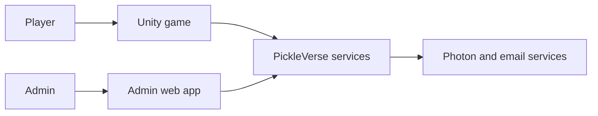

## Report 3 Figure 2 Player use cases

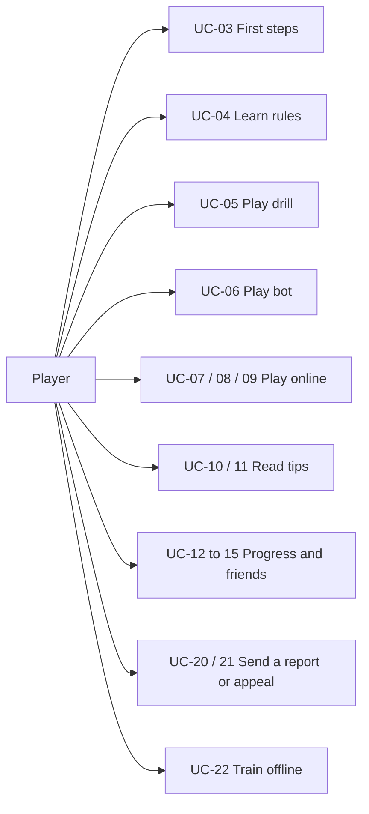

## Report 3 Figure 3 Visitor use cases

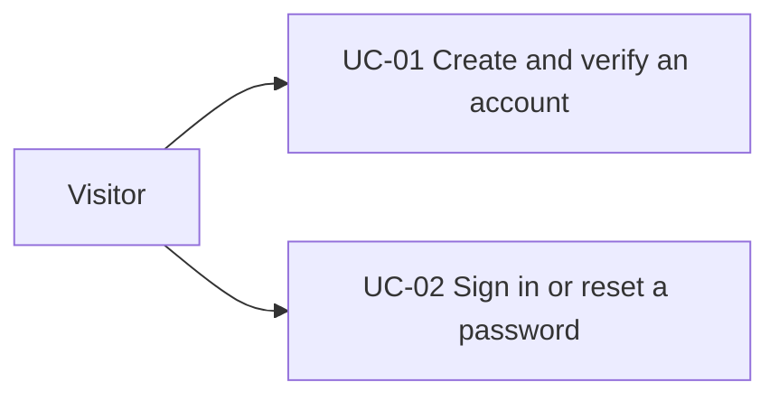

## Report 3 Figure 4 Admin use cases

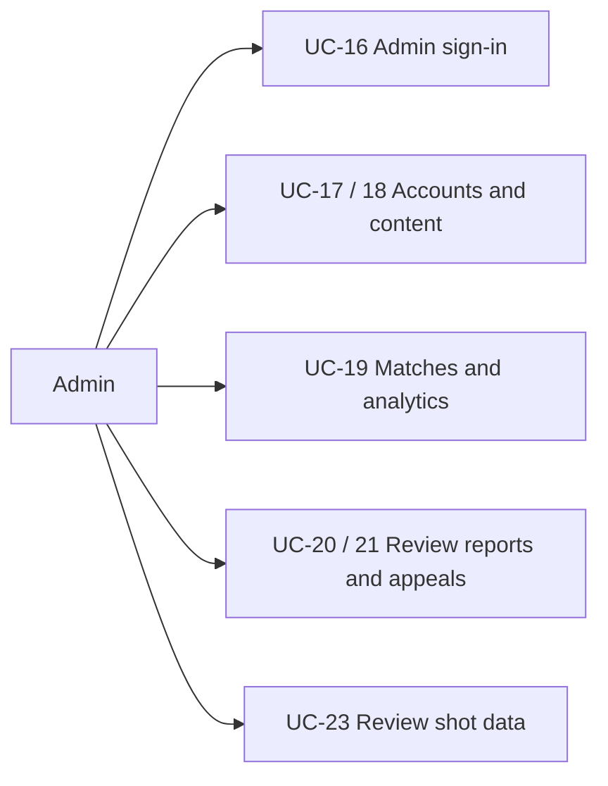

## Report 3 Figure 5 Game screen flow

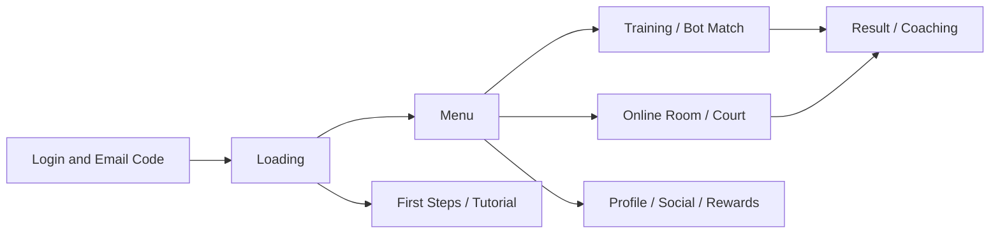

## Report 3 Figure 6 Admin screen flow

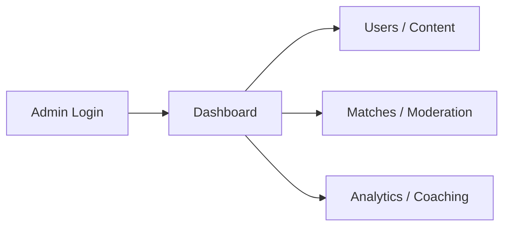

## Report 3 Figure 7 Main data groups

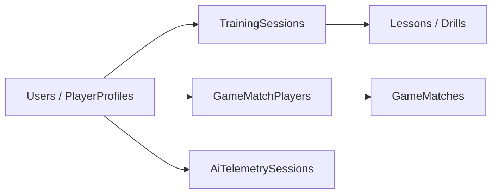

## Report 4 Figure 1 Runtime components

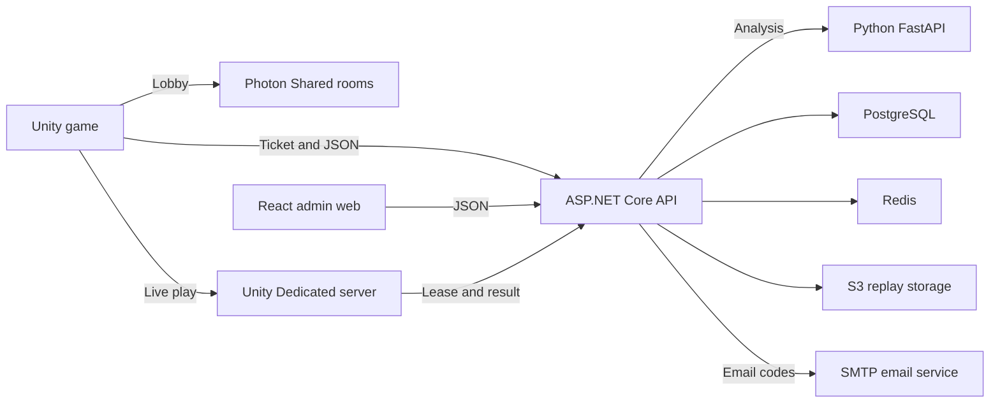

## Report 4 Figure 2 Backend project references

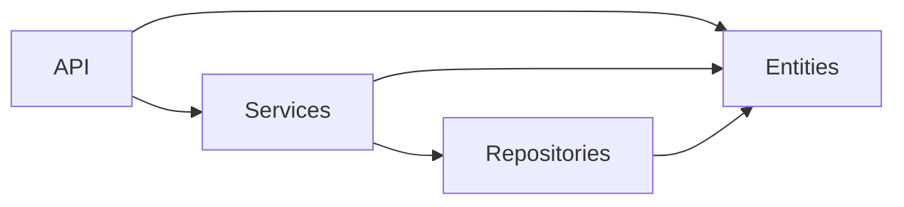

## Report 4 Figure 3 Unity assembly references

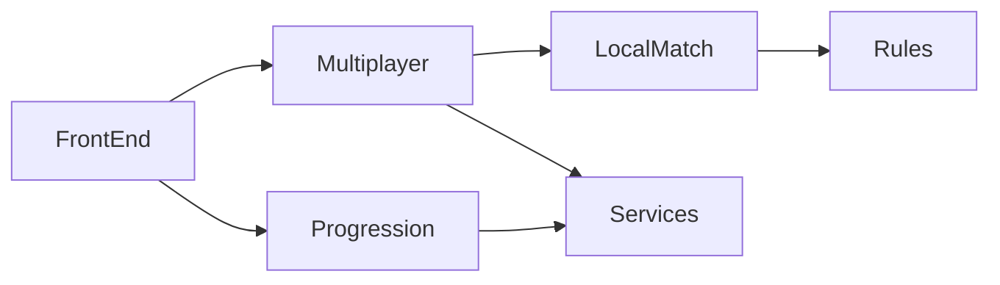

## Report 4 Figure 4 Admin web and AI modules

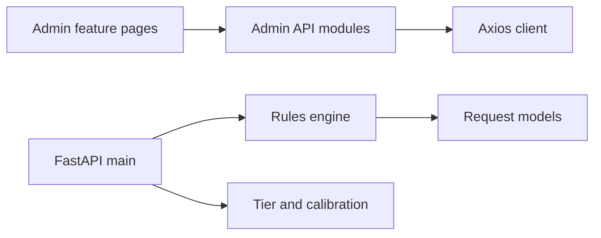

## Report 4 Figure 5 Account and training ERD

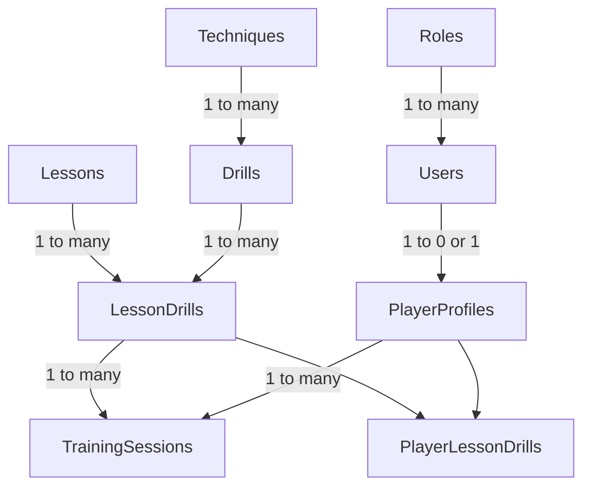

## Report 4 Figure 6 Match and safety ERD

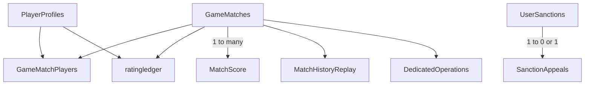

## Report 4 Figure 7 Coaching ERD

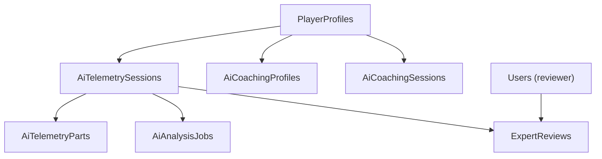

## Report 4 Figure 8 Report and appeal logical ERD

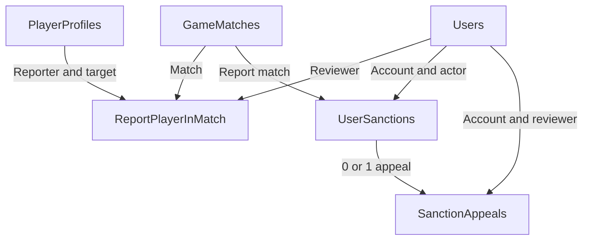

## Report 4 Figure 9 Progress and reward logical ERD

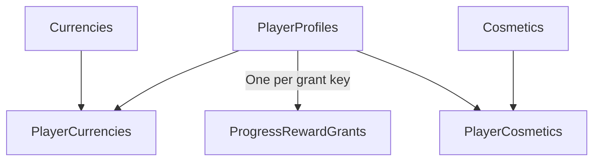

## Report 4 Figure 10 Friend and block logical ERD

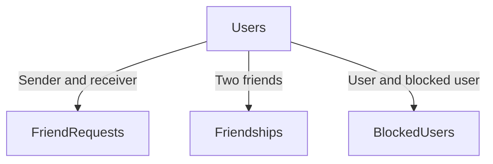

## Report 4 Figure 11 Account and first steps classes

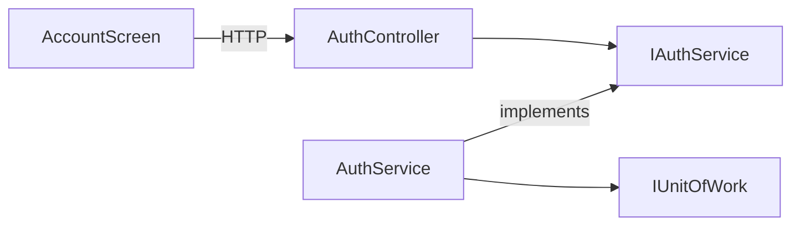

## Report 4 Figure 12 Account and first steps sequence

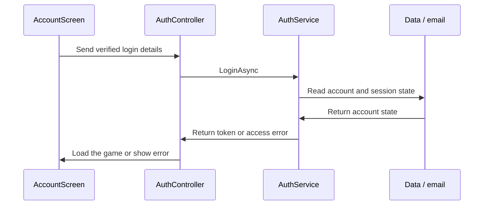

## Report 4 Figure 13 Training and offline sync classes

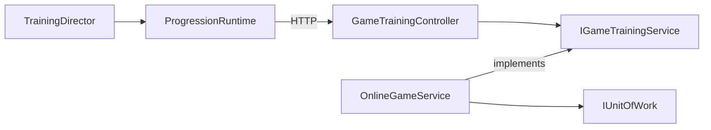

## Report 4 Figure 14 Training and offline sync sequence

```mermaid
sequenceDiagram
  participant P0 as Unity training
  participant P1 as Saved queue
  participant P2 as Training API
  participant P3 as OnlineGameService
  P0->>P1: Save finished offline run
  P1->>P2: Send runs after reconnect
  P2->>P3: SyncTraining
  P3->>P3: Check epoch, run ID and result
  P3->>P2: Return per-run receipt
  P2->>P1: Keep retry items, clear accepted items
```

## Report 4 Figure 15 Online rooms and dedicated play classes

```mermaid
flowchart LR
  N_p["PhotonSession"]
  N_w["DedicatedWorker"]
  N_a["DedicatedServerService"]
  N_d["DedicatedAdmission"]
  N_u["IUnitOfWork"]
  N_r["DedicatedLeaseRepository"]
  N_w -->|"API calls"| N_a
  N_w -->|"ticket check"| N_d
  N_a --> N_r
  N_a --> N_u
```

## Report 4 Figure 16 Online rooms and dedicated play sequence

```mermaid
sequenceDiagram
  participant P0 as Unity client
  participant P1 as API
  participant P2 as Dedicated Worker
  participant P3 as PostgreSQL
  P0->>P1: Request ticket for the started match
  P1->>P0: Waiting state while the worker starts
  P2->>P1: Claim lease and report Ready
  P0->>P1: Poll ticket every 500 ms until Ready
  P1->>P0: Ready with signed token
  P0->>P2: Join with the token
  P2->>P1: Check admission and lease
  P2->>P2: Run rallies and track scores
  P2->>P1: Send trusted completion
  P1->>P3: Save the outcome once
```

## Report 4 Figure 17 Bot and coaching classes

```mermaid
flowchart LR
  N_q["QuickCoachingRules"]
  N_c["CoachingRuntime"]
  N_h["HybridCoachingService"]
  N_b["HybridAiWorker"]
  N_a["FastAPI analyzer"]
  N_u["IUnitOfWork"]
  N_c -->|"API flow"| N_h
  N_h --> N_u
  N_b -->|"HTTP"| N_a
  N_b --> N_h
```

## Report 4 Figure 18 Bot and coaching sequence

```mermaid
sequenceDiagram
  participant P0 as Unity / Dedicated
  participant P1 as Coaching API
  participant P2 as HybridAiWorker
  participant P3 as FastAPI
  P0->>P1: Upload allowed session data
  P1->>P1: Check owner and queue the batch
  P2->>P1: Claim ready analysis job
  P2->>P3: Analyze with X-AI-Key
  P3->>P2: Return rules or gated model output
  P2->>P1: Store completed result
  P0->>P1: Read summary and suggestion
```

## Report 4 Figure 19 Progress, items and social classes

```mermaid
flowchart LR
  N_p["ProgressionRuntime"]
  N_a["Game API"]
  N_s["OnlineGameService"]
  N_u["IUnitOfWork"]
  N_r["GameRepository"]
  N_c["PickleVerseContext"]
  N_p -->|"HTTP"| N_a
  N_a -->|"service contract"| N_s
  N_s --> N_u
  N_u --> N_r
  N_r --> N_c
```

## Report 4 Figure 20 Progress, items and social sequence

```mermaid
sequenceDiagram
  participant P0 as Game client
  participant P1 as Game API
  participant P2 as Service
  participant P3 as Database
  P0->>P1: Request mission reward
  P1->>P2: Check player and claim
  P2->>P3: Read progress and saved command
  P2->>P3: Save one claim and reward
  P2->>P1: Return updated game state
  P1->>P0: Show new balance
```

## Report 4 Figure 21 Content and account administration classes

```mermaid
flowchart LR
  N_w["Admin web"]
  N_c["ContentController"]
  N_s["ContentService"]
  N_r["ProgressResetController"]
  N_p["ProgressResetService"]
  N_u["IUnitOfWork"]
  N_w -->|"HTTP"| N_c
  N_w -->|"HTTP"| N_r
  N_c -->|"IContentService"| N_s
  N_r -->|"service"| N_p
  N_s --> N_u
  N_p --> N_u
```

## Report 4 Figure 22 Content and account administration sequence

```mermaid
sequenceDiagram
  participant P0 as Admin web
  participant P1 as ContentController
  participant P2 as ContentService
  participant P3 as PostgreSQL
  P0->>P1: Save draft with expected version
  P1->>P2: Check Admin and pass request
  P2->>P3: Check and save versioned content
  P0->>P1: Publish lesson
  P1->>P2: Request a new catalog
  P2->>P3: Save published snapshot
  P1->>P0: Show current state
```

## Report 4 Figure 23 Moderation and expert review classes

```mermaid
flowchart LR
  N_m["ModerationService"]
  N_d["DedicatedServerService"]
  N_w["ExpertReviewController"]
  N_u["IUnitOfWork"]
  N_e["ExpertReviewService"]
  N_m --> N_u
  N_d --> N_u
  N_w -->|"service contract"| N_e
  N_e --> N_u
```

## Report 4 Figure 24 Moderation and expert review sequence

```mermaid
sequenceDiagram
  participant P0 as Admin web
  participant P1 as Moderation API
  participant P2 as ModerationService
  participant P3 as Dedicated Worker
  P0->>P1: Request stop with reason
  P1->>P2: Check access and live match
  P2->>P2: Store stop operation
  P3->>P1: Send heartbeat
  P1->>P3: Return stop command
  P3->>P1: Acknowledge with lease
  P0->>P1: Read operation state
```

## Report 4 Figure 25 ACT-W01 Learn and sync a drill

```mermaid
flowchart LR
  N_a["Player<br/>Verify and sign in"]
  N_b["Game<br/>Open tutorial and drill"]
  N_c["Player<br/>Finish cached drill offline"]
  N_d["Game<br/>Save run on device"]
  N_e["API<br/>Check ID and version"]
  N_f["API<br/>Apply once or return receipt"]
  N_a --> N_b
  N_b --> N_c
  N_c --> N_d
  N_d -->|"Reconnect"| N_e
  N_e --> N_f
```

## Report 4 Figure 26 ACT-W02 Play a bot and get a tip

```mermaid
flowchart LR
  N_a["Player<br/>Pick level and mode"]
  N_b["Game<br/>Start bot match"]
  N_c["Player and bot<br/>Play rallies"]
  N_d["Game<br/>Show result and quick tips"]
  N_e["AI service<br/>Check usable data"]
  N_f["Game<br/>Show available summary"]
  N_a --> N_b
  N_b --> N_c
  N_c --> N_d
  N_d -->|"Allowed data"| N_e
  N_e --> N_f
```

## Report 4 Figure 27 ACT-W03 Play online and save the result

```mermaid
flowchart LR
  N_a["Players<br/>Find or join a room"]
  N_b["Players<br/>Accept the ready check"]
  N_c["API and worker<br/>Wait for Ready ticket"]
  N_x["Game<br/>Close old offer"]
  N_d["Dedicated server<br/>Run rallies"]
  N_e["API<br/>Save one result"]
  N_a --> N_b
  N_b -->|"All accept"| N_c
  N_b -->|"Decline"| N_x
  N_c -->|"Ready"| N_d
  N_d --> N_e
```

## Report 4 Figure 28 ACT-W04 Review a report and publish a lesson

```mermaid
flowchart LR
  N_a["Player<br/>Send eligible report"]
  N_b["Admin<br/>Review the report"]
  N_c["API<br/>Save one decision"]
  N_d["Admin<br/>Publish a draft"]
  N_e["API<br/>Check role and version"]
  N_f["Game<br/>Read published lesson"]
  N_a --> N_b
  N_b --> N_c
  N_d --> N_e
  N_e -->|"Valid Admin"| N_f
```

## Report 4 Figure 29 SM-01 Email verification

```mermaid
stateDiagram-v2
  state "Unverified" as S_u
  state "Verified" as S_v
  [*] --> S_u: Register
  S_u --> S_v: Valid code
```

## Report 4 Figure 30 SM-02 Training run and sync

```mermaid
stateDiagram-v2
  state "Active run" as S_a
  state "Saved offline" as S_b
  state "APPLIED" as S_c
  state "REJECTED" as S_d
  state "DUPLICATE" as S_e
  S_a --> S_b: Finish offline
  S_b --> S_c: Valid sync
  S_b --> S_d: Bad version
  S_c --> S_e: Repeat
```

## Report 4 Figure 31 SM-03 Bot match phases

```mermaid
stateDiagram-v2
  state "Intro" as S_i
  state "Cinematic" as S_c
  state "PreServe" as S_p
  state "BetweenPoints" as S_b
  state "Settling" as S_s
  state "Rally" as S_r
  state "BetweenGames" as S_g
  state "MatchOver" as S_m
  state "Timeout" as S_t
  S_i --> S_c: Start
  S_c --> S_p: Intro ends
  S_p --> S_r: Serve
  S_r --> S_s: Rally ends
  S_s --> S_b: Next point
  S_s --> S_g: Next game
  S_s --> S_m: Match won
  S_b --> S_p
  S_g --> S_p
  S_p --> S_t: Timeout
  S_t --> S_p: Resume
```

## Report 4 Figure 32 SM-04 Ranked search

```mermaid
stateDiagram-v2
  state "SEARCHING" as S_s
  state "MATCHED" as S_m
  state "BOT" as S_b
  state "CANCELLED" as S_c
  state "TIMEOUT" as S_t
  S_s --> S_m: Group found
  S_s --> S_b: Bot fallback
  S_s --> S_c: Cancel
  S_s --> S_t: Expired
```

## Report 4 Figure 33 SM-05 Saved match

```mermaid
stateDiagram-v2
  state "PREPARING" as S_p
  state "PLAYING" as S_y
  state "FINISHED" as S_f
  state "CANCELLED" as S_c
  S_p --> S_y: Accept and start
  S_p --> S_c: Cancel
  S_y --> S_f: Result or interruption
```

## Report 4 Figure 34 SM-06 Content publication

```mermaid
stateDiagram-v2
  state "DRAFT" as S_d
  state "PUBLISHED" as S_p
  state "UNPUBLISHED" as S_u
  S_d --> S_p: Publish
  S_p --> S_u: Unpublish
  S_u --> S_p: Publish again
```

## Report 4 Figure 35 SM-07 Report and appeal decision

```mermaid
stateDiagram-v2
  state "PENDING" as S_p
  state "CHECKING" as S_c
  state "ACCEPTED" as S_a
  state "DECLINED" as S_d
  S_p --> S_c: Review
  S_c --> S_a: Accept
  S_c --> S_d: Decline
  S_p --> S_a: Direct accept
  S_p --> S_d: Direct decline
```

## Report 4 Figure 36 SM-08 Account restriction

```mermaid
stateDiagram-v2
  state "ACTIVE" as S_a
  state "SUSPENDED" as S_s
  state "BANNED" as S_b
  S_a --> S_s: Suspend
  S_a --> S_b: Ban
  S_s --> S_a: Expire or revoke
  S_b --> S_a: Lift restriction
```

## Report 4 Figure 37 SM-09 AI analysis job

```mermaid
stateDiagram-v2
  state "pending" as S_p
  state "processing" as S_r
  state "completed" as S_c
  state "failed" as S_f
  S_p --> S_r: Claim job
  S_r --> S_c: Save result
  S_r --> S_p: Retry
  S_r --> S_f: Limit reached
```

## Report 4 Figure 38 SM-10 Friend request

```mermaid
stateDiagram-v2
  state "PENDING" as S_p
  state "ACCEPTED" as S_a
  state "DECLINED" as S_d
  S_p --> S_a: Accept
  S_p --> S_d: Decline
```

## Report 4 Figure 39 SM-11 Dedicated allocation

```mermaid
stateDiagram-v2
  state "queued" as S_q
  state "starting" as S_s
  state "ready" as S_r
  state "Lease released or expired" as S_e
  state "finishing" as S_f
  S_q --> S_s: Worker claim
  S_s --> S_r: Worker ready
  S_r --> S_f: Final result
  S_f --> S_e: Release
  S_s --> S_e: Expire
  S_r --> S_e: Expire or stop
```
