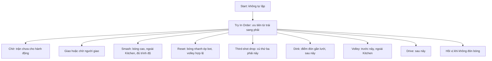

# Replay local, Daily Streak, Entites và BhTree

Triển khai trong Unity 6000.6.2f1, package Unity Behavior 1.0.16. Dữ liệu mới nằm ở máy chơi; kết nối multiplayer hiện có vẫn dùng dịch vụ hiện có. Không có API hoặc upload replay mới.

## Sử dụng

- **BotMatch:** chọn BhTree trong màn chuẩn bị trận. Dễ/Vừa/Khó vẫn có giá trị 0/1/2; BhTree là 3. Elo được chụp khi bắt đầu mỗi trận, không thay đổi giữa trận. HUD hiện Elo, phản xạ, sai số và nhánh đang chọn.
- **History:** bấm Xem replay. Trận cũ không có file hiện “Chưa có replay”; trận thoát giữa chừng hiện “chưa hoàn tất”. Có phát/dừng, thanh tua, 0,5×/1×/2× và quay về history.
- **Nhiệm vụ ngày:** xem chuỗi hiện tại, dài nhất và đã chơi hôm nay. Hồ sơ có thêm chuỗi ngày dài nhất. Đây là bộ đếm, chưa có thưởng.
- **PlayMultiplayer:** tên lấy từ profile local. Quay lại hủy tìm trận, rời phòng rồi mở ModeSelection. Nếu rời phòng lỗi, màn hình hiện lỗi để thử lại.

## Behavior tree là gì?

Behavior tree mô tả cách bot chọn hành động bằng các node. Một selector thử các con theo thứ tự; gặp con thành công thì dừng. Mỗi node có thể trả Success, Failure hoặc Running. Blackboard là nơi chứa dữ liệu bot dùng khi quyết định. Unity Behavior có công cụ vẽ và quan sát graph trong Editor; xem [tài liệu chính thức](https://docs.unity3d.com/Packages/com.unity.behavior@1.0/manual/index.html).

Graph của dự án nằm tại `Assets/Resources/BhTree/Bot Behavior.asset`. Mở asset bằng Unity Behavior. Trong Play Mode, chọn **Local Singles Match**, Behavior Graph Agent và instance graph của nó để xem blackboard/node. Agent bị tắt Update tự động; BotMatch gọi graph trong tick mô phỏng 1/120 giây. Các node ra quyết định tức thời, selector được chạy tới khi có quyết định trong cùng tick. Không dùng node Wait tính bằng thời gian Unity để tạo phản xạ; phản xạ/cooldown giảm bằng dt của mô phỏng.

Các node cú đánh tự kiểm tra bot có lượt hay không, dự đoán tiếp xúc, di chuyển đến điểm đón và chỉ gọi RequestShot khi phản xạ/cooldown/khả năng tới bóng cho phép. Cú đánh vẫn phải tiếp xúc với vợt; luật hiện có quyết định lỗi. Graph không cấp điểm, không dịch chuyển bóng để bảo đảm bot đánh trúng.

| Blackboard | Dữ liệu trong dự án |
|---|---|
| Phase, CanAct | Phase và trạng thái pause của BotMatch |
| Server, ExpectedHitter, Stroke, Bounces | Luật đang chạy, người giao, lượt đánh, số lần nảy |
| BallPosition, BallVelocity | Trạng thái bóng mô phỏng |
| BotPosition, HumanPosition | Vị trí hai nhân vật hiện tại |
| ContactPoint, ContactDelay | Dự đoán điểm/thời gian đón của nhánh được xét |
| Swinging, Cooldown, InKitchen | Swing, thời gian chờ và vị trí chân bot |
| Elo, SimulationTime, Branch | Elo cố định, thời gian mô phỏng, nhánh để quan sát |

Các node đọc trạng thái qua BhTreeBot, nơi cập nhật blackboard và nối graph với BotMatch. Không cần dataset để cây điều kiện này hoạt động. Nếu cân bằng chiến thuật sau này, có thể đo tỷ lệ trả bóng hợp lệ, lỗi Kitchen/two-bounce, tỷ lệ thắng, phân bố cú đánh và thời gian tới bóng ở từng nhóm Elo. Đó là đề xuất đo tiếp, chưa phải dữ liệu chứng minh cấu hình hiện tại đã cân bằng.

| Elo | Phản xạ | Sai số | Nhánh |
|---|---:|---:|---|
| < 500 | 0,28 s | 0,30 m | Giao, drive, volley hợp lệ, hồi vị |
| 500–1999 | 0,15 s | 0,16 m | Thêm drop, dink, reset |
| ≥ 2000 | 0,08 s | 0,08 m | Thêm smash, chọn thẳng/chéo xa người chơi hơn |

BhTree chỉ áp dụng cho BotMatch local. Ranked bot và bot multiplayer vẫn dùng logic cũ. Các ngưỡng trên là cấu hình thử nghiệm.

## Lưu dữ liệu và ranh giới backend

`Assets/Scripts/Entites` chứa assembly `PickleVerse.Entites`, chia Progression, Training, Shop, Social, Multiplayer và Replays. Giữ namespace/kiểu/trường JSON/enum cũ. CurrencyPolicy, engine, repository, kết nối mạng và prefab/material vẫn ở module sử dụng. Thực thể không tham chiếu các assembly runtime, tránh vòng phụ thuộc.

- Profile tiếp tục ở `Application.persistentDataPath/LocalPlayers/<profile>.json`. Migration thêm streak version 1, khởi tạo rỗng và không suy ra chuỗi từ history cũ. Profile version tăng lên 2; dữ liệu cũ được giữ.
- Replay version 1 ở `Application.persistentDataPath/Replays/<profile>/<matchId>/metadata.json`; các chunk là `000000.json.gz`, `000001.json.gz`… Unity cung cấp [persistentDataPath](https://docs.unity3d.com/ScriptReference/Application-persistentDataPath.html) cho dữ liệu tồn tại giữa những lần chạy.
- Mục tiêu lấy mẫu 30 Hz, dùng trạng thái hình ảnh quan sát được trong LateUpdate sau pose/secondary motion. Khi FPS thấp không tạo thêm các frame giả. Mỗi máy multiplayer ghi hình ảnh nó quan sát, có đủ 2 hoặc 4 actor.
- Pose gồm root và toàn bộ transform con, cả xương secondary motion, vợt và trang bị. Scene Replay chỉ có visual, camera/UI; prefab replay đã loại script gameplay, animation tự động, rigidbody/collider. Nó không chạy bot, luật hoặc áp dụng kết quả trận.
- Worker nén/ghi tối đa một chunk, recorder giữ thêm một buffer đang thu, tối đa 64 frame mỗi buffer. Chunk đóng theo khoảng hai giây. Nếu ổ đĩa không ghi kịp trước khi buffer kế tiếp đầy, dừng ghi và giữ các chunk đã hoàn tất. Unity xác nhận [JsonUtility.ToJson dùng được ở background thread](https://docs.unity3d.com/ScriptReference/JsonUtility.ToJson.html); các DTO được chuyển cho worker không bị thay đổi trong lúc ghi.
- Chunk được commit trước metadata. Khi mở profile, phục hồi các chunk đã commit nhưng metadata chưa kịp cập nhật; có metadata dự phòng. File hỏng/thiếu/phiên bản khác được báo ở màn replay, không xóa history/kết quả.
- Chỉ dọn file sau khi transaction profile lưu thành công; giữ 20 ID history và ID trận pending. IReplayRepository có thể thay bằng nguồn khác sau này. IUtcClock hiện dùng UTC thiết bị; chưa có đồng hồ server.

Daily streak lưu các ngày hợp lệ từ lúc bật tính năng. Won/Lost ở mọi chế độ đều tính, kể cả Custom; localForfeit và Interrupted không tính. Người còn lại sau đối thủ thoát vẫn có thể nhận kết quả hợp lệ. Cùng ngày chỉ ghi một lần; kết quả đến muộn có thể nối lại các ngày liên tiếp. Sau khi bỏ một ngày, chuỗi hiện tại hết hiệu lực; trận hợp lệ kế tiếp bắt đầu lại từ 1. Ngày UTC đổi lúc 07:00 Việt Nam. Replay không gọi ProgressionEngine.Apply.

## Kiểm chứng

Các kết quả chạy thực tế ở cùng thư mục: `EditMode-results.json`, `Recorder-performance.json`, ảnh UI và báo cáo Play Mode. Chạy lại trong Test Runner các assembly Progression, LocalMatch, Replays, Shop, Social và Multiplayer.

- **EditMode:** 285/285 test đạt, không có test bị bỏ qua. Bao gồm các bộ kiểm thử cũ và các ca mới về streak, replay, BhTree và điều hướng bất đồng bộ.
- **Play Mode:** kiểm tra lựa chọn BhTree, graph/blackboard thực, HUD, ghi và xem replay BotMatch, tua và đổi tốc độ, trở về history, và Quay lại trong lúc tìm trận. Kết quả kết thúc BotMatch dùng fixture điều khiển luật để tạo hai game thắng, xác nhận replay hoàn tất và streak tăng một lần.
- **Fixture 2v2:** kiểm tra đủ bốn nhân vật, skin/vợt, tỷ số và đổi sân. Đây là fixture hình ảnh trong Editor; chưa nghiệm thu một trận online với bốn máy kết nối thật.
- **Đo recorder:** hai rig 85/72 transform, 180 lần capture; median 0,188 ms, p95 0,471 ms, buffer lớn nhất 44 frame trong lần đo. Nén/ghi chạy worker. Khoảng chờ yêu cầu 34 ms có sai lệch do lịch chạy Editor; đây là phép đo capture, không phải benchmark FPS của cả trận.

Nếu cần tái tạo các asset mới, dùng menu **PickleVerse → Features → Setup**, ở ngoài Play Mode. Công cụ dùng API Unity Editor, giữ scene không liên quan; trước khi sửa scene đích đang chưa lưu, tạo bản sao trong Tools/SceneBackups. Phần authoring graph truy cập API internal của Behavior 1.0.16 bằng reflection tập trung trong LocalFeaturesSetup; cần kiểm tra lại khi nâng package. Graph đã tồn tại được giữ nguyên bố cục/node của người dùng và rebuild runtime data.

Nghiệm thu hiện tại chỉ ở Unity Editor. Chưa có kết quả build Windows/Android, thử lỗi dịch vụ rời phòng trên kết nối thật hoặc cân bằng bot dựa trên số liệu người chơi. Luồng lỗi/rời phòng và phản hồi đến muộn được kiểm tra bằng test điều khiển bất đồng bộ.
