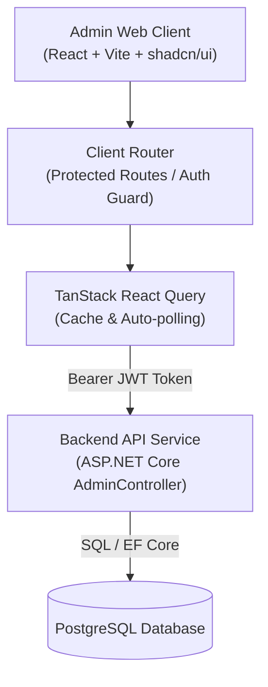

# Business Requirements Document (BRD)
## PickleVerse Admin Web Dashboard

**Project**: PickleVerse – Multiplayer Pickleball Skill-Training and Match Game with AI Coaching  
**Feature**: Admin Web Dashboard  
**Feature Slug**: `admin-web`  
**Project Scope**: `Full-Stack Application`  
**Status**: Draft for Stakeholder Review  
**Date**: 2026-10-22  
**Owner**: Tad-Min / PickleVerse Team  

---

## 1. Executive Summary & Business Context

### 1.1 Business Need
PickleVerse kết hợp giữa game 3D đào tạo kỹ thuật, thi đấu nhiều người chơi và huấn luyện AI. Để vận hành hệ thống một cách an toàn, tin cậy và liên tục mở rộng nội dung đào tạo mà không cần can thiệp trực tiếp vào database hoặc phát hành lại bản build Unity client, hệ thống bắt buộc phải có một **Website Quản trị (Admin Web Dashboard)** chuyên dụng.

### 1.2 Business Objectives
1. **Kiểm soát vận hành (Operational Control):** Cung cấp công cụ quản lý tài khoản người chơi, phát hiện và xử lý kịp thời các hành vi gian lận (cheating, toxicity, AFK) để duy trì môi trường thể thao trực tuyến công bằng, văn minh.
2. **Quản trị nội dung linh hoạt (Content Agility):** Cho phép huấn luyện viên và nhà thiết kế game bổ sung bài học, bài tập kỹ thuật (Drills), nhiệm vụ và vật phẩm trực tiếp qua giao diện web mà không cần sửa code.
3. **Khai thác dữ liệu huấn luyện AI (AI Telemetry Insights):** Trực quan hóa bản đồ nhiệt (Heatmap) các lỗi sai kỹ thuật phổ biến nhất (giao bóng trễ, dink quá cao, phạm luật kitchen) để ban chuyên môn điều chỉnh giáo trình đào tạo.
4. **Giám sát hệ thống thời gian thực (Live System Health):** Theo dõi số lượng người chơi hoạt động (DAU), thời gian chơi thực tế, các phiên trận đấu đang diễn ra và sức khỏe hàng chờ ghép trận.

---

## 2. Stakeholders & User Roles

| Vai trò | Phân loại | Trách nhiệm chính trong hệ thống | Quyền hạn trên Admin Web |
|---|---|---|---|
| **System Administrator (Super Admin)** | Primary | Vận hành toàn bộ hệ thống, quản lý tài khoản người dùng, phân quyền vai trò (RBAC), kích hoạt thủ công, reset điểm Elo. | Toàn quyền truy cập tất cả 6 phân hệ (User, CMS, Match, Moderation, Analytics, Settings). |
| **Pickleball Coach / Content Designer** | Primary | Soạn thảo giáo trình, tạo bài học (Lessons), bài tập (Drills), cấu hình ngưỡng kỹ thuật chuẩn và nhiệm vụ hàng ngày. | Truy cập phân hệ Content CMS và xem báo cáo Analytics Heatmap. |
| **Community Moderator** | Secondary | Tiếp nhận báo cáo vi phạm trận đấu từ người chơi, kiểm tra dữ liệu trận đấu và đưa ra quyết định xử phạt (Ban/Dismiss). | Truy cập phân hệ Moderation & Tribunal và xem lịch sử trận đấu (Match Monitoring). |
| **Capstone Examination Board / Sponsor** | External | Hội đồng đánh giá năng lực công nghệ phần mềm của đồ án, kiểm chứng kiến trúc đa tầng (Multi-tier Architecture) và tính hoàn thiện của sản phẩm. | Khách xem demo, nghiệm thu tính năng theo tiêu chí Proposal. |

---

## 3. Functional Requirements (FR)

### 3.1 Authentication & Role-Based Access Control (RBAC)

#### FR-01: Admin Authentication
* **User Story:** Là một Quản trị viên, tôi muốn đăng nhập vào hệ thống quản trị bằng Email/Username và Mật khẩu, để bảo vệ hệ thống khỏi các truy cập trái phép.
* **Acceptance Criteria:**
  1. Giao diện cung cấp form đăng nhập chuẩn với xác thực client-side (định dạng email, mật khẩu không được để trống).
  2. Gửi yêu cầu xác thực tới `POST /api/Auth/login`.
  3. Chỉ cho phép tiếp tục truy cập nếu phản hồi xác thực trả về JWT token có claim vai trò `Role = "Admin"`.
  4. Nếu tài khoản có vai trò `Player`, hệ thống từ chối truy cập, xóa token và thông báo lỗi: *"Tài khoản của bạn không có quyền truy cập trang quản trị."*
  5. Lưu trữ JWT an toàn (LocalStorage/SessionStorage) và đính kèm Bearer Header trong mọi cuộc gọi API sau đó.
  6. Hỗ trợ nút Đăng xuất (Logout) xóa sạch session và điều hướng về trang Login.
* **Priority:** `Must Have`
* **API Endpoint:** `POST /api/Auth/login`

#### FR-02: Route Guards & Unauthorized Interception
* **User Story:** Là một Quản trị viên, tôi muốn các trang quản trị được bảo vệ tự động, để người dùng chưa đăng nhập hoặc không có quyền bị chặn ngay từ phía client lẫn server.
* **Acceptance Criteria:**
  1. Client Router (React Router) kiểm tra token trước khi render mọi trang con trong Admin Dashboard.
  2. Nếu chưa có token $\rightarrow$ tự động chuyển hướng về `/login`.
  3. Cấu hình Axios/Fetch interceptor: khi API trả về mã HTTP `401 Unauthorized` hoặc `403 Forbidden`, hệ thống tự động xóa token và chuyển hướng về màn hình đăng nhập kèm thông báo giải thích.
* **Priority:** `Must Have`

---

### 3.2 User Management & Account Administration

#### FR-03: User Listing & Search
* **User Story:** Là một Quản trị viên, tôi muốn tra cứu và xem danh sách người dùng với các bộ lọc tìm kiếm và phân trang, để quản lý cộng đồng người chơi PickleVerse hiệu quả.
* **Acceptance Criteria:**
  1. Hiển thị bảng danh sách người dùng gồm các cột: `UserId`, `PlayerName`, `Email`, `RoleName`, `Status`, `Elo`, `TimePlayedSeconds`, `CreatedAt`.
  2. Có ô tìm kiếm tức thời theo từ khóa (tên người chơi, email) gửi tham số `search` lên backend.
  3. Có bộ lọc theo trạng thái tài khoản: `ACTIVE`, `BANNED`, `UNVERIFIED` (tham số `status`).
  4. Hỗ trợ phân trang máy chủ (`page`, `pageSize` mặc định 20 dòng/trang) với nút điều hướng trang trước/sau.
* **Priority:** `Must Have`
* **API Endpoint:** `GET /api/Admin/users?search={query}&status={status}&page={page}&pageSize={size}`

#### FR-04: Role Assignment
* **User Story:** Là một Quản trị viên cấp cao, tôi muốn gán hoặc thay đổi vai trò của một tài khoản giữa `Player` và `Admin`, để phân quyền cho cộng sự vận hành.
* **Acceptance Criteria:**
  1. Tại mỗi dòng người dùng, có nút/menu hành động "Gán vai trò" (Assign Role).
  2. Hiển thị modal cho phép chọn vai trò mới (Player = 1, Admin = 2).
  3. Khi xác nhận, gửi `POST /api/Admin/users/assign-role` với payload `{ userId, roleId }`.
  4. Cập nhật ngay trạng thái vai trò trên bảng và hiển thị toast thông báo thành công.
* **Priority:** `Must Have`
* **API Endpoint:** `POST /api/Admin/users/assign-role`

#### FR-05: Account Sanction (Ban & Unban)
* **User Story:** Là một Quản trị viên, tôi muốn khóa (Ban) hoặc mở khóa (Unban) tài khoản người chơi vi phạm, để giữ môi trường game văn minh và xử lý kháng cáo.
* **Acceptance Criteria:**
  1. Nút "Khóa tài khoản" hiển thị modal yêu cầu nhập: Lý do vi phạm (`Reason` - bắt buộc) và Thời hạn khóa (`BannedUntil` - tùy chọn, nếu để trống hiểu là khóa vĩnh viễn).
  2. Gửi request `POST /api/Admin/users/ban`. Trạng thái người dùng chuyển sang `BANNED`.
  3. Với tài khoản đang bị khóa, cung cấp nút "Mở khóa" (Unban), gửi request `POST /api/Admin/users/{userId}/unban`.
  4. Hệ thống ghi nhận biên bản và cập nhật ngay lập tức giao diện người dùng (Optimistic update hoặc refetch query).
* **Priority:** `Must Have`
* **API Endpoints:** `POST /api/Admin/users/ban`, `POST /api/Admin/users/{userId}/unban`

#### FR-06: Manual Email Verification & Elo Reset
* **User Story:** Là một Quản trị viên, tôi muốn kích hoạt tài khoản thủ công hoặc đặt lại điểm Elo của người chơi, để hỗ trợ xử lý sự cố xác thực và chống gian lận leo rank.
* **Acceptance Criteria:**
  1. Cung cấp nút "Kích hoạt thủ công" (Verify Email) cho các tài khoản đang ở trạng thái `UNVERIFIED`. Gửi `POST /api/Admin/users/{userId}/verify-email`.
  2. Cung cấp nút "Đặt lại Elo" (Reset Elo), gửi `POST /api/Admin/users/{playerId}/reset-elo?defaultElo=2000`.
  3. Có hộp thoại xác nhận (Confirmation Dialog) trước khi thực hiện để tránh click nhầm.
* **Priority:** `Should Have`
* **API Endpoints:** `POST /api/Admin/users/{userId}/verify-email`, `POST /api/Admin/users/{playerId}/reset-elo`

---

### 3.3 Content Management System (CMS)

#### FR-07: Lesson & Drill Creation
* **User Story:** Là một Huấn luyện viên/Content Designer, tôi muốn tạo mới các bài học và bài tập drill kỹ thuật, để mở rộng chương trình đào tạo của PickleVerse.
* **Acceptance Criteria:**
  1. **Tạo Bài học (Lesson):** Form gồm `LessonName`, `Description`, `RequiredLevel`, `Order`. Gửi `POST /api/Admin/cms/lessons`.
  2. **Tạo Bài tập (Drill):** Form gồm `LessonId`, `TechniqueId` (Serve=1, Dink=2, Volley=3, Third-Shot Drop=4, Kitchen=5), `DrillName`, `Description`, `Target`, `Order`. Gửi `POST /api/Admin/cms/drills`.
  3. Validate ràng buộc dữ liệu: tên không rỗng, cấp độ yêu cầu $\ge 1$, mục tiêu $\ge 1$.
  4. Hiển thị thông báo khi tạo thành công kèm ID được cấp từ server.
* **Priority:** `Must Have`
* **API Endpoints:** `POST /api/Admin/cms/lessons`, `POST /api/Admin/cms/drills`

#### FR-08: Cosmetics & Missions Management
* **User Story:** Là một Quản trị viên, tôi muốn đăng bán vật phẩm thời trang mới vào Shop và phát hành nhiệm vụ mới, để tạo động lực và trải nghiệm mới cho người chơi.
* **Acceptance Criteria:**
  1. **Đăng vật phẩm (Cosmetics):** Form nhập `ItemCode`, `CosmeticName`, `Description`, `Price`, `Type` (PADDLE, OUTFIT, HAT), `CurrencyId` (1: Gold, 2: Gem). Gửi `POST /api/Admin/cms/cosmetics`.
  2. **Tạo nhiệm vụ (Missions):** Form nhập `MissionName`, `Description`, `Type` (DAILY, WEEKLY), `Target`, `Reward` (VD: "100 Gold"). Gửi `POST /api/Admin/cms/missions`.
  3. Form kiểm tra hợp lệ dữ liệu và toast thông báo thành công.
* **Priority:** `Should Have`
* **API Endpoints:** `POST /api/Admin/cms/cosmetics`, `POST /api/Admin/cms/missions`

---

### 3.4 Match Monitoring & Real-time Operations

#### FR-09: Recent & Live Matches Monitoring
* **User Story:** Là một Quản trị viên, tôi muốn theo dõi danh sách các trận đấu vừa diễn ra và đang diễn ra, để nắm bắt tình hình hoạt động của game server.
* **Acceptance Criteria:**
  1. Hiển thị bảng danh sách các trận đấu gần nhất: `MatchId`, `Mode` (1v1 Singles, 2v2 Doubles), `CourtName`, `StartTime`, `EndTime`, `Winner`, `Status`.
  2. Hỗ trợ tính năng **Tự động làm mới (Auto-polling)** mỗi 15-30 giây (có switch bật/tắt tiện lợi).
  3. Hỗ trợ **Nút bấm làm mới thủ công (Manual Refresh)** với hiệu ứng quay spinner để tải lại dữ liệu tức thì.
  4. Khi nhấn vào một trận đấu, mở Drawer hoặc Modal hiển thị chi tiết tỷ số các set và thời lượng trận.
* **Priority:** `Must Have`
* **API Endpoint:** `GET /api/Admin/matches/recent?limit=50`

---

### 3.5 Moderation & Tribunal

#### FR-10: Player Report Triage
* **User Story:** Là một Kiểm duyệt viên, tôi muốn xem danh sách các báo cáo vi phạm từ người chơi, để điều tra và xử lý các hành vi tiêu cực.
* **Acceptance Criteria:**
  1. Hiển thị danh sách báo cáo với bộ lọc trạng thái: `PENDING`, `RESOLVED`, `DISMISSED`.
  2. Mỗi báo cáo hiển thị: `ReporterName`, `ReportedPlayerName`, `MatchId`, `Reason`, `CreatedAt`, link `ReplayUrl` (nếu có).
  3. Có badge cảnh báo màu sắc cho các báo cáo chưa xử lý (`PENDING`).
* **Priority:** `Must Have`
* **API Endpoint:** `GET /api/Admin/reports?status={status}`

#### FR-11: Report Review & Enforcement
* **User Story:** Là một Kiểm duyệt viên, tôi muốn giải quyết báo cáo bằng cách xử phạt hoặc bác bỏ, để khép lại khiếu nại.
* **Acceptance Criteria:**
  1. Modal xử lý báo cáo cho phép chọn hành động: Duyệt xử phạt (`Status = "RESOLVED"`) hoặc Bác bỏ (`Status = "DISMISSED"`).
  2. Tùy chọn kèm theo: Tích chọn "Khóa tài khoản người bị tố cáo" (`BanReportedPlayer = true`) và nhập lý do khóa (`BanReason`).
  3. Gửi payload lên `POST /api/Admin/reports/review`.
  4. Hệ thống cập nhật trạng thái báo cáo và toast thông báo kết quả.
* **Priority:** `Must Have`
* **API Endpoint:** `POST /api/Admin/reports/review`

---

### 3.6 Analytics & AI Telemetry Heatmap

#### FR-12: Operational Summary Dashboard
* **User Story:** Là một Quản trị viên, tôi muốn xem các chỉ số tổng quan quan trọng trên trang chủ Dashboard, để nắm bắt tức thì tình hình vận hành của PickleVerse.
* **Acceptance Criteria:**
  1. Hiển thị 5 thẻ thống kê (Metric Cards):
     - **Tổng người dùng (Total Users)**
     - **Người dùng hoạt động hôm nay (Active Users Today / DAU)**
     - **Tổng số trận đấu đã diễn ra (Total Matches Played)**
     - **Tổng thời gian chơi thực tế (Total Play Time - quy đổi Giờ/Phút)**
     - **Số báo cáo vi phạm đang chờ xử lý (Pending Reports)**
  2. Các thẻ card có icon trực quan, định dạng số ngăn cách hàng nghìn rõ ràng.
* **Priority:** `Must Have`
* **API Endpoint:** `GET /api/Admin/analytics/summary`

#### FR-13: AI Technique Error Heatmap
* **User Story:** Là một Huấn luyện viên, tôi muốn quan sát Bản đồ nhiệt lỗi kỹ thuật (Technique-Error Heatmap) từ engine phân tích AI, để biết kỹ thuật nào người chơi mắc lỗi nhiều nhất.
* **Acceptance Criteria:**
  1. Truy vấn dữ liệu từ `GET /api/Admin/analytics/error-heatmap`.
  2. Trực quan hóa dữ liệu gồm 5 kỹ thuật chính: *Serve, Dink, Volley, Third-Shot Drop, Court Positioning / Kitchen*.
  3. Mỗi kỹ thuật hiển thị chi tiết số lượng theo từng loại lỗi cụ thể (ví dụ: *Timing Trễ, Đánh Quá Cao, Chân Phạm Vạch Kitchen, Góc Vợt Sai*).
  4. Sử dụng ma trận nhiệt (Heatmap Matrix) hoặc biểu đồ cột xếp chồng (Stacked Bar Chart) với thang màu tương phản cao (Slate/Zinc với dải cảnh báo Vàng $\rightarrow$ Đỏ cam) để hiển thị tần suất lỗi.
  5. Hỗ trợ tooltip chi tiết khi di chuột qua từng ô lỗi.
* **Priority:** `Must Have`
* **API Endpoint:** `GET /api/Admin/analytics/error-heatmap`

---

## 4. Non-Functional Requirements (NFR)

### 4.1 Performance & Scalability
* **NFR-01 (Tốc độ tải trang & phản hồi):** Trang Dashboard và các bảng dữ liệu phải render lần đầu trong vòng $\le 1.5$ giây trên kết nối mạng băng thông rộng tiêu chuẩn. Các truy vấn phân trang qua React Query phải trả về và render kết quả trong $\le 500$ ms.
* **NFR-02 (Tối ưu hóa bộ nhớ & Render DOM):** Sử dụng cơ chế memoization và phân trang server-side, không tải toàn bộ database về client để đảm bảo ứng dụng chạy mượt mà không rò rỉ bộ nhớ.
* **NFR-03 (Polling Efficiency):** Cơ chế auto-polling trên trang Match Monitoring chỉ chạy khi tab trình duyệt đang active (`document.visibilityState === 'visible'`) để tiết kiệm tài nguyên máy chủ.

### 4.2 Security & Compliance
* **NFR-04 (Zero-Trust RBAC):** 100% API quản trị bắt buộc kiểm tra Header `Authorization: Bearer <JWT>`. Client tự động xóa token và chuyển hướng khi gặp 401/403.
* **NFR-05 (Bảo vệ dữ liệu nhạy cảm):** Tuyệt đối không hiển thị mật khẩu hoặc mã hash OTP của người dùng trên giao diện quản trị.
* **NFR-06 (Data Integrity & XSS Prevention):** Sử dụng React JSX với cơ chế escape dữ liệu tự động, ngăn ngừa tấn công Cross-Site Scripting (XSS) khi hiển thị nội dung do người chơi nhập (tên, lý do báo cáo).

### 4.3 Usability & Design System
* **NFR-07 (Design Language):** Thiết kế theo phong cách **SaaS Chuyên nghiệp tối giản (shadcn Slate/Zinc)** với Dark Mode mặc định, độ tương phản văn bản đạt chuẩn **WCAG 2.1 AA** ($\ge 4.5:1$ cho văn bản thường).
* **NFR-08 (Responsive Desktop/Tablet):** Giao diện tương thích hoàn hảo trên các màn hình có độ phân giải từ 1024px (iPad/Tablet ngang) đến 1920x1080 (Desktop), hỗ trợ thanh điều hướng bên hông (Sidebar) có thể thu gọn.
* **NFR-09 (Feedback & State Visibility):** Mọi thao tác gửi biểu mẫu (tạo bài học, khóa tài khoản, duyệt report) phải có loading state (spinner/disable button) và toast notification xác nhận thành công hoặc thông báo lỗi cụ thể từ backend.

---

## 5. Technical Architecture & Component Mapping

---

## 6. Traceability Matrix

| Mã Yêu cầu | Tên Chức năng | Phương thức & Endpoint API | Entity / Bảng CSDL | Độ ưu tiên (MoSCoW) |
|---|---|---|---|---|
| **FR-01** | Admin Authentication | `POST /api/Auth/login` | `Users`, `Roles` | `Must Have` |
| **FR-02** | Route Guards & Security | Client Middleware / Interceptor | N/A | `Must Have` |
| **FR-03** | User Listing & Search | `GET /api/Admin/users` | `Users`, `Profiles` | `Must Have` |
| **FR-04** | Role Assignment | `POST /api/Admin/users/assign-role` | `Users`, `Roles` | `Must Have` |
| **FR-05** | Ban / Unban User | `POST /api/Admin/users/ban` `POST /api/Admin/users/{id}/unban` | `Users`, `Sanctions` | `Must Have` |
| **FR-06** | Manual Verify / Reset Elo | `POST /api/Admin/users/{id}/verify-email` `POST /api/Admin/users/{id}/reset-elo` | `Users`, `Profiles` | `Should Have` |
| **FR-07** | Create Lesson & Drill | `POST /api/Admin/cms/lessons` `POST /api/Admin/cms/drills` | `Lessons`, `Drills` | `Must Have` |
| **FR-08** | Create Cosmetic & Mission | `POST /api/Admin/cms/cosmetics` `POST /api/Admin/cms/missions` | `Cosmetics`, `Missions` | `Should Have` |
| **FR-09** | Match Monitoring (Polling) | `GET /api/Admin/matches/recent` | `Matches`, `MatchPlayers` | `Must Have` |
| **FR-10** | Player Reports Listing | `GET /api/Admin/reports` | `Reports` | `Must Have` |
| **FR-11** | Review Report | `POST /api/Admin/reports/review` | `Reports`, `Sanctions` | `Must Have` |
| **FR-12** | Analytics Summary Cards | `GET /api/Admin/analytics/summary` | Aggregate Data | `Must Have` |
| **FR-13** | AI Technique Error Heatmap | `GET /api/Admin/analytics/error-heatmap` | `TelemetryErrors` | `Must Have` |

---

## 7. Risks & Mitigation Strategies

| Rủi ro | Mức độ | Ảnh hưởng | Biện pháp giảm thiểu |
|---|---|---|---|
| Token JWT hết hạn trong khi admin đang thao tác dở form | Trung bình | Gửi form thất bại, mất dữ liệu đang nhập | Cấu hình thời gian sống JWT hợp lý, lưu nháp form vào LocalStorage khi đang soạn thảo. |
| Auto-polling gây quá tải máy chủ nếu nhiều admin cùng mở tab | Thấp | Tăng tải CPU backend | Giới hạn chu kỳ polling $\ge 15$ giây, dừng polling khi tab bị ẩn (`visibilitychange`). |
| Dữ liệu heatmap AI quá lớn gây lag trình duyệt | Trung bình | Trình duyệt bị đơ khi render SVG | Nhóm dữ liệu theo 5 nhóm kỹ thuật chính từ backend trước khi gửi về client, dùng CSS Grid tối ưu thay vì render hàng nghìn node SVG riêng lẻ. |
| CORS bị chặn giữa Frontend localhost và Backend API | Thấp | Không gọi được API | Kiểm tra và cấu hình policy `AllowAnyOrigin` hoặc `WithOrigins("http://localhost:5173")` trong backend. |
