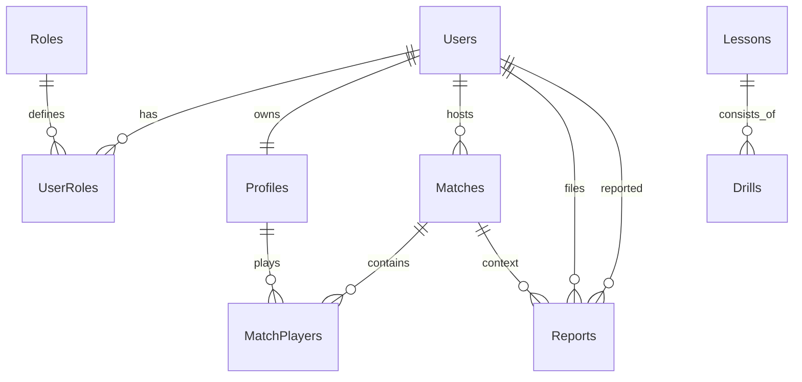

# Project Constitution
## PickleVerse Platform & Admin Web

**Version**: 1.0.0 | **Ratified**: 2026-10-22 | **Last amended**: 2026-10-22  
**Scope**: Project-wide (Toàn bộ dự án PickleVerse: Backend API, Admin Web và Game Integration)

---

## 1. Principles (Các Nguyên Tắc Bắt Buộc)

### Principle 1: Strict Layer Separation (Phân Tách Tam Tầng Nghiêm Ngặt)
*Mã nguồn backend phải phân tách tuyệt đối 3 tầng: `Controller/Handler` $\rightarrow$ `Service` $\rightarrow$ `Repository/DbContext`. Controller chỉ làm nhiệm vụ nhận request, validate DTO đầu vào, gọi Service và trả về HTTP response; tuyệt đối không chứa business logic hoặc truy vấn trực tiếp cơ sở dữ liệu.*
* **Rationale:** Đảm bảo khả năng kiểm thử độc lập (Unit Test), dễ bảo trì và ngăn ngừa rò rỉ logic nghiệp vụ vào tầng giao vận API.
* **Applicability:** Toàn bộ API Controller trong `src/Backend/`.
* **Evidence:** Quan sát thực tế trong `AdminController.cs` và `IAdminService.cs`.
* **Verification:** Code review và static analysis. PR chứa câu lệnh SQL hoặc query DbContext trong Controller sẽ bị từ chối sáp nhập.
* **Exception process:** Cần sự phê duyệt từ Technical Lead và ghi chú lý do trong PR.

### Principle 2: Zero-Trust Role-Based Access Control (RBAC)
*100% endpoint quản trị trong `AdminController` bắt buộc phải được gắn attribute `[Authorize(Roles = "Admin")]`. Phía Frontend, toàn bộ route quản trị phải được bảo vệ bởi Route Guard; khi nhận phản hồi HTTP 401 hoặc 403, client phải ngay lập tức hủy token và chuyển hướng về trang Login.*
* **Rationale:** Ngăn chặn việc người dùng bình thường (Role `Player`) hoặc người chưa đăng nhập can thiệp vào dữ liệu nhạy cảm hoặc chức năng quản trị hệ thống.
* **Applicability:** Tất cả endpoint quản trị backend và router frontend web.
* **Evidence:** Báo cáo kiểm thử bảo mật tại [Doc/Backend_Followup_Findings.md](../../Doc/PickleVerse_Project_Documentation.md#doc-backend-followup-findings).
* **Verification:** Test tự động kiểm tra 3 trạng thái: Chưa đăng nhập $\rightarrow$ HTTP 401; Role Player $\rightarrow$ HTTP 403; Role Admin $\rightarrow$ HTTP 200.
* **Exception process:** Không có ngoại lệ.

### Principle 3: Test-Driven Verification Before Completion (Kiểm Chứng Trước Khi Xác Nhận)
*Không bao giờ tuyên bố một tính năng, một API hoặc một module giao diện đã hoàn thành nếu chưa chạy lệnh kiểm thử thực tế và xác minh kết quả đầu ra. Mọi API mới phải có bài test tích hợp (Integration Check) hoặc Unit Test tương ứng.*
* **Rationale:** Tránh khẳng định suông dựa trên giả định; loại bỏ lỗi phát sinh muộn ở giai đoạn triển khai.
* **Applicability:** Toàn bộ mã nguồn backend, frontend và logic game.
* **Evidence:** Quy tắc kiểm thử cốt lõi của đề tài Capstone PickleVerse.
* **Verification:** Output log từ lệnh thực thi test thực tế (`dotnet test` hoặc `IntegrationChecks`).
* **Exception process:** Không có ngoại lệ.

### Principle 4: Strict TypeScript & Type-Safe DTO Mapping
*Mã nguồn Frontend Web bắt buộc viết bằng TypeScript ở chế độ Strict. Tuyệt đối cấm sử dụng kiểu `any` cho các payload API, dữ liệu trả về hoặc state quản trị. Mọi DTO từ Backend phải có interface/type tương ứng 1:1 trên Frontend.*
* **Rationale:** Phát hiện sớm các lỗi sai lệch cấu trúc dữ liệu giữa Backend và Frontend ngay từ lúc biên dịch (Compile time), tránh lỗi màn hình trắng (White screen of death) khi chạy thực tế.
* **Applicability:** Toàn bộ mã nguồn trong `src/Frontend/`.
* **Evidence:** Yêu cầu kỹ thuật từ `brd.md` (FR-01 $\rightarrow$ FR-13).
* **Verification:** Lệnh kiểm tra `tsc --noEmit` và ESLint rule `@typescript-eslint/no-explicit-any`.
* **Exception process:** Chỉ cho phép ép kiểu trung gian tạm thời trong thư viện ngoài nếu thư viện đó thiếu type definition chuẩn, kèm comment giải thích `// eslint-disable-next-line`.

### Principle 5: Centralized Error Handling & Unified API Response
*Backend xử lý ngoại lệ tập trung qua Middleware/Filter, trả về định dạng JSON thống nhất `{ message: string, code?: string }`. Frontend sử dụng Axios Interceptor để bắt lỗi tập trung và hiển thị Toast thông báo lỗi dễ hiểu cho người dùng.*
* **Rationale:** Loại bỏ tình trạng try-catch rải rác, không để lộ Stack Trace nội bộ của server ra ngoài và đem lại trải nghiệm phản hồi lỗi nhất quán.
* **Applicability:** Backend ASP.NET Core và Frontend React.
* **Evidence:** Best practices thiết kế RESTful API chuẩn studio.
* **Verification:** Kiểm thử cố tình gửi dữ liệu sai và xác minh response trả về đúng schema JSON mong đợi.
* **Exception process:** Không có ngoại lệ.

### Principle 6: UI State & Telemetry Decoupling (Chống Nghẽn Render Loop)
*Dữ liệu lịch sử trận đấu, danh sách người dùng và dữ liệu telemetry AI bắt buộc phải phân trang từ phía server (`page`, `pageSize`) và quản lý bộ nhớ đệm (cache) qua TanStack React Query. Tuyệt đối không kéo toàn bộ tập dữ liệu thô vào state React component gây quá tải DOM.*
* **Rationale:** Dữ liệu sự kiện game và telemetry tăng trưởng rất nhanh; việc render danh sách lớn không kiểm soát sẽ gây lag trình duyệt và rò rỉ bộ nhớ.
* **Applicability:** Các bảng dữ liệu (Users, Matches, Reports, Analytics) trên Admin Web.
* **Evidence:** Nghiên cứu kỹ thuật tại [docs/sdd/admin-web/brainstorm.md](file:///d:/Repository/PickleVerse/docs/sdd/admin-web/brainstorm.md).
* **Verification:** Kiểm tra kích thước DOM node và thời gian re-render bằng React DevTools Profiler.
* **Exception process:** Các danh sách danh mục nhỏ cố định dưới 20 phần tử (như danh sách Role hoặc Kỹ thuật cơ bản).

### Principle 7: WCAG 2.1 AA Accessibility & SaaS Slate/Zinc Design System
*Giao diện Admin Web phải tuân thủ chuẩn tương phản màu sắc WCAG 2.1 AA ($\ge 4.5:1$ cho văn bản thường). Sử dụng hệ màu SaaS Slate/Zinc chuyên nghiệp, Dark Mode mặc định, toàn bộ icon, nút bấm và trường nhập liệu phải có nhãn (label/aria-label) rõ ràng.*
* **Rationale:** Đảm bảo khả năng quan sát tốt, giao diện hiện đại, dễ thao tác trong thời gian dài và tạo ấn tượng chuyên nghiệp cho hội đồng đánh giá.
* **Applicability:** Toàn bộ giao diện người dùng tại `src/Frontend/`.
* **Evidence:** Quyết định phê duyệt thiết kế từ người dùng tại [docs/sdd/admin-web/brainstorm.md](file:///d:/Repository/PickleVerse/docs/sdd/admin-web/brainstorm.md).
* **Verification:** Kiểm tra độ tương phản bằng công cụ Lighthouse Accessibility ($\ge 90$ điểm).
* **Exception process:** Không có ngoại lệ.

### Principle 8: Zero Console Noise in Production
*Tuyệt đối không để lại các câu lệnh `console.log`, `console.error` hoặc `Console.WriteLine` debug rải rác trong mã nguồn đã hoàn thiện.*
* **Rationale:** Bảo mật thông tin nội bộ trên trình duyệt của người dùng và giữ log hệ thống sạch sẽ.
* **Applicability:** Toàn bộ mã nguồn Backend và Frontend.
* **Evidence:** Tiêu chuẩn Clean Code trong kỹ thuật phần mềm.
* **Verification:** ESLint rule `no-console` trên Frontend và Roslyn Analyzer trên C#.
* **Exception process:** Log có cấu trúc qua `ILogger` được cấu hình phân cấp (Information, Warning, Error).

---

## 2. Technology Constraints (Ràng Buộc Công Nghệ)

| Thành phần | Công nghệ lựa chọn | Phiên bản / Chi tiết | Ghi chú ràng buộc |
|---|---|---|---|
| **Backend API** | C# ASP.NET Core Web API | .NET 8 / 9 | Cấu trúc RESTful, Swagger UI, JWT Bearer Token |
| **Frontend Web** | ReactJS + Vite | React 18+, TypeScript | Cấu trúc SPA đặt tại `src/Frontend/` |
| **Styling & UI** | Tailwind CSS + `shadcn/ui` | Tailwind v3+, Radix UI | Theme Slate/Zinc, responsive desktop/tablet |
| **Data Fetching** | TanStack React Query | v5+ | Tự động cache, refetch và hỗ trợ auto-polling |
| **Data Visualization** | Recharts / Chart.js | Phiên bản mới nhất | Biểu đồ tổng quan và Heatmap lỗi kỹ thuật AI |
| **Database** | PostgreSQL | 15+ | Schema chuẩn hóa tại `src/Database.sql` |
| **Game Client** | Unity LTS (3D) | Unity 2022/2023 LTS | Netcode for GameObjects, authoritative server |

---

## 3. Full-Stack Backend & Database Architecture Standards

### 3.1 Cấu Trúc Thư Mục Chuẩn

#### Backend (`src/Backend/`)
```text
src/Backend/
├── API/
│   ├── Controllers/          # Chỉ đón nhận HTTP request, gọi Service, trả Response
│   └── Program.cs            # Cấu hình DI, JWT Middleware, CORS Policy, Swagger
├── Services/
│   ├── Interfaces/           # Contract dịch vụ (IAdminService, IAuthService,...)
│   ├── Implementations/      # Business logic xử lý nghiệp vụ
│   └── DTOs/                 # Data Transfer Objects trao đổi giữa Client và Server
├── IntegrationChecks/        # Bộ kiểm thử tích hợp tự động cho API
└── Database.sql              # Script khởi tạo toàn bộ bảng, khóa ngoại và seed roles
```

#### Frontend (`src/Frontend/`)
```text
src/Frontend/
├── src/
│   ├── api/                  # Axios instance, interceptors, và các hàm gọi API
│   ├── components/
│   │   ├── ui/               # Bộ component shadcn/ui nguyên tử (button, dialog, card,...)
│   │   ├── layout/           # Sidebar, Header, ProtectedRoute
│   │   └── modules/          # Component chuyên biệt cho từng phân hệ (UsersTable, Heatmap,...)
│   ├── hooks/                # Custom React hooks (useAuth, useTheme, usePolling)
│   ├── pages/                # Các trang chính (Login, Dashboard, Users, CMS, Matches, Reports, Analytics)
│   ├── types/                # Type definitions ánh xạ 1:1 với DTOs Backend
│   ├── App.tsx               # Cấu hình Router và React Query Provider
│   └── main.tsx              # Entry point ứng dụng
├── package.json
└── vite.config.ts
```

### 3.2 Database Relational Modeling & Entity Mapping

Dựa trên các yêu cầu nghiệp vụ của [brd.md](file:///d:/Repository/PickleVerse/docs/sdd/admin-web/brd.md), sơ đồ quan hệ thực thể (ER) được quy định chặt chẽ:



| Thực thể (Entity) | Quan hệ | Thực thể liên quan | Mục đích nghiệp vụ |
|---|---|---|---|
| `Users` | 1 - n | `UserRoles` | Phân quyền truy cập tài khoản (Player, Admin) |
| `Roles` | 1 - n | `UserRoles` | Danh mục vai trò trong hệ thống |
| `Users` | 1 - 1 | `Profiles` | Lưu trữ thông tin người chơi, Elo rank, thời gian chơi |
| `Matches` | 1 - n | `MatchPlayers` | Ghi nhận các trận đấu và thành viên tham gia |
| `Reports` | n - 1 | `Users` (Reporter/Reported) | Quản lý tố cáo vi phạm giữa người chơi |
| `Lessons` | 1 - n | `Drills` | Chương trình đào tạo và các bài tập kỹ thuật tương ứng |

### 3.3 Kiến Trúc Hệ Thống: Modular Monolith
* Dự án lựa chọn kiến trúc **Modular Monolith** triển khai qua Docker Compose.
* **Lý do:** Đảm bảo tính toàn vẹn dữ liệu qua transaction PostgreSQL, giảm thiểu độ phức tạp triển khai mạng cho nhóm 4 sinh viên trong thời gian 14 tuần, đồng thời các module chức năng (Auth, Admin, Game, Telemetry) được module hóa rõ ràng thông qua Service Layer và Interface độc lập.

---

## 4. Security Requirements (Bảo Mật)
1. **Authentication Token:** Token JWT bắt buộc chứa Claim `Role`, mã hóa an toàn bằng Secret Key tối thiểu 256-bit.
2. **CORS Policy:** Backend cấu hình chính sách CORS chỉ chấp nhận kết nối từ domain của Frontend Web (`http://localhost:5173` trong môi trường dev).
3. **Data Protection:** Tuyệt đối không lưu trữ hoặc trả về mật khẩu văn bản thô hoặc mã hash OTP qua bất kỳ API nào.
4. **Input Sanitization:** 100% dữ liệu đầu vào từ form (tên bài học, lý do ban, lý do tố cáo) phải được validate và sanitize chống SQL Injection và XSS.

---

## 5. Testing & Quality Gates (Điều Kiện Chấp Nhận & Sáp Nhập)

Một PR (Pull Request) hoặc bản build chỉ được coi là đạt yêu cầu khi thỏa mãn **toàn bộ** các điều kiện sau:
1. **Zero Linter/Compiler Errors:** Không còn bất kỳ lỗi nào từ TypeScript compiler (`tsc --noEmit`), ESLint hoặc C# build.
2. **RBAC Guard Verification:** Đã kiểm thử thực tế và ghi nhận kết quả: truy cập trái phép bị chặn với HTTP 401/403, tài khoản Admin truy cập thành công HTTP 200.
3. **API Contract Integrity:** Dữ liệu JSON trả về khớp hoàn toàn với DTO đã định nghĩa trong `src/Backend/Services/DTOs/`.
4. **UI Performance:** Tốc độ tải lần đầu của Dashboard đạt $\le 1.5$s, các bảng dữ liệu phản hồi mượt mà không bị treo giật DOM.

---

## 6. Governance (Quy Trình Sửa Đổi Hiến Pháp)
* Tài liệu `constitution.md` là cam kết cao nhất của dự án và chỉ được sửa đổi khi có sự thống nhất của cả nhóm phát triển.
* Mọi thay đổi phải:
  1. Nâng cấp phiên bản SemVer (ví dụ: `1.0.0` $\rightarrow$ `1.1.0`).
  2. Bổ sung báo cáo **Sync Impact Report** ở đầu tệp mô tả rõ các mục: *Changed*, *Added*, *Removed*.
  3. Cập nhật tương ứng các tài liệu liên quan (`plan.md`, `brd.md`).
